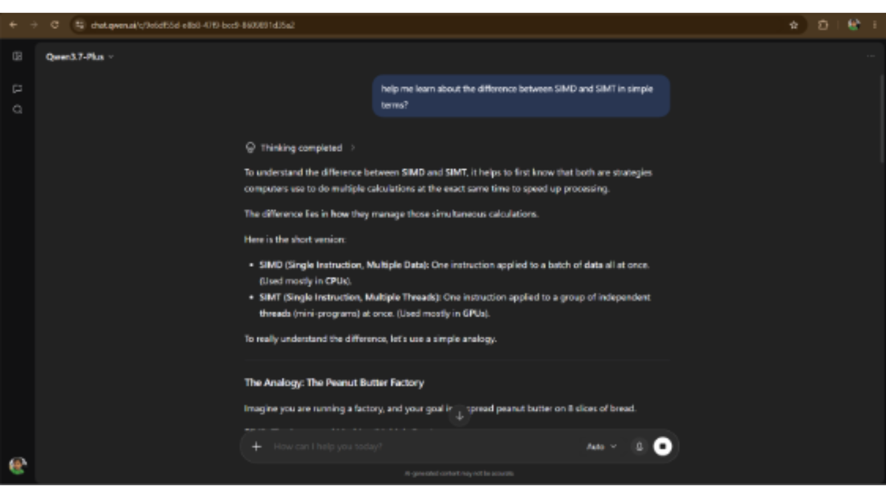

# How We Used AI in Stage 1
 
**Module:** Hardware, Networks & Behaviourist AI
 
This document records how our team used AI tools during Stage 1 of the project. AI supported our learning, organization, and formatting. All final content, decisions, and conclusions were reviewed and approved by team members.
 
## Table of Contents
 
1. [Scope Refinement & Pedagogy Evaluation](#1-scope-refinement--pedagogy-evaluation)
2. [Core Concept Clarification & Learning](#2-core-concept-clarification--learning)
3. [Research & Case Study Development](#3-research--case-study-development)
4. [Content Structuring & Learning Materials](#4-content-structuring--learning-materials)
5. [Team Documentation & Role Alignment](#5-team-documentation--role-alignment)
6. [Responsible Use Statement](#6-responsible-use-statement)
---
 
## 1. Scope Refinement & Pedagogy Evaluation
 
**What we did**
After drafting our learning materials as Markdown (`.md`) files, we uploaded them to an AI assistant and asked it to audit the content for complexity and suitability for beginners.
 
**How AI helped**
- Sorted each section into essential and non-essential material
- Flagged parts that were too advanced for our target learners
**Outcome**
- Removed lengthy mathematical derivations and advanced formulas (e.g., the full derivation of Amdahl's Law)
- Kept the key idea with a simple explanation, so the materials stay beginner-friendly
**Our role**
The team reviewed every suggestion and made the final decision on what to cut or keep.
 
---
 
## 2. Core Concept Clarification & Learning
 
**What we did**
Team members used AI as a study aid to understand difficult topics before writing about them.
 
**Topics covered**
 
| Topic | What we studied |
|-------|-----------------|
| Hardware architectures | CPU vs. GPU vs. TPU, and what each is best suited for |
| Training vs. inference | How the two processes differ and what each demands from hardware |
| Parallelism | SIMD (one instruction on many data items) vs. SIMT (one instruction across many threads) |
| Networking | How the TCP/IP protocol suite works |
| Cloud vs. Edge | How the location of computation affects latency |
 
**How AI helped**
It gave plain-language explanations and analogies. We asked follow-up questions until we understood each concept well enough to explain it ourselves.
 
**Evidence**
 

*Studying the difference between SIMD and SIMT*
 
---
 
## 3. Research & Case Study Development
 
**What we did**
We used AI to find foundational sources and to shape our real-world case studies.
 
**Sources**
- AI pointed us toward standards and citations, such as IETF RFC 791 (Internet Protocol) and relevant IEEE papers
- We [checked these against the original sources before using them]
**Case study**
We structured a case study on how Apple's Neural Engine supports on-device facial recognition and image processing on iPhones. It illustrates edge computing and specialized AI hardware in a familiar setting.
 
**Evidence**
 

*Researching materials*
 
---
 
## 4. Content Structuring & Learning Materials
 
**What we did**
We used AI to turn our technical notes into consistent, easy-to-read learning materials.
 
**Formats produced**
- Study sheets summarizing each topic
- Comparison tables (e.g., CPU vs. GPU vs. TPU, Cloud vs. Edge)
- Workflow diagrams showing how the parts of a system connect
- A mind map linking our three areas: Hardware, Networks, and Behaviourist AI
- Modular Markdown outlines, so each member can work on a section and merge it into our shared repository without conflicts
**Evidence**
 

*Training vs. inference explainer*
 

*Mind map of our three areas*
 

*Using AI to learn the materials (Cloud vs. Edge notes)*
 
---
 
## 5. Team Documentation & Role Alignment
 
**What we did**
We used AI to help with the written, organizational side of the project.
 
**Specific uses**
- Refining job descriptions so each role was clear
- Structuring personal reflections
- Aligning each member's responsibilities with their role (e.g., Visual Design Lead)
- Formatting work logs in the first person
**Work log columns**
 
| Column | What to put |
|--------|-------------|
| Member name and student ID | [Name, ID] |
| Main contribution | [What you did] |
| Relevant commit or file | [Link or filename] |
| Supporting evidence | [Screenshot or link] |
 
**Our role**
The content of every log and reflection reflects our own work and experience. AI only helped with wording and layout.
 
**Evidence**
 

*Using AI to format work logs*
 
---
 
## 6. Responsible Use Statement
 
AI supported our learning, organization, and formatting. All final content, decisions, and conclusions were reviewed and approved by team members, and sources suggested by AI were [verified] before use.
