# Module 01: AI Hardware Architecture
 
| | |
|---|---|
| **Course** | Hardware, Networks & Behaviourist AI |
| **Version** | V1.0 (substantive draft, Stage 1) |
| **Audience** | Beginners with basic programming knowledge and no hardware background |
| **Prerequisites** | Basic arithmetic, the idea of a variable and a loop. No electronics knowledge needed. |
| **Position in course** | First of five modules; Modules 02-05 reuse the vocabulary introduced here |
 
## Module overview
 
When people talk about artificial intelligence, they usually talk about software: models, data, and algorithms. But every AI model is, in the end, an enormous number of arithmetic operations running on physical chips. The choice of chip decides:
- how fast a model can be trained (days or months),
- how much electricity it uses (and therefore what it costs and what it emits),
- how quickly it can answer one request (milliseconds or seconds),
- and whether it can run on a phone at all, or only in a data centre.
This module explains why AI needs specialised hardware and how it's designed. It ends with a case study of the hardware inside a phone you may be holding right now: the Apple Neural Engine.

> [!NOTE]
> **Where this module is going.** Section 1 defines AI hardware and the arithmetic it exists to speed up. Section 2 compares CPUs, GPUs, TPUs and NPUs. Section 3 shows how parallelism speeds up MACs, and where it stops helping. Section 4 explains why memory, not arithmetic, is often the real limit. Section 5 applies everything to a real device, the Apple Neural Engine.
 
## Learning objectives
 
By the end of this module, you will be able to:
 
1. Define AI hardware and explain why general-purpose processors are not always enough.
2. Compare CPUs, GPUs, and TPUs in terms of architecture and the kind of work each does best.
3. Explain how parallel processing, systolic arrays, and reduced-precision arithmetic speed up the core operation of neural networks (matrix multiplication).
4. Describe the memory hierarchy and explain why moving data often costs more than computing on it.
5. Use a simple roofline calculation to decide whether a workload is limited by compute or by memory.
6. Analyse how the Apple Neural Engine brings AI onto a phone, and judge its trade-offs.

## A running example
 
Throughout the module we return to one small, concrete task so that every idea has something to attach to:
 
> **Running example: unlocking a phone with your face.** A camera takes a picture, a neural network turns it into a list of numbers, and the phone compares those numbers with the ones saved when you set up Face ID. The whole thing has to take a fraction of a second, use almost no battery, and never send your face to anyone else's computer.
 
Every hardware idea in this module (parallel units, low precision, on-chip memory) exists because of pressures like these.

## Section 1: Definition and Fundamental Concepts

> [!IMPORTANT]
> **Big idea.** AI hardware is not magic: it is ordinary computing hardware that has been arranged so that the one kind of arithmetic that AI does all day is cheap in time, energy, and money.

## Learning objectives

By the end of this section you should be able to:

1. Define AI hardware and classify it into general-purpose processors, massively parallel processors, domain-specific accelerators, memory systems and interconnects.
2. Explain what a neural network actually computes, and define a MAC.
3. Compute the output of a single neuron by hand, and count the MACs in a layer.
4. Use the key vocabulary of the module (FLOP, TOPS, throughput, latency, precision, bandwidth) correctly.
5. Explain why faster CPUs alone no longer solve AI workloads, and why parallelism and memory efficiency do.
6. Distinguish training from inference and state how their hardware requirements differ.
7. Choose between chips using the six comparison metrics.

## Table of contents

- [1.1 What is AI hardware?](#11-what-is-ai-hardware)
- [1.2 What do AI models actually compute?](#12-what-do-ai-models-actually-compute)
- [1.3 Key terms](#13-key-terms)
- [1.4 Why not just use a faster CPU?](#14-why-not-just-use-a-faster-cpu)
- [1.5 Training versus inference](#15-training-versus-inference)
- [1.6 Choosing hardware: metrics to compare](#16-choosing-hardware-metrics-to-compare)
- [1.7 Activities for Section 1](#17-activities-for-section-1)
- [1.8 Summary](#18-summary)
- [1.9 Glossary](#19-glossary)
- [1.10 Answer key](#110-answer-key)
- [References](#references)

---

## 1.1 What is AI hardware?

AI hardware is any physical computing device (a processor, a memory system or the wiring between them) that is designed, or is well suited, to run machine-learning workloads efficiently.

The word *efficiently* matters. A laptop CPU can run a neural network, and so can a calculator if you are patient enough. The real questions are:

- **How fast?** (time)
- **How much energy?** (battery life, electricity bill, heat)
- **At what cost?** (price of the chip, size of the data centre)

AI hardware therefore includes:

| Category | What it is | Examples |
|---|---|---|
| General-purpose processors used for AI | Chips designed for any program but able to run AI | CPUs (Intel, AMD, Arm) |
| Massively parallel processors | Thousands of simple cores doing the same thing to different data | GPUs (NVIDIA, AMD) |
| Domain-specific accelerators | Chips designed around the arithmetic of neural networks | TPUs (Google), NPUs such as Apple's Neural Engine |
| Memory systems | Fast memory placed near the compute units | On-chip SRAM, High Bandwidth Memory (HBM) |
| Interconnects | Links between chips and between machines | NVLink, TPU inter-chip links, Ethernet/InfiniBand (Module 02) |

**Table 1.1.** Five categories of AI hardware.

**Figure 1.1.** The five categories of AI hardware, shown as a layered system: processors compute, memory systems feed them, and interconnects link chips and machines. *Source: author's own diagram, based on Hennessy & Patterson (2019).*

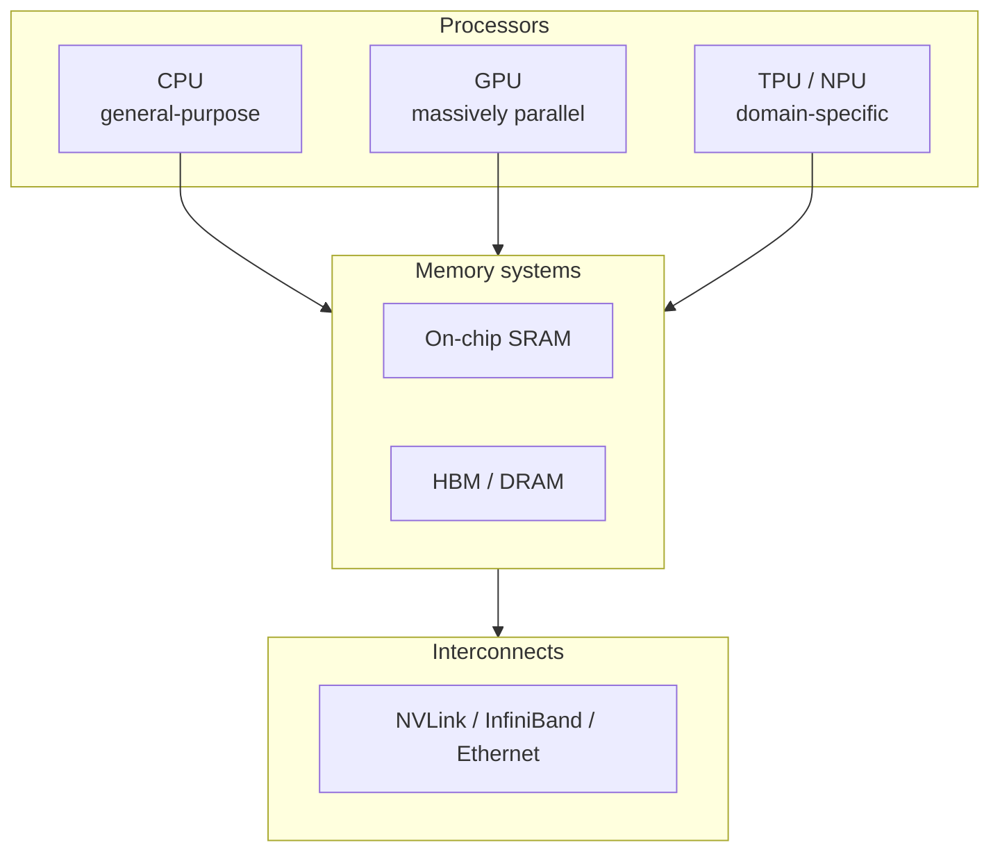

> [!TIP]
> **Going further.** A chip designed for one domain is often called an **ASIC** (application-specific integrated circuit). A TPU is an ASIC for neural-network arithmetic. The opposite extreme is the CPU, a general-purpose processor.

---

## 1.2 What do AI models actually compute?

Before comparing chips, we need to know what the chips are asked to do.

A neural network is built from layers. Most layers do one dominant operation: multiply a block of numbers (the **weights**, which the model learned during training) by another block of numbers (the **inputs**), then add the results together.

For one output value, the calculation looks like this:

```text
Output = (w1 × x1) + (w2 × x2) + (w3 × x3) + ... + (wn × xn)
```

Each "multiply, then add to a running total" step is called a **MAC** (multiply-accumulate).

**Figure 1.2.** A single neuron: each input is multiplied by its weight, and the products are summed into one output. *Source: author's own diagram.*

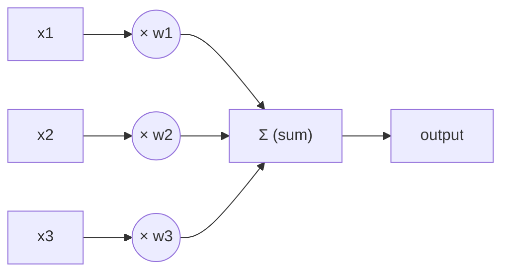

### Worked example 1.A: a single neuron by hand

*Illustrative numbers.* A tiny neuron has three weights and receives three inputs:

| | w1 / x1 | w2 / x2 | w3 / x3 |
|---|---:|---:|---:|
| Weights **w** | 0.5 | -1.0 | 2.0 |
| Inputs **x** | 4 | 3 | 1 |

**Table 1.2.** Weights and inputs for Worked example 1.A.

1. **Step 1.** Start the running total at 0.
2. **Step 2.** MAC #1: `total = 0 + (0.5 × 4) = 0 + 2.0 = 2.0`
3. **Step 3.** MAC #2: `total = 2.0 + (-1.0 × 3) = 2.0 - 3.0 = -1.0`
4. **Step 4.** MAC #3: `total = -1.0 + (2.0 × 1) = -1.0 + 2.0 = 1.0`

**Result.** The output is **1.0**, computed with 3 MACs. (Real networks then pass this number through a simple function such as ReLU, which keeps positive numbers and turns negative ones into 0; that step is cheap compared with the MACs.)

The following Python program checks the result. Its complete expected output is shown below the code.

```python
weights = [0.5, -1.0, 2.0]
inputs = [4, 3, 1]

total = 0
for w, x in zip(weights, inputs):
    total += w * x          # one MAC per loop

print(total)                # 1.0
print(max(0, total))        # ReLU -> 1.0
```

Expected output:

```text
1.0
1.0
```

Now scale it up. One layer might have 4,096 neurons, each with 1,024 inputs. That is 1,024 × 4,096 = **4,194,304 MACs**, about 4.2 million, for one layer and one input. A modern large language model needs billions to trillions of MACs to produce a single answer.

> [!IMPORTANT]
> **Key idea.** If a chip can do MACs very fast and very efficiently, it speeds up almost the whole model. This is why the MAC is the central operation in AI hardware design.

### Matrices: the same thing, written compactly

Writing out every MAC is tedious, so we group the weights into a table called a **matrix**, and the inputs into a list called a **vector**. "Multiply the weight matrix by the input vector" means "do all the neuron calculations at once". When we process several inputs at the same time, they form a second matrix, and we speak of matrix multiplication. Almost all of AI hardware is, at heart, hardware for multiplying matrices. A generalisation to higher dimensions is called a **tensor**, which is where the "T" in TPU comes from.

```text
Weight matrix W          Input vector x     Output vector y
(rows = neurons)

[ w11 w12 w13 ]          [ x1 ]             [ w11·x1 + w12·x2 + w13·x3 ]
[ w21 w22 w23 ]    ×     [ x2 ]      =      [ w21·x1 + w22·x2 + w23·x3 ]
[ w31 w32 w33 ]          [ x3 ]             [ w31·x1 + w32·x2 + w33·x3 ]
```

Each output value = 3 MACs. Whole layer = 3 × 3 = **9 MACs**.

The same idea in NumPy. Its complete expected output is shown below the code.

```python
import numpy as np

W = np.array([[0.5, -1.0, 2.0],
              [1.0,  0.0, 1.0],
              [0.0,  2.0, -1.0]])
x = np.array([4, 3, 1])

y = W @ x                   # all 9 MACs in one matrix-vector product
print(y)                    # [ 1.  5.  5.]
```

Expected output:

```text
[1. 5. 5.]
```

**Check by hand:** row 1 gives 0.5×4 + (−1.0)×3 + 2.0×1 = 1.0; row 2 gives 1.0×4 + 0.0×3 + 1.0×1 = 5.0; row 3 gives 0.0×4 + 2.0×3 + (−1.0)×1 = 5.0.

---

## 1.3 Key terms

These terms are used throughout the module. A complete glossary is in Section 1.9. Some terms (bandwidth, utilisation) are only fully explained later, in Sections 3 and 4, so treat this table as a first look.

| Term | Definition |
|---|---|
| **Training** | Adjusting a model's weights using lots of data. Very compute-heavy; usually done in data centres. |
| **Inference** | Using a trained model to produce an answer (for example, unlocking your phone). Happens every time a user uses the AI. |
| **MAC** | Multiply-accumulate: multiply two numbers and add the result to a running total. |
| **FLOP / FLOPs** | A floating-point operation (one add or multiply on decimal-style numbers). "FLOPs" is the plural; FLOPS (capital S) means FLOPs per second. One MAC counts as 2 FLOPs. |
| **TOPS** | Tera operations per second (10¹² operations per second). Often used for integer operations on AI chips. |
| **Throughput** | How much work is finished per second. |
| **Latency** | How long one task takes from start to finish. |
| **Precision** | How many bits are used to store each number: FP32 = 32-bit floating-point, FP16 = 16-bit float, INT8 = 8-bit integer. Lower precision means less memory, less energy and usually faster hardware, at some cost in accuracy. |
| **Accelerator** | A chip that works alongside the CPU to speed up specific kinds of work. |
| **Bandwidth** | How many bytes per second can be moved between two parts of a system. |

**Table 1.3.** Key terms for Section 1.

> [!WARNING]
> **Caution: bits and bytes.** 1 byte = 8 bits. An FP32 number takes 4 bytes, an FP16 number 2 bytes, and an INT8 number 1 byte. Many mistakes in hardware calculations come from forgetting this conversion.

**Figure 1.3.** The same model stored at three precisions. Lower precision uses less memory but keeps less information about each weight. *Source: author's own diagram.*

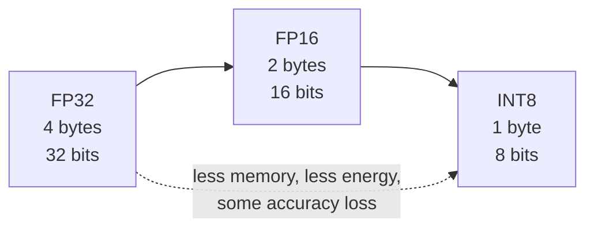

### Prefixes you will meet

| Prefix | Symbol | Power of ten | Example |
|---|---|---|---|
| kilo | k | 10³ | 1 kB = 1,000 bytes |
| mega | M | 10⁶ | 8 MB of cache |
| giga | G | 10⁹ | 500 GB/s bandwidth |
| tera | T | 10¹² | 92 TOPS |
| peta | P | 10¹⁵ | data-centre clusters quote PFLOPS |
| milli / micro / nano / pico | m / µ / n / p | 10⁻³ / 10⁻⁶ / 10⁻⁹ / 10⁻¹² | 1 ms, 1 µs, 1 ns, 1 pJ |

**Table 1.4.** SI prefixes used in this module.

Memory sizes are sometimes quoted in powers of two: 1 MiB = 2²⁰ = 1,048,576 bytes. The difference is small and does not change any conclusion in this module.

---

## 1.4 Why not just use a faster CPU?

For decades, the answer to "make computers faster" was simply "wait for the next CPU". That stopped working for two reasons.

**Reason 1: the workload is highly repetitive and independent.** Millions of MACs can be done at the same time because they do not depend on each other: the result of neuron 17 does not change the calculation for neuron 18. A chip built for doing one complicated thing quickly wastes its effort on this. A chip built for doing a huge number of simple things at once does not.

**Reason 2: energy and memory limits.** Chips can no longer simply be clocked faster without overheating. Historically, as transistors shrank, they also used less power, so each generation could run faster without getting hotter (this is often associated with Dennard scaling). That trend ended in the mid-2000s, and clock speeds flattened at a few gigahertz. Hennessy and Patterson, in their well-known textbook and Turing Award lecture, argue that because general-purpose processors have stopped improving as quickly as before, big gains in cost, energy, and performance must now come from domain-specific hardware (Hennessy & Patterson, 2019).

Gains now come from two directions, which this module keeps returning to:

1. doing more things at once (**parallelism**), and
2. moving less data (**memory efficiency**).

**Figure 1.4.** CPU clock speed over time, in schematic form. Clock speeds rose steeply until the mid-2000s, then flattened as power and heat limits were reached. *Source: author's own sketch, based on the trends described in Hennessy & Patterson (2019).*

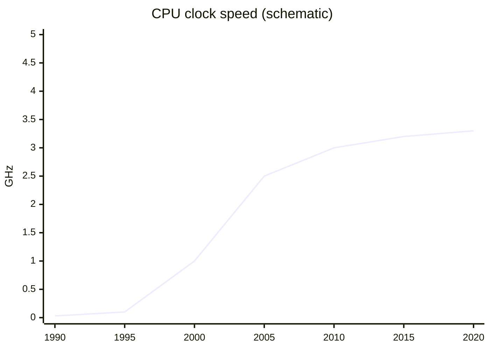

---

## 1.5 Training versus inference

The same neural network is used in two very different ways, and the hardware requirements differ.

| | Training | Inference |
|---|---|---|
| **Goal** | Learn weights from data | Use learned weights to answer a request |
| **Frequency** | Rare, long jobs (days to months) | Constant: millions of small requests |
| **Main limit** | Raw compute and chip-to-chip communication | Latency, energy and cost per request |
| **Typical place** | Large data-centre clusters | Data centres and edge devices (phones, cars) |
| **Precision** | Usually higher (FP32, BF16, FP16) | Often lower (INT8, FP8, even 4-bit) |
| **Data movement** | Forward pass and backward pass; many intermediate values stored | Forward pass only |
| **Batch size** | Large (hundreds or more) | Often 1 (one user at a time) |

**Table 1.5.** Training versus inference.

**Figure 1.5.** Where training and inference sit on the hardware landscape. Training happens in the data centre on large batches; inference happens both in the data centre and on edge devices, often at batch size 1. *Source: author's own diagram.*

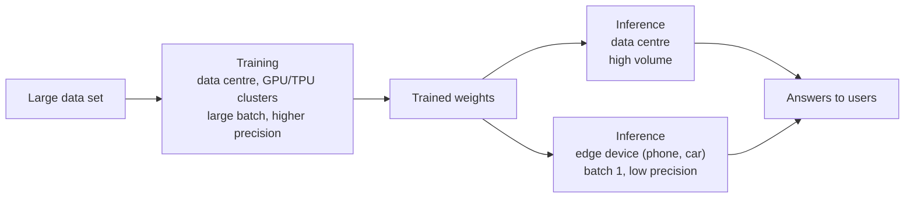

This distinction explains much of the hardware landscape. The first Google TPU was built for inference only (Jouppi et al., 2017); later generations added training, and Google's newest announced generation, Ironwood (announced 2025), is again aimed at inference at scale (Google, 2025).

> [!NOTE]
> **Why does the batch size matter?** Section 4 shows that a single-user request (batch size 1) tends to be limited by memory, whereas a large training batch tends to be limited by compute. That one fact shapes whole product lines.

---

## 1.6 Choosing hardware: metrics to compare

Section 1.3 defined the vocabulary. This table shows how those ideas are used to *choose* between chips.

| Metric | Question it answers | Why it matters |
|---|---|---|
| Throughput (TOPS, FLOP/s) | How much work per second? | Training speed |
| Latency | How long for one request? | User experience; real-time control |
| Performance per watt | How much work per joule? | Battery life; data-centre power bill |
| Utilisation | What share of peak is actually achieved? | Money paid for idle silicon |
| Performance per dollar | How much work per unit of cost? | Budget decisions |
| Memory capacity | How big a model fits? | Which models can run at all |

**Table 1.6.** Six metrics for comparing AI hardware.

**Figure 1.6.** Peak versus achieved utilisation. The gap between the two bars is the idle silicon you paid for. *Source: author's own diagram, based on the concept of utilisation introduced here and formalised in Section 3.*

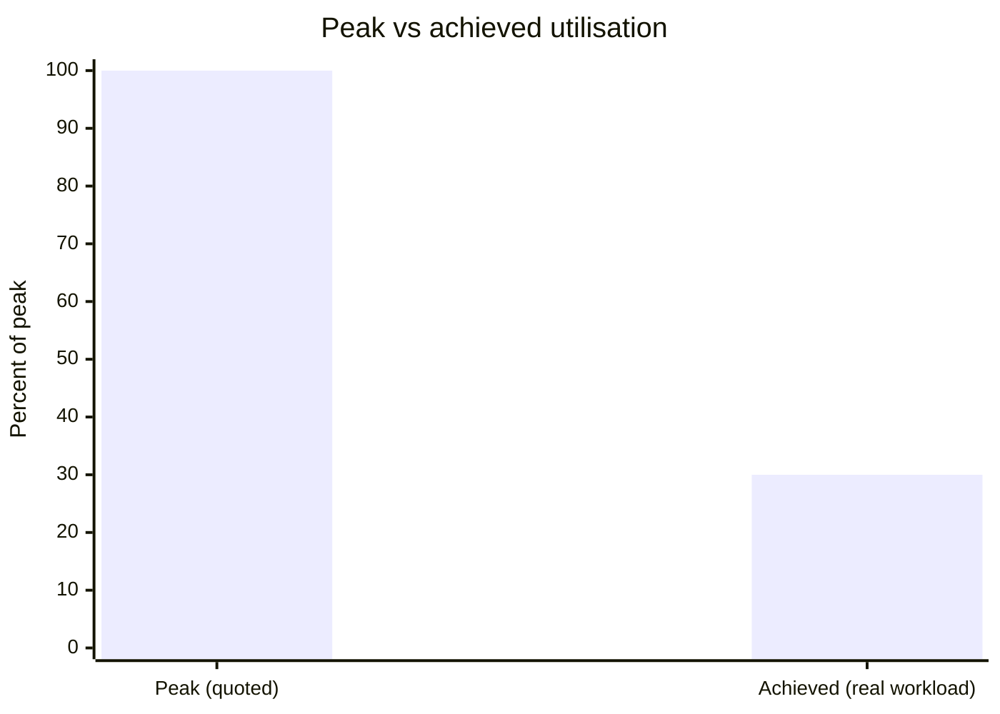

> [!WARNING]
> **Caution: peak is not typical.** A chip's quoted "peak" number is what it could do if every arithmetic unit were busy every cycle. Real programs are usually far below that. Sections 3 and 4 explain why.

---

## 1.7 Activities for Section 1

- **Activity 1.A.** A neuron has weights w = [2, -1, 0.5] and inputs x = [1, 4, 6]. Compute the output by hand, stating each MAC step.
- **Activity 1.B.** A layer has 512 inputs and 2,048 outputs. How many MACs does one input vector require? How many FLOPs is that?
- **Activity 1.C.** A chip is quoted as 100 TOPS but achieves only 30% utilisation on your workload. What throughput do you actually observe?
- **Activity 1.D.** For each case, say whether it is training or inference, and give one reason: (a) a phone unlocking with Face ID, (b) a team fine-tuning a language model on 100 GPUs for three weeks, (c) a chatbot answering 10,000 user requests per second.
- **Activity 1.E.** A model has 7 billion parameters stored in FP16. How much memory do the weights need? How much in INT8?

---

## 1.8 Summary

- AI hardware is any processor, memory system or interconnect designed or well suited to run machine-learning workloads efficiently; it covers five categories (general-purpose CPUs, GPUs, domain-specific accelerators, memory systems, interconnects).
- Neural networks are dominated by MACs (multiply-accumulate): one output is the sum of weight × input products, and a layer with 1,024 inputs and 4,096 outputs contains 4,194,304 MACs.
- A 3-weight, 3-input neuron computes its output in 3 MACs; the worked example gives 1.0.
- Matrices and vectors are compact ways of writing millions of MACs at once; a tensor is the higher-dimensional generalisation, which gives the TPU its name.
- Faster CPUs alone do not solve AI workloads because the work is repetitive and independent, and because clock-speed growth stopped in the mid-2000s; gains now come from parallelism and memory efficiency.
- Training and inference differ in goal, frequency, main limit, typical place, precision, data movement and batch size.
- Six metrics — throughput, latency, performance per watt, utilisation, performance per dollar and memory capacity — let you choose between chips; quoted peak numbers are rarely achieved in practice.

---

## 1.9 Glossary

| Term | Meaning |
|---|---|
| **Accelerator** | A chip that works alongside the CPU to speed up specific kinds of work. |
| **ASIC** | Application-specific integrated circuit; a chip built for one domain. |
| **Bandwidth** | How many bytes per second can be moved between two parts of a system. |
| **Batch size** | The number of inputs processed together. |
| **Dennard scaling** | The historical trend that shrinking transistors also reduced their power use, allowing faster clocks; it ended in the mid-2000s. |
| **FLOP / FLOPs / FLOPS** | One floating-point operation / the plural / FLOPs per second. One MAC = 2 FLOPs. |
| **HBM** | High Bandwidth Memory; stacked DRAM placed next to an accelerator. |
| **Inference** | Using a trained model to produce an answer. |
| **Interconnect** | The links between chips and between machines. |
| **Latency** | Time for one task from start to finish. |
| **MAC** | Multiply-accumulate: multiply two numbers and add the result to a running total. |
| **Matrix** | A table of numbers; the standard way to write many MACs compactly. |
| **NPU** | Neural processing unit; a small, low-power AI accelerator in a phone or laptop chip. |
| **Precision** | How many bits are used to store each number (FP32, FP16, INT8, and so on). |
| **Tensor** | A multi-dimensional array; the higher-dimensional generalisation of a matrix. |
| **Throughput** | Amount of work finished per second. |
| **TOPS** | Tera operations per second (10¹² operations per second). |
| **Training** | Adjusting a model's weights using data. |
| **Utilisation** | The fraction of a chip's peak capacity that is actually doing useful work. |
| **Vector** | A one-dimensional list of numbers. |
| **Weight** | A number learned during training and used during inference. |

---

## 1.10 Answer key

**Activity 1.A.**
Step 1: total = 0.
Step 2: total = 0 + (2 × 1) = 2.
Step 3: total = 2 + (-1 × 4) = 2 − 4 = −2.
Step 4: total = −2 + (0.5 × 6) = −2 + 3 = **1.0**.
Computed with 3 MACs.

**Activity 1.B.**
MACs = 512 × 2,048 = **1,048,576**. FLOPs = 2 × 1,048,576 = **2,097,152** (about 2.1 million), because one MAC = 2 FLOPs.

**Activity 1.C.**
Observed throughput = 100 TOPS × 0.30 = **30 TOPS**. The other 70% of peak is idle silicon.

**Activity 1.D.**
(a) **Inference** — a trained model answers a single request on the device.
(b) **Training** — the weights are being adjusted using data over a long job on many chips.
(c) **Inference** — a trained model is answering many user requests, even though the total volume is large. (Serving at scale is still inference; the compute cost comes from volume, not from learning.)

**Activity 1.E.**
FP16: 7 × 10⁹ × 2 bytes = **14 GB**.
INT8: 7 × 10⁹ × 1 byte = **7 GB**.

---

## References

- Google. (2025). *Ironwood TPU announcement*.
- Hennessy, J. L., & Patterson, D. A. (2019). A new golden age for computer architecture. *Communications of the ACM*, 62(2), 48–60.
- Jouppi, N. P., et al. (2017). In-datacenter performance analysis of a Tensor Processing Unit. *Proceedings of ISCA 2017*.

[← Back to module overview](Draft-01.1.md) · [Next: Section 2 →](Draft-02.2.md)

# Hardware, Networks & Behaviourist AI

## Module 01 · Section 2: CPU vs GPU vs TPU

> [!IMPORTANT]
> **Big idea.** Three families of chips sit at different points on a trade-off between flexibility and efficiency. The more a chip is specialised for a task, the more efficient it is at that task and the less useful it is for anything else.

## Learning objectives

By the end of this section you should be able to:

1. Describe in one sentence each what a CPU, a GPU, a TPU and an NPU is designed to do.
2. Compare the four chip families on design goal, core count, control logic, flexibility, energy efficiency for AI, typical AI role, weakness for AI and programming route.
3. Explain what a systolic array is and work through a 2 × 2 weight-stationary example by hand and in code.
4. Summarise what the first TPU paper (Jouppi et al., 2017) measured, and state two caveats when reading it.
5. Explain why software tooling determines how useful a chip is in practice.
6. Choose an appropriate chip for a given scenario and justify the choice.

## Table of contents

- [2.1 The three chips in one sentence each](#21-the-three-chips-in-one-sentence-each)
- [2.2 Comparison table](#22-comparison-table)
- [2.3 Visual: where the chip area goes](#23-visual-where-the-chip-area-goes)
- [2.4 Systolic arrays and a worked 2 × 2 example](#24-systolic-arrays-and-a-worked-2--2-example)
- [2.5 What the first TPU paper measured](#25-what-the-first-tpu-paper-measured)
- [2.6 The NPU: AI on small devices](#26-the-npu-ai-on-small-devices)
- [2.7 Software: why a chip is only as useful as its tools](#27-software-why-a-chip-is-only-as-useful-as-its-tools)
- [2.8 Activities for Section 2](#28-activities-for-section-2)
- [2.9 Summary](#29-summary)
- [2.10 Glossary](#210-glossary)
- [2.11 Answer key](#211-answer-key)
- [References](#references)

---

## 2.1 The three chips in one sentence each

- **CPU (Central Processing Unit):** a few very capable cores that handle any kind of program quickly, one step at a time per core.
- **GPU (Graphics Processing Unit):** thousands of simpler cores that do the same operation on many data items at once. Originally built to draw graphics, it turned out to be ideal for neural networks, because drawing millions of pixels and multiplying large matrices are both "same operation, lots of data" problems.
- **TPU (Tensor Processing Unit):** a chip designed by Google specifically for tensor (multi-dimensional array) arithmetic, built around a grid of multiply-accumulate units.

A related term you will meet in Section 5 is **NPU** (Neural Processing Unit): a general name for a small, low-power AI accelerator inside a phone or laptop chip.

**Figure 2.1.** The three chip families on the flexibility–efficiency trade-off. Moving right trades generality for efficiency on tensor arithmetic. *Source: author's own diagram, based on Hennessy & Patterson (2019).*

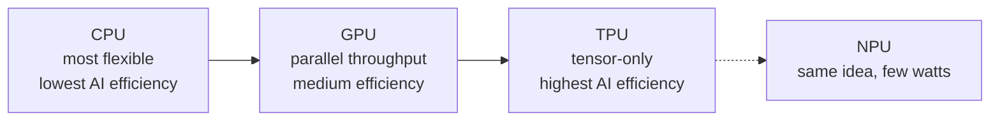

> [!NOTE]
> **An everyday analogy.**
> A **CPU** is like a small team of expert chefs who can cook any dish in the book, but each works on one dish at a time.
> A **GPU** is like a huge kitchen of junior cooks who all follow the same instruction ("chop these 1,000 onions") together.
> A **TPU** is like a factory assembly line built to make exactly one product, extremely efficiently, but useless if you want something else.

---

## 2.2 Comparison table

| Feature | CPU | GPU | TPU |
|---|---|---|---|
| **Design goal** | Fast, flexible, low latency for one task | High throughput on parallel data | Maximum matrix throughput per watt for neural networks |
| **Core count** (order of magnitude) | Few to ~100 complex cores | Thousands of simple cores | A large grid of MAC units (tens of thousands in one array) |
| **Control logic** | Complex: caches, out-of-order execution, branch prediction | Simpler; many threads hide delays | Minimal; deterministic execution |
| **Flexibility** | Highest: runs any program | High: programmable for many parallel tasks | Lowest: tuned to tensor operations |
| **Energy efficiency for AI** | Lowest | Medium to high | Highest (for supported workloads) |
| **Typical AI role** | Pre-processing, data loading, small models, orchestration | Training and inference of large models | Large-scale training and inference in Google's cloud |
| **Weakness for AI** | Too few parallel units | Higher power than a custom ASIC; memory bandwidth can limit | Less flexible; tied to a software stack |
| **Programming** | Any language | CUDA, OpenCL, or frameworks such as PyTorch | Through frameworks such as TensorFlow/JAX and the XLA compiler |

**Table 2.1.** Comparison of CPU, GPU and TPU across design goal, core count, control logic, flexibility, energy efficiency, typical AI role, weakness for AI and programming route.

*Sources for the design descriptions: Jouppi et al. (2017); Sze et al. (2017); Hennessy & Patterson (2019); NVIDIA (n.d.).*

### Terms used in the table

- **Core:** a unit inside a chip that can execute instructions on its own.
- **Cache:** a small, fast memory that keeps copies of recently used data close to the processor.
- **Out-of-order execution:** a CPU trick of running instructions in a different order from the program when it is safe, to avoid waiting.
- **Branch prediction:** guessing which way an `if` statement will go so the CPU can keep working instead of waiting.
- **Deterministic execution:** every run takes the same, predictable number of cycles. This matters for services that must answer within a time limit.
- **Compiler:** software that translates a program into instructions for a specific chip. XLA is the compiler used for TPUs.
- **MAC (multiply-accumulate):** an operation that computes `a × b + c`; the basic building block of neural-network arithmetic.

---

## 2.3 Visual: where the chip area goes

**Figure 2.2.** A simplified, not-to-scale sketch of where each design spends its silicon. A CPU devotes much of its area to caches and control logic that make a single thread fast; a GPU devotes most area to arithmetic units; a TPU devotes nearly all of it to the grid of MACs and the memory that feeds it. The positions are a qualitative teaching sketch, not measurements. *Source: author's own sketch, based on the design descriptions in Jouppi et al. (2017) and Hennessy & Patterson (2019).*

```text
        CPU                       GPU                        TPU
+------------------------+ +------------------------+ +------------------------+
| [Core] [Core]  CACHE   | | c c c c c c c c c c c  | | Systolic array of      |
| [Core] [Core]  CACHE   | | c c c c c c c c c c c  | | MAC units              |
| big control logic      | | c c c c c c c c c c c  | | (data flows through)   |
| large caches           | | small control, cache   | | + on-chip buffer       |
+------------------------+ +------------------------+ +------------------------+
   Few smart cores          Many simple cores          Matrix-multiply engine
```

In a CPU much of the area is "overhead" (caches, prediction logic) that makes a single thread fast. In a GPU, most area goes to arithmetic units. In a TPU, nearly all of it goes to the grid of MACs and the memory that feeds it.

---

## 2.4 Systolic arrays and a worked 2 × 2 example

A **systolic array** is a grid of MAC cells. Each cell holds one weight, and data is passed from neighbour to neighbour instead of being fetched from memory again and again. This neighbour-to-neighbour passing is what makes the design memory-efficient: the same input is reused across many cells without repeated memory reads.

### Worked example 2.A: a 2 × 2 systolic array (weight-stationary)

Let the weights be **W = [[1, 2], [3, 4]]**, loaded once, one per cell. The input is **x = [5, 6]**. We want **y = W·x**.

**Figure 2.3.** A 2 × 2 weight-stationary systolic array. Each cell holds one weight; inputs enter from the top and partial sums move to the right. *Source: author's own diagram.*

```text
                 x1=5        x2=6
                  │           │
               ┌──▼──┐     ┌──▼──┐
 row 1 (y1) →  │  1  │ ──► │  2  │ ──► y1
               └──┬──┘     └──┬──┘
               ┌──▼──┐     ┌──▼──┐
 row 2 (y2) →  │  3  │ ──► │  4  │ ──► y2
               └─────┘     └─────┘
        (each cell holds one weight; partial sums move right)
```

| Cycle | What happens | Result |
|---|---|---|
| **1** | x1 = 5 enters column 1. The two cells compute 1 × 5 and 3 × 5 and pass the partial sums to the right. | 5 and 15 |
| **2** | x2 = 6 reaches column 2 (a real array staggers inputs by one cycle). The cells compute 2 × 6 + 5 and 4 × 6 + 15. | 17 and 39 |

**Table 2.2.** Cycle-by-cycle behaviour of the 2 × 2 systolic array in Figure 2.3.

**Result:** `y = [17, 39]`, using 4 MACs. Check: 1×5 + 2×6 = 17 and 3×5 + 4×6 = 39.

**Memory reads.** Each of the 4 weights was read from memory **once**, and each of the 2 inputs was read **once**, then handed from cell to cell. Without neighbour-to-neighbour passing, each input would be read twice (once per output). That saving in memory traffic is the point of the systolic design, and it grows with array size.

The following Python program counts the reads in both styles. Its complete expected output is shown below the code.

```python
W = [[1, 2],
     [3, 4]]
x = [5, 6]

# Without reuse: every MAC fetches its own weight and its own input
reads_no_reuse = 0
y = [0, 0]
for i in range(2):
    for j in range(2):
        y[i] += W[i][j] * x[j]
        reads_no_reuse += 2          # one weight read + one input read

# Systolic style: each weight read once, each input read once
reads_systolic = 4 + 2

print(y)                             # [17, 39]
print(reads_no_reuse, reads_systolic)  # 8 6
```

Expected output:

```text
[17, 39]
8 6
```

---

## 2.5 What the first TPU paper measured

The 2017 paper by Jouppi et al. is the best-documented comparison available, because it measured a real chip in real data centres:

- The heart of the first TPU is a **65,536-element 8-bit MAC matrix unit** with a peak of **92 TOPS** and a **28 MiB** software-managed on-chip memory.
- Compared with a contemporary Intel Haswell server CPU and an Nvidia K80 GPU in the same data centres, the TPU was on average about **15–30× faster** and delivered about **30–80× more TOPS per watt**.
- The authors attribute part of this to deterministic execution: caches, out-of-order execution, multithreading and prefetching improve average throughput, but not the 99th-percentile response time that user-facing services need.
- Four of the six benchmark applications were **memory-bandwidth limited** on the TPU. Using the GPU's faster GDDR5 memory in a revised design would have tripled achieved TOPS.

**Figure 2.4.** What the first TPU paper measured. The TPU beat contemporary CPUs and GPUs on speed and energy efficiency, but on four of six benchmarks it was limited by memory bandwidth rather than by arithmetic. *Source: author's own diagram, based on data in Jouppi et al. (2017).*

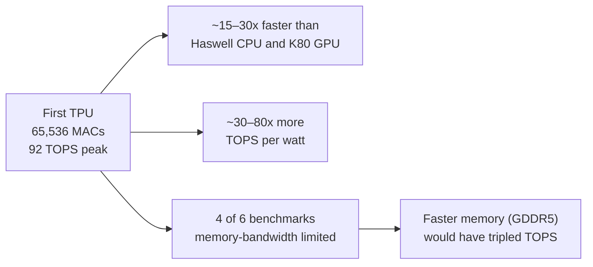

> [!WARNING]
> **Read this with care.** The comparison is from 2015–2017 hardware. It is a good illustration of the design philosophy, not a ranking of today's chips. Current GPUs have added dedicated matrix units of their own (NVIDIA calls them Tensor Cores), and the gap between "GPU" and "TPU" designs has narrowed.

> [!NOTE]
> **Why does the memory finding matter?** Even a chip with 65,536 MACs spent most of its time waiting for data on four out of six workloads. More arithmetic units do not help if they cannot be fed.

---

## 2.6 The NPU: AI on small devices

A phone cannot carry a 300-watt accelerator. An NPU applies the same ideas as a TPU (a grid of MAC units, low-precision numbers, on-chip memory) but scaled down to run in a few watts inside a **system-on-a-chip (SoC)**, which puts the CPU, GPU, NPU, memory controllers and other blocks on a single piece of silicon.

| Company | Name of its NPU |
|---|---|
| Apple | Neural Engine |
| Google Pixel | Tensor SoC |
| Qualcomm | Hexagon NPU |
| Many laptops | "AI Engine" / NPU |

**Table 2.3.** Vendor names for NPUs in consumer devices. Names differ, but the principle is the same.

**Figure 2.5.** An NPU inside a system-on-a-chip. The CPU, GPU and NPU share the same silicon and memory, which is what makes a few-watt AI accelerator practical on a phone. *Source: author's own diagram, based on Apple Inc. (2024) and Qualcomm (2024).*

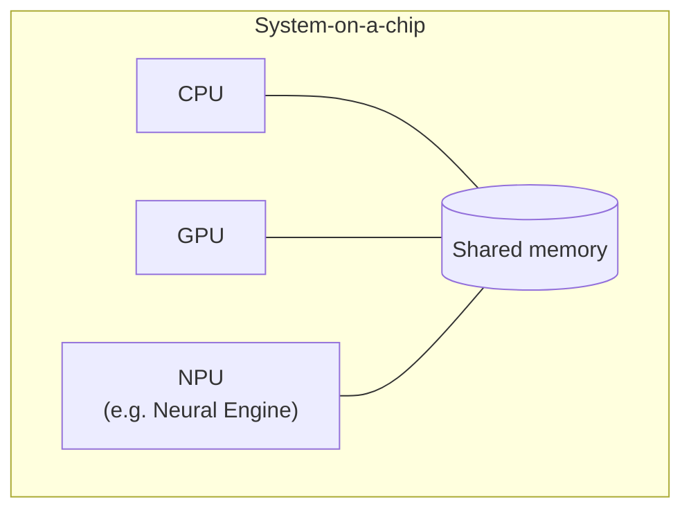

Section 5 studies the Apple version.

---

## 2.7 Software: why a chip is only as useful as its tools

Hardware is useless if programmers cannot easily use it. This is a major reason GPUs became dominant for AI:

| Chip | Typical way programmers reach it |
|---|---|
| CPU | Any language; compiler targets it directly |
| GPU | CUDA (NVIDIA), OpenCL, or high-level frameworks (PyTorch, TensorFlow) that call vendor-optimised libraries |
| TPU | Frameworks (TensorFlow, JAX, PyTorch/XLA) compile to the TPU through XLA |
| Apple Neural Engine | Core ML, which decides whether a model runs on CPU, GPU or the Neural Engine |

**Table 2.4.** How programmers typically reach each chip family.

A programmer usually does not write instructions for the MAC units directly. They write a model in a framework, and a compiler/runtime maps it onto the hardware. This is why "unsupported operations falling back to the CPU" can silently make a model slow (see the case-study questions in Section 5).

**Figure 2.6.** The software stack between a model and the hardware. Each layer hides detail from the one above, but also adds a place where unsupported operations can fall back to the CPU. *Source: author's own diagram, based on NVIDIA (n.d.) and Apple Inc. (2024).*

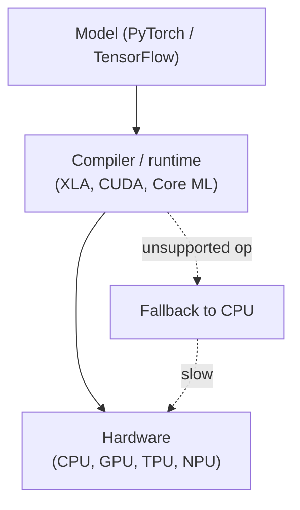

> [!TIP]
> **Going further.** The combination of hardware and its software ecosystem is sometimes called a **platform**. Switching from one platform to another can be costly even if the new chip is faster on paper, which partly explains why one vendor can dominate a market.

---

## 2.8 Activities for Section 2

- [ ] **Activity 2.A.** Which of the three chips would you choose for each case? Justify briefly.
  (a) a web server running mixed tasks, (b) training a large image model, (c) a fixed, high-volume inference service in a data centre.
- [ ] **Activity 2.B.** In the 2 × 2 systolic example (Worked example 2.A), how many times was each weight read from memory, and how many times was each input read?
- [ ] **Activity 2.C.** A start-up wants to add a voice assistant to a smart speaker that runs on a small battery. Arrange CPU, GPU and NPU in order from most to least suitable and give one reason for your ordering.
- [ ] **Activity 2.D.** The first TPU was faster and more energy-efficient than its contemporaries on Google's workloads, but a start-up with a different workload might still pick a GPU. Give two reasons.

---

## 2.9 Summary

- CPUs prioritise flexibility and low latency; GPUs prioritise parallel throughput; TPUs prioritise matrix throughput per watt at the cost of flexibility; NPUs scale the TPU idea down to a few watts inside a phone or laptop SoC.
- Systolic arrays reduce memory traffic by holding weights in place and passing inputs and partial sums from neighbour to neighbour; in the 2 × 2 example this cut memory reads from 8 to 6.
- The first TPU (Jouppi et al., 2017) was about 15–30× faster and 30–80× more TOPS per watt than contemporary CPUs and GPUs, but four of six benchmarks were memory-bandwidth limited, and the comparison is historical.
- A chip is only as useful as its software ecosystem; unsupported operations that fall back to the CPU can silently erase the hardware advantage.
- Choosing a chip means matching its design goal to the workload: mixed latency-sensitive tasks favour a CPU, large-model training favours a GPU, fixed high-volume inference favours a TPU or NPU.

---

## 2.10 Glossary

| Term | Meaning |
|---|---|
| **ASIC** | Application-specific integrated circuit: a chip built for one fixed task. |
| **Branch prediction** | A CPU technique that guesses which way a conditional branch will go so it can keep working instead of waiting. |
| **Cache** | A small, fast memory that keeps copies of recently used data close to the processor. |
| **Compiler** | Software that translates a program into instructions for a specific chip. |
| **Core** | A unit inside a chip that can execute instructions on its own. |
| **CUDA** | NVIDIA's programming interface for running general-purpose code on its GPUs. |
| **Deterministic execution** | Every run takes the same, predictable number of cycles. |
| **MAC** | Multiply-accumulate: the operation `a × b + c`, the basic building block of neural-network arithmetic. |
| **NPU** | Neural Processing Unit: a small, low-power AI accelerator inside a phone or laptop chip. |
| **Out-of-order execution** | A CPU technique of running instructions in a different order from the program when it is safe, to avoid waiting. |
| **SoC** | System-on-a-chip: a single piece of silicon containing CPU, GPU, NPU, memory controllers and other blocks. |
| **Systolic array** | A grid of MAC cells in which each cell holds a weight and data is passed from neighbour to neighbour. |
| **TOPS** | Tera operations per second: a measure of arithmetic throughput. |
| **XLA** | A compiler used to map models onto TPUs. |

---

## 2.11 Answer key

**Activity 2.A.**
(a) **CPU** — the workload is mixed and latency-sensitive, so flexibility matters most.
(b) **GPU** (or a TPU if training on Google Cloud) — training needs high parallel throughput on large matrices.
(c) **TPU or another fixed-function accelerator** — the workload is fixed and high-volume, so maximum efficiency per watt pays off.

**Activity 2.B.**
Each weight is read **once** (4 reads in total), and each input is read **once** (2 reads in total), for 6 reads in total. Without neighbour-to-neighbour passing, each input would be read once per output, giving 8 reads. The saving grows with array size.

**Activity 2.C.**
Order: **NPU, then CPU, then GPU.**
Reason: the NPU gives the most operations per watt and is designed for exactly this kind of always-on, low-power inference; the CPU is flexible but less efficient; the GPU draws too much power for a small battery.

**Activity 2.D.**
Any two of: the workload may use operations the TPU does not support well (falling back to the CPU and losing the advantage); the team may already depend on a GPU software stack, and switching platforms is costly; GPU cloud availability and cost may be better; the workload may be memory-bandwidth limited, where the TPU's arithmetic advantage does not help.

---

## References

- Apple Inc. (2024). *Apple Platform Security guide*.
- Hennessy, J. L., & Patterson, D. A. (2019). A new golden age for computer architecture. *Communications of the ACM*, 62(2), 48–60.
- Jouppi, N. P., et al. (2017). In-datacenter performance analysis of a Tensor Processing Unit. *Proceedings of ISCA 2017*.
- NVIDIA. (n.d.). *GPU and Tensor Core documentation*.
- Qualcomm. (2024). *Hexagon NPU documentation*.
- Sze, V., et al. (2017). Efficient processing of deep neural networks: A tutorial and survey. *Proceedings of the IEEE*.

[← Previous: Section 1](Draft-01.2.md) · [Back to module overview](Draft-02.1.md) · [Next: Section 3 →](Draft-03.2.md)

# Hardware, Networks & Behaviourist AI

## Module 01 · Section 3: Parallel Processing and AI Acceleration

> [!IMPORTANT]
> **Big idea.** Neural networks consist of huge numbers of independent MACs, so the way to go fast is to do many of them at the same time. But parallel hardware has limits, and the limits are as important as the speed-ups.

## Learning objectives

By the end of this section you should be able to:

1. Name and distinguish the four levels of parallelism (instruction-level, data-level, matrix-level, and across chips).
2. Count the MACs and FLOPs in a dense layer, and estimate the time for one pass on an idealised CPU core and an idealised parallel accelerator.
3. State Amdahl's law, apply it to a worked example, and explain its ceiling.
4. Explain why parallel hardware has limits: Amdahl's law, idle units, feeding the units, and communication.
5. Describe three acceleration techniques (quantisation, specialised units, batching) and calculate the memory footprint of a model in different precisions.

## Table of contents

- [3.1 Kinds of parallelism](#31-kinds-of-parallelism)
- [3.2 Worked example 3.A: how many MACs, and how long?](#32-worked-example-3a-how-many-macs-and-how-long)
- [3.3 Why parallel hardware has limits](#33-why-parallel-hardware-has-limits)
- [3.4 Other acceleration techniques](#34-other-acceleration-techniques)
- [3.5 Activities for Section 3](#35-activities-for-section-3)
- [3.6 Summary](#36-summary)
- [3.7 Glossary](#37-glossary)
- [3.8 Answer key](#38-answer-key)
- [References](#references)

---

## 3.1 Kinds of parallelism

"Parallel" simply means "at the same time". Hardware does this at several different levels:

| Level | Idea | Example |
|---|---|---|
| **Instruction-level** | A single core overlaps several instructions (like an assembly line) | Modern CPU pipelines |
| **Data-level (SIMD / SIMT)** | One instruction acts on many values at once | GPU warps; CPU vector units |
| **Matrix-level (systolic)** | A grid of MAC units passes data neighbour to neighbour | TPU matrix unit |
| **Across chips** (data, pipeline and model splitting) | Split the model, or the batch of data, over many chips | Training clusters (Module 02) |

**Table 3.1.** Four levels of parallelism in AI hardware.

**Figure 3.1.** The four levels of parallelism, from a single instruction inside one core to a whole model split across many chips. Each level adds more units but also more coordination overhead. *Source: author's own diagram, based on Hennessy & Patterson (2019).*

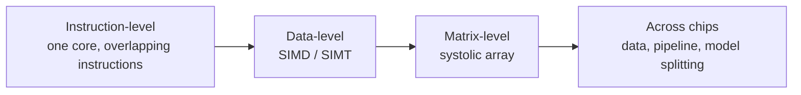

### Terms

- **SIMD (Single Instruction, Multiple Data):** the same instruction is applied to a block of values in lock-step. On GPUs the equivalent idea is often called **SIMT** (Single Instruction, Multiple Threads): groups of threads (a *warp* on NVIDIA GPUs) execute together.
- **Thread:** one stream of instructions. GPUs run tens of thousands at once.
- **Data parallelism:** the same operation on different data at the same time (for example, 1,000 pixels each multiplied by the same filter weights).
- **Pipeline parallelism:** one big model is split into stages across several chips (for example, one chip handles layers 1–10 while another handles layers 11–20), and data flows from stage to stage.

GPUs are built for data parallelism. A very useful trick they use is **latency hiding**: when one group of threads has to wait for memory, the GPU switches instantly to another group that is ready. With thousands of threads available, the arithmetic units rarely sit idle. CPUs take the opposite approach: they spend silicon on big caches and prediction logic so that one thread rarely waits at all.

> [!NOTE]
> **Bridge to Networks.** The last row of the table is where hardware meets networking. Once a model is split across chips, the links between them (NVLink, InfiniBand; Module 02) decide how much of the extra compute you can actually use.

---

## 3.2 Worked example 3.A: how many MACs, and how long?

**Problem.** A dense (fully connected) layer takes an input vector of 1,024 numbers and produces 4,096 outputs. The weight matrix is 1,024 × 4,096. Estimate the time for one pass on (a) a single idealised CPU core and (b) an idealised parallel accelerator.

**Step 1: Count the MACs.** Each of the 4,096 outputs needs 1,024 multiplications and additions.

```text
MACs = 1,024 × 4,096 = 4,194,304   (about 4.2 million)
```

**Step 2: Convert to FLOPs.** One MAC = 2 FLOPs (one multiply, one add).

```text
FLOPs = 2 × 4,194,304 = 8,388,608   (about 8.4 million)
```

**Step 3: Estimate time on two idealised chips** (illustrative assumptions).

| Chip (idealised) | Assumption | Calculation | Time for one pass |
|---|---|---|---|
| Single CPU core, one MAC per cycle, 3 GHz | 3 × 10⁹ MACs/s | 4,194,304 ÷ 3 × 10⁹ | ≈ **1.4 ms** |
| Accelerator with 4,096 MAC units working in parallel, 1 GHz | 4,096 × 10⁹ = 4.096 × 10¹² MACs/s | 4,194,304 ÷ 4.096 × 10¹² | ≈ **1.0 µs** |

**Table 3.2.** Estimated time for one pass of the layer on two idealised chips.

**Step 4: Interpret.** The idealised parallel accelerator is about 1,365× faster (roughly 1,400×) on this layer, even though its clock is slower, because it does 4,096 MACs per cycle instead of 1.

**Figure 3.2.** The same 4,194,304 MACs on a single CPU core (one MAC per cycle) versus a 4,096-unit accelerator. The accelerator's slower clock is more than compensated by doing many MACs per cycle. *Source: author's own diagram, based on the illustrative assumptions in Table 3.2.*

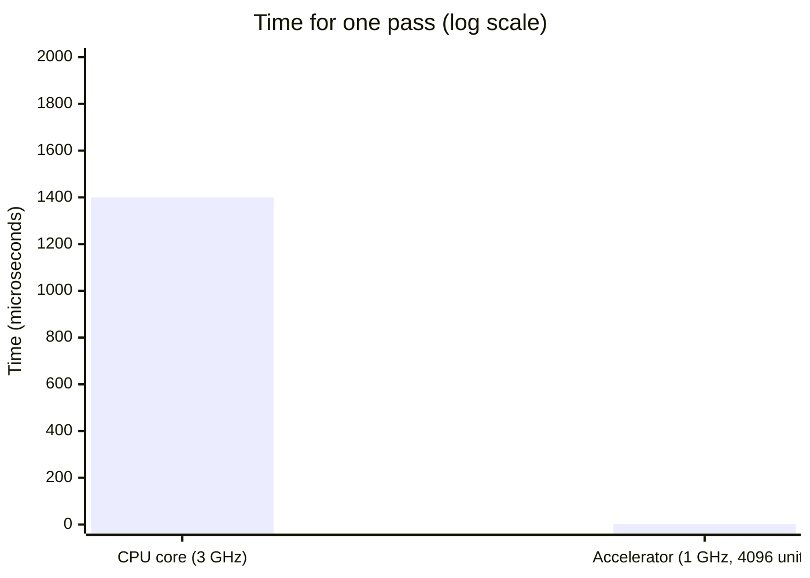

The following Python program reproduces the numbers. Its complete expected output is shown below the code.

```python
macs = 1024 * 4096
cpu_time = macs / 3e9            # 1 MAC per cycle at 3 GHz
acc_time = macs / (4096 * 1e9)   # 4,096 MACs per cycle at 1 GHz

print(macs)                      # 4194304
print(round(cpu_time * 1e3, 2), "ms")   # ~1.40 ms
print(round(acc_time * 1e6, 2), "us")   # ~1.02 us
print(round(cpu_time / acc_time))       # ~1365
```

Expected output:

```text
4194304
1.4 ms
1.02 us
1365
```

> [!WARNING]
> **Important caveat.** These are ideal numbers. They assume the data is always ready the instant it is needed. Section 3.3 and Section 4 explain why real chips often cannot reach them.

---

## 3.3 Why parallel hardware has limits

Adding more units does not give unlimited speed-up. Four things get in the way.

**Figure 3.3.** The four limits on parallel speed-up. Each can dominate on a real workload, and Amdahl's law sets a hard ceiling regardless of how many units you add. *Source: author's own diagram, based on Amdahl (1967) and the design discussion in Sections 3–4.*

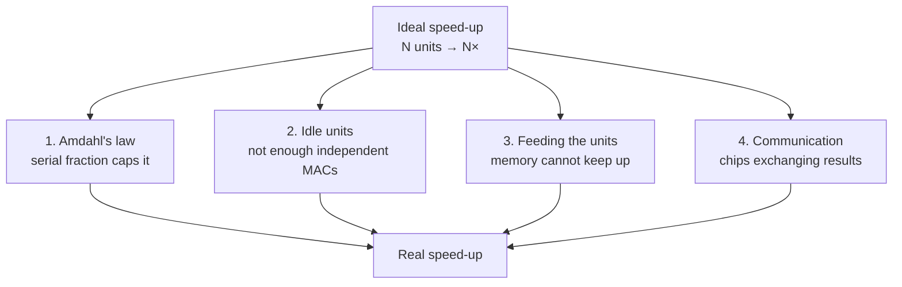

### 1. Amdahl's law

If a fraction *p* of a job can be parallelised, the best possible speed-up on *N* units is

```text
speed-up = 1 ÷ ( (1 − p) + p ÷ N )
```

*Worked example.* With p = 0.9 and N = 100: speed-up = 1 ÷ (0.1 + 0.009) ≈ **9.2×**. Even with unlimited units it can never exceed 1 ÷ 0.1 = **10×**, because the 10% serial part remains. In an AI pipeline the serial part might be loading data, pre-processing, or a step that cannot be spread out.

**Figure 3.4.** Amdahl's law for p = 0.9. The speed-up rises with the number of units but flattens towards the ceiling of 10×, set by the 10% serial fraction. *Source: author's own diagram, based on Amdahl (1967).*

```mermaid
xychart-beta
    title "Amdahl's law (p = 0.9)"
    x-axis ["1", "2", "4", "8", "16", "32", "64", "128"]
    y-axis "Speed-up" 0 --> 10
    line [1, 1.8, 3.1, 4.7, 6.4, 7.8, 8.8, 9.4]
```

The following Python program computes the worked example and the ceiling. Its complete expected output is shown below the code.

```python
def amdahl(p, n):
    return 1 / ((1 - p) + p / n)

print(round(amdahl(0.9, 100), 1))     # 9.2
print(round(amdahl(0.9, 10**9), 1))   # 10.0  (the ceiling)
```

Expected output:

```text
9.2
10.0
```

### 2. Idle units

A 4,096-unit accelerator can only be fully used if there are at least 4,096 independent MACs to do at once. A small layer leaves units idle, so **utilisation** (Section 1.6) falls.

### 3. Feeding the units

Units cannot compute without data. If memory cannot deliver numbers fast enough, the MACs wait. This is the subject of Section 4.

### 4. Communication

Across many chips, the time spent exchanging results can outweigh the gain from adding chips (Module 02).

---

## 3.4 Other acceleration techniques

Parallel MAC units are only one trick. Designers combine several. The three most important for this module are:

| Technique | What it does | Why it helps |
|---|---|---|
| **Lower precision (quantisation)** | Use INT8 or FP16 instead of FP32 | Smaller numbers: more fit in the same memory and more can be processed per cycle |
| **Specialised units** | NVIDIA Tensor Cores and Apple's Neural Engine are circuits that do small matrix multiplications as a single hardware step | Fewer instructions and less control overhead per MAC |
| **Batching** | Process several inputs together so the same weights are reused | Fetch weights once, use them many times (Section 4) |

**Table 3.3.** Three acceleration techniques and why they help.

**Figure 3.5.** Three ways to speed up AI beyond adding more MAC units: quantisation (smaller numbers), specialised units (matrix operations in one hardware step) and batching (reuse weights across inputs). *Source: author's own diagram, based on Jouppi et al. (2017) and NVIDIA (n.d.).*

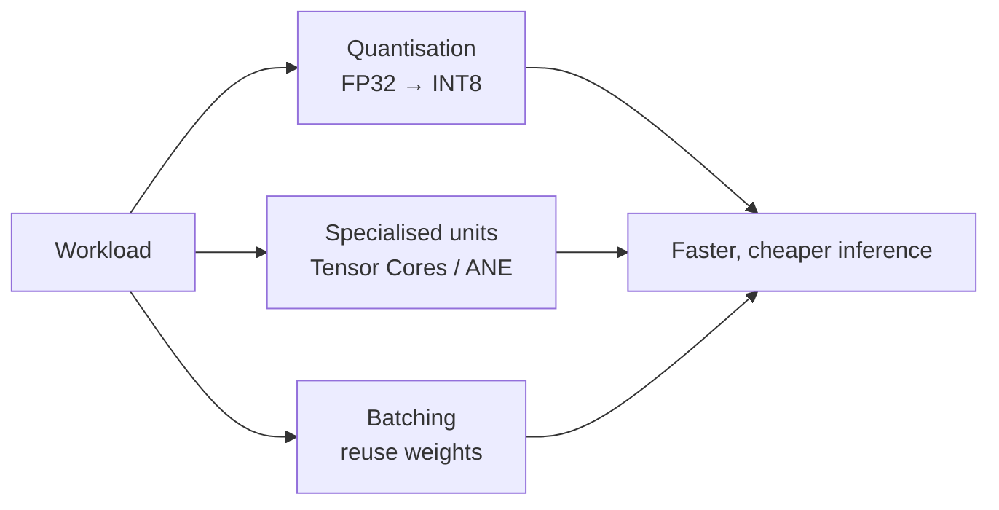

> [!TIP]
> **Going further.** Three more techniques you may meet:
> - **Sparsity:** skip multiplications by zero, so there is no work for values that cannot change the answer.
> - **Operator fusion:** combine several steps (for example, multiply, add bias and apply ReLU) into one pass to avoid writing and re-reading intermediate results.
> - **Weight-stationary data reuse:** keep weights in place while data moves past them, as in systolic arrays.

### Reduced precision (quantisation) in more detail

Quantisation converts a model's numbers from a high-precision format (such as FP32) to a lower-precision one (such as INT8). Using fewer bits per number lets a chip fit more MAC units in the same area and move fewer bytes. The first TPU used 8-bit integers for inference (Jouppi et al., 2017); later accelerators support formats such as bfloat16 (a 16-bit float with the same range as FP32) and 8-bit floating point.

| Format | Bits | Bytes | Typical use |
|---|---:|---:|---|
| FP32 | 32 | 4 | Classic training; "full" precision |
| BF16 / FP16 | 16 | 2 | Training and inference on modern accelerators |
| FP8 | 8 | 1 | Newer training/inference hardware |
| INT8 | 8 | 1 | Inference on phones, edge devices, TPUs |
| INT4 and below | 4 | 0.5 | Aggressively compressed models |

**Table 3.4.** Common number formats in AI hardware.

**Figure 3.6.** Quantising four sample weights to INT8 and back. The reconstructed values are close to the originals, with a maximum error of 0.0039. *Source: author's own diagram, based on the numbers in the code below.*

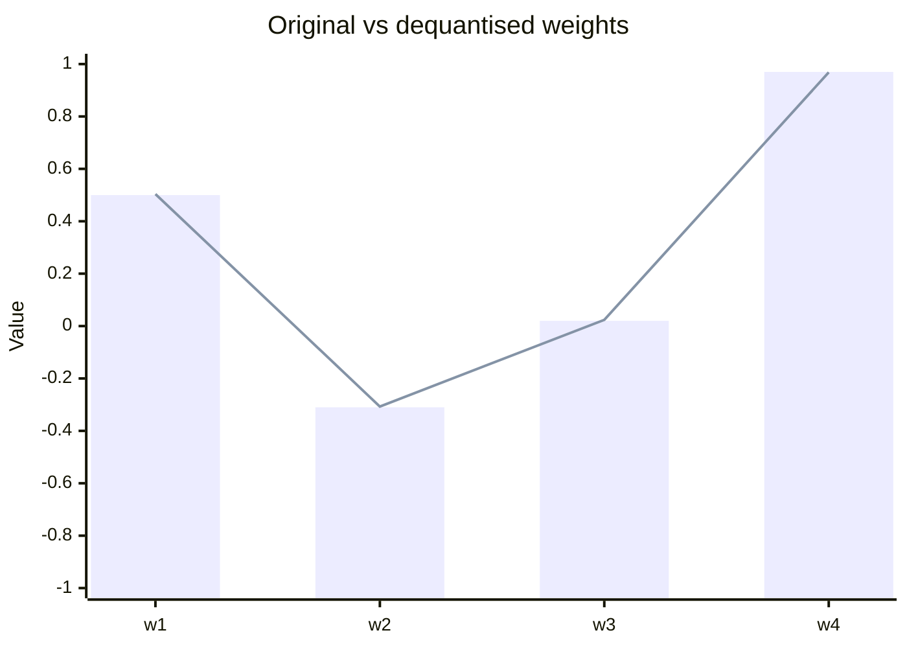

The following Python program quantises four weights to INT8 and back, and reports the maximum error. Its complete expected output is shown below the code.

```python
import numpy as np

w = np.array([0.5, -0.31, 0.02, 0.97], dtype=np.float32)
scale = 1.0 / 127
q = np.round(w / scale).astype(np.int8)    # quantise
w_back = q.astype(np.float32) * scale      # dequantise

print(q)                      # [ 64 -39   3 123]
print(np.round(w_back, 4))    # [ 0.5039 -0.3071  0.0236  0.9685]
print("max error:", np.abs(w - w_back).max().round(4))
```

Expected output:

```text
[ 64 -39   3 123]
[ 0.5039 -0.3071  0.0236  0.9685]
max error: 0.0039
```

---

## 3.5 Activities for Section 3

- [ ] **Activity 3.A.** The layer in Worked example 3.A is changed so that the output has 8,192 values instead of 4,096. What happens to the MAC count?
- [ ] **Activity 3.B.** With the same 4,096-unit accelerator, roughly how long would the 8,192-output layer take?
- [ ] **Activity 3.C.** A job is 80% parallelisable. What is the maximum speed-up on 8 units, and what is the limit with unlimited units?
- [ ] **Activity 3.D.** A 7-billion-parameter model is stored in FP16. How much memory do its weights need? How much if converted to INT8? To 4-bit?

---

## 3.6 Summary

- Hardware exploits parallelism at four levels: instruction-level, data-level (SIMD/SIMT), matrix-level (systolic), and across chips (data, pipeline and model splitting).
- A dense layer from 1,024 inputs to 4,096 outputs contains 4,194,304 MACs (about 8.4 million FLOPs); on idealised hardware this takes about 1.4 ms on one CPU core and about 1.0 µs on a 4,096-unit accelerator, a speed-up of about 1,365×.
- Amdahl's law caps the speed-up: with 90% parallelisable work the ceiling is 10×, and on 100 units you get about 9.2×.
- Parallel hardware also loses to idle units, memory that cannot feed the units fast enough, and communication between chips.
- Quantisation, specialised units and batching are the three main acceleration techniques covered here; quantising four sample weights to INT8 gives a maximum error of 0.0039.

---

## 3.7 Glossary

| Term | Meaning |
|---|---|
| **Amdahl's law** | A formula giving the maximum speed-up from parallelising a fraction *p* of a job on *N* units: 1 ÷ ((1 − p) + p ÷ N). |
| **Batch / batching** | Processing several inputs together so the same weights are reused. |
| **BF16 (bfloat16)** | A 16-bit floating-point format with the same range as FP32. |
| **Data parallelism** | Doing the same operation on different data at the same time. |
| **FLOP** | Floating-point operation; one multiply or one add. One MAC equals two FLOPs. |
| **FP32 / FP16 / FP8** | Floating-point formats using 32, 16 or 8 bits per number. |
| **INT8 / INT4** | Integer formats using 8 or 4 bits per number. |
| **Latency hiding** | Switching to another ready group of threads while one group waits, so arithmetic units stay busy. |
| **MAC** | Multiply-accumulate: the operation `a × b + c`. |
| **Operator fusion** | Combining several operations into one pass to avoid writing and re-reading intermediate results. |
| **Pipeline parallelism** | Splitting a model into stages across several chips, with data flowing from stage to stage. |
| **Quantisation** | Converting numbers from a high-precision to a lower-precision format. |
| **SIMD / SIMT** | Single Instruction, Multiple Data / Threads: one instruction applied to many values or threads at once. |
| **Sparsity** | Skipping multiplications by zero. |
| **Thread** | One stream of instructions. |
| **Utilisation** | The fraction of a chip's arithmetic units that are actually doing useful work. |
| **Warp** | A group of GPU threads that execute together. |

---

## 3.8 Answer key

**Activity 3.A.**
The MAC count doubles, to 1,024 × 8,192 = **8,388,608 MACs** (about 16.8 million FLOPs), because there are twice as many outputs and each still needs 1,024 MACs.

**Activity 3.B.**
About **2 µs**, ideally: twice the MACs at the same throughput. In practice the accelerator may do slightly better than a simple doubling if the larger layer keeps more units busy, or slightly worse if memory becomes the bottleneck.

**Activity 3.C.**
On 8 units: 1 ÷ (0.2 + 0.8 ÷ 8) = 1 ÷ 0.3 ≈ **3.3×**.
With unlimited units: 1 ÷ 0.2 = **5×**, because the 20% serial part remains.

**Activity 3.D.**
FP16: 7 × 10⁹ × 2 bytes = **14 GB**.
INT8: 7 × 10⁹ × 1 byte = **7 GB**.
4-bit: 7 × 10⁹ × 0.5 bytes = **3.5 GB**.

---

## References

- Amdahl, G. M. (1967). Validity of the single processor approach to achieving large scale computing capabilities. *AFIPS Conference Proceedings*.
- Hennessy, J. L., & Patterson, D. A. (2019). A new golden age for computer architecture. *Communications of the ACM*, 62(2), 48–60.
- Jouppi, N. P., et al. (2017). In-datacenter performance analysis of a Tensor Processing Unit. *Proceedings of ISCA 2017*.
- NVIDIA. (n.d.). *GPU and Tensor Core documentation*.

[← Previous: Section 2](Draft-02.2.md) · [Back to module overview](Draft-03.1.md) · [Next: Section 4 →](Draft-04.2.md)

# Hardware, Networks & Behaviourist AI

## Module 01 · Section 4: Memory Hierarchy and Computational Efficiency

> [!IMPORTANT]
> **Big idea.** Arithmetic is cheap; moving data is expensive. Good AI hardware and good AI software are both organised to keep data in small, fast memory for as long as possible.

## Learning objectives

By the end of this section you should be able to:

1. Describe the levels of the memory hierarchy from registers to storage, and the trade-off between speed, size and cost that organises them.
2. State approximate energy costs for a 32-bit multiply, an on-chip SRAM read and a DRAM read, and explain why data movement dominates energy.
3. Define arithmetic intensity and the roofline model, including the ridge point, memory-bound and compute-bound regimes.
4. Apply the roofline model to a worked layer, and determine the batch size at which a workload becomes compute-bound.
5. List the main techniques for improving a memory-bound workload and explain how batching trades throughput against latency.

## Table of contents

- [4.1 The memory hierarchy](#41-the-memory-hierarchy)
- [4.2 The surprising fact: data movement dominates energy](#42-the-surprising-fact-data-movement-dominates-energy)
- [4.3 Arithmetic intensity and the roofline model](#43-arithmetic-intensity-and-the-roofline-model)
- [4.4 Worked example 4.A: roofline for one layer](#44-worked-example-4a-roofline-for-one-layer)
- [4.5 Learner activity: roofline for a different layer](#45-learner-activity-roofline-for-a-different-layer)
- [4.6 Further efficiency ideas](#46-further-efficiency-ideas)
- [4.7 Bridges to the rest of the course](#47-bridges-to-the-rest-of-the-course)
- [4.8 Activities for Section 4](#48-activities-for-section-4)
- [4.9 Summary](#49-summary)
- [4.10 Glossary](#410-glossary)
- [4.11 Answer key](#411-answer-key)
- [References](#references)

---

## 4.1 The memory hierarchy

Computers have several kinds of memory. Fast memory is small and expensive; large memory is slow and cheap. The arrangement from fastest to slowest is called the **memory hierarchy**.

**Figure 4.1.** The memory hierarchy, from small, fast registers at the top to large, slow storage at the bottom. Each level down is larger, cheaper per byte and slower to access. *Source: author's own diagram, based on the standard memory hierarchy described in Hennessy & Patterson (2019).*

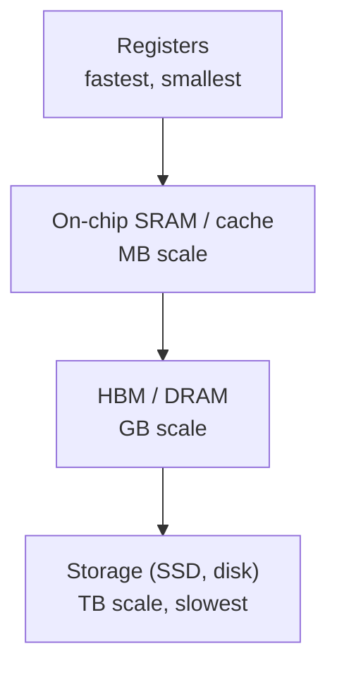

### Terms

- **Cache:** a small, fast memory that keeps copies of recently used data close to the processor. Managed automatically by hardware.
- **Scratchpad / software-managed buffer:** on-chip memory that the program or compiler controls explicitly, as in the TPU's 28 MiB unified buffer. It avoids the unpredictability of automatic caches.
- **SRAM:** fast memory built into the chip (usually several transistors per bit; expensive in area).
- **DRAM:** larger, slower memory outside the chip (one transistor plus a capacitor per bit; cheap per byte).
- **HBM (High Bandwidth Memory):** DRAM stacked in layers and placed right next to a GPU or accelerator to deliver very high bandwidth. As announced in 2025, Google's Ironwood TPU pairs each chip with 192 GB of HBM (Google, 2025).
- **Bandwidth:** how many bytes per second can be moved (for example, 500 GB/s).
- **Latency (memory):** how long one access takes, as opposed to how many bytes per second can flow once it starts.
- **Unified memory:** a design (used by Apple silicon) in which CPU, GPU and NPU share one pool of memory so data need not be copied between them.

> [!NOTE]
> **Analogy.** Think of cooking. Registers are the ingredients in your hands. Cache/SRAM is the chopping board in front of you. DRAM is the fridge across the kitchen. Storage is the supermarket. A cook who walks to the supermarket for every ingredient will never finish; a good cook plans the recipe so that everything needed is on the chopping board when required. Good AI hardware and software do the same.

**Figure 4.2.** The same hierarchy drawn as a cooking analogy: the closer the ingredient, the cheaper it is to reach. *Source: author's own diagram.*


---

## 4.2 The surprising fact: data movement dominates energy

Horowitz (2014) published approximate energy costs for a 45 nm chip process:

| Operation | Approximate energy |
|---|---:|
| 32-bit floating-point multiply | ~3.7 pJ |
| Read 32 bits from small on-chip SRAM (8 KB) | ~5 pJ |
| Read 32 bits from off-chip DRAM | ~640 pJ |

**Table 4.1.** Approximate energy costs per operation, from Horowitz (2014). pJ = picojoule, 10⁻¹² joule. Reading a register costs far less than any row in this table.

**Figure 4.3.** Fetching a number from DRAM costs about **170 times** the energy of multiplying it (640 ÷ 3.7 ≈ 173) and about **128 times** the energy of reading it from small on-chip SRAM. Data: Horowitz (2014).

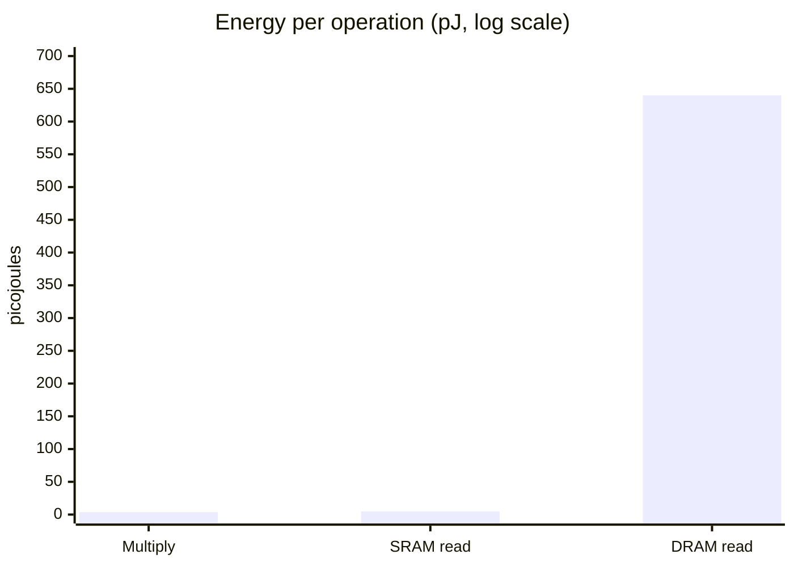

The following Python program computes the two ratios. Its complete expected output is shown below the code.

```python
mult, sram, dram = 3.7, 5, 640   # picojoules
print(round(dram / mult))        # 173
print(round(dram / sram))        # 128
```

Expected output:

```text
173
128
```

Fetching a number from DRAM costs roughly two orders of magnitude (about 100× or more) more energy than multiplying it. Modern processes differ in the exact numbers, but the pattern remains. This is why AI chip designers focus on reusing data already on the chip.

---

## 4.3 Arithmetic intensity and the roofline model

To judge whether a workload is limited by computing or by memory, we use **arithmetic intensity**:

```text
arithmetic intensity (FLOPs per byte) = total FLOPs ÷ total bytes moved from memory
```

A chip has two limits:

- **Peak compute** (FLOP/s): the most arithmetic it can do.
- **Memory bandwidth** (bytes/s): the most data it can fetch.

The **roofline model** (Williams, Waterman & Patterson, 2009) says:

```text
attainable performance = min( peak compute , arithmetic intensity × memory bandwidth )
```

The **ridge point** is where the two limits meet: peak compute ÷ bandwidth.

- Intensity **below** the ridge point → **memory-bound** (the chip waits for data).
- Intensity **above** the ridge point → **compute-bound** (the chip is busy computing).

> [!NOTE]
> **Why is it called a "roofline"?** Plot performance against intensity and the picture looks like a roof: a sloping line on the left (memory limit) that meets a flat line on the right (compute limit). Your workload's performance can never poke through the roof.

**Figure 4.4.** The roofline for the hypothetical accelerator used in this section (10 TFLOP/s peak, 500 GB/s bandwidth). The sloping left side is the memory limit; the flat right side is the compute limit. The ridge point sits at 20 FLOP/byte. *Source: author's own diagram, based on Williams, Waterman & Patterson (2009).*

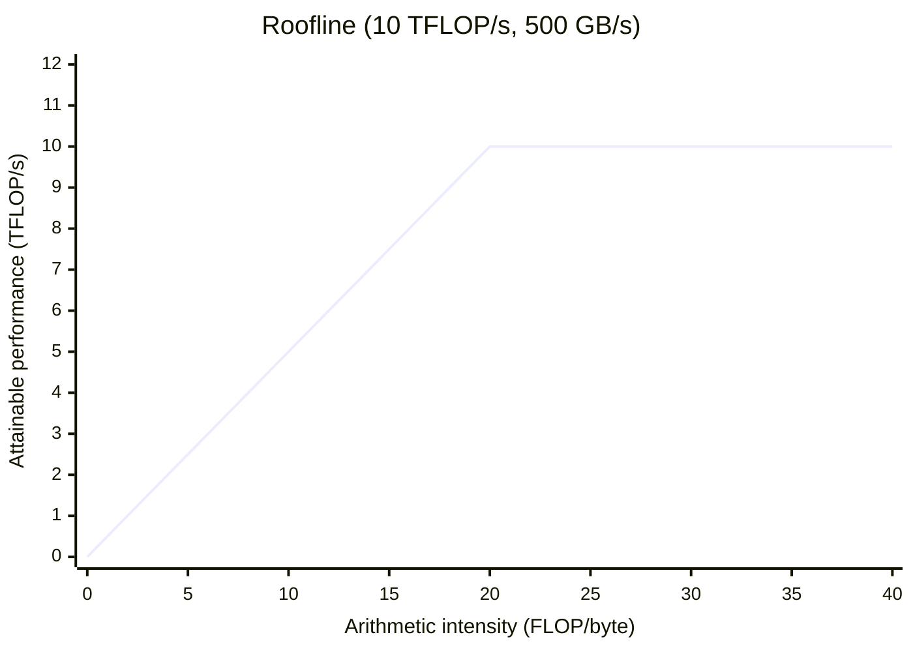

---

## 4.4 Worked example 4.A: roofline for one layer

**The hypothetical accelerator** used here and in the activity below:

| Property | Value |
|---|---|
| Peak compute | 10 TFLOP/s |
| Memory bandwidth | 500 GB/s |
| Ridge point | 10 TFLOP/s ÷ 500 GB/s = **20 FLOP/byte** |

**Table 4.2.** Properties of the hypothetical accelerator used in Worked example 4.A and Activity 4.5.

**Layer:** 1,024 inputs × 4,096 outputs, stored in FP16 (2 bytes per value).

### Batch 1

- FLOPs = 2 × 4,194,304 = 8,388,608.
- Bytes moved: weights 4,194,304 × 2 = 8,388,608; inputs 1,024 × 2 = 2,048; outputs 4,096 × 2 = 8,192. Total = **8,398,848**.
- Intensity = 8,388,608 ÷ 8,398,848 ≈ **1.0 FLOP/byte**, far below the ridge point of 20, so the layer is **memory-bound**.
- Attainable = min(10, 1.0 × 0.5) = **0.5 TFLOP/s, only 5% of peak**.
- Check in time: moving 8.4 MB at 500 GB/s takes about 16.8 µs, while the arithmetic at 10 TFLOP/s would take only about 0.84 µs. The chip spends about 95% of its time waiting.

### Batch 32

- FLOPs = 32 × 8,388,608 = 268,435,456.
- Bytes: weights 8,388,608 (fetched once) + inputs 32 × 2,048 = 65,536 + outputs 32 × 8,192 = 262,144. Total = **8,716,288**.
- Intensity ≈ **30.8 FLOP/byte**, above the ridge point, so the layer is **compute-bound** and reaches the full 10 TFLOP/s.

The weights were fetched once and reused 32 times. That is the whole story of batching.

**Figure 4.5.** Where batch 1 and batch 32 sit on the roofline. Batch 1 falls on the memory-limited slope; batch 32 clears the ridge point and reaches the compute ceiling. *Source: author's own diagram, based on the numbers in Worked example 4.A.*

```mermaid
xychart-beta
    title "Batch 1 vs batch 32 on the roofline"
    x-axis "Arithmetic intensity (FLOP/byte)" 0 --> 40
    y-axis "Attainable performance (TFLOP/s)" 0 --> 12
    line [0, 0.5, 1, 1.5, 2, 2.5, 3, 3.5, 4, 4.5, 5, 5.5, 6, 6.5, 7, 7.5, 8, 8.5, 9, 9.5, 10, 10, 10, 10, 10, 10, 10, 10, 10, 10, 10, 10, 10, 10, 10, 10, 10, 10, 10, 10, 10]
```

The following Python program checks all the numbers above. Its complete expected output is shown below the code.

```python
PEAK = 10e12        # FLOP/s
BW = 500e9          # bytes/s
BYTES = 2           # FP16

def roofline(n_in, n_out, batch):
    flops = 2 * n_in * n_out * batch
    weight_bytes = n_in * n_out * BYTES
    io_bytes = batch * (n_in + n_out) * BYTES
    intensity = flops / (weight_bytes + io_bytes)
    attainable = min(PEAK, intensity * BW)
    return intensity, attainable

for b in (1, 32):
    i, a = roofline(1024, 4096, b)
    print(b, round(i, 1), round(a / 1e12, 2), "TFLOP/s", f"{a / PEAK:.0%}")
```

Expected output:

```text
1 1.0 0.5 TFLOP/s 5%
32 30.8 10.0 TFLOP/s 100%
```

---

## 4.5 Learner activity: roofline for a different layer

**Setting.** Same hypothetical accelerator as in 4.4 (10 TFLOP/s, 500 GB/s, ridge point 20 FLOP/byte). A layer has **512 inputs and 2,048 outputs**, stored in FP16 (2 bytes per value).

**Tasks.**

1. Compute the number of weights and the weight size in bytes.
2. Compute FLOPs for one input vector (batch 1).
3. For batch sizes 1, 8 and 32, compute the bytes moved (weights + inputs + outputs) and the arithmetic intensity. State whether each case is memory-bound or compute-bound.
4. For each batch size, compute the attainable performance in TFLOP/s and as a percentage of peak.
5. What is the smallest batch size that makes the layer compute-bound?
6. **Reflect (2–3 sentences):** A voice assistant must answer one user at a time within milliseconds. What does the result of Task 3 imply for the hardware you would choose, and why?

**Hints.** Weights are fetched once per batch; inputs and outputs are fetched/written once per sample. Intensity = FLOPs ÷ bytes. Attainable = min(10 TFLOP/s, intensity × 0.5 TFLOP/s per unit intensity).

---

## 4.6 Further efficiency ideas

A designer who understands the roofline has a checklist of ways to improve a memory-bound workload:

| Idea | How it helps | Where you will see it |
|---|---|---|
| Bigger on-chip memory | Weights and activations stay close to the MACs | TPU's 28 MiB buffer; large caches in GPUs; NPUs |
| Higher bandwidth memory | Raises the slope of the roofline | HBM stacked beside the chip |
| Weight reuse (batching, weight-stationary arrays) | More operations per byte fetched | Systolic arrays, batched serving |
| Lower precision | Fewer bytes per weight | INT8/FP8/4-bit inference |
| Compression and pruning | Smaller or sparser models | Mobile model deployment |
| Operator fusion | Intermediate values never leave the chip | Compilers such as XLA and Core ML |
| Unified memory | No copy between CPU, GPU and NPU | Apple silicon |

**Table 4.3.** Techniques for improving a memory-bound workload.

**Figure 4.6.** The same techniques shown as levers on the roofline. Bigger on-chip memory and higher bandwidth raise the slope; batching, lower precision and weight reuse push a workload to the right. *Source: author's own diagram.*

```mermaid
flowchart LR
    MB["Memory-bound workload"] --> UP["Raise the slope<br/>higher bandwidth, larger on-chip memory"]
    MB --> RIGHT["Move right on the x-axis<br/>batching, weight reuse, lower precision"]
    UP --> CB["Compute-bound"]
    RIGHT --> CB
```

> [!WARNING]
> **A caution about batching.** Batching raises intensity but increases latency per request if requests must wait to form a batch. Servers therefore balance throughput (large batches) against latency (answer quickly). This trade-off is why the same model may be run differently in a data centre than on a phone.

---

## 4.7 Bridges to the rest of the course

**Networks.** The memory hierarchy does not stop at the edge of the chip. Moving data between chips, over links such as NVLink or InfiniBand, is another, slower level of the same hierarchy. When a model is split across many chips, this network becomes the bottleneck, which is the subject of Module 02.

**Behaviourist AI.** Behaviour-driven agents, such as robots and game-playing agents, run a loop of *sense, decide, act*, often one observation at a time. That is batch size 1, the memory-bound case from this section. Low latency and low energy per decision therefore matter more than peak throughput, which is why such agents often run on edge hardware such as NPUs.

**Figure 4.7.** The sense–decide–act loop of a behaviour-driven agent runs at batch size 1, so it sits on the memory-bound side of the roofline. *Source: author's own diagram, based on the behaviourist agent model described in Section 1.*

```mermaid
flowchart LR
    S["Sense<br/>one observation"] --> D["Decide<br/>batch = 1, memory-bound"]
    D --> A["Act"]
    A --> S
```

---

## 4.8 Activities for Section 4

- [ ] **Activity 4.A.** A designer doubles the number of MAC units on a memory-bound chip but leaves memory bandwidth unchanged. What happens to performance on a memory-bound workload?
- [ ] **Activity 4.B.** *(Revision of Section 2.5.)* The first TPU had four of six benchmarks memory-bandwidth limited. Which single hardware change did the authors say would have tripled achieved TOPS in a revised design?
- [ ] **Activity 4.C.** Using the energy table in 4.2 and the hierarchy in Figure 4.1, rank from lowest to highest energy per access: DRAM read, register access, small SRAM read.

---

## 4.9 Summary

- The memory hierarchy runs from registers (fastest, smallest) through on-chip SRAM/cache and DRAM/HBM to storage (slowest, largest); each level down is larger, cheaper per byte and slower.
- Data movement dominates energy: a DRAM read costs about 170× a 32-bit multiply and about 128× a small SRAM read (Horowitz, 2014).
- Arithmetic intensity (FLOPs per byte) and the roofline model determine attainable performance: min(peak compute, intensity × bandwidth). The ridge point separates memory-bound from compute-bound workloads.
- For the worked layer (1,024 × 4,096, FP16) on a 10 TFLOP/s, 500 GB/s accelerator, batch 1 is memory-bound at about 0.5 TFLOP/s (5% of peak), while batch 32 is compute-bound at the full 10 TFLOP/s.
- Batching, bigger on-chip memory, higher bandwidth, lower precision, compression, operator fusion and unified memory all raise effective intensity; batching trades latency for throughput.

---

## 4.10 Glossary

| Term | Meaning |
|---|---|
| **Arithmetic intensity** | FLOPs performed per byte moved from memory. |
| **Bandwidth** | The number of bytes per second that can be moved between two points. |
| **Cache** | A small, fast memory that keeps copies of recently used data close to the processor, managed by hardware. |
| **Compute-bound** | A workload whose intensity is above the ridge point, so the chip's arithmetic is the limit. |
| **DRAM** | Larger, slower memory outside the chip, cheap per byte. |
| **HBM (High Bandwidth Memory)** | DRAM stacked in layers next to a GPU or accelerator to deliver very high bandwidth. |
| **Latency (memory)** | The time one memory access takes, as opposed to sustained bandwidth. |
| **Memory-bound** | A workload whose intensity is below the ridge point, so memory bandwidth is the limit. |
| **Memory hierarchy** | The arrangement of memory from fastest and smallest (registers) to slowest and largest (storage). |
| **Operator fusion** | Combining several operations into one pass so intermediate values never leave the chip. |
| **Peak compute** | The maximum arithmetic throughput of a chip, in FLOP/s. |
| **Ridge point** | Peak compute ÷ memory bandwidth; the intensity at which a workload switches from memory-bound to compute-bound. |
| **Roofline model** | A model stating attainable performance = min(peak compute, intensity × bandwidth). |
| **Scratchpad / software-managed buffer** | On-chip memory that the program or compiler controls explicitly. |
| **SRAM** | Fast on-chip memory, expensive in area. |
| **Unified memory** | One pool of memory shared by CPU, GPU and NPU so data need not be copied between them. |

---

## 4.11 Answer key

**Activity 4.A.**
Almost nothing changes. On a memory-bound workload the limit is the rate at which data can be supplied, not the number of arithmetic units. Doubling the MACs leaves them idle for the same fraction of time, so attainable performance stays about the same until memory bandwidth or on-chip reuse improves.

**Activity 4.B.**
Using the GPU's faster **GDDR5 memory** in a revised design; the authors estimated this would have tripled achieved TOPS.

**Activity 4.C.**
Lowest to highest energy per access: **register access, then small SRAM read (~5 pJ), then DRAM read (~640 pJ)**.

**Activity 4.5 (learner activity) — full answer key.**

- Weights: 512 × 2,048 = **1,048,576 weights**, i.e. 1,048,576 × 2 = **2,097,152 bytes**.
- FLOPs at batch 1 = 2 × 1,048,576 = **2,097,152**.

| Batch | Intensity (FLOP/byte) | Bound | Attainable | % of peak |
|---:|---:|---|---:|---:|
| 1 | ≈ 1.0 | memory | ≈ 0.5 TFLOP/s | ≈ 5% |
| 8 | ≈ 7.9 | memory | ≈ 3.9 TFLOP/s | ≈ 39% |
| 32 | ≈ 29.7 | compute | 10 TFLOP/s | 100% |

**Table 4.4.** Answer key for Activity 4.5, tasks 3 and 4.

- Smallest compute-bound batch: **22** (intensity reaches the ridge point of 20 at batch 22).
- Reflection: batch 1 is memory-bound, so extra arithmetic units help little. Prefer hardware with high memory bandwidth, large on-chip memory and low-precision weights (for example, an NPU), because latency and energy per decision matter more than peak throughput.

---

## References

- Google. (2025). *Ironwood TPU announcement*.
- Hennessy, J. L., & Patterson, D. A. (2019). A new golden age for computer architecture. *Communications of the ACM*, 62(2), 48–60.
- Horowitz, M. (2014). Computing's energy problem (and what we can do about it). *IEEE ISSCC*.
- Jouppi, N. P., et al. (2017). In-datacenter performance analysis of a Tensor Processing Unit. *Proceedings of ISCA 2017*.
- Williams, S., Waterman, A., & Patterson, D. (2009). Roofline: an insightful visual performance model for multicore architectures. *Communications of the ACM*, 52(4), 65–76.

[← Previous: Section 3](Draft-03.2.md) · [Back to module overview](Draft-03.2.md) · [Next: Section 5 →](Draft-05.2.md)

# Hardware, Networks & Behaviourist AI

## Module 01 · Section 5: Case Study — Apple Neural Engine (On-Device AI)

> [!IMPORTANT]
> **Big idea.** The Apple Neural Engine is the module's ideas in one real device: parallel MACs, low-precision numbers, and on-chip, shared memory, all working inside a few watts.

## Learning objectives

By the end of this section you should be able to:

1. Describe what the Apple Neural Engine (ANE) is, where it sits in an Apple SoC, and what kinds of tasks it accelerates.
2. Explain how the CPU, GPU, Neural Engine and unified memory work together, and how Core ML decides where each part of a model runs.
3. Distinguish training from inference, and explain why training happens in the data centre while inference happens on the device.
4. Analyse Face ID as a sense–decide–act loop, and judge using the roofline model whether it is memory-bound or compute-bound.
5. Evaluate the advantages and limitations of on-device AI, including memory footprint, hardware compatibility, privacy and cloud dependency.

## Table of contents

- [5.1 Introduction](#51-introduction)
- [5.2 How the Apple Neural Engine works](#52-how-the-apple-neural-engine-works)
- [5.3 Connection between training and inference](#53-connection-between-training-and-inference)
- [5.4 Real-life application: Face ID](#54-real-life-application-face-id)
- [5.5 Advantages of the Apple Neural Engine](#55-advantages-of-the-apple-neural-engine)
- [5.6 Limitations](#56-limitations)
- [5.7 Case-study questions](#57-case-study-questions)
- [5.8 Conclusion](#58-conclusion)
- [5.9 Summary](#59-summary)
- [5.10 Glossary](#510-glossary)
- [5.11 Answer key](#511-answer-key)
- [References](#references)

---

## 5.1 Introduction

**Figure 5.1.** The Neural Engine sits inside an Apple system-on-a-chip alongside the CPU, GPU and shared memory. *Source: Apple Inc. (2024), Apple Platform Security guide; diagram adapted by the author.*

```mermaid
flowchart TB
    subgraph SoC["Apple system-on-a-chip"]
        CPU["CPU"]
        GPU["GPU"]
        ANE["Neural Engine"]
        MEM[("Unified memory")]
        SEC["Secure Enclave"]
    end
    CPU --- MEM
    GPU --- MEM
    ANE --- MEM
    ANE --- SEC
```

The Apple Neural Engine (ANE) is a specialised processor built into Apple's chips to improve the speed and efficiency of artificial intelligence (AI) tasks. It is the NPU described in Section 2.6.

It was first introduced in 2017 with the A11 Bionic chip in the iPhone X. Apple described that first version as capable of 600 billion operations per second (Apple Inc., 2017); later generations are quoted in TOPS on Apple's specification pages for each chip.

Unlike traditional processors, the Neural Engine is specifically designed to handle AI calculations, allowing iPhones to perform tasks such as:

- Facial recognition (Face ID)
- Image and object recognition
- AI-powered camera features
- Language and speech processing

One major advantage is **on-device AI**, meaning AI tasks can be processed directly on an iPhone without always needing an internet connection or cloud server.

---

## 5.2 How the Apple Neural Engine works

The iPhone uses several hardware components that work together to process AI tasks. They sit on one system-on-a-chip (Section 2.6).

| Component | Function |
|---|---|
| **CPU** | Manages general tasks and coordinates AI operations. |
| **GPU** | Processes multiple calculations simultaneously, especially for graphics and AI. |
| **Neural Engine** | Accelerates neural network calculations for supported AI tasks. |
| **Memory** | Stores AI models, input data, and processing results. |

**Table 5.1.** Hardware components of an Apple SoC and their roles in AI processing.

The Neural Engine uses parallel processing (Section 3), allowing many calculations to happen at the same time instead of one by one. This makes AI applications faster and more energy-efficient.

**Figure 5.2.** How an app reaches the Neural Engine through Core ML. Core ML inspects the model and routes each operation to the CPU, GPU or Neural Engine; all three share unified memory. *Source: author's own diagram, based on Apple Inc. (2024), Core ML documentation.*

```mermaid
flowchart LR
    App["App / model"] --> CML["Core ML<br/>(decides where to run)"]
    CML --> CPU["CPU"]
    CML --> GPU["GPU"]
    CML --> ANE["Neural Engine"]
    CPU --- MEM[("Unified memory")]
    GPU --- MEM
    ANE --- MEM
```

### Technical details: linking back to Sections 2, 3 and 4

- **Software (Section 2.7).** Developers use **Core ML**, which decides whether each part of a model runs on the CPU, GPU or Neural Engine. If a model uses an operation the Neural Engine does not support, that part falls back to the CPU, which can make the whole model slower.
- **Memory (Section 4.1).** Apple silicon uses **unified memory**, so the CPU, GPU and Neural Engine share one pool and no copying is needed between them.
- **Precision (Section 3.4).** Models are usually quantised to INT8 or FP16 so that more fits in memory and less energy is spent moving it.
- **Batch size (Section 4.3).** Features such as Face ID process one input at a time (batch 1), the memory-bound case. This is why on-chip memory and low-precision weights matter so much on a phone.

---

## 5.3 Connection between training and inference

Training and inference are two important stages of AI processing (Section 1.5).

**Figure 5.3.** Training happens in the data centre on GPUs or accelerators; the trained weights are then shipped to the iPhone, where inference runs on the Neural Engine. *Source: author's own diagram.*

```mermaid
flowchart LR
    D["Large data set"] --> T["Training<br/>data centre, GPUs / accelerators"]
    T --> M["Trained model<br/>(weights)"]
    M --> I["Inference<br/>on the iPhone, Neural Engine"]
    I --> R["Fast, private answer"]
```

- **Training:** AI models are trained using large amounts of data, usually on powerful computers equipped with GPUs or other AI accelerators.
- **Inference:** once trained, the model can be used on an iPhone. The Neural Engine helps process new information quickly without needing to retrain the entire model.

This shows how specialised AI hardware supports the practical use of trained AI models.

---

## 5.4 Real-life application: Face ID

**Figure 5.4.** An iPhone using the TrueDepth camera for Face ID. *Source: Apple Inc. (2024), Face ID and privacy documentation; photograph reproduced by the author for teaching purposes only.*

Face ID is a real-world example of how Apple's AI hardware performs facial recognition.

### How Face ID works

1. **Face scanning:** the TrueDepth camera captures facial information using infrared light and depth sensors.
2. **Data processing:** the system converts facial information into a mathematical representation.
3. **AI inference:** neural networks analyse the facial information using specialised processing hardware.
4. **Face comparison:** the system securely compares the information with the registered face.
5. **Device unlocking:** if the face matches, the iPhone unlocks.

This process happens quickly because the iPhone uses specialised hardware to accelerate AI calculations.

**Figure 5.5.** The five steps of Face ID, from scanning to unlocking. *Source: author's own diagram, based on Apple Inc. (2024), Face ID documentation.*

```mermaid
flowchart LR
    S["1. Scan<br/>TrueDepth camera"] --> P["2. Process<br/>mathematical representation"]
    P --> A["3. AI inference<br/>Neural Engine"]
    A --> C["4. Compare<br/>with registered face"]
    C --> U["5. Unlock<br/>if match"]
```

Face ID also protects privacy because facial authentication data is processed and protected on the device rather than stored in the cloud. Apple's public security documentation describes this data as being kept in the **Secure Enclave** (Apple Inc., 2024).

> [!NOTE]
> **Bridge to Behaviourist AI.** Face ID is a small sense–decide–act loop: sense the face, decide match or no match, act by unlocking. It must answer in a fraction of a second, one request at a time, on a battery. The same constraints apply to robots and other agents that act in real time.

> [!NOTE]
> **Bridge to Networks.** Because the work stays on the device, Face ID needs no network round trip. That removes network delay and keeps sensitive data local, which is the trade-off between on-device and cloud processing.

---

## 5.5 Advantages of the Apple Neural Engine

| Advantage | Explanation |
|---|---|
| **Faster processing** | AI tasks can be completed quickly using specialised hardware. |
| **Energy efficiency** | AI calculations can use less power, helping preserve battery life. |
| **Better privacy** | Sensitive information can remain on the device. |
| **Real-time performance** | Applications such as Face ID respond almost immediately. |
| **Offline capability** | Many supported AI functions work without an internet connection. |

**Table 5.2.** Advantages of the Apple Neural Engine.

**Figure 5.6.** The five advantages of on-device AI with the Neural Engine. *Source: author's own diagram, based on Apple Inc. (2024).*

```mermaid
flowchart LR
    ANE["Apple Neural Engine"] --> F["Faster processing"]
    ANE --> E["Energy efficiency"]
    ANE --> P["Better privacy"]
    ANE --> R["Real-time performance"]
    ANE --> O["Offline capability"]
```

---

## 5.6 Limitations

Despite its advantages, the Apple Neural Engine has some limitations.

- **Limited computing resources:** smartphones cannot handle every large AI model as efficiently as powerful servers.
- **Hardware compatibility:** not all AI models or operations can run on the Neural Engine.
- **Memory limitations:** complex AI models may require more memory than a mobile device can provide.
- **Cloud dependency:** some advanced AI applications still need cloud-based processing.

---

## 5.7 Case-study questions

1. A model has one unsupported operation in the middle. Explain why it may run slower than a model with fewer supported operations overall. *(Hint: Section 2.7, fallback to the CPU, and the cost of moving data between processors.)*
2. Face ID processes one face at a time. Using Section 4, is this likely to be memory-bound or compute-bound, and why?
3. A 3-billion-parameter language model is quantised to 4-bit. How much memory do its weights need? Does it fit comfortably on a phone with 8 GB of memory shared with other apps?
4. Give one benefit and one drawback of keeping AI processing on the device rather than in the cloud.
5. Explain, using the Section 4 energy table, why unified memory saves energy as well as time.

The following Python program checks the arithmetic for question 3. Its complete expected output is shown below the code.

```python
params = 3e9
bytes_per_weight = 0.5          # 4-bit = half a byte
print(params * bytes_per_weight / 1e9, "GB")   # 1.5 GB
```

Expected output:

```text
1.5 GB
```

---

## 5.8 Conclusion

The Apple Neural Engine demonstrates how specialised hardware improves the performance of AI applications. By combining the CPU, GPU, Neural Engine, and memory, iPhones can process AI tasks quickly and efficiently.

The case study also shows the relationship between training and inference: AI models are generally trained using powerful computers, while the Neural Engine helps run those trained models directly on the iPhone. This makes everyday features such as Face ID, image recognition, and AI-powered photography possible.

---

## 5.9 Summary

- The Apple Neural Engine is the NPU inside Apple's SoC, introduced in 2017 (A11 Bionic) and shared with the CPU and GPU through unified memory.
- Core ML decides whether each operation runs on the CPU, GPU or Neural Engine; unsupported operations fall back to the CPU and can silently slow a model.
- Training happens in the data centre on GPUs or accelerators; inference happens on the device, where batch size 1 makes the workload memory-bound.
- Face ID is a sense–decide–act loop that must answer in a fraction of a second, on battery, with no network round trip; it is the memory-bound, latency-critical case from Section 4.
- On-device AI buys privacy, latency and offline capability, but is limited by memory, compute and hardware compatibility; a 3-billion-parameter model quantised to 4-bit needs 1.5 GB for its weights alone.

---

## 5.10 Glossary

| Term | Meaning |
|---|---|
| **Accelerator** | A chip that works alongside the CPU to speed up specific kinds of work. |
| **Arithmetic intensity** | FLOPs performed per byte moved from memory. |
| **ASIC** | Application-specific integrated circuit; a chip built for one domain. |
| **Bandwidth** | Bytes per second that can move between two parts of a system. |
| **Batch size** | Number of inputs processed together. |
| **Core ML** | Apple's framework that routes each part of a model to the CPU, GPU or Neural Engine. |
| **FLOP / FLOPS** | One floating-point operation / operations per second. |
| **HBM** | High Bandwidth Memory; stacked DRAM placed next to an accelerator. |
| **Inference** | Using a trained model to produce an answer. |
| **Latency** | Time for one task from start to finish. |
| **MAC** | Multiply-accumulate; 1 MAC = 2 FLOPs. |
| **NPU** | Neural processing unit; a small, low-power AI accelerator in a phone or laptop chip. |
| **Quantisation** | Converting numbers to a lower-precision format. |
| **Ridge point** | Peak compute ÷ bandwidth; the intensity at which a chip stops being memory-bound. |
| **Roofline model** | Attainable performance = min(peak compute, intensity × bandwidth). |
| **Secure Enclave** | Apple's isolated security processor that protects sensitive data such as Face ID templates. |
| **SoC** | System-on-a-chip; CPU, GPU, NPU and memory controllers on one piece of silicon. |
| **Systolic array** | A grid of MAC cells passing data neighbour to neighbour. |
| **Throughput** | Amount of work finished per second. |
| **TOPS** | Tera operations per second; a measure of arithmetic throughput. |
| **Training** | Adjusting a model's weights using data. |
| **Unified memory** | One memory pool shared by CPU, GPU and NPU. |

---

## 5.11 Answer key

**Question 1.**
The model is split into pieces. Each switch to the CPU and back means moving data between processors and losing the accelerator's efficiency, so a few unsupported operations can dominate the total time. The cost is not the unsupported operation itself but the data movement around it.

**Question 2.**
**Memory-bound.** Batch 1 has low arithmetic intensity (Section 4.3): each weight is fetched for a single input, so the chip spends most of its time waiting for data. This is why on-chip memory and low-precision weights matter so much on a phone.

**Question 3.**
The weights need 3 × 10⁹ × 0.5 bytes = **1.5 GB**. That is a modest share of 8 GB, but the model also needs working memory (activations, KV cache during generation) and shares RAM with other apps, so it is workable rather than comfortable.

**Question 4.**
Benefits: privacy (data stays on the device), no network delay, works offline.
Drawbacks: limited memory and compute, so the largest models may still need the cloud; hardware compatibility limits which operations can run on the Neural Engine.

**Question 5.**
Without copying between CPU, GPU and NPU, fewer off-chip memory accesses are needed. Each DRAM access costs far more energy than arithmetic (about 170× a multiply, Section 4.2), so avoiding copies saves energy as well as time.

---

## References

- Apple Inc. (2017). *Apple introduces iPhone X* [press release].
- Apple Inc. (2024). *Apple Platform Security guide* (Face ID and Secure Enclave sections).
- Apple Inc. (2024). *Core ML documentation*.
- Horowitz, M. (2014). Computing's energy problem (and what we can do about it). *IEEE ISSCC*.
- Jouppi, N. P., et al. (2017). In-datacenter performance analysis of a Tensor Processing Unit. *Proceedings of ISCA 2017*.

[← Previous: Section 4](Draft-04.2.md) · [Back to module overview](Draft-05.1.md)
