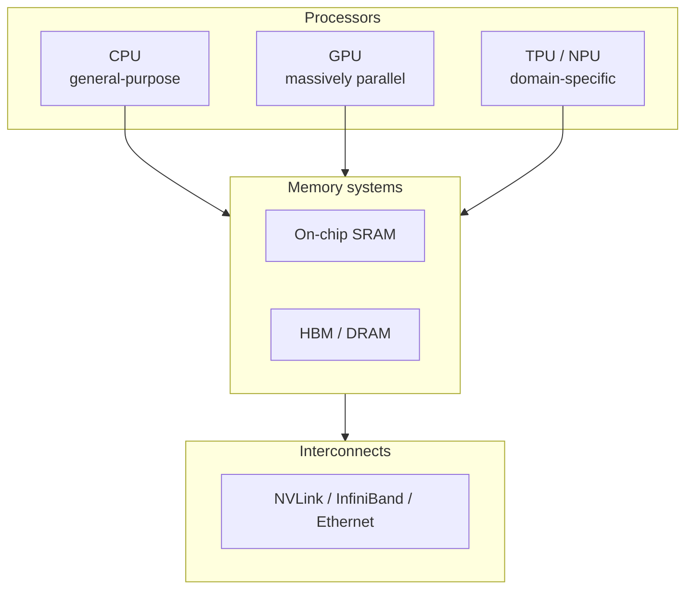
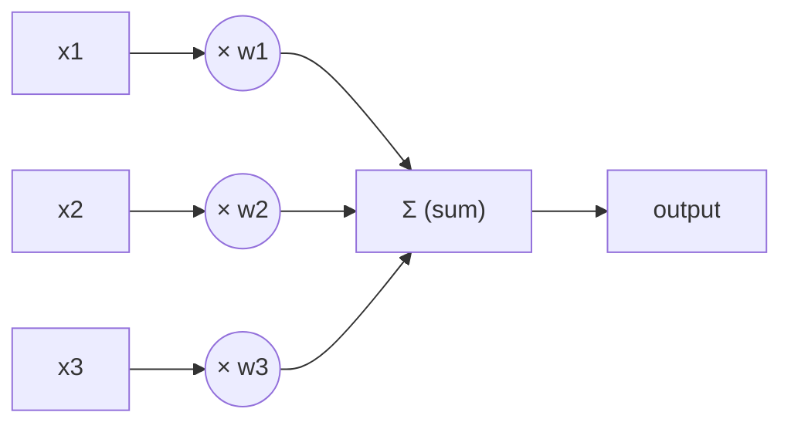
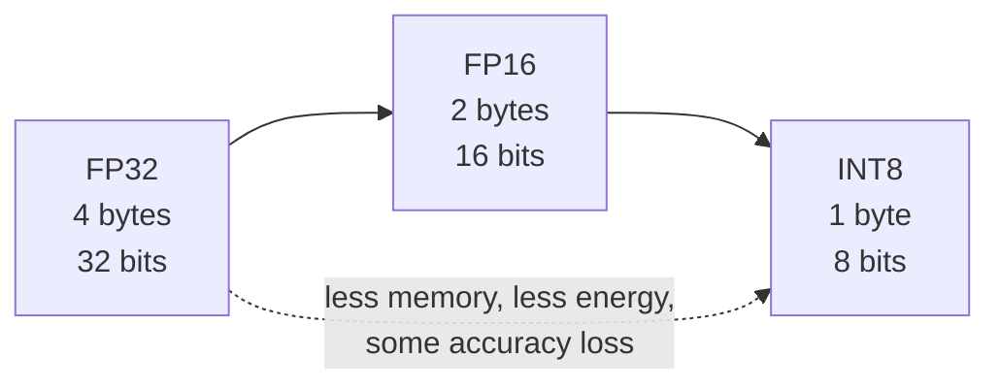
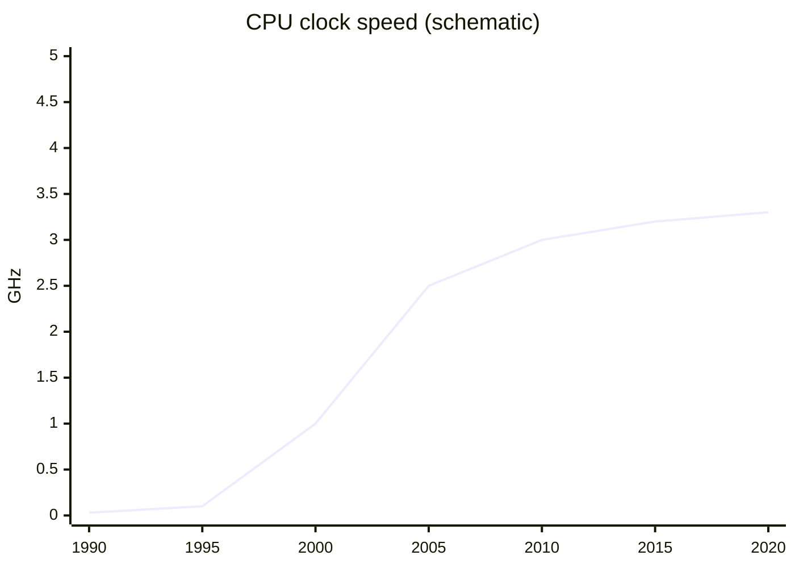
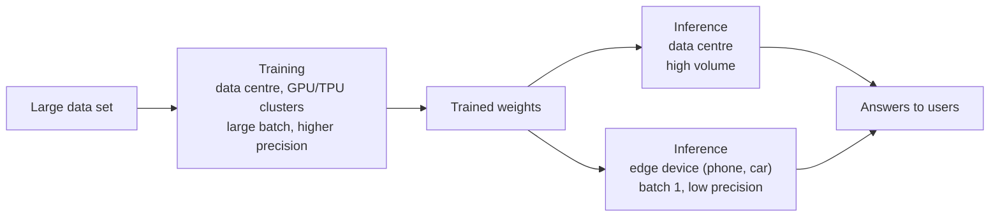
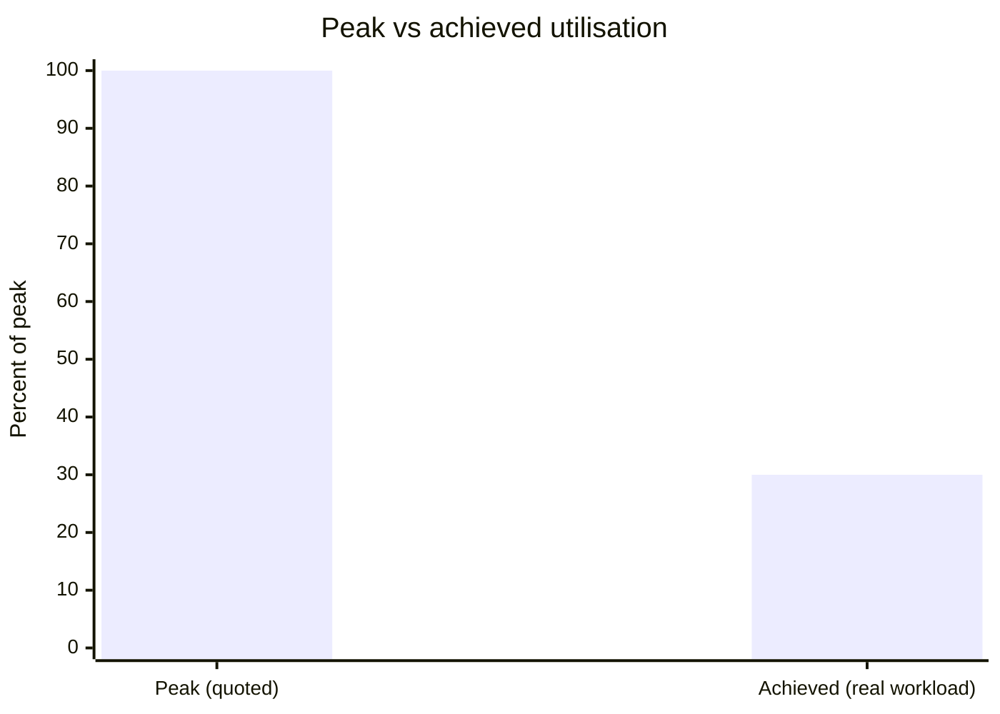
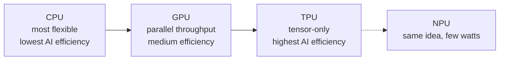
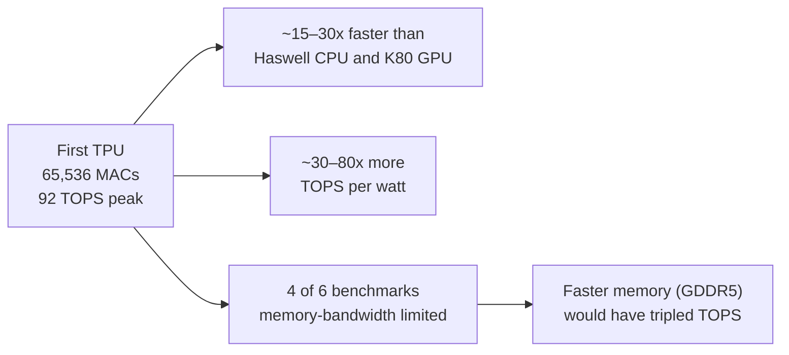
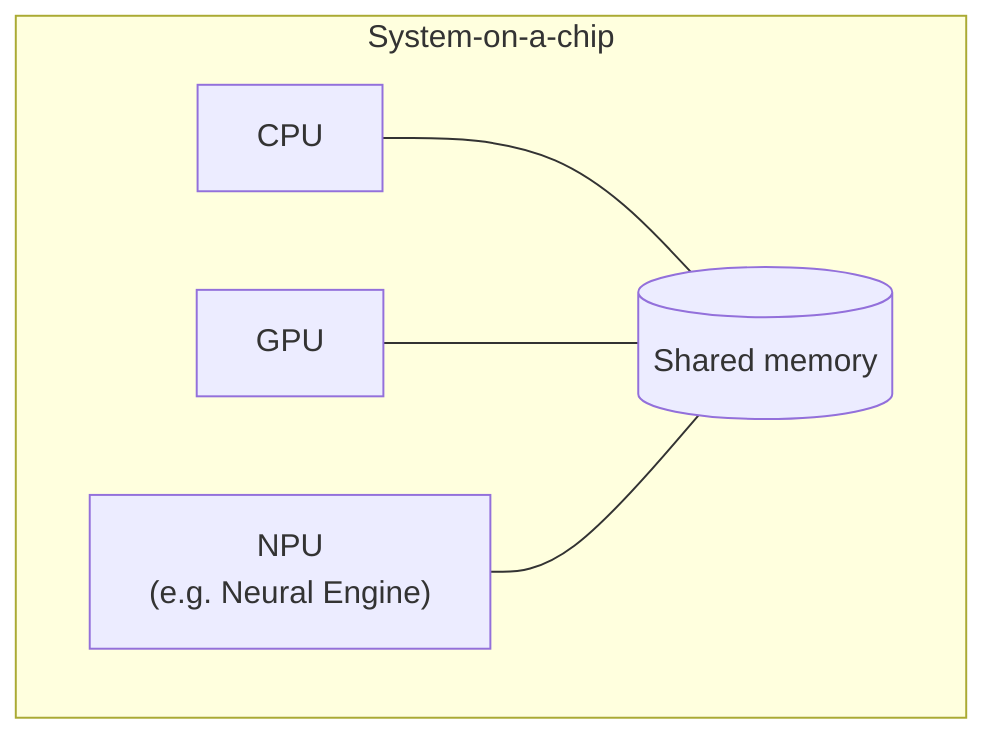
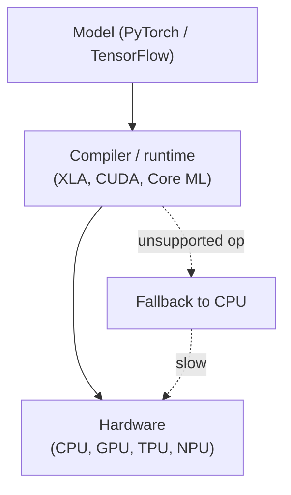

# Module 01: AI Hardware Architecture
 
| | |
|---|---|
| **Course** | Hardware, Networks & Behaviourist AI |
| **Version** | V1.0 (substantive draft, Stage 1) |
| **Audience** | Beginners with basic programming knowledge and no hardware background |
| **Prerequisites** | Basic arithmetic, the idea of a variable and a loop. No electronics knowledge needed. |
| **Position in course** | First of five modules; Modules 02-05 reuse the vocabulary introduced here |
 
## Module overview
 
When people talk about artificial intelligence, they usually talk about software: models, data, and algorithms. But every AI model is, in the end, an enormous number of arithmetic operations running on physical chips. The choice of chip decides:
- how fast a model can be trained (days or months),
- how much electricity it uses (and therefore what it costs and what it emits),
- how quickly it can answer one request (milliseconds or seconds),
- and whether it can run on a phone at all, or only in a data centre.
This module explains why AI needs specialised hardware and how it's designed. It ends with a case study of the hardware inside a phone you may be holding right now: the Apple Neural Engine.
 
## Learning objectives
 
By the end of this module, you will be able to:
 
1. Define AI hardware and explain why general-purpose processors are not always enough.
2. Compare CPUs, GPUs, and TPUs in terms of architecture and the kind of work each does best.
3. Explain how parallel processing, systolic arrays, and reduced-precision arithmetic speed up the core operation of neural networks (matrix multiplication).
4. Describe the memory hierarchy and explain why moving data often costs more than computing on it.
5. Use a simple roofline calculation to decide whether a workload is limited by compute or by memory.
6. Analyse how the Apple Neural Engine brings AI onto a phone, and judge its trade-offs.

## A running example
 
Throughout the module we return to one small, concrete task so that every idea has something to attach to:
 
> **Running example: unlocking a phone with your face.** A camera takes a picture, a neural network turns it into a list of numbers, and the phone compares those numbers with the ones saved when you set up Face ID. The whole thing has to take a fraction of a second, use almost no battery, and never send your face to anyone else's computer.
 
Every hardware idea in this module (parallel units, low precision, on-chip memory) exists because of pressures like these.

## Module 01 · Section 1: Definition and Fundamental Concepts

> [!NOTE]
> **Where this module is going.** Section 1 defines AI hardware and the arithmetic it exists to speed up. Section 2 compares CPUs, GPUs, TPUs and NPUs. Section 3 shows how parallelism speeds up MACs, and where it stops helping. Section 4 explains why memory, not arithmetic, is often the real limit. Section 5 applies everything to a real device, the Apple Neural Engine.

> [!IMPORTANT]
> **Big idea.** AI hardware is not magic: it is ordinary computing hardware that has been arranged so that the one kind of arithmetic that AI does all day is cheap in time, energy, and money.

## Learning objectives

By the end of this section you should be able to:

1. Define AI hardware and classify it into general-purpose processors, massively parallel processors, domain-specific accelerators, memory systems and interconnects.
2. Explain what a neural network actually computes, and define a MAC.
3. Compute the output of a single neuron by hand, and count the MACs in a layer.
4. Use the key vocabulary of the module (FLOP, TOPS, throughput, latency, precision, bandwidth) correctly.
5. Explain why faster CPUs alone no longer solve AI workloads, and why parallelism and memory efficiency do.
6. Distinguish training from inference and state how their hardware requirements differ.
7. Choose between chips using the six comparison metrics.

## Table of contents

- [1.1 What is AI hardware?](#11-what-is-ai-hardware)
- [1.2 What do AI models actually compute?](#12-what-do-ai-models-actually-compute)
- [1.3 Key terms](#13-key-terms)
- [1.4 Why not just use a faster CPU?](#14-why-not-just-use-a-faster-cpu)
- [1.5 Training versus inference](#15-training-versus-inference)
- [1.6 Choosing hardware: metrics to compare](#16-choosing-hardware-metrics-to-compare)
- [1.7 Activities for Section 1](#17-activities-for-section-1)
- [1.8 Summary](#18-summary)
- [1.9 Glossary](#19-glossary)
- [1.10 Answer key](#110-answer-key)
- [References](#references)

---

## 1.1 What is AI hardware?

AI hardware is any physical computing device (a processor, a memory system or the wiring between them) that is designed, or is well suited, to run machine-learning workloads efficiently.

The word *efficiently* matters. A laptop CPU can run a neural network, and so can a calculator if you are patient enough. The real questions are:

- **How fast?** (time)
- **How much energy?** (battery life, electricity bill, heat)
- **At what cost?** (price of the chip, size of the data centre)

AI hardware therefore includes:

| Category | What it is | Examples |
|---|---|---|
| General-purpose processors used for AI | Chips designed for any program but able to run AI | CPUs (Intel, AMD, Arm) |
| Massively parallel processors | Thousands of simple cores doing the same thing to different data | GPUs (NVIDIA, AMD) |
| Domain-specific accelerators | Chips designed around the arithmetic of neural networks | TPUs (Google), NPUs such as Apple's Neural Engine |
| Memory systems | Fast memory placed near the compute units | On-chip SRAM, High Bandwidth Memory (HBM) |
| Interconnects | Links between chips and between machines | NVLink, TPU inter-chip links, Ethernet/InfiniBand (Module 02) |

**Table 1.1.** Five categories of AI hardware.

**Figure 1.1.** The five categories of AI hardware, shown as a layered system: processors compute, memory systems feed them, and interconnects link chips and machines. *Source: author's own diagram, based on Hennessy & Patterson (2019).*



> [!TIP]
> **Going further.** A chip designed for one domain is often called an **ASIC** (application-specific integrated circuit). A TPU is an ASIC for neural-network arithmetic. The opposite extreme is the CPU, a general-purpose processor.

---

## 1.2 What do AI models actually compute?

Before comparing chips, we need to know what the chips are asked to do.

A neural network is built from layers. Most layers do one dominant operation: multiply a block of numbers (the **weights**, which the model learned during training) by another block of numbers (the **inputs**), then add the results together.

For one output value, the calculation looks like this:

```text
Output = (w1 × x1) + (w2 × x2) + (w3 × x3) + ... + (wn × xn)
```

Each "multiply, then add to a running total" step is called a **MAC** (multiply-accumulate).

**Figure 1.2.** A single neuron: each input is multiplied by its weight, and the products are summed into one output. *Source: author's own diagram.*



### Worked example 1.A: a single neuron by hand

*Illustrative numbers.* A tiny neuron has three weights and receives three inputs:

| | w1 / x1 | w2 / x2 | w3 / x3 |
|---|---:|---:|---:|
| Weights **w** | 0.5 | -1.0 | 2.0 |
| Inputs **x** | 4 | 3 | 1 |

**Table 1.2.** Weights and inputs for Worked example 1.A.

1. **Step 1.** Start the running total at 0.
2. **Step 2.** MAC #1: `total = 0 + (0.5 × 4) = 0 + 2.0 = 2.0`
3. **Step 3.** MAC #2: `total = 2.0 + (-1.0 × 3) = 2.0 - 3.0 = -1.0`
4. **Step 4.** MAC #3: `total = -1.0 + (2.0 × 1) = -1.0 + 2.0 = 1.0`

**Result.** The output is **1.0**, computed with 3 MACs. (Real networks then pass this number through a simple function such as ReLU, which keeps positive numbers and turns negative ones into 0; that step is cheap compared with the MACs.)

The following Python program checks the result. Its complete expected output is shown below the code.

```python
weights = [0.5, -1.0, 2.0]
inputs = [4, 3, 1]

total = 0
for w, x in zip(weights, inputs):
    total += w * x          # one MAC per loop

print(total)                # 1.0
print(max(0, total))        # ReLU -> 1.0
```

Expected output:

```text
1.0
1.0
```

Now scale it up. One layer might have 4,096 neurons, each with 1,024 inputs. That is 1,024 × 4,096 = **4,194,304 MACs**, about 4.2 million, for one layer and one input. A modern large language model needs billions to trillions of MACs to produce a single answer.

> [!IMPORTANT]
> **Key idea.** If a chip can do MACs very fast and very efficiently, it speeds up almost the whole model. This is why the MAC is the central operation in AI hardware design.

### Matrices: the same thing, written compactly

Writing out every MAC is tedious, so we group the weights into a table called a **matrix**, and the inputs into a list called a **vector**. "Multiply the weight matrix by the input vector" means "do all the neuron calculations at once". When we process several inputs at the same time, they form a second matrix, and we speak of matrix multiplication. Almost all of AI hardware is, at heart, hardware for multiplying matrices. A generalisation to higher dimensions is called a **tensor**, which is where the "T" in TPU comes from.

```text
Weight matrix W          Input vector x     Output vector y
(rows = neurons)

[ w11 w12 w13 ]          [ x1 ]             [ w11·x1 + w12·x2 + w13·x3 ]
[ w21 w22 w23 ]    ×     [ x2 ]      =      [ w21·x1 + w22·x2 + w23·x3 ]
[ w31 w32 w33 ]          [ x3 ]             [ w31·x1 + w32·x2 + w33·x3 ]
```

Each output value = 3 MACs. Whole layer = 3 × 3 = **9 MACs**.

The same idea in NumPy. Its complete expected output is shown below the code.

```python
import numpy as np

W = np.array([[0.5, -1.0, 2.0],
              [1.0,  0.0, 1.0],
              [0.0,  2.0, -1.0]])
x = np.array([4, 3, 1])

y = W @ x                   # all 9 MACs in one matrix-vector product
print(y)                    # [ 1.  5.  5.]
```

Expected output:

```text
[1. 5. 5.]
```

**Check by hand:** row 1 gives 0.5×4 + (−1.0)×3 + 2.0×1 = 1.0; row 2 gives 1.0×4 + 0.0×3 + 1.0×1 = 5.0; row 3 gives 0.0×4 + 2.0×3 + (−1.0)×1 = 5.0.

---

## 1.3 Key terms

These terms are used throughout the module. A complete glossary is in Section 1.9. Some terms (bandwidth, utilisation) are only fully explained later, in Sections 3 and 4, so treat this table as a first look.

| Term | Definition |
|---|---|
| **Training** | Adjusting a model's weights using lots of data. Very compute-heavy; usually done in data centres. |
| **Inference** | Using a trained model to produce an answer (for example, unlocking your phone). Happens every time a user uses the AI. |
| **MAC** | Multiply-accumulate: multiply two numbers and add the result to a running total. |
| **FLOP / FLOPs** | A floating-point operation (one add or multiply on decimal-style numbers). "FLOPs" is the plural; FLOPS (capital S) means FLOPs per second. One MAC counts as 2 FLOPs. |
| **TOPS** | Tera operations per second (10¹² operations per second). Often used for integer operations on AI chips. |
| **Throughput** | How much work is finished per second. |
| **Latency** | How long one task takes from start to finish. |
| **Precision** | How many bits are used to store each number: FP32 = 32-bit floating-point, FP16 = 16-bit float, INT8 = 8-bit integer. Lower precision means less memory, less energy and usually faster hardware, at some cost in accuracy. |
| **Accelerator** | A chip that works alongside the CPU to speed up specific kinds of work. |
| **Bandwidth** | How many bytes per second can be moved between two parts of a system. |

**Table 1.3.** Key terms for Section 1.

> [!WARNING]
> **Caution: bits and bytes.** 1 byte = 8 bits. An FP32 number takes 4 bytes, an FP16 number 2 bytes, and an INT8 number 1 byte. Many mistakes in hardware calculations come from forgetting this conversion.

**Figure 1.3.** The same model stored at three precisions. Lower precision uses less memory but keeps less information about each weight. *Source: author's own diagram.*



### Prefixes you will meet

| Prefix | Symbol | Power of ten | Example |
|---|---|---|---|
| kilo | k | 10³ | 1 kB = 1,000 bytes |
| mega | M | 10⁶ | 8 MB of cache |
| giga | G | 10⁹ | 500 GB/s bandwidth |
| tera | T | 10¹² | 92 TOPS |
| peta | P | 10¹⁵ | data-centre clusters quote PFLOPS |
| milli / micro / nano / pico | m / µ / n / p | 10⁻³ / 10⁻⁶ / 10⁻⁹ / 10⁻¹² | 1 ms, 1 µs, 1 ns, 1 pJ |

**Table 1.4.** SI prefixes used in this module.

Memory sizes are sometimes quoted in powers of two: 1 MiB = 2²⁰ = 1,048,576 bytes. The difference is small and does not change any conclusion in this module.

---

## 1.4 Why not just use a faster CPU?

For decades, the answer to "make computers faster" was simply "wait for the next CPU". That stopped working for two reasons.

**Reason 1: the workload is highly repetitive and independent.** Millions of MACs can be done at the same time because they do not depend on each other: the result of neuron 17 does not change the calculation for neuron 18. A chip built for doing one complicated thing quickly wastes its effort on this. A chip built for doing a huge number of simple things at once does not.

**Reason 2: energy and memory limits.** Chips can no longer simply be clocked faster without overheating. Historically, as transistors shrank, they also used less power, so each generation could run faster without getting hotter (this is often associated with Dennard scaling). That trend ended in the mid-2000s, and clock speeds flattened at a few gigahertz. Hennessy and Patterson, in their well-known textbook and Turing Award lecture, argue that because general-purpose processors have stopped improving as quickly as before, big gains in cost, energy, and performance must now come from domain-specific hardware (Hennessy & Patterson, 2019).

Gains now come from two directions, which this module keeps returning to:

1. doing more things at once (**parallelism**), and
2. moving less data (**memory efficiency**).

**Figure 1.4.** CPU clock speed over time, in schematic form. Clock speeds rose steeply until the mid-2000s, then flattened as power and heat limits were reached. *Source: author's own sketch, based on the trends described in Hennessy & Patterson (2019).*



---

## 1.5 Training versus inference

The same neural network is used in two very different ways, and the hardware requirements differ.

| | Training | Inference |
|---|---|---|
| **Goal** | Learn weights from data | Use learned weights to answer a request |
| **Frequency** | Rare, long jobs (days to months) | Constant: millions of small requests |
| **Main limit** | Raw compute and chip-to-chip communication | Latency, energy and cost per request |
| **Typical place** | Large data-centre clusters | Data centres and edge devices (phones, cars) |
| **Precision** | Usually higher (FP32, BF16, FP16) | Often lower (INT8, FP8, even 4-bit) |
| **Data movement** | Forward pass and backward pass; many intermediate values stored | Forward pass only |
| **Batch size** | Large (hundreds or more) | Often 1 (one user at a time) |

**Table 1.5.** Training versus inference.

**Figure 1.5.** Where training and inference sit on the hardware landscape. Training happens in the data centre on large batches; inference happens both in the data centre and on edge devices, often at batch size 1. *Source: author's own diagram.*



This distinction explains much of the hardware landscape. The first Google TPU was built for inference only (Jouppi et al., 2017); later generations added training, and Google's newest announced generation, Ironwood (announced 2025), is again aimed at inference at scale (Google, 2025).

> [!NOTE]
> **Why does the batch size matter?** Section 4 shows that a single-user request (batch size 1) tends to be limited by memory, whereas a large training batch tends to be limited by compute. That one fact shapes whole product lines.

---

## 1.6 Choosing hardware: metrics to compare

Section 1.3 defined the vocabulary. This table shows how those ideas are used to *choose* between chips.

| Metric | Question it answers | Why it matters |
|---|---|---|
| Throughput (TOPS, FLOP/s) | How much work per second? | Training speed |
| Latency | How long for one request? | User experience; real-time control |
| Performance per watt | How much work per joule? | Battery life; data-centre power bill |
| Utilisation | What share of peak is actually achieved? | Money paid for idle silicon |
| Performance per dollar | How much work per unit of cost? | Budget decisions |
| Memory capacity | How big a model fits? | Which models can run at all |

**Table 1.6.** Six metrics for comparing AI hardware.

**Figure 1.6.** Peak versus achieved utilisation. The gap between the two bars is the idle silicon you paid for. *Source: author's own diagram, based on the concept of utilisation introduced here and formalised in Section 3.*



> [!WARNING]
> **Caution: peak is not typical.** A chip's quoted "peak" number is what it could do if every arithmetic unit were busy every cycle. Real programs are usually far below that. Sections 3 and 4 explain why.

---

## 1.7 Activities for Section 1

- **Activity 1.A.** A neuron has weights w = [2, -1, 0.5] and inputs x = [1, 4, 6]. Compute the output by hand, stating each MAC step.
- **Activity 1.B.** A layer has 512 inputs and 2,048 outputs. How many MACs does one input vector require? How many FLOPs is that?
- **Activity 1.C.** A chip is quoted as 100 TOPS but achieves only 30% utilisation on your workload. What throughput do you actually observe?
- **Activity 1.D.** For each case, say whether it is training or inference, and give one reason: (a) a phone unlocking with Face ID, (b) a team fine-tuning a language model on 100 GPUs for three weeks, (c) a chatbot answering 10,000 user requests per second.
- **Activity 1.E.** A model has 7 billion parameters stored in FP16. How much memory do the weights need? How much in INT8?

---

## 1.8 Summary

- AI hardware is any processor, memory system or interconnect designed or well suited to run machine-learning workloads efficiently; it covers five categories (general-purpose CPUs, GPUs, domain-specific accelerators, memory systems, interconnects).
- Neural networks are dominated by MACs (multiply-accumulate): one output is the sum of weight × input products, and a layer with 1,024 inputs and 4,096 outputs contains 4,194,304 MACs.
- A 3-weight, 3-input neuron computes its output in 3 MACs; the worked example gives 1.0.
- Matrices and vectors are compact ways of writing millions of MACs at once; a tensor is the higher-dimensional generalisation, which gives the TPU its name.
- Faster CPUs alone do not solve AI workloads because the work is repetitive and independent, and because clock-speed growth stopped in the mid-2000s; gains now come from parallelism and memory efficiency.
- Training and inference differ in goal, frequency, main limit, typical place, precision, data movement and batch size.
- Six metrics — throughput, latency, performance per watt, utilisation, performance per dollar and memory capacity — let you choose between chips; quoted peak numbers are rarely achieved in practice.

---

## 1.9 Glossary

| Term | Meaning |
|---|---|
| **Accelerator** | A chip that works alongside the CPU to speed up specific kinds of work. |
| **ASIC** | Application-specific integrated circuit; a chip built for one domain. |
| **Bandwidth** | How many bytes per second can be moved between two parts of a system. |
| **Batch size** | The number of inputs processed together. |
| **Dennard scaling** | The historical trend that shrinking transistors also reduced their power use, allowing faster clocks; it ended in the mid-2000s. |
| **FLOP / FLOPs / FLOPS** | One floating-point operation / the plural / FLOPs per second. One MAC = 2 FLOPs. |
| **HBM** | High Bandwidth Memory; stacked DRAM placed next to an accelerator. |
| **Inference** | Using a trained model to produce an answer. |
| **Interconnect** | The links between chips and between machines. |
| **Latency** | Time for one task from start to finish. |
| **MAC** | Multiply-accumulate: multiply two numbers and add the result to a running total. |
| **Matrix** | A table of numbers; the standard way to write many MACs compactly. |
| **NPU** | Neural processing unit; a small, low-power AI accelerator in a phone or laptop chip. |
| **Precision** | How many bits are used to store each number (FP32, FP16, INT8, and so on). |
| **Tensor** | A multi-dimensional array; the higher-dimensional generalisation of a matrix. |
| **Throughput** | Amount of work finished per second. |
| **TOPS** | Tera operations per second (10¹² operations per second). |
| **Training** | Adjusting a model's weights using data. |
| **Utilisation** | The fraction of a chip's peak capacity that is actually doing useful work. |
| **Vector** | A one-dimensional list of numbers. |
| **Weight** | A number learned during training and used during inference. |

---

## 1.10 Answer key

**Activity 1.A.**
Step 1: total = 0.
Step 2: total = 0 + (2 × 1) = 2.
Step 3: total = 2 + (-1 × 4) = 2 − 4 = −2.
Step 4: total = −2 + (0.5 × 6) = −2 + 3 = **1.0**.
Computed with 3 MACs.

**Activity 1.B.**
MACs = 512 × 2,048 = **1,048,576**. FLOPs = 2 × 1,048,576 = **2,097,152** (about 2.1 million), because one MAC = 2 FLOPs.

**Activity 1.C.**
Observed throughput = 100 TOPS × 0.30 = **30 TOPS**. The other 70% of peak is idle silicon.

**Activity 1.D.**
(a) **Inference** — a trained model answers a single request on the device.
(b) **Training** — the weights are being adjusted using data over a long job on many chips.
(c) **Inference** — a trained model is answering many user requests, even though the total volume is large. (Serving at scale is still inference; the compute cost comes from volume, not from learning.)

**Activity 1.E.**
FP16: 7 × 10⁹ × 2 bytes = **14 GB**.
INT8: 7 × 10⁹ × 1 byte = **7 GB**.

---

## References

- Google. (2025). *Ironwood TPU announcement*.
- Hennessy, J. L., & Patterson, D. A. (2019). A new golden age for computer architecture. *Communications of the ACM*, 62(2), 48–60.
- Jouppi, N. P., et al. (2017). In-datacenter performance analysis of a Tensor Processing Unit. *Proceedings of ISCA 2017*.

[← Back to module overview](Draft-01.1.md) · [Next: Section 2 →](Draft-02.2.md)

# Hardware, Networks & Behaviourist AI

## Module 01 · Section 2: CPU vs GPU vs TPU

> [!IMPORTANT]
> **Big idea.** Three families of chips sit at different points on a trade-off between flexibility and efficiency. The more a chip is specialised for a task, the more efficient it is at that task and the less useful it is for anything else.

## Learning objectives

By the end of this section you should be able to:

1. Describe in one sentence each what a CPU, a GPU, a TPU and an NPU is designed to do.
2. Compare the four chip families on design goal, core count, control logic, flexibility, energy efficiency for AI, typical AI role, weakness for AI and programming route.
3. Explain what a systolic array is and work through a 2 × 2 weight-stationary example by hand and in code.
4. Summarise what the first TPU paper (Jouppi et al., 2017) measured, and state two caveats when reading it.
5. Explain why software tooling determines how useful a chip is in practice.
6. Choose an appropriate chip for a given scenario and justify the choice.

## Table of contents

- [2.1 The three chips in one sentence each](#21-the-three-chips-in-one-sentence-each)
- [2.2 Comparison table](#22-comparison-table)
- [2.3 Visual: where the chip area goes](#23-visual-where-the-chip-area-goes)
- [2.4 Systolic arrays and a worked 2 × 2 example](#24-systolic-arrays-and-a-worked-2--2-example)
- [2.5 What the first TPU paper measured](#25-what-the-first-tpu-paper-measured)
- [2.6 The NPU: AI on small devices](#26-the-npu-ai-on-small-devices)
- [2.7 Software: why a chip is only as useful as its tools](#27-software-why-a-chip-is-only-as-useful-as-its-tools)
- [2.8 Activities for Section 2](#28-activities-for-section-2)
- [2.9 Summary](#29-summary)
- [2.10 Glossary](#210-glossary)
- [2.11 Answer key](#211-answer-key)
- [References](#references)

---

## 2.1 The three chips in one sentence each

- **CPU (Central Processing Unit):** a few very capable cores that handle any kind of program quickly, one step at a time per core.
- **GPU (Graphics Processing Unit):** thousands of simpler cores that do the same operation on many data items at once. Originally built to draw graphics, it turned out to be ideal for neural networks, because drawing millions of pixels and multiplying large matrices are both "same operation, lots of data" problems.
- **TPU (Tensor Processing Unit):** a chip designed by Google specifically for tensor (multi-dimensional array) arithmetic, built around a grid of multiply-accumulate units.

A related term you will meet in Section 5 is **NPU** (Neural Processing Unit): a general name for a small, low-power AI accelerator inside a phone or laptop chip.

**Figure 2.1.** The three chip families on the flexibility–efficiency trade-off. Moving right trades generality for efficiency on tensor arithmetic. *Source: author's own diagram, based on Hennessy & Patterson (2019).*



> [!NOTE]
> **An everyday analogy.**
> A **CPU** is like a small team of expert chefs who can cook any dish in the book, but each works on one dish at a time.
> A **GPU** is like a huge kitchen of junior cooks who all follow the same instruction ("chop these 1,000 onions") together.
> A **TPU** is like a factory assembly line built to make exactly one product, extremely efficiently, but useless if you want something else.

---

## 2.2 Comparison table

| Feature | CPU | GPU | TPU |
|---|---|---|---|
| **Design goal** | Fast, flexible, low latency for one task | High throughput on parallel data | Maximum matrix throughput per watt for neural networks |
| **Core count** (order of magnitude) | Few to ~100 complex cores | Thousands of simple cores | A large grid of MAC units (tens of thousands in one array) |
| **Control logic** | Complex: caches, out-of-order execution, branch prediction | Simpler; many threads hide delays | Minimal; deterministic execution |
| **Flexibility** | Highest: runs any program | High: programmable for many parallel tasks | Lowest: tuned to tensor operations |
| **Energy efficiency for AI** | Lowest | Medium to high | Highest (for supported workloads) |
| **Typical AI role** | Pre-processing, data loading, small models, orchestration | Training and inference of large models | Large-scale training and inference in Google's cloud |
| **Weakness for AI** | Too few parallel units | Higher power than a custom ASIC; memory bandwidth can limit | Less flexible; tied to a software stack |
| **Programming** | Any language | CUDA, OpenCL, or frameworks such as PyTorch | Through frameworks such as TensorFlow/JAX and the XLA compiler |

**Table 2.1.** Comparison of CPU, GPU and TPU across design goal, core count, control logic, flexibility, energy efficiency, typical AI role, weakness for AI and programming route.

*Sources for the design descriptions: Jouppi et al. (2017); Sze et al. (2017); Hennessy & Patterson (2019); NVIDIA (n.d.).*

### Terms used in the table

- **Core:** a unit inside a chip that can execute instructions on its own.
- **Cache:** a small, fast memory that keeps copies of recently used data close to the processor.
- **Out-of-order execution:** a CPU trick of running instructions in a different order from the program when it is safe, to avoid waiting.
- **Branch prediction:** guessing which way an `if` statement will go so the CPU can keep working instead of waiting.
- **Deterministic execution:** every run takes the same, predictable number of cycles. This matters for services that must answer within a time limit.
- **Compiler:** software that translates a program into instructions for a specific chip. XLA is the compiler used for TPUs.
- **MAC (multiply-accumulate):** an operation that computes `a × b + c`; the basic building block of neural-network arithmetic.

---

## 2.3 Visual: where the chip area goes

**Figure 2.2.** A simplified, not-to-scale sketch of where each design spends its silicon. A CPU devotes much of its area to caches and control logic that make a single thread fast; a GPU devotes most area to arithmetic units; a TPU devotes nearly all of it to the grid of MACs and the memory that feeds it. The positions are a qualitative teaching sketch, not measurements. *Source: author's own sketch, based on the design descriptions in Jouppi et al. (2017) and Hennessy & Patterson (2019).*

```text
        CPU                       GPU                        TPU
+------------------------+ +------------------------+ +------------------------+
| [Core] [Core]  CACHE   | | c c c c c c c c c c c  | | Systolic array of      |
| [Core] [Core]  CACHE   | | c c c c c c c c c c c  | | MAC units              |
| big control logic      | | c c c c c c c c c c c  | | (data flows through)   |
| large caches           | | small control, cache   | | + on-chip buffer       |
+------------------------+ +------------------------+ +------------------------+
   Few smart cores          Many simple cores          Matrix-multiply engine
```

In a CPU much of the area is "overhead" (caches, prediction logic) that makes a single thread fast. In a GPU, most area goes to arithmetic units. In a TPU, nearly all of it goes to the grid of MACs and the memory that feeds it.

---

## 2.4 Systolic arrays and a worked 2 × 2 example

A **systolic array** is a grid of MAC cells. Each cell holds one weight, and data is passed from neighbour to neighbour instead of being fetched from memory again and again. This neighbour-to-neighbour passing is what makes the design memory-efficient: the same input is reused across many cells without repeated memory reads.

### Worked example 2.A: a 2 × 2 systolic array (weight-stationary)

Let the weights be **W = [[1, 2], [3, 4]]**, loaded once, one per cell. The input is **x = [5, 6]**. We want **y = W·x**.

**Figure 2.3.** A 2 × 2 weight-stationary systolic array. Each cell holds one weight; inputs enter from the top and partial sums move to the right. *Source: author's own diagram.*

```text
                 x1=5        x2=6
                  │           │
               ┌──▼──┐     ┌──▼──┐
 row 1 (y1) →  │  1  │ ──► │  2  │ ──► y1
               └──┬──┘     └──┬──┘
               ┌──▼──┐     ┌──▼──┐
 row 2 (y2) →  │  3  │ ──► │  4  │ ──► y2
               └─────┘     └─────┘
        (each cell holds one weight; partial sums move right)
```

| Cycle | What happens | Result |
|---|---|---|
| **1** | x1 = 5 enters column 1. The two cells compute 1 × 5 and 3 × 5 and pass the partial sums to the right. | 5 and 15 |
| **2** | x2 = 6 reaches column 2 (a real array staggers inputs by one cycle). The cells compute 2 × 6 + 5 and 4 × 6 + 15. | 17 and 39 |

**Table 2.2.** Cycle-by-cycle behaviour of the 2 × 2 systolic array in Figure 2.3.

**Result:** `y = [17, 39]`, using 4 MACs. Check: 1×5 + 2×6 = 17 and 3×5 + 4×6 = 39.

**Memory reads.** Each of the 4 weights was read from memory **once**, and each of the 2 inputs was read **once**, then handed from cell to cell. Without neighbour-to-neighbour passing, each input would be read twice (once per output). That saving in memory traffic is the point of the systolic design, and it grows with array size.

The following Python program counts the reads in both styles. Its complete expected output is shown below the code.

```python
W = [[1, 2],
     [3, 4]]
x = [5, 6]

# Without reuse: every MAC fetches its own weight and its own input
reads_no_reuse = 0
y = [0, 0]
for i in range(2):
    for j in range(2):
        y[i] += W[i][j] * x[j]
        reads_no_reuse += 2          # one weight read + one input read

# Systolic style: each weight read once, each input read once
reads_systolic = 4 + 2

print(y)                             # [17, 39]
print(reads_no_reuse, reads_systolic)  # 8 6
```

Expected output:

```text
[17, 39]
8 6
```

---

## 2.5 What the first TPU paper measured

The 2017 paper by Jouppi et al. is the best-documented comparison available, because it measured a real chip in real data centres:

- The heart of the first TPU is a **65,536-element 8-bit MAC matrix unit** with a peak of **92 TOPS** and a **28 MiB** software-managed on-chip memory.
- Compared with a contemporary Intel Haswell server CPU and an Nvidia K80 GPU in the same data centres, the TPU was on average about **15–30× faster** and delivered about **30–80× more TOPS per watt**.
- The authors attribute part of this to deterministic execution: caches, out-of-order execution, multithreading and prefetching improve average throughput, but not the 99th-percentile response time that user-facing services need.
- Four of the six benchmark applications were **memory-bandwidth limited** on the TPU. Using the GPU's faster GDDR5 memory in a revised design would have tripled achieved TOPS.

**Figure 2.4.** What the first TPU paper measured. The TPU beat contemporary CPUs and GPUs on speed and energy efficiency, but on four of six benchmarks it was limited by memory bandwidth rather than by arithmetic. *Source: author's own diagram, based on data in Jouppi et al. (2017).*



> [!WARNING]
> **Read this with care.** The comparison is from 2015–2017 hardware. It is a good illustration of the design philosophy, not a ranking of today's chips. Current GPUs have added dedicated matrix units of their own (NVIDIA calls them Tensor Cores), and the gap between "GPU" and "TPU" designs has narrowed.

> [!NOTE]
> **Why does the memory finding matter?** Even a chip with 65,536 MACs spent most of its time waiting for data on four out of six workloads. More arithmetic units do not help if they cannot be fed.

---

## 2.6 The NPU: AI on small devices

A phone cannot carry a 300-watt accelerator. An NPU applies the same ideas as a TPU (a grid of MAC units, low-precision numbers, on-chip memory) but scaled down to run in a few watts inside a **system-on-a-chip (SoC)**, which puts the CPU, GPU, NPU, memory controllers and other blocks on a single piece of silicon.

| Company | Name of its NPU |
|---|---|
| Apple | Neural Engine |
| Google Pixel | Tensor SoC |
| Qualcomm | Hexagon NPU |
| Many laptops | "AI Engine" / NPU |

**Table 2.3.** Vendor names for NPUs in consumer devices. Names differ, but the principle is the same.

**Figure 2.5.** An NPU inside a system-on-a-chip. The CPU, GPU and NPU share the same silicon and memory, which is what makes a few-watt AI accelerator practical on a phone. *Source: author's own diagram, based on Apple Inc. (2024) and Qualcomm (2024).*



Section 5 studies the Apple version.

---

## 2.7 Software: why a chip is only as useful as its tools

Hardware is useless if programmers cannot easily use it. This is a major reason GPUs became dominant for AI:

| Chip | Typical way programmers reach it |
|---|---|
| CPU | Any language; compiler targets it directly |
| GPU | CUDA (NVIDIA), OpenCL, or high-level frameworks (PyTorch, TensorFlow) that call vendor-optimised libraries |
| TPU | Frameworks (TensorFlow, JAX, PyTorch/XLA) compile to the TPU through XLA |
| Apple Neural Engine | Core ML, which decides whether a model runs on CPU, GPU or the Neural Engine |

**Table 2.4.** How programmers typically reach each chip family.

A programmer usually does not write instructions for the MAC units directly. They write a model in a framework, and a compiler/runtime maps it onto the hardware. This is why "unsupported operations falling back to the CPU" can silently make a model slow (see the case-study questions in Section 5).

**Figure 2.6.** The software stack between a model and the hardware. Each layer hides detail from the one above, but also adds a place where unsupported operations can fall back to the CPU. *Source: author's own diagram, based on NVIDIA (n.d.) and Apple Inc. (2024).*



> [!TIP]
> **Going further.** The combination of hardware and its software ecosystem is sometimes called a **platform**. Switching from one platform to another can be costly even if the new chip is faster on paper, which partly explains why one vendor can dominate a market.

---

## 2.8 Activities for Section 2

- [ ] **Activity 2.A.** Which of the three chips would you choose for each case? Justify briefly.
  (a) a web server running mixed tasks, (b) training a large image model, (c) a fixed, high-volume inference service in a data centre.
- [ ] **Activity 2.B.** In the 2 × 2 systolic example (Worked example 2.A), how many times was each weight read from memory, and how many times was each input read?
- [ ] **Activity 2.C.** A start-up wants to add a voice assistant to a smart speaker that runs on a small battery. Arrange CPU, GPU and NPU in order from most to least suitable and give one reason for your ordering.
- [ ] **Activity 2.D.** The first TPU was faster and more energy-efficient than its contemporaries on Google's workloads, but a start-up with a different workload might still pick a GPU. Give two reasons.

---

## 2.9 Summary

- CPUs prioritise flexibility and low latency; GPUs prioritise parallel throughput; TPUs prioritise matrix throughput per watt at the cost of flexibility; NPUs scale the TPU idea down to a few watts inside a phone or laptop SoC.
- Systolic arrays reduce memory traffic by holding weights in place and passing inputs and partial sums from neighbour to neighbour; in the 2 × 2 example this cut memory reads from 8 to 6.
- The first TPU (Jouppi et al., 2017) was about 15–30× faster and 30–80× more TOPS per watt than contemporary CPUs and GPUs, but four of six benchmarks were memory-bandwidth limited, and the comparison is historical.
- A chip is only as useful as its software ecosystem; unsupported operations that fall back to the CPU can silently erase the hardware advantage.
- Choosing a chip means matching its design goal to the workload: mixed latency-sensitive tasks favour a CPU, large-model training favours a GPU, fixed high-volume inference favours a TPU or NPU.

---

## 2.10 Glossary

| Term | Meaning |
|---|---|
| **ASIC** | Application-specific integrated circuit: a chip built for one fixed task. |
| **Branch prediction** | A CPU technique that guesses which way a conditional branch will go so it can keep working instead of waiting. |
| **Cache** | A small, fast memory that keeps copies of recently used data close to the processor. |
| **Compiler** | Software that translates a program into instructions for a specific chip. |
| **Core** | A unit inside a chip that can execute instructions on its own. |
| **CUDA** | NVIDIA's programming interface for running general-purpose code on its GPUs. |
| **Deterministic execution** | Every run takes the same, predictable number of cycles. |
| **MAC** | Multiply-accumulate: the operation `a × b + c`, the basic building block of neural-network arithmetic. |
| **NPU** | Neural Processing Unit: a small, low-power AI accelerator inside a phone or laptop chip. |
| **Out-of-order execution** | A CPU technique of running instructions in a different order from the program when it is safe, to avoid waiting. |
| **SoC** | System-on-a-chip: a single piece of silicon containing CPU, GPU, NPU, memory controllers and other blocks. |
| **Systolic array** | A grid of MAC cells in which each cell holds a weight and data is passed from neighbour to neighbour. |
| **TOPS** | Tera operations per second: a measure of arithmetic throughput. |
| **XLA** | A compiler used to map models onto TPUs. |

---

## 2.11 Answer key

**Activity 2.A.**
(a) **CPU** — the workload is mixed and latency-sensitive, so flexibility matters most.
(b) **GPU** (or a TPU if training on Google Cloud) — training needs high parallel throughput on large matrices.
(c) **TPU or another fixed-function accelerator** — the workload is fixed and high-volume, so maximum efficiency per watt pays off.

**Activity 2.B.**
Each weight is read **once** (4 reads in total), and each input is read **once** (2 reads in total), for 6 reads in total. Without neighbour-to-neighbour passing, each input would be read once per output, giving 8 reads. The saving grows with array size.

**Activity 2.C.**
Order: **NPU, then CPU, then GPU.**
Reason: the NPU gives the most operations per watt and is designed for exactly this kind of always-on, low-power inference; the CPU is flexible but less efficient; the GPU draws too much power for a small battery.

**Activity 2.D.**
Any two of: the workload may use operations the TPU does not support well (falling back to the CPU and losing the advantage); the team may already depend on a GPU software stack, and switching platforms is costly; GPU cloud availability and cost may be better; the workload may be memory-bandwidth limited, where the TPU's arithmetic advantage does not help.

---

## References

- Apple Inc. (2024). *Apple Platform Security guide*.
- Hennessy, J. L., & Patterson, D. A. (2019). A new golden age for computer architecture. *Communications of the ACM*, 62(2), 48–60.
- Jouppi, N. P., et al. (2017). In-datacenter performance analysis of a Tensor Processing Unit. *Proceedings of ISCA 2017*.
- NVIDIA. (n.d.). *GPU and Tensor Core documentation*.
- Qualcomm. (2024). *Hexagon NPU documentation*.
- Sze, V., et al. (2017). Efficient processing of deep neural networks: A tutorial and survey. *Proceedings of the IEEE*.

[← Previous: Section 1](Draft-01.2.md) · [Back to module overview](Draft-02.1.md) · [Next: Section 3 →](Draft-03.2.md)
