# Module 02: Computer Networks & AI Infrastructure

| | |
|---|---|
| **Course** | Hardware, Networks & Behaviourist AI |
| **Version** | V1.0 (substantive draft) |
| **Audience** | Beginners with basic programming knowledge and no networking background |
| **Prerequisites** | Module 01 (MACs, bandwidth, memory hierarchy, batch size). Basic arithmetic and the idea of a variable and a loop. |
| **Position in course** | Second of five modules; builds on the vocabulary of Module 01 and is reused by Modules 03-05 |

## Table of contents

- [Module overview](#module-overview)
- [Learning objectives](#learning-objectives)
- [A running example](#a-running-example)
- [Section 1: Network Architecture and Communication Protocols](#section-1-network-architecture-and-communication-protocols)
- [Section 2: TCP/IP and Data Transmission](#section-2-tcpip-and-data-transmission)
- [Section 3: Cloud Computing vs Edge Computing](#section-3-cloud-computing-vs-edge-computing)
- [Section 4: Network Latency, Bandwidth, and Scalability](#section-4-network-latency-bandwidth-and-scalability)
- [Section 5: Case Study — Cloud-Based AI Service (5G and AI-Powered Network Optimization)](#section-5-case-study--cloud-based-ai-service-5g-and-ai-powered-network-optimization)
- [Glossary (all sections)](#glossary-all-sections)
- [Answer Key (all sections)](#answer-key-all-sections)
- [References (all sections)](#references-all-sections)

---

## Module overview

Module 01 showed that an AI model is, in the end, a huge number of arithmetic operations on physical chips, and that moving data often costs more than computing on it. That story did not stop at the edge of the chip. A trained model has to be delivered to users, a request has to travel to wherever the model runs, and, when a model is too big for one chip, the chips have to talk to each other. All of that happens over networks.

The choice of network and of *where* the computation runs decides:

- how long a user waits for an answer (milliseconds or seconds),
- how much a service can grow before it breaks (one user or a billion),
- what data leaves the user's device (privacy), and
- how much of the extra hardware you pay for actually gets used (Module 01's utilisation, now across many machines).

This module explains how networks are organised, how data is moved reliably across them, where AI computation can be placed (cloud, edge, device), how to reason about latency, bandwidth and scalability with simple calculations, and how a modern mobile network (5G) and AI work together in both directions: the network carries AI services, and AI helps run the network.

> [!NOTE]
> **Where this module is going.** Section 1 introduces network architectures, layered models and the protocols AI services use. Section 2 follows data through TCP/IP and shows why a fast link can still deliver slow transfers. Section 3 compares cloud, edge and on-device computing. Section 4 gives the tools to reason about latency, bandwidth and scalability, including the communication cost of training across many chips. Section 5 applies everything to a cloud-based AI service delivered over 5G, and to AI-powered network optimization.

## Learning objectives

By the end of this module, you will be able to:

1. Describe common network architectures and explain how layered models and encapsulation let very different systems communicate.
2. Explain how TCP/IP moves data reliably (addressing, handshake, acknowledgements, flow and congestion control) and where UDP and QUIC differ.
3. Compare cloud, edge and on-device computing for an AI workload and justify a choice using latency, bandwidth, privacy and model size.
4. Calculate propagation, transmission and queueing delays and the bandwidth-delay product, and use them to explain why a transfer is slow.
5. Explain scalability, tail latency, and why communication limits the speed-up of training across many chips (linking to Amdahl's law from Module 01).
6. Analyse how 5G and AI-powered network optimization support a cloud-based AI service, and judge the trade-offs.

## A running example

Module 01 used Face ID, a task that stays entirely on the device. This module uses a contrasting task that cannot always stay there:

> **Running example: translating a street sign.** You point your phone's camera at a sign in a language you cannot read and ask for a translation. The photo has to be turned into text, translated, and shown to you within about a second. A small model might run on the phone's Neural Engine. A bigger, more accurate model runs in a data centre. Deciding which one answers (and how the photo gets there) is the networking problem of this module.

Every networking idea here (protocol layers, round trips, bandwidth, edge servers) exists because of pressures like these.

---

# Section 1: Network Architecture and Communication Protocols

> [!IMPORTANT]
> **Big idea.** A network is a set of machines connected by links that follow shared rules (protocols). Layering those rules lets each part do one job, so a phone, a router and a GPU server can cooperate even though they are built by different companies.

## Learning objectives

By the end of this section you should be able to:

1. Define a computer network and name its basic elements (nodes, links, packets, protocols).
2. Describe the scales of network that matter for AI, from inside a chip package to a mobile network.
3. Compare client-server, peer-to-peer and data-centre (leaf-spine) architectures.
4. Explain layering and encapsulation, and calculate the header overhead of a packet.
5. Match common application protocols (HTTP, gRPC, MQTT, WebRTC) to the AI scenarios they suit.

---

## 1.1 What is a computer network?

A **computer network** is a collection of devices (**nodes**) connected by **links** so they can exchange data. Data is cut into small pieces called **packets**; each packet carries a header with the information needed to deliver it. A **protocol** is an agreed set of rules for how packets are formatted, sent, received and acknowledged.

Networks matter to AI at three moments:

- **Delivering data to the model**: a photo, a voice clip or a sensor reading travels to where the model runs.
- **Delivering the model to the user**: weights are downloaded to a phone or a server.
- **Connecting the chips that run the model**: large models are split across many accelerators, which exchange results constantly (Module 01, Section 3, "Across chips").

> [!TIP]
> **Going further.** Module 01 listed *interconnects* as one of the five categories of AI hardware. This module is the full story of that category: what the links are, which rules they follow, and how far the data has to travel.

---

## 1.2 Network scales in AI systems

The same idea (send data over a link) appears at very different scales. Speed and delay change by many orders of magnitude between them. This is the memory hierarchy of Module 01 extended outwards.

| Scale | Typical link | Rough bandwidth | Rough delay |
|---|---|---|---|
| Inside an accelerator package | HBM stack to chip | ~TB/s (Module 01) | hundreds of ns |
| Between GPUs in one server | NVLink; PCIe | up to several hundred GB/s (NVLink); ~64 GB/s per direction (PCIe 5.0 x16) | ~µs |
| Between servers in a data centre | InfiniBand or Ethernet, 100-400 Gbit/s per port (12.5-50 GB/s) | 12.5-50 GB/s | ~µs to tens of µs |
| Between data centres and users | Fibre backbone and access network | 0.1-10 Gbit/s typical per user | ~ms to ~100 ms |
| Last hop to a phone | Wi-Fi, 4G, 5G | tens to hundreds of Mbit/s (more with 5G) | ~ms to tens of ms |

**Table 1.1.** Orders of magnitude for links at different scales. These are indicative figures from vendor specifications and typical deployments; exact values depend on the generation of hardware and on the network, so check current specification sheets before relying on them (NVIDIA, n.d.; Kurose & Ross, 2020).

> [!NOTE]
> **Bits and bytes again.** Network speeds are quoted in **bits** per second (Gbit/s), memory speeds in **bytes** per second (GB/s). Divide by 8 to convert: 100 Gbit/s = 12.5 GB/s. This is the same bits-and-bytes caution as in Module 01.

---

## 1.3 Network architectures

An **architecture** is the pattern in which machines are arranged and who talks to whom.

| Architecture | Idea | AI example |
|---|---|---|
| **Client-server** | Many clients send requests to a few servers that do the work | A phone app sending a photo to a cloud translation service |
| **Peer-to-peer (P2P)** | Machines talk to each other directly, with no central server | Devices sharing model updates in federated learning (Section 3.6) |
| **Data-centre fabric (leaf-spine)** | Every "leaf" switch connects to every "spine" switch, giving many equal paths | A training cluster where thousands of GPUs exchange gradients |
| **Hybrid** | A mix, such as device, edge server and cloud | Section 3 and the case study in Section 5 |

**Table 1.2.** Four network architectures and an AI example of each.

**Figure 1.1.** A small leaf-spine data-centre fabric. Servers attach to leaf switches; every leaf connects to every spine, so traffic between any two servers has several equal-length paths and no single link is the bottleneck. *Source: author's own diagram, based on Al-Fares, Loukissas & Vahdat (2008).*

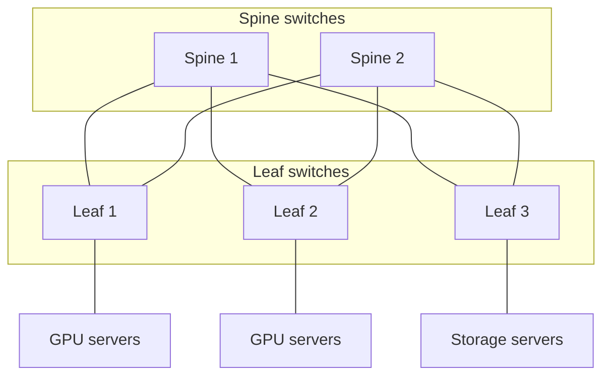

Why this shape? A single giant switch would be a bottleneck and a single point of failure. In a leaf-spine fabric you grow the network by adding switches, and if one spine fails the others carry the load.

---

## 1.4 Layered models and encapsulation

Sending a photo across the world involves radio signals, cables, addresses, routes, retransmissions and an application that understands the photo. Nobody designs all of that as one block. Instead, the work is split into **layers**, each using the one below it and offering a simple service to the one above.

| Layer (TCP/IP model) | Job | Example protocols |
|---|---|---|
| **Application** | What the programs say to each other | HTTP, gRPC, MQTT, DNS |
| **Transport** | Delivery between programs on two machines; reliability | TCP, UDP, QUIC |
| **Network (Internet)** | Addressing and routing across networks | IP (IPv4, IPv6) |
| **Link and physical** | Moving bits over one hop: cable, fibre, radio | Ethernet, Wi-Fi, 5G radio |

**Table 1.3.** The four-layer TCP/IP model. (The seven-layer OSI model splits the application layer into three and the link layer into two; you will see both in textbooks.)

As data moves down the stack, each layer wraps it in its own header. This is called **encapsulation**. At the destination, each layer removes its header and hands the rest upward.

**Figure 1.2.** Encapsulation. The application data is wrapped first by a TCP header, then an IP header, then an Ethernet header and trailer. Each wrapper is overhead that the link must carry in addition to the useful data. *Source: author's own diagram, based on Kurose & Ross (2020).*

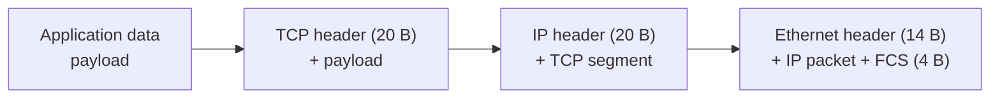

### Worked example 1.A: how much of a packet is useful?

*Illustrative numbers.* Assume a minimal TCP header (20 bytes), a minimal IPv4 header (20 bytes), and Ethernet framing (14-byte header plus 4-byte check sequence). That is 58 bytes of overhead per packet.

1. **Step 1.** Overhead = 20 + 20 + 14 + 4 = **58 bytes**.
2. **Step 2.** For a 1,000-byte payload, the frame is 1,000 + 58 = **1,058 bytes**.
3. **Step 3.** Efficiency = useful bytes ÷ total bytes = 1,000 ÷ 1,058 ≈ **94.5%**.
4. **Step 4.** For a tiny 100-byte payload (such as a small sensor reading), efficiency = 100 ÷ 158 ≈ **63.3%**.

**Result.** Large payloads waste little on headers; very small messages waste more than a third of the link. This is one reason many small messages are batched together, an idea that returns in Section 4.

The following Python program checks the result. Its complete expected output is shown below the code.

```python
HEADERS = 20 + 20 + 14 + 4   # TCP + IP + Ethernet header + Ethernet FCS (bytes)

def efficiency(payload):
    return payload / (payload + HEADERS)

print(1000 + HEADERS)                 # frame size for a 1,000-byte payload
print(f"{efficiency(1000):.1%}")
print(f"{efficiency(100):.1%}")
```

Expected output:

```text
1058
94.5%
63.3%
```

> [!WARNING]
> **Caution: real packets vary.** IPv6 headers are 40 bytes, TCP can carry options, and wireless links add their own framing. Treat 58 bytes as a teaching figure, not a rule.

---

## 1.5 Application protocols for AI services

At the top of the stack, programs agree on *what* to say. Different AI scenarios favour different protocols.

| Protocol | Style | Typical use in AI systems |
|---|---|---|
| **HTTP / REST (usually with JSON)** | Request and response, human-readable | Public AI APIs: send a prompt or an image, receive a result |
| **gRPC** | Compact binary messages, typed interfaces, streaming | Service-to-service calls inside a data centre, for example between a web server and a model server |
| **WebSocket / server-sent events** | Long-lived connection the server can push on | Streaming a chatbot's answer word by word |
| **MQTT** | Lightweight publish/subscribe messaging | Thousands of low-power sensors reporting to a hub |
| **RTP / WebRTC** | Real-time audio and video, usually over UDP | Live voice assistants and video calls |

**Table 1.4.** Common application protocols and the AI scenarios they suit.

**Figure 1.3.** A cloud AI request passes through several services, each speaking a protocol suited to its job. *Source: author's own diagram.*

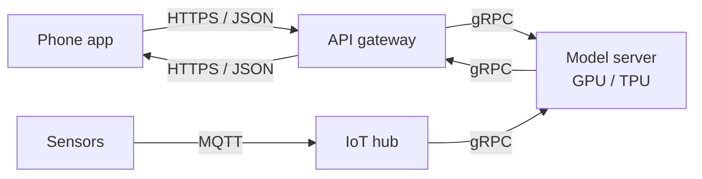

---

## 1.6 Key terms

A complete glossary is at the end of this module (see [Glossary](#glossary-all-sections)). Some terms (round-trip time, bandwidth-delay product) are explained in full in later sections, so treat this as a first look.

| Term | Definition |
|---|---|
| **Node** | Any device on a network: phone, server, router, switch. |
| **Link** | A connection that carries bits between two nodes. |
| **Packet** | A small chunk of data plus a header with delivery information. |
| **Protocol** | An agreed set of rules for communication. |
| **Header** | Control information a layer adds in front of the data it carries. |
| **Router / switch** | Devices that forward packets. Routers forward between networks using IP addresses; switches forward within a network. |
| **Bandwidth** | How many bits per second a link can carry (Module 01 defined it in bytes per second for memory). |
| **Latency** | How long it takes for data to get from one point to another, or for a request to be answered. |
| **RTT (round-trip time)** | Time for a message to go to the destination and a reply to come back. |
| **Throughput** | The rate at which useful data is actually delivered; always at most the bandwidth. |
| **Client / server** | The machine that asks / the machine that answers. |

**Table 1.5.** Key terms for Section 1.

---

## 1.7 Activities for Section 1

- [ ] **Activity 1.A.** Using the 58-byte overhead from Worked example 1.A, compute the efficiency for a 1,200-byte payload and for a 40-byte payload.
- [ ] **Activity 1.B.** For each task, name the TCP/IP layer responsible: (a) choosing which route a packet takes across the internet, (b) re-sending a lost segment, (c) turning bits into a radio signal, (d) an HTTP request for a translation.
- [ ] **Activity 1.C.** Explain in two or three sentences why a data centre uses a leaf-spine fabric instead of one very large switch.
- [ ] **Activity 1.D.** Match each scenario to the most suitable protocol (HTTP/REST, gRPC, MQTT, WebRTC): (a) thousands of battery-powered sensors reporting to a hub, (b) a web server calling a model server in the same data centre, (c) a live voice assistant, (d) a public API that accepts images from any developer.

---

## 1.8 Summary

- A network is nodes connected by links that follow protocols; data travels as packets with headers.
- Links span many scales, from TB/s inside a package to tens of Mbit/s on a mobile network; delay grows with distance, just as in the memory hierarchy of Module 01.
- Common architectures are client-server, peer-to-peer, data-centre leaf-spine fabrics and hybrids.
- Layering (application, transport, network, link) splits the work; encapsulation wraps data in a header at each layer. With 58 bytes of headers, a 1,000-byte payload is 94.5% efficient and a 100-byte payload 63.3%.
- Different protocols suit different AI jobs: HTTP/REST for public APIs, gRPC inside data centres, MQTT for sensors, WebRTC for real-time media.

---

# Section 2: TCP/IP and Data Transmission

> [!IMPORTANT]
> **Big idea.** IP gets packets across the world on a best-effort basis; TCP turns that unreliable delivery into a dependable stream. The price is round trips and careful pacing, and these can make a fast link feel slow.

## Learning objectives

By the end of this section you should be able to:

1. Explain what IP addresses and routing do, and why IP delivery is "best effort".
2. Describe how TCP establishes a connection, achieves reliability, and controls flow and congestion.
3. Distinguish TCP, UDP and QUIC and say when each is used.
4. Calculate time to first byte for different protocol setups.
5. Compute the bandwidth-delay product and the window-limited throughput of a TCP connection.
6. Explain how packet loss reduces TCP throughput, using the Mathis formula.

---

## 2.1 IP: addressing and best-effort delivery

Every device on the internet has an **IP address**. IPv4 addresses are 32 bits (about 4.3 billion possible); IPv6 addresses are 128 bits (Postel, 1981; Deering & Hinden, 2017). A **router** reads the destination address in each packet's header and forwards it one hop closer to its destination. No router keeps track of the whole journey.

IP is **best effort**: a packet may be delayed, lost, duplicated or arrive out of order, and IP does not tell anyone. This simple design is why the internet scales so well, but most applications need more.

**Figure 2.1.** A packet crosses several routers. Each router decides only the next hop. If a router is overloaded, it drops the packet and IP does not notice. *Source: author's own diagram, based on Kurose & Ross (2020).*

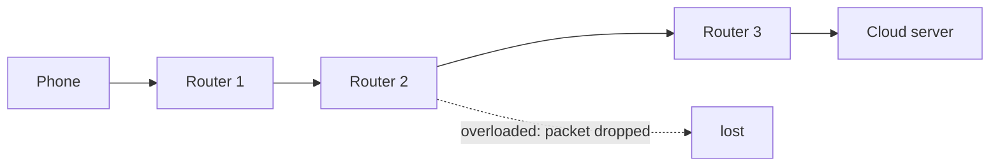

---

## 2.2 TCP: a reliable stream on top of unreliable packets

The **Transmission Control Protocol (TCP)** adds four things on top of IP (Cerf & Kahn, 1974; Eddy, 2022):

1. **Connection setup.** The two ends agree to talk, using a **three-way handshake**: SYN, SYN-ACK, ACK.
2. **Reliability.** Every byte has a sequence number. The receiver sends acknowledgements (ACKs); if the sender does not see an ACK in time, it sends the data again.
3. **Flow control.** The receiver advertises how much data it can accept (the **receive window**), so a fast sender does not overwhelm a slow receiver.
4. **Congestion control.** The sender adjusts how fast it sends in response to signs of network congestion. A classic scheme begins with **slow start** (the sending window grows quickly) and then increases it gradually until loss occurs, cutting it back sharply when loss is detected (Jacobson, 1988).

**Figure 2.2.** The TCP three-way handshake. One full round trip passes before the first byte of application data can be sent. *Source: author's own diagram, based on Eddy (2022).*

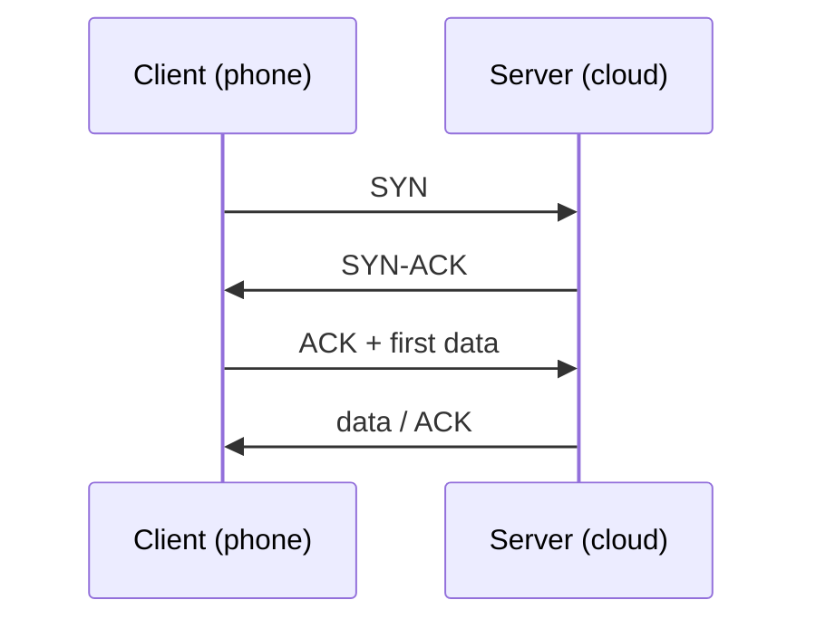

> [!NOTE]
> **An everyday analogy.** TCP is like a registered courier service. Before sending anything, you phone ahead to check the recipient is there (handshake). Every parcel is numbered and signed for (ACKs). If a signature does not come back, the parcel is sent again (retransmission). If the recipient's hallway is full, they tell you to slow down (flow control), and if the roads are jammed, you send fewer vans (congestion control).

---

## 2.3 UDP and QUIC

TCP's guarantees cost time. For some applications, an old packet is worse than no packet: a voice assistant that waits to retransmit a lost 20 ms audio chunk will only deliver it too late.

| Protocol | Reliable? | Connection setup | Typical use |
|---|---|---|---|
| **TCP** | Yes, ordered stream | 1 round trip (plus security handshake) | Web, file and model downloads, most APIs |
| **UDP** | No: just send packets (Postel, 1980) | None | Real-time voice and video, games, DNS |
| **QUIC** | Yes, built on UDP | Transport and security combined, about 1 round trip (Iyengar & Thomson, 2021) | HTTP/3, modern web and mobile apps |

**Table 2.1.** Three transport protocols compared.

QUIC runs in user space on top of UDP, combines connection setup with encryption, and avoids a TCP problem where one lost packet blocks everything behind it. It is increasingly used by large web services.

> [!TIP]
> **Going further: security.** Most AI APIs use **TLS** (Transport Layer Security) so that data (your photo, your prompt) is encrypted in transit. TLS 1.3 needs one extra round trip on top of TCP's handshake (Rescorla, 2018).

---

## 2.4 Worked example 2.A: time to first byte

**Problem.** A phone is 40 ms (round trip) from a cloud server. How long before the first byte of an answer can arrive, using TCP with TLS 1.3, and using QUIC? Assume a fresh connection and ignore server processing time.

**Step 1: Count round trips for TCP + TLS 1.3.**

- TCP handshake: **1** round trip.
- TLS 1.3 handshake: **1** round trip.
- HTTP request and first byte of response: **1** round trip.
- Total: **3** round trips.

**Step 2: Count round trips for QUIC.**

- Combined transport and security handshake: **1** round trip.
- Request and first byte of response: **1** round trip.
- Total: **2** round trips.

**Step 3: Multiply by the RTT.**

| Setup | Round trips | Time to first byte at RTT = 40 ms |
|---|---:|---:|
| TCP + TLS 1.3 | 3 | **120 ms** |
| QUIC | 2 | **80 ms** |

**Table 2.2.** Time to first byte for a fresh connection. Connection reuse and session resumption can remove some of these round trips in practice.

The following Python program checks the numbers. Its complete expected output is shown below the code.

```python
def time_to_first_byte(rtt_ms, round_trips):
    return rtt_ms * round_trips

rtt = 40
print("TCP + TLS 1.3:", time_to_first_byte(rtt, 3), "ms")
print("QUIC:", time_to_first_byte(rtt, 2), "ms")
```

Expected output:

```text
TCP + TLS 1.3: 120 ms
QUIC: 80 ms
```

> [!IMPORTANT]
> **Key idea.** Handshakes cost *round trips*, and a round trip cannot be made shorter by buying a faster link. Only moving the server closer, or doing fewer round trips, helps. This is the networking version of "moving data is more expensive than computing on it".

---

## 2.5 Worked example 2.B: why a fast link can give a slow transfer

TCP can only have as much data "in flight" (sent but not yet acknowledged) as its window allows. To keep a link full, the window must be at least the **bandwidth-delay product (BDP)**:

```text
BDP = bandwidth × round-trip time
```

**Problem.** A 1 Gbit/s link has a 40 ms RTT. A TCP connection uses a classic 65,535-byte window. What is the BDP, and what throughput does the window allow?

1. **Step 1.** BDP = 1 × 10⁹ bit/s × 0.040 s = 40 × 10⁶ bits = **5.0 MB** (divide by 8 to get bytes).
2. **Step 2.** Window-limited throughput = window ÷ RTT = 65,535 × 8 bits ÷ 0.040 s ≈ **13.1 Mbit/s**.
3. **Step 3.** Share of the link used = 13.1 Mbit/s ÷ 1,000 Mbit/s ≈ **1.31%**.

**Result.** The link could carry 1 Gbit/s, but this connection uses about 1.3% of it. The sender spends most of the time waiting for ACKs. Modern TCP uses *window scaling* to allow much bigger windows; the point of the example is that the window must be roughly the BDP to fill the link.

**Figure 2.3.** The sender can only keep one window of data in flight per round trip. If the window is smaller than the pipe, the pipe is mostly empty. *Source: author's own diagram, based on Kurose & Ross (2020).*

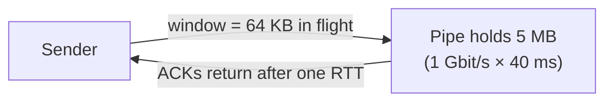

The following Python program checks the numbers. Its complete expected output is shown below the code.

```python
link = 1e9          # bit/s
rtt = 0.040         # seconds
window = 65535      # bytes

bdp = link * rtt / 8                 # bytes
limit = window * 8 / rtt             # bit/s

print(bdp / 1e6, "MB")
print(round(limit / 1e6, 1), "Mbit/s")
print(f"{limit / link:.2%}")
```

Expected output:

```text
5.0 MB
13.1 Mbit/s
1.31%
```

---

## 2.6 Worked example 2.C: how packet loss limits throughput

Even with a large window, TCP's congestion control slows down when it sees loss. A well-known approximation (the Mathis formula) says that the throughput of one TCP connection is about

```text
throughput ≈ 1.22 × MSS ÷ ( RTT × √p )
```

where **MSS** is the maximum segment size (about 1,460 bytes of payload on Ethernet) and **p** is the packet-loss probability (Mathis et al., 1997).

**Problem.** For MSS = 1,460 bytes and RTT = 40 ms, find the throughput at loss rates p = 10⁻⁶, 10⁻⁴ and 10⁻².

The following Python program computes the three values. Its complete expected output is shown below the code.

```python
import math

MSS = 1460       # bytes
RTT = 0.040      # seconds

for p in (1e-6, 1e-4, 1e-2):
    rate = 1.22 * MSS * 8 / (RTT * math.sqrt(p))
    print(p, round(rate / 1e6, 1), "Mbit/s")
```

Expected output:

```text
1e-06 356.2 Mbit/s
0.0001 35.6 Mbit/s
0.01 3.6 Mbit/s
```

**Interpretation.** Because of the square root, a 100× increase in loss produces a 10× fall in throughput. A wireless last hop with noticeable loss, or a congested path, can therefore dominate the whole transfer, however fast the backbone is.

> [!WARNING]
> **Caution: an approximation.** The formula assumes a long-lived, loss-limited TCP flow in steady state and a particular congestion-control algorithm. It is a good way to see the *shape* of the effect (RTT and loss both matter), not a precise prediction for a particular connection.

---

## 2.7 Why this matters for AI

- **Model downloads and API calls** are transfers like those above: RTT and loss, not just bandwidth, set the speed.
- **Streaming answers** (token by token) use long-lived connections so the handshake is paid once, not for every word.
- **Real-time voice and video** favour UDP-style transport, where late packets are dropped rather than retransmitted.
- **Training clusters** often bypass the ordinary operating-system network stack with hardware features such as RDMA (remote direct memory access), used with InfiniBand or RoCE Ethernet, so data moves from one machine's memory to another's with minimal overhead. The reason is exactly the one in Module 01: for the same bytes, less overhead means more of the expensive accelerators' time spent computing.

---

## 2.8 Activities for Section 2

- [ ] **Activity 2.A.** The phone-to-server RTT is 100 ms. Compute the time to first byte for TCP + TLS 1.3 and for QUIC on a fresh connection.
- [ ] **Activity 2.B.** A 100 Mbit/s link has an RTT of 80 ms and uses a 65,535-byte window. What is the BDP? What throughput does the window allow, and what percentage of the link is that?
- [ ] **Activity 2.C.** Using Worked example 2.C, what happens to the throughput when the loss rate rises from 10⁻⁶ to 10⁻⁴, and why?
- [ ] **Activity 2.D.** Put these in order: ACK, SYN, SYN-ACK. Then explain in one sentence why a live voice assistant may prefer UDP-based transport over TCP.

---

## 2.9 Summary

- IP addresses and routes packets across networks on a best-effort basis; packets can be lost, delayed or reordered.
- TCP adds a handshake, sequence numbers and acknowledgements, flow control and congestion control to deliver a reliable stream; UDP skips these; QUIC builds a reliable, encrypted transport on UDP and saves a round trip.
- On a fresh connection with a 40 ms RTT, TCP + TLS 1.3 needs 3 round trips (120 ms) before the first byte, QUIC 2 (80 ms).
- The bandwidth-delay product tells how much data must be in flight to fill a link: a 1 Gbit/s, 40 ms path needs 5 MB, and a 65,535-byte window reaches only about 1.3% of the link.
- Loss and RTT both limit TCP throughput; because of the square root in the Mathis formula, 100× more loss means 10× less throughput.

---

# Section 3: Cloud Computing vs Edge Computing

> [!IMPORTANT]
> **Big idea.** Where a model runs is a design choice with trade-offs. The cloud offers almost unlimited compute and large models; the edge and the device offer shorter paths, less data leaving the user, and independence from the network. Most real systems combine all three.

## Learning objectives

By the end of this section you should be able to:

1. Define cloud computing using the NIST characteristics and distinguish IaaS, PaaS and SaaS.
2. Define edge computing and describe the device, near-edge and cloud tiers.
3. Compare cloud, edge and on-device computing for an AI workload.
4. Build an end-to-end latency budget for cloud, edge and on-device inference.
5. Calculate the data saved by processing at the edge, and check whether a model fits on a device.
6. Describe hybrid patterns such as cascades, split inference and federated learning.

---

## 3.1 Cloud computing

The US National Institute of Standards and Technology (NIST) defines **cloud computing** as a model for on-demand network access to a shared pool of configurable computing resources, and lists five essential characteristics: on-demand self-service, broad network access, resource pooling, rapid elasticity, and measured service (Mell & Grance, 2011).

For AI this means you can rent a rack of GPUs for a weekend, scale a model service up when traffic spikes and down when it drops, and pay for what you used.

| Service model | What the provider runs | AI example |
|---|---|---|
| **IaaS** (infrastructure) | Servers, storage, networking; you install everything else | Renting GPU or TPU machines to train a model |
| **PaaS** (platform) | Plus the runtime and tools | A managed service to train and deploy models |
| **SaaS** (software) | The whole application | An AI assistant or translation service you simply use |

**Table 3.1.** Cloud service models with AI examples.

---

## 3.2 Edge computing

**Edge computing** moves computation closer to where data is produced or used, rather than sending everything to a distant data centre (Shi et al., 2016; Satyanarayanan, 2017). "Edge" is a spectrum of places:

- **On-device:** the phone, car or camera itself (for example, the Neural Engine from Module 01).
- **Near edge / multi-access edge computing (MEC):** small servers at a mobile operator's base station or local exchange, a few milliseconds from the user (ETSI, 2014).
- **Regional cloud:** a large data centre in the same region.
- **Distant cloud:** a data centre far away, with the most resources.

**Figure 3.1.** Computing tiers between a user and the cloud. Moving left means shorter paths and less data leaving the device; moving right means more compute and larger models. *Source: author's own diagram, based on Shi et al. (2016) and ETSI (2014).*

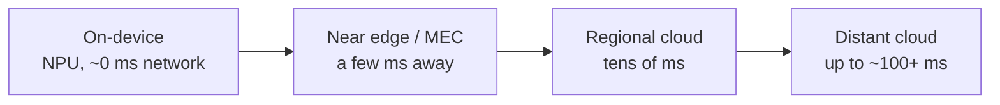

---

## 3.3 Comparison

| Property | On-device | Edge server (MEC) | Cloud |
|---|---|---|---|
| **Network delay** | None | A few ms | Tens to 100+ ms |
| **Compute and memory** | Smallest (watts, GB) | Medium | Largest, elastic |
| **Model size possible** | Small to mid (quantised) | Mid to large | Largest |
| **Privacy** | Best: data stays local | Good: data stays in the region | Data leaves the user's control |
| **Works offline** | Yes | No | No |
| **Cost model** | Cost sits in the device | Operator or enterprise infrastructure | Pay-per-use, scales with traffic |
| **Weakness** | Limited by battery and memory | Fewer locations, less elasticity | Network dependence, delay, data transfer |

**Table 3.2.** On-device, edge and cloud compared.

---

## 3.4 Worked example 3.A: an end-to-end latency budget

**Problem.** The running example sends a 200 KB photo to be translated. Compare three options. All numbers are illustrative assumptions.

- Uplink speed: 20 Mbit/s.
- Cloud region: RTT 60 ms; edge server: RTT 10 ms.
- Inference on a server accelerator: 10 ms.
- On-device model on the Neural Engine: 15 ms.
- Connection is already open (no handshake), and the reply is tiny.

**Step 1: Time to upload the photo.** 200,000 bytes × 8 ÷ 20 × 10⁶ bit/s = 0.080 s = **80 ms**.

**Step 2: Add the other terms.**

| Option | Upload | Network round trip | Inference | Total |
|---|---:|---:|---:|---:|
| Cloud | 80 ms | 60 ms | 10 ms | **150 ms** |
| Edge server | 80 ms | 10 ms | 10 ms | **100 ms** |
| On-device | none | none | 15 ms | **15 ms** |

**Table 3.3.** Latency budget for the three options.

**Step 3: Interpret.** Notice that the *upload*, not the server's fast inference, is the largest term for the remote options. Sending a smaller (compressed) image or sending extracted features would help; so would a faster link, which is where 5G enters in Section 5. The on-device option wins on latency, but only if the model on the phone is good enough.

**Figure 3.2.** Latency budget for each option. The remote options are dominated by upload and network delay, not by the model's compute time. *Source: author's own diagram, based on the illustrative assumptions in Table 3.3.*

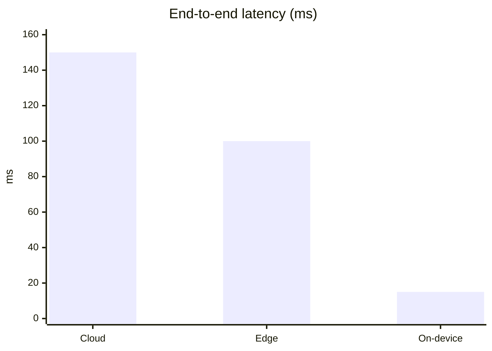

The following Python program checks the numbers. Its complete expected output is shown below the code.

```python
def tx_ms(size_bytes, rate_bps):
    return size_bytes * 8 / rate_bps * 1000

upload = tx_ms(200_000, 20e6)
cloud = upload + 60 + 10
edge = upload + 10 + 10

print("Upload:", round(upload), "ms")
print("Cloud:", round(cloud), "ms")
print("Edge:", round(edge), "ms")
print("On-device:", 15, "ms")
```

Expected output:

```text
Upload: 80 ms
Cloud: 150 ms
Edge: 100 ms
On-device: 15 ms
```

---

## 3.5 Worked example 3.B: how much data does the edge save?

**Problem.** A shop has 100 cameras, each streaming compressed video at 5 Mbit/s to a cloud service that detects events. Instead, an edge box in the shop analyses the video and sends only small event messages: 200 bytes each, about 10 per second per camera. How much network traffic is saved?

1. **Step 1: Streaming everything.** 100 × 5 Mbit/s = **500 Mbit/s**.
2. **Step 2: Sending only events.** 100 cameras × 200 bytes × 8 bits × 10 events/s = 1,600,000 bit/s = **1.6 Mbit/s**.
3. **Step 3: Ratio.** 500 ÷ 1.6 = **312.5**, so about 300 times less traffic.

The following Python program checks the numbers. Its complete expected output is shown below the code.

```python
cameras = 100
video = cameras * 5                          # Mbit/s
events = cameras * 200 * 8 * 10 / 1e6        # Mbit/s (200-byte events, 10 per second)

print(video, "Mbit/s")
print(events, "Mbit/s")
print(round(video / events, 1))
```

Expected output:

```text
500 Mbit/s
1.6 Mbit/s
312.5
```

**Interpretation.** The edge converts a *bandwidth* problem into a *compute* problem: the shop must now run a model locally (Module 01), but the wide-area network carries three hundred times less data, and raw video never leaves the premises.

---

## 3.6 Hybrid patterns

Real systems rarely pick one location. Common combinations:

| Pattern | Idea | Example |
|---|---|---|
| **Cascade** | A small, cheap model runs first; hard cases go to a bigger model | Phone recognises common signs locally, and sends unusual ones to the cloud |
| **Split inference** | The first layers run on the device, the rest on a server; only the intermediate values are sent | Reduces upload size and keeps raw data local |
| **Edge pre-processing** | The edge filters or compresses data before it goes to the cloud | Worked example 3.B |
| **Federated learning** | Devices train on their own data and send only model updates to a server (McMahan et al., 2017) | Keyboard prediction learned from many phones without uploading their text |

**Table 3.4.** Hybrid patterns combining device, edge and cloud.

### Does the model fit? (Module 01 revisited)

Module 01 showed that a model's weight memory is parameters × bytes per weight. That decides whether on-device is even possible.

| Model | Precision | Weight memory | Fits in an 8 GB phone shared with other apps? |
|---|---|---:|---|
| 3 billion parameters | 4-bit | 1.5 GB | Yes, comfortably |
| 13 billion parameters | 4-bit | 6.5 GB | Not realistically: almost all the memory |
| 70 billion parameters | FP16 | 140 GB | No: a multi-accelerator server |

**Table 3.5.** Weight memory for three models (weights only; real use needs extra working memory).

---

## 3.7 Choosing where to run: a checklist

| Question | If the answer is yes... |
|---|---|
| Must the answer arrive in a few tens of milliseconds, every time? | Favour on-device or edge |
| Must raw data stay with the user or on-premises? | Favour on-device or edge |
| Must it work with no connection? | On-device |
| Is the model too big for the device's memory? | Edge or cloud |
| Is demand very bursty or unpredictable? | Cloud (elasticity) |
| Is the job a large, one-off batch such as training? | Cloud |

**Table 3.6.** A first-pass checklist. Real decisions weigh several of these at once.

---

## 3.8 Activities for Section 3

- [ ] **Activity 3.A.** A 500 KB image is sent over a 40 Mbit/s uplink. Cloud RTT is 25 ms, edge RTT is 5 ms, and server inference takes 20 ms. Compute the total latency for cloud and edge. Which option could meet a 33 ms budget (30 frames per second) if an on-device model takes 30 ms?
- [ ] **Activity 3.B.** 50 cameras each stream 4 Mbit/s. An edge box instead sends 20 kbit/s of events per camera. How much traffic is saved, in Mbit/s and as a ratio?
- [ ] **Activity 3.C.** How much memory do the weights of a 13-billion-parameter model need in 4-bit and in FP16? Which, if either, could run on an 8 GB phone?
- [ ] **Activity 3.D.** Choose cloud, edge or on-device, and justify: (a) a hospital scanner that must respond instantly and keep images on site, (b) a nightly job that trains a large model, (c) noise suppression in a hearing aid.

---

## 3.9 Summary

- Cloud computing provides on-demand, elastic, pooled resources (NIST); service models are IaaS, PaaS and SaaS.
- Edge computing puts computation closer to the data: on-device, at a near-edge server (MEC), or in a regional cloud.
- Trade-offs: the cloud has the most compute and the longest path; on-device has no network but the least memory; the edge sits in between.
- In the street-sign example, cloud takes about 150 ms, edge 100 ms and on-device 15 ms; upload time, not compute, dominates the remote options.
- Processing at the edge can cut wide-area traffic by hundreds of times (312.5× in the camera example).
- Hybrid designs (cascade, split inference, edge pre-processing, federated learning) combine the tiers; model size and quantisation (Module 01) decide what fits on the device.

---

# Section 4: Network Latency, Bandwidth, and Scalability

> [!IMPORTANT]
> **Big idea.** Latency and bandwidth are different things and are limited by different laws. Latency has a floor set by the speed of light and a ceiling set by queues; bandwidth can be bought. Scalability is about keeping both under control as demand grows.

## Learning objectives

By the end of this section you should be able to:

1. Break latency into processing, queueing, transmission and propagation delay.
2. Distinguish latency, bandwidth and throughput, and calculate transmission and propagation delays.
3. Explain tail latency and compute the chance that at least one of many parallel requests is slow.
4. Explain how queueing makes delay grow sharply as utilisation approaches 100%.
5. Explain vertical vs horizontal scaling and apply the idea of communication overhead to data-parallel training.
6. Connect these ideas to Amdahl's law and utilisation from Module 01.

---

## 4.1 Four kinds of delay

The time for a packet to get from A to B is the sum of four delays (Kurose & Ross, 2020):

| Delay | What causes it | How to reduce it |
|---|---|---|
| **Processing** | Routers and servers examining headers and handling the request | Faster hardware, simpler pipelines |
| **Queueing** | Waiting in line behind other packets or requests | Spare capacity, load balancing |
| **Transmission** | Pushing all the bits onto the link: size ÷ bandwidth | More bandwidth, smaller messages |
| **Propagation** | The signal travelling through the medium: distance ÷ speed | Shorter distance (edge servers) |

**Table 4.1.** The four components of delay.

**Figure 4.1.** One hop of a packet's journey. Processing, queueing and transmission happen at each node; propagation happens on each link. *Source: author's own diagram, based on Kurose & Ross (2020).*

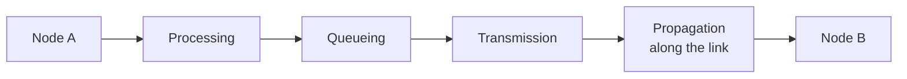

> [!NOTE]
> **An everyday analogy.** Think of a pipe. *Bandwidth* is how wide the pipe is: how much water per second can flow. *Latency* is how long the pipe is: how long a drop takes to get through. A wider pipe lets you move more water per second, but it does not make any single drop arrive sooner.

---

## 4.2 Worked example 4.A: the speed-of-light floor, and big downloads

Light in optical fibre travels at about two-thirds of its speed in vacuum, roughly 2 × 10⁸ m/s, which is 5 µs per kilometre one way.

**Problem (part 1).** What is the minimum delay over 1,000 km, 3,000 km and 10,000 km of fibre?

**Problem (part 2).** How long does it take to download a 1.5 GB model (the 3-billion-parameter 4-bit model from Module 01) at 100 Mbit/s and at 1 Gbit/s?

The following Python program computes both. Its complete expected output is shown below the code.

```python
V = 2e8   # m/s, light in fibre is roughly two-thirds of c

for km in (1000, 3000, 10000):
    one_way = km * 1000 / V * 1000          # milliseconds
    print(km, "km:", round(one_way, 1), "ms one way,", round(2 * one_way, 1), "ms round trip")

model_bits = 1.5e9 * 8
print(round(model_bits / 100e6, 1), "s at 100 Mbit/s")
print(round(model_bits / 1e9, 1), "s at 1 Gbit/s")
```

Expected output:

```text
1000 km: 5.0 ms one way, 10.0 ms round trip
3000 km: 15.0 ms one way, 30.0 ms round trip
10000 km: 50.0 ms one way, 100.0 ms round trip
120.0 s at 100 Mbit/s
12.0 s at 1 Gbit/s
```

**Interpretation.**

- Over 10,000 km no network can answer in under about 100 ms round trip, however much bandwidth is bought. Real routes are longer than straight lines, so real delays are higher. The only fix is a closer server, which is the case for edge computing.
- For the *model download*, transmission time dominates, and a 10× faster link makes it 10× quicker. Different problems need different fixes: latency-bound tasks need proximity; bandwidth-bound tasks need capacity.

---

## 4.3 Tail latency and the problem of many parallel requests

Average latency is a poor guide to what users feel. A large AI service often fans a request out to many servers (retrieval shards, model replicas, tool calls) and waits for all of them. Then the *slowest* response decides the total (Dean & Barroso, 2013).

### Worked example 4.B

Suppose each server is slow (say, delayed by a garbage-collection pause or a busy neighbour) on 1% of requests, independently. If a request must wait for *n* servers, the probability that at least one is slow is

```text
P(at least one slow) = 1 − (1 − p)ⁿ
```

The following Python program evaluates this for n = 1, 10 and 100 with p = 0.01. Its complete expected output is shown below the code.

```python
def p_slow(n, p):
    return 1 - (1 - p) ** n

for n in (1, 10, 100):
    print(n, f"{p_slow(n, 0.01):.1%}")
```

Expected output:

```text
1 1.0%
10 9.6%
100 63.4%
```

**Result.** A rare 1% problem becomes a problem for nearly two out of three requests when the request touches 100 servers. This is why large services track the 99th-percentile latency and design to tolerate slow components (for example, by sending a backup request).

**Figure 4.2.** Probability of hitting at least one slow server as the number of parallel servers grows, for a 1% per-server slow rate. *Source: author's own diagram, based on the numbers in Worked example 4.B and Dean & Barroso (2013).*

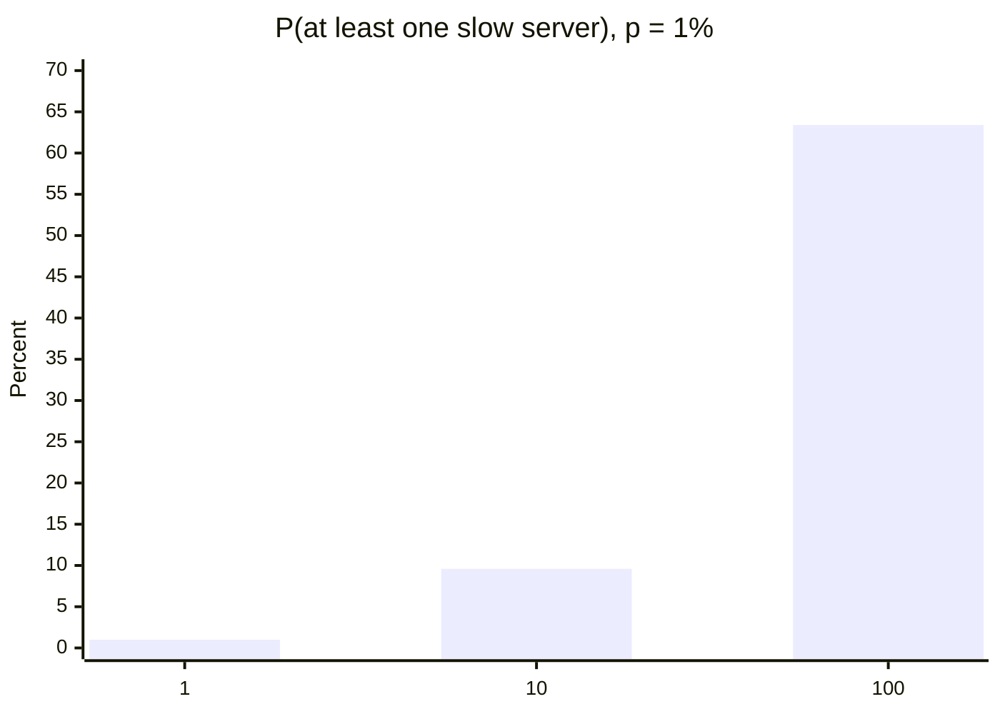

---

## 4.4 Queueing: why high utilisation is dangerous

A server that is busy 100% of the time has no spare capacity, so any burst forms a queue. For a simple single-server queue (the M/M/1 model, where arrivals are random and service times vary), the average time in the system is

```text
time ≈ service time ÷ (1 − utilisation)
```

This is a textbook result (Kurose & Ross, 2020) and a simplification of real systems, but its shape is what matters.

### Worked example 4.C

A model server takes 10 ms per request. What is the average response time at utilisation 0.5, 0.9 and 0.99?

```python
service = 10  # ms

for rho in (0.5, 0.9, 0.99):
    print(rho, round(service / (1 - rho)), "ms")
```

Expected output:

```text
0.5 20 ms
0.9 100 ms
0.99 1000 ms
```

**Figure 4.3.** Response time against utilisation for a 10 ms service time. Delay rises slowly until about 80% utilisation and then shoots upwards. *Source: author's own diagram, based on the formula above.*

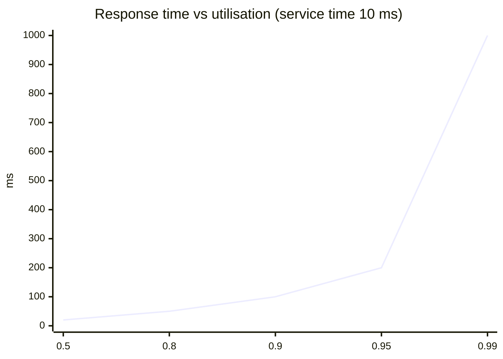

> [!WARNING]
> **Caution: utilisation is not a goal in itself.** In Module 01, low utilisation meant wasted silicon. Here, utilisation near 100% means unpredictable delay. Real services aim for a deliberate middle: high enough to be cost-effective, low enough to absorb bursts.

---

## 4.5 Scalability

A system is **scalable** if it can handle more load by adding resources without redesign.

| Approach | Idea | Limit |
|---|---|---|
| **Vertical scaling (scale up)** | Use a bigger machine (more memory, more accelerators in one box) | There is a biggest machine; failure takes everything down |
| **Horizontal scaling (scale out)** | Add more machines behind a **load balancer** | The work must be divisible, and machines must coordinate |
| **Autoscaling** | Add or remove machines automatically as demand changes | Takes time to start new machines; GPUs can be scarce |

**Table 4.2.** Ways to scale a service.

Scaling out works best when requests are independent and **stateless**, meaning any server can handle any request. Serving a model is mostly like this: add replicas of the model server and spread the requests. Training one large model is not: the machines must continually agree on the same set of weights.

---

## 4.6 Worked example 4.D: the communication cost of training

In *data-parallel training*, each GPU processes a different slice of the data, and then all GPUs must combine (average) their gradients before the next step. A standard method is **ring all-reduce**, in which each of *N* GPUs sends and receives about

```text
data per GPU = 2 × (N − 1) ÷ N × gradient size
```

(Patarasuk & Yuan, 2009). The result is that, for large *N*, each GPU moves close to twice the gradient size, almost independently of *N*.

**Problem.** Eight GPUs each hold 2 GB of gradients (a 1-billion-parameter model in FP16). A step needs 300 ms of computation. Compare a fast intra-server link of 50 GB/s with a 100 Gbit/s (12.5 GB/s) Ethernet link. Assume, for simplicity, that communication does not overlap with computation.

1. **Step 1: Data per GPU.** 2 × 7 ÷ 8 × 2 GB = **3.5 GB**.
2. **Step 2: Time to exchange.** At 50 GB/s: 70 ms. At 12.5 GB/s: 280 ms.
3. **Step 3: Efficiency** = compute ÷ (compute + communication): 300 ÷ 370 = **81.1%** and 300 ÷ 580 = **51.7%**.

The following Python program checks the numbers. Its complete expected output is shown below the code.

```python
def allreduce_gb(n_gpus, size_gb):
    return 2 * (n_gpus - 1) / n_gpus * size_gb

vol = allreduce_gb(8, 2)
compute = 0.300   # seconds per step

print(vol, "GB per GPU")
for name, bw in (("50 GB/s link", 50), ("100 Gbit/s Ethernet", 12.5)):
    comm = vol / bw
    print(f"{name}: {comm * 1000:.0f} ms, efficiency {compute / (compute + comm):.1%}")
```

Expected output:

```text
3.5 GB per GPU
50 GB/s link: 70 ms, efficiency 81.1%
100 Gbit/s Ethernet: 280 ms, efficiency 51.7%
```

**Interpretation.** With the slower network, nearly half of the expensive GPUs' time is spent waiting for data. This is the "communication" limit that Module 01 (Section 3.3) named, now with numbers. It is also why training clusters use the fastest links available, and why practitioners overlap communication with computation so that the two happen at the same time.

**Figure 4.4.** The same step with two network speeds. A slower link leaves the GPUs idle for longer in every step. *Source: author's own diagram, based on the numbers in Worked example 4.D.*

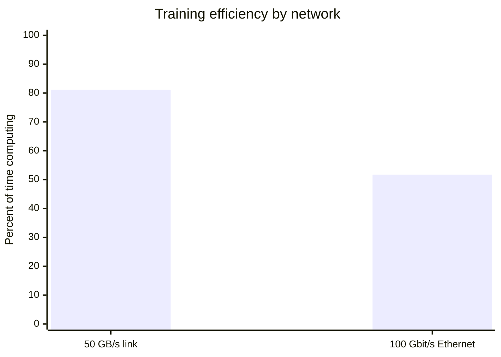

> [!TIP]
> **Going further.** Amdahl's law (Module 01, Section 3.3) says the serial part of a job caps the speed-up. In distributed training, communication that cannot be hidden behind computation behaves like a serial part, so adding more GPUs gives diminishing returns, just as the formula predicts.

---

## 4.7 Activities for Section 4

- [ ] **Activity 4.A.** What is the minimum round-trip time over 3,000 km of fibre? Why will a real connection be slower?
- [ ] **Activity 4.B.** A request waits for 50 servers, each slow 2% of the time. What is the probability that at least one is slow?
- [ ] **Activity 4.C.** A server has a 5 ms service time. Compute the average response time at utilisation 0.8 and 0.95.
- [ ] **Activity 4.D.** Four GPUs each hold 4 GB of gradients, and the link is 25 GB/s. How much data does each GPU move in a ring all-reduce, and how long does it take?

---

## 4.8 Summary

- Delay has four parts (processing, queueing, transmission, propagation); latency, bandwidth and throughput are different quantities.
- Propagation sets a floor: about 5 µs per km one way in fibre, so 10,000 km means at least about 100 ms round trip. Bandwidth cannot remove it; a closer server can.
- Transmission delay shrinks with bandwidth: a 1.5 GB model takes 120 s at 100 Mbit/s and 12 s at 1 Gbit/s.
- Tail latency: a 1% slow rate per server becomes a 63.4% chance of a slow request if 100 servers are involved.
- Queueing delay explodes near full utilisation: a 10 ms service takes 20 ms at 50% load and 1,000 ms at 99%.
- Scaling out works for independent requests; training needs communication, and with 8 GPUs exchanging 2 GB each, a 12.5 GB/s link cuts efficiency to 51.7% versus 81.1% at 50 GB/s.

---

# Section 5: Case Study — Cloud-Based AI Service (5G and AI-Powered Network Optimization)

> [!IMPORTANT]
> **Big idea.** A cloud-based AI service is only as good as the network between the user and the model. 5G improves that network and brings computing closer through edge servers; at the same time, AI is used to run the 5G network itself. Each helps the other.

## Learning objectives

By the end of this section, you should be able to:

1. Describe the path of a request from a phone through a 5G network to a cloud or edge AI service.
2. Explain the three 5G usage scenarios and the role of network slicing and multi-access edge computing (MEC).
3. Compare the latency of a cloud AI service over 4G, 5G, and 5G with an edge server, and identify which term dominates.
4. Explain, with an example, how AI is used to optimise a network (traffic prediction, energy saving, closed-loop control).
5. Evaluate the advantages and limitations of delivering AI services over 5G.

---

## 5.1 Introduction

**Cloud-based AI service.** A *cloud-based AI service* is a model hosted in a data centre and offered over the network: a translation API, a speech recognition service, an image classifier or a chatbot. Developers and apps send requests and receive results, as in the running example. The provider handles the hardware (Module 01) and scaling (Section 4); the user needs only a connection.

**5G.** The fifth generation of mobile networks, defined by the ITU as IMT-2020 and standardised by 3GPP. The ITU set three usage scenarios for it (ITU-R, 2015):

| Scenario | Goal | Example |
|---|---|---|
| **eMBB** (enhanced mobile broadband) | Much higher data rates | Fast uploads of photos and video to an AI service |
| **URLLC** (ultra-reliable low-latency communication) | Very low and dependable delay | Remote control, industrial automation, vehicles |
| **mMTC** (massive machine-type communication) | A very large number of devices | Dense fields of sensors |

**Table 5.1.** The three 5G usage scenarios.

The ITU's minimum technical requirements (ITU-R, 2017) include a peak data rate of 20 Gbit/s downlink and 10 Gbit/s uplink, a target of 1 ms user-plane latency for URLLC (4 ms for eMBB), and support for up to one million devices per square kilometre. These are *targets for the radio network under ideal conditions*, not what an app sees end to end.

> [!WARNING]
> **Caution: "1 ms" is not the delay of your AI service.** The 1 ms figure covers the radio part of the path. An AI request also has to be uploaded, cross the operator's network, reach a server, wait in a queue, be processed by the model and return. Section 5.3 builds the full budget.

---

## 5.2 The path of a request

**Figure 5.1.** The path of an AI request over a 5G network. The base station (gNB) is the radio access point; the user plane function (UPF) in the 5G core routes traffic either to a nearby edge server (MEC) or onward to the internet and the cloud. *Source: author's own diagram, based on 3GPP TS 23.501 and ETSI (2014).*

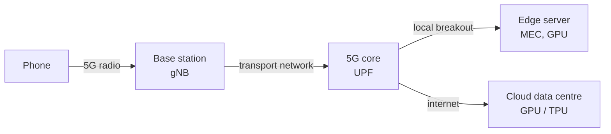

Three features of 5G matter to AI services:

- **Higher radio speeds** shorten the *upload* term in the latency budget (Section 3.4).
- **Multi-access edge computing (MEC):** the operator places servers near the base station, and the core can route traffic to them directly (local breakout), cutting the *round-trip* term (Section 4.1).
- **Network slicing:** a single physical network is divided into virtual slices with different guarantees. An AI service with strict latency needs can be given its own slice, kept apart from, say, bulk video downloads (3GPP, n.d.).

---

## 5.3 Worked example 5.A: latency budget of the street-sign translation

We reuse the 200 KB photo from Worked example 3.A. The numbers are illustrative assumptions, chosen to show the pattern; real values vary widely by operator, location and load.

| Path | Uplink speed | Round trip to server | Inference |
|---|---:|---:|---:|
| 4G + cloud | 20 Mbit/s | 50 ms | 10 ms |
| 5G + cloud | 100 Mbit/s | 30 ms | 10 ms |
| 5G + MEC edge | 100 Mbit/s | 10 ms | 10 ms |
| On-device NPU | n/a | n/a | 15 ms |

**Table 5.2.** Assumptions for each path.

**Step 1: Upload time.** At 20 Mbit/s: 200,000 × 8 ÷ 20 × 10⁶ = 80 ms. At 100 Mbit/s: **16 ms**.

**Step 2: Add the terms.**

- 4G + cloud: 80 + 50 + 10 = **140 ms**
- 5G + cloud: 16 + 30 + 10 = **56 ms**
- 5G + MEC: 16 + 10 + 10 = **36 ms**
- On-device: **15 ms**

**Figure 5.2.** End-to-end latency for each path. 5G reduces both the upload term and, with MEC, the round-trip term; on-device still has the lowest latency but the smallest model. *Source: author's own diagram, based on the illustrative assumptions in Table 5.2.*

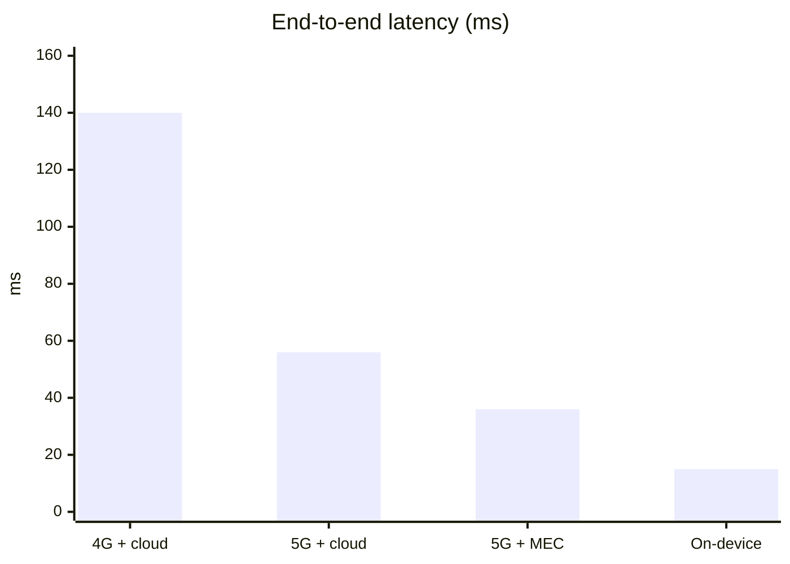

The following Python program checks the numbers. Its complete expected output is shown below the code.

```python
def tx_ms(size_bytes, rate_bps):
    return size_bytes * 8 / rate_bps * 1000

IMAGE = 200_000   # bytes
INFER = 10        # ms on a server accelerator

paths = {
    "4G + cloud": (20e6, 50),
    "5G + cloud": (100e6, 30),
    "5G + MEC edge": (100e6, 10),
}
for name, (rate, rtt) in paths.items():
    print(f"{name}: {tx_ms(IMAGE, rate) + rtt + INFER:.0f} ms")
print("On-device NPU: 15 ms")
```

Expected output:

```text
4G + cloud: 140 ms
5G + cloud: 56 ms
5G + MEC edge: 36 ms
On-device NPU: 15 ms
```

**Interpretation.** Moving from 4G to 5G cut the total by 84 ms (140 → 56), mostly from the faster upload (80 → 16 ms). Once the upload is fast, the largest remaining term in "5G + cloud" is the 30 ms round trip, so the MEC edge server (10 ms) gives the next big gain. The on-device model is fastest, but it is a smaller model; the network lets a phone reach a much larger one at the cost of some tens of milliseconds. That is the design trade-off of Section 3 in numbers.

---

## 5.4 AI for the network: optimization in a 5G system

So far AI has been a *customer* of the network. It is also a *tool* for running it. A 5G network has thousands of base stations, each making constant decisions about radio resources, and operators use machine learning to improve:

| Task | What AI does | Benefit |
|---|---|---|
| **Traffic prediction** | Forecasts load per cell from past patterns | Prepare capacity before the demand arrives |
| **Energy saving** | Predicts quiet periods and switches off spare radio capacity | Lower power bills and emissions |
| **Beam and resource management** | Adapts radio settings to user movement and interference | Better speed and reliability |
| **Anomaly and fault detection** | Spots unusual behaviour before it becomes an outage | Fewer service disruptions |

**Table 5.3.** Examples of AI-powered network optimization.

In the O-RAN architecture, an RAN Intelligent Controller (RIC) hosts such applications in two control loops: a *non-real-time* RIC for decisions on timescales longer than one second (such as training models and setting policies), and a *near-real-time* RIC for decisions between about 10 ms and 1 s (such as adjusting radio resources) (O-RAN Alliance, n.d.).

**Figure 5.3.** The network as a sense-decide-act loop. Measurements from the network feed a model; the model's decision changes the network; new measurements follow. *Source: author's own diagram, based on O-RAN Alliance (n.d.).*

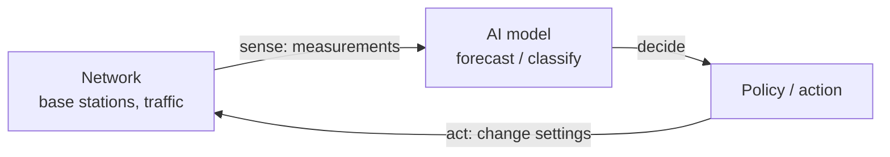

> [!NOTE]
> **Bridge to Behaviourist AI.** This is the same sense-decide-act loop as Face ID in Module 01, and as the agents studied in the later Behaviourist AI modules. Here the "agent" controls a network, and the "environment" is the traffic. Reinforcement learning, the subject of Module 03, is an active research approach for such control problems.

### Worked example 5.B: a tiny traffic forecast for energy saving

*A toy model, for teaching.* A base station's load (as a percentage of capacity) is measured every 15 minutes: 40, 35, 30, 22, 15, 10, 8, 9. We forecast the next load with **exponential smoothing**, a simple method that blends the newest measurement with the previous forecast:

```text
forecast = 0.5 × newest measurement + 0.5 × previous forecast
```

The rule: if the forecast falls below 20%, the operator may switch off spare capacity at this cell to save energy (real systems also check that neighbouring cells can take over).

```python
load = [40, 35, 30, 22, 15, 10, 8, 9]   # % of capacity every 15 min
forecast = load[0]
forecasts = []
for x in load:
    forecast = 0.5 * x + 0.5 * forecast
    forecasts.append(round(forecast, 1))

print(forecasts)
sleep_at = next(i + 1 for i, v in enumerate(forecasts) if v < 20)
print("sleep at step", sleep_at)
```

Expected output:

```text
[40.0, 37.5, 33.8, 27.9, 21.4, 15.7, 11.9, 10.4]
sleep at step 6
```

**Interpretation.** The smoothed forecast crosses 20% at step 6 (15.7%), even though the raw load first dipped below 20% at step 5 (15%): smoothing makes the decision less jumpy. Production systems use much richer models (for example, neural networks that use time of day, events and neighbouring cells), but the loop (measure, forecast, decide, act) is the same.

---

## 5.5 Advantages of 5G-delivered AI services

| Advantage | Explanation |
|---|---|
| **Faster upload** | Higher radio rates shorten the time to send photos, audio and video |
| **Shorter round trips** | MEC places the model a few milliseconds away |
| **Access to large models** | A phone can use models far bigger than fit in its memory (Table 3.5) |
| **Guaranteed service levels** | Network slicing can reserve capacity and latency for critical AI services |
| **Smarter, greener networks** | AI-based forecasting and control can cut energy use and prevent faults |

**Table 5.4.** Advantages of delivering cloud AI over 5G.

**Figure 5.4.** The advantages as two reinforcing loops: 5G improves the AI service, and AI improves the 5G network. *Source: author's own diagram.*

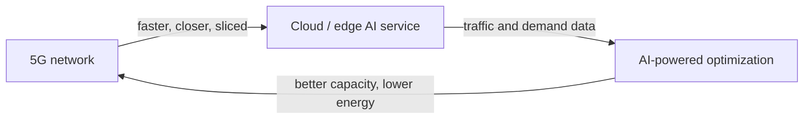

---

## 5.6 Limitations

- **Coverage and variability.** 5G speeds depend heavily on frequency band, distance and load. High-capacity bands cover short distances; real-world rates fall well below the peak.
- **Latency is not just the radio.** As Section 5.3 shows, upload, round trip, queueing and inference all count; "1 ms" is only the radio target.
- **Edge capacity is limited.** MEC sites have fewer servers than a cloud region, so they cannot always host the largest models or absorb large bursts (Section 4.4).
- **Privacy and security.** Data still leaves the device for the operator's and provider's systems and must be encrypted and governed.
- **Cost and complexity.** Slicing, MEC and AI-based control need investment, skills and integration across the operator and the service provider.
- **Dependence.** A cloud AI service stops working without a connection; an on-device fallback (Section 3.6) is often wise.
- **Risk of automated control.** An AI controller that switches off capacity wrongly can degrade service, so decisions need safeguards and human oversight.

---

## 5.7 Case-study questions

1. In "5G + cloud" (Worked example 5.A), which term is largest, and what change would help most?
2. Why does the 1 ms user-plane latency target for 5G not mean a cloud AI service answers in 1 ms?
3. In Worked example 5.B, why is a forecast-based sleep decision better than switching off the moment load falls below 20%? Name one risk of switching off too eagerly.
4. For each decision, say whether it fits better in the non-real-time RIC or the near-real-time RIC: (a) re-tuning radio resources for a moving user, (b) re-training a traffic forecasting model overnight.
5. Give one benefit and one risk of using a network slice for a latency-critical AI service.

---

## 5.8 Conclusion

A cloud-based AI service turns the network into part of the AI system. The model's quality matters, but so do the upload speed, the round trip and the queue, which is why operators place edge servers near users and why 5G focuses on rate and latency. At the same time, AI helps run the network: forecasting traffic, saving energy and controlling resources in a continuing sense-decide-act loop.

The case study also connects the whole module. Protocol layers and TCP/IP (Sections 1-2) set how data moves; the cloud-edge-device trade-off (Section 3) sets where it goes; delay, bandwidth and scalability (Section 4) set how well the service performs; and 5G with AI-based optimization shows these ideas working together in a real system.

---

## 5.9 Summary

- A cloud-based AI service is a model hosted in a data centre and reached over a network; 5G provides the access network, with an optional edge server (MEC) near the user.
- 5G's three scenarios are eMBB, URLLC and mMTC; headline targets include 20 Gbit/s peak downlink and 1 ms radio latency, but these are radio-network targets, not end-to-end service delays.
- For the street-sign example, the total latency falls from 140 ms (4G + cloud) to 56 ms (5G + cloud) and 36 ms (5G + MEC); on-device takes 15 ms with a smaller model.
- AI is also used inside the network: traffic prediction, energy saving, beam management and anomaly detection, organised in non-real-time (over 1 s) and near-real-time (about 10 ms to 1 s) control loops.
- A simple exponential-smoothing forecast triggers an energy-saving decision at step 6, showing the measure-forecast-decide-act loop.
- Limitations include coverage variability, limited edge capacity, privacy and cost; designs should keep a fallback for when the network is not available.

---

# Glossary (all sections)

| Term | Meaning |
|---|---|
| **5G** | The fifth generation of mobile networks (ITU: IMT-2020). |
| **Autoscaling** | Automatically adding or removing machines as demand changes. |
| **Bandwidth** | How many bits per second a link can carry. |
| **Bandwidth-delay product (BDP)** | Bandwidth × round-trip time: the amount of data in flight needed to fill a link. |
| **Best effort** | A delivery service that makes no guarantee of arrival, order or timing (IP). |
| **Cloud computing** | On-demand access to a shared pool of computing resources over a network (NIST). |
| **Congestion control** | TCP's adjustment of its sending rate in response to network congestion. |
| **Edge computing** | Computation placed close to where data is produced or used. |
| **eMBB** | Enhanced mobile broadband: a 5G scenario focused on high data rates. |
| **Encapsulation** | Wrapping data in a header at each layer as it moves down the stack. |
| **Federated learning** | Training in which devices learn locally and share only model updates. |
| **Flow control** | The receiver limiting how much a sender may send, using the receive window. |
| **gNB** | The 5G base station (radio access point). |
| **gRPC** | A binary, typed remote-procedure-call protocol common between services in a data centre. |
| **Header** | Control information added in front of data by a protocol layer. |
| **Horizontal scaling** | Adding more machines to share the load. |
| **IaaS / PaaS / SaaS** | Infrastructure / Platform / Software as a service. |
| **IP address** | The numerical address of a device on an IP network (IPv4: 32 bits; IPv6: 128 bits). |
| **Latency** | The time for data to travel from one point to another, or for a request to be answered. |
| **Leaf-spine** | A data-centre network in which every leaf switch connects to every spine switch. |
| **Load balancer** | A device or service that spreads requests across several servers. |
| **MEC (multi-access edge computing)** | Servers placed in or near the access network to serve nearby users with low delay. |
| **mMTC** | Massive machine-type communication: a 5G scenario for very many devices. |
| **MQTT** | A lightweight publish/subscribe messaging protocol for devices and sensors. |
| **MSS** | Maximum segment size: the largest payload in one TCP segment. |
| **Network slicing** | Dividing one physical network into virtual networks with different guarantees. |
| **Node** | Any device on a network. |
| **O-RAN / RIC** | Open radio access network architecture / RAN Intelligent Controller, which hosts network-optimization applications. |
| **Packet** | A small chunk of data with a header, the unit of delivery on a network. |
| **Peer-to-peer** | An architecture in which machines communicate directly, without a central server. |
| **Propagation delay** | Time for a signal to travel through the medium: distance ÷ speed. |
| **Protocol** | An agreed set of rules for communication. |
| **QUIC** | A reliable, encrypted transport protocol built on UDP. |
| **Queueing delay** | Time spent waiting in line before being processed or transmitted. |
| **RDMA** | Remote direct memory access: moving data between machines' memories with little CPU involvement. |
| **Ring all-reduce** | A method in which GPUs pass pieces of data around a ring to sum gradients efficiently. |
| **Router** | A device that forwards packets between networks using IP addresses. |
| **RTT (round-trip time)** | Time for a message to reach the destination and the reply to return. |
| **Scalability** | The ability to handle more load by adding resources. |
| **Slow start** | The initial phase of TCP congestion control in which the sending window grows quickly. |
| **Stateless** | A service design in which any server can handle any request. |
| **Tail latency** | The latency of the slowest requests, for example the 99th percentile. |
| **TCP** | Transmission Control Protocol: a reliable, ordered byte stream. |
| **Three-way handshake** | The SYN, SYN-ACK, ACK exchange that opens a TCP connection. |
| **TLS** | Transport Layer Security: encryption for data in transit. |
| **Throughput** | The rate of useful data actually delivered. |
| **Transmission delay** | Time to push all the bits of a message onto a link: size ÷ bandwidth. |
| **UDP** | User Datagram Protocol: unreliable, connectionless delivery of packets. |
| **UPF** | User plane function: the 5G core component that routes user data. |
| **URLLC** | Ultra-reliable low-latency communication: a 5G scenario for dependable low delay. |
| **Utilisation** | The fraction of capacity in use. |
| **Vertical scaling** | Using a bigger machine to handle more load. |

---

# Answer Key (all sections)

## Section 1

**Activity 1.A.**
Overhead = 58 bytes. For 1,200 bytes: 1,200 ÷ 1,258 ≈ **95.4%**. For 40 bytes: 40 ÷ 98 ≈ **40.8%**. Small messages waste most of the packet on headers.

**Activity 1.B.**
(a) **Network (IP)** layer. (b) **Transport (TCP)** layer. (c) **Link/physical** layer. (d) **Application** layer.

**Activity 1.C.**
A single huge switch is a bottleneck and a single point of failure, and there is a limit to how big one switch can be. In a leaf-spine fabric, capacity grows by adding switches; every pair of servers has several equal-length paths, so traffic is spread out; and if one spine switch fails, the others keep the network running.

**Activity 1.D.**
(a) **MQTT**: lightweight publish/subscribe for many small devices. (b) **gRPC**: compact binary messages between services in a data centre. (c) **WebRTC** (RTP over UDP): real-time audio with low delay. (d) **HTTP/REST**: universal, easy for any developer to call.

---

## Section 2

**Activity 2.A.**
TCP + TLS 1.3: 3 × 100 = **300 ms**. QUIC: 2 × 100 = **200 ms**.

**Activity 2.B.**
BDP = 100 × 10⁶ × 0.080 ÷ 8 = **1 MB**. Window-limited throughput = 65,535 × 8 ÷ 0.080 ≈ **6.55 Mbit/s**, which is about **6.6%** of the link. A window of about 1 MB would be needed to fill it.

**Activity 2.C.**
The loss rate rises 100×, so throughput falls by √100 = **10×**: from about 356 Mbit/s to about 36 Mbit/s (Worked example 2.C). TCP interprets loss as congestion and reduces its sending rate, and the reduction scales with the square root of the loss rate.

**Activity 2.D.**
Order: **SYN, SYN-ACK, ACK**. A live voice assistant may prefer UDP-based transport because a retransmitted audio chunk arrives too late to be useful; it is better to skip a lost packet than to delay everything behind it.

---

## Section 3

**Activity 3.A.**
Upload = 500,000 × 8 ÷ 40 × 10⁶ = 0.100 s = 100 ms. Cloud: 100 + 25 + 20 = **145 ms**. Edge: 100 + 5 + 20 = **125 ms**. Neither remote option meets a 33 ms budget; only the **on-device** model (30 ms) does, provided it is accurate enough and fits in memory.

**Activity 3.B.**
Streaming everything: 50 × 4 = **200 Mbit/s**. Events: 50 × 20 kbit/s = 1,000 kbit/s = **1 Mbit/s**. Ratio: **200×** less traffic.

**Activity 3.C.**
4-bit: 13 × 10⁹ × 0.5 bytes = **6.5 GB**. FP16: 13 × 10⁹ × 2 bytes = **26 GB**. Neither realistically runs on an 8 GB phone shared with other apps: the 4-bit version would take most of the memory, and FP16 does not fit at all.

**Activity 3.D.**
(a) **Edge** (on-premises server): instant response and data kept on site, with more compute than a device. (b) **Cloud**: large, one-off batch job that benefits from elastic GPUs. (c) **On-device**: tiny battery, very low latency and no dependence on a connection.

---

## Section 4

**Activity 4.A.**
One way: 3,000 km × 5 µs/km = 15 ms; round trip = **30 ms** at minimum. Real routes are longer than straight lines and add processing and queueing at every hop, so the real value is higher.

**Activity 4.B.**
1 − 0.98⁵⁰ ≈ 1 − 0.364 = **63.6%**.

**Activity 4.C.**
At 0.8: 5 ÷ 0.2 = **25 ms**. At 0.95: 5 ÷ 0.05 = **100 ms**. Going from 80% to 95% utilisation quadruples the response time.

**Activity 4.D.**
Data per GPU = 2 × 3 ÷ 4 × 4 GB = **6 GB**. Time = 6 ÷ 25 = **0.24 s** (240 ms).

---

## Section 5

**Question 1.**
The **30 ms round trip** is largest (30 of 56 ms, about 54%), ahead of the 16 ms upload and 10 ms inference. Moving the server closer (MEC) helps most: it cuts the round trip to 10 ms, giving 36 ms in total.

**Question 2.**
The 1 ms figure is a *radio* target for the user plane. A cloud AI service also needs the upload of the data (16 ms for 200 KB at 100 Mbit/s), transport and core-network delay, the distance to the server, any queueing, the model's inference time and the reply. These add up to tens of milliseconds even on a good 5G network.

**Question 3.**
The smoothed forecast reduces false alarms from momentary dips: it crossed 20% at step 6, not at step 5 when the raw load first dipped to 15%. A forecast also lets the operator prepare for the *expected* trend. Risk of switching off too eagerly: if demand rises again, users may see slower service or dropped connections while capacity is restored.

**Question 4.**
(a) **Near-real-time RIC** (decisions between about 10 ms and 1 s). (b) **Non-real-time RIC** (timescales longer than 1 s, such as model training and policy setting).

**Question 5.**
Benefit: the slice's capacity and latency are reserved and isolated from other traffic, so the AI service keeps predictable performance under load. Risk: it adds cost and complexity, depends on the operator offering and correctly configuring slices, and may not be available everywhere.

---

# References (all sections)

- 3GPP. (n.d.). *TS 23.501: System architecture for the 5G System (5GS).*
- Al-Fares, M., Loukissas, A., & Vahdat, A. (2008). A scalable, commodity data center network architecture. *Proceedings of ACM SIGCOMM 2008*.
- Cerf, V. G., & Kahn, R. E. (1974). A protocol for packet network intercommunication. *IEEE Transactions on Communications*, 22(5), 637-648.
- Dean, J., & Barroso, L. A. (2013). The tail at scale. *Communications of the ACM*, 56(2), 74-80.
- Deering, S., & Hinden, R. (2017). *Internet Protocol, Version 6 (IPv6) Specification* (RFC 8200). IETF.
- Eddy, W. (2022). *Transmission Control Protocol (TCP)* (RFC 9293). IETF.
- ETSI. (2014). *Mobile-Edge Computing: Introductory Technical White Paper.*
- ITU-R. (2015). *Recommendation M.2083-0: IMT Vision, Framework and overall objectives of the future development of IMT for 2020 and beyond.*
- ITU-R. (2017). *Report M.2410-0: Minimum requirements related to technical performance for IMT-2020 radio interface(s).*
- Iyengar, J., & Thomson, M. (2021). *QUIC: A UDP-Based Multiplexed and Secure Transport* (RFC 9000). IETF.
- Jacobson, V. (1988). Congestion avoidance and control. *Proceedings of ACM SIGCOMM 1988*.
- Kurose, J. F., & Ross, K. W. (2020). *Computer Networking: A Top-Down Approach* (8th ed.). Pearson.
- Mathis, M., Semke, J., Mahdavi, J., & Ott, T. (1997). The macroscopic behavior of the TCP congestion avoidance algorithm. *ACM SIGCOMM Computer Communication Review*, 27(3), 67-82.
- McMahan, H. B., Moore, E., Ramage, D., Hampson, S., & Arcas, B. A. y. (2017). Communication-efficient learning of deep networks from decentralized data. *Proceedings of AISTATS 2017*.
- Mell, P., & Grance, T. (2011). *The NIST Definition of Cloud Computing* (NIST Special Publication 800-145).
- NVIDIA. (n.d.). *NVLink and NVSwitch documentation.*
- O-RAN Alliance. (n.d.). *O-RAN architecture description and RAN Intelligent Controller specifications.*
- Patarasuk, P., & Yuan, X. (2009). Bandwidth optimal all-reduce algorithms for clusters of workstations. *Journal of Parallel and Distributed Computing*, 69(2), 117-124.
- Postel, J. (1980). *User Datagram Protocol* (RFC 768). IETF.
- Postel, J. (1981). *Internet Protocol* (RFC 791). IETF.
- Rescorla, E. (2018). *The Transport Layer Security (TLS) Protocol Version 1.3* (RFC 8446). IETF.
- Satyanarayanan, M. (2017). The emergence of edge computing. *Computer*, 50(1), 30-39.
- Shi, W., Cao, J., Zhang, Q., Li, Y., & Xu, L. (2016). Edge computing: Vision and challenges. *IEEE Internet of Things Journal*, 3(5), 637-646.
