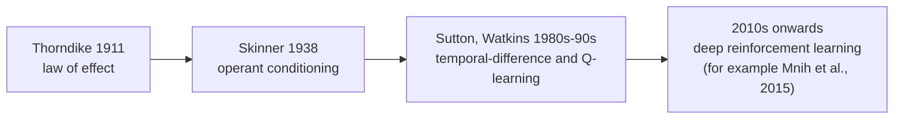
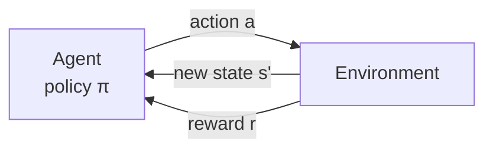
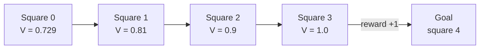
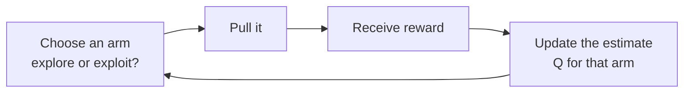
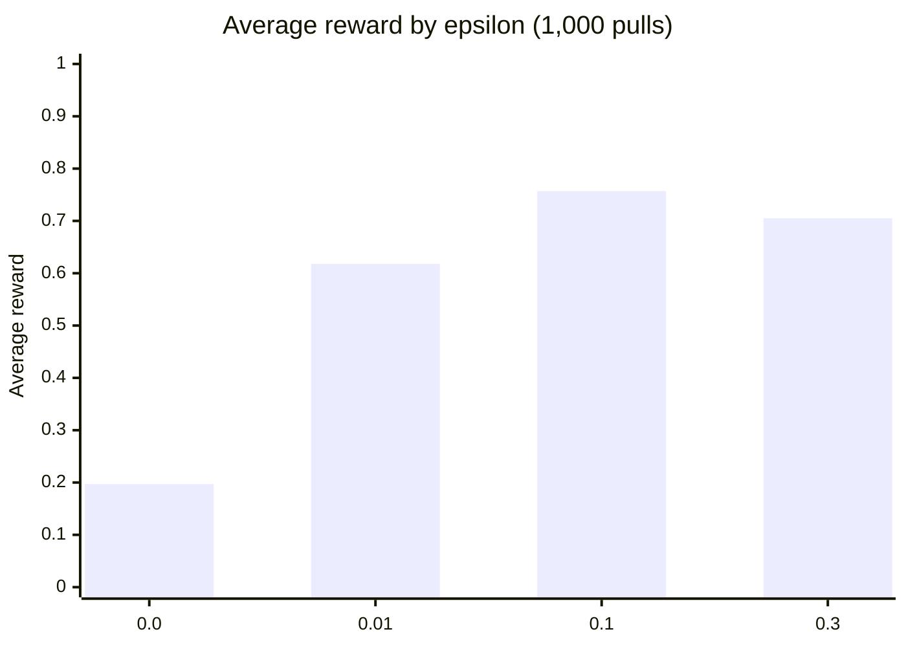
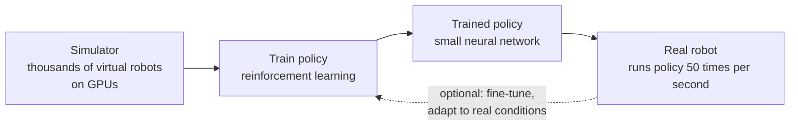
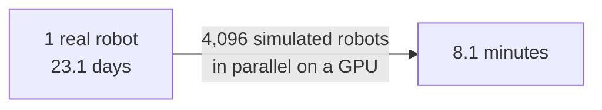
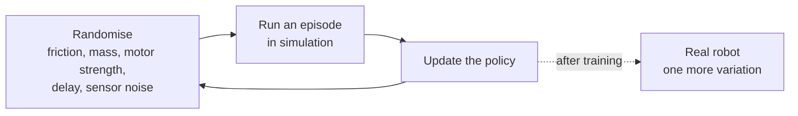

# Module 03: Behaviourist AI & Reinforcement Learning

| | |
|---|---|
| **Course** | Hardware, Networks & Behaviourist AI |
| **Version** | V1.0 (substantive draft) |
| **Audience** | Beginners with basic programming knowledge and no machine-learning background |
| **Prerequisites** | Basic arithmetic, variables, loops and lists. Modules 01 and 02 help (MACs, batch size, latency) but each bridge to them is explained again where it appears. |
| **Position in course** | Third of five modules; uses the hardware (Module 01) and network (Module 02) vocabulary and prepares Modules 04-05 |

## Table of contents

- [Module overview](#module-overview)
- [Learning objectives](#learning-objectives)
- [A running example](#a-running-example)
- [Section 1: Definition and Principles of Behaviourist AI](#section-1-definition-and-principles-of-behaviourist-ai)
- [Section 2: Agent-Environment Interaction](#section-2-agent-environment-interaction)
- [Section 3: Reward Systems and Feedback Mechanisms](#section-3-reward-systems-and-feedback-mechanisms)
- [Section 4: Exploration vs Exploitation](#section-4-exploration-vs-exploitation)
- [Section 5: Case Study — Robot Dogs: How a Quadruped Learns to Walk](#section-5-case-study--robot-dogs-how-a-quadruped-learns-to-walk)
- [Glossary (all sections)](#glossary-all-sections)
- [Answer Key (all sections)](#answer-key-all-sections)
- [References (all sections)](#references-all-sections)

---

## Module overview

Modules 01 and 02 were about *where* AI computation happens: on which chip, over which network. This module is about a different question: *how does a machine learn what to do?*

Most of the AI you meet first learns from examples that come with the right answer: here is a photo, and it is a cat. But many problems do not come with an answer key. Nobody can write down the correct motor command for every instant of a robot dog's walk, or the correct move for every position in a game. What we *can* do is say, afterwards, whether things went well. **Behaviourist AI** builds systems that learn what to do from the consequences of their own actions, in the same spirit as an animal learning from rewards and punishments.

This module explains the idea and its psychological roots, the formal model of an agent interacting with an environment, how rewards shape behaviour (and how badly designed rewards backfire), the central trade-off between trying new things and repeating what works, and a case study of robot dogs that learn to walk.

> [!NOTE]
> **Where this module is going.** Section 1 defines behaviourist AI and contrasts it with other kinds of learning. Section 2 introduces agents, environments, states, actions, policies and returns. Section 3 studies rewards, feedback and the Q-learning update. Section 4 studies exploration versus exploitation. Section 5 applies everything to robot dogs, where Module 01's hardware and Module 02's latency numbers come back.

> [!NOTE]
> **A note on the term.** "Behaviourist AI" is how this course names the family of methods in which an agent learns behaviour from interaction and reward. The standard technical name for the mathematical framework is **reinforcement learning (RL)** (Sutton & Barto, 2018). The two terms are used together throughout.

## Learning objectives

By the end of this module, you will be able to:

1. Define behaviourist AI, explain its roots in behavioural psychology, and distinguish it from rule-based and supervised approaches.
2. Describe the agent-environment loop and use the terms state, action, reward, policy, return and value correctly.
3. Calculate a discounted return and the value of states in a small environment by hand and in code.
4. Explain how reward design shapes behaviour, including sparse versus dense rewards, reward shaping and reward hacking, and perform a Q-learning update.
5. Explain the exploration-exploitation trade-off and compare greedy, epsilon-greedy and upper-confidence-bound strategies.
6. Analyse how a robot dog can learn to walk using simulation and reinforcement learning, and judge the trade-offs, linking the policy to hardware and network limits.

## A running example

Module 01 used Face ID and Module 02 used translating a street sign. This module uses a task where nobody can hand the machine the answers:

> **Running example: teaching a robot dog to walk.** A four-legged robot has twelve motors (three per leg) and sensors that tell it how its joints are bent and how its body is tilting. Nobody tells it which joint angles to use. It tries something, maybe falls over, and receives a number saying how well that went: positive for moving forward steadily, negative for falling or wasting energy. Over many thousands of attempts, it learns a way of walking.

Every idea in this module (agents, rewards, exploration, simulation) is needed to make that example work.

---

# Section 1: Definition and Principles of Behaviourist AI

> [!IMPORTANT]
> **Big idea.** Behaviourist AI learns *behaviour* from *consequences*. Instead of being told what to do, the system acts, observes how well it went, and gradually does more of what was rewarded and less of what was not.

## Learning objectives

By the end of this section you should be able to:

1. Define behaviourist AI and describe the psychological ideas it borrows (law of effect, operant conditioning).
2. Explain the four basic consequences: positive reinforcement, punishment, extinction, and the idea of shaping.
3. Compare rule-based AI, supervised learning and behaviourist AI/reinforcement learning.
4. Carry out a small law-of-effect update by hand and in code.
5. State two strengths and two limitations of learning purely from reward.

---

## 1.1 What is behaviourist AI?

**Behaviourist AI** is an approach in which a system learns a way of behaving by interacting with an environment and receiving feedback in the form of rewards. The system is not told the correct action; it discovers which actions lead to good outcomes through trial and error.

The name comes from **behaviourism**, a school of psychology that studies observable behaviour and how it is shaped by its consequences rather than by inner mental states. Four ideas are central:

- **Law of effect.** Responses that are followed by satisfying consequences become more likely to be repeated; responses followed by unpleasant consequences become less likely (Thorndike, 1911). Thorndike studied cats learning to escape from puzzle boxes by trial and error.
- **Classical conditioning.** A neutral signal paired repeatedly with a meaningful one comes to trigger a response by itself: Pavlov's dogs salivating at a bell (Pavlov, 1927).
- **Operant conditioning.** Behaviour is shaped by reinforcement and punishment that follow it (Skinner, 1938).
- **Behaviour as the object of study.** Watson (1913) argued that psychology should focus on what can be observed.

The technical descendant of these ideas in AI is reinforcement learning, which grew in the 1980s and 1990s into a mathematical theory (Sutton, 1988; Watkins & Dayan, 1992; Sutton & Barto, 2018).

**Figure 1.1.** From animal learning to machine learning: a short chain of ideas. *Source: author's own diagram, based on the works cited in Section 1.1.*



---

## 1.2 The four consequences of behaviour

Behavioural psychology names four basic ways in which consequences change behaviour. The same vocabulary describes how machines are trained.

| Term | What happens | Effect on behaviour | Dog-training example | Robot example |
|---|---|---|---|---|
| **Positive reinforcement** | Something good is added after an action | The action becomes more likely | A treat after "sit" | + reward for moving forward |
| **Punishment** | Something unpleasant follows an action | The action becomes less likely | A sharp "no" after jumping on the sofa | − reward for falling over |
| **Extinction** | A previously rewarded action stops being rewarded | The action fades | Barking no longer gets attention | A trick that no longer scores gradually disappears |
| **Shaping** | Reward successive approximations of the target behaviour | Complex behaviour is built step by step | Reward a step towards the mat, then touching it, then lying on it | Reward partial progress before the full walk |

**Table 1.1.** The four consequences of behaviour, with a dog-training example and a robot example of each.

> [!NOTE]
> **An everyday analogy.** Training a puppy is a good picture of behaviourist AI. You do not explain sitting in words or show it a labelled photo. You wait for it to do something close, reward it immediately, and repeat. Over time, the behaviour you rewarded becomes the one it chooses.

---

## 1.3 Behaviourist AI compared with other approaches

| | Rule-based (symbolic) AI | Supervised learning | Behaviourist AI / reinforcement learning |
|---|---|---|---|
| **Where the knowledge comes from** | Rules written by a person | Labelled examples (input and correct output) | Experience of acting and receiving rewards |
| **What the system is told** | Exactly what to do | The right answer for each example | Only how good the outcome was, often late |
| **Typical task** | Tax calculation, expert systems | Classifying photos, spam filtering | Robot control, games, resource management |
| **Data needed** | Expert time | A large labelled data set | An environment (real or simulated) to act in |
| **Main weakness** | Cannot handle what the rules miss | Cannot learn what no one has labelled | Needs many trials; reward must be designed well |

**Table 1.2.** Three ways to give a machine its knowledge.

An early robotics echo of the behavioural view is Brooks's argument for intelligence built from layers of simple, direct sense-to-action behaviours rather than detailed internal models of the world (Brooks, 1986; Brooks, 1991). Modern reinforcement learning is different in method (the behaviour is learned, not hand-wired), but shares the emphasis on action in a real environment.

> [!WARNING]
> **Caution: behaviourism has limits, and so does the AI version.** Psychologists criticised pure behaviourism for ignoring internal mental processes (a famous example is Chomsky, 1959). The AI analogue: a system that only learns from reward may need enormous amounts of experience, may find shortcuts you did not intend (Section 3.5), and does not necessarily "understand" what it is doing. Some modern methods add an internal model of the world to address this; they are mentioned in Section 5.7.

---

## 1.4 Worked example 1.A: the law of effect by hand

*Illustrative numbers.* A robot dog can try three actions when it hears the command: **sit**, **bark** or **roll**. It keeps a number for each action, a *preference value*, starting at 0. After each trial, it moves the chosen action's value towards the reward received:

```text
value ← value + α × (reward − value)
```

Here α (alpha, the **learning rate**) says how far to move; we use α = 0.5. Rewards: +1 for a treat, −1 for a scolding, 0 for nothing.

1. **Step 1.** Trial 1: the dog sits and gets a treat (+1). `value(sit) = 0 + 0.5 × (1 − 0) = 0.5`.
2. **Step 2.** Trial 2: the dog barks and is scolded (−1). `value(bark) = 0 + 0.5 × (−1 − 0) = −0.5`.
3. **Step 3.** Trial 3: the dog sits again and gets a treat (+1). `value(sit) = 0.5 + 0.5 × (1 − 0.5) = 0.75`.

**Result.** After three trials, sit has value 0.75, bark −0.5, roll 0. If the dog now picks the action with the highest value, it sits. Nobody told it to; the consequences did. This is the law of effect as arithmetic.

The following Python program checks the result. Its complete expected output is shown below the code.

```python
ALPHA = 0.5
value = {"sit": 0.0, "bark": 0.0, "roll": 0.0}
trials = [("sit", 1), ("bark", -1), ("sit", 1)]

for action, reward in trials:
    value[action] += ALPHA * (reward - value[action])
    print(action, reward, value)
```

Expected output:

```text
sit 1 {'sit': 0.5, 'bark': 0.0, 'roll': 0.0}
bark -1 {'sit': 0.5, 'bark': -0.5, 'roll': 0.0}
sit 1 {'sit': 0.75, 'bark': -0.5, 'roll': 0.0}
```

> [!IMPORTANT]
> **Key idea.** The update `value ← value + α × (reward − value)` is a running average that leans towards recent experience. A larger α learns faster but is noisier; a smaller α is steadier but slower. Every learning rule in this module is a variation of this one.

---

## 1.5 Key terms

A complete glossary is at the end of this module (see [Glossary](#glossary-all-sections)). Some terms (policy, return) are fully explained in Section 2, so treat this as a first look.

| Term | Definition |
|---|---|
| **Agent** | The learner and decision-maker (the robot dog's controller). |
| **Environment** | Everything the agent interacts with (the floor, gravity, the robot's body). |
| **Action** | A choice the agent makes (a target angle for each joint). |
| **Reward** | A number the environment gives after an action, saying how good it was. |
| **Policy** | The agent's way of choosing actions: a mapping from situations to actions. |
| **Trial and error** | Learning by trying actions and observing consequences. |
| **Learning rate (α)** | How strongly one new experience changes what the agent believes. |
| **Reinforcement learning (RL)** | The mathematical framework for learning a policy from rewards. |

**Table 1.3.** Key terms for Section 1.

---

## 1.6 Activities for Section 1

- [ ] **Activity 1.A.** Use the update rule from Worked example 1.A (α = 0.5, all values start at 0) for this sequence of trials: sit (+1), roll (0), sit (+1), sit (+1). What are the final values?
- [ ] **Activity 1.B.** Classify each as rule-based, supervised or behaviourist/reinforcement learning, with one reason: (a) a chess program whose moves come from hand-written rules, (b) an image classifier trained on 100,000 labelled photos, (c) a robot that learns to walk by trial and error, (d) a spam filter trained on emails marked "spam" or "not spam".
- [ ] **Activity 1.C.** Name the consequence from Table 1.1 in each case: (a) a robot gets +1 for every second it stays upright, (b) a game agent gets −10 for losing a life, (c) a dog that was fed for begging stops being fed, and eventually stops begging, (d) a trainer rewards a robot for lifting one leg, then two, then a full step.
- [ ] **Activity 1.D.** In two or three sentences, explain the difference between telling a robot *what to do* and telling it *how well it did*. Why is the second often easier to provide?

---

## 1.7 Summary

- Behaviourist AI learns behaviour from the consequences of its actions through trial and error; the technical framework is reinforcement learning.
- It draws on the law of effect (Thorndike), classical conditioning (Pavlov) and operant conditioning (Skinner).
- Four consequences shape behaviour: positive reinforcement, punishment, extinction and shaping.
- Compared with rule-based and supervised approaches, it needs no correct answers, only a measure of how good outcomes were, but it needs many trials and a well-designed reward.
- The core update, `value ← value + α × (reward − value)`, moves an estimate towards what was just experienced; in Worked example 1.A, "sit" reaches 0.75 and "bark" falls to −0.5 after three trials.

---

# Section 2: Agent-Environment Interaction

> [!IMPORTANT]
> **Big idea.** Reinforcement learning describes every problem as the same loop: the agent observes the situation, acts, and the environment responds with a new situation and a reward. The agent's goal is to choose actions that maximise the total reward over time, not just the next reward.

## Learning objectives

By the end of this section you should be able to:

1. Describe the agent-environment loop and name its parts: state, action, reward, policy.
2. Explain an episode, a trajectory and the Markov property.
3. Calculate a discounted return and explain the role of the discount factor γ.
4. Define the value of a state and compute it for a small corridor environment.
5. Estimate the computation a small control policy needs, and check whether it can meet a control-loop time budget, linking to Modules 01 and 02.

---

## 2.1 The loop

At each time step *t*, the same cycle repeats:

1. The agent receives the current **state** *s* (what it can observe).
2. It chooses an **action** *a* according to its **policy** π.
3. The environment responds with a **reward** *r* and a new state *s′*.

**Figure 2.1.** The agent-environment loop. The agent never sees the environment's inner workings, only states and rewards. *Source: author's own diagram, based on Sutton & Barto (2018).*



> [!NOTE]
> **Bridge to Modules 01 and 02.** This is the *sense, decide, act* loop of Module 01 (Face ID, robots, game agents), now with a reward added. Because the agent usually handles one observation at a time, it runs at batch size 1, the memory-bound case of Module 01 Section 4. And because the loop repeats many times per second, the time each pass takes (Module 02, Section 4) is a hard limit; Section 2.6 below puts numbers on that.

### Terms

- **State (s):** the information the agent uses to decide: the robot's joint angles, body tilt and so on. (When the agent sees only part of the world, this is called an *observation*.)
- **Action (a):** what the agent can do.
- **Reward (r):** a single number per step.
- **Policy (π):** how the agent chooses actions. It can be a table, a rule, or a neural network.
- **Episode:** one run from a start state until it ends (the robot falls, reaches the goal, or time runs out).
- **Trajectory:** the sequence state, action, reward, state, action, reward, … recorded during an episode.
- **Markov property:** the next state and reward depend only on the current state and action, not on the longer history. This is what lets the loop be described compactly. A problem written this way is called a **Markov decision process (MDP)**.

---

## 2.2 Return and the discount factor

The agent does not care about one reward in isolation; it cares about the total reward over the episode. But rewards that come sooner are usually worth more than rewards that come later: they are more certain, and often a delay has costs. We capture this with a **discount factor** γ (gamma), a number between 0 and 1. The **return** is the discounted sum of future rewards:

```text
G = r₁ + γ·r₂ + γ²·r₃ + γ³·r₄ + ...
```

- γ close to 1: the agent is *far-sighted*; distant rewards count almost fully.
- γ close to 0: the agent is *short-sighted*; only the next reward matters.

### Worked example 2.A: a discounted return

*Illustrative numbers.* An agent walks down a corridor and gets rewards `[0, 0, 0, 10]`: nothing for three steps, then 10 on arrival.

1. **Step 1: γ = 0.9.** G = 0 + 0.9 × 0 + 0.81 × 0 + 0.729 × 10 = **7.29**.
2. **Step 2: γ = 0.5.** G = 0.125 × 10 = **1.25**.
3. **Step 3: shorter path.** If the reward `10` arrives after only three steps (`[0, 0, 10]`) with γ = 0.9: G = 0.81 × 10 = **8.1**.

**Result.** A smaller γ makes the agent care less about distant rewards, and a shorter route to the same reward is worth more.

The following Python program checks the numbers. Its complete expected output is shown below the code.

```python
def discounted_return(rewards, gamma):
    return sum(gamma ** k * r for k, r in enumerate(rewards))

print(round(discounted_return([0, 0, 0, 10], 0.9), 3))
print(round(discounted_return([0, 0, 0, 10], 0.5), 3))
print(round(discounted_return([0, 0, 10], 0.9), 3))
```

Expected output:

```text
7.29
1.25
8.1
```

---

## 2.3 Policies and value

A **policy** tells the agent what to do. A **value** tells it how good a situation is:

- **State value V(s):** the expected return if the agent starts in state *s* and follows its policy.
- **Action value Q(s, a):** the expected return if the agent takes action *a* in state *s*, then follows its policy.

Values connect the present to the future in a simple way. The value of a state is the reward you get next, plus the discounted value of where you end up (the **Bellman equation**, Sutton & Barto, 2018):

```text
V(s) = r + γ · V(s′)
```

(for a deterministic move; with randomness, the right-hand side is averaged over the possible outcomes).

### Worked example 2.B: the value of each square in a corridor

**Environment.** A corridor with five squares numbered 0 to 4. Square 4 is the goal. Moving into the goal gives reward +1; every other step gives 0. The policy is "always move right". γ = 0.9.

**By hand, working backwards from the goal.**

- Square 3 is one step from the goal: V(3) = 1 + 0.9 × 0 = **1.0**.
- Square 2: V(2) = 0 + 0.9 × V(3) = **0.9**.
- Square 1: V(1) = 0.9 × 0.9 = **0.81**.
- Square 0: V(0) = 0.9 × 0.81 = **0.729**.

Notice the pattern: each step further from the goal multiplies the value by γ.

**Figure 2.2.** The corridor and the value of each square under the "always move right" policy. *Source: author's own diagram, based on the calculation in Worked example 2.B.*



The following Python program repeats the calculation until the values settle. Its complete expected output is shown below the code.

```python
GAMMA = 0.9
N = 5                          # squares 0..4; square 4 is the goal (terminal)
V = [0.0] * N

for _ in range(50):
    for s in range(N - 1):     # policy: always move right
        s2 = s + 1
        r = 1.0 if s2 == N - 1 else 0.0
        V[s] = r + GAMMA * V[s2]     # V of the goal stays 0

print([round(v, 3) for v in V])
```

Expected output:

```text
[0.729, 0.81, 0.9, 1.0, 0.0]
```

> [!IMPORTANT]
> **Key idea.** Value turns a *delayed* reward into a *per-step* guide: square 0 has no reward of its own, yet it has value 0.729 because it leads to one. That is how an agent learns that early actions matter even when the payoff comes much later (Section 3.3).

---

## 2.4 The goal: find a good policy

The agent's aim is a policy that maximises the expected return. Two broad ways to get there:

| Approach | Idea | Example |
|---|---|---|
| **Value-based** | Learn Q(s, a) for every action, then pick the action with the largest Q | Q-learning (Section 3.4) |
| **Policy-based** | Adjust the policy directly to increase the return | Policy-gradient methods, used for robot locomotion (Section 5) |

**Table 2.1.** Two families of reinforcement-learning methods.

Modern systems use a neural network as the policy or value function, which is called *deep* reinforcement learning (Mnih et al., 2015).

---

## 2.5 Model-free and model-based

- **Model-free:** the agent learns what to do purely from experience, without trying to predict how the world works. This is closest to the behaviourist picture.
- **Model-based:** the agent also learns, or is given, a model of how the environment responds, and plans using it.

Model-free methods are simpler but need more experience; model-based methods can learn from less experience but suffer if the model is wrong. Many practical systems, including the ones in Section 5, are model-free in how the policy is learned, but use a simulator (a hand-built model of physics) to *generate* the experience.

---

## 2.6 Worked example 2.C: what the policy costs to run (a bridge to Modules 01 and 02)

A robot dog's policy is usually a small neural network that runs on the robot itself, many times per second. Let's check what that demands.

**Setting (illustrative).** The policy has an input of 45 numbers (joint angles, joint speeds, body tilt, and so on), two hidden layers of 128 numbers, and 12 outputs (one per joint). It runs at 50 times per second (50 Hz).

1. **Step 1: MACs per decision.** 45 × 128 + 128 × 128 + 128 × 12 = 5,760 + 16,384 + 1,536 = **23,680 MACs** (Module 01, Section 1.2).
2. **Step 2: FLOPs.** 2 × 23,680 = **47,360 FLOPs** per decision. At 50 Hz that is about **2.4 million FLOP/s**, a tiny fraction of what any modern chip can do.
3. **Step 3: Memory.** Counting weights only, each weight is used once per decision, so there are 23,680 weights. In FP16 (2 bytes each) that is **47,360 bytes ≈ 46 KiB**. This fits easily in on-chip memory (Module 01, Section 4).
4. **Step 4: Intensity.** 47,360 FLOPs ÷ 47,360 bytes = **1 FLOP per byte**: the batch-1 memory-bound case from Module 01. It does not matter here, because all the weights sit in fast on-chip memory and the amount of computation is tiny.
5. **Step 5: Time budget.** At 50 Hz, each control step lasts 1,000 ÷ 50 = **20 ms**.

The following Python program checks the numbers. Its complete expected output is shown below the code.

```python
def macs(layers):
    return sum(a * b for a, b in zip(layers, layers[1:]))

m = macs([45, 128, 128, 12])
print(m, 2 * m)
print(2 * m * 50 / 1e6, "MFLOP/s at 50 Hz")
print(2 * m, "bytes in FP16,", round(2 * m / 1024, 2), "KiB")
print(1000 / 50, "ms per control step")
```

Expected output:

```text
23680 47360
2.368 MFLOP/s at 50 Hz
47360 bytes in FP16, 46.25 KiB
20.0 ms per control step
```

**Interpretation, using Module 02.** The decision must be made within 20 ms. In Module 02 (Worked example 5.A), even the best case of a 5G edge server (MEC) took about 36 ms end to end, and a cloud path 56 to 140 ms. So the policy **cannot** live in the cloud: it must run on the robot itself, which is easy because it is so small. Training, by contrast, is heavy and happens in a data centre, exactly as in Module 01's Face ID and Apple Neural Engine case study.

> [!TIP]
> **Going further.** Real locomotion policies are often a few hundred units wide and are sometimes combined with extra inputs such as a terrain scan; the numbers above are a teaching example of the scale, not the size of any specific published system.

---

## 2.7 Activities for Section 2

- [ ] **Activity 2.A.** Compute the discounted return for rewards `[1, 0, 2, 5]` with γ = 0.9.
- [ ] **Activity 2.B.** A corridor has six squares (0 to 5) with the goal at square 5, reward +1 for entering it, γ = 0.9, and the policy "always move right". What is V(0)? What would it be with γ = 0.5?
- [ ] **Activity 2.C.** A drone's controller must run at 100 Hz. What is the time budget per step? Can it use a policy served over a 5G edge server with a 36 ms end-to-end delay? Explain.
- [ ] **Activity 2.D.** A policy network has layers 20 → 64 → 64 → 6. How many MACs and FLOPs per decision? How many bytes do its weights take in FP16?

---

## 2.8 Summary

- Every reinforcement-learning problem is the loop: observe a state, choose an action by the policy, receive a reward and a new state.
- An episode is one run; a trajectory is the recorded sequence; the Markov property says the future depends only on the present state and action.
- The return is the discounted sum of future rewards; γ sets how far-sighted the agent is. With rewards `[0, 0, 0, 10]`, G = 7.29 at γ = 0.9 and 1.25 at γ = 0.5.
- Values (V and Q) measure how good states and actions are; the Bellman relation `V(s) = r + γ·V(s′)` gives V = 0.729, 0.81, 0.9, 1.0 along the example corridor.
- A small 45 → 128 → 128 → 12 policy needs 23,680 MACs and about 46 KiB per decision; at 50 Hz it has a 20 ms budget, which rules out a cloud-served policy and means it runs on the robot.

---

# Section 3: Reward Systems and Feedback Mechanisms

> [!IMPORTANT]
> **Big idea.** The reward is the only way you tell the agent what you want. Whatever the reward measures is what the agent will pursue, whether or not it is what you meant.

## Learning objectives

By the end of this section you should be able to:

1. State the reward hypothesis and explain why reward design is the main place where humans specify the goal.
2. Distinguish sparse from dense rewards, and explain delayed reward and credit assignment.
3. Explain reward shaping, including the potential-based form that does not change the best policy.
4. Recognise reward hacking (specification gaming) and suggest a fix.
5. Perform a Q-learning update by hand and in code, and read a learned Q-table.

---

## 3.1 The reward hypothesis

Reinforcement learning rests on the **reward hypothesis**: all of what we mean by a goal can be expressed as the maximisation of the expected cumulative reward (Sutton & Barto, 2018). To teach a robot to walk, we do not describe walking. We design a reward and let the agent discover the walking that earns it.

This puts a lot of weight on the reward. A good reward is:

- **Aligned:** high reward really means the behaviour you want.
- **Informative:** it gives the agent a way to tell better from worse.
- **Robust:** it cannot be earned in some unintended cheap way.

---

## 3.2 Sparse and dense rewards

| | Sparse reward | Dense reward |
|---|---|---|
| **What it is** | Reward only at the end or at rare moments (+1 for reaching the goal, 0 otherwise) | A reward at nearly every step (for example, based on progress) |
| **Advantage** | Simple and hard to misuse: it measures exactly the goal | Easier to learn from: the agent gets feedback all the time |
| **Disadvantage** | The agent may wander for a very long time before it ever sees a reward | Easy to design badly, and the agent may exploit the shortcuts it creates |
| **Example** | Winning a board game | Robot reward for forward speed, minus an energy cost |

**Table 3.1.** Sparse versus dense rewards.

---

## 3.3 Delayed reward and credit assignment

Often the consequence of an action shows up much later. A chess move can decide the game thirty moves on; a robot's bad foot placement may cause a fall two steps later. The question "which of my earlier actions deserves the credit (or blame)?" is the **credit assignment problem**.

Discounting and values (Section 2) address it: a state's value carries the future reward back to the states that lead to it, as Worked example 2.B showed. Learning methods that update an estimate using the *next* estimate rather than waiting for the final outcome are called **temporal-difference (TD) learning** (Sutton, 1988).

---

## 3.4 Learning from feedback: Q-learning

**Q-learning** learns the action values Q(s, a) from experience, one step at a time (Watkins & Dayan, 1992). After taking action *a* in state *s* and seeing reward *r* and new state *s′*, update:

```text
Q(s, a) ← Q(s, a) + α × [ r + γ × max over a′ of Q(s′, a′) − Q(s, a) ]
```

Read it in three parts:

- **Target:** `r + γ × max Q(s′, a′)`: what the reward plus the best future now suggests.
- **TD error:** target minus the current Q: how wrong the old estimate was.
- **Step:** move Q by a fraction α of that error. This is the same form as the update in Worked example 1.A.

### Worked example 3.A: one Q-learning update by hand

*Illustrative numbers.* Currently Q(s, a) = 0.2. The agent takes the action, receives r = 1, and arrives in s′ where the best action's value is 0.5. Use α = 0.1 and γ = 0.9.

1. **Step 1: Target** = 1 + 0.9 × 0.5 = **1.45**.
2. **Step 2: TD error** = 1.45 − 0.2 = **1.25**.
3. **Step 3: New Q** = 0.2 + 0.1 × 1.25 = **0.325**.

The estimate moved from 0.2 towards the target of 1.45 by a tenth of the gap.

### Worked example 3.B: Q-learning on the corridor

We return to the corridor from Worked example 2.B: five squares, the goal at square 4, reward +1 for entering it, γ = 0.9, α = 0.5. This time the agent has two actions, **left** and **right** (moving left from square 0 leaves it in square 0), and learns Q for both. To keep the output predictable, the program updates every state-action pair in turn, 30 times, instead of choosing actions at random (Section 4 covers choosing actions).

```python
GAMMA, ALPHA = 0.9, 0.5
N = 5                              # squares 0..4; square 4 is the goal (terminal)
ACTIONS = (-1, +1)                 # left, right
Q = [[0.0, 0.0] for _ in range(N)]

def step(s, a):
    s2 = min(max(s + a, 0), N - 1)
    return s2, (1.0 if s2 == N - 1 else 0.0)

for sweep in range(30):
    for s in range(N - 1):
        for i, a in enumerate(ACTIONS):
            s2, r = step(s, a)
            future = 0.0 if s2 == N - 1 else max(Q[s2])
            Q[s][i] += ALPHA * (r + GAMMA * future - Q[s][i])

for s in range(N - 1):
    best = "right" if Q[s][1] > Q[s][0] else "left"
    print(s, [round(q, 3) for q in Q[s]], "->", best)
```

Expected output:

```text
0 [0.656, 0.729] -> right
1 [0.656, 0.81] -> right
2 [0.729, 0.9] -> right
3 [0.81, 1.0] -> right
```

**Reading the table.** Each row is `[Q(left), Q(right)]`. The "right" values are exactly the V values from Worked example 2.B (0.729, 0.81, 0.9, 1.0). The "left" values are slightly lower because moving left costs one extra step: for example, from square 1, going left to square 0 then right gives 0.9 × 0.729 = 0.656. Choosing the larger Q in each row gives the best policy: always move right. The agent has learned the route from rewards alone.

---

## 3.5 Reward shaping and reward hacking

### Reward shaping

When the reward is sparse, we can add *extra* rewards that guide the agent. **Reward shaping** does this. The danger: a badly chosen extra reward changes what is optimal. A safe form, **potential-based shaping**, adds

```text
F(s, s′) = γ × Φ(s′) − Φ(s)
```

where Φ is any function of the state (a "potential", such as the negative of the distance to the goal). This particular form is proven not to change which policy is best (Ng, Harada & Russell, 1999), so it guides learning without altering the goal.

*Example.* With Φ(s) = −(distance to the goal), a step from distance 4 to distance 3 gives F = 0.9 × (−3) − (−4) = **+1.3**: a bonus for making progress.

### Reward hacking

**Reward hacking** (also called specification gaming) is when the agent finds a way to earn a high reward without doing what the designer intended. It is the AI version of a student studying the test instead of the subject. A well-known example: a boat-racing game agent, rewarded for hitting targets along the track, learned to circle in a lagoon hitting respawning targets instead of finishing the race (Clark & Amodei, 2016). More general discussion: Amodei et al. (2016).

| Intended goal | Reward written | Possible hack | Better design |
|---|---|---|---|
| Clean the room | +1 per piece of dirt collected | Dump the dirt, collect it again, repeat | Reward the *amount of clean floor*, not the act of collecting |
| Walk forward | +1 for body speed | Throw itself forward, or vibrate | Reward speed *and* penalise falling, tilt and violent motion |
| Finish the race | +1 per target hit | Circle through targets forever | Reward progress along the track and finishing |

**Table 3.2.** Intended goals, naive rewards, hacks and fixes.

> [!WARNING]
> **Caution: you get what you reward.** The agent has no idea what you meant, only what you scored. Always ask: "if the agent were clever and lazy, how could it earn this reward without doing the job?" Check by watching the behaviour, not just the number.

---

## 3.6 Feedback in practice

| Feedback source | How it arrives | Example |
|---|---|---|
| **Environment reward** | Built into the task | Score in a game |
| **Hand-designed reward function** | A formula by the engineer | Robot speed minus energy cost (Section 5) |
| **Human feedback** | A person rates or compares behaviours | A trainer approving or rejecting a robot's gait |
| **Imitation** | Reward for matching a demonstration | A robot copying motion-capture data from an animal |

**Table 3.3.** Where feedback can come from.

---

## 3.7 Activities for Section 3

- [ ] **Activity 3.A.** Perform one Q-learning update: Q(s, a) = 0.5, r = 0, max Q(s′, ·) = 0.8, α = 0.2, γ = 0.9. Show the target, the TD error and the new Q.
- [ ] **Activity 3.B.** Using potential-based shaping with Φ(s) = −(distance to goal) and γ = 0.9, compute F for a step from distance 4 to distance 3, and for a step *backwards* from distance 3 to distance 4.
- [ ] **Activity 3.C.** A cleaning robot is rewarded +1 for every item of rubbish it puts in the bin. Describe how it might hack this reward, and propose a better reward.
- [ ] **Activity 3.D.** For each reward, say whether it is sparse or dense: (a) +1 only when a robot reaches a charging station, (b) a score every step based on how fast the robot is moving, (c) +100 for winning a game, 0 otherwise.

---

## 3.8 Summary

- The reward hypothesis says goals can be expressed as maximising cumulative reward, so reward design is where humans specify what they want.
- Sparse rewards are simple but slow to learn from; dense rewards guide learning but risk being exploited.
- Delayed rewards raise the credit assignment problem; discounting, values and TD learning pass credit back to earlier states.
- Q-learning updates `Q ← Q + α × (target − Q)`, where the target is `r + γ × max Q(s′, ·)`. On the corridor it recovers the policy "always move right" from reward alone.
- Potential-based shaping, `F = γΦ(s′) − Φ(s)`, guides learning without changing the best policy; careless shaping and naive rewards invite reward hacking.

---

# Section 4: Exploration vs Exploitation

> [!IMPORTANT]
> **Big idea.** To get a high reward, the agent must *use* what it knows (exploit), but to find out what is best it must sometimes *try* things it is unsure about (explore). Too little exploration and it gets stuck on a mediocre habit; too much and it wastes time.

## Learning objectives

By the end of this section you should be able to:

1. Explain the exploration-exploitation trade-off with an everyday example.
2. Describe the multi-armed bandit problem as the simplest setting for it.
3. Compare greedy, epsilon-greedy (with decay) and upper-confidence-bound (UCB) strategies.
4. Compute an expected reward for epsilon-greedy and a UCB score by hand.
5. Interpret a bandit simulation and explain why pure greedy fails.
6. Explain why exploration is costly on real hardware and how simulation reduces that cost.

---

## 4.1 The dilemma

> [!NOTE]
> **An everyday analogy.** You are in a city with ten restaurants. You have tried three, and one was good. Do you go to the good one again (exploit), guaranteeing a decent dinner? Or try a new one (explore), risking a bad meal but possibly finding a great one? If you only ever exploit, you may never learn there was a better place. If you only ever explore, you never enjoy the best one you found.

For a learning agent the same tension appears at every step. The cost of exploring is the reward you could have earned by exploiting. The benefit is information that raises future rewards.

---

## 4.2 The multi-armed bandit

The simplest version of the dilemma is the **multi-armed bandit**: a row of slot machines ("arms"), each paying out with a different, unknown probability. At each step you choose one arm. There is no changing state, only the question *which arm?* The goal is to collect as much reward as possible over many pulls.

The agent keeps an estimate Q for each arm: the average reward seen so far. It updates the estimate with the running-average rule from Section 1:

```text
Q(arm) ← Q(arm) + (reward − Q(arm)) ÷ n
```

where *n* is how many times that arm has been pulled (the learning rate is 1/n, which gives the exact average).

**Figure 4.1.** The bandit loop: choose an arm, get a reward, update that arm's estimate. The *choice* is where exploration versus exploitation is decided. *Source: author's own diagram, based on Sutton & Barto (2018).*



---

## 4.3 Strategies

| Strategy | Rule | Strength | Weakness |
|---|---|---|---|
| **Greedy** | Always pick the arm with the highest current Q | Pure exploitation, no wasted pulls | Can lock onto the first arm that looks fine and never discover better ones |
| **Epsilon-greedy (ε-greedy)** | With probability ε pick a random arm; otherwise pick the greedy arm | Simple; never stops exploring | Keeps exploring at the same rate even when it already knows the answer |
| **Decaying ε** | Start with a large ε and shrink it over time, for example ε = max(0.05, 0.99ᵗ) | Explore early, exploit later | The schedule must be tuned |
| **Optimistic initial values** | Start every Q high so every arm looks promising until tried | Encourages early exploration with no randomness | Works mainly at the start |
| **Upper confidence bound (UCB)** | Pick the arm with the largest `Q + √(2 ln t ÷ n)` | Explores the arms it is *least sure about* | Needs counts; designed for the bandit setting |

**Table 4.1.** Five exploration strategies. UCB is analysed in Auer, Cesa-Bianchi & Fischer (2002).

### Worked example 4.A: how much does ε-greedy give up?

**Problem.** Three arms pay out with probabilities 0.2, 0.5 and 0.8. Suppose the agent has already identified the best arm (0.8). With ε = 0.1, what is its average reward per pull?

1. **Step 1.** With probability 0.9 it exploits the best arm: 0.9 × 0.8 = **0.72**.
2. **Step 2.** With probability 0.1 it picks an arm at random; the average of the three arms is (0.2 + 0.5 + 0.8) ÷ 3 = 0.5, so this part contributes 0.1 × 0.5 = **0.05**.
3. **Step 3.** Total = 0.72 + 0.05 = **0.77**, compared with 0.8 for always picking the best arm.

**Result.** Exploration costs about 0.03 reward per pull forever, even after the agent knows the answer. That is why ε is often decayed (Table 4.1).

### Worked example 4.B: a bandit simulation

The following program plays the three-arm bandit for 1,000 pulls, for four values of ε, and averages the result over 20 runs with different random seeds. A random-number generator with a fixed seed is used so that the output is the same every time. "Best arm chosen" is the share of pulls that used the 0.8 arm. Its complete expected output is shown below the code.

```python
import random

def run(epsilon, steps=1000, seed=0):
    rng = random.Random(seed)
    means = [0.2, 0.5, 0.8]
    q = [0.0, 0.0, 0.0]
    n = [0, 0, 0]
    total = 0.0
    for _ in range(steps):
        if rng.random() < epsilon:
            a = rng.randrange(3)          # explore
        else:
            a = q.index(max(q))           # exploit (ties: first arm)
        r = 1.0 if rng.random() < means[a] else 0.0
        n[a] += 1
        q[a] += (r - q[a]) / n[a]
        total += r
    return total / steps, n[2] / steps

for eps in (0.0, 0.01, 0.1, 0.3):
    results = [run(eps, seed=s) for s in range(20)]
    avg = sum(r[0] for r in results) / 20
    best = sum(r[1] for r in results) / 20
    print(f"epsilon={eps}: average reward {avg:.3f}, best arm chosen {best:.1%}")
```

Expected output:

```text
epsilon=0.0: average reward 0.197, best arm chosen 0.0%
epsilon=0.01: average reward 0.618, best arm chosen 55.8%
epsilon=0.1: average reward 0.757, best arm chosen 88.6%
epsilon=0.3: average reward 0.705, best arm chosen 78.5%
```

**Reading the results.**

- **ε = 0 (pure greedy)** never leaves the first arm it tries (arm 0, payout 0.2): its average reward is about 0.2, the value of that arm. It never even tries the best arm.
- **ε = 0.01** explores too rarely to find the best arm quickly, so it spends much of the 1,000 pulls on worse arms.
- **ε = 0.1** is the best of the four here: 0.757, close to the 0.77 limit from Worked example 4.A (the gap is the cost of the early learning).
- **ε = 0.3** finds the best arm but wastes too many pulls exploring forever: 0.705.

**Figure 4.2.** Average reward for four exploration rates (from the simulation above). Too little exploration and too much both lose; a moderate ε wins. *Source: author's own diagram, based on the output of Worked example 4.B.*



> [!IMPORTANT]
> **Key idea.** There is no free lunch: exploring costs reward now to gain information for later. The right amount depends on how long you will keep playing; with only a few pulls left, explore little, with thousands left, explore more.

### Worked example 4.C: the UCB rule favours the uncertain

UCB adds a bonus to each arm's estimate that is large when the arm has been tried only a few times:

```text
score = Q + √( 2 × ln(t) ÷ n )
```

where *t* is the total number of pulls so far and *n* is the number of pulls of that arm.

**Problem.** After t = 100 pulls, arm A has Q = 0.6 from n = 60 pulls and arm B has Q = 0.5 from n = 10 pulls. Which does UCB choose?

```python
import math

t = 100
arms = {"A": (0.6, 60), "B": (0.5, 10)}
for name, (mean, n) in arms.items():
    print(name, round(mean + math.sqrt(2 * math.log(t) / n), 3))
```

Expected output:

```text
A 0.992
B 1.46
```

**Result.** UCB picks **B**, even though its average (0.5) is lower than A's (0.6), because B has been tried so little that it could still turn out to be much better. As B is tried more, its bonus shrinks and the estimates take over. This is "optimism in the face of uncertainty".

---

## 4.4 Exploration beyond bandits

In full problems (with states, like the corridor or a robot), the same trade-off appears and the same tools carry over. Common practice:

- **ε-greedy on Q-values**, with ε decayed during training.
- **Adding noise to the actions**, so a robot tries slightly different joint commands every time.
- **Bonuses for novelty**, rewarding visits to states the agent has not seen often ("curiosity").
- **Entropy bonuses** in policy-based methods, which reward the policy for staying random until it has good reason not to be.

---

## 4.5 Exploration is costly on real hardware

On a game, a bad exploratory move costs nothing. On a real robot, it can mean a fall, a broken part or an injured person. Exploring a robot dog on a real floor 100 million times is neither safe nor practical. Two common responses:

- **Explore in simulation first.** Let the agent try (and fall) as often as needed in a physics simulator, then transfer the learned policy to the real robot (Section 5).
- **Constrain exploration.** Limit joint torques, add safety stops, and restrict actions to safe ranges.

This is where Module 01 returns: simulators can run thousands of virtual robots in parallel on one GPU, which turns the *time* cost of exploration into a *hardware* cost. Section 5.4 puts numbers on this.

---

## 4.6 Activities for Section 4

- [ ] **Activity 4.A.** Three arms pay 0.1, 0.4 and 0.7. An agent that already knows the best arm uses ε = 0.2 (random choices pick any arm with equal probability). What is its average reward per pull, and how much less than the best arm is that?
- [ ] **Activity 4.B.** After t = 200 pulls, arm A has Q = 0.7 from n = 150 pulls and arm B has Q = 0.6 from n = 50. Compute the UCB score of each. Which is chosen?
- [ ] **Activity 4.C.** Explain in two or three sentences why a pure greedy agent can get stuck, using the simulation of Worked example 4.B.
- [ ] **Activity 4.D.** An exploration schedule is ε = max(0.05, 0.99ᵗ). What is ε at t = 100 (to three decimals) and at t = 300?

---

## 4.7 Summary

- Exploration (trying uncertain options) and exploitation (using the best known option) pull against each other; the cost of exploring is the reward given up now.
- The multi-armed bandit isolates the dilemma; the estimate of each arm is a running average.
- Pure greedy can lock onto a poor option (average reward ≈ 0.2 in the simulation); ε-greedy keeps trying others; a moderate ε = 0.1 was best of four (0.757), while ε = 0.01 (0.618) explored too little and ε = 0.3 (0.705) too much.
- Even after learning the best arm, ε = 0.1 costs about 0.03 reward per pull (0.77 instead of 0.8), so ε is often decayed.
- UCB explores the arms it is least sure about: in the example it prefers B (score 1.46) over A (0.992) despite B's lower average.
- Exploration is dangerous and slow on real hardware, so it is done mostly in simulation, which is where parallel hardware helps.

---

# Section 5: Case Study — Robot Dogs: How a Quadruped Learns to Walk

> [!IMPORTANT]
> **Big idea.** A robot dog is a reward-driven agent whose body is the environment. Rather than writing equations for every leg movement, engineers write a reward, let thousands of simulated robots try and fall in parallel on GPUs, and then run the small, learned policy on the real robot.

## Learning objectives

By the end of this section, you should be able to:

1. Describe a quadruped robot as a reinforcement-learning agent: its states, actions and reward.
2. Calculate a locomotion reward from its terms and explain what each term is for.
3. Explain the sim-to-real approach, including domain randomisation, and why it is used.
4. Estimate how much massively parallel simulation shortens training, linking to Module 01.
5. Evaluate the advantages and limitations of learned locomotion, including safety and the behaviourist critique.

---

## 5.1 Introduction

Four-legged ("quadruped") robots, often called **robot dogs**, are used for inspection, research and exploration. Walking is hard to program by hand: the robot is unstable, the ground varies, contact with the floor is brief and violent, and small errors can cause a fall. Traditionally, engineers designed controllers from models of the robot's physics. Over the last decade, researchers have shown that policies *learned* by reinforcement learning can walk, run, recover from falls and cross rough ground on real quadrupeds (Hwangbo et al., 2019; Lee et al., 2020).

**Figure 5.1.** The learning pipeline for a robot dog. Training happens in simulation on GPUs in a data centre; the learned policy is then copied onto the robot, where it runs in real time. *Source: author's own diagram, based on Hwangbo et al. (2019) and Rudin et al. (2022).*



---

## 5.2 The robot dog as an RL problem

| Element | In the robot dog | Example (illustrative) |
|---|---|---|
| **Agent** | The controller (a neural network) | 45 → 128 → 128 → 12 network (Section 2.6) |
| **Environment** | The robot body, the ground, gravity | Simulated or real |
| **State / observation** | What the sensors report | 12 joint angles, 12 joint speeds, 3 body-tilt numbers, 3 body-rotation speeds, the previous 12 actions, 3 velocity commands = 45 numbers |
| **Action** | What the controller outputs | A target angle for each of the 12 joints (a low-level controller then drives the motors) |
| **Reward** | A formula scoring each step | See Section 5.3 |
| **Episode** | One attempt | Ends if the robot falls or after a time limit |
| **Time step** | One decision | 20 ms (50 Hz) |

**Table 5.1.** The robot dog in reinforcement-learning terms.

The **velocity command** is an input: a person (or a higher-level planner) says "go forward at 1 m/s", and the learned policy works out how to do it. That is how one policy can walk at many speeds and turn on command.

> [!NOTE]
> **Bridge to Module 04.** The observation comes from sensors: joint encoders, an inertial measurement unit (IMU) and sometimes cameras. Module 04 (AI Sensors and Intelligent Systems) covers how these measurements are produced and processed; here we take them as given numbers.

---

## 5.3 Designing the reward

A typical walking reward is a **sum of weighted terms**, each pushing the robot towards one aspect of good walking (Hwangbo et al., 2019; Rudin et al., 2022). Here is a simplified example (illustrative):

| Term | Purpose | Form |
|---|---|---|
| **Velocity tracking** | Move as commanded | `exp( −(v_cmd − v)² ÷ 0.25 )`, which is 1 when speed matches the command and falls as the error grows |
| **Energy penalty** | Avoid wasting power and straining motors | `−0.0001 × Σ torque²` |
| **Action-rate penalty** | Avoid jerky, vibrating motion | `−0.01 × Σ (change in action)²` |
| **Termination** | Falling ends the episode, which also ends reward collection | (episode stops) |

**Table 5.2.** A simplified locomotion reward. The weights are illustrative; real systems use more terms (body orientation, foot clearance and others) and tune the weights.

### Worked example 5.A: scoring three moments

*Illustrative numbers.* The command is v_cmd = 1.0 m/s. Compare three moments:

1. **Walking well:** speed 0.8 m/s, Σ torque² = 400, Σ (Δaction)² = 2.0.
   Tracking = exp(−0.04 ÷ 0.25) = exp(−0.16) ≈ 0.8521. Penalties: 0.0001 × 400 = 0.04 and 0.01 × 2.0 = 0.02. Reward ≈ 0.8521 − 0.04 − 0.02 = **0.7921**.
2. **Walking slowly:** speed 0.5 m/s, same effort. Tracking = exp(−0.25 ÷ 0.25) = exp(−1) ≈ 0.3679. Reward ≈ 0.3679 − 0.06 = **0.3079**.
3. **Standing still, using no effort:** speed 0, no torque, no action change. Tracking = exp(−1 ÷ 0.25) = exp(−4) ≈ 0.0183. Reward ≈ **0.0183**.

```python
import math

def reward(v_cmd, v, torque_sq, action_rate_sq):
    track = math.exp(-(v_cmd - v) ** 2 / 0.25)
    return track - 0.0001 * torque_sq - 0.01 * action_rate_sq

print(round(reward(1.0, 0.8, 400, 2.0), 4))
print(round(reward(1.0, 0.5, 400, 2.0), 4))
print(round(reward(1.0, 0.0, 0, 0), 4))
```

Expected output:

```text
0.7921
0.3079
0.0183
```

**Interpretation.** The reward ranks the behaviours in the order we want: walking well beats walking slowly, which beats standing still. The penalties stop the robot from reaching speed with violent, wasteful motion (a mild defence against the hacks in Table 3.2). The smooth, continuous shape of the tracking term is also a *dense* reward (Section 3.2): the robot gets a useful signal at every step, even when it is far from the target speed.

> [!WARNING]
> **Caution: the weights matter.** If the energy penalty were far too large, the robot would learn that standing still is best. If it were too small, the gait could become jerky and damage the motors. Engineers tune these weights over many training runs and always *watch the robot* to catch behaviours the score does not reveal.

---

## 5.4 Training in simulation: massively parallel learning

Learning to walk needs a huge number of steps. Suppose a policy needs about 100 million steps of experience (an illustrative figure; real numbers vary with the method and the terrain).

**Worked example 5.B: one real robot versus thousands of simulated ones.**

1. **Step 1: One real robot at 50 steps per second**, running without breaks: 100,000,000 ÷ 50 = 2,000,000 s ≈ **23.1 days**. In practice it would also fall, need resetting and wear out.
2. **Step 2: 4,096 simulated robots, each at 50 steps per second in simulated real time**, all running in parallel on one GPU: 4,096 × 50 = 204,800 steps per second, so 100,000,000 ÷ 204,800 ≈ 488 s ≈ **8.1 minutes**.

```python
real = 100e6 / 50 / 86400                 # days on one real robot
sim = 100e6 / (4096 * 50) / 60            # minutes with 4,096 simulated robots
print(round(real, 1), "days")
print(round(sim, 1), "minutes")
```

Expected output:

```text
23.1 days
8.1 minutes
```

**Interpretation.** This is exactly the parallelism of Module 01 (Section 3): the same simple computation (physics and a small network) is applied to thousands of independent robots, and a GPU does it at once. Research systems built on this idea report training walking policies in minutes on a single GPU (Rudin et al., 2022), using GPU-based simulators (Makoviychuk et al., 2021). Real systems fall short of the ideal division, because of Amdahl's law (Module 01, Section 3.3): part of every step (collecting results, updating the network) is not perfectly parallel, and communication between chips (Module 02, Section 4.6) adds overhead when training is spread across several GPUs.

**Figure 5.2.** Time to collect the same experience: one real robot versus 4,096 simulated robots in parallel. Note the change of unit (days versus minutes). *Source: author's own diagram, based on the numbers in Worked example 5.B.*



---

## 5.5 From simulation to the real robot

A policy trained only in simulation often fails on the real robot, because the simulator is never exactly right: the floor is slipperier, the motors are weaker or slower, the robot is heavier. This difference is the **sim-to-real gap**. Three standard remedies:

| Technique | Idea | Reference |
|---|---|---|
| **Domain randomisation** | In simulation, randomly vary friction, body mass, motor strength, delays and sensor noise on every run, so the policy must work across all of them and the real robot looks like just another variation | Tobin et al. (2017); Tan et al. (2018) |
| **Better actuator models** | Learn a model of the real motors from data and include it in the simulator | Hwangbo et al. (2019) |
| **Adaptation** | The policy estimates the current conditions (a slippery floor, a heavy load) from recent experience and adjusts | Kumar et al. (2021) |

**Table 5.3.** Ways to narrow the sim-to-real gap.

Other work has trained robots directly on real hardware, using careful safety measures and efficient algorithms (Haarnoja et al., 2019; Smith et al., 2022). These methods spend the real robot's time on a smaller number of attempts, which links back to the cost of real exploration in Section 4.5.

**Figure 5.3.** Domain randomisation. Each training run draws different physical settings, so the policy learns behaviour that works across many "worlds", including, hopefully, the real one. *Source: author's own diagram, based on Tobin et al. (2017).*



---

## 5.6 Advantages of learned locomotion

| Advantage | Explanation |
|---|---|
| **Handles complexity** | One learned policy can walk, run, turn and recover from pushes, without hand-written equations for each |
| **Robust behaviour** | Training across randomised conditions can produce gaits that cope with unexpected terrain |
| **Fast iteration** | Changing the goal (for example, adding a stairs-climbing term) means changing the reward and retraining, not rewriting a controller |
| **Small to run** | The finished policy is tiny (Section 2.6) and runs on-board with no network |
| **Learns from experience** | Skills improve with more training, including recovering from falls (Hwangbo et al., 2019) |

**Table 5.4.** Advantages of learned locomotion.

---

## 5.7 Limitations

- **Reward design effort.** Getting the reward terms and weights right takes expertise and many runs (Section 3.5). A subtly wrong reward can produce odd gaits that score well but look or behave badly.
- **Sim-to-real gap.** Policies can fail in conditions the randomisation did not cover.
- **Safety and wear.** Learning or fine-tuning on a real robot risks falls and damage; limits and safety stops are needed.
- **Data and compute.** Training needs a lot of experience and GPU time, even if the finished policy is tiny.
- **Limited understanding.** The policy is a pattern of reflexes learned from reward; it does not "know" why it works, and may behave unpredictably outside its training range. This is the behaviourist critique of Section 1.3 in a concrete form.
- **Explainability.** It is hard to say exactly why a neural-network policy chose an action, which matters for safety certification.
- **Alternative approaches.** Model-based control, which plans with an explicit physics model, is more predictable and is still widely used; modern systems often combine learning with such methods.

---

## 5.8 Case-study questions

1. A policy network has layers 45 → 128 → 128 → 12. How many MACs and how many FLOPs does one decision need? How many bytes do its weights take in FP16?
2. Why can the policy not run on a cloud server over a 5G network at 50 Hz? Use the numbers from Module 02, Worked example 5.A.
3. Compute the reward for a moment where the command is 1.0 m/s, the robot moves at 0.5 m/s, Σ torque² = 400 and Σ (Δaction)² = 2.0, using the reward in Table 5.2.
4. With 4,096 parallel simulated robots, the ideal speed-up over a single robot is 4,096×. Give two reasons the real speed-up is lower.
5. Give one benefit and one risk of domain randomisation.

---

## 5.9 Conclusion

The robot dog shows behaviourist AI working end to end. The goal is expressed as a reward (Section 3); the agent explores by trial and error, mostly in simulation where mistakes are cheap (Section 4); the loop of state, action and reward is the framework that makes it a learning problem (Section 2); and the result is a small policy that earns its reward by behaving, not by following hand-written rules (Section 1).

The case also connects the whole course. Module 01's parallel hardware makes training in minutes possible; Module 02's latency analysis explains why the finished policy runs on the robot rather than in the cloud; and Module 04's sensors will supply the observations the policy depends on.

---

## 5.10 Summary

- A robot dog can be treated as a reward-driven agent: states are sensor readings (45 numbers in the example), actions are 12 joint targets, and the policy runs at 50 Hz (20 ms per decision).
- The reward is a weighted sum: a velocity-tracking term plus penalties for energy and jerky motion; in the example, walking well scores 0.7921, walking slowly 0.3079 and standing still 0.0183.
- Training in simulation with thousands of parallel robots can reduce the time to collect 100 million steps from about 23.1 days to about 8.1 minutes in the ideal case, thanks to GPU parallelism (Module 01).
- Domain randomisation, better actuator models and adaptation narrow the sim-to-real gap.
- The learned policy is small (23,680 MACs, about 46 KiB in FP16) and must run on the robot, because a 20 ms control step cannot tolerate cloud delays (Module 02).
- Limitations include reward design effort, the sim-to-real gap, safety and wear, compute for training, and limited explainability.

---

# Glossary (all sections)

| Term | Meaning |
|---|---|
| **Action (a)** | A choice the agent makes at a time step. |
| **Agent** | The learner and decision-maker. |
| **Behaviourism** | A school of psychology that studies observable behaviour and how consequences shape it. |
| **Behaviourist AI** | Learning behaviour from interaction and the consequences (rewards) of actions. |
| **Bellman equation** | The relation between the value of a state and the reward plus the discounted value of the next state: V(s) = r + γV(s′). |
| **Classical conditioning** | Learning that a neutral signal predicts a meaningful event (Pavlov). |
| **Credit assignment** | Working out which earlier actions deserve credit or blame for a later outcome. |
| **Deep reinforcement learning** | Reinforcement learning that uses neural networks for the policy or value function. |
| **Discount factor (γ)** | A number between 0 and 1 that reduces the weight of later rewards. |
| **Domain randomisation** | Varying simulation settings during training so the policy works across many conditions. |
| **Environment** | Everything the agent interacts with. |
| **Epsilon-greedy** | A strategy that explores at random with probability ε and otherwise exploits the best-known action. |
| **Episode** | One run of the agent from a start state to an end. |
| **Exploitation** | Choosing the action currently believed to be best. |
| **Exploration** | Trying actions whose value is uncertain in order to learn more. |
| **Extinction** | The fading of a behaviour once it is no longer rewarded. |
| **Greedy** | Always choosing the action with the highest current estimate. |
| **Law of effect** | Behaviour followed by satisfying consequences becomes more likely (Thorndike). |
| **Learning rate (α)** | How far one new experience moves an estimate. |
| **Markov decision process (MDP)** | A formal model of states, actions, rewards and transitions in which the future depends only on the present state and action. |
| **Markov property** | The next state and reward depend only on the current state and action. |
| **Model-based / model-free** | Using / not using a learned or given model of how the environment responds. |
| **Multi-armed bandit** | The problem of repeatedly choosing among options with unknown payouts. |
| **Operant conditioning** | Shaping behaviour through reinforcement and punishment (Skinner). |
| **Policy (π)** | The rule the agent uses to choose actions. |
| **Positive reinforcement** | Adding something good after an action, making the action more likely. |
| **Potential-based shaping** | Extra reward of the form γΦ(s′) − Φ(s) that guides learning without changing the best policy. |
| **Punishment** | An unpleasant consequence after an action, making it less likely. |
| **Q-learning** | A method that learns action values Q(s, a) from experience using a TD update. |
| **Q-value Q(s, a)** | Expected return from taking action a in state s and following the policy afterwards. |
| **Reinforcement learning (RL)** | Learning a policy from rewards through interaction. |
| **Return (G)** | The discounted sum of future rewards. |
| **Reward** | A number given by the environment after an action. |
| **Reward hacking** | Earning high reward without achieving the intended goal; also called specification gaming. |
| **Reward hypothesis** | Goals can be expressed as maximising expected cumulative reward. |
| **Reward shaping** | Adding extra reward to guide learning. |
| **Shaping (behavioural)** | Rewarding successive approximations of a target behaviour. |
| **Sim-to-real gap** | The difference between a simulator and the real world that can make a simulated policy fail on a real robot. |
| **Sparse / dense reward** | Reward given rarely / at nearly every step. |
| **State (s)** | The information the agent uses to decide. |
| **Temporal-difference (TD) learning** | Updating an estimate using the next estimate instead of waiting for the final outcome. |
| **Trajectory** | The recorded sequence of states, actions and rewards. |
| **UCB (upper confidence bound)** | A strategy that adds an uncertainty bonus to each estimate: Q + √(2 ln t ÷ n). |
| **Value V(s)** | Expected return starting from state s and following the policy. |

---

# Answer Key (all sections)

## Section 1

**Activity 1.A.**
Start: sit 0, roll 0, bark 0. Trial 1 (sit, +1): sit = 0.5. Trial 2 (roll, 0): roll = 0 + 0.5 × (0 − 0) = 0. Trial 3 (sit, +1): sit = 0.5 + 0.5 × (1 − 0.5) = 0.75. Trial 4 (sit, +1): sit = 0.75 + 0.5 × (1 − 0.75) = **0.875**. Final: **sit 0.875, roll 0, bark 0**.

**Activity 1.B.**
(a) **Rule-based**: the knowledge was written as rules by a person. (b) **Supervised**: each training example comes with the correct label. (c) **Behaviourist/reinforcement learning**: no correct answers, only consequences of trials. (d) **Supervised**: emails are labelled "spam" or "not spam".

**Activity 1.C.**
(a) **Positive reinforcement**: something good is added while the robot stays upright. (b) **Punishment**: something unpleasant follows losing a life. (c) **Extinction**: the reward for begging stops, so the behaviour fades. (d) **Shaping**: successive approximations of the target behaviour are rewarded.

**Activity 1.D.**
Telling a robot what to do needs an expert to specify every action for every situation, which is impractical for walking. Telling it how well it did needs only a score, which is usually easier to provide because we can recognise a good result, such as moving forward steadily, without knowing exactly which motor commands cause it. The robot then works out the *how* by trial and error.

---

## Section 2

**Activity 2.A.**
G = 1 + 0.9 × 0 + 0.81 × 2 + 0.729 × 5 = 1 + 0 + 1.62 + 3.645 = **6.265**.

**Activity 2.B.**
Square 0 is five steps from the goal, so the reward of +1 arrives on the fifth step, discounted by γ⁴. With γ = 0.9: 0.9⁴ = **0.6561**. With γ = 0.5: 0.5⁴ = **0.0625**.

**Activity 2.C.**
The time budget is 1,000 ÷ 100 = **10 ms** per step. A 36 ms end-to-end delay is more than three times that, so the policy **cannot** be served over the 5G edge server; it must run on board the drone.

**Activity 2.D.**
MACs = 20 × 64 + 64 × 64 + 64 × 6 = 1,280 + 4,096 + 384 = **5,760**. FLOPs = 2 × 5,760 = **11,520**. Weights = 5,760 × 2 bytes = **11,520 bytes** (about 11.3 KiB) in FP16.

---

## Section 3

**Activity 3.A.**
Target = 0 + 0.9 × 0.8 = **0.72**. TD error = 0.72 − 0.5 = **0.22**. New Q = 0.5 + 0.2 × 0.22 = **0.544**. The target (0.72) is above the old estimate (0.5), so Q moves up by 0.044 even though this step's reward was 0: the promise of a good next state is enough.

**Activity 3.B.**
Forwards (distance 4 → 3): F = 0.9 × (−3) − (−4) = −2.7 + 4 = **+1.3**. Backwards (distance 3 → 4): F = 0.9 × (−4) − (−3) = −3.6 + 3 = **−0.6**. Progress gets a bonus and going backwards gets a penalty.

**Activity 3.C.**
The robot could pick up an item of rubbish, drop it out of the bin, and pick it up again, earning +1 each time without cleaning anything. A better reward: reward the *reduction in the amount of rubbish on the floor* (or the total amount that is in the bin at the end of the episode), rather than counting the act of putting items in.

**Activity 3.D.**
(a) **Sparse**: reward only when the charging station is reached. (b) **Dense**: a score at every step. (c) **Sparse**: reward only at the end of the game.

---

## Section 4

**Activity 4.A.**
Exploit: 0.8 × 0.7 = 0.56. Explore: 0.2 × (0.1 + 0.4 + 0.7) ÷ 3 = 0.2 × 0.4 = 0.08. Total = **0.64**. That is **0.06** less than the best arm's 0.7.

**Activity 4.B.**
ln 200 ≈ 5.298, so 2 ln 200 ≈ 10.597. A: 0.7 + √(10.597 ÷ 150) = 0.7 + √0.0706 = 0.7 + 0.266 = **0.966**. B: 0.6 + √(10.597 ÷ 50) = 0.6 + √0.2119 = 0.6 + 0.460 = **1.060**. UCB chooses **B**.

**Activity 4.C.**
With ε = 0 the agent always picks the arm with the highest estimate, and at the start all estimates are equal, so it picks the first arm. That arm's estimate then stays at or above the others' untried estimates, so the agent keeps picking it and never learns that another arm pays more. In the simulation this gave an average reward of about 0.2, the payout of the first arm, and the best arm was chosen 0.0% of the time.

**Activity 4.D.**
At t = 100: 0.99¹⁰⁰ ≈ 0.366, which is above 0.05, so **ε ≈ 0.366**. At t = 300: 0.99³⁰⁰ ≈ 0.049, which is below 0.05, so the floor applies and **ε = 0.05**.

---

## Section 5

**Question 1.**
MACs = 45 × 128 + 128 × 128 + 128 × 12 = 5,760 + 16,384 + 1,536 = **23,680**. FLOPs = **47,360**. Weights in FP16 = 23,680 × 2 = **47,360 bytes** (about 46.25 KiB), counting weights only.

**Question 2.**
At 50 Hz the control step lasts 20 ms. In Module 02, the best remote path (5G with an edge server) took about 36 ms end to end, and the cloud paths 56 to 140 ms. All of these exceed 20 ms, so a cloud-served policy would arrive too late. The policy is small (about 46 KiB), so running it on the robot is easy.

**Question 3.**
Tracking = exp(−(1.0 − 0.5)² ÷ 0.25) = exp(−1) ≈ 0.3679. Penalties = 0.0001 × 400 + 0.01 × 2.0 = 0.04 + 0.02 = 0.06. Reward ≈ 0.3679 − 0.06 = **0.3079**.

**Question 4.**
Any two of: part of each training step is not parallel (collecting results, updating the network), so Amdahl's law caps the speed-up; the simulator and the network update may be limited by memory bandwidth rather than arithmetic (Module 01, Section 4); if training is spread across several GPUs, communication between them adds overhead (Module 02, Section 4.6); the simulated robots do not all run at exactly the same speed or finish at the same time.

**Question 5.**
Benefit: the policy becomes robust to differences between the simulator and reality, so it is more likely to work on the real robot. Risk: too much randomisation can make the task unnecessarily hard or lead to an overly cautious, lower-performing policy, and randomising the *wrong* factors (or too narrow a range) still leaves a sim-to-real gap.

---

# References (all sections)

- Amodei, D., Olah, C., Steinhardt, J., Christiano, P., Schulman, J., & Mané, D. (2016). Concrete problems in AI safety. *arXiv preprint*.
- Auer, P., Cesa-Bianchi, N., & Fischer, P. (2002). Finite-time analysis of the multiarmed bandit problem. *Machine Learning*, 47(2-3), 235-256.
- Brooks, R. A. (1986). A robust layered control system for a mobile robot. *IEEE Journal of Robotics and Automation*, 2(1), 14-23.
- Brooks, R. A. (1991). Intelligence without representation. *Artificial Intelligence*, 47(1-3), 139-159.
- Chomsky, N. (1959). A review of B. F. Skinner's *Verbal Behavior*. *Language*, 35(1), 26-58.
- Clark, J., & Amodei, D. (2016). *Faulty reward functions in the wild* [blog post]. OpenAI.
- Haarnoja, T., Ha, S., Zhou, A., Tan, J., Tucker, G., & Levine, S. (2019). Learning to walk via deep reinforcement learning. *Robotics: Science and Systems (RSS)*.
- Hwangbo, J., Lee, J., Dosovitskiy, A., Bellicoso, D., Tsounis, V., Koltun, V., & Hutter, M. (2019). Learning agile and dynamic motor skills for legged robots. *Science Robotics*, 4(26).
- Kumar, A., Fu, Z., Pathak, D., & Malik, J. (2021). RMA: Rapid motor adaptation for legged robots. *Robotics: Science and Systems (RSS)*.
- Lee, J., Hwangbo, J., Wellhausen, L., Koltun, V., & Hutter, M. (2020). Learning quadrupedal locomotion over challenging terrain. *Science Robotics*, 5(47).
- Makoviychuk, V., et al. (2021). Isaac Gym: High performance GPU-based physics simulation for robot learning. *NeurIPS Datasets and Benchmarks Track*.
- Mnih, V., et al. (2015). Human-level control through deep reinforcement learning. *Nature*, 518, 529-533.
- Ng, A. Y., Harada, D., & Russell, S. (1999). Policy invariance under reward transformations: Theory and application to reward shaping. *Proceedings of ICML 1999*.
- Pavlov, I. P. (1927). *Conditioned Reflexes*. Oxford University Press.
- Rudin, N., Hoeller, D., Reist, P., & Hutter, M. (2022). Learning to walk in minutes using massively parallel deep reinforcement learning. *Proceedings of Machine Learning Research*, 164 (CoRL 2021), 91-100.
- Skinner, B. F. (1938). *The Behavior of Organisms*. Appleton-Century.
- Smith, L., Kostrikov, I., & Levine, S. (2022). A walk in the park: Learning to walk in 20 minutes with model-free reinforcement learning. *arXiv preprint*.
- Sutton, R. S. (1988). Learning to predict by the methods of temporal differences. *Machine Learning*, 3(1), 9-44.
- Sutton, R. S., & Barto, A. G. (2018). *Reinforcement Learning: An Introduction* (2nd ed.). MIT Press.
- Tan, J., et al. (2018). Sim-to-real: Learning agile locomotion for quadruped robots. *Robotics: Science and Systems (RSS)*.
- Thorndike, E. L. (1911). *Animal Intelligence: Experimental Studies*. Macmillan.
- Tobin, J., Fong, R., Ray, A., Schneider, J., Zaremba, W., & Abbeel, P. (2017). Domain randomization for transferring deep neural networks from simulation to the real world. *Proceedings of IROS 2017*.
- Watkins, C. J. C. H., & Dayan, P. (1992). Q-learning. *Machine Learning*, 8(3-4), 279-292.
- Watson, J. B. (1913). Psychology as the behaviorist views it. *Psychological Review*, 20(2), 158-177.
