# Module 05: AI System Integration & Optimization

| | |
|---|---|
| **Course** | Hardware, Networks & Behaviourist AI |
| **Version** | V1.0 (substantive draft, Stage 1) |
| **Audience** | Beginners with basic programming knowledge and no hardware background |
| **Prerequisites** | Module 01 (MACs, FLOPs, precision, memory hierarchy, roofline model). Module 02 (links between chips) is helpful. |
| **Position in course** | Fifth and final module; it integrates the vocabulary of Modules 01–04 into whole systems |

## Table of contents

- [Module overview](#module-overview)
- [Learning objectives](#learning-objectives)
- [A running example](#a-running-example)
- [Section 1: Hardware–Software Interaction](#section-1-hardwaresoftware-interaction)
- [Section 2: Distributed AI Systems](#section-2-distributed-ai-systems)
- [Section 3: Performance Optimization and Resource Allocation](#section-3-performance-optimization-and-resource-allocation)
- [Section 4: Challenges in AI Infrastructure: Energy, Cost and Scalability](#section-4-challenges-in-ai-infrastructure-energy-cost-and-scalability)
- [Section 5: Case Study — Google TPU Infrastructure](#section-5-case-study--google-tpu-infrastructure)
- [Glossary](#glossary-all-sections)
- [Answer Key](#answer-key-all-sections)
- [References](#references-all-sections)

## Module overview

Module 01 studied a single chip. Real AI products are never a single chip. A chatbot used by millions of people runs on thousands of chips, linked by networks, scheduled by software, housed in buildings that need electricity and cooling, and paid for by someone. This module asks what changes when we zoom out from one chip to the whole system.

Three questions run through the module:

- **How well does the software use the hardware?** A chip with a high peak speed is worth little if the program keeps it waiting.
- **How do many chips work as one?** Splitting a job across chips adds speed but also adds communication, and communication has a cost.
- **What limits growth?** Energy, money and reliability each set a ceiling on how large a system can usefully become.

The module ends with a case study of Google's TPU infrastructure, where all of these ideas are visible in one real system.

> [!NOTE]
> **Where this module is going.** Section 1 shows how software maps a model onto hardware. Section 2 explains how a model is split across many chips and what that costs in communication. Section 3 covers methods for making training and serving faster and for sharing hardware fairly. Section 4 quantifies the three big infrastructure challenges: energy, cost and scalability. Section 5 applies everything to Google's TPU pods.

## Learning objectives

By the end of this module, you will be able to:

1. Explain how compilers, runtimes and frameworks map a neural network onto hardware, and estimate the benefit of operator fusion.
2. Distinguish data, tensor and pipeline parallelism, and calculate when a model must be split across chips.
3. Estimate the communication cost of synchronising gradients with an all-reduce, and compute a scaling efficiency.
4. Apply a measure-first workflow to performance optimisation, and explain the throughput–latency trade-off in model serving.
5. Calculate the compute, time, energy and money needed to train a model, and the effect of facility efficiency (PUE) on energy.
6. Explain why failures become routine at scale, and choose a sensible checkpoint interval.
7. Analyse how Google's TPU infrastructure combines chips, interconnect, compiler and scheduling into one system, and judge its trade-offs.

## A running example

> **Running example: a team trains and serves a 7-billion-parameter chat model.** The team has a budget, a deadline, and a rented cluster of 256 accelerator chips. They must (1) train the model on 1.4 trillion tokens of text, (2) keep the chips busy while doing so, and (3) afterwards answer thousands of user requests per second at a cost per answer that the business can afford.

Every idea in this module appears in this one story: the compiler that maps the model to the chips, the split of the model across chips, the network that joins them, the electricity bill, and the failures that interrupt a month-long job.

The 7-billion-parameter size was chosen to match the activities in Module 01 (Activities 1.E and 3.D).

---

# Section 1: Hardware–Software Interaction

> [!IMPORTANT]
> **Big idea.** A model is not run on hardware directly. It passes through layers of software that decide which chip does what, in which order, and how data moves. Much of the real-world speed of AI comes from these layers, not from the chip's peak numbers.

## Learning objectives

By the end of this section you should be able to:

- Describe the layers of the AI software stack, from framework to hardware.
- Explain what a compiler does for an AI model and why operator fusion saves memory traffic.
- Calculate the memory traffic of a chain of operations with and without fusion.
- Define MFU (model FLOPs utilisation) and explain why it is almost always well below 100%.
- Explain why unsupported operations and device switches slow a model down.

## 1.1 The software stack

A programmer writes a model in a **framework** such as PyTorch, JAX or TensorFlow. Between that code and the transistors there are several layers. Each layer hides detail from the one above, and each is a place where performance can be won or lost.

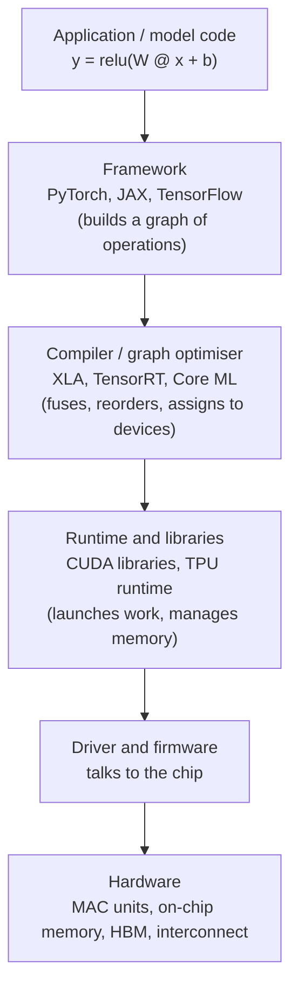

*Figure 1.1. The AI software stack. Each layer can hide detail, but each is also a place where work can be wasted. Source: author's own diagram, based on the stack described in Module 01, Section 2.7.*

The key point: **the same model can run at very different speeds on the same chip**, depending on how well these layers cooperate. This is called *hardware–software co-design* when the chip and the software are designed together, as with TPUs and the XLA compiler.

## 1.2 What a compiler does for an AI model

A model is first turned into a **computation graph**: a diagram where each node is an operation (matrix multiply, add, ReLU) and each arrow is a tensor flowing between them. The compiler then improves this graph. The four most important jobs are:

| Job | What it does | Why it helps |
|---|---|---|
| **Operator fusion** | Merges several operations into one pass over the data | Intermediate results never travel to and from off-chip memory |
| **Layout and tiling** | Cuts large tensors into tiles that fit in on-chip memory | Data stays in fast memory while it is reused |
| **Precision assignment** | Chooses FP16, BF16 or INT8 for each operation | Fewer bytes moved, more MACs per cycle |
| **Placement and scheduling** | Decides which chip or core runs each part, and in what order | Keeps units busy; overlaps compute with data transfer |

*Table 1.1. Four jobs of an AI compiler.*

### Worked example 1.A: why fusion saves memory traffic

*Illustrative numbers.* A tensor has 1,000,000 FP16 values (2 bytes each), so it is 2 MB. We apply three element-wise operations in a row: multiply by a scale, add a bias, apply ReLU.

**Unfused.** Each operation reads the whole tensor from memory and writes a whole result back.

- 3 operations × (1 read + 1 write) × 2 MB = **12 MB** of traffic.

**Fused.** One combined operation reads the tensor once, does all three steps on each value while it is in a register, and writes the final result once.

- 1 read + 1 write × 2 MB = **4 MB** of traffic.

Fusion cuts memory traffic by a factor of 3. Because these operations do almost no arithmetic per byte, they are memory-bound (Module 01, Section 4.3), so a 3× cut in traffic gives close to a 3× cut in time.

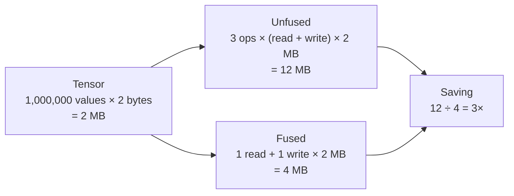

> [!TIP]
> **Going further.** The compiler can only fuse operations it understands. A custom operation it does not recognise acts as a wall: the data must be written out before the wall and read back after it.

## 1.3 Utilisation at system level: MFU

Module 01 defined *utilisation* as the share of peak that a chip actually achieves. For training large models, the standard measure is **MFU (model FLOPs utilisation)**:

```
MFU = (FLOPs the model mathematically needs per second) ÷ (peak FLOP/s of the hardware)
```

It counts only the useful arithmetic of the model, not wasted or repeated work. Well-tuned large training runs commonly report MFU somewhere in the range of 30–60%; the rest is lost to waiting for memory, waiting for other chips, and gaps between operations. A low MFU means you are paying for idle silicon.

**Example.** A chip has a peak of 275 TFLOP/s. A training job achieves 110 TFLOP/s of useful model arithmetic. MFU = 110 ÷ 275 = **40%**.

> [!WARNING]
> **Caution: MFU is not the same as hardware utilisation.** A chip can look "100% busy" in a monitoring tool while doing little useful arithmetic (for example, spending all its time copying data). MFU measures *useful* work, which is why it is preferred.

## 1.4 Device switches and fallbacks

In Module 01 you saw that an unsupported operation "falls back" to the CPU on a phone. The same problem appears in data centres. Whenever execution moves between devices (CPU to accelerator, or one chip to another), data must be copied, and the accelerator waits.

Consider a model with 10 operations where operation 5 is unsupported on the accelerator. The graph splits into three segments: operations 1–4 on the accelerator, operation 5 on the CPU, operations 6–10 on the accelerator. That is **two device switches**, each with a copy. If the copies are large, they can cost more time than all the accelerated arithmetic saved.

## 1.5 Activities for Section 1

- **Activity 1.A.** A tensor has 4,000,000 FP16 values. Four element-wise operations are applied in a row. Calculate the memory traffic (in MB) unfused and fused, and the percentage saved.
- **Activity 1.B.** A chip has a peak of 400 TFLOP/s. A training job achieves 140 TFLOP/s of useful model arithmetic. What is the MFU?
- **Activity 1.C.** A model has 12 operations in a row. Operations 3 and 8 are unsupported on the accelerator. How many device switches occur?
- **Activity 1.D.** In two or three sentences, explain why a compiler needs to know the size of a chip's on-chip memory when it decides how to tile a large matrix.

## 1.6 Summary

- The AI software stack (framework, compiler, runtime, driver, hardware) decides how well a model uses a chip; the same model can run at very different speeds on the same hardware.
- A compiler turns a model into a computation graph and then fuses operations, tiles tensors, assigns precision and schedules work.
- Fusing three element-wise operations on a 2 MB tensor cut memory traffic from 12 MB to 4 MB, a 3× saving on a memory-bound step.
- MFU measures useful model arithmetic as a share of peak; values of 30–60% are typical for well-tuned large runs.
- Every switch between devices adds data copies; unsupported operations can therefore slow a whole model.

---

# Section 2: Distributed AI Systems

> [!IMPORTANT]
> **Big idea.** One chip is not enough: either the model does not fit, or training would take years. Splitting the work across many chips solves both problems, but every split creates communication, and communication is the price of going distributed.

## Learning objectives

By the end of this section you should be able to:

- Explain two reasons for distributing a model: memory and time.
- Calculate the memory needed to train a model and decide how many chips are needed to hold it.
- Distinguish data, tensor and pipeline parallelism, and say when each is used.
- Calculate the per-chip traffic of a ring all-reduce and the resulting communication overhead.
- Calculate scaling efficiency from measured times.

## 2.1 Why distribute? Two reasons

**Reason 1: the model does not fit.** Training needs far more memory than the weights alone. With the common *mixed-precision Adam* recipe, each parameter needs roughly:

| Item | Bytes per parameter |
|---|---|
| Weights (BF16) | 2 |
| Gradients (BF16) | 2 |
| Master copy of weights (FP32) | 4 |
| Optimiser state: two moments (FP32 each) | 8 |
| **Total** | **16** |

*Table 2.1. Approximate training memory per parameter (a widely used rule of thumb; exact recipes vary). Activations (intermediate values) come on top.*

### Worked example 2.A: does our 7B model fit on one chip?

*Illustrative numbers.* Suppose each chip has 96 GB of memory.

- Training state = 7 × 10⁹ parameters × 16 bytes = **112 GB**.
- 112 GB > 96 GB, so the training state alone does not fit on one chip, before counting any activations.
- If the state is *sharded* (each chip holds only a slice) across 256 chips, each chip holds 112 ÷ 256 ≈ **0.44 GB** of state, leaving the rest of its memory for activations.

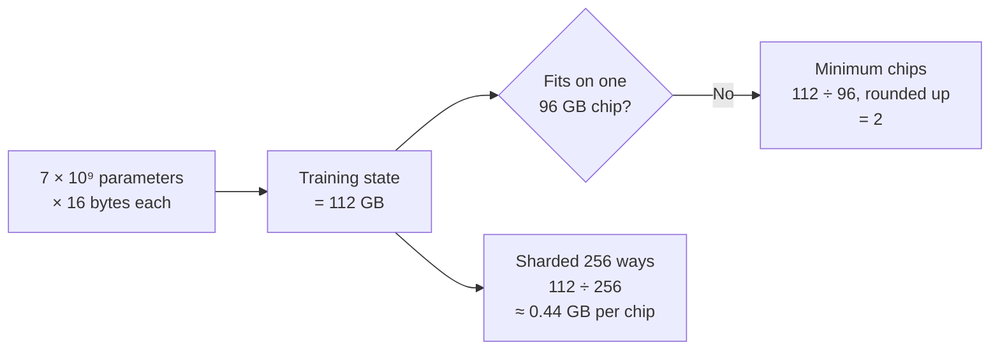

**Reason 2: time.** Training our model needs about 6 × N × D FLOPs, where N is the parameter count and D is the number of training tokens (a standard estimate; see Section 4.2). For N = 7 × 10⁹ and D = 1.4 × 10¹², that is about 5.9 × 10²² FLOPs. One chip delivering 100 TFLOP/s effective would need about 5.9 × 10²² ÷ 10¹⁴ ≈ 5.9 × 10⁸ seconds, which is almost 19 years, if run alone. Parallel chips are not a luxury but a necessity.

## 2.2 Three ways to split the work

| Strategy | What is split | Each chip holds | Communication | Best when |
|---|---|---|---|---|
| **Data parallelism** | The batch of training examples | A full copy of the model (or a shard of its state) | Gradients are summed across chips once per step (all-reduce) | The model (or its shards) fits on one chip; you want more throughput |
| **Tensor (model) parallelism** | Individual matrices inside a layer | A slice of every layer | Partial results exchanged inside every layer; needs very fast links | A single layer is too big, or you want lower latency |
| **Pipeline parallelism** | Groups of layers (stages) | A few consecutive layers | Activations passed from stage to stage | The model is deep; links between stages are slower |

*Table 2.2. Three parallelism strategies.*

Real large-model training combines all three ("3D parallelism"): tensor parallelism inside a group of tightly linked chips, pipeline parallelism across groups, and data parallelism across replicas. The rule of thumb is to put the most communication-hungry strategy (tensor) on the fastest links.

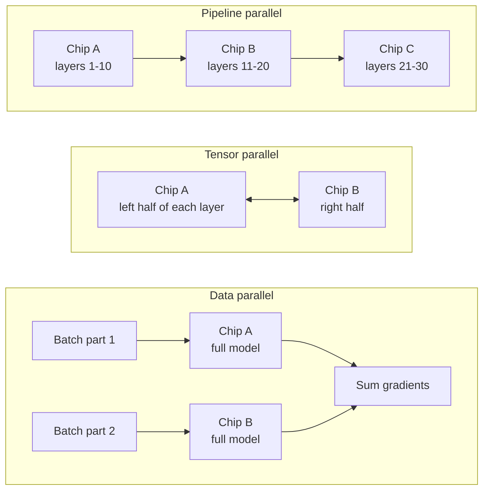

*Figure 2.1. The three strategies in schematic form. Source: author's own diagram.*

> [!NOTE]
> **Bridge to Networks (Module 02).** Each strategy loads the network differently. Data parallelism sends large, regular messages once per step. Tensor parallelism sends smaller messages very often, so it needs the lowest latency and highest bandwidth. Pipeline parallelism sends modest messages between neighbours. This is why the network design decides which strategy is practical.

## 2.3 The cost of keeping chips in sync: all-reduce

In data parallelism, each chip computes gradients on its own part of the batch. Before the weights are updated, all gradients must be summed and shared with every chip. This operation is called an **all-reduce**.

In the common **ring all-reduce**, chips are arranged in a ring and pass chunks of the data around. For a gradient of S bytes on N chips, each chip sends and receives about

```
traffic per chip = 2 × (N − 1) ÷ N × S   bytes
```

Notice that for large N this approaches 2 × S, almost independent of N. That property is why data parallelism scales well in principle.

### Worked example 2.B: communication overhead for the 7B model

*Illustrative numbers.*

- Gradients: 7 × 10⁹ values in BF16 = **14 GB**.
- N = 256 chips. Traffic per chip = 2 × (255 ÷ 256) × 14 GB ≈ **27.9 GB**.
- Link bandwidth per chip: 100 GB/s. Time = 27.9 ÷ 100 ≈ **0.28 s**.
- Compute per step: the batch is 4 × 10⁶ tokens, so FLOPs = 6 × 7 × 10⁹ × 4 × 10⁶ = 1.68 × 10¹⁷. The cluster delivers 256 × 200 TFLOP/s × 40% MFU = 2.048 × 10¹⁶ FLOP/s, so compute takes about **8.2 s**.
- If communication is not overlapped with compute, one step takes 8.2 + 0.28 = 8.48 s, so **efficiency ≈ 96.7%**.

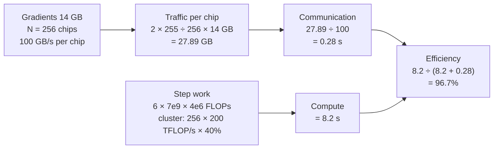

The overhead is small here because each step has a lot of compute (a large batch). With a smaller batch per chip, compute per step shrinks while the all-reduce stays the same size, and the overhead grows. Real systems also *overlap* communication with the backward pass, which hides part of it.

> [!WARNING]
> **Simplification.** This example treats pure data parallelism with a full gradient on every chip. In practice the 112 GB training state of Worked example 2.A would be sharded, which changes the communication pattern (more, smaller collectives). The order of magnitude is still instructive.

## 2.4 Scaling efficiency

How well does adding chips pay off? Measure the **speed-up** and the **scaling efficiency**:

```
speed-up = T(1 chip) ÷ T(N chips)
scaling efficiency = speed-up ÷ N
```

**Example.** A job takes 100 hours on 1 chip and 2.0 hours on 64 chips. Speed-up = 50. Scaling efficiency = 50 ÷ 64 ≈ **78%**. The missing 22% went to communication, idle units, and the serial parts predicted by Amdahl's law (Module 01, Section 3.3).

*Figure 2.2. Ideal versus achieved scaling. The ideal line is a straight diagonal; real curves bend away as communication and serial work grow. Source: author's own diagram, based on Amdahl (1967).*

Two terms are used for the two ways to measure scaling:

- **Strong scaling:** fixed problem size, more chips. Efficiency falls as each chip gets less work.
- **Weak scaling:** problem size grows with the chip count. Easier to keep efficient, and what large training runs usually rely on.

## 2.5 Activities for Section 2

- **Activity 2.A.** A 13-billion-parameter model is trained with the 16-bytes-per-parameter recipe. Each chip has 80 GB. How much memory does the training state need, and what is the minimum number of chips needed just to hold it?
- **Activity 2.B.** A model has 1 billion parameters, gradients stored in BF16. It is trained with data parallelism on 8 chips connected at 50 GB/s each. Calculate the traffic per chip and the time for one ring all-reduce.
- **Activity 2.C.** A job takes 120 hours on 1 chip and 4.5 hours on 32 chips. Calculate the speed-up and scaling efficiency.
- **Activity 2.D.** Name the best-fitting parallelism strategy for each case: (a) the model fits on one chip, and you want to process more data per second; (b) a single matrix is too large for one chip's memory; (c) a very deep model whose layers can be grouped into stages on separate chips.

## 2.6 Summary

- Models are distributed for two reasons: memory (training needs about 16 bytes per parameter, so a 7B model needs about 112 GB of state) and time (the 7B model needs about 5.9 × 10²² FLOPs).
- Data, tensor and pipeline parallelism split the batch, the matrices and the layers respectively; large systems combine all three and put tensor parallelism on the fastest links.
- A ring all-reduce moves about 2 × (N − 1) ÷ N × S bytes per chip; for 14 GB of gradients on 256 chips that is about 27.9 GB, or about 0.28 s at 100 GB/s, a 3% overhead on an 8.2 s step.
- Scaling efficiency (speed-up ÷ N) shows how much of the added hardware is really used; a drop from 100% is caused by communication, idle units and serial work.

---

# Section 3: Performance Optimization and Resource Allocation

> [!IMPORTANT]
> **Big idea.** Optimisation is a measurement discipline before it is a coding one. Find out what is actually limiting the system (compute, memory, communication or input data), fix that one thing, and measure again. Then, because chips are expensive, make sure they are shared so they are rarely idle.

## Learning objectives

By the end of this section you should be able to:

- Apply a measure-first optimisation workflow and match symptoms to likely bottlenecks.
- Explain how activation recomputation trades extra compute for lower memory, and calculate its cost.
- Explain why token-by-token generation is memory-bound, and calculate its speed limit.
- Describe the throughput–latency trade-off of batching in serving.
- Explain how scheduling and sharing raise utilisation, and calculate the effect on cost per useful hour.

## 3.1 The measure-first workflow

Beginners often guess at what is slow. Experts measure. The loop is:

1. **Profile.** Record where time goes: compute, memory transfers, communication, waiting for input data.
2. **Locate the bottleneck.** Use the roofline model from Module 01 for single chips, and the scaling-efficiency idea from Section 2.4 for many chips.
3. **Change one thing.**
4. **Measure again.** Keep the change only if the numbers improve.

The bottleneck is rarely where you expect, and removing one bottleneck simply exposes the next.

| Symptom | Likely bottleneck | Typical fix |
|---|---|---|
| MFU low, arithmetic units idle between operations | Many small operations; launch overhead | Operator fusion; larger batches; compile the whole graph |
| Low arithmetic intensity on the roofline | Memory bandwidth | Lower precision; reuse data on chip; bigger batch |
| Step time grows as chips are added | Communication | Overlap communication with compute; better placement; fewer, larger messages |
| Chips wait while data loads | Input pipeline (storage, decoding) | Prefetching; more loader workers; faster storage |
| Out-of-memory errors | Memory capacity | Sharding; recomputation; lower precision |

*Table 3.1. Matching symptoms to bottlenecks.*

*Figure 3.1. The optimisation loop: profile, locate, change one thing, re-measure. Source: author's own diagram.*

## 3.2 Optimisation techniques for training

| Technique | What it does | Trade-off |
|---|---|---|
| **Mixed precision** | Computes in BF16/FP16 and keeps an FP32 master copy | Slightly more code; small accuracy risk handled by scaling |
| **Activation recomputation** (checkpointing) | Does not store every intermediate value in the forward pass; recomputes them when needed in the backward pass | Saves memory, costs extra compute |
| **Overlapping communication and compute** | Starts sending the gradients of finished layers while earlier layers are still computing | Needs careful scheduling |
| **Larger per-chip batch** | More work per all-reduce, higher arithmetic intensity | Limited by memory; very large batches can hurt learning |
| **Efficient input pipeline** | Prepares the next batch while the current one runs | Uses CPU and storage resources |

*Table 3.2. Common training optimisations.*

### Worked example 3.A: the price of recomputation

The backward pass costs about twice the forward pass, so a normal training step is about 1 part forward + 2 parts backward = 3 parts, which equals the 6 × N × D estimate. If we recompute the forward pass once more during the backward pass, the step costs 4 parts instead of 3: **about 33% more compute**.

Our 7B job had a step time of 8.2 s (Worked example 2.B). With full recomputation it would take about 8.2 × 4 ÷ 3 ≈ **10.9 s**. We pay this only if the saved memory lets us use a larger batch or avoid a more expensive sharding scheme.

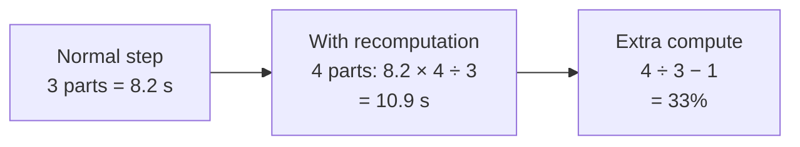

## 3.3 Optimisation for serving (inference)

When a language model writes an answer it generates one token at a time. For each new token, the chip must read **all of the model's weights** from memory once, but does only a small amount of arithmetic with them. That is the memory-bound case of Module 01 (arithmetic intensity near 1 FLOP/byte at batch 1).

### Worked example 3.B: the speed limit of one conversation

*Illustrative numbers.* The 7B model is stored in INT8 (7 GB). The chip has 1 TB/s of memory bandwidth.

- Time to read the weights once = 7 GB ÷ 1,000 GB/s = **7 ms** per token.
- Speed limit for one user = 1 ÷ 0.007 ≈ **143 tokens per second**, however many MAC units the chip has.
- If 32 users are served in the same batch, the weights are read once for all of them. Total throughput rises to about 32 × 143 ≈ **4,571 tokens per second**, while each user still sees about 143 tokens per second.

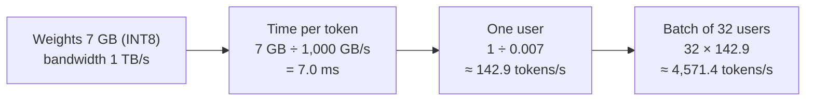

> [!WARNING]
> **Upper bounds.** This ignores the KV cache (stored attention state, which also has to be read for every token and grows with conversation length) and assumes enough compute. Real batches are limited by memory capacity and by the KV cache. The point is the pattern: batching raises throughput almost for free until the chip becomes compute-bound.

### The throughput–latency trade-off

Batching has a hidden cost: requests must wait to be grouped. If 100 requests arrive per second and the server insists on a full batch of 32, the first request in a batch waits about 31 ÷ 100 ≈ **0.31 s** before any computation starts. Servers therefore use a **timeout**: run the batch when it is full *or* when the oldest request has waited, say, 50 ms. With a 50 ms timeout and 100 requests per second, a batch typically holds about 5 requests. Modern servers use *continuous batching*, in which new requests join a running batch between tokens, to get most of the throughput gain without the long wait.

Other serving optimisations include quantisation (Module 01, Section 3.4), caching results for repeated prompts, and running a small fast model to draft tokens that a large model then verifies (*speculative decoding*).

## 3.4 Resource allocation: sharing expensive hardware

A cluster of accelerators is shared by many teams and many kinds of job. A **scheduler** decides who gets which chips and when.

| Concept | Meaning |
|---|---|
| **Quota** | Each team has a guaranteed share of chips |
| **Priority and preemption** | Urgent or customer-facing jobs (serving) can pause lower-priority jobs (experiments) |
| **Gang scheduling** | A training job needs all of its chips at the same moment; the scheduler starts it only when the full set is free |
| **Topology-aware placement** | Chips that communicate heavily are placed close together on fast links |
| **Bin packing** | Fit jobs of different sizes into free space with as few gaps as possible |
| **Autoscaling** | Add serving replicas when load rises; release them when it falls |

*Table 3.3. Key ideas in cluster resource allocation.*

### Worked example 3.C: why utilisation is a cost issue

A chip costs $2 per hour to own and run, whether it is busy or not. If the cluster's average utilisation is 35%, each *useful* chip-hour really costs 2 ÷ 0.35 ≈ **$5.71**. Better scheduling that lifts utilisation to 60% brings it down to 2 ÷ 0.60 ≈ **$3.33**, a saving of about **42%** without buying any hardware.

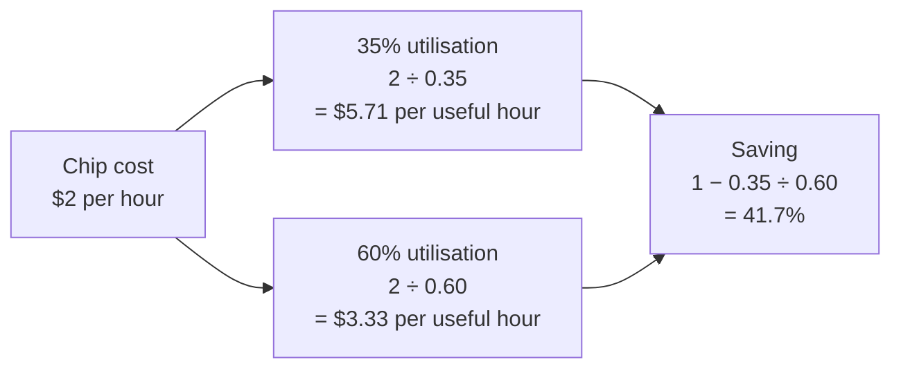

## 3.5 Activities for Section 3

- **Activity 3.A.** A training step takes 20 s without recomputation. How long does it take with full recomputation, using the 4-parts-instead-of-3 rule?
- **Activity 3.B.** A 13-billion-parameter model is stored in INT8 on a chip with 2 TB/s of memory bandwidth. What is the memory-bound limit on tokens per second for one user?
- **Activity 3.C.** A training job shows MFU of 15%, and the profiler shows the chips idle while they wait for the next batch to be read from storage. Which row of Table 3.1 applies, and what would you try first?
- **Activity 3.D.** A chip costs $3 per hour. Calculate the cost per useful hour at 25% utilisation and at 50% utilisation.

## 3.6 Summary

- Optimisation follows a loop: profile, locate the bottleneck, change one thing, re-measure; symptoms such as low MFU, growing step time or idle chips point to different bottlenecks.
- Training techniques include mixed precision, overlapping communication, and activation recomputation, which costs about 33% more compute to save memory.
- Generating tokens is memory-bound: a 7 GB INT8 model on a 1 TB/s chip is limited to about 143 tokens/s for one user, and batching 32 users lifts total throughput to about 4,571 tokens/s.
- Batching trades latency for throughput; timeouts and continuous batching limit the waiting.
- Schedulers share chips through quotas, priorities, gang scheduling and topology-aware placement; raising utilisation from 35% to 60% cuts the cost per useful chip-hour by about 42%.

---

# Section 4: Challenges in AI Infrastructure: Energy, Cost and Scalability

> [!IMPORTANT]
> **Big idea.** Three ceilings limit how large an AI system can usefully become: the electricity it needs, the money it costs, and the failures it suffers. They are linked, and improving one often pushes pressure onto another.

## Learning objectives

By the end of this section you should be able to:

- Distinguish power from energy, and use PUE to compute the energy of a facility.
- Estimate the compute, time, cost and energy of a training run from its parameters and tokens.
- Estimate the cost per million tokens of serving a model.
- Explain why failures become routine at scale, and calculate a sensible checkpoint interval.
- Describe the trade-offs between energy, cost and scalability.

## 4.1 Energy

**Power** is the rate of using energy, in watts (W). **Energy** is power used over time, in joules or, more commonly for electricity, kilowatt-hours (kWh). A 400 W chip running for 10 hours uses 4 kWh.

Chips are only part of the load. A data centre also needs cooling, power conversion and lighting. The ratio is called **PUE (power usage effectiveness)**:

```
PUE = total facility energy ÷ energy used by the computing equipment
```

A PUE of 1.0 would mean zero overhead. Older facilities often have PUE of 1.5 or worse; the most efficient large operators report values around 1.1.

### Worked example 4.A: what PUE is worth

A computing load of 1 MW, running all year (8,760 hours):

- PUE 1.1: 1 × 1.1 × 8,760 = **9,636 MWh**.
- PUE 1.6: 1 × 1.6 × 8,760 = **14,016 MWh**.
- Difference: **4,380 MWh** per year, which at an illustrative $80 per MWh is **$350,400**, for the same computing.

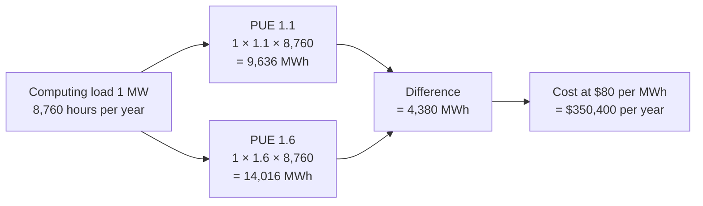

**From energy to carbon.** Emissions = energy × carbon intensity of the electricity. Intensity varies enormously by place and time. For an illustrative 89.8 MWh job (Worked example 4.B): at 0.4 kg CO₂e per kWh the emissions are about 35.9 tonnes; on a grid at 0.05 kg per kWh they are about 4.5 tonnes. *Where and when* a job runs can matter as much as how efficiently it runs.

**Why energy is a design limit.** Module 01 showed that moving a 32-bit word from DRAM costs about 170× the energy of multiplying it (Horowitz, 2014). Every technique that reduces data movement (fusion, lower precision, bigger on-chip memory) is therefore an *energy* technique as well as a speed technique. At the facility scale, the limit is often the power that can be delivered to a site and the heat that can be removed from the racks.

## 4.2 Cost

### Estimating training compute

A widely used estimate for dense transformer models is

```
training FLOPs ≈ 6 × N × D
```

where N is the number of parameters and D the number of training tokens (see Kaplan et al., 2020; Hoffmann et al., 2022). The factor 6 is the 2 FLOPs per MAC times 3 (forward plus about twice for backward). Hoffmann et al. found that, for a fixed compute budget, a good balance is roughly 20 tokens per parameter; our 7B model with 1.4 trillion tokens is exactly that.

### Worked example 4.B: the full bill for the running example

*Illustrative numbers.* 256 chips, each 200 TFLOP/s peak at 40% MFU, 400 W per chip, $2 per chip-hour, PUE 1.1.

- FLOPs = 6 × 7 × 10⁹ × 1.4 × 10¹² = **5.88 × 10²²**.
- Cluster rate = 256 × 200 × 10¹² × 0.40 = 2.048 × 10¹⁶ FLOP/s.
- Time = 5.88 × 10²² ÷ 2.048 × 10¹⁶ ≈ 2.87 × 10⁶ s ≈ **33.2 days**.
- Chip-hours = 256 × 797.5 h ≈ **204,167**; cost ≈ **$408,333**.
- Chip energy = 256 × 0.4 kW × 797.5 h ≈ 81.7 MWh; with PUE 1.1, **≈ 89.8 MWh**.

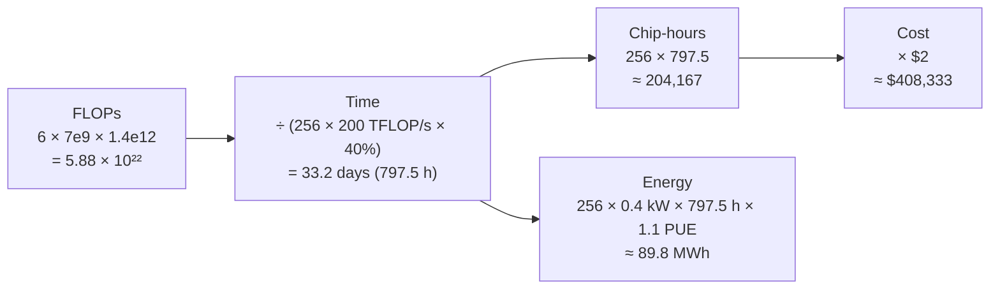

Notice what the example shows: improving MFU from 40% to 50% would cut the time, the cost and the energy by 20% each, with no new hardware. This is why Section 3 matters.

> [!WARNING]
> **What this number leaves out.** It is the cost of one successful run. Real projects pay also for failed runs, experiments and tuning (often several times the final run), data preparation, staff, and the capital cost of buildings and networks.

### Total cost of ownership and the cost of serving

**Total cost of ownership (TCO)** adds the purchase price (spread over the chip's life, typically a few years), electricity and cooling, networking, buildings, maintenance and staff. For serving, the useful figure is **cost per million tokens**:

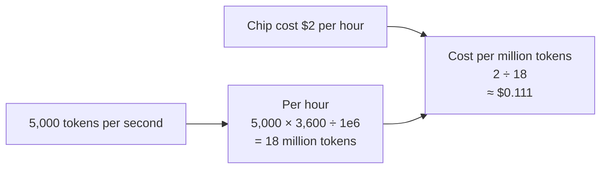

So a chip delivering 5,000 tokens per second at $2 per hour costs about **$0.11 per million tokens**. Anything that raises tokens per second (batching, quantisation) or utilisation lowers this directly. Training is a one-off cost; serving is a recurring cost that grows with every user, which is why many hardware generations are now designed with inference in mind (Module 01, Section 1.5).

## 4.3 Scalability: when failures become routine

A single chip may run for years without failing. A system of thousands of chips will see failures every few hours, because the failure rates add up. If each chip has a mean time between failures (MTBF) of M hours and the system fails when *any* chip fails, the system MTBF is roughly M ÷ N.

### Worked example 4.C: failures in a 4,096-chip job

*Illustrative numbers.* Each chip's MTBF is 5 years = 43,800 hours.

- System MTBF ≈ 43,800 ÷ 4,096 ≈ **10.7 hours**.
- A month-long job will therefore be interrupted dozens of times. The defence is **checkpointing**: periodically saving the full training state so that, after a failure, the job restarts from the last save rather than from scratch.
- Saving too rarely wastes much work at each failure; saving too often wastes time on saving. A classic approximation (Young, 1974) for the best interval is **√(2 × C × MTBF)**, where C is the time to write one checkpoint.
- With C = 2 minutes (0.0333 h): interval ≈ √(2 × 0.0333 × 10.7) ≈ 0.84 h ≈ **51 minutes**, at a saving overhead of about 3.9%.

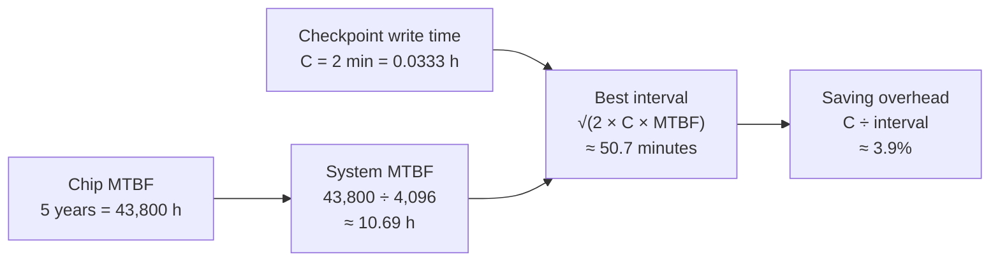

Failures are not only chips: links, power supplies, cooling and software bugs contribute. Large systems therefore also use spare chips, automatic detection of slow or faulty chips, and fast restart.

**Other scaling walls.** Besides reliability, growth is limited by: the **network** (communication overhead grows with scale; Module 02), the **memory wall** (compute grows faster than memory bandwidth; Module 01, Section 4), the **power and cooling** that a site can supply, and the **supply** of chips and memory.

## 4.4 The trade-offs in one table

| Lever | Helps | May hurt |
|---|---|---|
| More chips | Time to train | Cost, power, failures, communication overhead |
| Lower precision | Speed, energy, memory | Accuracy (needs care) |
| Larger batch | Utilisation, throughput | Latency in serving; learning quality in training |
| Frequent checkpoints | Resilience | Time and storage |
| Cleaner or cheaper power site | Carbon, cost | Location constraints, network distance |
| Custom accelerator (ASIC) | Energy and cost per operation | Flexibility, software ecosystem, design cost |

*Table 4.1. Common levers and their side effects.*

## 4.5 Activities for Section 4

- **Activity 4.A.** A facility has a computing load of 2 MW. Compare the annual energy at PUE 1.2 and PUE 1.5 (8,760 hours). How much extra energy does the less efficient facility use?
- **Activity 4.B.** A team trains a 3-billion-parameter model on 60 billion tokens on 64 chips, each delivering 200 TFLOP/s peak at 40% MFU. Calculate the training FLOPs and the training time in hours.
- **Activity 4.C.** A cluster has 1,024 chips, each with an MTBF of 4 years. Estimate the system MTBF in hours.
- **Activity 4.D.** Writing one checkpoint takes 3 minutes. Using the MTBF from Activity 4.C, find the best checkpoint interval with Young's approximation.
- **Activity 4.E.** A chip costing $3 per hour serves 6,000 tokens per second. What is the cost per million tokens?

## 4.6 Summary

- Energy is power × time; PUE multiplies the computing energy to give facility energy, and a 0.5 difference in PUE on a 1 MW load is worth about 4,380 MWh per year.
- Training compute is about 6 × N × D; the 7B-parameter, 1.4-trillion-token example needs 5.88 × 10²² FLOPs, about 33 days on 256 chips at 40% MFU, about $408,000 and about 90 MWh.
- Serving cost is best measured per million tokens; at 5,000 tokens/s and $2/hour it is about $0.11.
- System MTBF is roughly chip MTBF ÷ chip count, so a 4,096-chip job fails about every 10.7 hours and needs checkpoints about every 51 minutes (with a 2-minute checkpoint).
- Energy, cost and scalability are linked: most levers that help one place pressure on another.

---

# Section 5: Case Study — Google TPU Infrastructure

> [!IMPORTANT]
> **Big idea.** Google's TPU infrastructure is this module in one real system: a chip designed around MACs and on-chip memory (Module 01), joined by a purpose-built network into pods of thousands of chips (Section 2), programmed through a compiler (Section 1), scheduled as a shared resource (Section 3), and designed with energy, cost and failure in mind (Section 4).

## Learning objectives

By the end of this section you should be able to:

- Describe the layers of a TPU system from chip to pod to multi-pod training job.
- Explain what a torus network is, and calculate how wraparound links shorten the longest path.
- Explain how optical circuit switching improves availability and flexibility.
- Explain why hierarchical communication saves slow-network traffic, with a calculation.
- Evaluate the strengths and limitations of TPU infrastructure for a given team.

> [!WARNING]
> **A note on specifications.** TPU generations, chip counts and figures change quickly. This section teaches the *design ideas*, which are stable, and uses numbers from the cited papers where given. Before quoting any current specification, check Google Cloud's TPU documentation and the Google announcement for that generation. Calculations marked *illustrative* use round numbers chosen for teaching.

## 5.1 A short history: from one chip to a system

| Generation | Main idea | Source |
|---|---|---|
| First TPU (deployed 2015) | Inference-only chip with an 8-bit matrix unit, 92 TOPS peak, 28 MiB on-chip buffer | Jouppi et al. (2017); Module 01, Section 2.5 |
| Next generations (from 2017) | Added training: floating-point (bfloat16) arithmetic, HBM, and chips wired together into pods | Google Cloud TPU documentation |
| TPU v4 | Pods of 4,096 chips joined by optically reconfigurable links; specialised units for embedding lookups | Jouppi et al. (2023) |
| Later generations | Variants for cost-efficient serving and for the largest training runs; the newest announced generation (Ironwood, 2025) is aimed at inference at scale | Google (2025); Google Cloud TPU documentation |

*Table 5.1. Selected milestones in TPU design. Verify current generations before citing.*

The pattern is the one from Section 4: each generation moved attention from *the chip* to *the system around the chip*, because once a chip is fast, the limits become memory, communication, reliability and energy.

## 5.2 Building blocks: from chip to pod

Using the TPU v4 description in Jouppi et al. (2023) as a concrete example:

| Level | What it is | Why it exists |
|---|---|---|
| **Chip** | Matrix-multiply units, a vector unit, on-chip memory, HBM, and inter-chip network ports | Executes MACs efficiently (Module 01) |
| **Tray / host** | A small group of chips (four, in v4) plus a host computer that loads data and runs the program | Chips are accelerators and need a CPU host |
| **Rack / cube** | 64 chips arranged as a 4 × 4 × 4 cube | A unit of wiring and deployment |
| **Pod** | 64 cubes, 4,096 chips, linked into one system | The largest tightly coupled unit |
| **Slice** | The subset of a pod a job is given (for example 8 × 8 × 8 chips) | Lets many jobs share a pod |
| **Multi-slice job** | Several slices, possibly in different pods, linked by the data-centre network | Training beyond one pod |

*Table 5.2. Levels of a TPU system (v4 example).*


*Figure 5.1. The hierarchy from chip to multi-slice job. Source: author's own diagram, based on Jouppi et al. (2023).*

## 5.3 The interconnect: a 3D torus with optical switching

In Section 2 you saw that distributed training is limited by communication. TPU pods address this by connecting each chip **directly to its neighbours** over dedicated **inter-chip interconnect (ICI)** links, arranged as a three-dimensional grid. Each chip has six neighbours (up, down, left, right, front, back). In a **torus**, the links *wrap around*: the chip at one edge of the grid is linked to the chip at the opposite edge.

Why is this good for AI?

- Collective operations such as all-reduce can be built from neighbour-to-neighbour transfers (the ring idea from Section 2.3), which use short, fast cables.
- There is no single central switch that every message must cross, which would become the bottleneck.
- Wraparound links shorten the longest path between any two chips.

### Worked example 5.A: how much do wraparound links help?

In a grid with *side* chips along each dimension, the longest path (the **diameter**) is measured in hops.

- **Without wraparound (mesh):** the longest distance along one dimension is *side* − 1, so the diameter is 3 × (*side* − 1).
- **With wraparound (torus):** the longest distance along one dimension is about *side* ÷ 2, so the diameter is 3 × (*side* ÷ 2).

For a 4 × 4 × 4 cube (64 chips): mesh = 9 hops, torus = **6 hops**. For a 16 × 16 × 16 pod (4,096 chips): mesh = 45 hops, torus = **24 hops**.

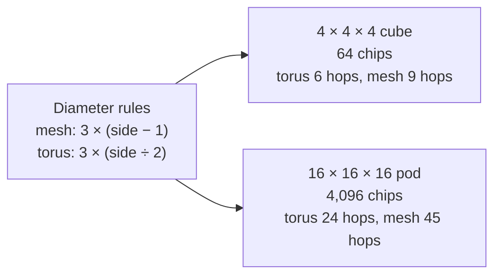

### Optical circuit switches (OCS)

TPU v4 does not wire cubes to each other with fixed cables. Instead, the links between cubes pass through **optical circuit switches**: devices that steer light with tiny mirrors, so that the connections between cubes can be *re-patched by software* without anyone touching a cable (Jouppi et al., 2023). This gives three benefits:

1. **Availability.** If a chip, tray or cube fails, the switches can route around it and assemble the requested slice from healthy cubes.
2. **Flexible slice shapes.** A job can ask for the shape that suits its parallelism (for example, a long thin slice or a cube), and the switches build it.
3. **Incremental deployment.** A pod can start working before every cube has arrived, and be expanded.

> [!NOTE]
> **Bridge to Networks (Module 02).** This is the same trade-off studied in Module 02: dedicated, direct links give high bandwidth and low latency for predictable traffic, and switched or reconfigurable networks give flexibility. TPU pods choose the former for the training traffic and use the latter (OCS and the data-centre network) to manage shape, failures and scale.

## 5.4 Software: compilers, sharding and multi-slice training

The hardware would be unusable without software that hides its structure.

- **XLA** (Section 1.2) compiles the model graph for the TPU, fusing operations and assigning layouts.
- **Frameworks** such as JAX, TensorFlow and PyTorch/XLA let programmers write models in a familiar way.
- **Sharding annotations.** The programmer states how each tensor should be split across the chips (for example, split this matrix by rows across a group of chips). The compiler then inserts the required communication (all-reduce, all-gather) automatically. This is the Section 2 parallelism strategies expressed as a few hints rather than hand-written messages.
- **Multi-slice training** connects slices over the data-centre network. Communication inside a slice uses the fast ICI; between slices it uses the slower network.

### Worked example 5.B: why communicate hierarchically?

*Illustrative numbers.* Two slices of 256 chips each train the 7B model. Gradients are 14 GB. The slow network gives each chip 12.5 GB/s between slices.

- **Naive:** every chip sends its full 14 GB across the slow network: 14 ÷ 12.5 ≈ **1.12 s**.
- **Hierarchical:** first, inside each slice (fast ICI), a *reduce-scatter* leaves each of the 256 chips holding just 14 ÷ 256 ≈ 0.055 GB of the summed gradient. Only these small pieces cross the slow network: 0.055 ÷ 12.5 ≈ **4.4 ms**.
- The slow-network traffic and time shrink by a factor of **256**, the number of chips in a slice.

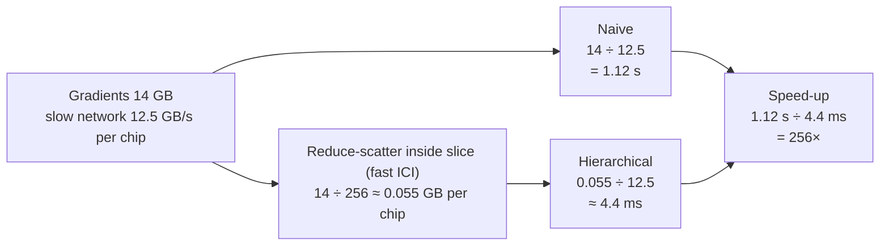

The general principle: *do as much reduction as possible on the fastest links, and send only the minimum across the slowest.* This is the Module 01 memory-hierarchy idea (keep data near the compute) applied to a network hierarchy.

## 5.5 Operating the fleet: scheduling, reliability, energy

- **Scheduling.** Pods are shared. A cluster scheduler (Section 3.4) allocates slices to jobs by quota and priority, places them so their chips are neighbours, and starts a training job only when its whole slice is available (gang scheduling). With OCS, the "shape" problem is easier: any set of healthy cubes can be wired into the requested slice, which reduces fragmentation and raises utilisation.
- **Reliability.** Section 4.3 showed that thousands of chips fail every few hours. TPU systems combine health monitoring, optical rerouting around bad hardware, and frequent checkpointing, so that a failure costs minutes rather than days.
- **Energy.** A custom chip spends silicon on MACs and on-chip memory instead of general-purpose control logic (Module 01, Section 2.3). At the facility level, Google reports a fleet-wide PUE close to 1.1 for its data centres, and recent TPU generations use liquid cooling to remove heat from densely packed chips (Google, n.d.; check the latest figures). The TPU v4 paper reports energy-efficiency comparisons with other accelerators; consult it for the exact numbers and conditions (Jouppi et al., 2023).

## 5.6 Evaluation: strengths and limitations

| Strengths | Limitations |
|---|---|
| High performance per watt and per dollar on large matrix workloads | Less flexible than a GPU for unusual operations; unsupported operations fall back to slower paths |
| Co-design of chip, network, compiler and scheduler lets the whole system be tuned together | Tied to a particular software stack (XLA/JAX/PyTorch-XLA); porting from a CUDA codebase takes effort |
| Direct-link torus network scales training to thousands of chips | Mostly available through Google's own cloud, which creates dependence on one provider |
| Optical switching raises availability and utilisation | Added complexity and hardware that other architectures do not need |
| Generations tailored for training or for serving | Peak numbers do not equal real performance; each team must measure its own workload |

*Table 5.3. Strengths and limitations of TPU infrastructure.*

> [!TIP]
> **Judge with your own numbers.** The way to decide between platforms is the way this module taught: measure MFU and cost per useful token on *your* workload, and include porting effort. A chip that is faster on paper may not be cheaper in practice.

## 5.7 Case-study questions

1. Why is a 3D torus a good match for all-reduce and tensor-parallel communication?
2. Explain in three sentences how optical circuit switches improve the availability of a pod.
3. Calculate the diameter, in hops, of an 8 × 8 × 8 mesh and an 8 × 8 × 8 torus. By what percentage does wraparound shorten the longest path?
4. In Worked example 5.B, why does hierarchical communication cut slow-network time by exactly the number of chips per slice?
5. Name three ideas from Module 01 that appear in the TPU system, and say where.
6. A start-up has a PyTorch model that uses a custom GPU kernel. List two things it must check before moving to TPUs.

## 5.8 Conclusion

The lesson of the TPU case study is that **AI performance is a property of systems, not chips**. A chip's peak number matters only if the compiler keeps it busy, the network keeps it fed, the scheduler keeps it shared, the cooling keeps it running, and the budget keeps it paid for. Each of those layers is a place to win or lose, and measuring each is the only reliable way to know which.

## 5.9 Summary

- A TPU system is a hierarchy: chip, tray, cube, pod (4,096 chips in v4) and multi-slice jobs across pods.
- Chips are joined by direct links in a 3D torus; wraparound shortens the longest path in a 16 × 16 × 16 pod from 45 to 24 hops.
- Optical circuit switches let software re-patch connections, which improves availability, slice-shape flexibility and incremental deployment.
- XLA and sharding annotations turn the parallelism strategies of Section 2 into compiler-generated communication; hierarchical collectives reduce slow-network traffic by the slice size (256× in the example).
- Scheduling, health monitoring, checkpointing and efficient cooling are as important as the chip itself.
- TPUs offer efficiency and scale at the cost of flexibility and ecosystem dependence; measure your own workload before choosing.

---

# Glossary (all sections)

| Term | Meaning |
|---|---|
| **All-reduce** | A collective operation that sums values (such as gradients) across all chips and gives every chip the result. |
| **Autoscaling** | Adding or removing serving replicas automatically as load changes. |
| **Bin packing** | Fitting jobs of different sizes into free capacity with as few gaps as possible. |
| **Checkpointing (fault tolerance)** | Periodically saving the full training state so a job can restart after a failure. |
| **Collective operation** | A communication pattern involving many chips (all-reduce, all-gather, reduce-scatter). |
| **Computation graph** | A diagram of a model in which nodes are operations and arrows are tensors. |
| **Continuous batching** | A serving method in which new requests join a running batch between tokens. |
| **Data parallelism** | Splitting the batch of examples across chips, each with a copy of the model (or its shards). |
| **Diameter (network)** | The longest shortest path between any two nodes, in hops. |
| **Gang scheduling** | Starting a job only when all of its chips are available at once. |
| **ICI (inter-chip interconnect)** | Direct high-speed links between TPU chips. |
| **KV cache** | Stored attention state for tokens already processed, which grows with conversation length. |
| **MFU (model FLOPs utilisation)** | Useful model FLOP/s divided by the hardware's peak FLOP/s. |
| **MTBF** | Mean time between failures. System MTBF is roughly chip MTBF divided by chip count. |
| **Multi-slice training** | Training across several slices linked by the data-centre network. |
| **OCS (optical circuit switch)** | A switch that re-patches optical links under software control. |
| **Operator fusion** | Merging several operations into one pass to avoid memory traffic. |
| **Pipeline parallelism** | Splitting a model into stages of consecutive layers on different chips. |
| **Pod** | The largest tightly coupled group of TPU chips (4,096 in v4). |
| **Preemption** | Pausing a lower-priority job to run a higher-priority one. |
| **PUE** | Power usage effectiveness: total facility energy ÷ computing equipment energy. |
| **Recomputation (activation)** | Recomputing intermediate values in the backward pass instead of storing them; saves memory at about 33% extra compute. |
| **Scaling efficiency** | Speed-up divided by the number of chips. |
| **Sharding** | Splitting a tensor or the training state across chips. |
| **Slice** | The subset of a pod allocated to one job. |
| **Strong / weak scaling** | Fixed problem size with more chips / problem size growing with chips. |
| **TCO** | Total cost of ownership: purchase, energy, cooling, networking, buildings, maintenance, staff. |
| **Tensor parallelism** | Splitting individual matrices within a layer across chips. |
| **Torus** | A grid network whose edges wrap around to the opposite side. |
| **Training FLOPs estimate** | About 6 × N × D for N parameters and D tokens. |
| **XLA** | The compiler that maps models onto TPUs (and other devices). |

---

# Answer Key (all sections)

## Section 1

**Activity 1.A.** Tensor size = 4,000,000 × 2 bytes = 8 MB. Unfused: 4 operations × (1 read + 1 write) × 8 MB = 64 MB. Fused: 1 read + 1 write = 16 MB. Saved = 48 MB, which is **75%**.

**Activity 1.B.** MFU = 140 ÷ 400 = **35%**.

**Activity 1.C.** Operations 1–2 on the accelerator, 3 on the CPU, 4–7 on the accelerator, 8 on the CPU, 9–12 on the accelerator: accelerator → CPU, CPU → accelerator, accelerator → CPU, CPU → accelerator = **4 device switches**.

**Activity 1.D.** The compiler chooses a tile size so that the data it needs (a tile of each input and the output) fits in on-chip memory. Tiles that are too large spill to slower off-chip memory and cause repeated traffic; tiles that are too small give little reuse and add overhead. The right size depends on the memory capacity.

## Section 2

**Activity 2.A.** 13 × 10⁹ × 16 bytes = 208 GB. 208 ÷ 80 = 2.6, so at least **3 chips**, and more once activations are included.

**Activity 2.B.** Gradients = 10⁹ × 2 bytes = 2 GB. Traffic per chip = 2 × (7 ÷ 8) × 2 = **3.5 GB**. Time = 3.5 ÷ 50 = **0.07 s**.

**Activity 2.C.** Speed-up = 120 ÷ 4.5 ≈ **26.7**. Efficiency = 26.7 ÷ 32 ≈ **83.3%**.

**Activity 2.D.** (a) Data parallelism. (b) Tensor parallelism. (c) Pipeline parallelism.

## Section 3

**Activity 3.A.** 20 × 4 ÷ 3 ≈ **26.7 s**.

**Activity 3.B.** Weights = 13 GB. Time per token = 13 ÷ 2,000 = **6.5 ms**. Limit = 1 ÷ 0.0065 ≈ **153.8 tokens/s**.

**Activity 3.C.** The row "Chips wait while data loads" (input pipeline). Try prefetching the next batch, adding loader workers, or faster storage first. Adding more chips would not help.

**Activity 3.D.** 3 ÷ 0.25 = **$12** per useful hour; 3 ÷ 0.50 = **$6** per useful hour.

## Section 4

**Activity 4.A.** PUE 1.2: 2 × 1.2 × 8,760 = 21,024 MWh. PUE 1.5: 2 × 1.5 × 8,760 = 26,280 MWh. Extra = **5,256 MWh** per year.

**Activity 4.B.** FLOPs = 6 × 3 × 10⁹ × 6 × 10¹⁰ = **1.08 × 10²¹**. Rate = 64 × 200 × 10¹² × 0.40 = 5.12 × 10¹⁵ FLOP/s. Time = 1.08 × 10²¹ ÷ 5.12 × 10¹⁵ ≈ 210,938 s ≈ **58.6 hours**.

**Activity 4.C.** Chip MTBF = 4 × 8,760 = 35,040 h. System MTBF ≈ 35,040 ÷ 1,024 ≈ **34.2 hours**.

**Activity 4.D.** C = 3 min = 0.05 h. Interval = √(2 × 0.05 × 34.2) = √3.42 ≈ 1.85 h ≈ **111 minutes**. (Checkpoint overhead ≈ 0.05 ÷ 1.85 ≈ 2.7%.)

**Activity 4.E.** 6,000 × 3,600 ÷ 10⁶ = 21.6 million tokens per hour. Cost = 3 ÷ 21.6 ≈ **$0.14 per million tokens**.

## Section 5

**Question 1.** Each chip has six direct neighbours, so ring-based collectives and neighbour-heavy tensor parallelism map onto short, fast links. There is no central switch to become a bottleneck, and wraparound links keep the longest path short.

**Question 2.** The optical switches connect the cubes and can be re-patched by software. If a chip or cube fails, the switches route around it and build the requested slice from healthy cubes instead of leaving the whole job stalled. Spare cubes can therefore be used immediately, which raises availability and utilisation.

**Question 3.** Mesh: 3 × (8 − 1) = 21 hops. Torus: 3 × (8 ÷ 2) = 12 hops. Shortening = (21 − 12) ÷ 21 ≈ **43%**.

**Question 4.** After the reduce-scatter inside a slice, each of the 256 chips holds only 1/256 of the summed gradient. Only these pieces cross the slow network, so the data (and the time at the same bandwidth) is smaller by a factor of 256.

**Question 5.** Any three of: the MAC matrix units (Module 01, Section 1.2); low-precision arithmetic such as bfloat16 and INT8 (Section 3.4); on-chip memory and HBM that raise effective bandwidth (Section 4); the roofline reasoning behind batching (Section 4.3); the compiler and software stack (Section 2.7); the ASIC flexibility–efficiency trade-off (Section 2.1).

**Question 6.** Any two of: whether the custom kernel has an equivalent that the TPU compiler supports (otherwise it may fall back and slow the model); the effort of porting the code and tooling to JAX or PyTorch/XLA; measured MFU and cost per useful token on the start-up's own workload; availability and dependence on one cloud provider.

---

# References (all sections)

- Amdahl, G. M. (1967). Validity of the single processor approach to achieving large scale computing capabilities. *AFIPS Conference Proceedings*.
- Barroso, L. A., Hölzle, U., & Ranganathan, P. (2018). *The Datacenter as a Computer: Designing Warehouse-Scale Machines* (3rd ed.). Morgan & Claypool.
- Google. (2025). Ironwood TPU announcement.
- Google. (n.d.). Data centers: efficiency (PUE reporting). Google Data Centers website.
- Google Cloud. (n.d.). Cloud TPU documentation: system architecture and TPU versions.
- Hennessy, J. L., & Patterson, D. A. (2019). A new golden age for computer architecture. *Communications of the ACM*, 62(2), 48–60.
- Hoffmann, J., et al. (2022). Training compute-optimal large language models. *NeurIPS 2022*.
- Horowitz, M. (2014). Computing's energy problem (and what we can do about it). *IEEE ISSCC*.
- Jouppi, N. P., et al. (2017). In-datacenter performance analysis of a Tensor Processing Unit. *Proceedings of ISCA 2017*.
- Jouppi, N. P., et al. (2023). TPU v4: An optically reconfigurable supercomputer for machine learning with hardware support for embeddings. *Proceedings of ISCA 2023*.
- Kaplan, J., et al. (2020). Scaling laws for neural language models. *arXiv:2001.08361*.
- Kwon, W., et al. (2023). Efficient memory management for large language model serving with PagedAttention. *SOSP 2023*.
- Narayanan, D., et al. (2021). Efficient large-scale language model training on GPU clusters using Megatron-LM. *SC21*.
- Patarasuk, P., & Yuan, X. (2009). Bandwidth optimal all-reduce algorithms for clusters of workstations. *Journal of Parallel and Distributed Computing*, 69(2), 117–124.
- Patterson, D., et al. (2021). Carbon emissions and large neural network training. *arXiv:2104.10350*.
- Rajbhandari, S., et al. (2020). ZeRO: Memory optimizations toward training trillion parameter models. *SC20*.
- Xu, Y., et al. (2021). GSPMD: General and scalable parallelization for ML computation graphs. *arXiv:2105.04663*.
- Young, J. W. (1974). A first order approximation to the optimum checkpoint interval. *Communications of the ACM*, 17(9), 530–531.
- Williams, S., Waterman, A., & Patterson, D. (2009). Roofline: an insightful visual performance model for multicore architectures. *Communications of the ACM*, 52(4), 65–76.
