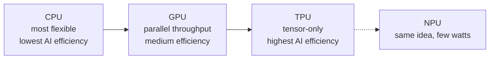
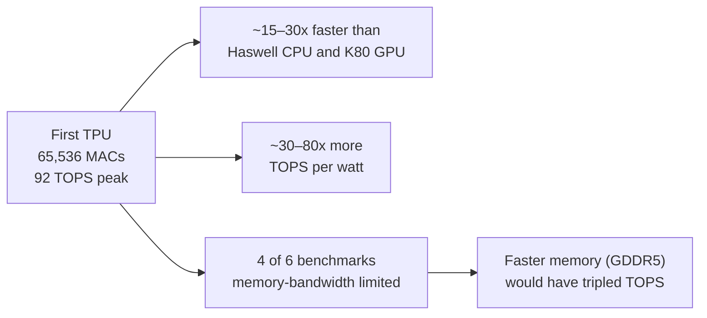
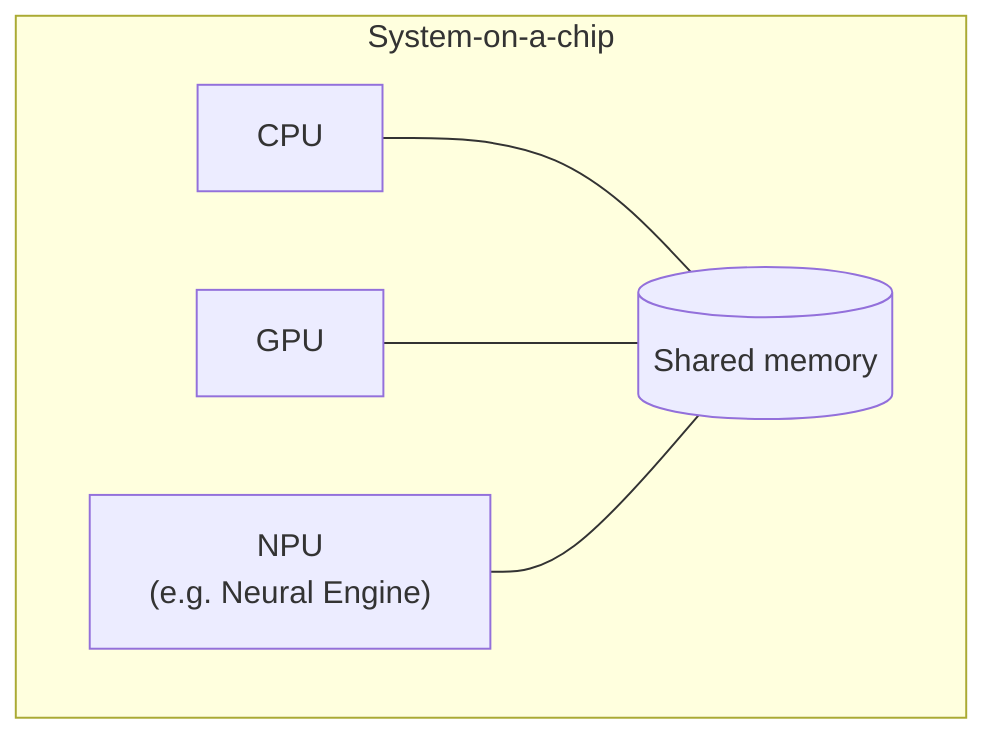
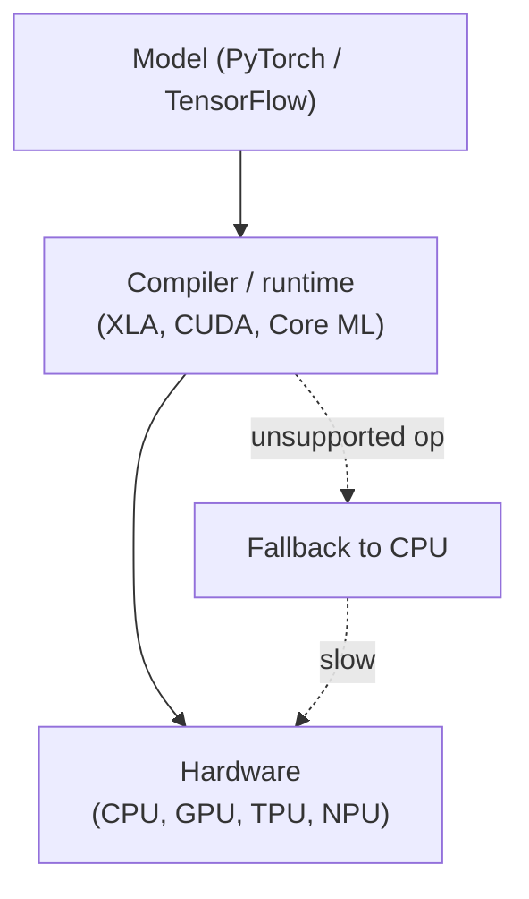

# Hardware, Networks & Behaviourist AI

## Module 01 · Section 2: CPU vs GPU vs TPU

> [!IMPORTANT]
> **Big idea.** Three families of chips sit at different points on a trade-off between flexibility and efficiency. The more a chip is specialised for a task, the more efficient it is at that task and the less useful it is for anything else.

## Learning objectives

By the end of this section you should be able to:

1. Describe in one sentence each what a CPU, a GPU, a TPU and an NPU is designed to do.
2. Compare the four chip families on design goal, core count, control logic, flexibility, energy efficiency for AI, typical AI role, weakness for AI and programming route.
3. Explain what a systolic array is and work through a 2 × 2 weight-stationary example by hand and in code.
4. Summarise what the first TPU paper (Jouppi et al., 2017) measured, and state two caveats when reading it.
5. Explain why software tooling determines how useful a chip is in practice.
6. Choose an appropriate chip for a given scenario and justify the choice.

## Table of contents

- [2.1 The three chips in one sentence each](#21-the-three-chips-in-one-sentence-each)
- [2.2 Comparison table](#22-comparison-table)
- [2.3 Visual: where the chip area goes](#23-visual-where-the-chip-area-goes)
- [2.4 Systolic arrays and a worked 2 × 2 example](#24-systolic-arrays-and-a-worked-2--2-example)
- [2.5 What the first TPU paper measured](#25-what-the-first-tpu-paper-measured)
- [2.6 The NPU: AI on small devices](#26-the-npu-ai-on-small-devices)
- [2.7 Software: why a chip is only as useful as its tools](#27-software-why-a-chip-is-only-as-useful-as-its-tools)
- [2.8 Activities for Section 2](#28-activities-for-section-2)
- [2.9 Summary](#29-summary)
- [2.10 Glossary](#210-glossary)
- [2.11 Answer key](#211-answer-key)
- [References](#references)

---

## 2.1 The three chips in one sentence each

- **CPU (Central Processing Unit):** a few very capable cores that handle any kind of program quickly, one step at a time per core.
- **GPU (Graphics Processing Unit):** thousands of simpler cores that do the same operation on many data items at once. Originally built to draw graphics, it turned out to be ideal for neural networks, because drawing millions of pixels and multiplying large matrices are both "same operation, lots of data" problems.
- **TPU (Tensor Processing Unit):** a chip designed by Google specifically for tensor (multi-dimensional array) arithmetic, built around a grid of multiply-accumulate units.

A related term you will meet in Section 5 is **NPU** (Neural Processing Unit): a general name for a small, low-power AI accelerator inside a phone or laptop chip.

**Figure 2.1.** The three chip families on the flexibility–efficiency trade-off. Moving right trades generality for efficiency on tensor arithmetic. *Source: author's own diagram, based on Hennessy & Patterson (2019).*



> [!NOTE]
> **An everyday analogy.**
> A **CPU** is like a small team of expert chefs who can cook any dish in the book, but each works on one dish at a time.
> A **GPU** is like a huge kitchen of junior cooks who all follow the same instruction ("chop these 1,000 onions") together.
> A **TPU** is like a factory assembly line built to make exactly one product, extremely efficiently, but useless if you want something else.

---

## 2.2 Comparison table

| Feature | CPU | GPU | TPU |
|---|---|---|---|
| **Design goal** | Fast, flexible, low latency for one task | High throughput on parallel data | Maximum matrix throughput per watt for neural networks |
| **Core count** (order of magnitude) | Few to ~100 complex cores | Thousands of simple cores | A large grid of MAC units (tens of thousands in one array) |
| **Control logic** | Complex: caches, out-of-order execution, branch prediction | Simpler; many threads hide delays | Minimal; deterministic execution |
| **Flexibility** | Highest: runs any program | High: programmable for many parallel tasks | Lowest: tuned to tensor operations |
| **Energy efficiency for AI** | Lowest | Medium to high | Highest (for supported workloads) |
| **Typical AI role** | Pre-processing, data loading, small models, orchestration | Training and inference of large models | Large-scale training and inference in Google's cloud |
| **Weakness for AI** | Too few parallel units | Higher power than a custom ASIC; memory bandwidth can limit | Less flexible; tied to a software stack |
| **Programming** | Any language | CUDA, OpenCL, or frameworks such as PyTorch | Through frameworks such as TensorFlow/JAX and the XLA compiler |

**Table 2.1.** Comparison of CPU, GPU and TPU across design goal, core count, control logic, flexibility, energy efficiency, typical AI role, weakness for AI and programming route.

*Sources for the design descriptions: Jouppi et al. (2017); Sze et al. (2017); Hennessy & Patterson (2019); NVIDIA (n.d.).*

### Terms used in the table

- **Core:** a unit inside a chip that can execute instructions on its own.
- **Cache:** a small, fast memory that keeps copies of recently used data close to the processor.
- **Out-of-order execution:** a CPU trick of running instructions in a different order from the program when it is safe, to avoid waiting.
- **Branch prediction:** guessing which way an `if` statement will go so the CPU can keep working instead of waiting.
- **Deterministic execution:** every run takes the same, predictable number of cycles. This matters for services that must answer within a time limit.
- **Compiler:** software that translates a program into instructions for a specific chip. XLA is the compiler used for TPUs.
- **MAC (multiply-accumulate):** an operation that computes `a × b + c`; the basic building block of neural-network arithmetic.

---

## 2.3 Visual: where the chip area goes

**Figure 2.2.** A simplified, not-to-scale sketch of where each design spends its silicon. A CPU devotes much of its area to caches and control logic that make a single thread fast; a GPU devotes most area to arithmetic units; a TPU devotes nearly all of it to the grid of MACs and the memory that feeds it. The positions are a qualitative teaching sketch, not measurements. *Source: author's own sketch, based on the design descriptions in Jouppi et al. (2017) and Hennessy & Patterson (2019).*

```text
        CPU                       GPU                        TPU
+------------------------+ +------------------------+ +------------------------+
| [Core] [Core]  CACHE   | | c c c c c c c c c c c  | | Systolic array of      |
| [Core] [Core]  CACHE   | | c c c c c c c c c c c  | | MAC units              |
| big control logic      | | c c c c c c c c c c c  | | (data flows through)   |
| large caches           | | small control, cache   | | + on-chip buffer       |
+------------------------+ +------------------------+ +------------------------+
   Few smart cores          Many simple cores          Matrix-multiply engine
```

In a CPU much of the area is "overhead" (caches, prediction logic) that makes a single thread fast. In a GPU, most area goes to arithmetic units. In a TPU, nearly all of it goes to the grid of MACs and the memory that feeds it.

---

## 2.4 Systolic arrays and a worked 2 × 2 example

A **systolic array** is a grid of MAC cells. Each cell holds one weight, and data is passed from neighbour to neighbour instead of being fetched from memory again and again. This neighbour-to-neighbour passing is what makes the design memory-efficient: the same input is reused across many cells without repeated memory reads.

### Worked example 2.A: a 2 × 2 systolic array (weight-stationary)

Let the weights be **W = [[1, 2], [3, 4]]**, loaded once, one per cell. The input is **x = [5, 6]**. We want **y = W·x**.

**Figure 2.3.** A 2 × 2 weight-stationary systolic array. Each cell holds one weight; inputs enter from the top and partial sums move to the right. *Source: author's own diagram.*

```text
                 x1=5        x2=6
                  │           │
               ┌──▼──┐     ┌──▼──┐
 row 1 (y1) →  │  1  │ ──► │  2  │ ──► y1
               └──┬──┘     └──┬──┘
               ┌──▼──┐     ┌──▼──┐
 row 2 (y2) →  │  3  │ ──► │  4  │ ──► y2
               └─────┘     └─────┘
        (each cell holds one weight; partial sums move right)
```

| Cycle | What happens | Result |
|---|---|---|
| **1** | x1 = 5 enters column 1. The two cells compute 1 × 5 and 3 × 5 and pass the partial sums to the right. | 5 and 15 |
| **2** | x2 = 6 reaches column 2 (a real array staggers inputs by one cycle). The cells compute 2 × 6 + 5 and 4 × 6 + 15. | 17 and 39 |

**Table 2.2.** Cycle-by-cycle behaviour of the 2 × 2 systolic array in Figure 2.3.

**Result:** `y = [17, 39]`, using 4 MACs. Check: 1×5 + 2×6 = 17 and 3×5 + 4×6 = 39.

**Memory reads.** Each of the 4 weights was read from memory **once**, and each of the 2 inputs was read **once**, then handed from cell to cell. Without neighbour-to-neighbour passing, each input would be read twice (once per output). That saving in memory traffic is the point of the systolic design, and it grows with array size.

The following Python program counts the reads in both styles. Its complete expected output is shown below the code.

```python
W = [[1, 2],
     [3, 4]]
x = [5, 6]

# Without reuse: every MAC fetches its own weight and its own input
reads_no_reuse = 0
y = [0, 0]
for i in range(2):
    for j in range(2):
        y[i] += W[i][j] * x[j]
        reads_no_reuse += 2          # one weight read + one input read

# Systolic style: each weight read once, each input read once
reads_systolic = 4 + 2

print(y)                             # [17, 39]
print(reads_no_reuse, reads_systolic)  # 8 6
```

Expected output:

```text
[17, 39]
8 6
```

---

## 2.5 What the first TPU paper measured

The 2017 paper by Jouppi et al. is the best-documented comparison available, because it measured a real chip in real data centres:

- The heart of the first TPU is a **65,536-element 8-bit MAC matrix unit** with a peak of **92 TOPS** and a **28 MiB** software-managed on-chip memory.
- Compared with a contemporary Intel Haswell server CPU and an Nvidia K80 GPU in the same data centres, the TPU was on average about **15–30× faster** and delivered about **30–80× more TOPS per watt**.
- The authors attribute part of this to deterministic execution: caches, out-of-order execution, multithreading and prefetching improve average throughput, but not the 99th-percentile response time that user-facing services need.
- Four of the six benchmark applications were **memory-bandwidth limited** on the TPU. Using the GPU's faster GDDR5 memory in a revised design would have tripled achieved TOPS.

**Figure 2.4.** What the first TPU paper measured. The TPU beat contemporary CPUs and GPUs on speed and energy efficiency, but on four of six benchmarks it was limited by memory bandwidth rather than by arithmetic. *Source: author's own diagram, based on data in Jouppi et al. (2017).*



> [!WARNING]
> **Read this with care.** The comparison is from 2015–2017 hardware. It is a good illustration of the design philosophy, not a ranking of today's chips. Current GPUs have added dedicated matrix units of their own (NVIDIA calls them Tensor Cores), and the gap between "GPU" and "TPU" designs has narrowed.

> [!NOTE]
> **Why does the memory finding matter?** Even a chip with 65,536 MACs spent most of its time waiting for data on four out of six workloads. More arithmetic units do not help if they cannot be fed.

---

## 2.6 The NPU: AI on small devices

A phone cannot carry a 300-watt accelerator. An NPU applies the same ideas as a TPU (a grid of MAC units, low-precision numbers, on-chip memory) but scaled down to run in a few watts inside a **system-on-a-chip (SoC)**, which puts the CPU, GPU, NPU, memory controllers and other blocks on a single piece of silicon.

| Company | Name of its NPU |
|---|---|
| Apple | Neural Engine |
| Google Pixel | Tensor SoC |
| Qualcomm | Hexagon NPU |
| Many laptops | "AI Engine" / NPU |

**Table 2.3.** Vendor names for NPUs in consumer devices. Names differ, but the principle is the same.

**Figure 2.5.** An NPU inside a system-on-a-chip. The CPU, GPU and NPU share the same silicon and memory, which is what makes a few-watt AI accelerator practical on a phone. *Source: author's own diagram, based on Apple Inc. (2024) and Qualcomm (2024).*



Section 5 studies the Apple version.

---

## 2.7 Software: why a chip is only as useful as its tools

Hardware is useless if programmers cannot easily use it. This is a major reason GPUs became dominant for AI:

| Chip | Typical way programmers reach it |
|---|---|
| CPU | Any language; compiler targets it directly |
| GPU | CUDA (NVIDIA), OpenCL, or high-level frameworks (PyTorch, TensorFlow) that call vendor-optimised libraries |
| TPU | Frameworks (TensorFlow, JAX, PyTorch/XLA) compile to the TPU through XLA |
| Apple Neural Engine | Core ML, which decides whether a model runs on CPU, GPU or the Neural Engine |

**Table 2.4.** How programmers typically reach each chip family.

A programmer usually does not write instructions for the MAC units directly. They write a model in a framework, and a compiler/runtime maps it onto the hardware. This is why "unsupported operations falling back to the CPU" can silently make a model slow (see the case-study questions in Section 5).

**Figure 2.6.** The software stack between a model and the hardware. Each layer hides detail from the one above, but also adds a place where unsupported operations can fall back to the CPU. *Source: author's own diagram, based on NVIDIA (n.d.) and Apple Inc. (2024).*



> [!TIP]
> **Going further.** The combination of hardware and its software ecosystem is sometimes called a **platform**. Switching from one platform to another can be costly even if the new chip is faster on paper, which partly explains why one vendor can dominate a market.

---

## 2.8 Activities for Section 2

- [ ] **Activity 2.A.** Which of the three chips would you choose for each case? Justify briefly.
  (a) a web server running mixed tasks, (b) training a large image model, (c) a fixed, high-volume inference service in a data centre.
- [ ] **Activity 2.B.** In the 2 × 2 systolic example (Worked example 2.A), how many times was each weight read from memory, and how many times was each input read?
- [ ] **Activity 2.C.** A start-up wants to add a voice assistant to a smart speaker that runs on a small battery. Arrange CPU, GPU and NPU in order from most to least suitable and give one reason for your ordering.
- [ ] **Activity 2.D.** The first TPU was faster and more energy-efficient than its contemporaries on Google's workloads, but a start-up with a different workload might still pick a GPU. Give two reasons.

---

## 2.9 Summary

- CPUs prioritise flexibility and low latency; GPUs prioritise parallel throughput; TPUs prioritise matrix throughput per watt at the cost of flexibility; NPUs scale the TPU idea down to a few watts inside a phone or laptop SoC.
- Systolic arrays reduce memory traffic by holding weights in place and passing inputs and partial sums from neighbour to neighbour; in the 2 × 2 example this cut memory reads from 8 to 6.
- The first TPU (Jouppi et al., 2017) was about 15–30× faster and 30–80× more TOPS per watt than contemporary CPUs and GPUs, but four of six benchmarks were memory-bandwidth limited, and the comparison is historical.
- A chip is only as useful as its software ecosystem; unsupported operations that fall back to the CPU can silently erase the hardware advantage.
- Choosing a chip means matching its design goal to the workload: mixed latency-sensitive tasks favour a CPU, large-model training favours a GPU, fixed high-volume inference favours a TPU or NPU.

---

## 2.10 Glossary

| Term | Meaning |
|---|---|
| **ASIC** | Application-specific integrated circuit: a chip built for one fixed task. |
| **Branch prediction** | A CPU technique that guesses which way a conditional branch will go so it can keep working instead of waiting. |
| **Cache** | A small, fast memory that keeps copies of recently used data close to the processor. |
| **Compiler** | Software that translates a program into instructions for a specific chip. |
| **Core** | A unit inside a chip that can execute instructions on its own. |
| **CUDA** | NVIDIA's programming interface for running general-purpose code on its GPUs. |
| **Deterministic execution** | Every run takes the same, predictable number of cycles. |
| **MAC** | Multiply-accumulate: the operation `a × b + c`, the basic building block of neural-network arithmetic. |
| **NPU** | Neural Processing Unit: a small, low-power AI accelerator inside a phone or laptop chip. |
| **Out-of-order execution** | A CPU technique of running instructions in a different order from the program when it is safe, to avoid waiting. |
| **SoC** | System-on-a-chip: a single piece of silicon containing CPU, GPU, NPU, memory controllers and other blocks. |
| **Systolic array** | A grid of MAC cells in which each cell holds a weight and data is passed from neighbour to neighbour. |
| **TOPS** | Tera operations per second: a measure of arithmetic throughput. |
| **XLA** | A compiler used to map models onto TPUs. |

---

## 2.11 Answer key

**Activity 2.A.**
(a) **CPU** — the workload is mixed and latency-sensitive, so flexibility matters most.
(b) **GPU** (or a TPU if training on Google Cloud) — training needs high parallel throughput on large matrices.
(c) **TPU or another fixed-function accelerator** — the workload is fixed and high-volume, so maximum efficiency per watt pays off.

**Activity 2.B.**
Each weight is read **once** (4 reads in total), and each input is read **once** (2 reads in total), for 6 reads in total. Without neighbour-to-neighbour passing, each input would be read once per output, giving 8 reads. The saving grows with array size.

**Activity 2.C.**
Order: **NPU, then CPU, then GPU.**
Reason: the NPU gives the most operations per watt and is designed for exactly this kind of always-on, low-power inference; the CPU is flexible but less efficient; the GPU draws too much power for a small battery.

**Activity 2.D.**
Any two of: the workload may use operations the TPU does not support well (falling back to the CPU and losing the advantage); the team may already depend on a GPU software stack, and switching platforms is costly; GPU cloud availability and cost may be better; the workload may be memory-bandwidth limited, where the TPU's arithmetic advantage does not help.

---

## References

- Apple Inc. (2024). *Apple Platform Security guide*.
- Hennessy, J. L., & Patterson, D. A. (2019). A new golden age for computer architecture. *Communications of the ACM*, 62(2), 48–60.
- Jouppi, N. P., et al. (2017). In-datacenter performance analysis of a Tensor Processing Unit. *Proceedings of ISCA 2017*.
- NVIDIA. (n.d.). *GPU and Tensor Core documentation*.
- Qualcomm. (2024). *Hexagon NPU documentation*.
- Sze, V., et al. (2017). Efficient processing of deep neural networks: A tutorial and survey. *Proceedings of the IEEE*.

[← Previous: Section 1](Draft-01.2.md) · [Back to module overview](Draft-02.1.md) · [Next: Section 3 →](Draft-03.2.md)
