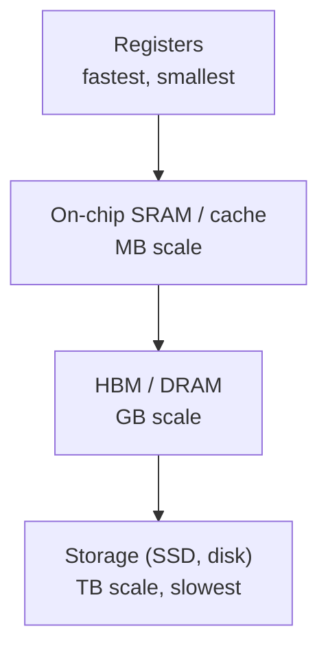

# Hardware, Networks & Behaviourist AI

## Module 01 · Section 4: Memory Hierarchy and Computational Efficiency

> [!IMPORTANT]
> **Big idea.** Arithmetic is cheap; moving data is expensive. Good AI hardware and good AI software are both organised to keep data in small, fast memory for as long as possible.

## Table of contents

- [4.1 The memory hierarchy](#41-the-memory-hierarchy)
- [4.2 The surprising fact: data movement dominates energy](#42-the-surprising-fact-data-movement-dominates-energy)
- [4.3 Arithmetic intensity and the roofline model](#43-arithmetic-intensity-and-the-roofline-model)
- [4.4 Worked example 4.A: roofline for one layer](#44-worked-example-4a-roofline-for-one-layer)
- [4.5 Learner activity: roofline for a different layer](#45-learner-activity-roofline-for-a-different-layer)
- [4.6 Further efficiency ideas](#46-further-efficiency-ideas)
- [4.7 Bridges to the rest of the course](#47-bridges-to-the-rest-of-the-course)
- [4.8 Activities for Section 4](#48-activities-for-section-4)

---

## 4.1 The memory hierarchy

Computers have several kinds of memory. Fast memory is small and expensive; large memory is slow and cheap. The arrangement from fastest to slowest is called the **memory hierarchy**.



*Figure 4.1: the memory hierarchy, from small, fast registers at the top to large, slow storage at the bottom.*

### Terms

- **Cache:** a small, fast memory that keeps copies of recently used data close to the processor. Managed automatically by hardware.
- **Scratchpad / software-managed buffer:** on-chip memory that the program or compiler controls explicitly, as in the TPU's 28 MiB unified buffer. It avoids the unpredictability of automatic caches.
- **SRAM:** fast memory built into the chip (usually several transistors per bit; expensive in area).
- **DRAM:** larger, slower memory outside the chip (one transistor plus a capacitor per bit; cheap per byte).
- **HBM (High Bandwidth Memory):** DRAM stacked in layers and placed right next to a GPU/accelerator to deliver very high bandwidth. Newer TPUs pair each chip with tens of gigabytes of HBM (*verify the Ironwood figure, reported as 192 GB per chip, against Google's own documentation before citing*).
- **Bandwidth:** how many bytes per second can be moved (for example, 500 GB/s).
- **Latency (memory):** how long one access takes, as opposed to how many bytes per second can flow once it starts.
- **Unified memory:** a design (used by Apple silicon) in which CPU, GPU and NPU share one pool of memory so data need not be copied between them.

> [!NOTE]
> **Analogy.** Think of cooking. Registers are the ingredients in your hands. Cache/SRAM is the chopping board in front of you. DRAM is the fridge across the kitchen. Storage is the supermarket. A cook who walks to the supermarket for every ingredient will never finish; a good cook plans the recipe so that everything needed is on the chopping board when required. Good AI hardware and software do the same.

---

## 4.2 The surprising fact: data movement dominates energy

Horowitz (2014) published approximate energy costs for a 45 nm chip process:

| Operation | Approximate energy |
|---|---:|
| 32-bit floating-point multiply | ~3.7 pJ |
| Read 32 bits from small on-chip SRAM (8 KB) | ~5 pJ |
| Read 32 bits from off-chip DRAM | ~640 pJ |

(pJ = picojoule, 10⁻¹² joule. Reading a register costs far less than any row in this table.)

**Figure 4.2.** Fetching a number from DRAM costs about **170 times** the energy of multiplying it (640 ÷ 3.7 ≈ 173) and about **128 times** the energy of reading it from small on-chip SRAM. Data: Horowitz (2014).

```python
mult, sram, dram = 3.7, 5, 640   # picojoules
print(round(dram / mult))        # 173
print(round(dram / sram))        # 128
```

Fetching a number from DRAM costs roughly two orders of magnitude (about 100× or more) more energy than multiplying it. Modern processes differ in the exact numbers, but the pattern remains. This is why AI chip designers focus on reusing data already on the chip.

---

## 4.3 Arithmetic intensity and the roofline model

To judge whether a workload is limited by computing or by memory, we use **arithmetic intensity**:

```text
arithmetic intensity (FLOPs per byte) = total FLOPs ÷ total bytes moved from memory
```

A chip has two limits:

- **Peak compute** (FLOP/s): the most arithmetic it can do.
- **Memory bandwidth** (bytes/s): the most data it can fetch.

The **roofline model** (Williams, Waterman & Patterson, 2009) says:

```text
attainable performance = min( peak compute , arithmetic intensity × memory bandwidth )
```

The **ridge point** is where the two limits meet: peak compute ÷ bandwidth.

- Intensity **below** the ridge point → **memory-bound** (the chip waits for data).
- Intensity **above** the ridge point → **compute-bound** (the chip is busy computing).

> [!NOTE]
> **Why is it called a "roofline"?** Plot performance against intensity and the picture looks like a roof: a sloping line on the left (memory limit) that meets a flat line on the right (compute limit). Your workload's performance can never poke through the roof.

---

## 4.4 Worked example 4.A: roofline for one layer

**The hypothetical accelerator** used here and in the activity below:

| Property | Value |
|---|---|
| Peak compute | 10 TFLOP/s |
| Memory bandwidth | 500 GB/s |
| Ridge point | 10 TFLOP/s ÷ 500 GB/s = **20 FLOP/byte** |

**Layer:** 1,024 inputs × 4,096 outputs, stored in FP16 (2 bytes per value).

### Batch 1

- FLOPs = 2 × 4,194,304 = 8,388,608.
- Bytes moved: weights 4,194,304 × 2 = 8,388,608; inputs 1,024 × 2 = 2,048; outputs 4,096 × 2 = 8,192. Total = **8,398,848**.
- Intensity = 8,388,608 ÷ 8,398,848 ≈ **1.0 FLOP/byte**, far below the ridge point of 20, so the layer is **memory-bound**.
- Attainable = min(10, 1.0 × 0.5) = **0.5 TFLOP/s, only 5% of peak**.
- Check in time: moving 8.4 MB at 500 GB/s takes about 16.8 µs, while the arithmetic at 10 TFLOP/s would take only about 0.84 µs. The chip spends about 95% of its time waiting.

### Batch 32

- FLOPs = 32 × 8,388,608 = 268,435,456.
- Bytes: weights 8,388,608 (fetched once) + inputs 32 × 2,048 = 65,536 + outputs 32 × 8,192 = 262,144. Total = **8,716,288**.
- Intensity ≈ **30.8 FLOP/byte**, above the ridge point, so the layer is **compute-bound** and reaches the full 10 TFLOP/s.

The weights were fetched once and reused 32 times. That is the whole story of batching.

### Code to check the numbers

```python
PEAK = 10e12        # FLOP/s
BW = 500e9          # bytes/s
BYTES = 2           # FP16

def roofline(n_in, n_out, batch):
    flops = 2 * n_in * n_out * batch
    weight_bytes = n_in * n_out * BYTES
    io_bytes = batch * (n_in + n_out) * BYTES
    intensity = flops / (weight_bytes + io_bytes)
    attainable = min(PEAK, intensity * BW)
    return intensity, attainable

for b in (1, 32):
    i, a = roofline(1024, 4096, b)
    print(b, round(i, 1), round(a / 1e12, 2), "TFLOP/s", f"{a / PEAK:.0%}")
# 1  1.0  0.5   TFLOP/s 5%
# 32 30.8 10.0  TFLOP/s 100%
```

---

## 4.5 Learner activity: roofline for a different layer

**Setting.** Same hypothetical accelerator as in 4.4 (10 TFLOP/s, 500 GB/s, ridge point 20 FLOP/byte). A layer has **512 inputs and 2,048 outputs**, stored in FP16 (2 bytes per value).

**Tasks.**

1. Compute the number of weights and the weight size in bytes.
2. Compute FLOPs for one input vector (batch 1).
3. For batch sizes 1, 8 and 32, compute the bytes moved (weights + inputs + outputs) and the arithmetic intensity. State whether each case is memory-bound or compute-bound.
4. For each batch size, compute the attainable performance in TFLOP/s and as a percentage of peak.
5. What is the smallest batch size that makes the layer compute-bound?
6. **Reflect (2-3 sentences):** A voice assistant must answer one user at a time within milliseconds. What does the result of Task 3 imply for the hardware you would choose, and why?

**Hints.** Weights are fetched once per batch; inputs and outputs are fetched/written once per sample. Intensity = FLOPs ÷ bytes. Attainable = min(10 TFLOP/s, intensity × 0.5 TFLOP/s per unit intensity).

<details>
<summary><b>Answer key (for tutors)</b></summary>

| Batch | Intensity (FLOP/byte) | Bound | Attainable | % of peak |
|---:|---:|---|---:|---:|
| 1 | ≈ 1.0 | memory | ≈ 0.5 TFLOP/s | ≈ 5% |
| 8 | ≈ 7.9 | memory | ≈ 3.9 TFLOP/s | ≈ 39% |
| 32 | ≈ 29.7 | compute | 10 TFLOP/s | 100% |

- Weights: 512 × 2,048 = 1,048,576 (2,097,152 bytes). FLOPs at batch 1 = 2,097,152.
- Smallest compute-bound batch: **22** (intensity reaches 20 at batch 22).
- Reflection: batch 1 is memory-bound, so extra arithmetic units help little. Prefer hardware with high memory bandwidth, large on-chip memory and low-precision weights (for example, an NPU).

</details>

---

## 4.6 Further efficiency ideas

A designer who understands the roofline has a checklist of ways to improve a memory-bound workload:

| Idea | How it helps | Where you will see it |
|---|---|---|
| Bigger on-chip memory | Weights and activations stay close to the MACs | TPU's 28 MiB buffer; large caches in GPUs; NPUs |
| Higher bandwidth memory | Raises the slope of the roofline | HBM stacked beside the chip |
| Weight reuse (batching, weight-stationary arrays) | More operations per byte fetched | Systolic arrays, batched serving |
| Lower precision | Fewer bytes per weight | INT8/FP8/4-bit inference |
| Compression and pruning | Smaller or sparser models | Mobile model deployment |
| Operator fusion | Intermediate values never leave the chip | Compilers such as XLA and Core ML |
| Unified memory | No copy between CPU, GPU and NPU | Apple silicon |

> [!WARNING]
> **A caution about batching.** Batching raises intensity but increases latency per request if requests must wait to form a batch. Servers therefore balance throughput (large batches) against latency (answer quickly). This trade-off is why the same model may be run differently in a data centre than on a phone.

---

## 4.7 Bridges to the rest of the course

**Networks.** The memory hierarchy does not stop at the edge of the chip. Moving data between chips, over links such as NVLink or InfiniBand, is another, slower level of the same hierarchy. When a model is split across many chips, this network becomes the bottleneck, which is the subject of Module 02.

**Behaviourist AI.** Behaviour-driven agents, such as robots and game-playing agents, run a loop of *sense, decide, act*, often one observation at a time. That is batch size 1, the memory-bound case from this section. Low latency and low energy per decision therefore matter more than peak throughput, which is why such agents often run on edge hardware such as NPUs.

---

## 4.8 Activities for Section 4

- [ ] **Activity A.** A designer doubles the number of MAC units on a memory-bound chip but leaves memory bandwidth unchanged. What happens to performance on a memory-bound workload?
- [ ] **Activity B.** *(Revision of Section 2.4.)* The first TPU had four of six benchmarks memory-bandwidth limited. Which single hardware change did the authors say would have tripled achieved TOPS in a revised design?
- [ ] **Activity C.** Using the energy table in 4.2 and the hierarchy in Figure 4.1, rank from lowest to highest energy per access: DRAM read, register access, small SRAM read.

<details>
<summary><b>Answer hints (for tutors)</b></summary>

- **A.** Almost nothing changes; the limit is data supply, not arithmetic.
- **B.** Using faster GDDR5 memory.
- **C.** Register, then small SRAM, then DRAM.

</details>

---

## References

- Horowitz, M. (2014). Computing's energy problem (and what we can do about it). *IEEE ISSCC*.
- Williams, S., Waterman, A., & Patterson, D. (2009). Roofline: an insightful visual performance model for multicore architectures. *Communications of the ACM*, 52(4), 65–76.
- Jouppi, N. P., et al. (2017). In-datacenter performance analysis of a Tensor Processing Unit. *Proceedings of ISCA 2017*.

[← Previous: Section 3](Draft-03.2.md) · [Back to module overview](Draft-03.2.md) · [Next: Section 5 →](Draft-05.2.md)

