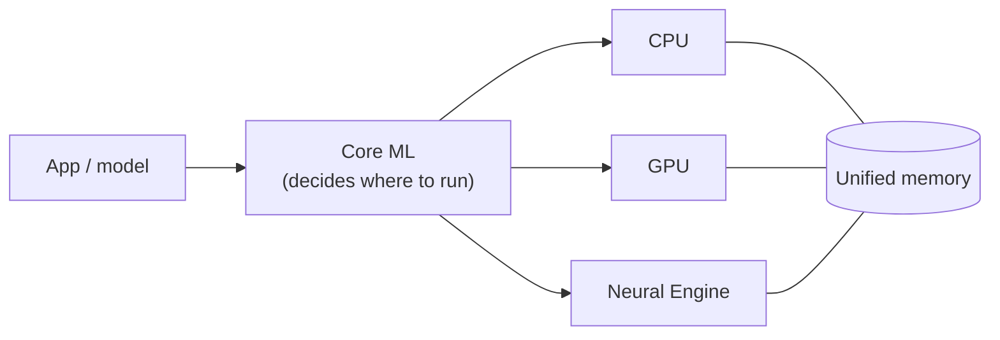

# Hardware, Networks & Behaviourist AI

## Module 01 · Section 5: Case Study — Apple Neural Engine (On-Device AI)

> [!IMPORTANT]
> **Big idea.** The Apple Neural Engine is the module's ideas in one real device: parallel MACs, low-precision numbers, and on-chip, shared memory, all working inside a few watts.

## Table of contents

- [5.1 Introduction](#51-introduction)
- [5.2 How the Apple Neural Engine works](#52-how-the-apple-neural-engine-works)
- [5.3 Connection between training and inference](#53-connection-between-training-and-inference)
- [5.4 Real-life application: Face ID](#54-real-life-application-face-id)
- [5.5 Advantages of the Apple Neural Engine](#55-advantages-of-the-apple-neural-engine)
- [5.6 Limitations](#56-limitations)
- [5.7 Case-study questions](#57-case-study-questions)
- [5.8 Conclusion](#58-conclusion)
- [Glossary](#glossary)

---

## 5.1 Introduction

<!-- Add image: Neural Engine block inside an Apple chip (credit: tomshardware.com). Suggested alt text: "Diagram of an Apple chip showing the Neural Engine next to the CPU and GPU." -->

The Apple Neural Engine (ANE) is a specialised processor built into Apple's chips to improve the speed and efficiency of artificial intelligence (AI) tasks. It is the NPU described in Section 2.5.

It was first introduced in 2017 with the A11 Bionic chip in the iPhone X. Apple described that first version as capable of 600 billion operations per second (*verify against Apple's announcement*); later generations are quoted in TOPS (*verify against Apple's spec pages for the chip you cite*).

Unlike traditional processors, the Neural Engine is specifically designed to handle AI calculations, allowing iPhones to perform tasks such as:

- Facial recognition (Face ID)
- Image and object recognition
- AI-powered camera features
- Language and speech processing

One major advantage is **on-device AI**, meaning AI tasks can be processed directly on an iPhone without always needing an internet connection or cloud server.

---

## 5.2 How the Apple Neural Engine works

The iPhone uses several hardware components that work together to process AI tasks. They sit on one system-on-a-chip (Section 2.5).

| Component | Function |
|---|---|
| **CPU** | Manages general tasks and coordinates AI operations. |
| **GPU** | Processes multiple calculations simultaneously, especially for graphics and AI. |
| **Neural Engine** | Accelerates neural network calculations for supported AI tasks. |
| **Memory** | Stores AI models, input data, and processing results. |

The Neural Engine uses parallel processing (Section 3), allowing many calculations to happen at the same time instead of one by one. This makes AI applications faster and more energy-efficient.



### Technical details: linking back to Sections 2, 3 and 4

- **Software (Section 2.6).** Developers use **Core ML**, which decides whether each part of a model runs on the CPU, GPU or Neural Engine. If a model uses an operation the Neural Engine does not support, that part falls back to the CPU, which can make the whole model slower.
- **Memory (Section 4.1).** Apple silicon uses **unified memory**, so the CPU, GPU and Neural Engine share one pool and no copying is needed between them.
- **Precision (Section 3.4).** Models are usually quantised to INT8 or FP16 so that more fits in memory and less energy is spent moving it.
- **Batch size (Section 4.3).** Features such as Face ID process one input at a time (batch 1), the memory-bound case. This is why on-chip memory and low-precision weights matter so much on a phone.

---

## 5.3 Connection between training and inference

Training and inference are two important stages of AI processing (Section 1.5).


- **Training:** AI models are trained using large amounts of data, usually on powerful computers equipped with GPUs or other AI accelerators.
- **Inference:** once trained, the model can be used on an iPhone. The Neural Engine helps process new information quickly without needing to retrain the entire model.

This shows how specialised AI hardware supports the practical use of trained AI models.

---

## 5.4 Real-life application: Face ID

<!-- Add image: Face ID scan (credit: techtime.news). Suggested alt text: "An iPhone scanning a user's face with the TrueDepth camera." -->

Face ID is a real-world example of how Apple's AI hardware performs facial recognition.

### How Face ID works

1. **Face scanning:** the TrueDepth camera captures facial information using infrared light and depth sensors.
2. **Data processing:** the system converts facial information into a mathematical representation.
3. **AI inference:** neural networks analyse the facial information using specialised processing hardware.
4. **Face comparison:** the system securely compares the information with the registered face.
5. **Device unlocking:** if the face matches, the iPhone unlocks.

This process happens quickly because the iPhone uses specialised hardware to accelerate AI calculations.

Face ID also protects privacy because facial authentication data is processed and protected on the device rather than stored in the cloud. Apple's public security documentation describes this data as being kept in the **Secure Enclave** (*verify wording against Apple's platform security guide*).

> [!NOTE]
> **Bridge to Behaviourist AI.** Face ID is a small sense-decide-act loop: sense the face, decide match or no match, act by unlocking. It must answer in a fraction of a second, one request at a time, on a battery. The same constraints apply to robots and other agents that act in real time.

> [!NOTE]
> **Bridge to Networks.** Because the work stays on the device, Face ID needs no network round trip. That removes network delay and keeps sensitive data local, which is the trade-off between on-device and cloud processing.

---

## 5.5 Advantages of the Apple Neural Engine

| Advantage | Explanation |
|---|---|
| **Faster processing** | AI tasks can be completed quickly using specialised hardware. |
| **Energy efficiency** | AI calculations can use less power, helping preserve battery life. |
| **Better privacy** | Sensitive information can remain on the device. |
| **Real-time performance** | Applications such as Face ID respond almost immediately. |
| **Offline capability** | Many supported AI functions work without an internet connection. |

---

## 5.6 Limitations

Despite its advantages, the Apple Neural Engine has some limitations.

- **Limited computing resources:** smartphones cannot handle every large AI model as efficiently as powerful servers.
- **Hardware compatibility:** not all AI models or operations can run on the Neural Engine.
- **Memory limitations:** complex AI models may require more memory than a mobile device can provide.
- **Cloud dependency:** some advanced AI applications still need cloud-based processing.

---

## 5.7 Case-study questions

1. A model has one unsupported operation in the middle. Explain why it may run slower than a model with fewer supported operations overall. *(Hint: Section 2.6, fallback to the CPU, and the cost of moving data between processors.)*
2. Face ID processes one face at a time. Using Section 4, is this likely to be memory-bound or compute-bound, and why?
3. A 3-billion-parameter language model is quantised to 4-bit. How much memory do its weights need? Does it fit comfortably on a phone with 8 GB of memory shared with other apps?
4. Give one benefit and one drawback of keeping AI processing on the device rather than in the cloud.
5. Explain, using the Section 4 energy table, why unified memory saves energy as well as time.

Quick check for question 3:

```python
params = 3e9
bytes_per_weight = 0.5          # 4-bit = half a byte
print(params * bytes_per_weight / 1e9, "GB")   # 1.5 GB
```

<details>
<summary><b>Answer hints (for tutors)</b></summary>

1. The model is split into pieces. Each switch to the CPU and back means moving data and losing the accelerator's efficiency, so a few unsupported operations can dominate the total time.
2. Memory-bound. Batch 1 has low arithmetic intensity (Section 4.3), so the weights must be fetched for every single input.
3. 1.5 GB for the weights alone. That is a modest share of 8 GB, but the model also needs working memory and shares RAM with other apps, so it is workable rather than comfortable.
4. Benefits: privacy, no network delay, works offline. Drawbacks: limited memory and compute, so the largest models may still need the cloud.
5. Without copying between CPU, GPU and NPU, fewer off-chip memory accesses are needed, and each DRAM access costs far more energy than arithmetic (about 170× a multiply in Section 4.2).

</details>

---

## 5.8 Conclusion

The Apple Neural Engine demonstrates how specialised hardware improves the performance of AI applications. By combining the CPU, GPU, Neural Engine, and memory, iPhones can process AI tasks quickly and efficiently.

The case study also shows the relationship between training and inference: AI models are generally trained using powerful computers, while the Neural Engine helps run those trained models directly on the iPhone. This makes everyday features such as Face ID, image recognition, and AI-powered photography possible.

---

## Glossary

| Term | Meaning |
|---|---|
| **Accelerator** | A chip that works alongside the CPU to speed up specific kinds of work. |
| **Arithmetic intensity** | FLOPs performed per byte moved from memory. |
| **ASIC** | Application-specific integrated circuit; a chip built for one domain. |
| **Bandwidth** | Bytes per second that can move between two parts of a system. |
| **Batch size** | Number of inputs processed together. |
| **FLOP / FLOPS** | One floating-point operation / operations per second. |
| **HBM** | High Bandwidth Memory; stacked DRAM placed next to an accelerator. |
| **Inference** | Using a trained model to produce an answer. |
| **Latency** | Time for one task from start to finish. |
| **MAC** | Multiply-accumulate; 1 MAC = 2 FLOPs. |
| **NPU** | Neural processing unit; a small, low-power AI accelerator in a phone or laptop chip. |
| **Quantisation** | Converting numbers to a lower-precision format. |
| **Ridge point** | Peak compute ÷ bandwidth; the intensity at which a chip stops being memory-bound. |
| **Roofline model** | Attainable performance = min(peak compute, intensity × bandwidth). |
| **SoC** | System-on-a-chip; CPU, GPU, NPU and memory controllers on one piece of silicon. |
| **Systolic array** | A grid of MAC cells passing data neighbour to neighbour. |
| **Throughput** | Amount of work finished per second. |
| **Training** | Adjusting a model's weights using data. |
| **Unified memory** | One memory pool shared by CPU, GPU and NPU. |

---

## References

- Apple Inc. *Apple Platform Security guide* (Face ID and Secure Enclave sections). Add the exact edition and URL.
- Apple Inc. *Core ML documentation*. Add the exact URL.
- Jouppi, N. P., et al. (2017). In-datacenter performance analysis of a Tensor Processing Unit. *Proceedings of ISCA 2017*.
- Horowitz, M. (2014). Computing's energy problem (and what we can do about it). *IEEE ISSCC*.

[← Previous: Section 4](04-memory-hierarchy-and-computational-efficiency.md) · [Back to module overview](README.md)

