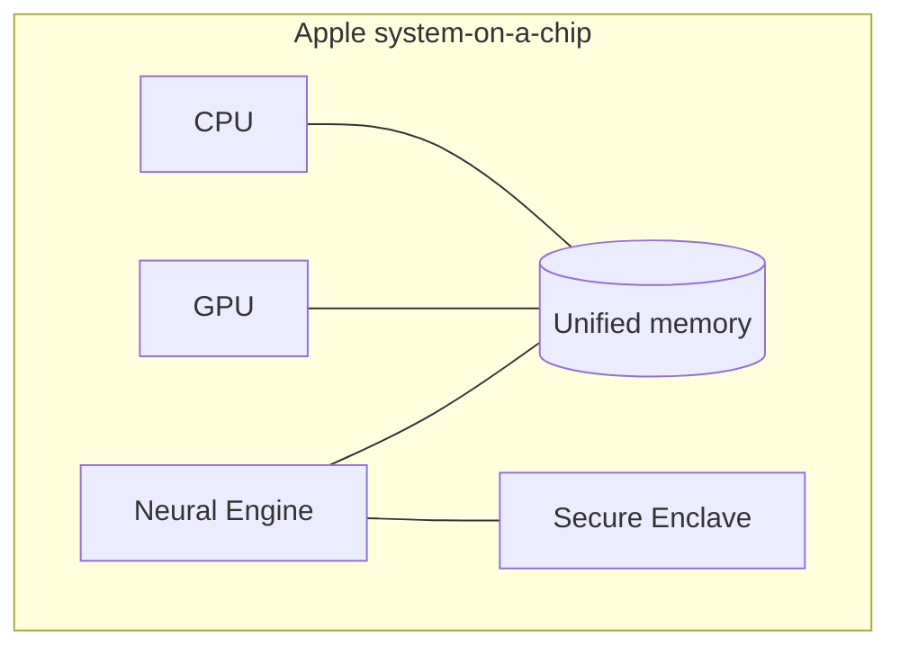
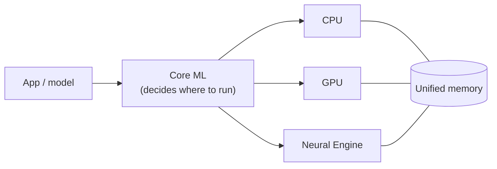
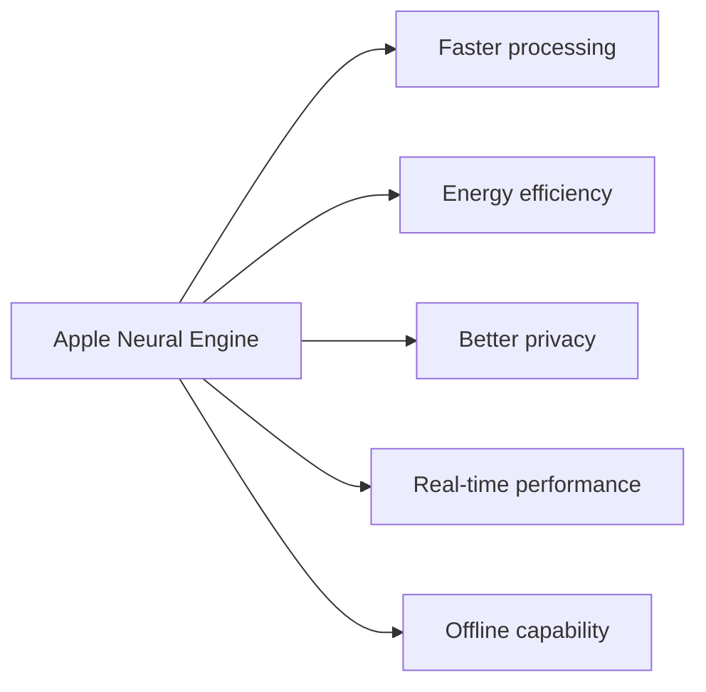

# Hardware, Networks & Behaviourist AI

## Module 01 · Section 5: Case Study — Apple Neural Engine (On-Device AI)

> [!IMPORTANT]
> **Big idea.** The Apple Neural Engine is the module's ideas in one real device: parallel MACs, low-precision numbers, and on-chip, shared memory, all working inside a few watts.

## Learning objectives

By the end of this section you should be able to:

1. Describe what the Apple Neural Engine (ANE) is, where it sits in an Apple SoC, and what kinds of tasks it accelerates.
2. Explain how the CPU, GPU, Neural Engine and unified memory work together, and how Core ML decides where each part of a model runs.
3. Distinguish training from inference, and explain why training happens in the data centre while inference happens on the device.
4. Analyse Face ID as a sense–decide–act loop, and judge using the roofline model whether it is memory-bound or compute-bound.
5. Evaluate the advantages and limitations of on-device AI, including memory footprint, hardware compatibility, privacy and cloud dependency.

## Table of contents

- [5.1 Introduction](#51-introduction)
- [5.2 How the Apple Neural Engine works](#52-how-the-apple-neural-engine-works)
- [5.3 Connection between training and inference](#53-connection-between-training-and-inference)
- [5.4 Real-life application: Face ID](#54-real-life-application-face-id)
- [5.5 Advantages of the Apple Neural Engine](#55-advantages-of-the-apple-neural-engine)
- [5.6 Limitations](#56-limitations)
- [5.7 Case-study questions](#57-case-study-questions)
- [5.8 Conclusion](#58-conclusion)
- [5.9 Summary](#59-summary)
- [5.10 Glossary](#510-glossary)
- [5.11 Answer key](#511-answer-key)
- [References](#references)

---

## 5.1 Introduction

**Figure 5.1.** The Neural Engine sits inside an Apple system-on-a-chip alongside the CPU, GPU and shared memory. *Source: Apple Inc. (2024), Apple Platform Security guide; diagram adapted by the author.*



The Apple Neural Engine (ANE) is a specialised processor built into Apple's chips to improve the speed and efficiency of artificial intelligence (AI) tasks. It is the NPU described in Section 2.6.

It was first introduced in 2017 with the A11 Bionic chip in the iPhone X. Apple described that first version as capable of 600 billion operations per second (Apple Inc., 2017); later generations are quoted in TOPS on Apple's specification pages for each chip.

Unlike traditional processors, the Neural Engine is specifically designed to handle AI calculations, allowing iPhones to perform tasks such as:

- Facial recognition (Face ID)
- Image and object recognition
- AI-powered camera features
- Language and speech processing

One major advantage is **on-device AI**, meaning AI tasks can be processed directly on an iPhone without always needing an internet connection or cloud server.

---

## 5.2 How the Apple Neural Engine works

The iPhone uses several hardware components that work together to process AI tasks. They sit on one system-on-a-chip (Section 2.6).

| Component | Function |
|---|---|
| **CPU** | Manages general tasks and coordinates AI operations. |
| **GPU** | Processes multiple calculations simultaneously, especially for graphics and AI. |
| **Neural Engine** | Accelerates neural network calculations for supported AI tasks. |
| **Memory** | Stores AI models, input data, and processing results. |

**Table 5.1.** Hardware components of an Apple SoC and their roles in AI processing.

The Neural Engine uses parallel processing (Section 3), allowing many calculations to happen at the same time instead of one by one. This makes AI applications faster and more energy-efficient.

**Figure 5.2.** How an app reaches the Neural Engine through Core ML. Core ML inspects the model and routes each operation to the CPU, GPU or Neural Engine; all three share unified memory. *Source: author's own diagram, based on Apple Inc. (2024), Core ML documentation.*



### Technical details: linking back to Sections 2, 3 and 4

- **Software (Section 2.7).** Developers use **Core ML**, which decides whether each part of a model runs on the CPU, GPU or Neural Engine. If a model uses an operation the Neural Engine does not support, that part falls back to the CPU, which can make the whole model slower.
- **Memory (Section 4.1).** Apple silicon uses **unified memory**, so the CPU, GPU and Neural Engine share one pool and no copying is needed between them.
- **Precision (Section 3.4).** Models are usually quantised to INT8 or FP16 so that more fits in memory and less energy is spent moving it.
- **Batch size (Section 4.3).** Features such as Face ID process one input at a time (batch 1), the memory-bound case. This is why on-chip memory and low-precision weights matter so much on a phone.

---

## 5.3 Connection between training and inference

Training and inference are two important stages of AI processing (Section 1.5).

**Figure 5.3.** Training happens in the data centre on GPUs or accelerators; the trained weights are then shipped to the iPhone, where inference runs on the Neural Engine. *Source: author's own diagram.*


- **Training:** AI models are trained using large amounts of data, usually on powerful computers equipped with GPUs or other AI accelerators.
- **Inference:** once trained, the model can be used on an iPhone. The Neural Engine helps process new information quickly without needing to retrain the entire model.

This shows how specialised AI hardware supports the practical use of trained AI models.

---

## 5.4 Real-life application: Face ID

**Figure 5.4.** An iPhone using the TrueDepth camera for Face ID. *Source: Apple Inc. (2024), Face ID and privacy documentation; photograph reproduced by the author for teaching purposes only.*

Face ID is a real-world example of how Apple's AI hardware performs facial recognition.

### How Face ID works

1. **Face scanning:** the TrueDepth camera captures facial information using infrared light and depth sensors.
2. **Data processing:** the system converts facial information into a mathematical representation.
3. **AI inference:** neural networks analyse the facial information using specialised processing hardware.
4. **Face comparison:** the system securely compares the information with the registered face.
5. **Device unlocking:** if the face matches, the iPhone unlocks.

This process happens quickly because the iPhone uses specialised hardware to accelerate AI calculations.

**Figure 5.5.** The five steps of Face ID, from scanning to unlocking. *Source: author's own diagram, based on Apple Inc. (2024), Face ID documentation.*


Face ID also protects privacy because facial authentication data is processed and protected on the device rather than stored in the cloud. Apple's public security documentation describes this data as being kept in the **Secure Enclave** (Apple Inc., 2024).

> [!NOTE]
> **Bridge to Behaviourist AI.** Face ID is a small sense–decide–act loop: sense the face, decide match or no match, act by unlocking. It must answer in a fraction of a second, one request at a time, on a battery. The same constraints apply to robots and other agents that act in real time.

> [!NOTE]
> **Bridge to Networks.** Because the work stays on the device, Face ID needs no network round trip. That removes network delay and keeps sensitive data local, which is the trade-off between on-device and cloud processing.

---

## 5.5 Advantages of the Apple Neural Engine

| Advantage | Explanation |
|---|---|
| **Faster processing** | AI tasks can be completed quickly using specialised hardware. |
| **Energy efficiency** | AI calculations can use less power, helping preserve battery life. |
| **Better privacy** | Sensitive information can remain on the device. |
| **Real-time performance** | Applications such as Face ID respond almost immediately. |
| **Offline capability** | Many supported AI functions work without an internet connection. |

**Table 5.2.** Advantages of the Apple Neural Engine.

**Figure 5.6.** The five advantages of on-device AI with the Neural Engine. *Source: author's own diagram, based on Apple Inc. (2024).*



---

## 5.6 Limitations

Despite its advantages, the Apple Neural Engine has some limitations.

- **Limited computing resources:** smartphones cannot handle every large AI model as efficiently as powerful servers.
- **Hardware compatibility:** not all AI models or operations can run on the Neural Engine.
- **Memory limitations:** complex AI models may require more memory than a mobile device can provide.
- **Cloud dependency:** some advanced AI applications still need cloud-based processing.

---

## 5.7 Case-study questions

1. A model has one unsupported operation in the middle. Explain why it may run slower than a model with fewer supported operations overall. *(Hint: Section 2.7, fallback to the CPU, and the cost of moving data between processors.)*
2. Face ID processes one face at a time. Using Section 4, is this likely to be memory-bound or compute-bound, and why?
3. A 3-billion-parameter language model is quantised to 4-bit. How much memory do its weights need? Does it fit comfortably on a phone with 8 GB of memory shared with other apps?
4. Give one benefit and one drawback of keeping AI processing on the device rather than in the cloud.
5. Explain, using the Section 4 energy table, why unified memory saves energy as well as time.

The following Python program checks the arithmetic for question 3. Its complete expected output is shown below the code.

```python
params = 3e9
bytes_per_weight = 0.5          # 4-bit = half a byte
print(params * bytes_per_weight / 1e9, "GB")   # 1.5 GB
```

Expected output:

```text
1.5 GB
```

---

## 5.8 Conclusion

The Apple Neural Engine demonstrates how specialised hardware improves the performance of AI applications. By combining the CPU, GPU, Neural Engine, and memory, iPhones can process AI tasks quickly and efficiently.

The case study also shows the relationship between training and inference: AI models are generally trained using powerful computers, while the Neural Engine helps run those trained models directly on the iPhone. This makes everyday features such as Face ID, image recognition, and AI-powered photography possible.

---

## 5.9 Summary

- The Apple Neural Engine is the NPU inside Apple's SoC, introduced in 2017 (A11 Bionic) and shared with the CPU and GPU through unified memory.
- Core ML decides whether each operation runs on the CPU, GPU or Neural Engine; unsupported operations fall back to the CPU and can silently slow a model.
- Training happens in the data centre on GPUs or accelerators; inference happens on the device, where batch size 1 makes the workload memory-bound.
- Face ID is a sense–decide–act loop that must answer in a fraction of a second, on battery, with no network round trip; it is the memory-bound, latency-critical case from Section 4.
- On-device AI buys privacy, latency and offline capability, but is limited by memory, compute and hardware compatibility; a 3-billion-parameter model quantised to 4-bit needs 1.5 GB for its weights alone.

---

## 5.10 Glossary

| Term | Meaning |
|---|---|
| **Accelerator** | A chip that works alongside the CPU to speed up specific kinds of work. |
| **Arithmetic intensity** | FLOPs performed per byte moved from memory. |
| **ASIC** | Application-specific integrated circuit; a chip built for one domain. |
| **Bandwidth** | Bytes per second that can move between two parts of a system. |
| **Batch size** | Number of inputs processed together. |
| **Core ML** | Apple's framework that routes each part of a model to the CPU, GPU or Neural Engine. |
| **FLOP / FLOPS** | One floating-point operation / operations per second. |
| **HBM** | High Bandwidth Memory; stacked DRAM placed next to an accelerator. |
| **Inference** | Using a trained model to produce an answer. |
| **Latency** | Time for one task from start to finish. |
| **MAC** | Multiply-accumulate; 1 MAC = 2 FLOPs. |
| **NPU** | Neural processing unit; a small, low-power AI accelerator in a phone or laptop chip. |
| **Quantisation** | Converting numbers to a lower-precision format. |
| **Ridge point** | Peak compute ÷ bandwidth; the intensity at which a chip stops being memory-bound. |
| **Roofline model** | Attainable performance = min(peak compute, intensity × bandwidth). |
| **Secure Enclave** | Apple's isolated security processor that protects sensitive data such as Face ID templates. |
| **SoC** | System-on-a-chip; CPU, GPU, NPU and memory controllers on one piece of silicon. |
| **Systolic array** | A grid of MAC cells passing data neighbour to neighbour. |
| **Throughput** | Amount of work finished per second. |
| **TOPS** | Tera operations per second; a measure of arithmetic throughput. |
| **Training** | Adjusting a model's weights using data. |
| **Unified memory** | One memory pool shared by CPU, GPU and NPU. |

---

## 5.11 Answer key

**Question 1.**
The model is split into pieces. Each switch to the CPU and back means moving data between processors and losing the accelerator's efficiency, so a few unsupported operations can dominate the total time. The cost is not the unsupported operation itself but the data movement around it.

**Question 2.**
**Memory-bound.** Batch 1 has low arithmetic intensity (Section 4.3): each weight is fetched for a single input, so the chip spends most of its time waiting for data. This is why on-chip memory and low-precision weights matter so much on a phone.

**Question 3.**
The weights need 3 × 10⁹ × 0.5 bytes = **1.5 GB**. That is a modest share of 8 GB, but the model also needs working memory (activations, KV cache during generation) and shares RAM with other apps, so it is workable rather than comfortable.

**Question 4.**
Benefits: privacy (data stays on the device), no network delay, works offline.
Drawbacks: limited memory and compute, so the largest models may still need the cloud; hardware compatibility limits which operations can run on the Neural Engine.

**Question 5.**
Without copying between CPU, GPU and NPU, fewer off-chip memory accesses are needed. Each DRAM access costs far more energy than arithmetic (about 170× a multiply, Section 4.2), so avoiding copies saves energy as well as time.

---

## References

- Apple Inc. (2017). *Apple introduces iPhone X* [press release].
- Apple Inc. (2024). *Apple Platform Security guide* (Face ID and Secure Enclave sections).
- Apple Inc. (2024). *Core ML documentation*.
- Horowitz, M. (2014). Computing's energy problem (and what we can do about it). *IEEE ISSCC*.
- Jouppi, N. P., et al. (2017). In-datacenter performance analysis of a Tensor Processing Unit. *Proceedings of ISCA 2017*.

[← Previous: Section 4](Draft-04.2.md) · [Back to module overview](Draft-05.1.md)
