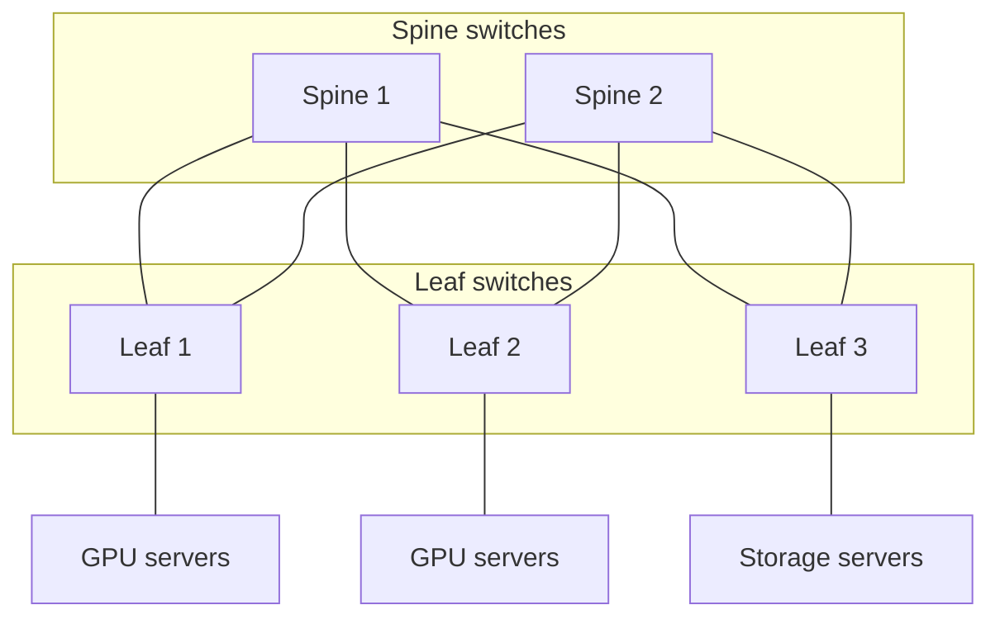
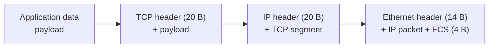
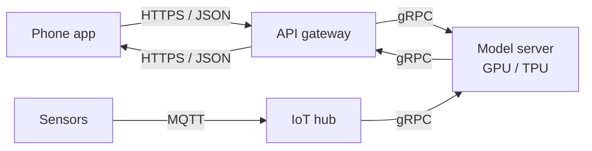

# Section 1: Network Architecture and Communication Protocols

> [!IMPORTANT]
> **Big idea.** A network is a set of machines connected by links that follow shared rules (protocols). Layering those rules lets each part do one job, so a phone, a router and a GPU server can cooperate even though they are built by different companies.

## Learning objectives

By the end of this section you should be able to:

1. Define a computer network and name its basic elements (nodes, links, packets, protocols).
2. Describe the scales of network that matter for AI, from inside a chip package to a mobile network.
3. Compare client-server, peer-to-peer and data-centre (leaf-spine) architectures.
4. Explain layering and encapsulation, and calculate the header overhead of a packet.
5. Match common application protocols (HTTP, gRPC, MQTT, WebRTC) to the AI scenarios they suit.

---

## 1.1 What is a computer network?

A **computer network** is a collection of devices (**nodes**) connected by **links** so they can exchange data. Data is cut into small pieces called **packets**; each packet carries a header with the information needed to deliver it. A **protocol** is an agreed set of rules for how packets are formatted, sent, received and acknowledged.

Networks matter to AI at three moments:

- **Delivering data to the model**: a photo, a voice clip or a sensor reading travels to where the model runs.
- **Delivering the model to the user**: weights are downloaded to a phone or a server.
- **Connecting the chips that run the model**: large models are split across many accelerators, which exchange results constantly (Module 01, Section 3, "Across chips").

> [!TIP]
> **Going further.** Module 01 listed *interconnects* as one of the five categories of AI hardware. This module is the full story of that category: what the links are, which rules they follow, and how far the data has to travel.

---

## 1.2 Network scales in AI systems

The same idea (send data over a link) appears at very different scales. Speed and delay change by many orders of magnitude between them. This is the memory hierarchy of Module 01 extended outwards.

| Scale | Typical link | Rough bandwidth | Rough delay |
|---|---|---|---|
| Inside an accelerator package | HBM stack to chip | ~TB/s (Module 01) | hundreds of ns |
| Between GPUs in one server | NVLink; PCIe | up to several hundred GB/s (NVLink); ~64 GB/s per direction (PCIe 5.0 x16) | ~µs |
| Between servers in a data centre | InfiniBand or Ethernet, 100-400 Gbit/s per port (12.5-50 GB/s) | 12.5-50 GB/s | ~µs to tens of µs |
| Between data centres and users | Fibre backbone and access network | 0.1-10 Gbit/s typical per user | ~ms to ~100 ms |
| Last hop to a phone | Wi-Fi, 4G, 5G | tens to hundreds of Mbit/s (more with 5G) | ~ms to tens of ms |

**Table 1.1.** Orders of magnitude for links at different scales. These are indicative figures from vendor specifications and typical deployments; exact values depend on the generation of hardware and on the network, so check current specification sheets before relying on them (NVIDIA, n.d.; Kurose & Ross, 2020).

> [!NOTE]
> **Bits and bytes again.** Network speeds are quoted in **bits** per second (Gbit/s), memory speeds in **bytes** per second (GB/s). Divide by 8 to convert: 100 Gbit/s = 12.5 GB/s. This is the same bits-and-bytes caution as in Module 01.

---

## 1.3 Network architectures

An **architecture** is the pattern in which machines are arranged and who talks to whom.

| Architecture | Idea | AI example |
|---|---|---|
| **Client-server** | Many clients send requests to a few servers that do the work | A phone app sending a photo to a cloud translation service |
| **Peer-to-peer (P2P)** | Machines talk to each other directly, with no central server | Devices sharing model updates in federated learning (Section 3.6) |
| **Data-centre fabric (leaf-spine)** | Every "leaf" switch connects to every "spine" switch, giving many equal paths | A training cluster where thousands of GPUs exchange gradients |
| **Hybrid** | A mix, such as device, edge server and cloud | Section 3 and the case study in Section 5 |

**Table 1.2.** Four network architectures and an AI example of each.

**Figure 1.1.** A small leaf-spine data-centre fabric. Servers attach to leaf switches; every leaf connects to every spine, so traffic between any two servers has several equal-length paths and no single link is the bottleneck. *Source: author's own diagram, based on Al-Fares, Loukissas & Vahdat (2008).*



Why this shape? A single giant switch would be a bottleneck and a single point of failure. In a leaf-spine fabric you grow the network by adding switches, and if one spine fails the others carry the load.

---

## 1.4 Layered models and encapsulation

Sending a photo across the world involves radio signals, cables, addresses, routes, retransmissions and an application that understands the photo. Nobody designs all of that as one block. Instead, the work is split into **layers**, each using the one below it and offering a simple service to the one above.

| Layer (TCP/IP model) | Job | Example protocols |
|---|---|---|
| **Application** | What the programs say to each other | HTTP, gRPC, MQTT, DNS |
| **Transport** | Delivery between programs on two machines; reliability | TCP, UDP, QUIC |
| **Network (Internet)** | Addressing and routing across networks | IP (IPv4, IPv6) |
| **Link and physical** | Moving bits over one hop: cable, fibre, radio | Ethernet, Wi-Fi, 5G radio |

**Table 1.3.** The four-layer TCP/IP model. (The seven-layer OSI model splits the application layer into three and the link layer into two; you will see both in textbooks.)

As data moves down the stack, each layer wraps it in its own header. This is called **encapsulation**. At the destination, each layer removes its header and hands the rest upward.

**Figure 1.2.** Encapsulation. The application data is wrapped first by a TCP header, then an IP header, then an Ethernet header and trailer. Each wrapper is overhead that the link must carry in addition to the useful data. *Source: author's own diagram, based on Kurose & Ross (2020).*



### Worked example 1.A: how much of a packet is useful?

*Illustrative numbers.* Assume a minimal TCP header (20 bytes), a minimal IPv4 header (20 bytes), and Ethernet framing (14-byte header plus 4-byte check sequence). That is 58 bytes of overhead per packet.

1. **Step 1.** Overhead = 20 + 20 + 14 + 4 = **58 bytes**.
2. **Step 2.** For a 1,000-byte payload, the frame is 1,000 + 58 = **1,058 bytes**.
3. **Step 3.** Efficiency = useful bytes ÷ total bytes = 1,000 ÷ 1,058 ≈ **94.5%**.
4. **Step 4.** For a tiny 100-byte payload (such as a small sensor reading), efficiency = 100 ÷ 158 ≈ **63.3%**.

**Result.** Large payloads waste little on headers; very small messages waste more than a third of the link. This is one reason many small messages are batched together, an idea that returns in Section 4.

The following Python program checks the result. Its complete expected output is shown below the code.

```python
HEADERS = 20 + 20 + 14 + 4   # TCP + IP + Ethernet header + Ethernet FCS (bytes)

def efficiency(payload):
    return payload / (payload + HEADERS)

print(1000 + HEADERS)                 # frame size for a 1,000-byte payload
print(f"{efficiency(1000):.1%}")
print(f"{efficiency(100):.1%}")
```

Expected output:

```text
1058
94.5%
63.3%
```

> [!WARNING]
> **Caution: real packets vary.** IPv6 headers are 40 bytes, TCP can carry options, and wireless links add their own framing. Treat 58 bytes as a teaching figure, not a rule.

---

## 1.5 Application protocols for AI services

At the top of the stack, programs agree on *what* to say. Different AI scenarios favour different protocols.

| Protocol | Style | Typical use in AI systems |
|---|---|---|
| **HTTP / REST (usually with JSON)** | Request and response, human-readable | Public AI APIs: send a prompt or an image, receive a result |
| **gRPC** | Compact binary messages, typed interfaces, streaming | Service-to-service calls inside a data centre, for example between a web server and a model server |
| **WebSocket / server-sent events** | Long-lived connection the server can push on | Streaming a chatbot's answer word by word |
| **MQTT** | Lightweight publish/subscribe messaging | Thousands of low-power sensors reporting to a hub |
| **RTP / WebRTC** | Real-time audio and video, usually over UDP | Live voice assistants and video calls |

**Table 1.4.** Common application protocols and the AI scenarios they suit.

**Figure 1.3.** A cloud AI request passes through several services, each speaking a protocol suited to its job. *Source: author's own diagram.*



---

## 1.6 Key terms

A complete glossary is at the end of this module (see [Glossary](#glossary-all-sections)). Some terms (round-trip time, bandwidth-delay product) are explained in full in later sections, so treat this as a first look.

| Term | Definition |
|---|---|
| **Node** | Any device on a network: phone, server, router, switch. |
| **Link** | A connection that carries bits between two nodes. |
| **Packet** | A small chunk of data plus a header with delivery information. |
| **Protocol** | An agreed set of rules for communication. |
| **Header** | Control information a layer adds in front of the data it carries. |
| **Router / switch** | Devices that forward packets. Routers forward between networks using IP addresses; switches forward within a network. |
| **Bandwidth** | How many bits per second a link can carry (Module 01 defined it in bytes per second for memory). |
| **Latency** | How long it takes for data to get from one point to another, or for a request to be answered. |
| **RTT (round-trip time)** | Time for a message to go to the destination and a reply to come back. |
| **Throughput** | The rate at which useful data is actually delivered; always at most the bandwidth. |
| **Client / server** | The machine that asks / the machine that answers. |

**Table 1.5.** Key terms for Section 1.

---

## 1.7 Activities for Section 1

- [ ] **Activity 1.A.** Using the 58-byte overhead from Worked example 1.A, compute the efficiency for a 1,200-byte payload and for a 40-byte payload.
- [ ] **Activity 1.B.** For each task, name the TCP/IP layer responsible: (a) choosing which route a packet takes across the internet, (b) re-sending a lost segment, (c) turning bits into a radio signal, (d) an HTTP request for a translation.
- [ ] **Activity 1.C.** Explain in two or three sentences why a data centre uses a leaf-spine fabric instead of one very large switch.
- [ ] **Activity 1.D.** Match each scenario to the most suitable protocol (HTTP/REST, gRPC, MQTT, WebRTC): (a) thousands of battery-powered sensors reporting to a hub, (b) a web server calling a model server in the same data centre, (c) a live voice assistant, (d) a public API that accepts images from any developer.

---

## 1.8 Summary

- A network is nodes connected by links that follow protocols; data travels as packets with headers.
- Links span many scales, from TB/s inside a package to tens of Mbit/s on a mobile network; delay grows with distance, just as in the memory hierarchy of Module 01.
- Common architectures are client-server, peer-to-peer, data-centre leaf-spine fabrics and hybrids.
- Layering (application, transport, network, link) splits the work; encapsulation wraps data in a header at each layer. With 58 bytes of headers, a 1,000-byte payload is 94.5% efficient and a 100-byte payload 63.3%.
- Different protocols suit different AI jobs: HTTP/REST for public APIs, gRPC inside data centres, MQTT for sensors, WebRTC for real-time media.

---

