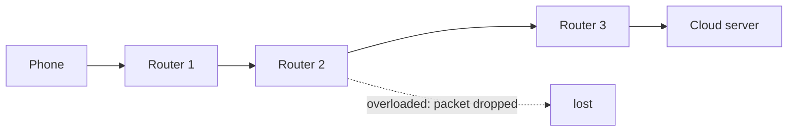
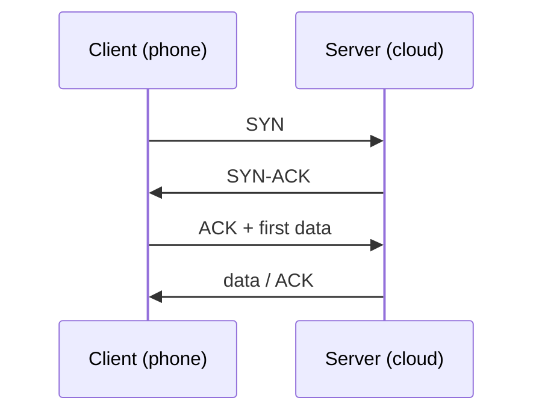
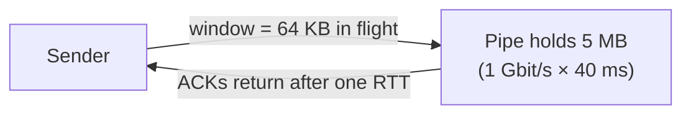

# Section 2: TCP/IP and Data Transmission

> **Big idea.** IP gets packets across the world on a best-effort basis; TCP turns that unreliable delivery into a dependable stream. The price is round trips and careful pacing, and these can make a fast link feel slow.

---

## Learning Objectives

By the end of this section you should be able to:

1. Explain what IP addresses and routing do, and why IP delivery is "best effort".
2. Describe how TCP establishes a connection, achieves reliability, and controls flow and congestion.
3. Distinguish TCP, UDP and QUIC and say when each is used.
4. Calculate time to first byte for different protocol setups.
5. Compute the bandwidth-delay product and the window-limited throughput of a TCP connection.
6. Explain how packet loss reduces TCP throughput, using the Mathis formula.

---

## 2.1 IP: Addressing and Best-Effort Delivery

Every device on the internet has an **IP address**. IPv4 addresses are 32 bits (about 4.3 billion possible); IPv6 addresses are 128 bits (Postel, 1981; Deering & Hinden, 2017). A **router** reads the destination address in each packet's header and forwards it one hop closer to its destination. No router keeps track of the whole journey.

IP is **best effort**: a packet may be delayed, lost, duplicated or arrive out of order, and IP does not tell anyone. This simple design is why the internet scales so well, but most applications need more.

**Figure 2.1.** A packet crosses several routers. Each router decides only the next hop. If a router is overloaded, it drops the packet and IP does not notice. *Source: author's own diagram, based on Kurose & Ross (2020).*



---

## 2.2 TCP: A Reliable Stream on Top of Unreliable Packets

The **Transmission Control Protocol (TCP)** adds four things on top of IP (Cerf & Kahn, 1974; Eddy, 2022):

1. **Connection setup.** The two ends agree to talk, using a **three-way handshake**: SYN, SYN-ACK, ACK.
2. **Reliability.** Every byte has a sequence number. The receiver sends acknowledgements (ACKs); if the sender does not see an ACK in time, it sends the data again.
3. **Flow control.** The receiver advertises how much data it can accept (the **receive window**), so a fast sender does not overwhelm a slow receiver.
4. **Congestion control.** The sender adjusts how fast it sends in response to signs of network congestion. A classic scheme begins with **slow start** (the sending window grows quickly) and then increases it gradually until loss occurs, cutting it back sharply when loss is detected (Jacobson, 1988).

**Figure 2.2.** The TCP three-way handshake. One full round trip passes before the first byte of application data can be sent. *Source: author's own diagram, based on Eddy (2022).*



> **An everyday analogy.** TCP is like a registered courier service. Before sending anything, you phone ahead to check the recipient is there (handshake). Every parcel is numbered and signed for (ACKs). If a signature does not come back, the parcel is sent again (retransmission). If the recipient's hallway is full, they tell you to slow down (flow control), and if the roads are jammed, you send fewer vans (congestion control).

---

## 2.3 UDP and QUIC

TCP's guarantees cost time. For some applications, an old packet is worse than no packet: a voice assistant that waits to retransmit a lost 20 ms audio chunk will only deliver it too late.

**Table 2.1.** Three transport protocols compared.

| Protocol | Reliable? | Connection setup | Typical use |
|---|---|---|---|
| **TCP** | Yes, ordered stream | 1 round trip (plus security handshake) | Web, file and model downloads, most APIs |
| **UDP** | No: just send packets (Postel, 1980) | None | Real-time voice and video, games, DNS |
| **QUIC** | Yes, built on UDP | Transport and security combined, about 1 round trip (Iyengar & Thomson, 2021) | HTTP/3, modern web and mobile apps |

QUIC runs in user space on top of UDP, combines connection setup with encryption, and avoids a TCP problem where one lost packet blocks everything behind it. It is increasingly used by large web services.

> **Going further: security.** Most AI APIs use **TLS** (Transport Layer Security) so that data (your photo, your prompt) is encrypted in transit. TLS 1.3 needs one extra round trip on top of TCP's handshake (Rescorla, 2018).

---

## 2.4 Worked Example 2.A: Time to First Byte

**Problem.** A phone is 40 ms (round trip) from a cloud server. How long before the first byte of an answer can arrive, using TCP with TLS 1.3, and using QUIC? Assume a fresh connection and ignore server processing time.

**Step 1: Count round trips for TCP + TLS 1.3.**

- TCP handshake: **1** round trip.
- TLS 1.3 handshake: **1** round trip.
- HTTP request and first byte of response: **1** round trip.
- Total: **3** round trips.

**Step 2: Count round trips for QUIC.**

- Combined transport and security handshake: **1** round trip.
- Request and first byte of response: **1** round trip.
- Total: **2** round trips.

**Step 3: Multiply by the RTT.**

**Table 2.2.** Time to first byte for a fresh connection. Connection reuse and session resumption can remove some of these round trips in practice.

| Setup | Round trips | Time to first byte at RTT = 40 ms |
|---|---:|---:|
| TCP + TLS 1.3 | 3 | **120 ms** |
| QUIC | 2 | **80 ms** |

The following Python program checks the numbers. Its complete expected output is shown below the code.

```python
def time_to_first_byte(rtt_ms, round_trips):
    return rtt_ms * round_trips

rtt = 40
print("TCP + TLS 1.3:", time_to_first_byte(rtt, 3), "ms")
print("QUIC:", time_to_first_byte(rtt, 2), "ms")
```

Expected output:

```text
TCP + TLS 1.3: 120 ms
QUIC: 80 ms
```

> **Key idea.** Handshakes cost *round trips*, and a round trip cannot be made shorter by buying a faster link. Only moving the server closer, or doing fewer round trips, helps. This is the networking version of "moving data is more expensive than computing on it".

---

## 2.5 Worked Example 2.B: Why a Fast Link Can Give a Slow Transfer

TCP can only have as much data "in flight" (sent but not yet acknowledged) as its window allows. To keep a link full, the window must be at least the **bandwidth-delay product (BDP)**:

```text
BDP = bandwidth × round-trip time
```

**Problem.** A 1 Gbit/s link has a 40 ms RTT. A TCP connection uses a classic 65,535-byte window. What is the BDP, and what throughput does the window allow?

1. **Step 1.** BDP = 1 × 10⁹ bit/s × 0.040 s = 40 × 10⁶ bits = **5.0 MB** (divide by 8 to get bytes).
2. **Step 2.** Window-limited throughput = window ÷ RTT = 65,535 × 8 bits ÷ 0.040 s ≈ **13.1 Mbit/s**.
3. **Step 3.** Share of the link used = 13.1 Mbit/s ÷ 1,000 Mbit/s ≈ **1.31%**.

**Result.** The link could carry 1 Gbit/s, but this connection uses about 1.3% of it. The sender spends most of the time waiting for ACKs. Modern TCP uses *window scaling* to allow much bigger windows; the point of the example is that the window must be roughly the BDP to fill the link.

**Figure 2.3.** The sender can only keep one window of data in flight per round trip. If the window is smaller than the pipe, the pipe is mostly empty. *Source: author's own diagram, based on Kurose & Ross (2020).*



The following Python program checks the numbers. Its complete expected output is shown below the code.

```python
link = 1e9          # bit/s
rtt = 0.040         # seconds
window = 65535      # bytes

bdp = link * rtt / 8                 # bytes
limit = window * 8 / rtt             # bit/s

print(bdp / 1e6, "MB")
print(round(limit / 1e6, 1), "Mbit/s")
print(f"{limit / link:.2%}")
```

Expected output:

```text
5.0 MB
13.1 Mbit/s
1.31%
```

---

## 2.6 Worked Example 2.C: How Packet Loss Limits Throughput

Even with a large window, TCP's congestion control slows down when it sees loss. A well-known approximation (the Mathis formula) says that the throughput of one TCP connection is about

```text
throughput ≈ 1.22 × MSS ÷ ( RTT × √p )
```

where **MSS** is the maximum segment size (about 1,460 bytes of payload on Ethernet) and **p** is the packet-loss probability (Mathis et al., 1997).

**Problem.** For MSS = 1,460 bytes and RTT = 40 ms, find the throughput at loss rates p = 10⁻⁶, 10⁻⁴ and 10⁻².

The following Python program computes the three values. Its complete expected output is shown below the code.

```python
import math

MSS = 1460       # bytes
RTT = 0.040      # seconds

for p in (1e-6, 1e-4, 1e-2):
    rate = 1.22 * MSS * 8 / (RTT * math.sqrt(p))
    print(p, round(rate / 1e6, 1), "Mbit/s")
```

Expected output:

```text
1e-06 356.2 Mbit/s
0.0001 35.6 Mbit/s
0.01 3.6 Mbit/s
```

**Interpretation.** Because of the square root, a 100× increase in loss produces a 10× fall in throughput. A wireless last hop with noticeable loss, or a congested path, can therefore dominate the whole transfer, however fast the backbone is.

> **Caution: an approximation.** The formula assumes a long-lived, loss-limited TCP flow in steady state and a particular congestion-control algorithm. It is a good way to see the *shape* of the effect (RTT and loss both matter), not a precise prediction for a particular connection.

---

## 2.7 Why This Matters for AI

- **Model downloads and API calls** are transfers like those above: RTT and loss, not just bandwidth, set the speed.
- **Streaming answers** (token by token) use long-lived connections so the handshake is paid once, not for every word.
- **Real-time voice and video** favour UDP-style transport, where late packets are dropped rather than retransmitted.
- **Training clusters** often bypass the ordinary operating-system network stack with hardware features such as RDMA (remote direct memory access), used with InfiniBand or RoCE Ethernet, so data moves from one machine's memory to another's with minimal overhead. The reason is exactly the one in Module 01: for the same bytes, less overhead means more of the expensive accelerators' time spent computing.

---

## 2.8 Activities for Section 2

- [ ] **Activity 2.A.** The phone-to-server RTT is 100 ms. Compute the time to first byte for TCP + TLS 1.3 and for QUIC on a fresh connection.
- [ ] **Activity 2.B.** A 100 Mbit/s link has an RTT of 80 ms and uses a 65,535-byte window. What is the BDP? What throughput does the window allow, and what percentage of the link is that?
- [ ] **Activity 2.C.** Using Worked Example 2.C, what happens to the throughput when the loss rate rises from 10⁻⁶ to 10⁻⁴, and why?
- [ ] **Activity 2.D.** Put these in order: ACK, SYN, SYN-ACK. Then explain in one sentence why a live voice assistant may prefer UDP-based transport over TCP.

### Answer Key for Activities

**Activity 2.A.**
- TCP + TLS 1.3: 3 round trips × 100 ms = **300 ms**.
- QUIC: 2 round trips × 100 ms = **200 ms**.

**Activity 2.B.**
- BDP = 100 × 10⁶ bit/s × 0.080 s ÷ 8 = 1,000,000 bytes = **1.0 MB**.
- Window-limited throughput = 65,535 × 8 ÷ 0.080 ≈ **6.55 Mbit/s**.
- Share of link = 6.55 ÷ 100 ≈ **6.55%**.

**Activity 2.C.** Throughput falls by a factor of 10 (from about 356.2 Mbit/s to 35.6 Mbit/s). The Mathis formula has √p in the denominator, so a 100× rise in loss (10⁻⁶ → 10⁻⁴) gives a √100 = 10× fall in throughput. Loss signals congestion, and TCP's congestion control cuts its sending window in response.

**Activity 2.D.**
- Order: **SYN → SYN-ACK → ACK**.
- A live voice assistant prefers UDP-based transport because a late audio packet is useless: retransmitting it would only deliver it after the conversation has moved on. Dropping the packet and carrying on keeps the audio stream current, whereas TCP's reliable in-order delivery would stall the stream waiting for the lost packet.

---

## 2.9 Summary

- IP addresses and routes packets across networks on a best-effort basis; packets can be lost, delayed or reordered.
- TCP adds a handshake, sequence numbers and acknowledgements, flow control and congestion control to deliver a reliable stream; UDP skips these; QUIC builds a reliable, encrypted transport on UDP and saves a round trip.
- On a fresh connection with a 40 ms RTT, TCP + TLS 1.3 needs 3 round trips (120 ms) before the first byte, QUIC 2 (80 ms).
- The bandwidth-delay product tells how much data must be in flight to fill a link: a 1 Gbit/s, 40 ms path needs 5 MB, and a 65,535-byte window reaches only about 1.3% of the link.
- Loss and RTT both limit TCP throughput; because of the square root in the Mathis formula, 100× more loss means 10× less throughput.

---

## References

Cerf, V., & Kahn, R. (1974). A protocol for packet network intercommunication. *IEEE Transactions on Communications, 22*(5), 637–648. https://doi.org/10.1109/TCOM.1974.1092259

Deering, S., & Hinden, R. (2017). *Internet Protocol, Version 6 (IPv6) specification* (RFC 8200). Internet Engineering Task Force. https://doi.org/10.17487/RFC8200

Eddy, W. (2022). *Transmission Control Protocol (TCP)* (RFC 9293). Internet Engineering Task Force. https://doi.org/10.17487/RFC9293

Iyengar, J., & Thomson, M. (2021). *QUIC: A UDP-based multiplexed and secure transport* (RFC 9000). Internet Engineering Task Force. https://doi.org/10.17487/RFC9000

Jacobson, V. (1988). Congestion avoidance and control. *ACM SIGCOMM Computer Communication Review, 18*(4), 314–329. https://doi.org/10.1145/52324.52356

Kurose, J. F., & Ross, K. W. (2020). *Computer networking: A top-down approach* (8th ed.). Pearson.

Mathis, M., Semke, J., Mahdavi, J., & Ott, T. (1997). The macroscopic behavior of the TCP congestion avoidance algorithm. *ACM SIGCOMM Computer Communication Review, 27*(3), 67–82. https://doi.org/10.1145/263932.264023

Postel, J. (1980). *User Datagram Protocol* (RFC 768). Internet Engineering Task Force. https://doi.org/10.17487/RFC0768

Postel, J. (1981). *Internet Protocol* (RFC 791). Internet Engineering Task Force. https://doi.org/10.17487/RFC0791

Rescorla, E. (2018). *The Transport Layer Security (TLS) Protocol version 1.3* (RFC 8446). Internet Engineering Task Force. https://doi.org/10.17487/RFC8446
