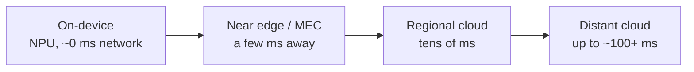
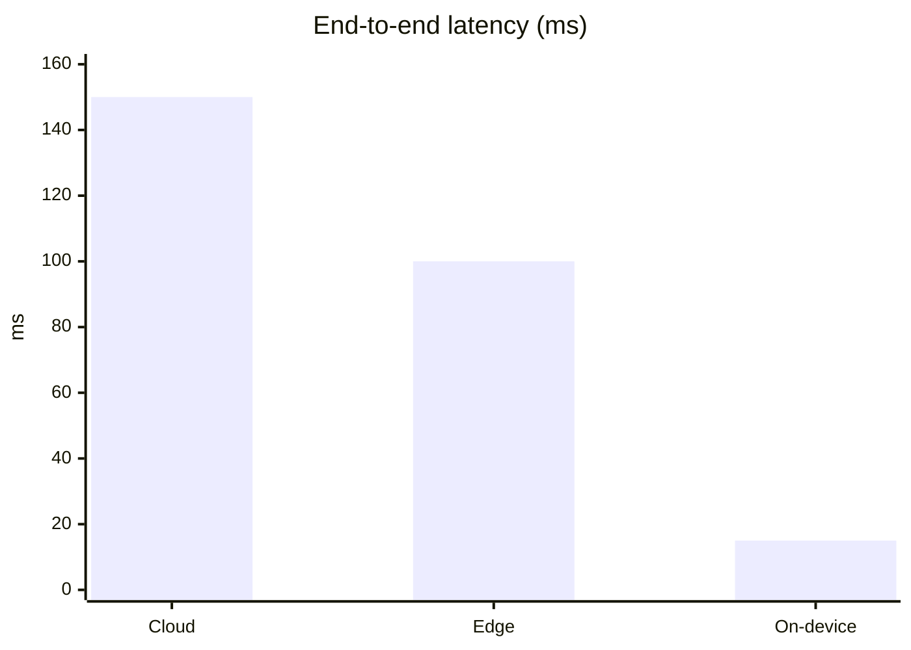

# Section 3: Cloud Computing vs Edge Computing

> [!IMPORTANT]
> **Big idea.** Where a model runs is a design choice with trade-offs. The cloud offers almost unlimited compute and large models; the edge and the device offer shorter paths, less data leaving the user, and independence from the network. Most real systems combine all three.

## Learning objectives

By the end of this section you should be able to:

1. Define cloud computing using the NIST characteristics and distinguish IaaS, PaaS and SaaS.
2. Define edge computing and describe the device, near-edge and cloud tiers.
3. Compare cloud, edge and on-device computing for an AI workload.
4. Build an end-to-end latency budget for cloud, edge and on-device inference.
5. Calculate the data saved by processing at the edge, and check whether a model fits on a device.
6. Describe hybrid patterns such as cascades, split inference and federated learning.

---

## 3.1 Cloud computing

The US National Institute of Standards and Technology (NIST) defines **cloud computing** as a model for on-demand network access to a shared pool of configurable computing resources, and lists five essential characteristics: on-demand self-service, broad network access, resource pooling, rapid elasticity, and measured service (Mell & Grance, 2011).

For AI this means you can rent a rack of GPUs for a weekend, scale a model service up when traffic spikes and down when it drops, and pay for what you used.

| Service model | What the provider runs | AI example |
|---|---|---|
| **IaaS** (infrastructure) | Servers, storage, networking; you install everything else | Renting GPU or TPU machines to train a model |
| **PaaS** (platform) | Plus the runtime and tools | A managed service to train and deploy models |
| **SaaS** (software) | The whole application | An AI assistant or translation service you simply use |

**Table 3.1.** Cloud service models with AI examples.

---

## 3.2 Edge computing

**Edge computing** moves computation closer to where data is produced or used, rather than sending everything to a distant data centre (Shi et al., 2016; Satyanarayanan, 2017). "Edge" is a spectrum of places:

- **On-device:** the phone, car or camera itself (for example, the Neural Engine from Module 01).
- **Near edge / multi-access edge computing (MEC):** small servers at a mobile operator's base station or local exchange, a few milliseconds from the user (ETSI, 2014).
- **Regional cloud:** a large data centre in the same region.
- **Distant cloud:** a data centre far away, with the most resources.

**Figure 3.1.** Computing tiers between a user and the cloud. Moving left means shorter paths and less data leaving the device; moving right means more compute and larger models. *Source: author's own diagram, based on Shi et al. (2016) and ETSI (2014).*



---

## 3.3 Comparison

| Property | On-device | Edge server (MEC) | Cloud |
|---|---|---|---|
| **Network delay** | None | A few ms | Tens to 100+ ms |
| **Compute and memory** | Smallest (watts, GB) | Medium | Largest, elastic |
| **Model size possible** | Small to mid (quantised) | Mid to large | Largest |
| **Privacy** | Best: data stays local | Good: data stays in the region | Data leaves the user's control |
| **Works offline** | Yes | No | No |
| **Cost model** | Cost sits in the device | Operator or enterprise infrastructure | Pay-per-use, scales with traffic |
| **Weakness** | Limited by battery and memory | Fewer locations, less elasticity | Network dependence, delay, data transfer |

**Table 3.2.** On-device, edge and cloud compared.

---

## 3.4 Worked example 3.A: an end-to-end latency budget

**Problem.** The running example sends a 200 KB photo to be translated. Compare three options. All numbers are illustrative assumptions.

- Uplink speed: 20 Mbit/s.
- Cloud region: RTT 60 ms; edge server: RTT 10 ms.
- Inference on a server accelerator: 10 ms.
- On-device model on the Neural Engine: 15 ms.
- Connection is already open (no handshake), and the reply is tiny.

**Step 1: Time to upload the photo.** 200,000 bytes × 8 ÷ 20 × 10⁶ bit/s = 0.080 s = **80 ms**.

**Step 2: Add the other terms.**

| Option | Upload | Network round trip | Inference | Total |
|---|---:|---:|---:|---:|
| Cloud | 80 ms | 60 ms | 10 ms | **150 ms** |
| Edge server | 80 ms | 10 ms | 10 ms | **100 ms** |
| On-device | none | none | 15 ms | **15 ms** |

**Table 3.3.** Latency budget for the three options.

**Step 3: Interpret.** Notice that the *upload*, not the server's fast inference, is the largest term for the remote options. Sending a smaller (compressed) image or sending extracted features would help; so would a faster link, which is where 5G enters in Section 5. The on-device option wins on latency, but only if the model on the phone is good enough.

**Figure 3.2.** Latency budget for each option. The remote options are dominated by upload and network delay, not by the model's compute time. *Source: author's own diagram, based on the illustrative assumptions in Table 3.3.*



The following Python program checks the numbers. Its complete expected output is shown below the code.

```python
def tx_ms(size_bytes, rate_bps):
    return size_bytes * 8 / rate_bps * 1000

upload = tx_ms(200_000, 20e6)
cloud = upload + 60 + 10
edge = upload + 10 + 10

print("Upload:", round(upload), "ms")
print("Cloud:", round(cloud), "ms")
print("Edge:", round(edge), "ms")
print("On-device:", 15, "ms")
```

Expected output:

```text
Upload: 80 ms
Cloud: 150 ms
Edge: 100 ms
On-device: 15 ms
```

---

## 3.5 Worked example 3.B: how much data does the edge save?

**Problem.** A shop has 100 cameras, each streaming compressed video at 5 Mbit/s to a cloud service that detects events. Instead, an edge box in the shop analyses the video and sends only small event messages: 200 bytes each, about 10 per second per camera. How much network traffic is saved?

1. **Step 1: Streaming everything.** 100 × 5 Mbit/s = **500 Mbit/s**.
2. **Step 2: Sending only events.** 100 cameras × 200 bytes × 8 bits × 10 events/s = 1,600,000 bit/s = **1.6 Mbit/s**.
3. **Step 3: Ratio.** 500 ÷ 1.6 = **312.5**, so about 300 times less traffic.

The following Python program checks the numbers. Its complete expected output is shown below the code.

```python
cameras = 100
video = cameras * 5                          # Mbit/s
events = cameras * 200 * 8 * 10 / 1e6        # Mbit/s (200-byte events, 10 per second)

print(video, "Mbit/s")
print(events, "Mbit/s")
print(round(video / events, 1))
```

Expected output:

```text
500 Mbit/s
1.6 Mbit/s
312.5
```

**Interpretation.** The edge converts a *bandwidth* problem into a *compute* problem: the shop must now run a model locally (Module 01), but the wide-area network carries three hundred times less data, and raw video never leaves the premises.

---

## 3.6 Hybrid patterns

Real systems rarely pick one location. Common combinations:

| Pattern | Idea | Example |
|---|---|---|
| **Cascade** | A small, cheap model runs first; hard cases go to a bigger model | Phone recognises common signs locally, and sends unusual ones to the cloud |
| **Split inference** | The first layers run on the device, the rest on a server; only the intermediate values are sent | Reduces upload size and keeps raw data local |
| **Edge pre-processing** | The edge filters or compresses data before it goes to the cloud | Worked example 3.B |
| **Federated learning** | Devices train on their own data and send only model updates to a server (McMahan et al., 2017) | Keyboard prediction learned from many phones without uploading their text |

**Table 3.4.** Hybrid patterns combining device, edge and cloud.

### Does the model fit? (Module 01 revisited)

Module 01 showed that a model's weight memory is parameters × bytes per weight. That decides whether on-device is even possible.

| Model | Precision | Weight memory | Fits in an 8 GB phone shared with other apps? |
|---|---|---:|---|
| 3 billion parameters | 4-bit | 1.5 GB | Yes, comfortably |
| 13 billion parameters | 4-bit | 6.5 GB | Not realistically: almost all the memory |
| 70 billion parameters | FP16 | 140 GB | No: a multi-accelerator server |

**Table 3.5.** Weight memory for three models (weights only; real use needs extra working memory).

---

## 3.7 Choosing where to run: a checklist

| Question | If the answer is yes... |
|---|---|
| Must the answer arrive in a few tens of milliseconds, every time? | Favour on-device or edge |
| Must raw data stay with the user or on-premises? | Favour on-device or edge |
| Must it work with no connection? | On-device |
| Is the model too big for the device's memory? | Edge or cloud |
| Is demand very bursty or unpredictable? | Cloud (elasticity) |
| Is the job a large, one-off batch such as training? | Cloud |

**Table 3.6.** A first-pass checklist. Real decisions weigh several of these at once.

---

## 3.8 Activities for Section 3

- [ ] **Activity 3.A.** A 500 KB image is sent over a 40 Mbit/s uplink. Cloud RTT is 25 ms, edge RTT is 5 ms, and server inference takes 20 ms. Compute the total latency for cloud and edge. Which option could meet a 33 ms budget (30 frames per second) if an on-device model takes 30 ms?
- [ ] **Activity 3.B.** 50 cameras each stream 4 Mbit/s. An edge box instead sends 20 kbit/s of events per camera. How much traffic is saved, in Mbit/s and as a ratio?
- [ ] **Activity 3.C.** How much memory do the weights of a 13-billion-parameter model need in 4-bit and in FP16? Which, if either, could run on an 8 GB phone?
- [ ] **Activity 3.D.** Choose cloud, edge or on-device, and justify: (a) a hospital scanner that must respond instantly and keep images on site, (b) a nightly job that trains a large model, (c) noise suppression in a hearing aid.

---

## 3.9 Summary

- Cloud computing provides on-demand, elastic, pooled resources (NIST); service models are IaaS, PaaS and SaaS.
- Edge computing puts computation closer to the data: on-device, at a near-edge server (MEC), or in a regional cloud.
- Trade-offs: the cloud has the most compute and the longest path; on-device has no network but the least memory; the edge sits in between.
- In the street-sign example, cloud takes about 150 ms, edge 100 ms and on-device 15 ms; upload time, not compute, dominates the remote options.
- Processing at the edge can cut wide-area traffic by hundreds of times (312.5× in the camera example).
- Hybrid designs (cascade, split inference, edge pre-processing, federated learning) combine the tiers; model size and quantisation (Module 01) decide what fits on the device.

---

