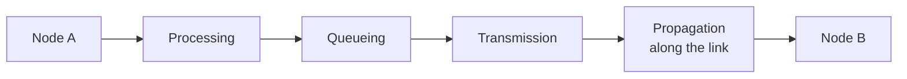
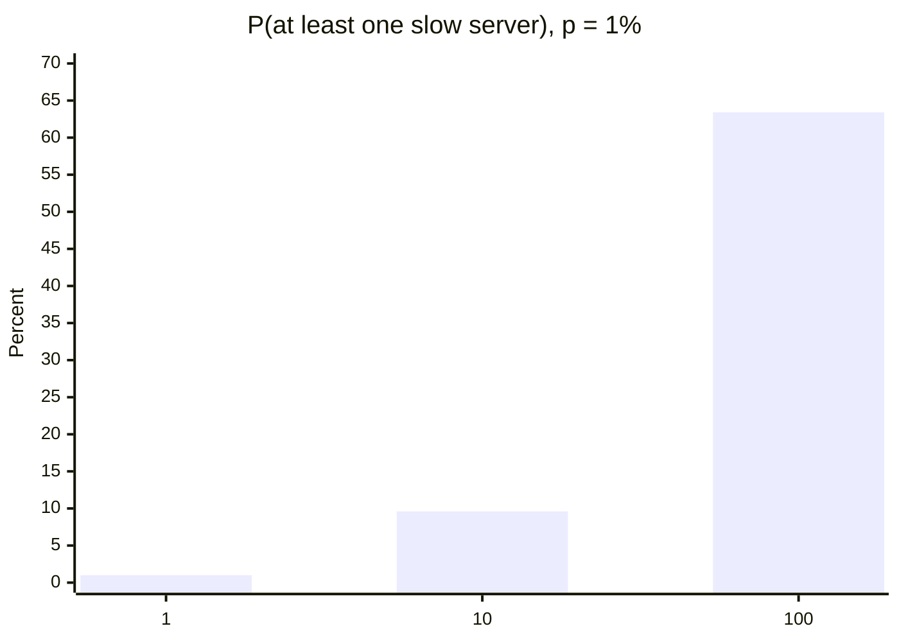
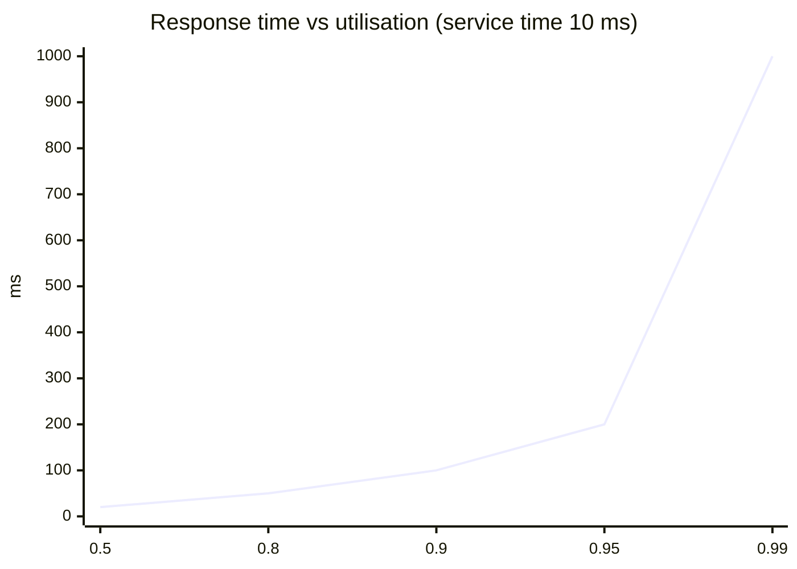
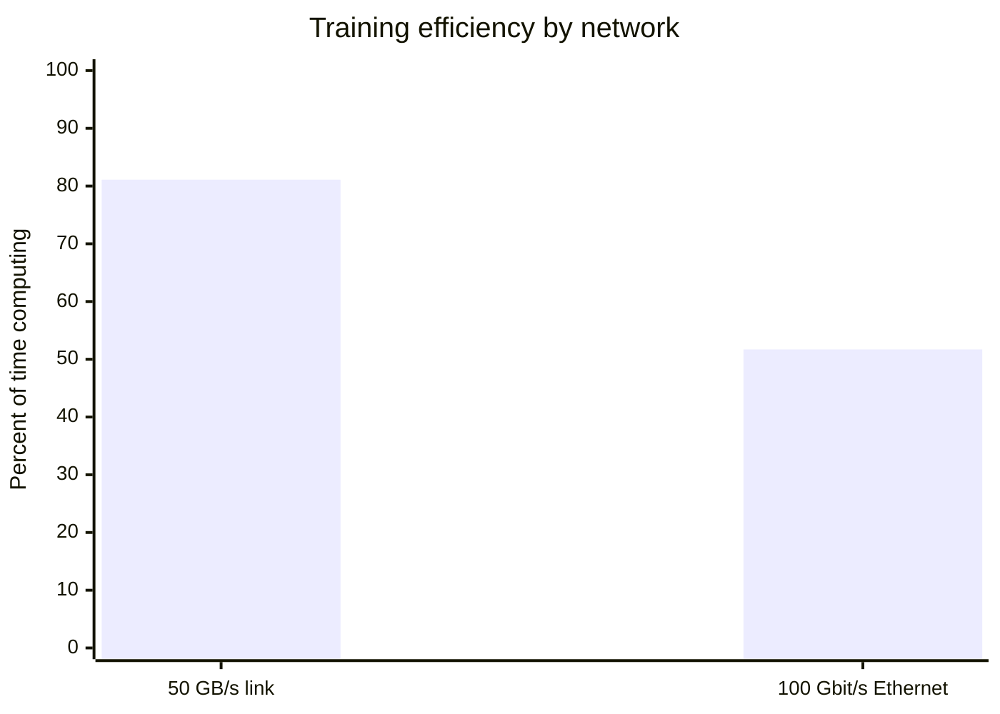

# Section 4: Network Latency, Bandwidth, and Scalability

> **Big idea.** Latency and bandwidth are different things and are limited by different laws. Latency has a floor set by the speed of light and a ceiling set by queues; bandwidth can be bought. Scalability is about keeping both under control as demand grows.

---

## Learning Objectives

By the end of this section you should be able to:

1. Break latency into processing, queueing, transmission and propagation delay.
2. Distinguish latency, bandwidth and throughput, and calculate transmission and propagation delays.
3. Explain tail latency and compute the chance that at least one of many parallel requests is slow.
4. Explain how queueing makes delay grow sharply as utilisation approaches 100%.
5. Explain vertical vs horizontal scaling and apply the idea of communication overhead to data-parallel training.
6. Connect these ideas to Amdahl's law and utilisation from Module 01.

---

## 4.1 Four Kinds of Delay

The time for a packet to get from A to B is the sum of four delays (Kurose & Ross, 2020). Each delay is caused by a different physical or logical process, and each has its own remedy. Confusing them is one of the most common mistakes in network performance work: buying more bandwidth cannot fix a propagation delay, and moving a server closer cannot fix a queue.

**Table 4.1.** The four components of delay.

| Delay | What causes it | How to reduce it | Does more bandwidth help? |
|---|---|---|---|
| **Processing** | Routers and servers examining headers and handling the request | Faster hardware, simpler pipelines | No |
| **Queueing** | Waiting in line behind other packets or requests | Spare capacity, load balancing | Sometimes (it drains queues faster) |
| **Transmission** | Pushing all the bits onto the link: size ÷ bandwidth | More bandwidth, smaller messages | Yes, directly |
| **Propagation** | The signal travelling through the medium: distance ÷ speed | Shorter distance (edge servers) | No, never |

**Figure 4.1.** One hop of a packet's journey. Processing, queueing and transmission happen at each node; propagation happens on each link. *Source: author's own diagram, based on Kurose & Ross (2020).*



> **An everyday analogy.** Think of a pipe. *Bandwidth* is how wide the pipe is: how much water per second can flow. *Latency* is how long the pipe is: how long a drop takes to get through. A wider pipe lets you move more water per second, but it does not make any single drop arrive sooner. If the pipe is clogged (queueing), widening it helps a little; if the pipe is simply long (propagation), widening it helps not at all.

---

## 4.2 Worked Example 4.A: The Speed-of-Light Floor, and Big Downloads

Light in optical fibre travels at about two-thirds of its speed in vacuum, roughly 2 × 10⁸ m/s, which is 5 µs per kilometre one way. This is a physical constant of the medium: no amount of engineering removes it.

**Problem (part 1).** What is the minimum delay over 1,000 km, 3,000 km and 10,000 km of fibre?

**Problem (part 2).** How long does it take to download a 1.5 GB model (the 3-billion-parameter 4-bit model from Module 01) at 100 Mbit/s and at 1 Gbit/s?

The following Python program computes both. Its complete expected output is shown below the code.

```python
V = 2e8   # m/s, light in fibre is roughly two-thirds of c

for km in (1000, 3000, 10000):
    one_way = km * 1000 / V * 1000          # milliseconds
    print(km, "km:", round(one_way, 1), "ms one way,", round(2 * one_way, 1), "ms round trip")

model_bits = 1.5e9 * 8
print(round(model_bits / 100e6, 1), "s at 100 Mbit/s")
print(round(model_bits / 1e9, 1), "s at 1 Gbit/s")
```

Expected output:

```text
1000 km: 5.0 ms one way, 10.0 ms round trip
3000 km: 15.0 ms one way, 30.0 ms round trip
10000 km: 50.0 ms one way, 100.0 ms round trip
120.0 s at 100 Mbit/s
12.0 s at 1 Gbit/s
```

**Interpretation.**

- Over 10,000 km no network can answer in under about 100 ms round trip, however much bandwidth is bought. Real routes are longer than straight lines, so real delays are higher. The only fix is a closer server, which is the case for edge computing.
- For the *model download*, transmission time dominates, and a 10× faster link makes it 10× quicker. Different problems need different fixes: latency-bound tasks need proximity; bandwidth-bound tasks need capacity.

> **Key idea.** The two halves of this example are deliberately placed side by side because they illustrate the same lesson from opposite directions. The first half shows a delay that *bandwidth cannot touch*; the second shows a delay that *bandwidth fixes exactly*. Recognising which kind of problem you have is the first step in any performance investigation.

---

## 4.3 Tail Latency and the Problem of Many Parallel Requests

Average latency is a poor guide to what users feel. A large AI service often fans a request out to many servers (retrieval shards, model replicas, tool calls) and waits for all of them. Then the *slowest* response decides the total (Dean & Barroso, 2013). This is the "tail at scale" problem: the rare slow response becomes common when you touch many servers.

### Worked Example 4.B

Suppose each server is slow (say, delayed by a garbage-collection pause or a busy neighbour) on 1% of requests, independently. If a request must wait for *n* servers, the probability that at least one is slow is

```text
P(at least one slow) = 1 − (1 − p)ⁿ
```

The following Python program evaluates this for n = 1, 10 and 100 with p = 0.01. Its complete expected output is shown below the code.

```python
def p_slow(n, p):
    return 1 - (1 - p) ** n

for n in (1, 10, 100):
    print(n, f"{p_slow(n, 0.01):.1%}")
```

Expected output:

```text
1 1.0%
10 9.6%
100 63.4%
```

**Result.** A rare 1% problem becomes a problem for nearly two out of three requests when the request touches 100 servers. This is why large services track the 99th-percentile latency and design to tolerate slow components (for example, by sending a backup request).

**Figure 4.2.** Probability of hitting at least one slow server as the number of parallel servers grows, for a 1% per-server slow rate. *Source: author's own diagram, based on the numbers in Worked Example 4.B and Dean & Barroso (2013).*



**Table 4.2.** How the chance of a slow request grows with fan-out, for p = 1%.

| Servers touched (n) | P(at least one slow) | What it means in practice |
|---:|---:|---|
| 1 | 1.0% | Almost always fast |
| 10 | 9.6% | About 1 in 10 requests slow |
| 100 | 63.4% | Most requests slow |

> **Design consequence.** If you cannot make individual servers faster, you can make the *system* faster by hedging: send the request to two servers and take the first answer. The chance that both are slow is p², which is 0.01% instead of 1%, at the cost of some duplicated work. This trade-off between extra work and reduced tail latency is a recurring theme in large AI services.

---

## 4.4 Queueing: Why High Utilisation Is Dangerous

A server that is busy 100% of the time has no spare capacity, so any burst forms a queue. For a simple single-server queue (the M/M/1 model, where arrivals are random and service times vary), the average time in the system is

```text
time ≈ service time ÷ (1 − utilisation)
```

This is a textbook result (Kurose & Ross, 2020) and a simplification of real systems, but its shape is what matters: the delay grows not linearly but hyperbolically as utilisation approaches 1.

### Worked Example 4.C

A model server takes 10 ms per request. What is the average response time at utilisation 0.5, 0.9 and 0.99?

```python
service = 10  # ms

for rho in (0.5, 0.9, 0.99):
    print(rho, round(service / (1 - rho)), "ms")
```

Expected output:

```text
0.5 20 ms
0.9 100 ms
0.99 1000 ms
```

**Figure 4.3.** Response time against utilisation for a 10 ms service time. Delay rises slowly until about 80% utilisation and then shoots upwards. *Source: author's own diagram, based on the formula above.*



**Table 4.3.** Response time at several utilisation levels for a 10 ms service time.

| Utilisation | Response time | Interpretation |
|---:|---:|---|
| 0.50 | 20 ms | Twice the service time; plenty of headroom |
| 0.80 | 50 ms | Five times the service time; acceptable |
| 0.90 | 100 ms | Ten times; starting to hurt |
| 0.95 | 200 ms | Twenty times; risky |
| 0.99 | 1,000 ms | One hundred times; unusable for interactive work |

> **Caution: utilisation is not a goal in itself.** In Module 01, low utilisation meant wasted silicon. Here, utilisation near 100% means unpredictable delay. Real services aim for a deliberate middle: high enough to be cost-effective, low enough to absorb bursts. The "right" number depends on the service-level objective: an interactive AI assistant might target 70%, while a batch training cluster can safely run at 95%.

---

## 4.5 Scalability

A system is **scalable** if it can handle more load by adding resources without redesign.

**Table 4.4.** Ways to scale a service.

| Approach | Idea | Limit | Example |
|---|---|---|---|
| **Vertical scaling (scale up)** | Use a bigger machine (more memory, more accelerators in one box) | There is a biggest machine; failure takes everything down | Moving from 1 GPU to 8 in one server |
| **Horizontal scaling (scale out)** | Add more machines behind a **load balancer** | The work must be divisible, and machines must coordinate | Adding model-server replicas behind a load balancer |
| **Autoscaling** | Add or remove machines automatically as demand changes | Takes time to start new machines; GPUs can be scarce | Cloud service that adds replicas when traffic spikes |

Scaling out works best when requests are independent and **stateless**, meaning any server can handle any request. Serving a model is mostly like this: add replicas of the model server and spread the requests. Training one large model is not: the machines must continually agree on the same set of weights.

---

## 4.6 Worked Example 4.D: The Communication Cost of Training

In *data-parallel training*, each GPU processes a different slice of the data, and then all GPUs must combine (average) their gradients before the next step. A standard method is **ring all-reduce**, in which each of *N* GPUs sends and receives about

```text
data per GPU = 2 × (N − 1) ÷ N × gradient size
```

(Patarasuk & Yuan, 2009). The result is that, for large *N*, each GPU moves close to twice the gradient size, almost independently of *N*.

**Problem.** Eight GPUs each hold 2 GB of gradients (a 1-billion-parameter model in FP16). A step needs 300 ms of computation. Compare a fast intra-server link of 50 GB/s with a 100 Gbit/s (12.5 GB/s) Ethernet link. Assume, for simplicity, that communication does not overlap with computation.

1. **Step 1: Data per GPU.** 2 × 7 ÷ 8 × 2 GB = **3.5 GB**.
2. **Step 2: Time to exchange.** At 50 GB/s: 70 ms. At 12.5 GB/s: 280 ms.
3. **Step 3: Efficiency** = compute ÷ (compute + communication): 300 ÷ 370 = **81.1%** and 300 ÷ 580 = **51.7%**.

The following Python program checks the numbers. Its complete expected output is shown below the code.

```python
def allreduce_gb(n_gpus, size_gb):
    return 2 * (n_gpus - 1) / n_gpus * size_gb

vol = allreduce_gb(8, 2)
compute = 0.300   # seconds per step

print(vol, "GB per GPU")
for name, bw in (("50 GB/s link", 50), ("100 Gbit/s Ethernet", 12.5)):
    comm = vol / bw
    print(f"{name}: {comm * 1000:.0f} ms, efficiency {compute / (compute + comm):.1%}")
```

Expected output:

```text
3.5 GB per GPU
50 GB/s link: 70 ms, efficiency 81.1%
100 Gbit/s Ethernet: 280 ms, efficiency 51.7%
```

**Interpretation.** With the slower network, nearly half of the expensive GPUs' time is spent waiting for data. This is the "communication" limit that Module 01 (Section 3.3) named, now with numbers. It is also why training clusters use the fastest links available, and why practitioners overlap communication with computation so that the two happen at the same time.

**Table 4.5.** Step breakdown with the two network speeds.

| Network | Communication per step | Compute per step | Total per step | Efficiency |
|---|---:|---:|---:|---:|
| 50 GB/s intra-server link | 70 ms | 300 ms | 370 ms | **81.1%** |
| 100 Gbit/s Ethernet | 280 ms | 300 ms | 580 ms | **51.7%** |

**Figure 4.4.** The same step with two network speeds. A slower link leaves the GPUs idle for longer in every step. *Source: author's own diagram, based on the numbers in Worked Example 4.D.*



> **Going further.** Amdahl's law (Module 01, Section 3.3) says the serial part of a job caps the speed-up. In distributed training, communication that cannot be hidden behind computation behaves like a serial part, so adding more GPUs gives diminishing returns, just as the formula predicts. Overlapping communication with computation is the practical way to shrink the "serial" part and recover the efficiency the formula says is lost.

---

## 4.7 Activities for Section 4

- [ ] **Activity 4.A.** What is the minimum round-trip time over 3,000 km of fibre? Why will a real connection be slower?
- [ ] **Activity 4.B.** A request waits for 50 servers, each slow 2% of the time. What is the probability that at least one is slow?
- [ ] **Activity 4.C.** A server has a 5 ms service time. Compute the average response time at utilisation 0.8 and 0.95.
- [ ] **Activity 4.D.** Four GPUs each hold 4 GB of gradients, and the link is 25 GB/s. How much data does each GPU move in a ring all-reduce, and how long does it take?

### Answer Key for Activities

**Activity 4.A.**
- One-way delay = 3,000 km × 1,000 m ÷ 2 × 10⁸ m/s = 0.015 s = **15 ms**.
- Round trip = 2 × 15 = **30 ms**.
- A real connection is slower because the physical route is longer than a straight line (cables follow geography), and because of processing, queueing and switching delays at each hop.

**Activity 4.B.**
- P(at least one slow) = 1 − (1 − 0.02)⁵⁰ = 1 − 0.98⁵⁰ ≈ **63.6%**.
- So even a 2% per-server slow rate becomes a likely slow request when 50 servers are involved.

**Activity 4.C.**
- At utilisation 0.8: time = 5 ÷ (1 − 0.8) = **25 ms**.
- At utilisation 0.95: time = 5 ÷ (1 − 0.95) = **100 ms**.
- A small increase in utilisation (0.8 → 0.95) multiplies the response time by four.

**Activity 4.D.**
- Data per GPU = 2 × (4 − 1) ÷ 4 × 4 GB = 2 × 0.75 × 4 = **6 GB**.
- Time = 6 GB ÷ 25 GB/s = **0.24 s = 240 ms**.
- Each GPU sends and receives 6 GB in total during one all-reduce step.

---

## 4.8 Summary

- Delay has four parts (processing, queueing, transmission, propagation); latency, bandwidth and throughput are different quantities, and only transmission delay is directly reduced by more bandwidth.
- Propagation sets a floor: about 5 µs per km one way in fibre, so 10,000 km means at least about 100 ms round trip. Bandwidth cannot remove it; a closer server can.
- Transmission delay shrinks with bandwidth: a 1.5 GB model takes 120 s at 100 Mbit/s and 12 s at 1 Gbit/s.
- Tail latency: a 1% slow rate per server becomes a 63.4% chance of a slow request if 100 servers are involved; hedging can turn p into p².
- Queueing delay explodes near full utilisation: a 10 ms service takes 20 ms at 50% load and 1,000 ms at 99%.
- Scaling out works for independent, stateless requests; training needs communication, and with 8 GPUs exchanging 2 GB each, a 12.5 GB/s link cuts efficiency to 51.7% versus 81.1% at 50 GB/s.

---

## References

Dean, J., & Barroso, L. A. (2013). The tail at scale. *Communications of the ACM, 56*(2), 74–80. https://doi.org/10.1145/2408776.2408794

Kurose, J. F., & Ross, K. W. (2020). *Computer networking: A top-down approach* (8th ed.). Pearson.

Patarasuk, P., & Yuan, X. (2009). Bandwidth optimal all-reduce algorithms for clusters of workstations. *Journal of Parallel and Distributed Computing, 69*(2), 117–124. https://doi.org/10.1016/j.jpdc.2008.09.002
