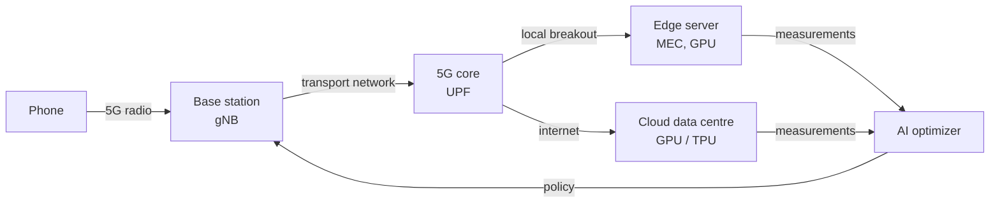
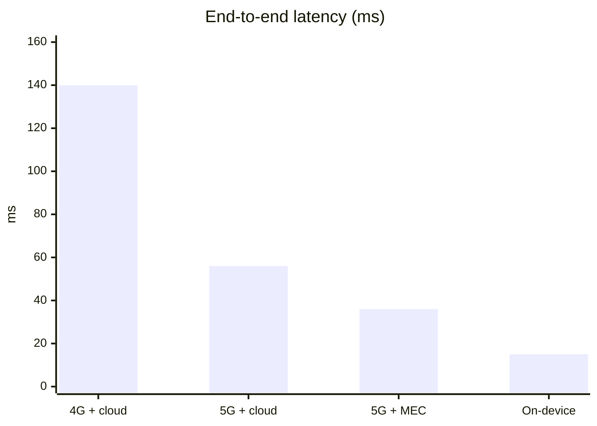
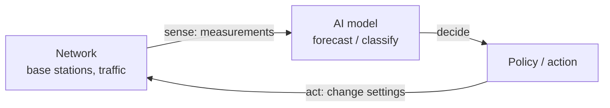

# Section 5: Case Study — Cloud-Based AI Service (5G and AI-Powered Network Optimization)

> **Big idea.** A cloud-based AI service is only as good as the network between the user and the model. 5G improves that network and brings computing closer through edge servers; at the same time, AI is used to run the 5G network itself. Each helps the other.

---

## Learning Objectives

By the end of this section, you should be able to:

1. Describe the path of a request from a phone through a 5G network to a cloud or edge AI service.
2. Explain the three 5G usage scenarios and the role of network slicing and multi-access edge computing (MEC).
3. Compare the latency of a cloud AI service over 4G, 5G, and 5G with an edge server, and identify which term dominates.
4. Explain, with an example, how AI is used to optimise a network (traffic prediction, energy saving, closed-loop control).
5. Evaluate the advantages and limitations of delivering AI services over 5G.

---

## 5.1 The Story in One Picture

Imagine a phone taking a photo of a street sign and asking an AI service to translate it. That single request passes through a 5G network, reaches a server, is processed by a model, and returns an answer. The case study follows that request and asks three questions at every step: *how far does the data travel, how fast does the link go, and who is waiting in a queue?*

**Figure 5.1.** The whole story on one page. The phone sends a request over 5G; the network routes it either to a nearby edge server (MEC) or to a distant cloud. At the same time, AI watches the network's traffic and adjusts its settings, closing a loop. *Source: author's own diagram, based on 3GPP TS 23.501 and ETSI (2014).*



Everything else in this section is a detail of this picture.

---

## 5.2 Two Actors: Cloud AI and 5G

**Cloud-based AI service.** A *cloud-based AI service* is a model hosted in a data centre and offered over the network: a translation API, a speech recognition service, an image classifier or a chatbot. Developers and apps send requests and receive results. The provider handles the hardware (Module 01) and scaling (Section 4); the user needs only a connection.

**5G.** The fifth generation of mobile networks, defined by the ITU as IMT-2020 and standardised by 3GPP. The ITU set three usage scenarios for it (ITU-R, 2015).

**Table 5.1.** The three 5G usage scenarios.

| Scenario | Goal | Example |
|---|---|---|
| **eMBB** (enhanced mobile broadband) | Much higher data rates | Fast uploads of photos and video to an AI service |
| **URLLC** (ultra-reliable low-latency communication) | Very low and dependable delay | Remote control, industrial automation, vehicles |
| **mMTC** (massive machine-type communication) | A very large number of devices | Dense fields of sensors |

The ITU's minimum technical requirements (ITU-R, 2017) include a peak data rate of 20 Gbit/s downlink and 10 Gbit/s uplink, a target of 1 ms user-plane latency for URLLC (4 ms for eMBB), and support for up to one million devices per square kilometre. These are *targets for the radio network under ideal conditions*, not what an app sees end to end.

> **Caution: "1 ms" is not the delay of your AI service.** The 1 ms figure covers the radio part of the path. An AI request also has to be uploaded, cross the operator's network, reach a server, wait in a queue, be processed by the model and return. Section 5.4 builds the full budget.

---

## 5.3 Three 5G Features That Help AI

**Table 5.2.** The three 5G features and which delay term each reduces.

| 5G feature | Delay term reduced | How |
|---|---|---|
| Higher radio speeds | Transmission (upload) | More bits per second over the radio link |
| MEC (local breakout) | Propagation / round trip | The server is physically closer |
| Network slicing | Queueing (variance) | Dedicated capacity prevents other traffic from crowding the slice |

- **Higher radio speeds** shorten the *upload* term in the latency budget (Section 3.4).
- **Multi-access edge computing (MEC):** the operator places servers near the base station, and the core can route traffic to them directly (local breakout), cutting the *round-trip* term (Section 4.1).
- **Network slicing:** a single physical network is divided into virtual slices with different guarantees. An AI service with strict latency needs can be given its own slice, kept apart from, say, bulk video downloads (3GPP, n.d.).

---

## 5.4 Worked Example 5.A: Latency Budget of the Street-Sign Translation

We reuse the 200 KB photo from Worked Example 3.A. The numbers are illustrative assumptions, chosen to show the pattern; real values vary widely by operator, location and load.

**Table 5.3.** Assumptions for each path.

| Path | Uplink speed | Round trip to server | Inference |
|---|---:|---:|---:|
| 4G + cloud | 20 Mbit/s | 50 ms | 10 ms |
| 5G + cloud | 100 Mbit/s | 30 ms | 10 ms |
| 5G + MEC edge | 100 Mbit/s | 10 ms | 10 ms |
| On-device NPU | n/a | n/a | 15 ms |

**Step 1: Upload time.** At 20 Mbit/s: 200,000 × 8 ÷ 20 × 10⁶ = 80 ms. At 100 Mbit/s: **16 ms**.

**Step 2: Add the terms.**

- 4G + cloud: 80 + 50 + 10 = **140 ms**
- 5G + cloud: 16 + 30 + 10 = **56 ms**
- 5G + MEC: 16 + 10 + 10 = **36 ms**
- On-device: **15 ms**

**Figure 5.2.** End-to-end latency for each path. 5G reduces both the upload term and, with MEC, the round-trip term; on-device still has the lowest latency but the smallest model. *Source: author's own diagram, based on the illustrative assumptions in Table 5.3.*



The following Python program checks the numbers. Its complete expected output is shown below the code.

```python
def tx_ms(size_bytes, rate_bps):
    return size_bytes * 8 / rate_bps * 1000

IMAGE = 200_000   # bytes
INFER = 10        # ms on a server accelerator

paths = {
    "4G + cloud": (20e6, 50),
    "5G + cloud": (100e6, 30),
    "5G + MEC edge": (100e6, 10),
}
for name, (rate, rtt) in paths.items():
    print(f"{name}: {tx_ms(IMAGE, rate) + rtt + INFER:.0f} ms")
print("On-device NPU: 15 ms")
```

Expected output:

```text
4G + cloud: 140 ms
5G + cloud: 56 ms
5G + MEC edge: 36 ms
On-device NPU: 15 ms
```

**Interpretation.** Moving from 4G to 5G cut the total by 84 ms (140 → 56), mostly from the faster upload (80 → 16 ms). Once the upload is fast, the largest remaining term in "5G + cloud" is the 30 ms round trip, so the MEC edge server (10 ms) gives the next big gain. The on-device model is fastest, but it is a smaller model; the network lets a phone reach a much larger one at the cost of some tens of milliseconds. That is the design trade-off of Section 3 in numbers.

**Table 5.4.** Where the milliseconds go in each path.

| Path | Upload | Round trip | Inference | Total | Dominant term |
|---|---:|---:|---:|---:|---|
| 4G + cloud | 80 ms | 50 ms | 10 ms | 140 ms | Upload |
| 5G + cloud | 16 ms | 30 ms | 10 ms | 56 ms | Round trip |
| 5G + MEC | 16 ms | 10 ms | 10 ms | 36 ms | Upload and inference (tied) |
| On-device | 0 ms | 0 ms | 15 ms | 15 ms | Inference |

---

## 5.5 The Other Direction: AI for the Network

So far AI has been a *customer* of the network. It is also a *tool* for running it. A 5G network has thousands of base stations, each making constant decisions about radio resources, and operators use machine learning to improve them.

**Table 5.5.** Examples of AI-powered network optimization.

| Task | What AI does | Benefit |
|---|---|---|
| **Traffic prediction** | Forecasts load per cell from past patterns | Prepare capacity before the demand arrives |
| **Energy saving** | Predicts quiet periods and switches off spare radio capacity | Lower power bills and emissions |
| **Beam and resource management** | Adapts radio settings to user movement and interference | Better speed and reliability |
| **Anomaly and fault detection** | Spots unusual behaviour before it becomes an outage | Fewer service disruptions |

In the O-RAN architecture, an RAN Intelligent Controller (RIC) hosts such applications in two control loops: a *non-real-time* RIC for decisions on timescales longer than one second (such as training models and setting policies), and a *near-real-time* RIC for decisions between about 10 ms and 1 s (such as adjusting radio resources) (O-RAN Alliance, n.d.).

**Figure 5.3.** The network as a sense-decide-act loop. Measurements from the network feed a model; the model's decision changes the network; new measurements follow. *Source: author's own diagram, based on O-RAN Alliance (n.d.).*



> **Bridge to Behaviourist AI.** This is the same sense-decide-act loop as Face ID in Module 01, and as the agents studied in the later Behaviourist AI modules. Here the "agent" controls a network, and the "environment" is the traffic. Reinforcement learning, the subject of Module 03, is an active research approach for such control problems.

**Table 5.6.** Which control loop fits which task.

| Task | Timescale | Control loop |
|---|---|---|
| Re-tuning radio resources for a moving user | 10 ms to 1 s | Near-real-time RIC |
| Re-training a traffic forecasting model overnight | Hours | Non-real-time RIC |
| Switching off spare capacity for energy saving | Minutes | Non-real-time RIC (with near-real-time checks) |
| Detecting an anomaly in a cell | Seconds | Near-real-time RIC |

### Worked Example 5.B: A Tiny Traffic Forecast for Energy Saving

*A toy model, for teaching.* A base station's load (as a percentage of capacity) is measured every 15 minutes: 40, 35, 30, 22, 15, 10, 8, 9. We forecast the next load with **exponential smoothing**, a simple method that blends the newest measurement with the previous forecast:

```text
forecast = 0.5 × newest measurement + 0.5 × previous forecast
```

The rule: if the forecast falls below 20%, the operator may switch off spare capacity at this cell to save energy (real systems also check that neighbouring cells can take over).

```python
load = [40, 35, 30, 22, 15, 10, 8, 9]   # % of capacity every 15 min
forecast = load[0]
forecasts = []
for x in load:
    forecast = 0.5 * x + 0.5 * forecast
    forecasts.append(round(forecast, 1))

print(forecasts)
sleep_at = next(i + 1 for i, v in enumerate(forecasts) if v < 20)
print("sleep at step", sleep_at)
```

Expected output:

```text
[40.0, 37.5, 33.8, 27.9, 21.4, 15.7, 11.9, 10.4]
sleep at step 6
```

**Interpretation.** The smoothed forecast crosses 20% at step 6 (15.7%), even though the raw load first dipped below 20% at step 5 (15%): smoothing makes the decision less jumpy. Production systems use much richer models (for example, neural networks that use time of day, events and neighbouring cells), but the loop (measure, forecast, decide, act) is the same.

---

## 5.6 The Two-Way Relationship

The two actors help each other. 5G makes cloud AI better, and AI makes 5G better. The arrows in the figure below form two reinforcing loops, not a single line.

**Table 5.7.** Advantages of delivering cloud AI over 5G.

| Advantage | Explanation |
|---|---|
| **Faster upload** | Higher radio rates shorten the time to send photos, audio and video |
| **Shorter round trips** | MEC places the model a few milliseconds away |
| **Access to large models** | A phone can use models far bigger than fit in its memory (Table 3.5) |
| **Guaranteed service levels** | Network slicing can reserve capacity and latency for critical AI services |
| **Smarter, greener networks** | AI-based forecasting and control can cut energy use and prevent faults |

**Figure 5.4.** The advantages as two reinforcing loops: 5G improves the AI service, and AI improves the 5G network. *Source: author's own diagram.*

```mermaid
flowchart LR
    G["5G network"] -->|"faster, closer, sliced"| S["Cloud / edge AI service"]
    S -->|"traffic and demand data"| A
