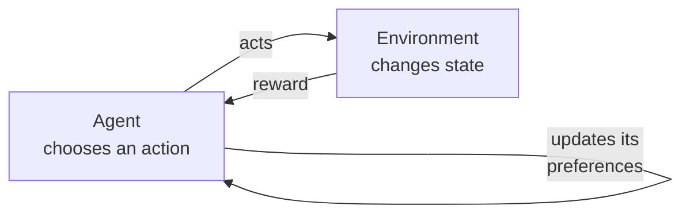
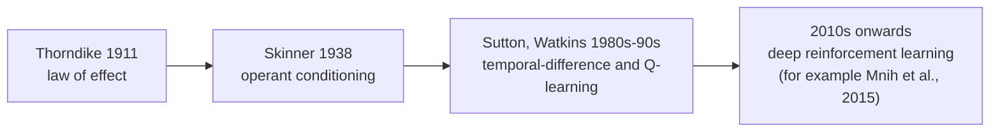

# Section 1: Definition and Principles of Behaviourist AI

> **Big idea.** Behaviourist AI learns *behaviour* from *consequences*. Instead of being told what to do, the system acts, observes how well it went, and gradually does more of what was rewarded and less of what was not.

---

## Learning Objectives

By the end of this section you should be able to:

1. Define behaviourist AI and describe the psychological ideas it borrows (law of effect, operant conditioning).
2. Explain the four basic consequences: positive reinforcement, punishment, extinction, and the idea of shaping.
3. Compare rule-based AI, supervised learning and behaviourist AI/reinforcement learning.
4. Carry out a small law-of-effect update by hand and in code.
5. State two strengths and two limitations of learning purely from reward.

---

## 1.1 The Story in One Picture

Imagine a puppy in a kitchen. Nobody explains "sit" to it. It tries things: it jumps, it barks, it puts its bottom on the floor. When its bottom touches the floor, a treat appears. After a few repetitions, the puppy sits more often. That is the whole idea of behaviourist AI, and the rest of this section is the detail.

**Figure 1.1.** The loop that defines behaviourist AI. The agent acts; the environment responds with a reward; the agent adjusts what it will do next time. *Source: author's own diagram.*



Everything else in this section is a detail of this loop.

---

## 1.2 What Is Behaviourist AI?

**Behaviourist AI** is an approach in which a system learns a way of behaving by interacting with an environment and receiving feedback in the form of rewards. The system is not told the correct action; it discovers which actions lead to good outcomes through trial and error.

The name comes from **behaviourism**, a school of psychology that studies observable behaviour and how it is shaped by its consequences rather than by inner mental states. Four ideas are central:

- **Law of effect.** Responses that are followed by satisfying consequences become more likely to be repeated; responses followed by unpleasant consequences become less likely (Thorndike, 1911). Thorndike studied cats learning to escape from puzzle boxes by trial and error.
- **Classical conditioning.** A neutral signal paired repeatedly with a meaningful one comes to trigger a response by itself: Pavlov's dogs salivating at a bell (Pavlov, 1927).
- **Operant conditioning.** Behaviour is shaped by reinforcement and punishment that follow it (Skinner, 1938).
- **Behaviour as the object of study.** Watson (1913) argued that psychology should focus on what can be observed.

The technical descendant of these ideas in AI is reinforcement learning, which grew in the 1980s and 1990s into a mathematical theory (Sutton, 1988; Watkins & Dayan, 1992; Sutton & Barto, 2018).

**Figure 1.2.** From animal learning to machine learning: a short chain of ideas. *Source: author's own diagram, based on the works cited in Section 1.2.*



**Table 1.1.** The four psychological ideas and what each contributes to behaviourist AI.

| Idea | Source | Contribution to AI |
|---|---|---|
| **Law of effect** | Thorndike (1911) | Rewarded actions become more likely; the core learning signal |
| **Classical conditioning** | Pavlov (1927) | A neutral signal can come to predict a reward; the basis of state values |
| **Operant conditioning** | Skinner (1938) | Behaviour is shaped by consequences; the basis of policy learning |
| **Behaviour as the object of study** | Watson (1913) | Focus on observable action and outcome, not on internal states |

---

## 1.3 The Four Consequences of Behaviour

Behavioural psychology names four basic ways in which consequences change behaviour. The same vocabulary describes how machines are trained.

**Table 1.2.** The four consequences of behaviour, with a dog-training example and a robot example of each.

| Term | What happens | Effect on behaviour | Dog-training example | Robot example |
|---|---|---|---|---|
| **Positive reinforcement** | Something good is added after an action | The action becomes more likely | A treat after "sit" | + reward for moving forward |
| **Punishment** | Something unpleasant follows an action | The action becomes less likely | A sharp "no" after jumping on the sofa | − reward for falling over |
| **Extinction** | A previously rewarded action stops being rewarded | The action fades | Barking no longer gets attention | A trick that no longer scores gradually disappears |
| **Shaping** | Reward successive approximations of the target behaviour | Complex behaviour is built step by step | Reward a step towards the mat, then touching it, then lying on it | Reward partial progress before the full walk |

> **An everyday analogy.** Training a puppy is a good picture of behaviourist AI. You do not explain sitting in words or show it a labelled photo. You wait for it to do something close, reward it immediately, and repeat. Over time, the behaviour you rewarded becomes the one it chooses.

**Table 1.3.** Which consequence is at work in each situation.

| Situation | Consequence |
|---|---|
| A robot gets +1 for every second it stays upright | Positive reinforcement |
| A game agent gets −10 for losing a life | Punishment |
| A dog that was fed for begging stops being fed and eventually stops begging | Extinction |
| A trainer rewards a robot for lifting one leg, then two, then a full step | Shaping |

---

## 1.4 Behaviourist AI Compared with Other Approaches

**Table 1.4.** Three ways to give a machine its knowledge.

| | Rule-based (symbolic) AI | Supervised learning | Behaviourist AI / reinforcement learning |
|---|---|---|---|
| **Where the knowledge comes from** | Rules written by a person | Labelled examples (input and correct output) | Experience of acting and receiving rewards |
| **What the system is told** | Exactly what to do | The right answer for each example | Only how good the outcome was, often late |
| **Typical task** | Tax calculation, expert systems | Classifying photos, spam filtering | Robot control, games, resource management |
| **Data needed** | Expert time | A large labelled data set | An environment (real or simulated) to act in |
| **Main weakness** | Cannot handle what the rules miss | Cannot learn what no one has labelled | Needs many trials; reward must be designed well |

An early robotics echo of the behavioural view is Brooks's argument for intelligence built from layers of simple, direct sense-to-action behaviours rather than detailed internal models of the world (Brooks, 1986; Brooks, 1991). Modern reinforcement learning is different in method (the behaviour is learned, not hand-wired), but shares the emphasis on action in a real environment.

> **Caution: behaviourism has limits, and so does the AI version.** Psychologists criticised pure behaviourism for ignoring internal mental processes (a famous example is Chomsky, 1959). The AI analogue: a system that only learns from reward may need enormous amounts of experience, may find shortcuts you did not intend (Section 3.5), and does not necessarily "understand" what it is doing. Some modern methods add an internal model of the world to address this; they are mentioned in Section 5.7.

---

## 1.5 Worked Example 1.A: The Law of Effect by Hand

*Illustrative numbers.* A robot dog can try three actions when it hears the command: **sit**, **bark** or **roll**. It keeps a number for each action, a *preference value*, starting at 0. After each trial, it moves the chosen action's value towards the reward received:

```text
value ← value + α × (reward − value)
```

Here α (alpha, the **learning rate**) says how far to move; we use α = 0.5. Rewards: +1 for a treat, −1 for a scolding, 0 for nothing.

1. **Step 1.** Trial 1: the dog sits and gets a treat (+1). `value(sit) = 0 + 0.5 × (1 − 0) = 0.5`.
2. **Step 2.** Trial 2: the dog barks and is scolded (−1). `value(bark) = 0 + 0.5 × (−1 − 0) = −0.5`.
3. **Step 3.** Trial 3: the dog sits again and gets a treat (+1). `value(sit) = 0.5 + 0.5 × (1 − 0.5) = 0.75`.

**Result.** After three trials, sit has value 0.75, bark −0.5, roll 0. If the dog now picks the action with the highest value, it sits. Nobody told it to; the consequences did. This is the law of effect as arithmetic.

The following Python program checks the result. Its complete expected output is shown below the code.

```python
ALPHA = 0.5
value = {"sit": 0.0, "bark": 0.0, "roll": 0.0}
trials = [("sit", 1), ("bark", -1), ("sit", 1)]

for action, reward in trials:
    value[action] += ALPHA * (reward - value[action])
    print(action, reward, value)
```

Expected output:

```text
sit 1 {'sit': 0.5, 'bark': 0.0, 'roll': 0.0}
bark -1 {'sit': 0.5, 'bark': -0.5, 'roll': 0.0}
sit 1 {'sit': 0.75, 'bark': -0.5, 'roll': 0.0}
```

> **Key idea.** The update `value ← value + α × (reward − value)` is a running average that leans towards recent experience. A larger α learns faster but is noisier; a smaller α is steadier but slower. Every learning rule in this module is a variation of this one.

**Table 1.5.** Effect of the learning rate on the same three trials.

| α | Value of "sit" after trial 3 | Behaviour |
|---:|---:|---|
| 0.1 | ≈ 0.27 | Slow, steady learning; small response to one bad trial |
| 0.5 | 0.75 | Balanced (the value used above) |
| 1.0 | 1.0 | Ignores history; only the latest reward counts |

---

## 1.6 Key Terms

A complete glossary is at the end of this module (see [Glossary](#glossary-all-sections)). Some terms (policy, return) are fully explained in Section 2, so treat this as a first look.

**Table 1.6.** Key terms for Section 1.

| Term | Definition |
|---|---|
| **Agent** | The learner and decision-maker (the robot dog's controller). |
| **Environment** | Everything the agent interacts with (the floor, gravity, the robot's body). |
| **Action** | A choice the agent makes (a target angle for each joint). |
| **Reward** | A number the environment gives after an action, saying how good it was. |
| **Policy** | The agent's way of choosing actions: a mapping from situations to actions. |
| **Trial and error** | Learning by trying actions and observing consequences. |
| **Learning rate (α)** | How strongly one new experience changes what the agent believes. |
| **Reinforcement learning (RL)** | The mathematical framework for learning a policy from rewards. |

---

## 1.7 Activities for Section 1

- [ ] **Activity 1.A.** Use the update rule from Worked Example 1.A (α = 0.5, all values start at 0) for this sequence of trials: sit (+1), roll (0), sit (+1), sit (+1). What are the final values?
- [ ] **Activity 1.B.** Classify each as rule-based, supervised or behaviourist/reinforcement learning, with one reason: (a) a chess program whose moves come from hand-written rules, (b) an image classifier trained on 100,000 labelled photos, (c) a robot that learns to walk by trial and error, (d) a spam filter trained on emails marked "spam" or "not spam".
- [ ] **Activity 1.C.** Name the consequence from Table 1.2 in each case: (a) a robot gets +1 for every second it stays upright, (b) a game agent gets −10 for losing a life, (c) a dog that was fed for begging stops being fed, and eventually stops begging, (d) a trainer rewards a robot for lifting one leg, then two, then a full step.
- [ ] **Activity 1.D.** In two or three sentences, explain the difference between telling a robot *what to do* and telling it *how well it did*. Why is the second often easier to provide?

### Answer Key for Activities

**Activity 1.A.**
- Trial 1, sit (+1): value(sit) = 0 + 0.5 × (1 − 0) = **0.5**.
- Trial 2, roll (0): value(roll) = 0 + 0.5 × (0 − 0) = **0.0**.
- Trial 3, sit (+1): value(sit) = 0.5 + 0.5 × (1 − 0.5) = **0.75**.
- Trial 4, sit (+1): value(sit) = 0.75 + 0.5 × (1 − 0.75) = **0.875**.
- Final values: sit **0.875**, bark **0.0**, roll **0.0**.

**Activity 1.B.**
- (a) Chess program with hand-written rules: **rule-based**. The moves come from rules written by a person, not from experience.
- (b) Image classifier on 100,000 labelled photos: **supervised learning**. Each training example has the correct answer.
- (c) Robot learning to walk by trial and error: **behaviourist / reinforcement learning**. It learns from rewards, not from labelled examples.
- (d) Spam filter trained on marked emails: **supervised learning**. Each email is labelled "spam" or "not spam".

**Activity 1.C.**
- (a) Robot gets +1 for staying upright: **positive reinforcement**.
- (b) Game agent gets −10 for losing a life: **punishment**.
- (c) Dog stops being fed for begging and stops begging: **extinction**.
- (d) Trainer rewards lifting one leg, then two, then a full step: **shaping**.

**Activity 1.D.** Telling a robot *what to do* means providing the correct action for every situation, which requires an expert to work out and write down every case. Telling it *how well it did* means providing only a score after the fact, which is often much easier to obtain: a game already knows the score, a robot can measure whether it fell over, and a user can press "thumbs up" or "thumbs down". The second approach scales to situations nobody anticipated, which is why behaviourist AI is attractive when correct actions are hard to specify but outcomes are easy to measure.

---

## 1.8 Summary

- Behaviourist AI learns behaviour from the consequences of its actions through trial and error; the technical framework is reinforcement learning.
- It draws on the law of effect (Thorndike), classical conditioning (Pavlov) and operant conditioning (Skinner).
- Four consequences shape behaviour: positive reinforcement, punishment, extinction and shaping.
- Compared with rule-based and supervised approaches, it needs no correct answers, only a measure of how good outcomes were, but it needs many trials and a well-designed reward.
- The core update, `value ← value + α × (reward − value)`, moves an estimate towards what was just experienced; in Worked Example 1.A, "sit" reaches 0.75 and "bark" falls to −0.5 after three trials.

---

## References

Brooks, R. A. (1986). A robust layered control system for a mobile robot. *IEEE Journal on Robotics and Automation, 2*(1), 14–23. https://doi.org/10.1109/JRA.1986.1087032

Brooks, R. A. (1991). Intelligence without representation. *Artificial Intelligence, 47*(1–3), 139–159. https://doi.org/10.1016/0004-3702(91)90053-M

Chomsky, N. (1959). A review of B. F. Skinner's *Verbal Behavior*. *Language, 35*(1), 26–58. https://doi.org/10.2307/411334

Mnih, V., Kavukcuoglu, K., Silver, D., Rusu, A. A., Veness, J., Bellemare, M. G., Graves, A., Riedmiller, M., Fidjeland, A. K., Ostrovski, G., Petersen, S., Beattie, C., Sadik, A., Antonoglou, I., King, H., Kumaran, D., Wierstra, D., Legg, S., & Hassabis, D. (2015). Human-level control through deep reinforcement learning. *Nature, 518*(7540), 529–533. https://doi.org/10.1038/nature14236

Pavlov, I. P. (1927). *Conditioned reflexes: An investigation of the physiological activity of the cerebral cortex*. Oxford University Press.

Skinner, B. F. (1938). *The behavior of organisms: An experimental analysis*. Appleton-Century.

Sutton, R. S. (1988). Learning to predict by the methods of temporal differences. *Machine Learning, 3*(1), 9–44. https://doi.org/10.1007/BF00115009

Sutton, R. S., & Barto, A. G. (2018). *Reinforcement learning: An introduction* (2nd ed.).
