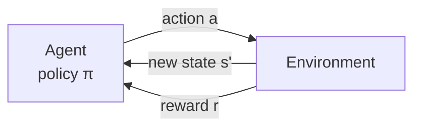
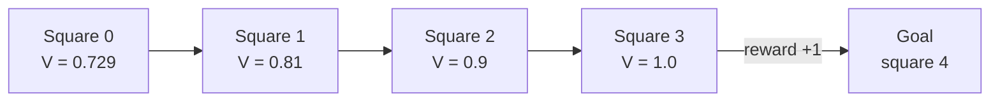

# Section 2: Agent-Environment Interaction

> [!IMPORTANT]
> **Big idea.** Reinforcement learning describes every problem as the same loop: the agent observes the situation, acts, and the environment responds with a new situation and a reward. The agent's goal is to choose actions that maximise the total reward over time, not just the next reward.

## Learning objectives

By the end of this section you should be able to:

1. Describe the agent-environment loop and name its parts: state, action, reward, policy.
2. Explain an episode, a trajectory and the Markov property.
3. Calculate a discounted return and explain the role of the discount factor γ.
4. Define the value of a state and compute it for a small corridor environment.
5. Estimate the computation a small control policy needs, and check whether it can meet a control-loop time budget, linking to Modules 01 and 02.

---

## 2.1 The loop

At each time step *t*, the same cycle repeats:

1. The agent receives the current **state** *s* (what it can observe).
2. It chooses an **action** *a* according to its **policy** π.
3. The environment responds with a **reward** *r* and a new state *s′*.

**Figure 2.1.** The agent-environment loop. The agent never sees the environment's inner workings, only states and rewards. *Source: author's own diagram, based on Sutton & Barto (2018).*



> [!NOTE]
> **Bridge to Modules 01 and 02.** This is the *sense, decide, act* loop of Module 01 (Face ID, robots, game agents), now with a reward added. Because the agent usually handles one observation at a time, it runs at batch size 1, the memory-bound case of Module 01 Section 4. And because the loop repeats many times per second, the time each pass takes (Module 02, Section 4) is a hard limit; Section 2.6 below puts numbers on that.

### Terms

- **State (s):** the information the agent uses to decide: the robot's joint angles, body tilt and so on. (When the agent sees only part of the world, this is called an *observation*.)
- **Action (a):** what the agent can do.
- **Reward (r):** a single number per step.
- **Policy (π):** how the agent chooses actions. It can be a table, a rule, or a neural network.
- **Episode:** one run from a start state until it ends (the robot falls, reaches the goal, or time runs out).
- **Trajectory:** the sequence state, action, reward, state, action, reward, … recorded during an episode.
- **Markov property:** the next state and reward depend only on the current state and action, not on the longer history. This is what lets the loop be described compactly. A problem written this way is called a **Markov decision process (MDP)**.

---

## 2.2 Return and the discount factor

The agent does not care about one reward in isolation; it cares about the total reward over the episode. But rewards that come sooner are usually worth more than rewards that come later: they are more certain, and often a delay has costs. We capture this with a **discount factor** γ (gamma), a number between 0 and 1. The **return** is the discounted sum of future rewards:

```text
G = r₁ + γ·r₂ + γ²·r₃ + γ³·r₄ + ...
```

- γ close to 1: the agent is *far-sighted*; distant rewards count almost fully.
- γ close to 0: the agent is *short-sighted*; only the next reward matters.

### Worked example 2.A: a discounted return

*Illustrative numbers.* An agent walks down a corridor and gets rewards `[0, 0, 0, 10]`: nothing for three steps, then 10 on arrival.

1. **Step 1: γ = 0.9.** G = 0 + 0.9 × 0 + 0.81 × 0 + 0.729 × 10 = **7.29**.
2. **Step 2: γ = 0.5.** G = 0.125 × 10 = **1.25**.
3. **Step 3: shorter path.** If the reward `10` arrives after only three steps (`[0, 0, 10]`) with γ = 0.9: G = 0.81 × 10 = **8.1**.

**Result.** A smaller γ makes the agent care less about distant rewards, and a shorter route to the same reward is worth more.

The following Python program checks the numbers. Its complete expected output is shown below the code.

```python
def discounted_return(rewards, gamma):
    return sum(gamma ** k * r for k, r in enumerate(rewards))

print(round(discounted_return([0, 0, 0, 10], 0.9), 3))
print(round(discounted_return([0, 0, 0, 10], 0.5), 3))
print(round(discounted_return([0, 0, 10], 0.9), 3))
```

Expected output:

```text
7.29
1.25
8.1
```

---

## 2.3 Policies and value

A **policy** tells the agent what to do. A **value** tells it how good a situation is:

- **State value V(s):** the expected return if the agent starts in state *s* and follows its policy.
- **Action value Q(s, a):** the expected return if the agent takes action *a* in state *s*, then follows its policy.

Values connect the present to the future in a simple way. The value of a state is the reward you get next, plus the discounted value of where you end up (the **Bellman equation**, Sutton & Barto, 2018):

```text
V(s) = r + γ · V(s′)
```

(for a deterministic move; with randomness, the right-hand side is averaged over the possible outcomes).

### Worked example 2.B: the value of each square in a corridor

**Environment.** A corridor with five squares numbered 0 to 4. Square 4 is the goal. Moving into the goal gives reward +1; every other step gives 0. The policy is "always move right". γ = 0.9.

**By hand, working backwards from the goal.**

- Square 3 is one step from the goal: V(3) = 1 + 0.9 × 0 = **1.0**.
- Square 2: V(2) = 0 + 0.9 × V(3) = **0.9**.
- Square 1: V(1) = 0.9 × 0.9 = **0.81**.
- Square 0: V(0) = 0.9 × 0.81 = **0.729**.

Notice the pattern: each step further from the goal multiplies the value by γ.

**Figure 2.2.** The corridor and the value of each square under the "always move right" policy. *Source: author's own diagram, based on the calculation in Worked example 2.B.*



The following Python program repeats the calculation until the values settle. Its complete expected output is shown below the code.

```python
GAMMA = 0.9
N = 5                          # squares 0..4; square 4 is the goal (terminal)
V = [0.0] * N

for _ in range(50):
    for s in range(N - 1):     # policy: always move right
        s2 = s + 1
        r = 1.0 if s2 == N - 1 else 0.0
        V[s] = r + GAMMA * V[s2]     # V of the goal stays 0

print([round(v, 3) for v in V])
```

Expected output:

```text
[0.729, 0.81, 0.9, 1.0, 0.0]
```

> [!IMPORTANT]
> **Key idea.** Value turns a *delayed* reward into a *per-step* guide: square 0 has no reward of its own, yet it has value 0.729 because it leads to one. That is how an agent learns that early actions matter even when the payoff comes much later (Section 3.3).

---

## 2.4 The goal: find a good policy

The agent's aim is a policy that maximises the expected return. Two broad ways to get there:

| Approach | Idea | Example |
|---|---|---|
| **Value-based** | Learn Q(s, a) for every action, then pick the action with the largest Q | Q-learning (Section 3.4) |
| **Policy-based** | Adjust the policy directly to increase the return | Policy-gradient methods, used for robot locomotion (Section 5) |

**Table 2.1.** Two families of reinforcement-learning methods.

Modern systems use a neural network as the policy or value function, which is called *deep* reinforcement learning (Mnih et al., 2015).

---

## 2.5 Model-free and model-based

- **Model-free:** the agent learns what to do purely from experience, without trying to predict how the world works. This is closest to the behaviourist picture.
- **Model-based:** the agent also learns, or is given, a model of how the environment responds, and plans using it.

Model-free methods are simpler but need more experience; model-based methods can learn from less experience but suffer if the model is wrong. Many practical systems, including the ones in Section 5, are model-free in how the policy is learned, but use a simulator (a hand-built model of physics) to *generate* the experience.

---

## 2.6 Worked example 2.C: what the policy costs to run (a bridge to Modules 01 and 02)

A robot dog's policy is usually a small neural network that runs on the robot itself, many times per second. Let's check what that demands.

**Setting (illustrative).** The policy has an input of 45 numbers (joint angles, joint speeds, body tilt, and so on), two hidden layers of 128 numbers, and 12 outputs (one per joint). It runs at 50 times per second (50 Hz).

1. **Step 1: MACs per decision.** 45 × 128 + 128 × 128 + 128 × 12 = 5,760 + 16,384 + 1,536 = **23,680 MACs** (Module 01, Section 1.2).
2. **Step 2: FLOPs.** 2 × 23,680 = **47,360 FLOPs** per decision. At 50 Hz that is about **2.4 million FLOP/s**, a tiny fraction of what any modern chip can do.
3. **Step 3: Memory.** Counting weights only, each weight is used once per decision, so there are 23,680 weights. In FP16 (2 bytes each) that is **47,360 bytes ≈ 46 KiB**. This fits easily in on-chip memory (Module 01, Section 4).
4. **Step 4: Intensity.** 47,360 FLOPs ÷ 47,360 bytes = **1 FLOP per byte**: the batch-1 memory-bound case from Module 01. It does not matter here, because all the weights sit in fast on-chip memory and the amount of computation is tiny.
5. **Step 5: Time budget.** At 50 Hz, each control step lasts 1,000 ÷ 50 = **20 ms**.

The following Python program checks the numbers. Its complete expected output is shown below the code.

```python
def macs(layers):
    return sum(a * b for a, b in zip(layers, layers[1:]))

m = macs([45, 128, 128, 12])
print(m, 2 * m)
print(2 * m * 50 / 1e6, "MFLOP/s at 50 Hz")
print(2 * m, "bytes in FP16,", round(2 * m / 1024, 2), "KiB")
print(1000 / 50, "ms per control step")
```

Expected output:

```text
23680 47360
2.368 MFLOP/s at 50 Hz
47360 bytes in FP16, 46.25 KiB
20.0 ms per control step
```

**Interpretation, using Module 02.** The decision must be made within 20 ms. In Module 02 (Worked example 5.A), even the best case of a 5G edge server (MEC) took about 36 ms end to end, and a cloud path 56 to 140 ms. So the policy **cannot** live in the cloud: it must run on the robot itself, which is easy because it is so small. Training, by contrast, is heavy and happens in a data centre, exactly as in Module 01's Face ID and Apple Neural Engine case study.

> [!TIP]
> **Going further.** Real locomotion policies are often a few hundred units wide and are sometimes combined with extra inputs such as a terrain scan; the numbers above are a teaching example of the scale, not the size of any specific published system.

---

## 2.7 Activities for Section 2

- [ ] **Activity 2.A.** Compute the discounted return for rewards `[1, 0, 2, 5]` with γ = 0.9.
- [ ] **Activity 2.B.** A corridor has six squares (0 to 5) with the goal at square 5, reward +1 for entering it, γ = 0.9, and the policy "always move right". What is V(0)? What would it be with γ = 0.5?
- [ ] **Activity 2.C.** A drone's controller must run at 100 Hz. What is the time budget per step? Can it use a policy served over a 5G edge server with a 36 ms end-to-end delay? Explain.
- [ ] **Activity 2.D.** A policy network has layers 20 → 64 → 64 → 6. How many MACs and FLOPs per decision? How many bytes do its weights take in FP16?

---

## 2.8 Summary

- Every reinforcement-learning problem is the loop: observe a state, choose an action by the policy, receive a reward and a new state.
- An episode is one run; a trajectory is the recorded sequence; the Markov property says the future depends only on the present state and action.
- The return is the discounted sum of future rewards; γ sets how far-sighted the agent is. With rewards `[0, 0, 0, 10]`, G = 7.29 at γ = 0.9 and 1.25 at γ = 0.5.
- Values (V and Q) measure how good states and actions are; the Bellman relation `V(s) = r + γ·V(s′)` gives V = 0.729, 0.81, 0.9, 1.0 along the example corridor.
- A small 45 → 128 → 128 → 12 policy needs 23,680 MACs and about 46 KiB per decision; at 50 Hz it has a 20 ms budget, which rules out a cloud-served policy and means it runs on the robot.

---

