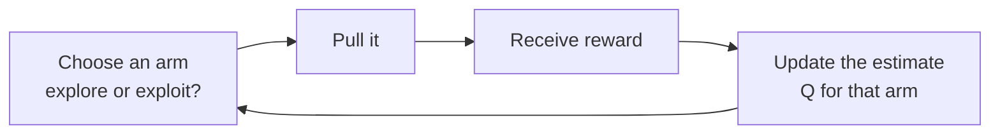
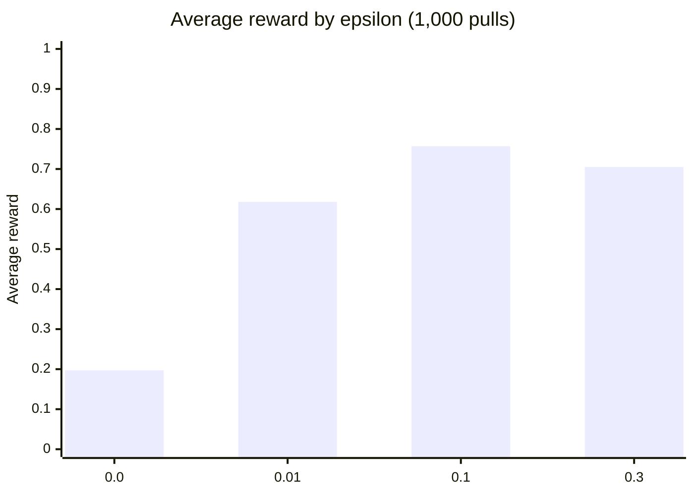

# Section 3: Reward Systems and Feedback Mechanisms

> [!IMPORTANT]
> **Big idea.** The reward is the only way you tell the agent what you want. Whatever the reward measures is what the agent will pursue, whether or not it is what you meant.

## Learning objectives

By the end of this section you should be able to:

1. State the reward hypothesis and explain why reward design is the main place where humans specify the goal.
2. Distinguish sparse from dense rewards, and explain delayed reward and credit assignment.
3. Explain reward shaping, including the potential-based form that does not change the best policy.
4. Recognise reward hacking (specification gaming) and suggest a fix.
5. Perform a Q-learning update by hand and in code, and read a learned Q-table.

---

## 3.1 The reward hypothesis

Reinforcement learning rests on the **reward hypothesis**: all of what we mean by a goal can be expressed as the maximisation of the expected cumulative reward (Sutton & Barto, 2018). To teach a robot to walk, we do not describe walking. We design a reward and let the agent discover the walking that earns it.

This puts a lot of weight on the reward. A good reward is:

- **Aligned:** high reward really means the behaviour you want.
- **Informative:** it gives the agent a way to tell better from worse.
- **Robust:** it cannot be earned in some unintended cheap way.

---

## 3.2 Sparse and dense rewards

| | Sparse reward | Dense reward |
|---|---|---|
| **What it is** | Reward only at the end or at rare moments (+1 for reaching the goal, 0 otherwise) | A reward at nearly every step (for example, based on progress) |
| **Advantage** | Simple and hard to misuse: it measures exactly the goal | Easier to learn from: the agent gets feedback all the time |
| **Disadvantage** | The agent may wander for a very long time before it ever sees a reward | Easy to design badly, and the agent may exploit the shortcuts it creates |
| **Example** | Winning a board game | Robot reward for forward speed, minus an energy cost |

**Table 3.1.** Sparse versus dense rewards.

---

## 3.3 Delayed reward and credit assignment

Often the consequence of an action shows up much later. A chess move can decide the game thirty moves on; a robot's bad foot placement may cause a fall two steps later. The question "which of my earlier actions deserves the credit (or blame)?" is the **credit assignment problem**.

Discounting and values (Section 2) address it: a state's value carries the future reward back to the states that lead to it, as Worked example 2.B showed. Learning methods that update an estimate using the *next* estimate rather than waiting for the final outcome are called **temporal-difference (TD) learning** (Sutton, 1988).

---

## 3.4 Learning from feedback: Q-learning

**Q-learning** learns the action values Q(s, a) from experience, one step at a time (Watkins & Dayan, 1992). After taking action *a* in state *s* and seeing reward *r* and new state *s′*, update:

```text
Q(s, a) ← Q(s, a) + α × [ r + γ × max over a′ of Q(s′, a′) − Q(s, a) ]
```

Read it in three parts:

- **Target:** `r + γ × max Q(s′, a′)`: what the reward plus the best future now suggests.
- **TD error:** target minus the current Q: how wrong the old estimate was.
- **Step:** move Q by a fraction α of that error. This is the same form as the update in Worked example 1.A.

### Worked example 3.A: one Q-learning update by hand

*Illustrative numbers.* Currently Q(s, a) = 0.2. The agent takes the action, receives r = 1, and arrives in s′ where the best action's value is 0.5. Use α = 0.1 and γ = 0.9.

1. **Step 1: Target** = 1 + 0.9 × 0.5 = **1.45**.
2. **Step 2: TD error** = 1.45 − 0.2 = **1.25**.
3. **Step 3: New Q** = 0.2 + 0.1 × 1.25 = **0.325**.

The estimate moved from 0.2 towards the target of 1.45 by a tenth of the gap.

### Worked example 3.B: Q-learning on the corridor

We return to the corridor from Worked example 2.B: five squares, the goal at square 4, reward +1 for entering it, γ = 0.9, α = 0.5. This time the agent has two actions, **left** and **right** (moving left from square 0 leaves it in square 0), and learns Q for both. To keep the output predictable, the program updates every state-action pair in turn, 30 times, instead of choosing actions at random (Section 4 covers choosing actions).

```python
GAMMA, ALPHA = 0.9, 0.5
N = 5                              # squares 0..4; square 4 is the goal (terminal)
ACTIONS = (-1, +1)                 # left, right
Q = [[0.0, 0.0] for _ in range(N)]

def step(s, a):
    s2 = min(max(s + a, 0), N - 1)
    return s2, (1.0 if s2 == N - 1 else 0.0)

for sweep in range(30):
    for s in range(N - 1):
        for i, a in enumerate(ACTIONS):
            s2, r = step(s, a)
            future = 0.0 if s2 == N - 1 else max(Q[s2])
            Q[s][i] += ALPHA * (r + GAMMA * future - Q[s][i])

for s in range(N - 1):
    best = "right" if Q[s][1] > Q[s][0] else "left"
    print(s, [round(q, 3) for q in Q[s]], "->", best)
```

Expected output:

```text
0 [0.656, 0.729] -> right
1 [0.656, 0.81] -> right
2 [0.729, 0.9] -> right
3 [0.81, 1.0] -> right
```

**Reading the table.** Each row is `[Q(left), Q(right)]`. The "right" values are exactly the V values from Worked example 2.B (0.729, 0.81, 0.9, 1.0). The "left" values are slightly lower because moving left costs one extra step: for example, from square 1, going left to square 0 then right gives 0.9 × 0.729 = 0.656. Choosing the larger Q in each row gives the best policy: always move right. The agent has learned the route from rewards alone.

---

## 3.5 Reward shaping and reward hacking

### Reward shaping

When the reward is sparse, we can add *extra* rewards that guide the agent. **Reward shaping** does this. The danger: a badly chosen extra reward changes what is optimal. A safe form, **potential-based shaping**, adds

```text
F(s, s′) = γ × Φ(s′) − Φ(s)
```

where Φ is any function of the state (a "potential", such as the negative of the distance to the goal). This particular form is proven not to change which policy is best (Ng, Harada & Russell, 1999), so it guides learning without altering the goal.

*Example.* With Φ(s) = −(distance to the goal), a step from distance 4 to distance 3 gives F = 0.9 × (−3) − (−4) = **+1.3**: a bonus for making progress.

### Reward hacking

**Reward hacking** (also called specification gaming) is when the agent finds a way to earn a high reward without doing what the designer intended. It is the AI version of a student studying the test instead of the subject. A well-known example: a boat-racing game agent, rewarded for hitting targets along the track, learned to circle in a lagoon hitting respawning targets instead of finishing the race (Clark & Amodei, 2016). More general discussion: Amodei et al. (2016).

| Intended goal | Reward written | Possible hack | Better design |
|---|---|---|---|
| Clean the room | +1 per piece of dirt collected | Dump the dirt, collect it again, repeat | Reward the *amount of clean floor*, not the act of collecting |
| Walk forward | +1 for body speed | Throw itself forward, or vibrate | Reward speed *and* penalise falling, tilt and violent motion |
| Finish the race | +1 per target hit | Circle through targets forever | Reward progress along the track and finishing |

**Table 3.2.** Intended goals, naive rewards, hacks and fixes.

> [!WARNING]
> **Caution: you get what you reward.** The agent has no idea what you meant, only what you scored. Always ask: "if the agent were clever and lazy, how could it earn this reward without doing the job?" Check by watching the behaviour, not just the number.

---

## 3.6 Feedback in practice

| Feedback source | How it arrives | Example |
|---|---|---|
| **Environment reward** | Built into the task | Score in a game |
| **Hand-designed reward function** | A formula by the engineer | Robot speed minus energy cost (Section 5) |
| **Human feedback** | A person rates or compares behaviours | A trainer approving or rejecting a robot's gait |
| **Imitation** | Reward for matching a demonstration | A robot copying motion-capture data from an animal |

**Table 3.3.** Where feedback can come from.

---

## 3.7 Activities for Section 3

- [ ] **Activity 3.A.** Perform one Q-learning update: Q(s, a) = 0.5, r = 0, max Q(s′, ·) = 0.8, α = 0.2, γ = 0.9. Show the target, the TD error and the new Q.
- [ ] **Activity 3.B.** Using potential-based shaping with Φ(s) = −(distance to goal) and γ = 0.9, compute F for a step from distance 4 to distance 3, and for a step *backwards* from distance 3 to distance 4.
- [ ] **Activity 3.C.** A cleaning robot is rewarded +1 for every item of rubbish it puts in the bin. Describe how it might hack this reward, and propose a better reward.
- [ ] **Activity 3.D.** For each reward, say whether it is sparse or dense: (a) +1 only when a robot reaches a charging station, (b) a score every step based on how fast the robot is moving, (c) +100 for winning a game, 0 otherwise.

---

## 3.8 Summary

- The reward hypothesis says goals can be expressed as maximising cumulative reward, so reward design is where humans specify what they want.
- Sparse rewards are simple but slow to learn from; dense rewards guide learning but risk being exploited.
- Delayed rewards raise the credit assignment problem; discounting, values and TD learning pass credit back to earlier states.
- Q-learning updates `Q ← Q + α × (target − Q)`, where the target is `r + γ × max Q(s′, ·)`. On the corridor it recovers the policy "always move right" from reward alone.
- Potential-based shaping, `F = γΦ(s′) − Φ(s)`, guides learning without changing the best policy; careless shaping and naive rewards invite reward hacking.

---
# Section 4: Exploration vs Exploitation

> [!IMPORTANT]
> **Big idea.** To get a high reward, the agent must *use* what it knows (exploit), but to find out what is best it must sometimes *try* things it is unsure about (explore). Too little exploration and it gets stuck on a mediocre habit; too much and it wastes time.

## Learning objectives

By the end of this section you should be able to:

1. Explain the exploration-exploitation trade-off with an everyday example.
2. Describe the multi-armed bandit problem as the simplest setting for it.
3. Compare greedy, epsilon-greedy (with decay) and upper-confidence-bound (UCB) strategies.
4. Compute an expected reward for epsilon-greedy and a UCB score by hand.
5. Interpret a bandit simulation and explain why pure greedy fails.
6. Explain why exploration is costly on real hardware and how simulation reduces that cost.

---

## 4.1 The dilemma

> [!NOTE]
> **An everyday analogy.** You are in a city with ten restaurants. You have tried three, and one was good. Do you go to the good one again (exploit), guaranteeing a decent dinner? Or try a new one (explore), risking a bad meal but possibly finding a great one? If you only ever exploit, you may never learn there was a better place. If you only ever explore, you never enjoy the best one you found.

For a learning agent the same tension appears at every step. The cost of exploring is the reward you could have earned by exploiting. The benefit is information that raises future rewards.

---

## 4.2 The multi-armed bandit

The simplest version of the dilemma is the **multi-armed bandit**: a row of slot machines ("arms"), each paying out with a different, unknown probability. At each step you choose one arm. There is no changing state, only the question *which arm?* The goal is to collect as much reward as possible over many pulls.

The agent keeps an estimate Q for each arm: the average reward seen so far. It updates the estimate with the running-average rule from Section 1:

```text
Q(arm) ← Q(arm) + (reward − Q(arm)) ÷ n
```

where *n* is how many times that arm has been pulled (the learning rate is 1/n, which gives the exact average).

**Figure 4.1.** The bandit loop: choose an arm, get a reward, update that arm's estimate. The *choice* is where exploration versus exploitation is decided. *Source: author's own diagram, based on Sutton & Barto (2018).*



---

## 4.3 Strategies

| Strategy | Rule | Strength | Weakness |
|---|---|---|---|
| **Greedy** | Always pick the arm with the highest current Q | Pure exploitation, no wasted pulls | Can lock onto the first arm that looks fine and never discover better ones |
| **Epsilon-greedy (ε-greedy)** | With probability ε pick a random arm; otherwise pick the greedy arm | Simple; never stops exploring | Keeps exploring at the same rate even when it already knows the answer |
| **Decaying ε** | Start with a large ε and shrink it over time, for example ε = max(0.05, 0.99ᵗ) | Explore early, exploit later | The schedule must be tuned |
| **Optimistic initial values** | Start every Q high so every arm looks promising until tried | Encourages early exploration with no randomness | Works mainly at the start |
| **Upper confidence bound (UCB)** | Pick the arm with the largest `Q + √(2 ln t ÷ n)` | Explores the arms it is *least sure about* | Needs counts; designed for the bandit setting |

**Table 4.1.** Five exploration strategies. UCB is analysed in Auer, Cesa-Bianchi & Fischer (2002).

### Worked example 4.A: how much does ε-greedy give up?

**Problem.** Three arms pay out with probabilities 0.2, 0.5 and 0.8. Suppose the agent has already identified the best arm (0.8). With ε = 0.1, what is its average reward per pull?

1. **Step 1.** With probability 0.9 it exploits the best arm: 0.9 × 0.8 = **0.72**.
2. **Step 2.** With probability 0.1 it picks an arm at random; the average of the three arms is (0.2 + 0.5 + 0.8) ÷ 3 = 0.5, so this part contributes 0.1 × 0.5 = **0.05**.
3. **Step 3.** Total = 0.72 + 0.05 = **0.77**, compared with 0.8 for always picking the best arm.

**Result.** Exploration costs about 0.03 reward per pull forever, even after the agent knows the answer. That is why ε is often decayed (Table 4.1).

### Worked example 4.B: a bandit simulation

The following program plays the three-arm bandit for 1,000 pulls, for four values of ε, and averages the result over 20 runs with different random seeds. A random-number generator with a fixed seed is used so that the output is the same every time. "Best arm chosen" is the share of pulls that used the 0.8 arm. Its complete expected output is shown below the code.

```python
import random

def run(epsilon, steps=1000, seed=0):
    rng = random.Random(seed)
    means = [0.2, 0.5, 0.8]
    q = [0.0, 0.0, 0.0]
    n = [0, 0, 0]
    total = 0.0
    for _ in range(steps):
        if rng.random() < epsilon:
            a = rng.randrange(3)          # explore
        else:
            a = q.index(max(q))           # exploit (ties: first arm)
        r = 1.0 if rng.random() < means[a] else 0.0
        n[a] += 1
        q[a] += (r - q[a]) / n[a]
        total += r
    return total / steps, n[2] / steps

for eps in (0.0, 0.01, 0.1, 0.3):
    results = [run(eps, seed=s) for s in range(20)]
    avg = sum(r[0] for r in results) / 20
    best = sum(r[1] for r in results) / 20
    print(f"epsilon={eps}: average reward {avg:.3f}, best arm chosen {best:.1%}")
```

Expected output:

```text
epsilon=0.0: average reward 0.197, best arm chosen 0.0%
epsilon=0.01: average reward 0.618, best arm chosen 55.8%
epsilon=0.1: average reward 0.757, best arm chosen 88.6%
epsilon=0.3: average reward 0.705, best arm chosen 78.5%
```

**Reading the results.**

- **ε = 0 (pure greedy)** never leaves the first arm it tries (arm 0, payout 0.2): its average reward is about 0.2, the value of that arm. It never even tries the best arm.
- **ε = 0.01** explores too rarely to find the best arm quickly, so it spends much of the 1,000 pulls on worse arms.
- **ε = 0.1** is the best of the four here: 0.757, close to the 0.77 limit from Worked example 4.A (the gap is the cost of the early learning).
- **ε = 0.3** finds the best arm but wastes too many pulls exploring forever: 0.705.

**Figure 4.2.** Average reward for four exploration rates (from the simulation above). Too little exploration and too much both lose; a moderate ε wins. *Source: author's own diagram, based on the output of Worked example 4.B.*



> [!IMPORTANT]
> **Key idea.** There is no free lunch: exploring costs reward now to gain information for later. The right amount depends on how long you will keep playing; with only a few pulls left, explore little, with thousands left, explore more.

### Worked example 4.C: the UCB rule favours the uncertain

UCB adds a bonus to each arm's estimate that is large when the arm has been tried only a few times:

```text
score = Q + √( 2 × ln(t) ÷ n )
```

where *t* is the total number of pulls so far and *n* is the number of pulls of that arm.

**Problem.** After t = 100 pulls, arm A has Q = 0.6 from n = 60 pulls and arm B has Q = 0.5 from n = 10 pulls. Which does UCB choose?

```python
import math

t = 100
arms = {"A": (0.6, 60), "B": (0.5, 10)}
for name, (mean, n) in arms.items():
    print(name, round(mean + math.sqrt(2 * math.log(t) / n), 3))
```

Expected output:

```text
A 0.992
B 1.46
```

**Result.** UCB picks **B**, even though its average (0.5) is lower than A's (0.6), because B has been tried so little that it could still turn out to be much better. As B is tried more, its bonus shrinks and the estimates take over. This is "optimism in the face of uncertainty".

---

## 4.4 Exploration beyond bandits

In full problems (with states, like the corridor or a robot), the same trade-off appears and the same tools carry over. Common practice:

- **ε-greedy on Q-values**, with ε decayed during training.
- **Adding noise to the actions**, so a robot tries slightly different joint commands every time.
- **Bonuses for novelty**, rewarding visits to states the agent has not seen often ("curiosity").
- **Entropy bonuses** in policy-based methods, which reward the policy for staying random until it has good reason not to be.

---

## 4.5 Exploration is costly on real hardware

On a game, a bad exploratory move costs nothing. On a real robot, it can mean a fall, a broken part or an injured person. Exploring a robot dog on a real floor 100 million times is neither safe nor practical. Two common responses:

- **Explore in simulation first.** Let the agent try (and fall) as often as needed in a physics simulator, then transfer the learned policy to the real robot (Section 5).
- **Constrain exploration.** Limit joint torques, add safety stops, and restrict actions to safe ranges.

This is where Module 01 returns: simulators can run thousands of virtual robots in parallel on one GPU, which turns the *time* cost of exploration into a *hardware* cost. Section 5.4 puts numbers on this.

---

## 4.6 Activities for Section 4

- [ ] **Activity 4.A.** Three arms pay 0.1, 0.4 and 0.7. An agent that already knows the best arm uses ε = 0.2 (random choices pick any arm with equal probability). What is its average reward per pull, and how much less than the best arm is that?
- [ ] **Activity 4.B.** After t = 200 pulls, arm A has Q = 0.7 from n = 150 pulls and arm B has Q = 0.6 from n = 50. Compute the UCB score of each. Which is chosen?
- [ ] **Activity 4.C.** Explain in two or three sentences why a pure greedy agent can get stuck, using the simulation of Worked example 4.B.
- [ ] **Activity 4.D.** An exploration schedule is ε = max(0.05, 0.99ᵗ). What is ε at t = 100 (to three decimals) and at t = 300?

---

## 4.7 Summary

- Exploration (trying uncertain options) and exploitation (using the best known option) pull against each other; the cost of exploring is the reward given up now.
- The multi-armed bandit isolates the dilemma; the estimate of each arm is a running average.
- Pure greedy can lock onto a poor option (average reward ≈ 0.2 in the simulation); ε-greedy keeps trying others; a moderate ε = 0.1 was best of four (0.757), while ε = 0.01 (0.618) explored too little and ε = 0.3 (0.705) too much.
- Even after learning the best arm, ε = 0.1 costs about 0.03 reward per pull (0.77 instead of 0.8), so ε is often decayed.
- UCB explores the arms it is least sure about: in the example it prefers B (score 1.46) over A (0.992) despite B's lower average.
- Exploration is dangerous and slow on real hardware, so it is done mostly in simulation, which is where parallel hardware helps.

---

