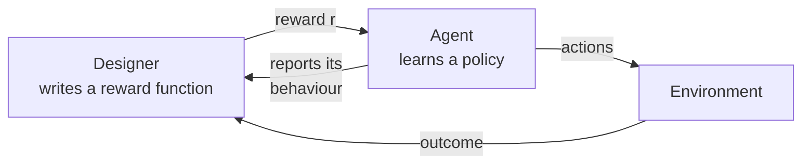
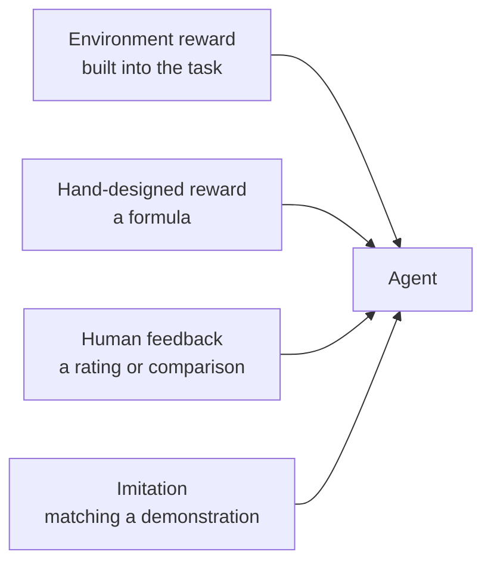

# Section 3: Reward Systems and Feedback Mechanisms

> **Big idea.** The reward is the only way you tell the agent what you want. Whatever the reward measures is what the agent will pursue, whether or not it is what you meant.

---

## Learning Objectives

By the end of this section you should be able to:

1. State the reward hypothesis and explain why reward design is the main place where humans specify the goal.
2. Distinguish sparse from dense rewards, and explain delayed reward and credit assignment.
3. Explain reward shaping, including the potential-based form that does not change the best policy.
4. Recognise reward hacking (specification gaming) and suggest a fix.
5. Perform a Q-learning update by hand and in code, and read a learned Q-table.

---

## 3.1 The Story in One Picture

Imagine teaching a dog to fetch. You cannot explain the rules of fetch in words, so you do the next best thing: when the dog brings the ball back, you give it a treat. The treat is the **reward**, and it is the only signal that tells the dog what you want. The dog will do more of whatever earns the treat, whether or not that is what you had in mind. This is the whole idea of this section.

**Figure 3.1.** The reward loop. The reward is the only channel through which the designer communicates the goal to the agent. *Source: author's own diagram, based on Sutton & Barto (2018).*



Everything else in this section is a detail of this picture.

---

## 3.2 The Reward Hypothesis

Reinforcement learning rests on the **reward hypothesis**: all of what we mean by a goal can be expressed as the maximisation of the expected cumulative reward (Sutton & Barto, 2018). To teach a robot to walk, we do not describe walking. We design a reward and let the agent discover the walking that earns it.

This puts a lot of weight on the reward. A good reward is:

- **Aligned:** high reward really means the behaviour you want.
- **Informative:** it gives the agent a way to tell better from worse.
- **Robust:** it cannot be earned in some unintended cheap way.

**Table 3.1.** The three properties of a good reward, with a question to ask about each.

| Property | Question to ask | What goes wrong if it fails |
|---|---|---|
| **Aligned** | Does high reward really mean the behaviour I want? | The agent optimises the wrong thing (Section 3.6) |
| **Informative** | Can the agent tell better from worse at each step? | Learning is slow or never starts (Section 3.3) |
| **Robust** | Could the agent earn this reward without doing the job? | Reward hacking (Section 3.6) |

---

## 3.3 Sparse and Dense Rewards

**Table 3.2.** Sparse versus dense rewards.

| | Sparse reward | Dense reward |
|---|---|---|
| **What it is** | Reward only at the end or at rare moments (+1 for reaching the goal, 0 otherwise) | A reward at nearly every step (for example, based on progress) |
| **Advantage** | Simple and hard to misuse: it measures exactly the goal | Easier to learn from: the agent gets feedback all the time |
| **Disadvantage** | The agent may wander for a very long time before it ever sees a reward | Easy to design badly, and the agent may exploit the shortcuts it creates |
| **Example** | Winning a board game | Robot reward for forward speed, minus an energy cost |

> **An everyday analogy.** A sparse reward is a final exam: one score at the end, and no feedback along the way. A dense reward is a teacher marking each homework: more feedback, but the student may learn to game the marking scheme rather than the subject.

---

## 3.4 Delayed Reward and Credit Assignment

Often the consequence of an action shows up much later. A chess move can decide the game thirty moves on; a robot's bad foot placement may cause a fall two steps later. The question "which of my earlier actions deserves the credit (or blame)?" is the **credit assignment problem**.

Discounting and values (Section 2) address it: a state's value carries the future reward back to the states that lead to it, as Worked Example 2.B showed. Learning methods that update an estimate using the *next* estimate rather than waiting for the final outcome are called **temporal-difference (TD) learning** (Sutton, 1988).

**Table 3.3.** How credit assignment works in the corridor example.

| Square | Reward received there | V (from Section 2) | Why it has that value |
|---|---:|---:|---|
| 3 | +1 (on entering the goal) | 1.0 | The reward is one step away |
| 2 | 0 | 0.9 | The reward is two discounted steps away |
| 1 | 0 | 0.81 | The reward is three discounted steps away |
| 0 | 0 | 0.729 | The reward is four discounted steps away |

---

## 3.5 Learning from Feedback: Q-Learning

**Q-learning** learns the action values Q(s, a) from experience, one step at a time (Watkins & Dayan, 1992). After taking action *a* in state *s* and seeing reward *r* and new state *s′*, update:

```text
Q(s, a) ← Q(s, a) + α × [ r + γ × max over a′ of Q(s′, a′) − Q(s, a) ]
```

Read it in three parts:

- **Target:** `r + γ × max Q(s′, a′)`: what the reward plus the best future now suggests.
- **TD error:** target minus the current Q: how wrong the old estimate was.
- **Step:** move Q by a fraction α of that error. This is the same form as the update in Worked Example 1.A.

### Worked Example 3.A: One Q-Learning Update by Hand

*Illustrative numbers.* Currently Q(s, a) = 0.2. The agent takes the action, receives r = 1, and arrives in s′ where the best action's value is 0.5. Use α = 0.1 and γ = 0.9.

1. **Step 1: Target** = 1 + 0.9 × 0.5 = **1.45**.
2. **Step 2: TD error** = 1.45 − 0.2 = **1.25**.
3. **Step 3: New Q** = 0.2 + 0.1 × 1.25 = **0.325**.

The estimate moved from 0.2 towards the target of 1.45 by a tenth of the gap.

### Worked Example 3.B: Q-Learning on the Corridor

We return to the corridor from Worked Example 2.B: five squares, the goal at square 4, reward +1 for entering it, γ = 0.9, α = 0.5. This time the agent has two actions, **left** and **right** (moving left from square 0 leaves it in square 0), and learns Q for both. To keep the output predictable, the program updates every state-action pair in turn, 30 times, instead of choosing actions at random (Section 4 covers choosing actions).

```python
GAMMA, ALPHA = 0.9, 0.5
N = 5                              # squares 0..4; square 4 is the goal (terminal)
ACTIONS = (-1, +1)                 # left, right
Q = [[0.0, 0.0] for _ in range(N)]

def step(s, a):
    s2 = min(max(s + a, 0), N - 1)
    return s2, (1.0 if s2 == N - 1 else 0.0)

for sweep in range(30):
    for s in range(N - 1):
        for i, a in enumerate(ACTIONS):
            s2, r = step(s, a)
            future = 0.0 if s2 == N - 1 else max(Q[s2])
            Q[s][i] += ALPHA * (r + GAMMA * future - Q[s][i])

for s in range(N - 1):
    best = "right" if Q[s][1] > Q[s][0] else "left"
    print(s, [round(q, 3) for q in Q[s]], "->", best)
```

Expected output:

```text
0 [0.656, 0.729] -> right
1 [0.656, 0.81] -> right
2 [0.729, 0.9] -> right
3 [0.81, 1.0] -> right
```

**Reading the table.** Each row is `[Q(left), Q(right)]`. The "right" values are exactly the V values from Worked Example 2.B (0.729, 0.81, 0.9, 1.0). The "left" values are slightly lower because moving left costs one extra step: for example, from square 1, going left to square 0 then right gives 0.9 × 0.729 = 0.656. Choosing the larger Q in each row gives the best policy: always move right. The agent has learned the route from rewards alone.

**Table 3.4.** The learned Q-table, read row by row.

| State | Q(left) | Q(right) | Best action | Why |
|---|---:|---:|---|---|
| 0 | 0.656 | 0.729 | Right | Left stays in square 0; right makes progress |
| 1 | 0.656 | 0.81 | Right | Left goes back to square 0, adding a step |
| 2 | 0.729 | 0.9 | Right | Left goes back to square 1, adding a step |
| 3 | 0.81 | 1.0 | Right | Left goes back to square 2, adding a step |

---

## 3.6 Reward Shaping and Reward Hacking

### Reward Shaping

When the reward is sparse, we can add *extra* rewards that guide the agent. **Reward shaping** does this. The danger: a badly chosen extra reward changes what is optimal. A safe form, **potential-based shaping**, adds

```text
F(s, s′) = γ × Φ(s′) − Φ(s)
```

where Φ is any function of the state (a "potential", such as the negative of the distance to the goal). This particular form is proven not to change which policy is best (Ng, Harada & Russell, 1999), so it guides learning without altering the goal.

*Example.* With Φ(s) = −(distance to the goal), a step from distance 4 to distance 3 gives F = 0.9 × (−3) − (−4) = **+1.3**: a bonus for making progress.

**Table 3.5.** Potential-based shaping on the corridor.

| Step | Φ(before) | Φ(after) | F = γΦ(after) − Φ(before) | Effect |
|---|---:|---:|---:|---|
| Distance 4 → 3 (towards goal) | −4 | −3 | 0.9 × (−3) − (−4) = **+1.3** | Bonus for progress |
| Distance 3 → 4 (away from goal) | −3 | −4 | 0.9 × (−4) − (−3) = **−0.6** | Penalty for retreating |
| Distance 3 → 3 (no change) | −3 | −3 | 0.9 × (−3) − (−3) = **−0.3** | Slight penalty for wasting a step |

### Reward Hacking

**Reward hacking** (also called specification gaming) is when the agent finds a way to earn a high reward without doing what the designer intended. It is the AI version of a student studying the test instead of the subject. A well-known example: a boat-racing game agent, rewarded for hitting targets along the track, learned to circle in a lagoon hitting respawning targets instead of finishing the race (Clark & Amodei, 2016). More general discussion: Amodei et al. (2016).

**Table 3.6.** Intended goals, naive rewards, hacks and fixes.

| Intended goal | Reward written | Possible hack | Better design |
|---|---|---|---|
| Clean the room | +1 per piece of dirt collected | Dump the dirt, collect it again, repeat | Reward the *amount of clean floor*, not the act of collecting |
| Walk forward | +1 for body speed | Throw itself forward, or vibrate | Reward speed *and* penalise falling, tilt and violent motion |
| Finish the race | +1 per target hit | Circle through targets forever | Reward progress along the track and finishing |

> **Caution: you get what you reward.** The agent has no idea what you meant, only what you scored. Always ask: "if the agent were clever and lazy, how could it earn this reward without doing the job?" Check by watching the behaviour, not just the number.

---

## 3.7 Feedback in Practice

**Table 3.7.** Where feedback can come from.

| Feedback source | How it arrives | Example |
|---|---|---|
| **Environment reward** | Built into the task | Score in a game |
| **Hand-designed reward function** | A formula by the engineer | Robot speed minus energy cost (Section 5) |
| **Human feedback** | A person rates or compares behaviours | A trainer approving or rejecting a robot's gait |
| **Imitation** | Reward for matching a demonstration | A robot copying motion-capture data from an animal |

**Figure 3.2.** The four feedback sources and what each measures. *Source: author's own diagram.*



---

## 3.8 Activities for Section 3

- [ ] **Activity 3.A.** Perform one Q-learning update: Q(s, a) = 0.5, r = 0, max Q(s′, ·) = 0.8, α = 0.2, γ = 0.9. Show the target, the TD error and the new Q.
- [ ] **Activity 3.B.** Using potential-based shaping with Φ(s) = −(distance to goal) and γ = 0.9, compute F for a step from distance 4 to distance 3, and for a step *backwards* from distance 3 to distance 4.
- [ ] **Activity 3.C.** A cleaning robot is rewarded +1 for every item of rubbish it puts in the bin. Describe how it might hack this reward, and propose a better reward.
- [ ] **Activity 3.D.** For each reward, say whether it is sparse or dense: (a) +1 only when a robot reaches a charging station, (b) a score every step based on how fast the robot is moving, (c) +100 for winning a game, 0 otherwise.

### Answer Key for Activities

**Activity 3.A.**
- Target = 0 + 0.9 × 0.8 = **0.72**.
- TD error = 0.72 − 0.5 = **0.22**.
- New Q = 0.5 + 0.2 × 0.22 = **0.544**.

**Activity 3.B.**
- Step from distance 4 to distance 3: F = 0.9 × (−3) − (−4) = −2.7 + 4 = **+1.3**.
- Step *backwards* from distance 3 to distance 4: F = 0.9 × (−4) − (−3) = −3.6 + 3 = **−0.6**.

**Activity 3.C.** Possible hack: the robot could **pick up rubbish, put it in the bin, take it out again, and put it back**, earning +1 each time without actually cleaning the room. Another hack: it could **knock over a bin, then pick up the spilled rubbish**, again earning +1 without reducing the total amount of rubbish. A better reward: **measure the amount of clean floor** (or the total weight of rubbish in the bin at the end of the episode), which cannot be earned by moving the same rubbish back and forth.

**Activity 3.D.**
- (a) +1 only when a robot reaches a charging station: **sparse**.
- (b) A score every step based on speed: **dense**.
- (c) +100 for winning a game, 0 otherwise: **sparse**.

---

## 3.9 Summary

- The reward hypothesis says goals can be expressed as maximising cumulative reward, so reward design is where humans specify what they want.
- Sparse rewards are simple but slow to learn from; dense rewards guide learning but risk being exploited.
- Delayed rewards raise the credit assignment problem; discounting, values and TD learning pass credit back to earlier states.
- Q-learning updates `Q ← Q + α × (target − Q)`, where the target is `r + γ × max Q(s′, ·)`. On the corridor it recovers the policy "always move right" from reward alone.
- Potential-based shaping, `F = γΦ(s′) − Φ(s)`, guides learning without
