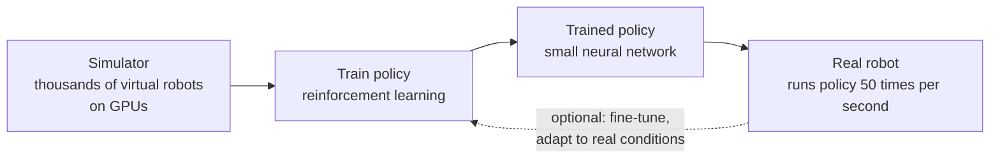
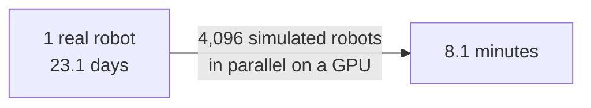
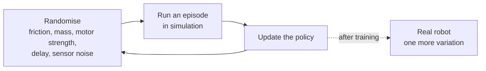

# Section 5: Case Study — Robot Dogs: How a Quadruped Learns to Walk

> **Big idea.** A robot dog is a reward-driven agent whose body is the environment. Rather than writing equations for every leg movement, engineers write a reward, let thousands of simulated robots try and fall in parallel on GPUs, and then run the small, learned policy on the real robot.

---

## Learning Objectives

By the end of this section, you should be able to:

1. Describe a quadruped robot as a reinforcement-learning agent: its states, actions and reward.
2. Calculate a locomotion reward from its terms and explain what each term is for.
3. Explain the sim-to-real approach, including domain randomisation, and why it is used.
4. Estimate how much massively parallel simulation shortens training, linking to Module 01.
5. Evaluate the advantages and limitations of learned locomotion, including safety and the behaviourist critique.

---

## 5.1 Introduction

Four-legged ("quadruped") robots, often called **robot dogs**, are used for inspection, research and exploration. Walking is hard to program by hand: the robot is unstable, the ground varies, contact with the floor is brief and violent, and small errors can cause a fall. Traditionally, engineers designed controllers from models of the robot's physics. Over the last decade, researchers have shown that policies *learned* by reinforcement learning can walk, run, recover from falls and cross rough ground on real quadrupeds (Hwangbo et al., 2019; Lee et al., 2020).

**Figure 5.1.** The learning pipeline for a robot dog. Training happens in simulation on GPUs in a data centre; the learned policy is then copied onto the robot, where it runs in real time. *Source: author's own diagram, based on Hwangbo et al. (2019) and Rudin et al. (2022).*



---

## 5.2 The Robot Dog as an RL Problem

**Table 5.1.** The robot dog in reinforcement-learning terms.

| Element | In the robot dog | Example (illustrative) |
|---|---|---|
| **Agent** | The controller (a neural network) | 45 → 128 → 128 → 12 network (Section 2.6) |
| **Environment** | The robot body, the ground, gravity | Simulated or real |
| **State / observation** | What the sensors report | 12 joint angles, 12 joint speeds, 3 body-tilt numbers, 3 body-rotation speeds, the previous 12 actions, 3 velocity commands = 45 numbers |
| **Action** | What the controller outputs | A target angle for each of the 12 joints (a low-level controller then drives the motors) |
| **Reward** | A formula scoring each step | See Section 5.3 |
| **Episode** | One attempt | Ends if the robot falls or after a time limit |
| **Time step** | One decision | 20 ms (50 Hz) |

The **velocity command** is an input: a person (or a higher-level planner) says "go forward at 1 m/s", and the learned policy works out how to do it. That is how one policy can walk at many speeds and turn on command.

> **Bridge to Module 04.** The observation comes from sensors: joint encoders, an inertial measurement unit (IMU) and sometimes cameras. Module 04 (AI Sensors and Intelligent Systems) covers how these measurements are produced and processed; here we take them as given numbers.

---

## 5.3 Designing the Reward

A typical walking reward is a **sum of weighted terms**, each pushing the robot towards one aspect of good walking (Hwangbo et al., 2019; Rudin et al., 2022). Here is a simplified example (illustrative):

**Table 5.2.** A simplified locomotion reward. The weights are illustrative; real systems use more terms (body orientation, foot clearance and others) and tune the weights.

| Term | Purpose | Form |
|---|---|---|
| **Velocity tracking** | Move as commanded | `exp( −(v_cmd − v)² ÷ 0.25 )`, which is 1 when speed matches the command and falls as the error grows |
| **Energy penalty** | Avoid wasting power and straining motors | `−0.0001 × Σ torque²` |
| **Action-rate penalty** | Avoid jerky, vibrating motion | `−0.01 × Σ (change in action)²` |
| **Termination** | Falling ends the episode, which also ends reward collection | (episode stops) |

### Worked Example 5.A: Scoring Three Moments

*Illustrative numbers.* The command is v_cmd = 1.0 m/s. Compare three moments:

1. **Walking well:** speed 0.8 m/s, Σ torque² = 400, Σ (Δaction)² = 2.0.
   Tracking = exp(−0.04 ÷ 0.25) = exp(−0.16) ≈ 0.8521. Penalties: 0.0001 × 400 = 0.04 and 0.01 × 2.0 = 0.02. Reward ≈ 0.8521 − 0.04 − 0.02 = **0.7921**.
2. **Walking slowly:** speed 0.5 m/s, same effort. Tracking = exp(−0.25 ÷ 0.25) = exp(−1) ≈ 0.3679. Reward ≈ 0.3679 − 0.06 = **0.3079**.
3. **Standing still, using no effort:** speed 0, no torque, no action change. Tracking = exp(−1 ÷ 0.25) = exp(−4) ≈ 0.0183. Reward ≈ **0.0183**.

```python
import math

def reward(v_cmd, v, torque_sq, action_rate_sq):
    track = math.exp(-(v_cmd - v) ** 2 / 0.25)
    return track - 0.0001 * torque_sq - 0.01 * action_rate_sq

print(round(reward(1.0, 0.8, 400, 2.0), 4))
print(round(reward(1.0, 0.5, 400, 2.0), 4))
print(round(reward(1.0, 0.0, 0, 0), 4))
```

Expected output:

```text
0.7921
0.3079
0.0183
```

**Interpretation.** The reward ranks the behaviours in the order we want: walking well beats walking slowly, which beats standing still. The penalties stop the robot from reaching speed with violent, wasteful motion (a mild defence against the hacks in Table 3.2). The smooth, continuous shape of the tracking term is also a *dense* reward (Section 3.2): the robot gets a useful signal at every step, even when it is far from the target speed.

> **Caution: the weights matter.** If the energy penalty were far too large, the robot would learn that standing still is best. If it were too small, the gait could become jerky and damage the motors. Engineers tune these weights over many training runs and always *watch the robot* to catch behaviours the score does not reveal.

---

## 5.4 Training in Simulation: Massively Parallel Learning

Learning to walk needs a huge number of steps. Suppose a policy needs about 100 million steps of experience (an illustrative figure; real numbers vary with the method and the terrain).

### Worked Example 5.B: One Real Robot versus Thousands of Simulated Ones

1. **Step 1: One real robot at 50 steps per second**, running without breaks: 100,000,000 ÷ 50 = 2,000,000 s ≈ **23.1 days**. In practice it would also fall, need resetting and wear out.
2. **Step 2: 4,096 simulated robots, each at 50 steps per second in simulated real time**, all running in parallel on one GPU: 4,096 × 50 = 204,800 steps per second, so 100,000,000 ÷ 204,800 ≈ 488 s ≈ **8.1 minutes**.

```python
real = 100e6 / 50 / 86400                 # days on one real robot
sim = 100e6 / (4096 * 50) / 60            # minutes with 4,096 simulated robots
print(round(real, 1), "days")
print(round(sim, 1), "minutes")
```

Expected output:

```text
23.1 days
8.1 minutes
```

**Interpretation.** This is exactly the parallelism of Module 01 (Section 3): the same simple computation (physics and a small network) is applied to thousands of independent robots, and a GPU does it at once. Research systems built on this idea report training walking policies in minutes on a single GPU (Rudin et al., 2022), using GPU-based simulators (Makoviychuk et al., 2021). Real systems fall short of the ideal division, because of Amdahl's law (Module 01, Section 3.3): part of every step (collecting results, updating the network) is not perfectly parallel, and communication between chips (Module 02, Section 4.6) adds overhead when training is spread across several GPUs.

**Figure 5.2.** Time to collect the same experience: one real robot versus 4,096 simulated robots in parallel. Note the change of unit (days versus minutes). *Source: author's own diagram, based on the numbers in Worked Example 5.B.*



---

## 5.5 From Simulation to the Real Robot

A policy trained only in simulation often fails on the real robot, because the simulator is never exactly right: the floor is slipperier, the motors are weaker or slower, the robot is heavier. This difference is the **sim-to-real gap**. Three standard remedies:

**Table 5.3.** Ways to narrow the sim-to-real gap.

| Technique | Idea | Reference |
|---|---|---|
| **Domain randomisation** | In simulation, randomly vary friction, body mass, motor strength, delays and sensor noise on every run, so the policy must work across all of them and the real robot looks like just another variation | Tobin et al. (2017); Tan et al. (2018) |
| **Better actuator models** | Learn a model of the real motors from data and include it in the simulator | Hwangbo et al. (2019) |
| **Adaptation** | The policy estimates the current conditions (a slippery floor, a heavy load) from recent experience and adjusts | Kumar et al. (2021) |

Other work has trained robots directly on real hardware, using careful safety measures and efficient algorithms (Haarnoja et al., 2019; Smith et al., 2022). These methods spend the real robot's time on a smaller number of attempts, which links back to the cost of real exploration in Section 4.5.

**Figure 5.3.** Domain randomisation. Each training run draws different physical settings, so the policy learns behaviour that works across many "worlds", including, hopefully, the real one. *Source: author's own diagram, based on Tobin et al. (2017).*



---

## 5.6 Advantages of Learned Locomotion

**Table 5.4.** Advantages of learned locomotion.

| Advantage | Explanation |
|---|---|
| **Handles complexity** | One learned policy can walk, run, turn and recover from pushes, without hand-written equations for each |
| **Robust behaviour** | Training across randomised conditions can produce gaits that cope with unexpected terrain |
| **Fast iteration** | Changing the goal (for example, adding a stairs-climbing term) means changing the reward and retraining, not rewriting a controller |
| **Small to run** | The finished policy is tiny (Section 2.6) and runs on-board with no network |
| **Learns from experience** | Skills improve with more training, including recovering from falls (Hwangbo et al., 2019) |

---

## 5.7 Limitations

- **Reward design effort.** Getting the reward terms and weights right takes expertise and many runs (Section 3.5). A subtly wrong reward can produce odd gaits that score well but look or behave badly.
- **Sim-to-real gap.** Policies can fail in conditions the randomisation did not cover.
- **Safety and wear.** Learning or fine-tuning on a real robot risks falls and damage; limits and safety stops are needed.
- **Data and compute.** Training needs a lot of experience and GPU time, even if the finished policy is tiny.
- **Limited understanding.** The policy is a pattern of reflexes learned from reward; it does not "know" why it works, and may behave unpredictably outside its training range. This is the behaviourist critique of Section 1.3 in a concrete form.
- **Explainability.** It is hard to say exactly why a neural-network policy chose an action, which matters for safety certification.
- **Alternative approaches.** Model-based control, which plans with an explicit physics model, is more predictable and is still widely used; modern systems often combine learning with such methods.

---

## 5.8 Case-Study Questions

1. A policy network has layers 45 → 128 → 128 → 12. How many MACs and how many FLOPs does one decision need? How many bytes do its weights take in FP16?
2. Why can the policy not run on a cloud server over a 5G network at 50 Hz? Use the numbers from Module 02, Worked Example 5.A.
3. Compute the reward for a moment where the command is 1.0 m/s, the robot moves at 0.5 m/s, Σ torque² = 400 and Σ (Δaction)² = 2.0, using the reward in Table 5.2.
4. With 4,096 parallel simulated robots, the ideal speed-up over a single robot is 4,096×. Give two reasons the real speed-up is lower.
5. Give one benefit and one risk of domain randomisation.

### Answer Key for Case-Study Questions

**Question 1.**
- MACs = 45 × 128 + 128 × 128 + 128 × 12 = 5,760 + 16,384 + 1,536 = **23,680 MACs**.
- FLOPs = 2 × 23,680 = **47,360 FLOPs** per decision.
- Weights = 23,680. In FP16 (2 bytes each) = **47,360 bytes ≈ 46 KiB**.

**Question 2.** A 50 Hz control loop has a budget of 1,000 ÷ 50 = **20 ms** per decision. In Module 02, even the best case of a 5G edge server (MEC) took about 36 ms end to end, and a cloud path took 56 to 140 ms. Since the network delay alone exceeds the 20 ms budget, the policy cannot live in the cloud; it must run on the robot itself.

**Question 3.**
- Tracking = exp(−(1.0 − 0.5)² ÷ 0.25) = exp(−0.25 ÷ 0.25) = exp(−1) ≈ 0.3679.
- Energy penalty = 0.0001 × 400 = 0.04.
- Action-rate penalty = 0.01 × 2.0 = 0.02.
- Reward ≈ 0.3679 − 0.04 − 0.02 = **0.3079**.

**Question 4.** Two reasons the real speed-up is lower:
1. **Amdahl's law:** part of every step (collecting results, updating the network) is serial and cannot be parallelised, capping the speed-up.
2. **Communication overhead:** when training is spread across several GPUs, exchanging gradients between chips adds delay that does not exist on a single GPU.

**Question 5.**
- **Benefit:** domain randomisation makes the policy robust to variations it has not seen, narrowing the sim-to-real gap, so the real robot is more likely to work on the first try.
- **Risk:** if the randomisation ranges are too wide or include unrealistic conditions, the policy may become overly conservative, learning a slow or hesitant gait that is safe in all simulated worlds but performs poorly on the real one.

---

## 5.9 Conclusion

The robot dog shows behaviourist AI working end to end. The goal is expressed as a reward (Section 3); the agent explores by trial and error, mostly in simulation where mistakes are cheap (Section 4); the loop of state, action and reward is the framework that makes it a learning problem (Section 2); and the result is a small policy that earns its reward by behaving, not by following hand-written rules (Section 1).

The case also connects the whole course. Module 01's parallel hardware makes training in minutes possible; Module 02's latency analysis explains why the finished policy runs on the robot rather than in the cloud; and Module 04's sensors will supply the observations the policy depends on.

---

## 5.10 Summary

- A robot dog can be treated as a reward-driven agent: states are sensor readings (45 numbers in the example), actions are 12 joint targets, and the policy runs at 50 Hz (20 ms per decision).
- The reward is a weighted sum: a velocity-tracking term plus penalties for energy and jerky motion; in the example, walking well scores 0.7921, walking slowly 0.3079 and standing still 0.0183.
- Training in simulation with thousands of parallel robots can reduce the time to collect 100 million steps from about 23.1 days to about 8.1 minutes in the ideal case, thanks to GPU parallelism (Module 01).
- Domain randomisation, better actuator models and adaptation narrow the sim-to-real gap.
- The learned policy is small (23,680 MACs, about 46 KiB in FP16) and must run on the robot, because a 20 ms control step cannot tolerate cloud delays (Module 02).
- Limitations include reward design effort, the sim-to-real gap, safety and wear, compute for training, and limited explainability.

---

## References

Haarnoja, T., Zhou, A., Hartikainen, K., Tucker, G., Ha, S., Tan, J., Kumar, V., Zhu, H., Gupta, A., Abbeel, P., & Levine, S. (2019). Soft actor-critic algorithms and applications. *arXiv preprint arXiv:1812.05905*.

Hwangbo, J., Lee, J., Dosovitskiy, A., Bellicoso, D., Tsounis, V., Koltun, V., & Hutter, M. (2019). Learning agile and dynamic motor skills for legged robots. *Science Robotics, 4*(26), eaau5872. https://doi.org/10.1126/scirobotics.aau5872

Kumar, A., Fu, Z., Pathak, D., & Malik, J. (2021). RMA: Rapid motor adaptation for legged robots. *Proceedings of Robotics: Science and Systems (RSS)*. https://doi.org/10.15607/RSS.2021.XVII.011

Lee, J., Hwangbo, J., Wellhausen, L., Koltun, V., & Hutter, M. (2020). Learning quadrupedal locomotion over challenging terrain. *Science Robotics, 5*(47), eabc5986. https://doi.org/10.1126/scirobotics.abc5986

Makoviychuk, V., Wawrzyniak, L., Guo, Y., Lu, M., Storey, K., Macklin, M., Hoeller, D., Rudin, N., Allshire, A., Handa, A., & State, G. (2021). Isaac Gym: High performance GPU-based physics simulation for robot learning. *arXiv preprint arXiv:2108.10470*.

Rudin, N., Hoeller, D., Reist, P., & Hutter, M. (2022). Learning to walk in minutes using massively parallel deep reinforcement learning. *Proceedings of the 5th Conference on Robot Learning (CoRL)*, 91–100.

Smith, L., Kew, J. C., Peng, X. B., Ha, S., Tan, J., & Levine, S. (2022). Legged robots that keep on learning: Fine-tuning locomotion policies in the real world. *Proceedings of the IEEE International Conference on Robotics and Automation (ICRA)*, 1593–1599.

Tan, J., Zhang, T., Coumans, E., Iscen, A., Bai, Y., Hafner, D., Bohez, S., & Vanhoucke, V. (2018). Sim-to-real: Learning agile locomotion for quadruped robots. *Proceedings of Robotics: Science and Systems (RSS)*. https://doi.org/10.15607/RSS.2018.XIV.010

Tobin, J., Fong, R., Ray, A., Schneider, J., Zaremba, W., & Abbeel, P. (2017). Domain randomization for transferring deep neural networks from simulation to the real world. *Proceedings of the IEEE/RSJ International Conference on Intelligent Robots and Systems (IROS)*, 23–30. https://doi.org/10.1109/IROS.2017.8202133
