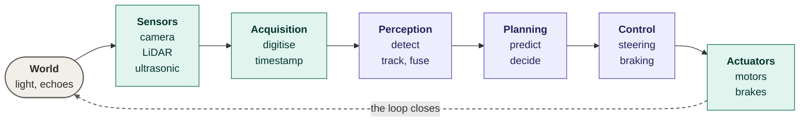

# Section 1: Types of Sensors (Cameras, LiDAR, Ultrasonic)

> **Big idea.** No sensor sees everything. Each one measures a different physical quantity (light, laser echoes, sound echoes), and each fails in different conditions. Choosing sensors is choosing which failures you can live with.

---

## Learning Objectives

By the end of this section you should be able to:

1. Define a sensor and place it in the sense–decide–act loop.
2. Distinguish passive from active and exteroceptive from proprioceptive sensors.
3. Explain how a camera, a LiDAR and an ultrasonic sensor each work, and calculate a basic quantity for each.
4. Use a comparison table to choose sensors for a scenario and justify the choice.

---

## 1.1 What Is a Sensor?

A **sensor** is a device that converts a physical quantity (light, sound, distance, acceleration) into an electrical signal that a computer can read. In Module 01 we described Face ID as a small *sense–decide–act* loop. The same loop, at larger scale, is the structure of every intelligent system.

**Figure 1.1.** The sense–decide–act loop. Sensors feed the acquisition stage; perception and planning decide; control drives the actuators; the actuators change the world. *Source: author's own diagram.*



**Table 1.1.** Two ways to classify sensors.

| Classification | Meaning | Examples |
|---|---|---|
| **Passive** | Only receives energy that already exists | Camera (uses ambient light), microphone |
| **Active** | Emits energy and measures the echo | LiDAR (laser), radar (radio waves), ultrasonic (sound) |
| **Exteroceptive** | Measures the outside world | Camera, LiDAR, radar, ultrasonic |
| **Proprioceptive** | Measures the machine itself | Wheel-speed sensor, IMU (accelerometer and gyroscope), steering-angle sensor |

This module concentrates on three exteroceptive sensors (camera, LiDAR, ultrasonic) and also mentions radar, because it appears in almost every real comparison.

---

## 1.2 Cameras

A **camera** is a passive sensor. A lens focuses light onto an image sensor, a grid of light-sensitive cells (pixels). Each pixel measures how much light reached it, and a colour filter pattern gives red, green and blue values.

**What a camera is good at.** It gives very high resolution and colour, so it can read traffic signs, lane markings, traffic-light colour and brake lights. It is cheap, small and has no moving parts. Because a camera produces a 2-D image, a neural network must *infer* distance from visual cues (object size, perspective, motion, or two cameras at once).

**What it is bad at.** It does not measure distance directly. It depends on ambient light, so low light, glare from a low sun or oncoming headlights, and fast changes in brightness hurt it. Rain, fog and dirt on the lens degrade the image.

**Key camera quantities.**

- **Resolution:** number of pixels, such as 1920 × 1080 (about 2 megapixels).
- **Field of view (FOV):** the angle the camera sees. A wide FOV sees more, but each object covers fewer pixels.
- **Frame rate:** images per second (fps).
- **Dynamic range:** the ratio between the brightest and darkest things it can capture in one frame; important for tunnels and sunsets.

### Worked Example 1.A: How Many Pixels Does a Child Cover?

*Illustrative numbers.* A camera has 1,920 pixels across and a horizontal field of view of 60°. The target is 0.5 m wide (a small child seen from the front). Under the pinhole model, the focal length expressed in pixels is

```text
f = (W / 2) / tan(FOV / 2) = 960 / tan(30°) = 960 / 0.5774 ≈ 1,663 pixels
```

The width of the target in the image is (f × real width) ÷ distance:

- At 50 m: 1,663 × 0.5 ÷ 50 ≈ **16.6 pixels**
- At 150 m: 1,663 × 0.5 ÷ 150 ≈ **5.5 pixels**

At 150 m the child is only about five pixels wide, which is hard for a network to classify reliably. This is why range and resolution are linked.

The following Python program checks the numbers. Its complete expected output is shown below the code.

```python
import math

W = 1920
hfov = 60
size = 0.5

f = (W / 2) / math.tan(math.radians(hfov / 2))
for d in (50, 150):
    print(d, "m:", round(f * size / d, 1), "pixels")
```

Expected output:

```text
50 m: 16.6 pixels
150 m: 5.5 pixels
```

---

## 1.3 LiDAR

**LiDAR** (Light Detection and Ranging) is an active sensor. It fires very short laser pulses and measures how long each pulse takes to bounce back. Because light travels at a known speed (c ≈ 3 × 10⁸ m/s), the delay gives the distance directly. This is called **time of flight (ToF)**:

```text
distance = (c × t) / 2        (divide by 2 because the pulse goes out and back)
```

By sweeping the laser in many directions (a spinning head, a mirror, or a solid-state design), the sensor builds a **point cloud**: a set of 3-D points (x, y, z) plus an intensity value for the strength of each return.

**What LiDAR is good at.** It measures distance directly and accurately (typically to a few centimetres), works in darkness because it brings its own light, and gives a 3-D shape of the surroundings. It is excellent for detecting obstacles that a camera might not recognise (an unusual object lying in the road).

**What it is bad at.** It does not see colour or read text, so it cannot read a sign or a traffic light. Heavy rain, fog, snow and dust scatter the laser pulses. Very dark or very shiny surfaces may return little energy. The sensor is more expensive than a camera, although costs have fallen as manufacturers moved to solid-state and mass-production designs. A point cloud is sparse: far objects may be hit by only a few points.

### Worked Example 1.B: Time of Flight

A pulse returns after **400 ns** (4 × 10⁻⁷ s).

```text
distance = (3 × 10⁸ × 4 × 10⁻⁷) / 2 = 120 / 2 = 60 m
```

### Worked Example 1.C: How Much Data Does a LiDAR Produce?

*Illustrative sensor:* 128 beams (vertical channels), a horizontal step of 0.2° over 360° (so 360 ÷ 0.2 = 1,800 steps), spinning at 10 Hz. Each point is stored as four 32-bit numbers (x, y, z, intensity) = 16 bytes.

The following Python program checks the numbers. Its complete expected output is shown below the code.

```python
beams, az, hz = 128, 1800, 10
pts = beams * az
print(pts)
print(pts * hz)
print(pts * 16 / 1e6, 'MB per frame')
print(pts * 16 * hz / 1e6, 'MB/s')
```

Expected output:

```text
230400
2304000
3.6864 MB per frame
36.864 MB/s
```

So this LiDAR produces about 2.3 million points per second and about 37 MB/s. Remember this number: in Section 2 we compare it with a camera.

---

## 1.4 Ultrasonic Sensors

An **ultrasonic sensor** is an active sensor that emits a short burst of sound above human hearing (typically about 40 kHz) and listens for the echo. It uses the same round-trip idea as LiDAR, but with sound, which is about a million times slower than light:

```text
distance = (v × t) / 2,   where v ≈ 343 m/s in air at 20 °C
```

The speed of sound depends on temperature: v ≈ 331.3 + 0.606 × T (T in °C).

**What it is good at.** It is very cheap, works in the dark and measures short distances to nearly any solid object, including low obstacles below a camera's view. This is why it is used for parking assistance.

**What it is bad at.** Its range is short (typically a few metres), its beam is wide and its angular resolution is poor, so it cannot tell *what* the object is. Because sound is slow, it cannot track fast-moving objects. Wind, other ultrasonic sources and soft, sound-absorbing surfaces (such as clothing) affect it.

### Worked Example 1.D: Echo to Distance, and the Temperature Error

*(a)* An echo returns after 5.8 ms. With v = 343 m/s: distance = 343 × 0.0058 ÷ 2 ≈ **0.99 m**.

*(b)* An object is truly 1.00 m away on a freezing day (0 °C, where v = 331.3 m/s). The echo takes 2 ÷ 331.3 = 6.04 ms. If the sensor wrongly assumes 343 m/s, it reports 343 × 0.00604 ÷ 2 ≈ 1.035 m, an error of about 3.5%. Good sensors measure temperature and correct for it.

The following Python program checks the numbers. Its complete expected output is shown below the code.

```python
v20, v0 = 343.0, 331.3
t = 2 * 1.00 / v0
print(round(t * 1e3, 2), 'ms')
print(round(v20 * t / 2, 3), 'm')
```

Expected output:

```text
6.04 ms
1.035 m
```

---

## 1.5 A Fourth Sensor: Radar

Radar emits radio waves (automotive radar commonly uses the 76–81 GHz band) and measures the echo. Its special strength is velocity: by the **Doppler effect**, a moving object shifts the frequency of the echo, so radar measures speed directly, and it keeps working in rain, fog and darkness. Its weakness is coarse angular resolution, so it struggles to separate nearby objects or identify shapes.

```text
v = (Δf × c) / (2 × f0)
```

*Example.* At f0 = 77 GHz, a shift of Δf = 10.27 kHz gives v = (10,270 × 3 × 10⁸) ÷ (2 × 77 × 10⁹) ≈ **20 m/s** (72 km/h).

---

## 1.6 Comparison Table

**Table 1.2.** Comparison of automotive sensors. Ranges and costs are typical orders of magnitude and vary by product and year; the data rates are derived in Sections 1.3 and 2.2. Sources for the principles: Winner et al. (2016); Thrun, Burgard & Fox (2005); Rosique et al. (2019).

| Feature | Camera | LiDAR | Ultrasonic | Radar (for reference) |
|---|---|---|---|---|
| **Physical principle** | Light (passive) | Laser time of flight (active) | Sound echo (active) | Radio-wave echo and Doppler (active) |
| **Measures** | Colour and texture image | 3-D point cloud | Short-range distance | Range and radial velocity |
| **Typical useful range** | Long (tens to 250 m or more, depending on lens) | Roughly 100–250 m for automotive units | About 0.2–5 m | Roughly 5–250 m |
| **Resolution** | Very high | High in range, sparse far away | Very low | Low to medium |
| **Direct depth?** | No (must be inferred) | Yes, accurate | Yes, short range | Yes |
| **Direct velocity?** | No (from frame-to-frame change) | No (from successive frames) | No | Yes (Doppler) |
| **Works in darkness?** | Poorly without light | Yes | Yes | Yes |
| **Rain, fog, snow** | Degraded | Degraded (scattering) | Mostly unaffected at short range | Least affected |
| **Reads signs and colours?** | Yes | No | No | No |
| **Approximate data rate** | High (about 100 MB/s per camera, raw) | Moderate (tens of MB/s) | Tiny | Low to moderate |
| **Approximate cost** | Low | Medium to high, falling | Very low | Low to medium |
| **Typical use** | Lane, sign and object recognition | 3-D mapping, obstacle detection | Parking, close-range alerts | Adaptive cruise control, collision warning |

> **Caution: numbers in a comparison table are typical, not guaranteed.** A specific sensor can be far better or worse. Always check the datasheet of the product you actually use.

---

## 1.7 Activities for Section 1

- [ ] **Activity 1.A.** A 3,840-pixel-wide camera has a 90° horizontal field of view. How many pixels wide is a 1.8 m car at 100 m?
- [ ] **Activity 1.B.** A LiDAR pulse returns after 1.0 µs. How far away is the object?
- [ ] **Activity 1.C.** An ultrasonic echo returns after 11.7 ms (v = 343 m/s). How far away is the object?
- [ ] **Activity 1.D.** A radar at 77 GHz measures a Doppler shift of 15.4 kHz. What is the object's radial speed?
- [ ] **Activity 1.E.** A LiDAR has 64 beams and a horizontal step of 0.4° over 360°, spinning at 10 Hz. How many points per frame, and how many MB per frame at 16 bytes per point?
- [ ] **Activity 1.F.** For each situation, say which sensor of the four you would rely on most, and why: (a) reversing into a garage with 30 cm clearance, (b) reading a speed-limit sign, (c) detecting a stalled car in dense fog on a motorway, (d) judging the exact 3-D shape of an unusual object on the road at night.

### Answer Key for Activities

**Activity 1.A.**
- f = (3840 ÷ 2) ÷ tan(45°) = 1920 ÷ 1 = **1,920 pixels**.
- Car width in pixels at 100 m = 1,920 × 1.8 ÷ 100 = **34.6 pixels**.

**Activity 1.B.**
- Distance = (3 × 10⁸ × 1.0 × 10⁻⁶) ÷ 2 = 300 ÷ 2 = **150 m**.

**Activity 1.C.**
- Distance = 343 × 0.0117 ÷ 2 = 4.013 ÷ 2 ≈ **2.0 m**.

**Activity 1.D.**
- v = (15,400 × 3 × 10⁸) ÷ (2 × 77 × 10⁹) = 4.62 × 10¹² ÷ 1.54 × 10¹¹ ≈ **30 m/s**.

**Activity 1.E.**
- Horizontal steps = 360 ÷ 0.4 = 900.
- Points per frame = 64 × 900 = **57,600 points**.
- Data per frame = 57,600 × 16 bytes = 921,600 bytes ≈ **0.92 MB per frame**.
- (At 10 Hz, this is about 9.2 MB/s.)

**Activity 1.F.**
- (a) Reversing into a garage: **ultrasonic**, because it is cheap, works at very short range, and detects low obstacles below a camera's view.
- (b) Reading a speed-limit sign: **camera**, because it reads colour and text.
- (c) Detecting a stalled car in dense fog: **radar**, because it is least affected by rain, fog and snow, and it measures distance directly.
- (d) Judging the exact 3-D shape of an unusual object at night: **LiDAR**, because it measures distance accurately, works in darkness, and gives a 3-D point cloud of the shape.

---

## 1.8 Summary

- A sensor turns a physical quantity into a signal; sensors can be passive or active, and exteroceptive or proprioceptive.
- Cameras are cheap and rich in detail but measure no distance directly and depend on light; at 150 m a 0.5 m child covers only about 5.5 pixels in our example.
- LiDAR measures distance directly with time of flight (distance = c × t ÷ 2) and produces a point cloud, about 37 MB/s in our example, but cannot read signs and is degraded by precipitation.
- Ultrasonic sensors are cheap and short-range; their accuracy depends on the temperature-dependent speed of sound.
- Radar adds direct velocity and weather robustness but has coarse resolution.
- No sensor dominates on every row of the comparison table, which is the motivation for fusion in Section 3.

---

## References

Rosique, F., Navarro, P. J., Fernández, C., & Padilla, A. (2019). A systematic review of perception system and simulators for autonomous vehicles research. *Sensors, 19*(3), 648. https://doi.org/10.3390/s19030648

Thrun, S., Burgard, W., & Fox, D. (2005). *Probabilistic robotics*. MIT Press.

Winner, H., Hakuli, S., Lotz, F., & Singer, C. (Eds.). (2016). *Handbook of driver assistance systems: Basic information, components and systems for active safety and comfort*. Springer. https://doi.org/10.1007/978-3-319-12352-3
