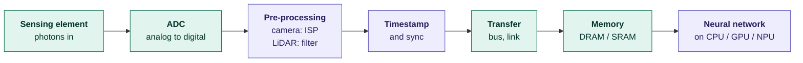
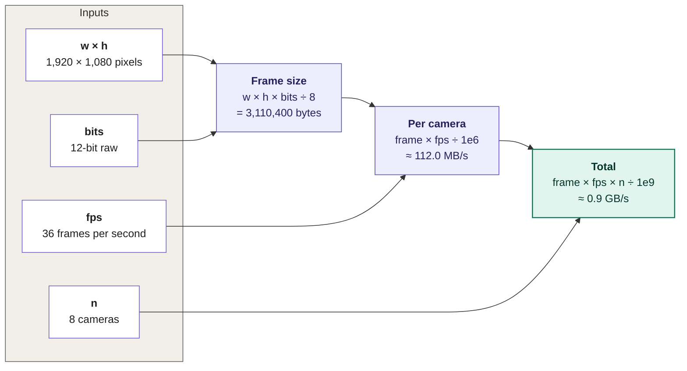
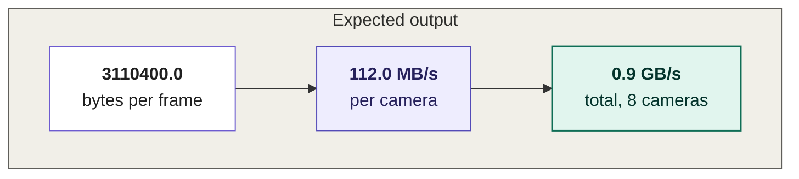
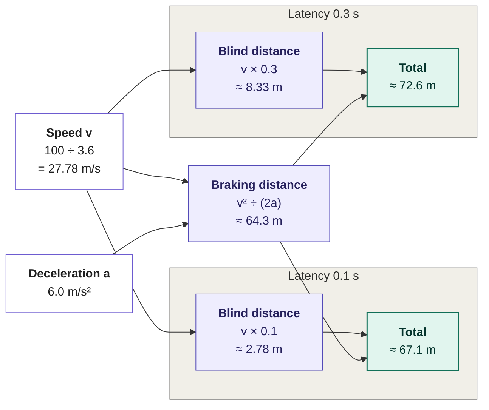
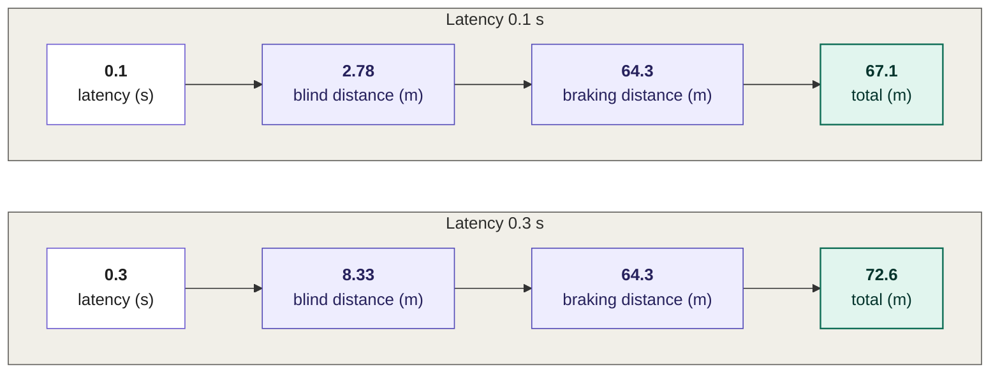
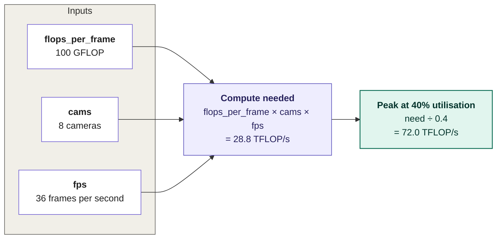
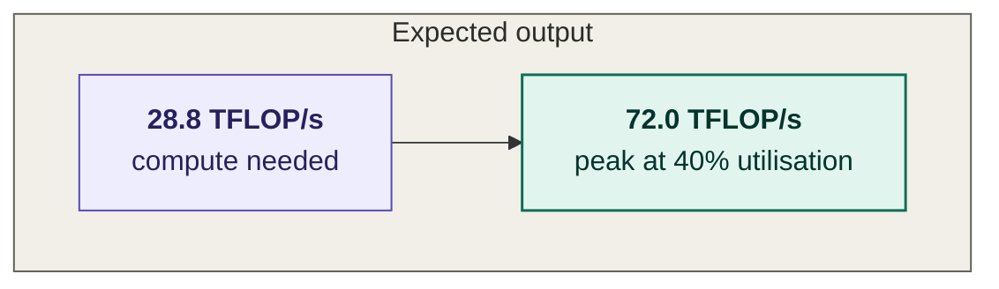

# Section 2: Data Acquisition and Real-Time Processing

> [!IMPORTANT]
> **Big idea** A sensor reading is only useful if it reaches the processor with the right timestamp, in time to act on. In a moving machine, every millisecond of delay is distance travelled blind.

**Learning objectives.** By the end of this section you should be able to:

- Describe the data-acquisition chain from sensing element to processor.
- Calculate the raw data rate of a camera array and compare it with a LiDAR.
- Build a latency budget and compute how far a vehicle travels while the system is still thinking.
- Explain why timestamp synchronisation and motion compensation matter.
- Estimate whether a compute platform can keep up with a sensor array, linking back to Module 01 (TOPS, utilisation).

## 2.1 The acquisition chain

- **Sensing element:** photodiodes in a camera, a laser receiver in a LiDAR, a microphone-like transducer in an ultrasonic sensor.
- **ADC (analogue-to-digital converter):** converts the voltage to a number. A 12-bit ADC gives 4,096 levels.
- **ISP (image signal processor):** hardware that turns raw sensor data into a usable image: removing noise, correcting the lens, adjusting exposure and colour.
- **Timestamp and synchronisation:** each measurement is labelled with the time it was taken.
- **Transfer:** the data crosses a cable or bus. Bandwidth here is limited just like memory bandwidth in Module 01.
- **Memory and compute:** the data lands in memory and a neural network runs on a CPU, GPU or NPU.

## 2.2 How much data?

### Worked example 2.A: data rate of a camera array

Illustrative array: 8 cameras, each 1,920 × 1,080 pixels, 12-bit raw output, 36 frames per second.

One camera alone (112 MB/s) produces about three times the data of the 128-beam LiDAR in Worked example 1.C (37 MB/s). Cameras, not LiDARs, usually dominate the data volume. This data must pass through memory, and Module 01 taught us that moving data costs more energy than computing on it, so keeping raw images on the chip, or compressing them early, matters.

## 2.3 Real-time deadlines

A **real-time** system must produce a result before a deadline. In a *hard* real-time system, missing the deadline is a failure (a braking command that arrives too late). In a *soft* real-time system, a late result is merely less useful (a delayed video frame). Driving needs hard guarantees for safety functions.

Two different quantities matter, as defined in Module 01:

- **Throughput:** how many frames per second the system can process.
- **Latency:** how long one frame takes from photon to action.

A system can have high throughput and still be dangerously slow to react if the latency of each frame is long.

### Worked example 2.B: distance travelled while thinking

A car drives at 100 km/h (27.78 m/s) and can brake with a deceleration of 6 m/s². Braking distance = v² ÷ (2a) = 771.6 ÷ 12 ≈ 64.3 m.

An extra 200 ms of latency adds 5.6 m to the total stopping distance, which can be the difference between a near miss and a collision.

### A latency budget

A **latency budget** splits the allowed end-to-end time among the stages. The numbers below are illustrative.

| Stage                      | Time (ms) |
|----------------------------|-----------|
| Exposure and readout       | 10        |
| ISP                        | 5         |
| Transfer to memory         | 2         |
| Neural-network inference   | 30        |
| Fusion and tracking        | 10        |
| Planning                   | 15        |
| Actuation (brake build-up) | 30        |
| **Total**                  | **102**   |

Table 2.1. An illustrative latency budget. If the target is 100 ms, the system is already 2 ms over. The biggest slice, inference, is where the hardware ideas of Module 01 (parallelism, low precision, on-chip memory) pay off.

## 2.4 Timestamps and motion compensation

Sensors do not sample at the same instant, and some take time to scan.

- A spinning LiDAR needs 100 ms (at 10 Hz) to complete one sweep. At 20 m/s the car moves 2 m during that sweep, so the first and last points of one frame are measured from places 2 m apart. Without **ego-motion compensation** (correcting each point using the car's own motion, from wheel and IMU data) the point cloud is smeared.
- If the camera and LiDAR timestamps differ by 10 ms at 20 m/s, an object in one sensor's view is displaced by 0.2 m from the same object in the other, which can cause a fused detection to split in two.
- Hardware solutions include a shared clock (for example, precision time protocol over Ethernet) and **hardware triggering**, which makes cameras expose at the instant the LiDAR beam passes their field of view.

## 2.5 Can the computer keep up?

This is where Module 01 and Module 04 meet.

### Worked example 2.C: compute needed for a camera array

Suppose one frame needs a 100 GFLOP network (illustrative). With 8 cameras at 36 fps:

The hypothetical accelerator in Module 01 (10 TFLOP/s peak) is far too small. And because the cameras are processed continuously, the realistic requirement is the *peak* figure that gives the needed performance after losses: here about 72 TFLOP/s. This is why self-driving computers carry hundreds of TOPS, and why Module 01's lessons (utilisation, memory-bound versus compute-bound, batch size) decide whether a system works. Note the contrast with a phone unlocking by Face ID: that was one image, one inference, batch 1. A car makes hundreds of inferences per second, continuously, and cannot skip one.

> [!NOTE]
> **Note** Bridge to Networks. Inside a vehicle, sensors and computers are connected by automotive Ethernet and other buses. Module 02 explains how network bandwidth and latency limit how much sensor data can be delivered.

## 2.6 Activities for Section 2

- **Activity 2.A.** Six cameras, each 1,280 × 960 pixels, 10-bit raw, 30 fps. What is the data rate per camera and in total?
- **Activity 2.B.** A vehicle travels at 72 km/h, brakes at 5 m/s², and has a total system latency of 150 ms. What is its total stopping distance?
- **Activity 2.C.** In Table 2.1, inference grows from 30 ms to 60 ms. What is the new total, and by how much does it miss a 100 ms target? Name two hardware or software changes that could recover the time.
- **Activity 2.D.** Twelve cameras at 30 fps with a 60 GFLOP network. What sustained TFLOP/s is needed, and what peak is required at 30% utilisation?
- **Activity 2.E.** The camera and LiDAR clocks are 15 ms apart and the car moves at 30 m/s. How far apart are the two views of the same object?

## 2.7 Summary

- The acquisition chain runs from sensing element through ADC, ISP, timestamping and transfer into memory, where a neural network processes it.
- A raw camera produces about 112 MB/s in our example, three times a 128-beam LiDAR; an 8-camera array produces about 0.9 GB/s.
- Real-time systems must meet deadlines; latency, not just throughput, decides safety. At 100 km/h, 100 ms of latency means 2.8 m travelled blind; 300 ms means 8.3 m.
- A latency budget splits the allowed time among stages; inference is usually the largest slice.
- Synchronisation and ego-motion compensation prevent smeared point clouds and mismatched detections.
- A multi-camera array needs tens of TFLOP/s sustained (28.8 in our example), so the utilisation and memory ideas of Module 01 determine feasibility.

