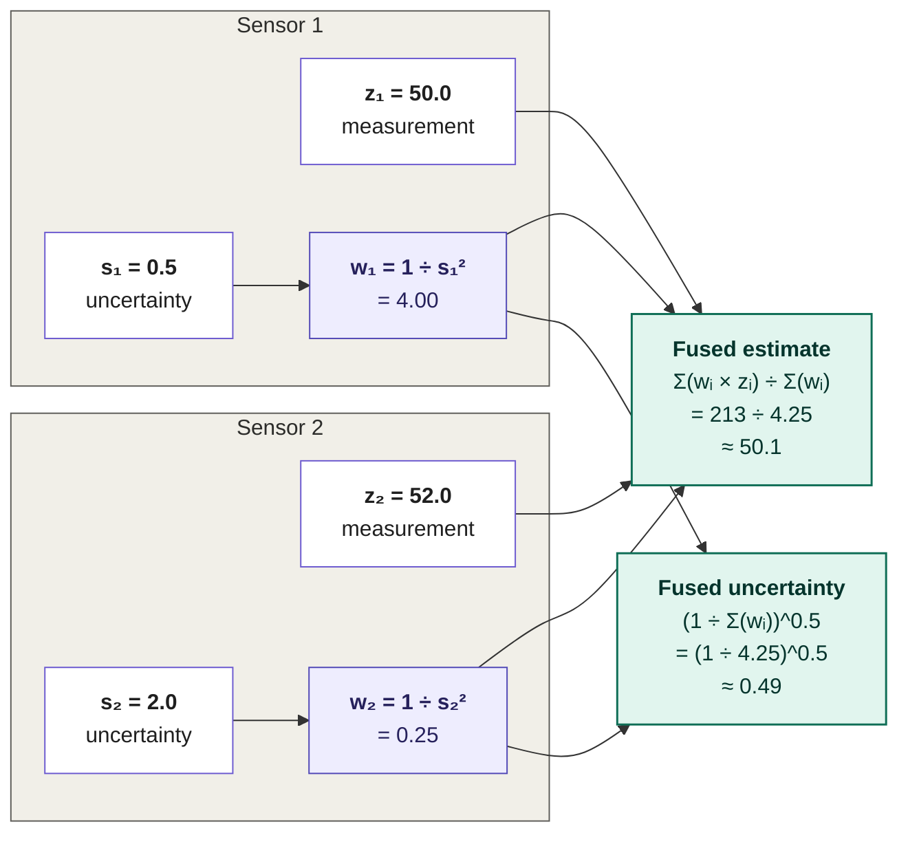
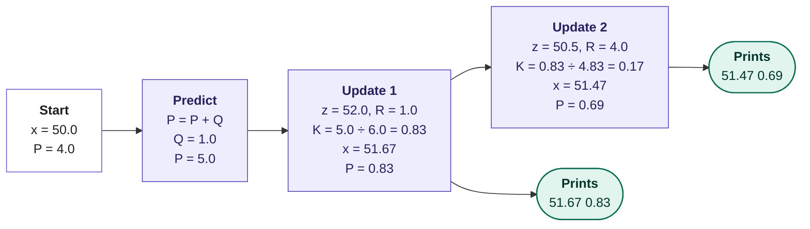
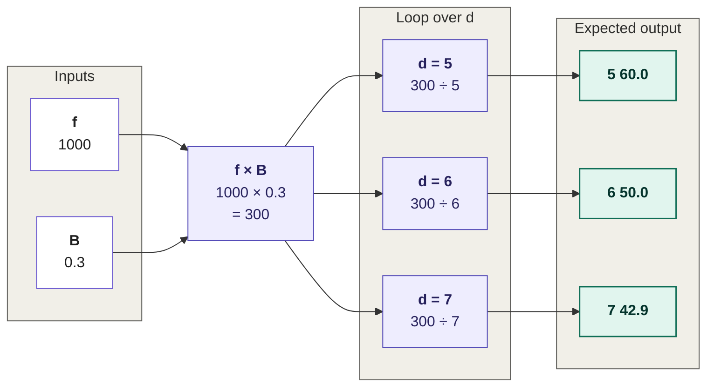

# Section 3: Sensor Fusion and Environmental Perception

> **Big idea.** Every sensor is wrong in its own way. Sensor fusion combines them so that one sensor's strength covers another's weakness, and so that the system knows *how uncertain* its picture is.

---

## Learning Objectives

By the end of this section, you should be able to:

1. Explain why fusion is needed, using complementary failure modes.
2. Distinguish early, mid-level (feature) and late (object-level) fusion, and draw the fusion flow.
3. Fuse two measurements by inverse-variance weighting and carry out one Kalman-filter cycle by hand.
4. Explain data association and tracking, and why camera depth error grows with distance.
5. Describe the main perception tasks and metrics (IoU, precision, recall), and name the common causes of fusion failure.

---

## 3.1 Why Fuse?

Section 1 ended with a comparison table in which no sensor won every row. Fusion exploits the fact that the *failures are different*.

**Table 3.1.** Complementary strengths and weaknesses (qualitative). Based on Rosique et al. (2019) and Feng et al. (2021).

| Condition | Camera | LiDAR | Radar | Ultrasonic |
|---|---|---|---|---|
| Night | Weak | Strong | Strong | Strong (short range) |
| Heavy rain, fog, snow | Weak | Weak to medium | Strong | Medium |
| Low sun glare | Weak | Strong | Strong | Strong |
| Dark, non-reflective object | Weak at night | Weaker returns | Strong if metal | Strong |
| Reading signs and lights | Strong | Cannot | Cannot | Cannot |
| Measuring speed directly | Indirect | Indirect | Strong | Weak |
| Close range below the bumper | Blind spot | Possible blind spot | Weak | Strong |

In the running example (a ball at dusk after rain), the camera sees the ball's colour but struggles with low light and wet-road reflections, while a LiDAR or radar return gives the distance regardless of light. Together they are more reliable than either alone.

---

## 3.2 Where Does Fusion Happen? Three Levels

**Table 3.2.** Three levels of sensor fusion. After Hall & Llinas (1997) and Liu et al. (2023).

| Level | What is fused | Advantage | Disadvantage |
|---|---|---|---|
| **Early (raw-data)** | Raw pixels and raw points, for example by projecting LiDAR points onto the image | Keeps all information | Needs precise calibration and synchronisation; heavy computation and data rates |
| **Mid-level (feature)** | Features from each sensor's neural network, merged in a shared space such as bird's-eye view (BEV) | Learns how to combine sensors; strong accuracy | Needs joint training; harder to debug |
| **Late (object-level)** | Lists of detected objects from each sensor, merged with a tracker | Simple; modular; one failed sensor is easy to drop | Information already thrown away before fusion |

A **bird's-eye view (BEV)** is a top-down map around the vehicle. Putting every sensor's features into the same BEV grid makes it natural to combine them (Philion & Fidler, 2020; Li et al., 2022; Liu et al., 2023).

---

## 3.3 The Simplest Fusion: Weigh by Confidence

Suppose two sensors measure the same distance. A more precise sensor deserves more weight. If a sensor's error has standard deviation σ, its **variance** is σ², and the optimal weight is 1 ÷ σ² (**inverse-variance weighting**).

### Worked Example 3.A: Radar Plus Camera

A radar measures the range to the car ahead as 50.0 m with σ = 0.5 m. A camera network estimates 52.0 m with σ = 2.0 m.

- Weights: radar 1 ÷ 0.25 = 4; camera 1 ÷ 4 = 0.25.
- Fused estimate = (4 × 50.0 + 0.25 × 52.0) ÷ (4 + 0.25) = 213 ÷ 4.25 ≈ **50.12 m**.
- Fused variance = 1 ÷ 4.25 ≈ 0.235, so σ ≈ **0.49 m**, slightly better than the best sensor alone.

**Figure 3.1.** Inverse-variance weighting. Each sensor's weight is the reciprocal of its variance; the fused estimate is the weighted average, and the fused uncertainty is smaller than either input. *Source: author's own diagram.*



> **Caution: independence and bias.** This assumes the errors are independent, unbiased and roughly bell-shaped. If both sensors share a flaw (for example, both are degraded by fog), the fused result is *less* trustworthy than the formula claims.

---

## 3.4 Fusion Over Time: The Kalman Filter

Measurements arrive repeatedly, and objects move. The **Kalman filter** (Kalman, 1960) keeps a running estimate *and* its uncertainty, and alternates two steps:

1. **Predict:** use a motion model to move the estimate forward in time. Uncertainty grows, because the model is imperfect (process noise Q).
2. **Update:** when a measurement z arrives (with noise variance R), correct the estimate. The **Kalman gain** K = P ÷ (P + R) decides how much to trust the measurement versus the prediction. Then x ← x + K(z − x), and P ← (1 − K)P.

### Worked Example 3.B: One Predict Step and Two Updates

Distance to the lead car: prior estimate x = 50.0 m with variance P = 4.0. Process noise Q = 1.0.

- **Predict:** P = 4.0 + 1.0 = 5.0.
- **Update 1 (radar):** z = 52.0, R = 1.0. K = 5 ÷ 6 = 0.833. x = 50 + 0.833 × 2 = 51.67. P = (1 − 0.833) × 5 = 0.83.
- **Update 2 (camera):** z = 50.5, R = 4.0. K = 0.833 ÷ 4.833 = 0.172. x = 51.67 + 0.172 × (50.5 − 51.67) = 51.47. P = (1 − 0.172) × 0.833 = 0.69.

**Figure 3.2.** The Kalman-filter cycle. The predict step grows the uncertainty; each update shrinks it. The precise radar pulls the estimate strongly, the noisy camera only a little. *Source: author's own diagram.*



Notice three things. The precise radar pulled the estimate strongly; the noisier camera pulled it only a little; and the uncertainty P *fell* with each update. Real trackers use a state with position and velocity (a constant-velocity model), so they also estimate speed, but the idea is identical. Thrun, Burgard & Fox (2005) give a full treatment.

---

## 3.5 Association and Tracking

Before fusing, the system must decide which detection belongs to which object. This is **data association**.

- **Gating:** only detections within a window around the predicted position are considered. If a track is predicted at 30.0 m with a gate of ±3 m, a detection at 29.2 m is accepted and one at 33.5 m is rejected.
- **Assignment:** when several tracks and detections compete, an algorithm such as the Hungarian algorithm finds the best one-to-one matching.
- **Track life cycle:** a new detection starts a *tentative* track; it becomes *confirmed* after being seen on several frames; it is *deleted* if unmatched for too long. This suppresses single-frame false alarms.

---

## 3.6 Depth from Cameras and Why It Gets Worse with Range

A single camera does not measure depth. With **two cameras** a known distance B apart (the baseline), a point appears shifted between the two images by a **disparity** d (in pixels), and depth is

```text
Z = (f × B) ÷ d
```

### Worked Example 3.C: Stereo Depth and Its Sensitivity

Let f = 1,000 pixels and B = 0.30 m.

**Figure 3.3.** Stereo depth calculation. The numerator (f × B) is fixed; the depth falls as the disparity rises. *Source: author's own diagram.*



A one-pixel error in disparity moves the answer from 50 m to 42.9 m or 60 m. The depth error per pixel of disparity error is approximately Z² ÷ (f × B): at 50 m, 2,500 ÷ 300 ≈ 8.3 m. Because of the *square*, camera depth error rises quickly with range, whereas a LiDAR's error stays at a few centimetres. Modern systems also learn depth from a single image or video using neural networks, and some convert it into a pseudo-LiDAR point cloud (Wang et al., 2019); this works well on average but is still an estimate, not a measurement.

---

## 3.7 What Perception Outputs, and How It Is Scored

**Table 3.3.** The main perception tasks.

| Task | Output |
|---|---|
| **Object detection** | 3-D boxes with class (car, pedestrian, cyclist) |
| **Semantic segmentation** | A class label for every pixel or point |
| **Tracking** | Identity, velocity and history of each object |
| **Occupancy / free space** | Which parts of 3-D space are occupied, even by unknown objects |
| **Lane and map elements** | Lane lines, curbs, crosswalks, traffic lights, signs |

Public datasets such as KITTI (Geiger, Lenz & Urtasun, 2012), nuScenes (Caesar et al., 2020) and the Waymo Open Dataset (Sun et al., 2020) provide labelled camera, LiDAR and radar data, so methods can be compared fairly.

**Scoring a detection.** **Intersection over Union (IoU)** measures how well a predicted box overlaps the true box: IoU = overlap area ÷ union area. **Precision** = true detections ÷ all detections made. **Recall** = true detections ÷ all real objects.

### Worked Example 3.D: IoU, Precision and Recall

A predicted box is 4 m × 2 m (8 m²) and the true box is the same size but shifted 1 m along its length. Overlap = 3 × 2 = 6 m². Union = 8 + 8 − 6 = 10 m². IoU = 6 ÷ 10 = **0.6**.

A detector makes 100 detections, of which 90 are correct and 10 are false alarms, and it misses 30 real objects. Precision = 90 ÷ 100 = **0.90**. Recall = 90 ÷ 120 = **0.75**. In driving, false alarms cause phantom braking and misses cause collisions; Section 4 shows how to weigh them.

---

## 3.8 How Fusion Fails

- **Miscalibration.** Fusion needs the exact position and angle of every sensor (the *extrinsic* calibration). A 1° yaw error between a camera and a LiDAR shifts an object at 50 m sideways by 50 × tan(1°) ≈ 0.87 m, enough to put a pedestrian in the wrong lane.
- **Poor synchronisation.** See Section 2.4.
- **Sensor disagreement.** When the camera says there is a car and the radar says there is not, which is right? Voting, confidence weights and learned fusion all try to answer this, and none is perfect.
- **Common-cause failures.** Fog or a dirty windscreen can degrade several sensors at once, breaking the independence assumption (Section 4.5).
- **Adversarial and rare cases.** Stickers on signs, reflective surfaces and unusual objects can fool networks, which is a reason to keep a sensor that measures geometry directly.

---

## 3.9 Activities for Section 3

- [ ] **Activity 3.A.** A LiDAR measures 30.0 m with σ = 0.1 m; a camera estimates 31.0 m with σ = 1.0 m. Compute the inverse-variance fused estimate and its σ.
- [ ] **Activity 3.B.** Starting from x = 20.0, P = 2.0, Q = 0.5, apply one predict step and then one update with z = 21.0 and R = 1.5. Give x and P.
- [ ] **Activity 3.C.** Stereo cameras with f = 1,200 pixels and B = 0.5 m see a disparity of 12 pixels. What is the depth, and what is the depth if the disparity is 11 pixels?
- [ ] **Activity 3.D.** A predicted box is 5 m × 2 m and the true box overlaps it by 4 m × 2 m (same size boxes). Compute the IoU.
- [ ] **Activity 3.E.** A detector makes 80 detections, 72 of them correct, and misses 8 objects. Compute precision and recall.
- [ ] **Activity 3.F.** A camera–LiDAR yaw calibration error is 0.5°. How large is the sideways offset at 80 m?
- [ ] **Activity 3.G.** Explain, in two or three sentences, why fusing a camera and a LiDAR in thick fog is less beneficial than fusing a camera and a radar.

### Answer Key for Activities

**Activity 3.A.**
- Weights: LiDAR 1 ÷ 0.01 = 100; camera 1 ÷ 1 = 1.
- Fused estimate = (100 × 30.0 + 1 × 31.0) ÷ 101 = 3,031 ÷ 101 ≈ **30.01 m**.
- Fused variance = 1 ÷ 101 ≈ 0.0099, so σ ≈ **0.10 m** (essentially the LiDAR's precision).

**Activity 3.B.**
- Predict: P = 2.0 + 0.5 = 2.5.
- Update: K = 2.5 ÷ (2.5 + 1.5) = 2.5 ÷ 4.0 = 0.625.
- x = 20.0 + 0.625 × (21.0 − 20.0) = **20.625**.
- P = (1 − 0.625) × 2.5 = **0.9375**.

**Activity 3.C.**
- At d = 12: Z = (1,200 × 0.5) ÷ 12 = 600 ÷ 12 = **50 m**.
- At d = 11: Z = 600 ÷ 11 ≈ **54.5 m**.
- A single-pixel error in disparity moves the depth estimate by 4.5 m at 50 m.

**Activity 3.D.**
- Predicted area = 5 × 2 = 10 m²; true area = 5 × 2 = 10 m².
- Overlap = 4 × 2 = 8 m².
- Union = 10 + 10 − 8 = 12 m².
- IoU = 8 ÷ 12 ≈ **0.667**.

**Activity 3.E.**
- Precision = 72 ÷ 80 = **0.90**.
- Recall: the detector found 72 of the 72 + 8 = 80 real objects, so recall = 72 ÷ 80 = **0.90**.

**Activity 3.F.**
- Offset = 80 × tan(0.5°) ≈ 80 × 0.00873 ≈ **0.70 m**.

**Activity 3.G.** LiDAR and cameras both degrade in thick fog: the fog scatters laser pulses, and it blurs the camera's image. Since both sensors fail in the same conditions, their combined value is limited. Radar, by contrast, keeps working in fog, so fusing camera and radar preserves complementary information. This is a common-cause failure: when the failure is shared, the independence assumption behind inverse-variance weighting breaks down.

---

## 3.10 Summary

- Sensors fail in different ways, so combining them improves reliability and measurably reduces uncertainty.
- Fusion can happen on raw data (early), on features (mid-level, often in bird's-eye view) or on object lists (late).
- Inverse-variance weighting gave a fused range of 50.1 m with σ ≈ 0.49 m in our example; a Kalman filter does the same over time and tracks uncertainty (51.67 m then 51.47 m, with P falling from 5.0 to 0.69).
- Association (gating, assignment, track life cycle) decides which measurement belongs to which object.
- Stereo depth error grows with the square of distance (about 8.3 m per pixel at 50 m in our example), which is why direct range sensors remain valuable.
- Perception is scored with IoU, precision and recall; fusion fails through miscalibration, poor timing, disagreement and common-cause conditions.

---

## References

Caesar, H., Bankiti, V., Lang, A. H., Vora, S., Liong, V. E., Xu, Q., Krishnan, A., Pan, Y., Baldan, G., & Beijbom, O. (2020). nuScenes: A multimodal dataset for autonomous driving. *Proceedings of the IEEE/CVF Conference on Computer Vision and Pattern Recognition (CVPR)*, 11621–11631. https://doi.org/10.1109/CVPR42600.2020.01164

Feng, D., Haase-Schütz, C., Rosenbaum, L., Hertlein, H., Glaeser, C., Timm, F., Wiesbeck, W., & Dietmayer, K. (2021). Deep multi-modal object detection and semantic segmentation for autonomous driving: Datasets, methods, and challenges. *IEEE Transactions on Intelligent Transportation Systems, 22*(3), 1341–1360. https://doi.org/10.1109/TITS.2020.2972974

Geiger, A., Lenz, P., & Urtasun, R. (2012). Are we ready for autonomous driving? The KITTI vision benchmark suite. *Proceedings of the IEEE Conference on Computer Vision and Pattern Recognition (CVPR)*, 3354–3361. https://doi.org/10.1109/CVPR.2012.6248074

Hall, D. L., & Llinas, J. (1997). An introduction to multisensor data fusion. *Proceedings of the IEEE, 85*(1), 6–23. https://doi.org/10.1109/5.554205

Kalman, R. E. (1960). A new approach to linear filtering and prediction problems. *Journal of Basic Engineering, 82*(1), 35–45. https://doi.org/10.1115/1.3662552

Li, Y., Ibanez-Guzman, J., Wu, J., Wang, Z., & Cao, Y. (2022). BEV-Locator: An end-to-end visual semantic localization network using multi-view images. *arXiv preprint arXiv:2211.14927*.

Liu, Z., Tang, H., Amini, A., Mao, X., & Guo, B. (2023). BEVFusion: Multi-task multi-sensor fusion with unified bird's-eye view representation. *Proceedings of the IEEE International Conference on Robotics and Automation (ICRA)*, 2774–2781.

Philion, J., & Fidler, S. (2020). Lift, splat, shoot: Encoding images from arbitrary camera rigs by implicitly unprojecting to 3D. *Proceedings of the European Conference on Computer Vision (ECCV)*, 194–210. https://doi.org/10.1007/978-3-030-58610-2_12

Rosique, F., Navarro, P. J., Fernández, C., & Padilla, A. (2019). A systematic review of perception system and simulators for autonomous vehicles research. *Sensors, 19*(3), 648. https://doi.org/10.3390/s19030648

Sun, P., Kretzschmar, H., Dotiwalla, X., Chouard, A., Patnaik, V., Tsui, P., Guo, J., Zhou, Y., Chai, Y., Caine, B., Vasudevan, V., Han, W., Ngiam, J., Zhao, H., Timofeev, A., Ettinger, S., Krivokon, M., Gao, A., Joshi, A., & Anguelov, D. (2020). Scalability in perception for autonomous driving: Waymo open dataset. *Proceedings of the IEEE/CVF Conference on Computer Vision and Pattern Recognition (CVPR)*, 2446–2454.

Thrun, S., Burgard, W., & Fox, D. (2005). *Probabilistic robotics*. MIT Press.

Wang, Y., Chao, W.-L., Garg, D., Hariharan, B., Campbell, M., & Weinberger, K. Q. (2019). Pseudo-LiDAR from visual depth estimation: Bridging the gap in 3D object detection for autonomous driving. *Proceedings of the IEEE/CVF Conference on Computer Vision and Pattern Recognition (CVPR)*, 8445–8453.
