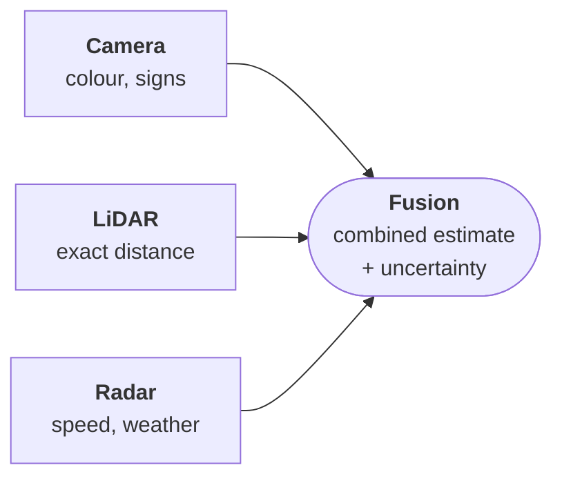
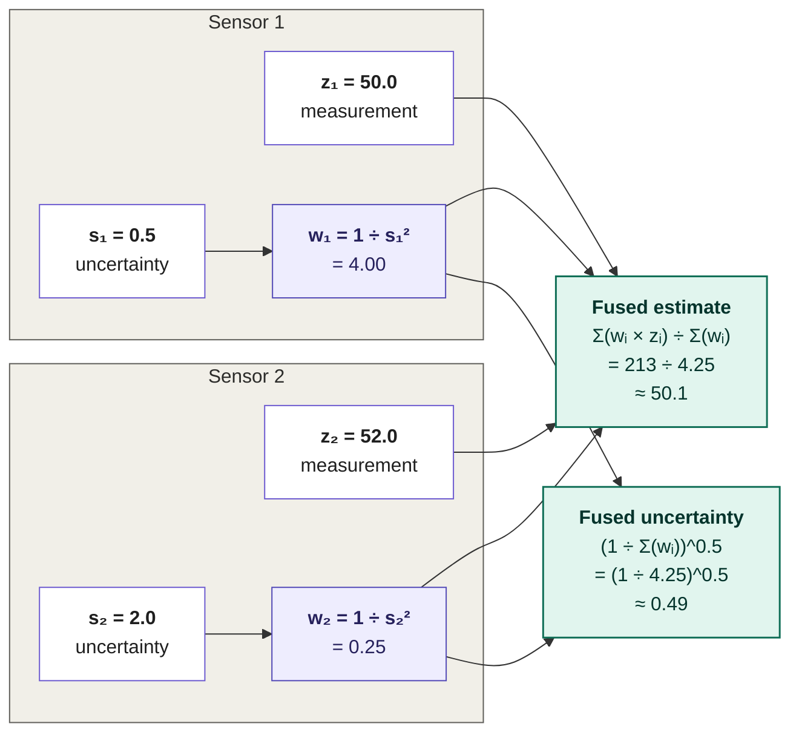

# Section 3: Sensor Fusion and Environmental Perception

> **Big idea.** Every sensor is wrong in its own way. Sensor fusion combines them so that one sensor's strength covers another's weakness, and so that the system knows *how uncertain* its picture is.

---

## Learning Objectives

By the end of this section, you should be able to:

1. Explain why fusion is needed, using complementary failure modes.
2. Distinguish early, mid-level (feature) and late (object-level) fusion, and draw the fusion flow.
3. Fuse two measurements by inverse-variance weighting and carry out one Kalman-filter cycle by hand.
4. Explain data association and tracking, and why camera depth error grows with distance.
5. Describe the main perception tasks and metrics (IoU, precision, recall), and name the common causes of fusion failure.

---

## 3.1 The Story in One Picture

Imagine a car driving at dusk after rain. A ball rolls into the road. The camera sees it, but the wet road reflects the low sun and the ball's colour is hard to make out. A LiDAR return gives the ball's exact distance regardless of light. Radar spots the motion. None of the three is sure on its own, but together they are. This is the whole story of sensor fusion.

**Figure 3.1.** Fusion combines sensors whose failures are different. The system's estimate is more reliable than any single sensor, and it knows how uncertain it is. *Source: author's own diagram.*

Everything else in this section is a detail of this picture.

---

## 3.2 Why Fuse?

Section 1 ended with a comparison table in which no sensor won every row. Fusion exploits the fact that the *failures are different*.

**Table 3.1.** Complementary strengths and weaknesses (qualitative). Based on Rosique et al. (2019) and Feng et al. (2021).

| Condition | Camera | LiDAR | Radar | Ultrasonic |
|---|---|---|---|---|
| Night | Weak | Strong | Strong | Strong (short range) |
| Heavy rain, fog, snow | Weak | Weak to medium | Strong | Medium |
| Low sun glare | Weak | Strong | Strong | Strong |
| Dark, non-reflective object | Weak at night | Weaker returns | Strong if metal | Strong |
| Reading signs and lights | Strong | Cannot | Cannot | Cannot |
| Measuring speed directly | Indirect | Indirect | Strong | Weak |
| Close range below the bumper | Blind spot | Possible blind spot | Weak | Strong |

In the running example (a ball at dusk after rain), the camera sees the ball's colour but struggles with low light and wet-road reflections, while a LiDAR or radar return gives the distance regardless of light. Together they are more reliable than either alone.

---

## 3.3 Where Does Fusion Happen? Three Levels

**Table 3.2.** Three levels of sensor fusion. After Hall & Llinas (1997) and Liu et al. (2023).

| Level | What is fused | Advantage | Disadvantage |
|---|---|---|---|
| **Early (raw-data)** | Raw pixels and raw points, for example by projecting LiDAR points onto the image | Keeps all information | Needs precise calibration and synchronisation; heavy computation and data rates |
| **Mid-level (feature)** | Features from each sensor's neural network, merged in a shared space such as bird's-eye view (BEV) | Learns how to combine sensors; strong accuracy | Needs joint training; harder to debug |
| **Late (object-level)** | Lists of detected objects from each sensor, merged with a tracker | Simple; modular; one failed sensor is easy to drop | Information already thrown away before fusion |

A **bird's-eye view (BEV)** is a top-down map around the vehicle. Putting every sensor's features into the same BEV grid makes it natural to combine them (Philion & Fidler, 2020; Li et al., 2022; Liu et al., 2023).

---

## 3.4 The Simplest Fusion: Weigh by Confidence

Suppose two sensors measure the same distance. A more precise sensor deserves more weight. If a sensor's error has standard deviation σ, its **variance** is σ², and the optimal weight is 1 ÷ σ² (**inverse-variance weighting**).

### Worked Example 3.A: Radar Plus Camera

A radar measures the range to the car ahead as 50.0 m with σ = 0.5 m. A camera network estimates 52.0 m with σ = 2.0 m.

- Weights: radar 1 ÷ 0.25 = 4; camera 1 ÷ 4 = 0.25.
- Fused estimate = (4 × 50.0 + 0.25 × 52.0) ÷ (4 + 0.25) = 213 ÷ 4.25 ≈ **50.12 m**.
- Fused variance = 1 ÷ 4.25 ≈ 0.235, so σ ≈ **0.49 m**, slightly better than the best sensor alone.

**Figure 3.2.** Inverse-variance weighting. Each sensor's weight is the reciprocal of its variance; the fused estimate is the weighted average, and the fused uncertainty is smaller than either input. *Source: author's own diagram.*

> **Caution: independence and bias.** This assumes the errors are independent, unbiased and roughly bell-shaped. If both sensors share a flaw (for example, both are degraded by fog), the fused result is *less* trustworthy than the formula claims.

---

## 3.5 Fusion Over Time: The Kalman Filter

Measurements arrive repeatedly, and objects move. The **Kalman filter** (Kalman, 1960) keeps a running estimate *and* its uncertainty, and alternates two steps:

1. **Predict:** use a motion model to move the estimate forward in time. Uncertainty grows, because the model is imperfect (process noise Q).
2. **Update:** when a measurement z arrives (with noise variance R), correct the estimate. The **Kalman gain** K = P ÷ (P + R) decides how much to trust the measurement versus the prediction. Then x ← x + K(z − x), and P ← (1 − K)P.

### Worked Example 3.B: One Predict Step and Two Updates

Distance to the lead car: prior estimate x
