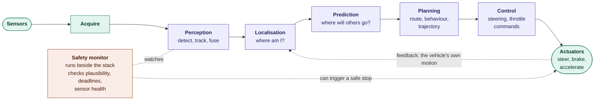
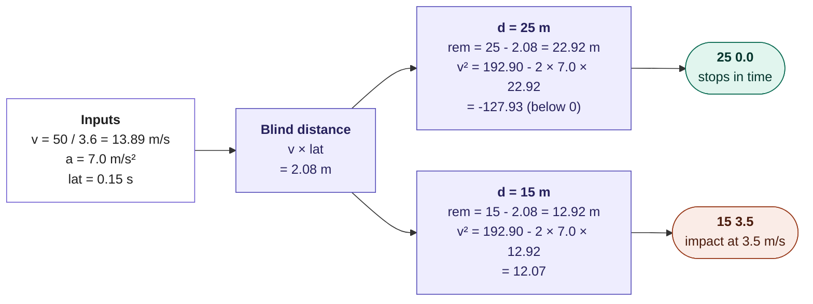
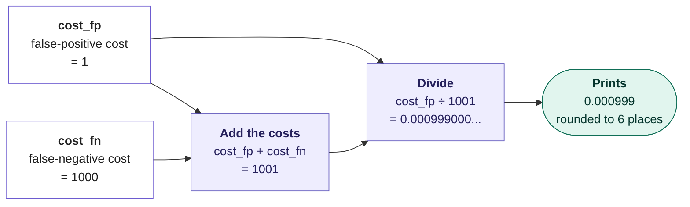

# Section 4: Integration of Hardware and AI Decision-Making

> [!IMPORTANT]
> **Big idea** Perception is only useful if it changes what the machine does. Turning an uncertain picture into a safe action is a chain of software modules mapped onto hardware, each with its own deadline, and with safety checks wrapped around it.

**Learning objectives.** By the end of this section you should be able to:

- Draw the autonomy stack (perception, prediction, planning, control) and map each stage to hardware.
- Compare modular and end-to-end architectures.
- Calculate whether a vehicle can stop in time given detection range and latency.
- Use a cost-based rule to choose a decision threshold under uncertainty.
- Describe SAE automation levels, functional safety and redundancy, and why redundancy needs independence.

## 4.1 The autonomy stack

- **Perception** (Section 3) outputs tracked objects with uncertainty.
- **Localisation** estimates the vehicle's own position, using GNSS, an IMU, wheel odometry, and maps or camera and LiDAR features.
- **Prediction** forecasts where other road users will be in the next few seconds, often as several possible trajectories with probabilities.
- **Planning** chooses a route, a behaviour (follow, overtake, stop) and a smooth, collision-free trajectory.
- **Control** converts the trajectory into steering, throttle and brake commands, usually at 50–100 Hz or faster.

### Modular versus end-to-end

The stack above is *modular*: each stage is a separate component with a defined interface. The alternative is *end-to-end*: one neural network takes sensor data and outputs a trajectory or controls. An early demonstration trained a convolutional network to steer directly from camera images (Bojarski et al., 2016), and more recent work trains one network with several linked tasks (Hu et al., 2023).

|                      | Modular                                         | End-to-end                                   |
|----------------------|-------------------------------------------------|----------------------------------------------|
| **Interfaces**       | Explicit (object lists, trajectories)           | Learned, implicit                            |
| **Debugging**        | Easier: find the failing module                 | Harder: behaviour is hidden in the weights   |
| **Safety argument**  | Easier to test and certify per module           | Harder to certify; needs very strong testing |
| **Information loss** | Detail is lost at each interface                | Less loss; the network can keep what matters |
| **Data needs**       | Each module can be trained and tuned separately | Needs very large amounts of driving data     |
| **Compute**          | Many specialised pieces                         | One or a few very large networks             |

Table 4.1. Modular versus end-to-end architectures. Real systems are often hybrids.

## 4.2 Mapping the stack onto hardware

Module 01 showed that different chips suit different work. A vehicle computer is a **heterogeneous** system that combines several:

| Stage                          | Typical workload                   | Typical hardware             | Typical rate   |
|--------------------------------|------------------------------------|------------------------------|----------------|
| Sensor capture and ISP         | Fixed image processing             | Dedicated ISP blocks         | 30–60 fps      |
| Neural-network perception      | Huge matrix arithmetic             | NPU or GPU (Module 01)       | 10–60 Hz       |
| Fusion, tracking, localisation | Many small, irregular computations | CPU, DSP                     | 10–100 Hz      |
| Prediction and planning        | Mixed neural and search code       | CPU plus accelerator         | About 10 Hz    |
| Control and safety monitor     | Simple but strictly timed code     | Safety-rated microcontroller | 100 Hz or more |

Table 4.2. A typical mapping of autonomy functions to hardware. The rates are illustrative.

Two lessons from earlier modules apply directly. First, **utilisation and memory** (Module 01): a perception network at batch size 1 on a continuous stream tends to be memory-bound, so on-chip memory and low precision matter. Second, **unsupported operations falling back to the CPU** (Module 01, Section 2.7) can silently blow the latency budget of Section 2.3.

## 4.3 Can the car stop in time?

The earlier running example becomes a calculation. The car drives at 50 km/h (13.89 m/s). System latency is 0.15 s and it can brake at 7 m/s². A ball (and perhaps a child) is detected at distance d. Will the car stop?

### Worked example 4.A: detection range decides the outcome

- Distance travelled during latency: 13.89 × 0.15 ≈ 2.08 m.
- Braking distance: 13.89² ÷ (2 × 7) ≈ 13.78 m. Total needed ≈ **15.9 m**.
- If detection happens at 25 m, the car stops with about 9 m to spare.
- If detection happens at only 15 m, the car cannot stop. After the 2.08 m latency it has 12.92 m left; its speed when it reaches the obstacle is √(13.89² − 2 × 7 × 12.92) ≈ 3.5 m/s (about 12.5 km/h).

This ties the whole module together: detection range (Section 1: pixels on target, LiDAR range), latency (Section 2), and the quality of the fused estimate (Section 3) decide whether the decision can be carried out at all. Even a 3.5 m/s impact is a serious injury risk for a child, so early, reliable detection beats any amount of late braking.

## 4.4 Deciding under uncertainty

The perception system rarely outputs a certain answer. It outputs *probabilities* and *uncertainties*. The planner must act anyway. A principled way to choose is to compare **expected costs**.

### Worked example 4.B: when should the car brake?

Let the cost of an unnecessary hard brake (a false alarm) be 1 unit, and the cost of failing to brake for a real pedestrian be 1,000 units. Let p be the probability that the object is a real pedestrian.

- Expected cost of braking = (1 − p) × 1 (cost arises only if it was a false alarm).
- Expected cost of not braking = p × 1,000.
- Brake when (1 − p) \< 1,000p, that is when p \> 1 ÷ 1,001 ≈ **0.1%**.

The threshold is tiny because the two errors are so unequal. But if the car brakes at 0.1% confidence, it will brake often for harmless things (shadows, plastic bags): the *phantom braking* problem, which is irritating and can itself cause rear-end collisions. The real cost ratio is not 1,000:1 at every speed and in every traffic situation, so the thresholds are tuned with data, simulation and road testing. The lesson is that **precision and recall (Section 3.7) are not abstract scores; they set a safety-versus-comfort trade-off.**

The fused uncertainty also feeds the planner. In Worked example 3.B, the fused distance was 51.47 m with variance 0.69 (σ ≈ 0.83 m). A cautious planner may plan with a conservative distance of 51.47 − 2 × 0.83 ≈ 49.8 m (two standard deviations closer), so that a bad measurement does not cause a collision.

## 4.5 Safety, levels of automation and redundancy

**Levels of automation.** SAE J3016 defines six levels of driving automation (SAE International, 2021):

| Level | Name                                      | Who monitors the road?                          |
|-------|-------------------------------------------|-------------------------------------------------|
| 0     | No automation                             | Human                                           |
| 1     | Driver assistance (steering *or* speed)   | Human                                           |
| 2     | Partial automation (steering *and* speed) | Human must supervise at all times               |
| 3     | Conditional automation                    | System, but the human must take over on request |
| 4     | High automation                           | System, within a defined operating domain       |
| 5     | Full automation                           | System, everywhere                              |

Table 4.3. SAE levels of driving automation. Consumer driver-assist features that require constant human supervision are Level 2, whatever their marketing names.

**Functional safety.** ISO 26262 is the standard for the safety of electronic systems in cars; it classifies the risk of each function into integrity levels (ASIL A to D, with D the strictest) and sets design and testing requirements. **SOTIF** (ISO 21448, Safety Of The Intended Functionality) covers a different problem: hazards that occur even when nothing is broken, because a sensor or a neural network reaches its performance limits (for example, a camera blinded by glare).

**Redundancy.** Safety-critical systems duplicate important parts: two computers, two power supplies, and *diverse* sensors that measure the world in different ways. If a function fails, a **fail-operational** system keeps working in a reduced mode, while a **fail-safe** system stops safely. The vehicle executes a **minimal-risk manoeuvre**, such as pulling over, when it can no longer drive safely.

### Why redundancy needs independence

Suppose each sensing channel misses a hazard 5% of the time. If two channels fail *independently*, both miss it only 0.05 × 0.05 = **0.25%** of the time, which is 20 times better. If the failures are perfectly *correlated* (a single cause, such as fog or a dirty windscreen, blinds both), both miss it **5%** of the time, no better than one channel. Real systems fall in between. This is the engineering argument for using *different physical principles* (camera, radar, LiDAR) rather than several copies of the same sensor. The counter-argument (Section 5) is that a single, very capable sensing channel plus a very good network can be simpler, cheaper and avoid the problem of conflicting sensors.

## 4.6 Activities for Section 4

- **Activity 4.A.** A vehicle drives at 36 km/h, with 0.2 s latency and a braking deceleration of 6 m/s². What is the minimum detection distance needed to stop before an obstacle?
- **Activity 4.B.** Using the numbers of Worked example 4.A, at what detection distance is the impact speed exactly zero? (Hint: the answer is the total needed distance.)
- **Activity 4.C.** If a false alarm costs 2 units and a missed pedestrian costs 600 units, what is the probability threshold above which the car should brake?
- **Activity 4.D.** Two independent channels each miss a hazard with probability 0.02. What is the probability that both miss it? What if they are perfectly correlated?
- **Activity 4.E.** Name two advantages and two disadvantages of an end-to-end architecture compared with a modular one.
- **Activity 4.F.** Explain the difference between ISO 26262 and SOTIF using one example of each kind of hazard.

## 4.7 Summary

- The autonomy stack runs perception, localisation, prediction, planning and control in a loop, with a safety monitor beside it; modular designs are easier to debug and certify, end-to-end designs lose less information but are harder to verify.
- The stack maps onto heterogeneous hardware: ISPs, NPUs/GPUs, CPUs and safety-rated microcontrollers, each with its own rate and deadline.
- In our example a car at 50 km/h with 0.15 s latency needs about 15.9 m to stop; detection at 15 m still leaves a 3.5 m/s impact.
- Decisions under uncertainty compare expected costs; with a 1:1,000 cost ratio the braking threshold falls to about 0.1%, which shows why false alarms and misses must be balanced with data.
- SAE levels describe who is responsible; ISO 26262 and SOTIF address faults and performance limits; redundancy only helps if failures are independent (0.25% versus 5% in our example).

