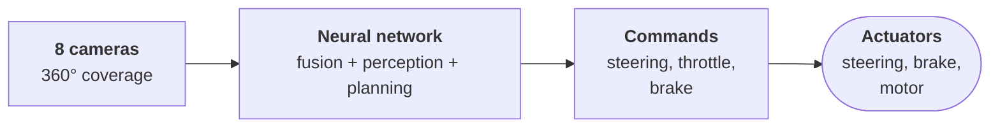

# Section 5: Case Study — Tesla's Autonomous Driving Technology

> **Big idea.** Tesla made the most debated sensor decision in the industry: drive with cameras and a neural network alone. The case shows every idea in this module at once, and it is also a lesson in separating what a company *claims* from what independent evidence *shows*.

---

## Learning Objectives

By the end of this section, you should be able to:

1. Describe Tesla's sensor history and its current camera-only (Tesla Vision) design.
2. Explain how Tesla's software replaces radar and ultrasonic sensors with learned perception (bird's-eye view, occupancy networks, end-to-end networks).
3. Link the in-car computer to Module 01 (MACs, TOPS, memory bandwidth, quantisation) with a calculation.
4. Compare Tesla's approach with a sensor-rich alternative (Waymo) using a table.
5. Evaluate public claims critically and say what evidence would settle the camera-versus-LiDAR argument.

> **Currency note.** This case study was checked against public sources in early November 2026. Tesla's software, hardware plans and regulatory status change quickly, and several figures below come from news reports of company statements, not from independent measurement. Each such figure is marked *reported* or *company claim*.

---

## 5.1 The Story in One Picture

Imagine a Tesla driving through a suburban street at night, in the rain. There is no radar, no LiDAR, no ultrasonic sensor — only eight cameras and a computer. The car has to tell the difference between a puddle's reflection and a pedestrian, between a plastic bag and a child. It does this by fusing what all eight cameras see into a single 3-D map, remembering the last few frames, and running a large neural network that outputs steering and braking commands. That is the whole story of this section, and the rest of it is the detail.

**Figure 5.1.** The overall pipeline. Eight cameras feed a large neural network; the network outputs a driving trajectory, and the trajectory becomes steering and acceleration commands. *Source: author's own diagram.*



Everything else in this section is a detail of this picture.

---

## 5.2 A Short History of Tesla's Sensors

**Table 5.1.** Timeline of Tesla's sensor and computing changes. Sources: Tesla Support (2021, 2022); Talpes et al. (2020); TechCrunch (2022); Electrek (2022); press coverage of Tesla earnings calls (2026). Dates and volumes marked *reported* were not independently verified.

| Period | Sensor suite and software milestone |
|---|---|
| 2016 | Early Autopilot hardware: eight cameras, a forward-facing radar and twelve ultrasonic sensors, with a plan to reach full self-driving by software updates |
| 2019 | Tesla's own FSD computer ('HW3') with two custom chips, described by Tesla as about 144 TOPS in total |
| 2021 | Radar removed from new Model 3 and Model Y cars, and from Model S and Model X in 2022 (Tesla Support: Tesla Vision) |
| October 2022 | Ultrasonic sensors dropped from new Model 3 and Model Y; a vision-based **occupancy network** replaces their inputs (Tesla Support; reports in TechCrunch and Electrek) |
| 2023 onward | 'HW4' computer and new cameras in new vehicles |
| Early 2024 (FSD v12) | End-to-end neural network replaces much of the hand-written control code (reported: about 300,000 lines of C++) |
| October 2025 (FSD v14) | Larger model; available on HW4 vehicles first (reported) |
| 2025–2026 | Robotaxi service launched in Austin in June 2025 and expanded to further cities during 2026 (reported); Tesla stated that older HW3 vehicles would not be capable of unsupervised driving (Q1 2026 earnings call, reported) |
| 2026–2027 | Next-generation 'AI5' chip: small volumes reported for late 2026, high volume later, after delays |

---

## 5.3 The Sensor Suite Today

Current Tesla cars use **eight external cameras** giving 360° coverage, with no radar, no LiDAR and no ultrasonic sensors (in markets where Tesla Vision is fully deployed). In Tesla's earlier public descriptions of the layout, three cameras look forward with different lenses (wide, main, narrow; the narrow one for long range, with a maximum range quoted as about 250 m), two look forward and sideways from the B-pillars, two look backward and sideways from the front fenders, and one looks to the rear. Camera resolution is reported to have risen from about 1.2 megapixels (HW3) to about 5 megapixels (HW4).

**Figure 5.2.** Camera coverage (top view, schematic, not to scale). *Source: author's own diagram.*

```text
                  narrow  main  wide
                      \    |    /
          fwd-side L  .---------.  fwd-side R
                  \  /           \  /
                   ||    CAR      ||
                  /  \           /  \
          rear-side L  '---------'  rear-side R
                          |
                         rear
```

There is no directly measured depth anywhere in this system. Every distance comes from a neural network's inference from images. That makes the system a direct test of the depth limits discussed in Section 3.6.

---

## 5.4 From Pixels to a Driving Decision

**Figure 5.3.** Tesla's perception-to-control pipeline (simplified from public talks). *Source: author's own diagram.*

```text
 8 cameras -> ISP / calibration -> shared image backbone per camera
                                          |
                                          v
                     multi-camera fusion into a 3-D / bird's-eye-view space
                          (attention-based network; uses several past frames)
                                          |
              +---------------------------+---------------------------+
              v                           v                           v
     objects, lanes, signs      3-D OCCUPANCY (what is solid,      motion / velocity
                                even for unknown objects)           per object
              \___________________________|___________________________/
                                          v
                    end-to-end driving network (v12 and later)
                                          v
                       steering and acceleration commands
```

Three ideas from the public talks stand out:

1. **Multi-camera fusion in bird's-eye view.** Instead of detecting objects in each image and merging lists (late fusion), the network fuses *image features* from all eight cameras into one top-down 3-D representation (Tesla AI Day, 2021; Karpathy, 2021). This is mid-level fusion, as described in Section 3.2.
2. **Occupancy networks.** The network predicts which small 3-D cells around the car are occupied, even by objects it cannot name (a fallen ladder, an unusual trailer). This gives geometry like a LiDAR would, but inferred from video (Tesla AI Day, 2022), and it is what Tesla used to replace the ultrasonic sensors.
3. **Video, not single images.** The network uses a memory of recent frames, so it can estimate speed and see through brief occlusions. Using several frames at slightly different positions is like having a moving stereo baseline (Section 3.6).

The **data engine** is the second half of the system. It is a loop that turns driving mistakes into training data.

**Figure 5.4.** The data-engine loop (training in the data centre, inference in the car). *Source: author's own diagram.*

```text
   fleet drives -> rare or difficult case detected -> clip uploaded -> labelled
        ^                                                               |
        |                                                               v
   over-the-air update <- validated in simulation and tests <- network retrained
   (inference runs in the car on the NPU)                  (data centre, GPUs)
```

This is the training-versus-inference split from Module 01, Section 1.5, applied at a scale of millions of vehicles.

---

## 5.5 The In-Car Computer: Module 01 in One Chip

Tesla's FSD computer uses custom chips, each with two neural-network accelerators. Tesla described each accelerator as a **96 × 96 array of multiply-accumulate (MAC) units** doing 8-bit integer multiplications at about 2 GHz (Talpes et al., 2020). This is the same design idea as the systolic arrays and INT8 quantisation of Module 01, Sections 2 and 3.

### Worked Example 5.A: How Many TOPS?

One MAC counts as 2 operations (Module 01, Section 1.3).

```python
macs = 96 * 96
clock = 2e9
tops_npu = macs * 2 * clock / 1e12
print(round(tops_npu, 1))
print(round(tops_npu * 4, 1))
print(round(tops_npu * 4 * 0.4, 1))
```

Expected output:

```text
36.9
147.5
59.0
```

Four accelerators (two chips of two each) give about 147 TOPS peak, close to Tesla's quoted 144 TOPS. At 40% utilisation (Module 01, Section 1.6), about 59 TOPS are usable, which exceeds the 28.8 TFLOP/s needed by the illustrative camera network of Worked Example 2.C. So the arithmetic is plausible.

But Module 01, Section 4, warned that **memory, not arithmetic, is often the limit**. At batch size 1 on a continuous stream, a perception network is typically memory-bound. This matches a report from Tesla's Q1 2026 earnings call, in which the company said HW3 has about one-eighth of the memory bandwidth of HW4, and that bandwidth is a key requirement for unsupervised driving (reported). In roofline terms (Module 01, Section 4.3), the same TOPS figure cannot be reached if the memory cannot feed it; bigger models on the older computer are bandwidth-starved.

---

## 5.6 Why Camera-Only? The Arguments

**Table 5.2.** Arguments for and against camera-only perception.

| Argument for camera-only | Argument against |
|---|---|
| Humans drive with vision, and roads are designed for eyes (Tesla's public reasoning) | Humans also have a large brain and common sense that networks do not reliably match, so copying the sensor does not copy the capability |
| Cameras are cheap, so the system can be fitted to every car and scale to millions of vehicles that supply training data | Cost savings do not remove the cost of the compute, the data engine and any accidents |
| Many sensors can disagree; one sensor and one network avoid sensor-conflict problems (Tesla's explanation for dropping radar) | Disagreement is information; a LiDAR or radar that measures geometry directly gives an independent check on the network (Section 4.5) |
| High-resolution cameras plus large networks have improved fast | Camera depth error grows with the square of distance (Worked Example 3.C), and cameras are weak in glare, darkness and heavy precipitation (Table 3.1) |
| The data engine finds rare cases at fleet scale | All sensing shares one failure mode (common cause); redundancy of the same modality is less powerful than diverse sensing |

> **Caution: a strong argument is not evidence.** This table lists arguments. Only measurements, ideally independent ones, can show which side is right.

---

## 5.7 A Contrast: Waymo

**Table 5.3.** Two philosophies. Sources: Tesla Support (2021, 2022); Waymo (2024); Electrek (2026). Waymo's sixth-generation system reduced its sensor count from 29 cameras and 5 LiDARs in the previous generation while adding a 17-megapixel imager (reported).

| Feature | Tesla (consumer cars) | Waymo (robotaxi, sixth-generation Driver) |
|---|---|---|
| Cameras | 8 external | 13 |
| LiDAR | None | 4 |
| Radar | None | 6 (plus external audio receivers) |
| Direct depth measurement | None; inferred | LiDAR and radar |
| Role of the human | FSD (Supervised) is a driver-assistance feature; the driver must supervise (SAE Level 2). Driverless Robotaxi service operates in selected cities (reported) | Driverless service in defined areas (Level 4 style) |
| Hardware cost | Low per car | Higher; sixth-generation hardware reported at under US$20,000 per unit |
| Maps | Relies mainly on live perception and standard navigation maps | Uses detailed prior maps, matched to live sensor data |
| Operating domain | Broad (anywhere the car can go), with supervision | Geofenced service areas |

Notice that Waymo is also *reducing* sensors as its cameras and software improve, while keeping LiDAR and radar. The industry therefore did not settle on 'more sensors is always better'. It is converging on 'enough *diverse* sensors, with better software'.

---

## 5.8 Evaluating the Evidence

Tesla has publicly claimed (company claim, April 2026, from a company executive's post) that supervised FSD has several times fewer collisions per mile than average human drivers. How should a student judge this?

- **Who measured it?** A company's own data is not independent.
- **What is the exposure?** FSD may be used mostly on easier roads (motorways) in good weather; human averages include all roads and conditions.
- **Who is really driving?** With a supervising human, the combined system is measured, not the software alone.
- **What counts as a collision or an intervention?** Definitions differ between companies and regulators.
- **What do regulators find?** The US National Highway Traffic Safety Administration (NHTSA) has opened several investigations into FSD behaviour, including bad-weather crashes and traffic-law violations; these investigations are slow, and their outcomes should be checked at nhtsa.gov (reported).

What would settle the camera-only question? Independent, comparable data: crashes and disengagements per million miles, split by road type, weather and light; third-party tests of low-visibility scenarios; and open reporting of incidents. Until then, the honest conclusion is that camera-only driving is technically *possible to demonstrate* and *not yet proven equal to* a sensor-rich design in all conditions.

---

## 5.9 Case-Study Questions

1. Using Worked Example 3.C, explain why a camera-only system finds long-range distance harder than a LiDAR system. What techniques does Tesla use to compensate?
2. A report says HW3 has one-eighth of HW4's memory bandwidth. Using the roofline model of Module 01, explain why this could limit performance even if the TOPS figure were similar.
3. Check Worked Example 5.A: recompute the TOPS if the array were 128 × 128 at 1.5 GHz.
4. A company says its driver-assistance system is seven times safer than an average driver. List four questions you would ask before accepting this.
5. Removing ultrasonic sensors saves cost and cabling. Give one benefit and one risk, using the idea of common-cause failure.
6. Classify FSD (Supervised) on the SAE scale. What does this imply for driver monitoring?
7. Choose three real-world conditions where you would most want an additional radar or LiDAR on
