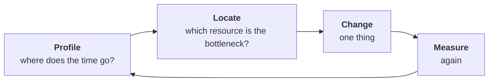

# Section 3: Performance Optimization and Resource Allocation

> **Big idea.** Optimisation is a measurement discipline before it is a coding one. Find out what is actually limiting the system (compute, memory, communication or input data), fix that one thing, and measure again. Then, because chips are expensive, make sure they are shared so they are rarely idle.

---

## Learning Objectives

By the end of this section, you should be able to:

1. Apply a measure-first optimisation workflow and match symptoms to likely bottlenecks.
2. Explain how activation recomputation trades extra compute for lower memory, and calculate its cost.
3. Explain why token-by-token generation is memory-bound, and calculate its speed limit.
4. Describe the throughput–latency trade-off of batching in serving.
5. Explain how scheduling and sharing raise utilisation, and calculate the effect on cost per useful hour.

---

## 3.1 The Story in One Picture

Imagine a training cluster where every chip is expensive and every second costs money. One team complains that training is slow. Another team's chips sit idle for hours because a job is waiting for storage. A third team wonders why a chatbot feels sluggish even though the hardware is fast. All three problems have the same root: nobody measured where the time was actually going. This is the whole story of this section.

**Figure 3.1.** The optimisation loop. Measure first, change one thing, measure again. *Source: author's own diagram.*



Everything else in this section is a detail of this picture.

---

## 3.2 The Measure-First Workflow

Beginners often guess at what is slow. Experts measure. The loop is:

1. **Profile.** Record where time goes: compute, memory transfers, communication, waiting for input data.
2. **Locate the bottleneck.** Use the roofline model from Module 01 for single chips, and the scaling-efficiency idea from Section 2.4 for many chips.
3. **Change one thing.**
4. **Measure again.** Keep the change only if the numbers improve.

The bottleneck is rarely where you expect, and removing one bottleneck simply exposes the next.

**Table 3.1.** Matching symptoms to bottlenecks.

| Symptom | Likely bottleneck | Typical fix |
|---|---|---|
| MFU low, arithmetic units idle between operations | Many small operations; launch overhead | Operator fusion; larger batches; compile the whole graph |
| Low arithmetic intensity on the roofline | Memory bandwidth | Lower precision; reuse data on chip; bigger batch |
| Step time grows as chips are added | Communication | Overlap communication with compute; better placement; fewer, larger messages |
| Chips wait while data loads | Input pipeline (storage, decoding) | Prefetching; more loader workers; faster storage |
| Out-of-memory errors | Memory capacity | Sharding; recomputation; lower precision |

---

## 3.3 Optimisation Techniques for Training

**Table 3.2.** Common training optimisations.

| Technique | What it does | Trade-off |
|---|---|---|
| **Mixed precision** | Computes in BF16/FP16 and keeps an FP32 master copy | Slightly more code; small accuracy risk handled by scaling |
| **Activation recomputation** (checkpointing) | Does not store every intermediate value in the forward pass; recomputes them when needed in the backward pass | Saves memory, costs extra compute |
| **Overlapping communication and compute** | Starts sending the gradients of finished layers while earlier layers are still computing | Needs careful scheduling |
| **Larger per-chip batch** | More work per all-reduce, higher arithmetic intensity | Limited by memory; very large batches can hurt learning |
| **Efficient input pipeline** | Prepares the next batch while the current one runs | Uses CPU and storage resources |

### Worked Example 3.A: The Price of Recomputation

The backward pass costs about twice the forward pass, so a normal training step is about 1 part forward + 2 parts backward = 3 parts, which equals the 6 × N × D estimate. If we recompute the forward pass once more during the backward pass, the step costs 4 parts instead of 3: **about 33% more compute**.

Our 7B job had a step time of 8.2 s (Worked Example 2.B). With full recomputation it would take about 8.2 × 4 ÷ 3 ≈ **10.9 s**. We pay this only if the saved memory lets us use a larger batch or avoid a more expensive sharding scheme.

The following Python program checks the numbers. Its complete expected output is shown below the code.

```python
base = 8.2                     # seconds per step
with_recompute = base * 4 / 3
print(round(with_recompute, 1))
print(f'{4/3 - 1:.0%} extra compute')
```

Expected output:

```text
10.9
33% extra compute
```

---

## 3.4 Optimisation for Serving (Inference)

When a language model writes an answer it generates one token at a time. For each new token, the chip must read **all of the model's weights** from memory once, but does only a small amount of arithmetic with them. That is the memory-bound case of Module 01 (arithmetic intensity near 1 FLOP/byte at batch 1).

### Worked Example 3.B: The Speed Limit of One Conversation

*Illustrative numbers.* The 7B model is stored in INT8 (7 GB). The chip has 1 TB/s of memory bandwidth.

- Time to read the weights once = 7 GB ÷ 1,000 GB/s = **7 ms** per token.
- Speed limit for one user = 1 ÷ 0.007 ≈ **143 tokens per second**, however many MAC units the chip has.
- If 32 users are served in the same batch, the weights are read once for all of them. Total throughput rises to about 32 × 143 ≈ **4,571 tokens per second**, while each user still sees about 143 tokens per second.

The following Python program checks the numbers. Its complete expected output is shown below the code.

```python
weight_bytes = 7e9
bandwidth = 1e12
t = weight_bytes / bandwidth
tps = 1 / t
print(round(t * 1e3, 1), 'ms')
print(round(tps, 1))
print(round(32 * tps, 1))
```

Expected output:

```text
7.0 ms
142.9
4571.4
```

> **Caution: upper bounds.** This ignores the KV cache (stored attention state, which also has to be read for every token and grows with conversation length) and assumes enough compute. Real batches are limited by memory capacity and by the KV cache. The point is the pattern: batching raises throughput almost for free until the chip becomes compute-bound.

### The Throughput–Latency Trade-off

Batching has a hidden cost: requests must wait to be grouped. If 100 requests arrive per second and the server insists on a full batch of 32, the first request in a batch waits about 31 ÷ 100 ≈ **0.31 s** before any computation starts. Servers therefore use a **timeout**: run the batch when it is full *or* when the oldest request has waited, say, 50 ms. With a 50 ms timeout and 100 requests per second, a batch typically holds about 5 requests. Modern servers use *continuous batching*, in which new requests join a running batch between tokens, to get most of the throughput gain without the long wait.

Other serving optimisations include quantisation (Module 01, Section 3.4), caching results for repeated prompts, and running a small fast model to draft tokens that a large model then verifies (*speculative decoding*).

---

## 3.5 Resource Allocation: Sharing Expensive Hardware

A cluster of accelerators is shared by many teams and many kinds of job. A **scheduler** decides who gets which chips and when.

**Table 3.3.** Key ideas in cluster resource allocation.

| Concept | Meaning |
|---|---|
| **Quota** | Each team has a guaranteed share of chips |
| **Priority and preemption** | Urgent or customer-facing jobs (serving) can pause lower-priority jobs (experiments) |
| **Gang scheduling** | A training job needs all of its chips at the same moment; the scheduler starts it only when the full set is free |
| **Topology-aware placement** | Chips that communicate heavily are placed close together on fast links |
| **Bin packing** | Fit jobs of different sizes into free space with as few gaps as possible |
| **Autoscaling** | Add serving replicas when load rises; release them when it falls |

### Worked Example 3.C: Why Utilisation Is a Cost Issue

A chip costs $2 per hour to own and run, whether it is busy or not. If the cluster's average utilisation is 35%, each *useful* chip-hour really costs 2 ÷ 0.35 ≈ **$5.71**. Better scheduling that lifts utilisation to 60% brings it down to 2 ÷ 0.60 ≈ **$3.33**, a saving of about **42%** without buying any hardware.

The following Python program checks the numbers. Its complete expected output is shown below the code.

```python
cost_hr = 2.0
for u in (0.35, 0.60):
    print(round(cost_hr / u, 2))
print(f'{1 - 0.35 / 0.60:.1%} saving')
```

Expected output:

```text
5.71
3.33
41.7% saving
```

---

## 3.6 Activities for Section 3

- [ ] **Activity 3.A.** A training step takes 20 s without recomputation. How long does it take with full recomputation, using the 4-parts-instead-of-3 rule?
- [ ] **Activity 3.B.** A 13-billion-parameter model is stored in INT8 on a chip with 2 TB/s of memory bandwidth. What is the memory-bound limit on tokens per second for one user?
- [ ] **Activity 3.C.** A training job shows MFU of 15%, and the profiler shows the chips idle while they wait for the next batch to be read from storage. Which row of Table 3.1 applies, and what would you try first?
- [ ] **Activity 3.D.** A chip costs $3 per hour. Calculate the cost per useful hour at 25% utilisation and at 50% utilisation.

### Answer Key for Activities

**Activity 3.A.**
- Time with full recomputation = 20 × 4 ÷ 3 ≈ **26.7 s**.

**Activity 3.B.**
- INT8 weight size = 13 × 10⁹ × 1 byte = **13 GB**.
- Time to read weights once = 13 ÷ 2,000 = 0.0065 s = **6.5 ms** per token.
- Speed limit = 1 ÷ 0.0065 ≈ **153.8 tokens per second** for one user.

**Activity 3.C.**
- The symptom "chips idle while they wait for the next batch to be read from storage" matches the fourth row of Table 3.1: **Chips wait while data loads**, with the likely bottleneck being the **input pipeline (storage, decoding)**.
- What I would try first: **prefetch the next batch while the current one is computing**, and add more loader workers or faster storage.

**Activity 3.D.**
- At 25% utilisation: cost per useful hour = 3 ÷ 0.25 = **$12.00**.
- At 50% utilisation: cost per useful hour = 3 ÷ 0.50 = **$6.00**.

---

## 3.7 Summary

- Optimisation follows a loop: profile, locate the bottleneck, change one thing, re-measure; symptoms such as low MFU, growing step time or idle chips point to different bottlenecks.
- Training techniques include mixed precision, overlapping communication, and activation recomputation, which costs about 33% more compute to save memory.
- Generating tokens is memory-bound: a 7 GB INT8 model on a 1 TB/s chip is limited to about 143 tokens/s for one user, and batching 32 users lifts total throughput to about 4,571 tokens/s.
- Batching trades latency for throughput; timeouts and continuous batching limit the waiting.
- Schedulers share chips through quotas, priorities, gang scheduling and topology-aware placement; raising utilisation from 35% to 60% cuts the cost per useful chip-hour by about 42%.

---

## References

Kurose, J. F., & Ross, K. W. (2020). *Computer networking: A top-down approach* (8th ed.). Pearson.
