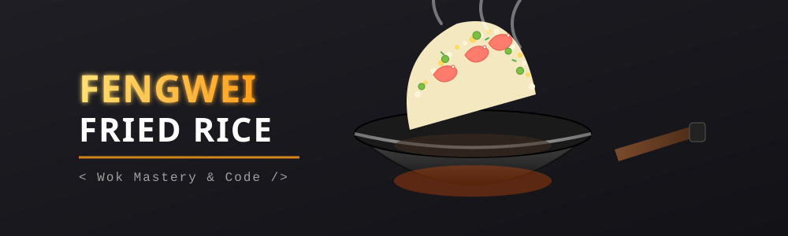

<div align="center">
  
</div>

# Hardware, Networks & Behaviourist AI

**Team Fengwei Fried Rice · Introduction to Artificial Intelligence · Final version (Stage 3), 28 November 2026**

Beginner-friendly learning materials that explain what makes modern AI work underneath the software: the **chips** that compute, the **networks** that carry data, the **reward-driven learning** behind behaviourist AI, the **sensors** that perceive the world, and how all of these are **integrated and optimised** at scale.

> **Start here:** [`Main/00-Module-Overview.md`](Main/00-Module-Overview.md). It describes the intended learners, prerequisites, learning outcomes and reading order.
> **Prefer one file?** Read the PDF copy: [`Main/FengweiFriedRice_Stage3_FinalMarkdown.pdf`](Main/FengweiFriedRice_Stage3_FinalMarkdown.pdf).

---

## Team

| No. | Member | GitHub | Role |
|---|---|---|---|
| 1 | 纪小佩 | [Violine888](https://github.com/Violine888) | CEO: project plan, deadlines, coordination |
| 2 | 林元甲 | [Bvmhe](https://github.com/Bvmhe) | CIO: GitHub repository, file structure, ZIP, report |
| 3 | 温俊强 | [nktjahjadi22](https://github.com/nktjahjadi22) | Content Lead: scope, structure, accuracy review |
| 4 | 汤丽嘉 | [elliciathoenger](https://github.com/elliciathoenger) | Content Lead: content, examples, fact-check |
| 5 | 曾富良 | [LimunZ](https://github.com/LimunZ) | Visual Design Lead: diagrams, slide visuals |
| 6 | 李秀春 | [jocelynemelie](https://github.com/jocelynemelie) | Video Lead: video planning, recording, editing |
| 7 | 黄施杰 | [benedictttt110](https://github.com/benedictttt110) | Quality Lead: accuracy, usability, final check |

*Commit authors:* commits signed **"hama besar"** were made by 曾富良 (LimunZ), and commits signed **"liciaaa"** by 汤丽嘉 (elliciathoenger), from a local Git setup with a different display name.

## Purpose, learners and goals

- **Purpose:** one checked Markdown source for the team's Study Guide and Test Bank, PPT slides and video tutorials.
- **Intended learners:** first- and second-year CS/IT undergraduates, beginners with no previous course in hardware, networking or machine learning.
- **Prerequisites:** basic arithmetic, what a variable and a loop are, and an everyday idea of what a CPU and the internet are.
- **Learning goals:** by the end, learners can
  1. name CPU, GPU, TPU/NPU and memory and explain what each does for AI;
  2. explain how networks move AI data and choose cloud vs edge using latency and bandwidth;
  3. describe how an agent learns from rewards, and explain exploration vs exploitation;
  4. compare cameras, LiDAR and ultrasonic sensors, and explain sensor fusion;
  5. explain how hardware, networks and software are combined and optimised at scale.

## Recommended reading order

1. [`Main/00-Module-Overview.md`](Main/00-Module-Overview.md): start page
2. [Module 01: AI Hardware Architecture](Main/Chapter-01/01-AI-Hardware-Architecture.md)
3. [Module 02: Computer Networks & AI Infrastructure](Main/Chapter-02/02-Computer-Networks-and-AI-Infrastructure.md)
4. [Module 03: Behaviourist AI & Reinforcement Learning](Main/Chapter-03/03-Behaviourist-AI-and-Reinforcement-Learning.md)
5. [Module 04: AI Sensors & Intelligent Systems](Main/Chapter-04/04-AI-Sensors-and-Intelligent-Systems.md)
6. [Module 05: AI System Integration & Optimization](Main/Chapter-05/05-AI-System-Integration-and-Optimization.md)

Each chapter has five sections (four topics and a case study), then a glossary, an answer key with explanations, references and photo credits.

## Folder structure

```text
CS-AI-Group/
├── README.md                  ← you are here
├── Main/                      ← FINAL MARKDOWN CONTENT (the source)
│   ├── 00-Module-Overview.md  ← start page
│   ├── Chapter-01 … Chapter-05/   one chapter file each + assets/ (diagrams, photos/)
│   └── FengweiFriedRice_Stage3_FinalMarkdown.pdf   ← readable PDF copy of all of the above
├── Stage3-Final/              ← final learning resources built from the Markdown
│   ├── FengweiFriedRice_Stage3_FinalStudyGuide.pdf
│   ├── FengweiFriedRice_Stage3_FinalTestBank.docx / .pdf
│   ├── Improvement_Summary.docx / .pdf   (Study Guide & Test Bank revisions)
│   ├── Photo_Credits.txt
│   ├── Supplements/           ← three offline HTML games + setup README + fallback screenshots
│   └── tools/                 ← scripts used to build the guide, test bank and ZIP
├── docs/
│   ├── resource-mapping.md    ← where each Markdown topic is used in the guide, test bank, slides and videos
│   ├── planning/              ← project plan, task list, Stage 1 outline (kept as a record)
│   └── history/               ← Stage 1 resubmission report
├── Quality-&-Reviews/         ← content review drafts for each chapter + quality standards
├── AI-Logs/                   ← AI-use logs for Stages 1, 2 and 3
├── Study-Guide/               ← source files of the Study Guide (page scripts, diagrams, artwork) and the Stage 2 PDF
├── Test-Bank/                 ← Stage 2 Test Bank (superseded by Stage3-Final/)
├── Diner-Game/                ← Diner World Tour study game (preview)
└── tools/                     ← build_pdf.py and the two JavaScript libraries it uses
```

## Opening and using the materials

| What | How |
|---|---|
| Markdown chapters | Read on GitHub, or open in any Markdown viewer (for example VS Code's preview). Images use relative paths and work offline. Diagrams are written in Mermaid; GitHub and VS Code draw them automatically. |
| PDF copy | Open `Main/FengweiFriedRice_Stage3_FinalMarkdown.pdf` in any PDF reader. |
| Rebuild the PDF | Run `python tools/build_pdf.py` from the repository root on Windows with Microsoft Edge installed. No internet is needed. |
| Study Guide, Test Bank | Open the PDF or Word files in `Stage3-Final/`. |
| Games | Double-click an HTML file in `Stage3-Final/Supplements/`; it opens in a browser and works offline. See `Stage3-Final/Supplements/README.md`. |
| PPT slides and video tutorials | Submitted under their own assignments; large video files are not stored in GitHub. See `docs/resource-mapping.md`. |

## Final version

- **Version:** Final (Stage 3), 28 November 2026, branch `main`, Git tag `stage3-final`.
- **Content:** 5 chapters, 25 sections, 129 Mermaid diagrams, 19 images (15 real-world photos from Wikimedia Commons), 5 answer keys.
- **Change history:** every revision since Stage 1 is visible in the commit history. The Stage 3 changes to the Markdown are listed in the Final Submission Report and in `AI-Logs/Stage-3-AI-use-log.md`.

## Known limitations

- Two figures in Module 01 (Figure 5.1 and the Face ID figure) are Apple images reproduced for teaching; all other photos are freely licensed.
- The PDF is generated from the Markdown, so its layout is simple: it is a readable copy, not a designed book. The designed version is the Final Study Guide.
- The slide speaker notes still say "Study Guide V1.0" in their reference lines; the topics and answers they point to are unchanged.
- Videos linked in the Study Guide are on YouTube, which may not open in mainland China; the guide gives a text alternative for each one.
