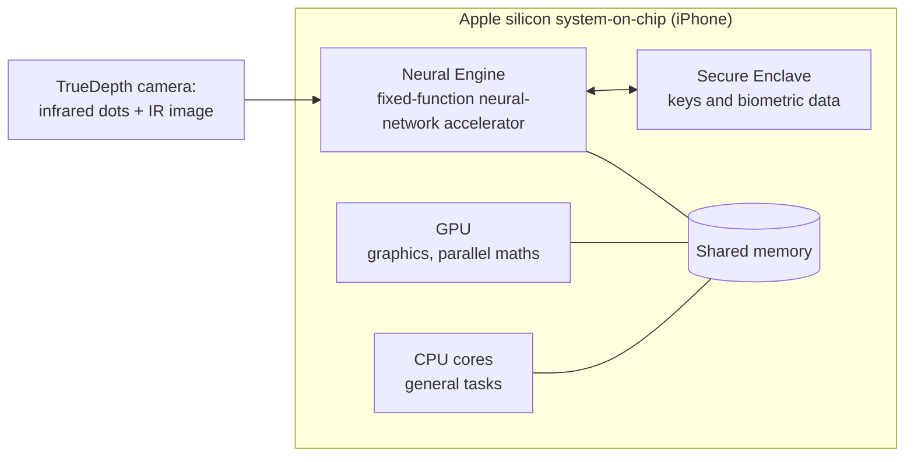

# Module 01 · AI Hardware Architecture
 
## Learning goals
 
After this module you should be able to:
 
- define AI hardware and explain why modern AI needs it;
- compare CPUs, GPUs and TPUs by architecture and by the kind of work each does best;
- explain parallel processing, systolic arrays and reduced-precision arithmetic;
- describe the memory hierarchy and use a simple *roofline* calculation to decide whether a workload is limited by compute or by memory;
- analyse how the Apple Neural Engine brings AI onto a phone.
---
 
## 1.1 Definition and fundamental concepts
 
**AI hardware** is any processor, memory system or interconnect that is designed, or is well suited, to run machine-learning workloads efficiently. The word *efficiently* matters. A laptop CPU can run a neural network; the question is how fast, how much energy it uses, and at what cost.
 
### Why AI workloads are special
 
A neural network layer is mostly **matrix multiplication**: multiply a matrix of weights by a matrix of inputs, add a bias, apply a non-linear function. A single multiply-accumulate (MAC) operation is trivial, but a modern model performs billions or trillions of them. Three properties follow:
 
1. **Massive parallelism.** Millions of MACs in a layer are independent of each other and can be done at the same time.
2. **Regular, predictable data flow.** The sequence of operations is known in advance, so hardware does not need to guess (no complex branch prediction, for example).
3. **Tolerance for low precision.** Many models work well with 16-bit, 8-bit or even 4-bit numbers instead of 32-bit or 64-bit ones, which saves silicon area, memory and energy.
Sze and colleagues summarise the situation this way: deep neural networks deliver state-of-the-art accuracy but at the cost of high computational complexity, so efficient processing is critical to wide deployment [S2 ✓]. The TPU designers made the same argument from the data-centre side: many architects believe major improvements in cost, energy and performance must now come from **domain-specific hardware** [S1 ✓].
 
### Training vs inference
 
| | Training | Inference |
|---|---|---|
| Goal | Learn weights from data | Use learned weights to answer a request |
| Frequency | Rare, long jobs (days to months) | Constant, millions of small requests |
| Main limit | Raw compute and inter-chip communication | Latency, energy and cost per request |
| Typical place | Large data-centre clusters | Data centre **and** edge devices (phones, cars) |
 
This distinction explains much of the hardware landscape. The first Google TPU was built for **inference** only [S1 ✓]; later generations added training, and the newest (Ironwood) is again aimed at inference at scale [S29 ✓] (Module 05).
 
---
 
## 1.2 CPU vs GPU vs TPU: architecture and performance
 
### The three designs in one sentence each
 
- **CPU (central processing unit).** A few very powerful, flexible cores, with large caches and sophisticated control logic, built to run *any* program quickly one after another.
- **GPU (graphics processing unit).** Thousands of simpler cores that run the *same instruction on many data items at once*. Originally for graphics, which is also matrix and vector arithmetic, so it fits neural networks well.
- **TPU (tensor processing unit).** A custom chip (an ASIC) built around a large **matrix-multiply unit** and software-managed on-chip memory, with almost no general-purpose machinery [S1 ✓].
### Table 1.1: CPU vs GPU vs TPU
 
| Aspect | CPU | GPU | TPU |
|---|---|---|---|
| Design goal | General-purpose, low latency for one task | High throughput for parallel tasks | Maximum matrix throughput per watt for neural networks |
| Core count | Few (tens) | Thousands of small cores | One or a few very large matrix units |
| Control logic | Complex: caches, out-of-order execution, branch prediction | Simpler; many threads hide delays | Minimal; deterministic execution |
| Flexibility | Highest | High (programmable) | Lowest (tuned to tensor operations) |
| Typical AI role | Pre-processing, small models, orchestration | Training and inference | Large-scale training and inference in Google's cloud |
| Weakness for AI | Too few parallel units | Higher power than a custom ASIC; memory bandwidth can limit | Less flexible; tied to a software stack |
 
*Sources for the design descriptions: [S1 ✓], [S2 ✓], [S3 †].*
 
### What the first TPU paper measured
 
The 2017 paper by Jouppi et al. is the best-documented comparison available, because it measured a real chip in real data centres [S1 ✓]:
 
- The heart of the first TPU is a **65,536-element 8-bit MAC matrix unit** with a peak of **92 tera-operations per second (TOPS)** and a **28 MiB software-managed on-chip memory**.
- Compared with a contemporary Intel Haswell server CPU and an Nvidia K80 GPU in the same data centres, the TPU was on average about **15–30× faster** and delivered about **30–80× more TOPS per watt**.
- The authors attribute part of this to **deterministic execution**: caches, out-of-order execution, multithreading and prefetching improve *average* throughput, but not the *99th-percentile response time* that user-facing services need.
- Four of the six benchmark applications were **memory-bandwidth limited** on the TPU. Using the GPU's faster GDDR5 memory in a revised design would have tripled achieved TOPS.
> **Read this with care.** The comparison is from 2015–2017 hardware. It is a good *illustration of the design philosophy*, not a ranking of today's chips. Current GPUs have added dedicated matrix units of their own, and the gap between "GPU" and "TPU" designs has narrowed.
 
---
 
## 1.3 Parallel processing and AI acceleration
 
### Kinds of parallelism
 
| Level | Idea | Example |
|---|---|---|
| **Instruction-level** | A core overlaps several instructions | Modern CPU pipelines |
| **Data-level (SIMD / SIMT)** | One instruction acts on many values | GPU warps; CPU vector units |
| **Matrix-level (systolic)** | A grid of MAC units passes data neighbour to neighbour | TPU matrix unit |
| **Model- and data-level across chips** | Split the model or the batch over many chips | Training clusters (Module 05) |
 
### The systolic array
 
In a systolic array, weights are loaded into a grid of MAC cells. Input values flow through the grid in a regular rhythm, and each cell multiplies, adds its result to the partial sum from its neighbour, and passes it on. Each data value is fetched from memory **once** but used many times, which cuts the costly memory traffic.
 
```
 inputs ─►  [MAC]──►[MAC]──►[MAC]──►[MAC]
              │       │       │       │
              ▼       ▼       ▼       ▼   partial sums flow down
 inputs ─►  [MAC]──►[MAC]──►[MAC]──►[MAC]
              │       │       │       │
              ▼       ▼       ▼       ▼
 inputs ─►  [MAC]──►[MAC]──►[MAC]──►[MAC]
              │       │       │       │
              ▼       ▼       ▼       ▼
            results accumulate at the bottom
```
 
*Figure 1.1: Simplified systolic array (teaching sketch). The first TPU used a 256 × 256 grid, which is the 65,536 MACs quoted above [S1 ✓].*
 
### Amdahl's law: parallel hardware has limits
 
If a fraction *p* of a job can be parallelised over *N* units, the best possible speed-up is
 
$$S = \frac{1}{(1-p) + p/N}$$
 
**Worked example (illustrative).** A pipeline spends 95 % of its time in matrix maths (*p* = 0.95) and 5 % in serial pre-processing. With *N* = 100 accelerator units:
 
S = 1 / (0.05 + 0.95/100) = 1 / 0.0595 ≈ **16.8×**, not 100×.
 
Even with infinitely many units the limit is 1/0.05 = 20×. The lesson for AI systems: **speed up the serial parts too** (data loading, tokenisation, networking), or the accelerator sits idle.
 
### Reduced precision (quantisation)
 
Using fewer bits per number lets a chip fit more MAC units in the same area and move fewer bytes. The first TPU used 8-bit integers for inference [S1 ✓]; later accelerators support formats such as bfloat16 and 8-bit floating point [S29 ✓, S30 ✓]. The trade-off is a small, usually acceptable loss of numerical accuracy.
 
---
 
## 1.4 Memory hierarchy and computational efficiency
 
### Figure 1.2: The memory pyramid
 
```
                    ▲  faster, smaller, costlier per byte, lower energy per access
                   ╱ ╲
                  ╱   ╲        Registers
                 ╱─────╲       (inside the core)
                ╱       ╲      On-chip SRAM: L1 / L2 cache, or
               ╱─────────╲     software-managed buffers (e.g. TPU's 28 MiB)
              ╱           ╲    High-bandwidth memory (HBM) / GDDR
             ╱─────────────╲   (stacked next to the chip)
            ╱               ╲  Main memory (DRAM)
           ╱─────────────────╲ 
          ╱                   ╲ Flash / SSD storage
         ╱─────────────────────╲ 
        ╱                       ╲ Network or cloud storage
       ╱─────────────────────────╲
                   ▼  slower, larger, cheaper per byte, higher energy per access
```
 
The main idea: **moving data costs more time and energy than computing on it**. Good AI hardware and good AI software are both organised to keep data in the small, fast levels as long as possible. The TPU's large software-managed on-chip memory is a design choice in exactly this direction [S1 ✓]. Newer TPUs pair each chip with tens of gigabytes of HBM: Ironwood has 192 GB per chip, six times the previous generation [S30 ✓, via press coverage of Google's announcement].
 
### Compute-bound vs memory-bound: the roofline idea
 
The roofline model [S39 †] says achievable performance is the smaller of:
 
- the chip's **peak compute rate**, and
- **memory bandwidth × arithmetic intensity**, where arithmetic intensity = operations performed per byte moved.
**Worked example (illustrative numbers).** Multiply two *N × N* matrices stored in 16-bit format (2 bytes per value).
 
- Operations: 2*N*³ (a multiply and an add per term).
- Data moved, if each matrix is read or written once: 3*N*² values × 2 bytes = 6*N*² bytes.
- Intensity = 2*N*³ / 6*N*² = *N*/3 operations per byte.
For *N* = 4096 the intensity is about **1,365 operations per byte**.
 
Now take a *made-up* accelerator with 1,000 TFLOP/s peak and 3 TB/s memory bandwidth. Its **ridge point** is 1,000×10¹² / 3×10¹² ≈ **333 operations per byte**.
 
- A large matrix multiply (1,365 > 333) is **compute-bound**: the chip's arithmetic units are the limit.
- A small-batch inference step that reads every weight once to do only a couple of operations per byte (intensity ≈ 1–2) is **memory-bound**: performance is about 3 TB/s × 2 ≈ 6 TFLOP/s, under 1 % of peak.
This is why the first TPU paper found most workloads were memory-bandwidth limited [S1 ✓], and why **batching** (reusing each weight for many requests) and **faster memory** (HBM) matter so much.
 
### Efficiency metrics to remember
 
| Metric | Meaning | Why it matters |
|---|---|---|
| Throughput (TOPS, FLOP/s) | Operations per second | Training speed |
| Latency | Time for one request | User experience; real-time control |
| Performance per watt | Operations per joule | Battery life; data-centre power bill |
| Utilisation | Share of peak actually achieved | Money paid for idle silicon |
 
---
 
## 1.5 Case study: Apple Neural Engine (on-device AI)
 
*Task from the outline: investigate how iPhones use specialised neural processing hardware for facial recognition, image processing and other AI features.*
 
### Problem
 
Unlocking a phone with your face must be fast (a fraction of a second), accurate, hard to fool, **private** (face data is highly sensitive) and light on battery. Sending images to a cloud service and waiting for a reply would add delay, depend on connectivity and expose biometric data. The computation therefore has to happen **on the device**.
 
### Approach: a dedicated neural processing unit
 
Apple introduced the **Neural Engine** with the A11 Bionic chip in the iPhone 8 and iPhone X (2017). Press coverage at the time described it as a pair of cores dedicated to specific machine-learning algorithms, powering Face ID, Animoji and augmented-reality features [S5 ✓]. Analysts described this as the start of a second stage of embedded AI, in which more intelligence runs on the device independent of the cloud [S6 ✓]. A teardown of the A11 (10 nm process, about 87.7 mm²) found the Neural Engine occupies an area comparable to several CPU cores, which shows how much silicon Apple devoted to it [S8 ✓].
 

 
*Figure 1.4: Simplified view of where the Neural Engine sits (teaching diagram, not Apple's schematic).*
 
### How Face ID uses it
 
1. The front sensor system projects an infrared dot pattern and captures an infrared image; coverage of the launch put the pattern at about 30,000 points forming a 3D map of the face [S6 ✓].
2. Neural networks convert the 2D image and depth data into a **mathematical representation** of the face.
3. That representation is compared with the enrolled one inside the **Secure Enclave**, an isolated security processor. Apple's security documentation states that the matching networks were trained on over a billion images, that a separate network is trained to resist spoofing with photos or masks, that Face ID data is encrypted and available only to the Secure Enclave, and that it never leaves the device. Face images captured in normal use are discarded once the mathematical representation is computed [S4 ✓].
4. At launch Apple claimed the chance that a random person could unlock a phone is 1 in 1,000,000, versus 1 in 50,000 for Touch ID [S5 ✓]. *(This is a vendor claim made in 2017.)*
**Hardware detail worth knowing.** On A11 to A13 chips a dedicated "Secure Neural Engine" lived inside the Secure Enclave. From A14 and M1, according to Apple's platform security guide as summarised by security press, this function moved to a **secure mode of the main Neural Engine**: the engine's state is reset when it switches between secure and ordinary work so data from one cannot leak to the other [S7 ✓ (secondary summary; check the Apple guide itself)].
 
### Other uses of on-device neural hardware
 
- **Computational photography and image processing:** scene and object recognition, portrait effects, photo search.
- **Language and voice:** on-device speech recognition and text prediction.
- **Developer access:** apps reach the accelerator through Apple's Core ML framework, which can automatically use on-device accelerators when present [S6 ✓].
Apple's computer-vision team also described the engineering constraint clearly: on-device models must ship inside the operating system, taking up storage, and must share compute and memory with other running apps, unlike a cloud service whose resources can be dedicated to the task [reported in S6-adjacent coverage; see Sources note].
 
### Results and benefits
 
| Benefit | Why on-device hardware delivers it |
|---|---|
| **Privacy** | Biometric data is processed and stored locally [S4 ✓] |
| **Low latency** | No network round trip (Module 02) |
| **Works offline** | No connectivity needed |
| **Energy efficiency** | Fixed-function neural silicon uses less energy per operation than a general-purpose CPU would [S2 ✓ for the general principle] |
 
### Limits and trade-offs
 
- **Fixed capability.** A phone's accelerator is small compared with a data-centre. Large models must be compressed, quantised, or sent to the cloud.
- **Hardware ageing.** New model types may not map well onto last generation's silicon.
- **Security trade-offs.** Making the accelerator shared across tasks required careful isolation design (the A14 change above).
- **Closed ecosystem.** Details of the Neural Engine's internals are not fully public, so outside analysis relies on Apple's documentation, teardowns and press reports.
### Link to the rest of the book
 
The Neural Engine is an **edge** accelerator: it is the on-device end of the cloud-versus-edge choice in Module 02, it uses the same principles (parallel MACs, low precision, careful memory use) as the TPU in Module 05, and it receives data from the sensors discussed in Module 04.
 
---
 
## 1.6 Summary
 
- AI workloads are dominated by regular, parallel matrix arithmetic that tolerates low precision, which is why specialised hardware pays off.
- CPUs are flexible, GPUs are massively parallel, and TPUs are domain-specific matrix engines. The first TPU was roughly 15–30× faster and 30–80× more energy-efficient than its contemporaries on Google's inference workloads [S1 ✓].
- Parallel speed-up is limited by the serial fraction (Amdahl) and often by **memory bandwidth** rather than arithmetic (roofline).
- Moving data costs more than computing on it, so the memory hierarchy shapes hardware design.
- The Apple Neural Engine shows the same ideas shrunk to a phone, trading flexibility for privacy, latency and battery life.
### Key terms
 
AI hardware · ASIC · MAC · TOPS · systolic array · SIMD/SIMT · quantisation · memory hierarchy · HBM · arithmetic intensity · roofline · compute-bound · memory-bound · NPU · Neural Engine · Secure Enclave
 
### Review questions
 
1. Why does a neural network's structure make GPUs and TPUs more efficient than CPUs?
2. Name two design choices that let the first TPU meet strict response-time limits better than a CPU or GPU [S1 ✓].
3. A pipeline is 90 % parallelisable. What is the maximum speed-up with 10 accelerator units? With unlimited units?
4. Explain, with the roofline idea, why batching improves accelerator utilisation.
5. Give three reasons Face ID processing happens on the phone rather than in the cloud.
6. What is the difference between *compute-bound* and *memory-bound*? Give one example of each.
*Answers to Q3: 1/(0.1 + 0.9/10) = 5.26×; unlimited: 10×.*
