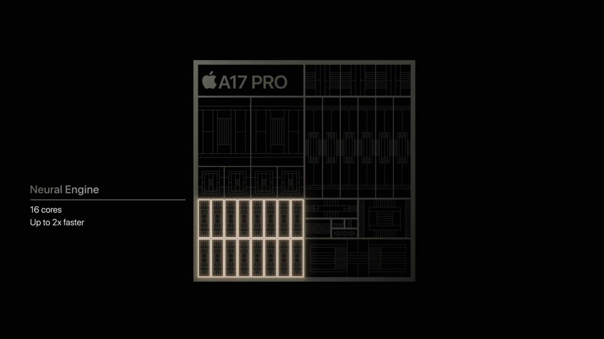
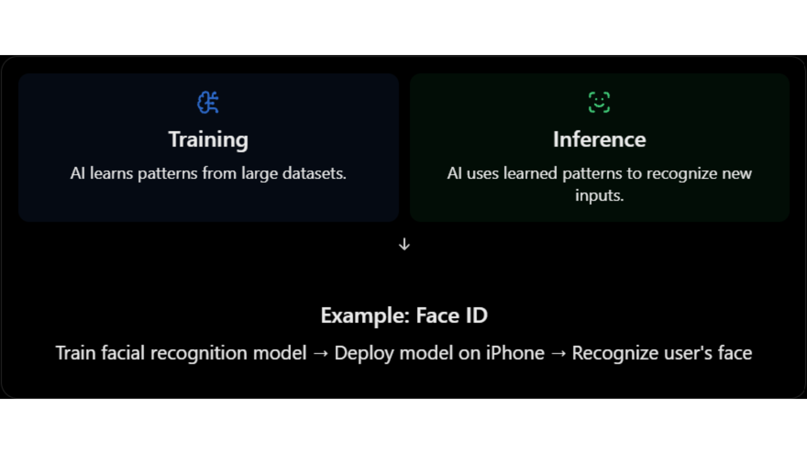
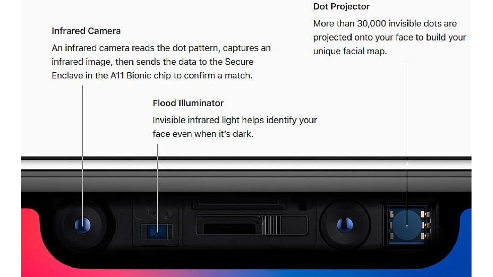

# Module 01: AI Hardware Architecture
 
| | |
|---|---|
| **Course** | Hardware, Networks & Behaviourist AI |
| **Version** | V1.0 (substantive draft, Stage 1) |
| **Audience** | Beginners with basic programming knowledge and no hardware background |
| **Prerequisites** | Basic arithmetic, the idea of a variable and a loop. No electronics knowledge needed. |
| **Position in course** | First of five modules; Modules 02-05 reuse the vocabulary introduced here |
 
## Module overview
 
When people talk about artificial intelligence, they usually talk about software: models, data, and algorithms. But every AI model is, in the end, an enormous number of arithmetic operations running on physical chips. The choice of chip decides:
- how fast a model can be trained (days or months),
- how much electricity it uses (and therefore what it costs and what it emits),
- how quickly it can answer one request (milliseconds or seconds),
- and whether it can run on a phone at all, or only in a data centre.
This module explains why AI needs specialised hardware and how it's designed. It ends with a case study of the hardware inside a phone you may be holding right now: the Apple Neural Engine.
 
## Learning objectives
 
By the end of this module, you will be able to:
 
1. Define AI hardware and explain why general-purpose processors are not always enough.
2. Compare CPUs, GPUs, and TPUs in terms of architecture and the kind of work each does best.
3. Explain how parallel processing, systolic arrays, and reduced-precision arithmetic speed up the core operation of neural networks (matrix multiplication).
4. Describe the memory hierarchy and explain why moving data often costs more than computing on it.
5. Use a simple roofline calculation to decide whether a workload is limited by compute or by memory.
6. Analyse how the Apple Neural Engine brings AI onto a phone, and judge its trade-offs.

## A running example
 
Throughout the module we return to one small, concrete task so that every idea has something to attach to:
 
> **Running example: unlocking a phone with your face.** A camera takes a picture, a neural network turns it into a list of numbers, and the phone compares those numbers with the ones saved when you set up Face ID. The whole thing has to take a fraction of a second, use almost no battery, and never send your face to anyone else's computer.
 
Every hardware idea in this module (parallel units, low precision, on-chip memory) exists because of pressures like these.
 
## 1. Definition and Fundamental Concepts
 
> **Big idea.** AI hardware is not magic: it is ordinary computing hardware that has been arranged so that the one kind of arithmetic that AI does all day is cheap in time, energy, and money.
 
### 1.1 What is AI hardware?
 
AI hardware is any physical computing device (a processor, a memory system or the wiring between them) that is designed, or is well suited, to run machine-learning workloads efficiently.
 
The word *efficiently* matters. A laptop CPU can run a neural network, and so can a calculator if you are patient enough. The real questions are:
 
- How fast? (time)
- How much energy? (battery life, electricity bill, heat)
- At what cost? (price of the chip, size of the data centre)
AI hardware therefore includes:
 
| Category | What it is | Examples |
|---|---|---|
| General-purpose processors used for AI | Chips designed for any program but able to run AI | CPUs (Intel, AMD, Arm) |
| Massively parallel processors | Thousands of simple cores doing the same thing to different data | GPUs (NVIDIA, AMD) |
| Domain-specific accelerators | Chips designed around the arithmetic of neural networks | TPUs (Google), NPUs such as Apple's Neural Engine |
| Memory systems | Fast memory placed near the compute units | On-chip SRAM, High Bandwidth Memory (HBM) |
| Interconnects | Links between chips and between machines | NVLink, TPU inter-chip links, Ethernet/InfiniBand (Module 02) |
 
> **Going further.** A chip designed for one domain is often called an **ASIC** (application-specific integrated circuit). A TPU is an ASIC for neural-network arithmetic. The opposite extreme is the CPU, a general-purpose processor.
 
### 1.2 What do AI models actually compute?
 
Before comparing chips, we need to know what the chips are asked to do.
 
A neural network is built from layers. Most layers do one dominant operation: multiply a block of numbers (the **weights**, which the model learned during training) by another block of numbers (the **inputs**), then add the results together.
 
For one output value, the calculation looks like this:

Output = (w1 × x1) + (w2 × x2) + (w3 × x3) + ... + (wn × xn)
 
Each "multiply, then add to a running total" step is called a **MAC** (multiply-accumulate).
 
#### Worked example 1.A: a single neuron by hand
 
*Illustrative numbers.* A tiny neuron has three weights and receives three inputs:
 
| | 1st | 2nd | 3rd |
|---|---|---|---|
| Weights w | 0.5 | -1.0 | 2.0 |
| Inputs x | 4 | 3 | 1 |
 
- **Step 1.** Start the running total at 0.
- **Step 2.** MAC #1: total = 0 + (0.5 × 4) = 0 + 2.0 = 2.0
- **Step 3.** MAC #2: total = 2.0 + (-1.0 × 3) = 2.0 - 3.0 = -1.0
- **Step 4.** MAC #3: total = -1.0 + (2.0 × 1) = -1.0 + 2.0 = 1.0
**Result.** The output is 1.0, computed with 3 MACs. (Real networks then pass this number through a simple function such as ReLU, which keeps positive numbers and turns negative ones into 0; that step is cheap compared with the MACs.)
 
Now scale it up. One layer might have 4,096 neurons, each with 1,024 inputs. That is 1,024 × 4,096 = 4,194,304 MACs, about 4.2 million, for one layer and one input. A modern large language model needs billions to trillions of MACs to produce a single answer.
 
> **Key idea.** If a chip can do MACs very fast and very efficiently, it speeds up almost the whole model. This is why the MAC is the central operation in AI hardware design.
 
#### Matrices: the same thing, written compactly
 
Writing out every MAC is tedious, so we group the weights into a table called a **matrix**, and the inputs into a list called a **vector**. "Multiply the weight matrix by the input vector" means "do all the neuron calculations at once". When we process several inputs at the same time, they form a second matrix, and we speak of **matrix multiplication**. Almost all of AI hardware is, at heart, hardware for multiplying matrices. A generalisation to higher dimensions is called a **tensor**, which is where the "T" in TPU comes from.

```
Weight matrix W          Input vector x     Output vector y
(rows = neurons)
 
[ w11 w12 w13 ]          [ x1 ]             [ w11·x1 + w12·x2 + w13·x3 ]
[ w21 w22 w23 ]    ×     [ x2 ]      =      [ w21·x1 + w22·x2 + w23·x3 ]
[ w31 w32 w33 ]          [ x3 ]             [ w31·x1 + w32·x2 + w33·x3 ]
```

Each output value = 3 MACs. Whole layer = 3 × 3 = 9 MACs.
 
### 1.3 Key terms
 
These terms are used throughout the module. A complete glossary is at the end.
 
| Term | Definition |
|---|---|
| **Training** | Adjusting a model's weights using lots of data. Very compute-heavy; usually done in data centres. |
| **Inference** | Using a trained model to produce an answer (for example, unlocking your phone). Happens every time a user uses the AI. |
| **MAC** | Multiply-accumulate: multiply two numbers and add the result to a running total. |
| **FLOP / FLOPs** | A floating-point operation (one add or multiply on decimal-style numbers). "FLOPs" is the plural; FLOPS (capital S) means FLOPs per second. One MAC counts as 2 FLOPs. |
| **TOPS** | Tera operations per second (10¹² operations per second). Often used for integer operations on AI chips. |
| **Throughput** | How much work is finished per second. |
| **Latency** | How long one task takes from start to finish. |
| **Precision** | How many bits are used to store each number: FP32 = 32-bit floating-point, FP16 = 16-bit float, INT8 = 8-bit integer. Lower precision means less memory, less energy and usually faster hardware, at some cost in accuracy. |
| **Accelerator** | A chip that works alongside the CPU to speed up specific kinds of work. |
| **Bandwidth** | How many bytes per second can be moved between two parts of a system. |
 
> **Caution: bits and bytes.** 1 byte = 8 bits. An FP32 number takes 4 bytes, an FP16 number 2 bytes, and an INT8 number 1 byte. Many mistakes in hardware calculations come from forgetting this conversion.
 
#### Prefixes you will meet
 
| Prefix | Symbol | Power of ten | Example |
|---|---|---|---|
| kilo | k | 10³ | 1 kB = 1,000 bytes |
| mega | M | 10⁶ | 8 MB of cache |
| giga | G | 10⁹ | 500 GB/s bandwidth |
| tera | T | 10¹² | 92 TOPS |
| peta | P | 10¹⁵ | data-centre clusters quote PFLOPS |
| milli / micro / nano / pico | m / µ / n / p | 10⁻³ / 10⁻⁶ / 10⁻⁹ / 10⁻¹² | 1 ms, 1 µs, 1 ns, 1 pJ |
 
(Memory sizes are sometimes quoted in powers of two: 1 MiB = 2²⁰ = 1,048,576 bytes. The difference is small and does not change any conclusion in this module.)
 
### 1.4 Why not just use a faster CPU?
 
For decades, the answer to "make computers faster" was simply "wait for the next CPU". That stopped working for two reasons.
 
**Reason 1: the workload is highly repetitive and independent.** Millions of MACs can be done at the same time because they do not depend on each other: the result of neuron 17 does not change the calculation for neuron 18. A chip built for doing one complicated thing quickly wastes its effort on this. A chip built for doing a huge number of simple things at once does not.
 
**Reason 2: energy and memory limits.** Chips can no longer simply be clocked faster without overheating. Historically, as transistors shrank, they also used less power, so each generation could run faster without getting hotter (this is often associated with Dennard scaling). That trend ended in the mid-2000s, and clock speeds flattened at a few gigahertz. Hennessy and Patterson, in their well known textbook and Turing Award lecture, argue that because general-purpose processors have stopped improving as quickly as before, big gains in cost, energy, and performance must now come from domain-specific hardware (Hennessy & Patterson, 2019). Gains now come from two directions, which this module keeps returning to:
 
1. doing more things at once (parallelism), and
2. moving less data (memory efficiency).
 
### 1.5 Training versus inference
 
The same neural network is used in two very different ways, and the hardware requirements differ.
 
| | Training | Inference |
|---|---|---|
| **Goal** | Learn weights from data | Use learned weights to answer a request |
| **Frequency** | Rare, long jobs (days to months) | Constant: millions of small requests |
| **Main limit** | Raw compute and chip-to-chip communication | Latency, energy and cost per request |
| **Typical place** | Large data-centre clusters | Data centres and edge devices (phones, cars) |
| **Precision** | Usually higher (FP32, BF16, FP16) | Often lower (INT8, FP8, even 4-bit) |
| **Data movement** | Forward pass and backward pass; many intermediate values stored | Forward pass only |
| **Batch size** | Large (hundreds or more) | Often 1 (one user at a time) |
 
This distinction explains much of the hardware landscape. The first Google TPU was built for inference only (Jouppi et al., 2017); later generations added training, and Google's newest announced generation, Ironwood, is again aimed at inference at scale (Module 05 looks at it in detail).
 
**Why does the batch size matter?** Section 4 shows that a single-user request (batch size 1) tends to be limited by memory, whereas a large training batch tends to be limited by compute. That one fact shapes whole product lines.
 
### 1.6 Efficiency metrics to remember
 
| Metric | Meaning | Why it matters |
|---|---|---|
| Throughput (TOPS, FLOP/s) | Operations per second | Training speed |
| Latency | Time for one request | User experience; real-time control |
| Performance per watt | Operations per joule | Battery life; data-centre power bill |
| Utilisation | Share of peak performance actually achieved | Money paid for idle silicon |
| Performance per dollar | Operations per unit of cost | Budget decisions |
| Memory capacity | How big a model fits | Which models can run at all |
 
> **Caution: peak is not typical.** A chip's quoted "peak" number is what it could do if every arithmetic unit were busy every cycle. Real programs are usually far below that. Sections 3 and 4 explain why.
 
---
 
## 2. CPU vs GPU vs TPU
 
> **Big idea.** Three families of chips sit at different points on a trade-off between flexibility and efficiency. The more a chip is specialised for a task, the more efficient it is at that task and the less useful it is for anything else.
 
### 2.1 The three chips in one sentence each
 
- **CPU (Central Processing Unit):** a few very capable cores that handle any kind of program quickly, one step at a time per core.
- **GPU (Graphics Processing Unit):** thousands of simpler cores that do the same operation on many data items at once. Originally built to draw graphics, it turned out to be ideal for neural networks, because drawing millions of pixels and multiplying large matrices are both "same operation, lots of data" problems.
- **TPU (Tensor Processing Unit):** a chip designed by Google specifically for tensor (multi-dimensional array) arithmetic, built around a grid of multiply-accumulate units.
A related term you will meet in Section 5 is **NPU** (Neural Processing Unit): a general name for a small, low-power AI accelerator inside a phone or laptop chip.
 
**An everyday analogy:**
 
> A CPU is like a small team of expert chefs who can cook any dish in the book, but each works on one dish at a time. A GPU is like a huge kitchen of junior cooks who all follow the same instruction ("chop these 1,000 onions") together. A TPU is like a factory assembly line built to make exactly one product, extremely efficiently, but useless if you want something else.
 
### 2.2 Comparison table
 
| Feature | CPU | GPU | TPU |
|---|---|---|---|
| **Design goal** | Fast, flexible, low latency for one task | High throughput on parallel data | Maximum matrix throughput per watt for neural networks |
| **Core count (order of magnitude)** | Few to ~100 complex cores | Thousands of simple cores | A large grid of MAC units (tens of thousands in one array) |
| **Control logic** | Complex: caches, out-of-order execution, branch prediction | Simpler; many threads hide delays | Minimal; deterministic execution |
| **Flexibility** | Highest: runs any program | High: programmable for many parallel tasks | Lowest: tuned to tensor operations |
| **Energy efficiency for AI** | Lowest | Medium to high | Highest (for supported workloads) |
| **Typical AI role** | Pre-processing, data loading, small models, orchestration | Training and inference of large models | Large-scale training and inference in Google's cloud |
| **Weakness for AI** | Too few parallel units | Higher power than a custom ASIC; memory bandwidth can limit | Less flexible; tied to a software stack |
| **Programming** | Any language | CUDA, OpenCL, or frameworks such as PyTorch | Through frameworks such as TensorFlow/JAX and the XLA compiler |
 
*Sources for the design descriptions: Jouppi et al. (2017); Sze et al. (2017); Hennessy & Patterson (2019); NVIDIA (n.d.).*
 
#### Terms used in the table
 
- **Core:** a unit inside a chip that can execute instructions on its own.
- **Cache:** a small, fast memory that keeps copies of recently used data close to the processor (Section 4).
- **Out-of-order execution:** a CPU trick of running instructions in a different order from the program when it is safe, to avoid waiting.
- **Branch prediction:** guessing which way an `if` statement will go so the CPU can keep working instead of waiting.
- **Deterministic execution:** every run takes the same, predictable number of cycles. This matters for services that must answer within a time limit.
- **Compiler:** software that translates a program into instructions for a specific chip. XLA is the compiler used for TPUs.
### 2.3 Visual: where the chip area goes
 
*Simplified, not to scale. The point is what each design spends its silicon on:*
 
```
        CPU                       GPU                        TPU
+------------------------+ +------------------------+ +------------------------+
| [Core] [Core]  CACHE   | | c c c c c c c c c c c  | | Systolic array of      |
| [Core] [Core]  CACHE   | | c c c c c c c c c c c  | | MAC units              |
| big control logic      | | c c c c c c c c c c c  | | (data flows through)   |
| large caches           | | small control, cache   | | + on-chip buffer       |
+------------------------+ +------------------------+ +------------------------+
   Few smart cores          Many simple cores          Matrix-multiply engine
```
 
In a CPU much of the area is "overhead" (caches, prediction logic) that makes a single thread fast. In a GPU, most area goes to arithmetic units. In a TPU, nearly all of it goes to the grid of MACs and the memory that feeds it.
 
*(The positions are a qualitative teaching sketch, not measurements.)*
 
### 2.4 What the first TPU paper measured
 
The 2017 paper by Jouppi et al. is the best-documented comparison available, because it measured a real chip in real data centres:
 
- The heart of the first TPU is a 65,536-element 8-bit MAC matrix unit with a peak of 92 TOPS and a 28 MiB software-managed on-chip memory.
- Compared with a contemporary Intel Haswell server CPU and an Nvidia K80 GPU in the same data centres, the TPU was on average about 15-30× faster and delivered about 30-80× more TOPS per watt.
- The authors attribute part of this to deterministic execution: caches, out-of-order execution, multithreading and prefetching improve average throughput, but not the 99th-percentile response time that user-facing services need.
- Four of the six benchmark applications were memory-bandwidth limited on the TPU. Using the GPU's faster GDDR5 memory in a revised design would have tripled achieved TOPS.
> **Caution: read this with care.** The comparison is from 2015-2017 hardware. It is a good illustration of the design philosophy, not a ranking of today's chips. Current GPUs have added dedicated matrix units of their own (NVIDIA calls them Tensor Cores), and the gap between "GPU" and "TPU" designs has narrowed.
 
**Why does the memory finding matter?** Notice the last bullet: even a chip with 65,536 MACs spent most of its time waiting for data on four out of six workloads. This is exactly the problem Section 4 formalises with the roofline model. Keep it in mind: more arithmetic units do not help if they cannot be fed.
 
### 2.5 The NPU: AI on small devices
 
A phone cannot carry a 300-watt accelerator. An NPU (neural processing unit) applies the same ideas as a TPU (a grid of MAC units, low-precision numbers, on-chip memory) but scaled down to run in a few watts inside a **system-on-a-chip (SoC)**, which puts the CPU, GPU, NPU, memory controllers and other blocks on a single piece of silicon. Names differ by company (Apple: Neural Engine; Google Pixel: Tensor chip's TPU; Qualcomm: Hexagon NPU; many laptops: "AI Engine/NPU"), but the principle is the same. Section 5 studies the Apple version.
 
### 2.6 Software: why a chip is only as useful as its tools
 
Hardware is useless if programmers cannot easily use it. This is a major reason GPUs became dominant for AI:
 
| Chip | Typical way programmers reach it |
|---|---|
| CPU | Any language; compiler targets it directly |
| GPU | CUDA (NVIDIA), OpenCL, or high-level frameworks (PyTorch, TensorFlow) that call vendor-optimised libraries |
| TPU | Frameworks (TensorFlow, JAX, PyTorch/XLA) compile to the TPU through XLA |
| Apple Neural Engine | Core ML, which decides whether a model runs on CPU, GPU or the Neural Engine |
 
A programmer usually does not write instructions for the MAC units directly. They write a model in a framework, and a compiler/runtime maps it onto the hardware. This is why "unsupported operations falling back to the CPU" can silently make a model slow (see the case-study questions in Section 5).
 
> **Going further.** The combination of hardware and its software ecosystem is sometimes called a **platform**. Switching from one platform to another can be costly even if the new chip is faster on paper, which partly explains why one vendor can dominate a market.
 
### 2.7 Activities for Section 2
 
> **Check your understanding (2.1).** Which of the three chips would you choose for? Justify briefly.
>  (a) a web server running mixed tasks,
> (b) training a large image model,
> (c) a fixed, high-volume inference service in a data centre? 
>
 
> **Check your understanding (2.2).** In the 2 × 2 systolic example, how many times was each weight read from memory, and how many times was each input read?
>
 
> **Application question (2.3).** A start-up wants to add a voice assistant to a smart speaker that runs on a small battery. Arrange CPU, GPU and NPU in order from most to least suitable and give one reason for your ordering!
>
 
> **Discussion (2.4).** The first TPU was faster and more energy-efficient than its contemporaries on Google's workloads, but a start-up with a different workload might still pick a GPU. Give two reasons.
>
 
---
 
## 3. Parallel Processing and AI Acceleration
 
> **Big idea.** Neural networks consist of huge numbers of independent MACs, so the way to go fast is to do many of them at the same time. But parallel hardware has limits, and the limits are as important as the speed-ups.
 
### 3.1 Kinds of parallelism
 
"Parallel" simply means "at the same time". Hardware does this at several different levels:
 
| Level | Idea | Example |
|---|---|---|
| Instruction-level | A single core overlaps several instructions (like an assembly line) | Modern CPU pipelines |
| Data-level (SIMD / SIMT) | One instruction acts on many values at once | GPU warps; CPU vector units |
| Matrix-level (systolic) | A grid of MAC units passes data neighbour to neighbour | TPU matrix unit |
| Model- and data-level across chips | Split the model, or the batch of data, over many chips | Training clusters (Module 05) |
 
**Terms.**
 
- **SIMD** (Single Instruction, Multiple Data): the same instruction is applied to a block of values in lock-step. On GPUs the equivalent idea is often called **SIMT** (Single Instruction, Multiple Threads): groups of threads (a *warp* on NVIDIA GPUs) execute together.
- **Thread:** one stream of instructions. GPUs run tens of thousands at once.
- **Data parallelism:** the same operation on different data at the same time (for example, 1,000 pixels each multiplied by the same filter weights).
- **Model (task) parallelism:** different operations at the same time, or one big model split across several chips (for example, one chip handles layers 1-10 while another handles layers 11-20).
GPUs are built for data parallelism. A very useful trick they use is **latency hiding**: when one group of threads has to wait for memory, the GPU switches instantly to another group that is ready. With thousands of threads available, the arithmetic units rarely sit idle. CPUs take the opposite approach: they spend silicon on big caches and prediction logic so that one thread rarely waits at all.
 
### 3.2 Worked example 3.A: how many MACs, and how long?
 
**Problem.** A dense (fully connected) layer takes an input vector of 1,024 numbers and produces 4,096 outputs. The weight matrix is 1,024 × 4,096. Estimate the time for one pass on (a) a single idealised CPU core and (b) an idealised parallel accelerator.
 
**Step 1: Count the MACs.** Each of the 4,096 outputs needs 1,024 multiplications and additions.
MACs = 1,024 × 4,096 = 4,194,304 (about 4.2 million).
 
**Step 2: Convert to FLOPs.** One MAC = 2 FLOPs (one multiply, one add).
FLOPs = 2 × 4,194,304 = 8,388,608 (about 8.4 million).
 
**Step 3: Estimate time on two idealised chips (illustrative assumptions).**
 
| Chip (idealised) | Assumption | Calculation | Time for one pass |
|---|---|---|---|
| Single CPU core, one MAC per cycle, 3 GHz | 3 × 10⁹ MACs/s | 4,194,304 ÷ 3 × 10⁹ | ≈ 1.4 ms |
| Accelerator with 4,096 MAC units working in parallel, 1 GHz | 4,096 × 10⁹ = 4.096 × 10¹² MACs/s | 4,194,304 ÷ 4.096 × 10¹² | ≈ 1.0 µs |
 
**Step 4: Interpret.** The idealised parallel accelerator is about 1,365× faster (roughly 1,400×) on this layer, even though its clock is slower, because it does 4,096 MACs per cycle instead of 1.
 
> **Important caveat.** These are ideal numbers. They assume the data is always ready the instant it is needed. Section 4 explains why real chips often cannot reach them.
 
> **Check your understanding (3.1).** The same layer is changed so that the output has 8,192 values instead of 4,096. What happens to the MAC count?
>
 
> **Check your understanding (3.2).** With the same 4,096-unit accelerator, roughly how long would the 8,192-output layer take?
>
 
### 3.4 Other acceleration techniques
 
Parallel MAC units are only one trick. Designers combine several:
 
| Technique | What it does | Why it helps |
|---|---|---|
| Lower precision (quantisation) | Use INT8 or FP16 instead of FP32 | Smaller numbers: more fit in the same memory and more can be processed per cycle |
| Specialised units | NVIDIA Tensor Cores and Apple's Neural Engine are circuits that do small matrix multiplications as a single hardware step | Fewer instructions and less control overhead per MAC |
| Batching | Process several inputs together so the same weights are reused | Fetch weights once, use them many times (Section 4) |
| Sparsity | Skip multiplications by zero | No work for values that cannot change the answer |
| Operator fusion | Combine several steps (for example, multiply, add bias, apply ReLU) into one pass | Avoid writing and re-reading intermediate results |
| Weight stationary / data reuse | Keep weights in place while data moves past them (systolic arrays) | Cut memory traffic |
 
#### Reduced precision (quantisation) in more detail
 
Quantisation converts a model's numbers from a high-precision format (such as FP32) to a lower-precision one (such as INT8). Using fewer bits per number lets a chip fit more MAC units in the same area and move fewer bytes. The first TPU used 8-bit integers for inference (Jouppi et al., 2017); later accelerators support formats such as bfloat16 (a 16-bit float with the same range as FP32) and 8-bit floating point.
 
| Format | Bits | Bytes | Typical use |
|---|---|---|---|
| FP32 | 32 | 4 | Classic training; "full" precision |
| BF16 / FP16 | 16 | 2 | Training and inference on modern accelerators |
| FP8 | 8 | 1 | Newer training/inference hardware |
| INT8 | 8 | 1 | Inference on phones, edge devices, TPUs |
| INT4 and below | 4 | 0.5 | Aggressively compressed models |
 
```python
import numpy as np
 
w = np.array([0.5, -0.31, 0.02, 0.97], dtype=np.float32)
scale = 1.0 / 127
q = np.round(w / scale).astype(np.int8)    # quantise
w_back = q.astype(np.float32) * scale      # dequantise
 
print(q)                      # [ 64 -39   3 123]
print(np.round(w_back, 4))    # [ 0.5039 -0.3071  0.0236  0.9685]
print("max error:", np.abs(w - w_back).max().round(4))
```
 
> **Application question (3.4).** A 7-billion-parameter model is stored in FP16. How much memory do its weights need? How much if converted to INT8? To 4-bit?
>
 
---
 
## 4. Memory Hierarchy and Computational Efficiency
 
> **Big idea.** Arithmetic is cheap; moving data is expensive. Good AI hardware and good AI software are both organised to keep data in small, fast memory for as long as possible.
 
### 4.1 The memory hierarchy
 
Computers have several kinds of memory. Fast memory is small and expensive; large memory is slow and cheap. The arrangement from fastest to slowest is called the **memory hierarchy**.
 

 
#### Terms
 
- **Cache:** a small, fast memory that keeps copies of recently used data close to the processor. Managed automatically by hardware.
- **Scratchpad / software-managed buffer:** on-chip memory that the program or compiler controls explicitly, as in the TPU's 28 MiB unified buffer. It avoids the unpredictability of automatic caches.
- **SRAM:** fast memory built into the chip (usually several transistors per bit; expensive in area).
- **DRAM:** larger, slower memory outside the chip (one transistor plus a capacitor per bit; cheap per byte).
- **HBM (High Bandwidth Memory):** DRAM stacked in layers and placed right next to a GPU/accelerator to deliver very high bandwidth. Newer TPUs pair each chip with tens of gigabytes of HBM; for example Google reported 192 GB per chip for Ironwood, six times the previous generation (as reported in press coverage of Google's 2025 announcement; verify against Google's own documentation before citing).
- **Bandwidth:** how many bytes per second can be moved (for example, 500 GB/s).
- **Latency (memory):** how long one access takes, as opposed to how many bytes per second can flow once it starts.
- **Unified memory:** a design (used by Apple silicon) in which CPU, GPU and NPU share one pool of memory so data need not be copied between them.
> **Analogy.** Think of cooking. Registers are the ingredients in your hands. Cache/SRAM is the chopping board in front of you. DRAM is the fridge across the kitchen. Storage is the supermarket. A cook who walks to the supermarket for every ingredient will never finish; a good cook plans the recipe so that everything needed is on the chopping board when required. Good AI hardware and software do the same.
 
### 4.2 The surprising fact: data movement dominates energy
 
Horowitz (2014) published approximate energy costs for a 45 nm chip process:
 
| Operation | Approximate energy |
|---|---|
| 32-bit floating-point multiply | ~3.7 pJ |
| Read 32 bits from small on-chip SRAM (8 KB) | ~5 pJ |
| Read 32 bits from off-chip DRAM | ~640 pJ |
 
(pJ = picojoule, 10⁻¹² joule.)
 
*Figure 4.4: Fetching a number from DRAM costs about 170 times the energy of multiplying it (640 ÷ 3.7 ≈ 173) and about 128 times the energy of reading it from small on-chip SRAM. Data: Horowitz (2014); chart by the author.* (figure not included in this conversion)
 
Fetching a number from DRAM costs roughly two orders of magnitude (about 100× or more) more energy than multiplying it. Modern processes differ in the exact numbers, but the pattern remains. This is why AI chip designers focus on reusing data already on the chip.
 
### 4.3 Arithmetic intensity and the roofline model
 
To judge whether a workload is limited by computing or by memory, we use **arithmetic intensity**:
 
```
arithmetic intensity (FLOPs per byte) = total FLOPs ÷ total bytes moved from memory
```
 
A chip has two limits:
 
- **Peak compute** (FLOP/s): the most arithmetic it can do.
- **Memory bandwidth** (bytes/s): the most data it can fetch.
The **roofline model** (Williams, Waterman & Patterson, 2009) says:
 
```
attainable performance = min( peak compute , arithmetic intensity × memory bandwidth )
```
 
The **ridge point** is where the two limits meet: peak compute ÷ bandwidth.
 
- Intensity **below** the ridge point → **memory-bound** (the chip waits for data).
- Intensity **above** the ridge point → **compute-bound** (the chip is busy computing).
**Why is it called a "roofline"?** Plot performance against intensity and the picture looks like a roof: a sloping line on the left (memory limit) that meets a flat line on the right (compute limit). Your workload's performance can never poke through the roof.
 
### 4.5 Learner activity: roofline for a different layer
 
**Setting.** Same hypothetical accelerator (10 TFLOP/s, 500 GB/s, ridge point 20 FLOP/byte). A layer has 512 inputs and 2,048 outputs, stored in FP16 (2 bytes per value).
 
**Tasks.**
 
1. Compute the number of weights and the weight size in bytes.
2. Compute FLOPs for one input vector (batch 1).
3. For batch sizes 1, 8 and 32, compute the bytes moved (weights + inputs + outputs) and the arithmetic intensity. State whether each case is memory-bound or compute-bound.
4. For each batch size, compute the attainable performance in TFLOP/s and as a percentage of peak.
5. What is the smallest batch size that makes the layer compute-bound?
6. Reflect (2-3 sentences): A voice assistant must answer one user at a time within milliseconds. What does the result of Task 3 imply for the hardware you would choose, and why?
**Hints.** Weights are fetched once per batch; inputs and outputs are fetched/written once per sample. Intensity = FLOPs ÷ bytes. Attainable = min(10 TFLOP/s, intensity × 0.5 TFLOP/s per unit intensity).

 
### 4.6 Further efficiency ideas
 
A designer who understands the roofline has a checklist of ways to improve a memory-bound workload:
 
| Idea | How it helps | Where you will see it |
|---|---|---|
| Bigger on-chip memory | Weights and activations stay close to the MACs | TPU's 28 MiB buffer; large caches in GPUs; NPUs |
| Higher bandwidth memory | Raises the slope of the roofline | HBM stacked beside the chip |
| Weight reuse (batching, weight-stationary arrays) | More operations per byte fetched | Systolic arrays, batched serving |
| Lower precision | Fewer bytes per weight | INT8/FP8/4-bit inference |
| Compression and pruning | Smaller or sparser models | Mobile model deployment |
| Operator fusion | Intermediate values never leave the chip | Compilers such as XLA and Core ML |
| Unified memory | No copy between CPU, GPU and NPU | Apple silicon |
 
#### A caution about batching
 
Batching raises intensity but increases latency per request if requests must wait to form a batch. Servers therefore balance throughput (large batches) against latency (answer quickly). This trade-off is why the same model may be run differently in a data centre than on a phone.
 
> **Check your understanding (4.1).** A designer doubles the number of MAC units on a memory-bound chip but leaves memory bandwidth unchanged. What happens to performance on a memory-bound workload?
>
 
> **Check your understanding (4.2).** The first TPU had four of six benchmarks memory-bandwidth limited. Which single hardware change did the authors say would have tripled achieved TOPS in a revised design?
>
 
> **Check your understanding (4.3).** Rank from lowest to highest energy per access: DRAM read, register access, small SRAM read.
>
 
---
 
# Case Study: Apple Neural Engine – On-Device AI
 
## 1. Introduction
 

Source: tomshardware.com
 
*Image source: tomshardware.com (image not embedded in this conversion).*
 
The Apple Neural Engine (ANE) is a specialized processor built into Apple's chips to improve the speed and efficiency of artificial intelligence (AI) tasks.
 
It was first introduced in 2017 with the A11 Bionic chip in the iPhone X.
 
Unlike traditional processors, the Neural Engine is specifically designed to handle AI calculations, allowing iPhones to perform tasks such as:
 
- Facial recognition (Face ID)
- Image and object recognition
- AI-powered camera features
- Language and speech processing
One major advantage is **on-device AI**, meaning AI tasks can be processed directly on an iPhone without always needing an internet connection or cloud server.
 
## 2. How the Apple Neural Engine Works
 
The iPhone uses several hardware components that work together to process AI tasks.
 
| Component | Function |
|---|---|
| CPU | Manages general tasks and coordinates AI operations. |
| GPU | Processes multiple calculations simultaneously, especially for graphics and AI. |
| Neural Engine | Accelerates neural network calculations for supported AI tasks. |
| Memory | Stores AI models, input data, and processing results. |
 
The Neural Engine uses parallel processing, allowing many calculations to happen at the same time instead of one by one.
 
This makes AI applications faster and more energy-efficient.
 
## 3. Connection Between Training and Inference
 
Training and inference are two important stages of AI processing.
 

 
**Training:** AI models are trained using large amounts of data, usually on powerful computers equipped with GPUs or other AI accelerators.
 
**Inference:** Once trained, the model can be used on an iPhone. The Neural Engine helps process new information quickly without needing to retrain the entire model.
 
This shows how specialized AI hardware supports the practical use of trained AI models.
 
## 4. Real-Life Application: Face ID
 

 
Source: techtime.news
 
Face ID is a real-world example of how Apple's AI hardware performs facial recognition.
 
### How Face ID Works
 
1. **Face scanning:** The TrueDepth camera captures facial information using infrared light and depth sensors.
2. **Data processing:** The system converts facial information into a mathematical representation.
3. **AI inference:** Neural networks analyze the facial information using specialized processing hardware.
4. **Face comparison:** The system securely compares the information with the registered face.
5. **Device unlocking:** If the face matches, the iPhone unlocks.
This process happens quickly because the iPhone uses specialized hardware to accelerate AI calculations.
 
Face ID also protects privacy because facial authentication data is processed and protected on the device rather than stored in the cloud.
 
## 5. Advantages of the Apple Neural Engine
 
| Advantage | Explanation |
|---|---|
| Faster processing | AI tasks can be completed quickly using specialized hardware. |
| Energy efficiency | AI calculations can use less power, helping preserve battery life. |
| Better privacy | Sensitive information can remain on the device. |
| Real-time performance | Applications such as Face ID respond almost immediately. |
| Offline capability | Many supported AI functions work without an internet connection. |
 
## 6. Limitations
 
Despite its advantages, the Apple Neural Engine has some limitations.
 
- **Limited computing resources:** Smartphones cannot handle every large AI model as efficiently as powerful servers.
- **Hardware compatibility:** Not all AI models or operations can run on the Neural Engine.
- **Memory limitations:** Complex AI models may require more memory than a mobile device can provide.
- **Cloud dependency:** Some advanced AI applications still need cloud-based processing.
## 7. Conclusion
 
The Apple Neural Engine demonstrates how specialized hardware improves the performance of AI applications.
 
By combining the CPU, GPU, Neural Engine, and memory, iPhones can process AI tasks quickly and efficiently.
 
The case study also shows the relationship between training and inference: AI models are generally trained using powerful computers, while the Neural Engine helps run those trained models directly on the iPhone.
 
This makes everyday features such as Face ID, image recognition, and AI-powered photography possible.
 
## References
 
- Apple Machine Learning Research – *Deploying Transformers on the Apple Neural Engine*
- Apple Support – *About Face ID Advanced Technology*
- Apple Developer – *Core ML Documentation*
 
