# Module 01: AI Hardware Architecture

| | |
|---|---|
| **Course** | Hardware, Networks & Behaviourist AI |
| **Version** | V1.0 (substantive draft, Stage 1) |
| **Audience** | Beginners with basic programming knowledge and no hardware background |
| **Prerequisites** | Basic arithmetic, the idea of a variable and a loop. No electronics knowledge needed. |
| **Position in course** | First of five modules; Modules 02-05 reuse the vocabulary introduced here |

## Table of contents

- [Module overview](#module-overview)
- [Learning objectives](#learning-objectives)
- [A running example](#a-running-example)
- [Section 1: Definition and Fundamental Concepts](#section-1-definition-and-fundamental-concepts)
- [Section 2: CPU vs GPU vs TPU](#section-2-cpu-vs-gpu-vs-tpu)
- [Section 3: Parallel Processing and AI Acceleration](#section-3-parallel-processing-and-ai-acceleration)
- [Section 4: Memory Hierarchy and Computational Efficiency](#section-4-memory-hierarchy-and-computational-efficiency)
- [Section 5: Case Study — Apple Neural Engine (On-Device AI)](#section-5-case-study--apple-neural-engine-on-device-ai)
- [Glossary (all sections)](#glossary-all-sections)
- [Answer Key (all sections)](#answer-key-all-sections)
- [References (all sections)](#references-all-sections)

---

## Module overview

When people talk about artificial intelligence, they usually talk about software: models, data, and algorithms. But every AI model is, in the end, an enormous number of arithmetic operations running on physical chips. The choice of chip decides:

- how fast a model can be trained (days or months),
- how much electricity it uses (and therefore what it costs and what it emits),
- how quickly it can answer one request (milliseconds or seconds),
- and whether it can run on a phone at all, or only in a data centre.

This module explains why AI needs specialised hardware and how it's designed. It ends with a case study of the hardware inside a phone you may be holding right now: the Apple Neural Engine.

> [!NOTE]
> **Where this module is going.** Section 1 defines AI hardware and the arithmetic it exists to speed up. Section 2 compares CPUs, GPUs, TPUs and NPUs. Section 3 shows how parallelism speeds up MACs, and where it stops helping. Section 4 explains why memory, not arithmetic, is often the real limit. Section 5 applies everything to a real device, the Apple Neural Engine.

## Learning objectives

By the end of this module, you will be able to:

1. Define AI hardware and explain why general-purpose processors are not always enough.
2. Compare CPUs, GPUs, and TPUs in terms of architecture and the kind of work each does best.
3. Explain how parallel processing, systolic arrays, and reduced-precision arithmetic speed up the core operation of neural networks (matrix multiplication).
4. Describe the memory hierarchy and explain why moving data often costs more than computing on it.
5. Use a simple roofline calculation to decide whether a workload is limited by compute or by memory.
6. Analyse how the Apple Neural Engine brings AI onto a phone, and judge its trade-offs.

## A running example

Throughout the module we return to one small, concrete task so that every idea has something to attach to:

> **Running example: unlocking a phone with your face.** A camera takes a picture, a neural network turns it into a list of numbers, and the phone compares those numbers with the ones saved when you set up Face ID. The whole thing has to take a fraction of a second, use almost no battery, and never send your face to anyone else's computer.

Every hardware idea in this module (parallel units, low precision, on-chip memory) exists because of pressures like these.

---

# Section 1: Definition and Fundamental Concepts

## 1.1 What is AI hardware?

AI hardware is any physical computing device (a processor, a memory system or the wiring between them) that is designed, or is well suited, to run machine-learning workloads efficiently.

The word *efficiently* matters. A laptop CPU can run a neural network, and so can a calculator if you are patient enough. The real questions are:

- **How fast?** (time)
- **How much energy?** (battery life, electricity bill, heat)
- **At what cost?** (price of the chip, size of the data centre)

AI hardware therefore includes:

| Category | What it is | Examples |
|---|---|---|
| General-purpose processors used for AI | Chips designed for any program but able to run AI | CPUs (Intel, AMD, Arm) |
| Massively parallel processors | Thousands of simple cores doing the same thing to different data | GPUs (NVIDIA, AMD) |
| Domain-specific accelerators | Chips designed around the arithmetic of neural networks | TPUs (Google), NPUs such as Apple's Neural Engine |
| Memory systems | Fast memory placed near the compute units | On-chip SRAM, High Bandwidth Memory (HBM) |
| Interconnects | Links between chips and between machines | NVLink, TPU inter-chip links, Ethernet/InfiniBand (Module 02) |

**Table 1.1.** Five categories of AI hardware.

**Figure 1.1.** The five categories of AI hardware, shown as a layered system: processors compute, memory systems feed them, and interconnects link chips and machines. *Source: author's own diagram, based on Hennessy & Patterson (2019).*

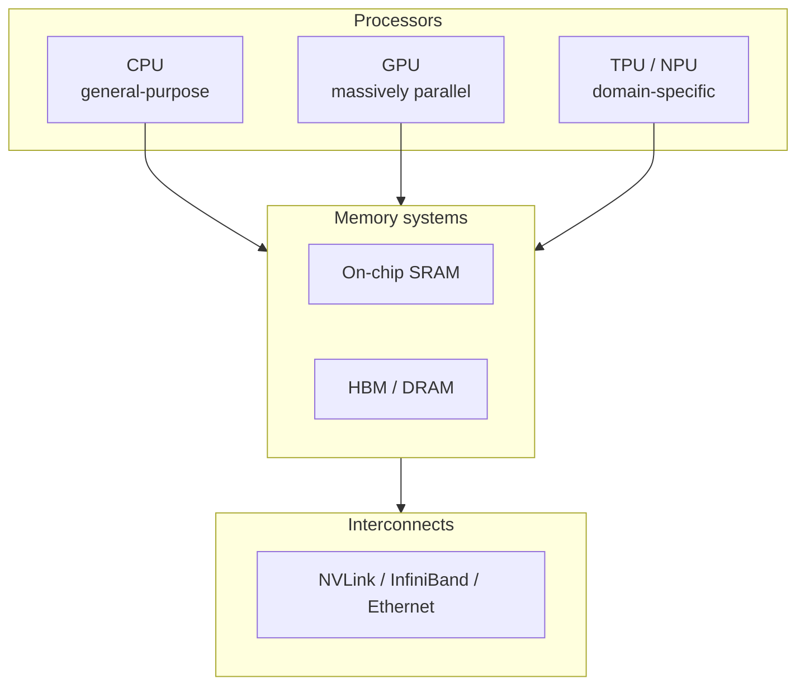

> [!TIP]
> **Going further.** A chip designed for one domain is often called an **ASIC** (application-specific integrated circuit). A TPU is an ASIC for neural-network arithmetic. The opposite extreme is the CPU, a general-purpose processor.

---

## 1.2 What do AI models actually compute?

Before comparing chips, we need to know what the chips are asked to do.

A neural network is built from layers. Most layers do one dominant operation: multiply a block of numbers (the **weights**, which the model learned during training) by another block of numbers (the **inputs**), then add the results together.

For one output value, the calculation looks like this:

```text
Output = (w1 × x1) + (w2 × x2) + (w3 × x3) + ... + (wn × xn)
```

Each "multiply, then add to a running total" step is called a **MAC** (multiply-accumulate).

**Figure 1.2.** A single neuron: each input is multiplied by its weight, and the products are summed into one output. *Source: author's own diagram.*

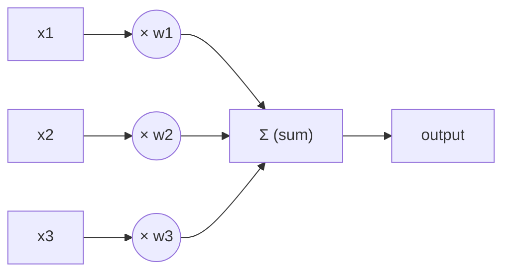

### Worked example 1.A: a single neuron by hand

*Illustrative numbers.* A tiny neuron has three weights and receives three inputs:

| | w1 / x1 | w2 / x2 | w3 / x3 |
|---|---:|---:|---:|
| Weights **w** | 0.5 | -1.0 | 2.0 |
| Inputs **x** | 4 | 3 | 1 |

**Table 1.2.** Weights and inputs for Worked example 1.A.

1. **Step 1.** Start the running total at 0.
2. **Step 2.** MAC #1: `total = 0 + (0.5 × 4) = 0 + 2.0 = 2.0`
3. **Step 3.** MAC #2: `total = 2.0 + (-1.0 × 3) = 2.0 - 3.0 = -1.0`
4. **Step 4.** MAC #3: `total = -1.0 + (2.0 × 1) = -1.0 + 2.0 = 1.0`

**Result.** The output is **1.0**, computed with 3 MACs. (Real networks then pass this number through a simple function such as ReLU, which keeps positive numbers and turns negative ones into 0; that step is cheap compared with the MACs.)

The following Python program checks the result. Its complete expected output is shown below the code.

```python
weights = [0.5, -1.0, 2.0]
inputs = [4, 3, 1]

total = 0
for w, x in zip(weights, inputs):
    total += w * x          # one MAC per loop

print(total)                # 1.0
print(max(0, total))        # ReLU -> 1.0
```

Expected output:

```text
1.0
1.0
```

Now scale it up. One layer might have 4,096 neurons, each with 1,024 inputs. That is 1,024 × 4,096 = **4,194,304 MACs**, about 4.2 million, for one layer and one input. A modern large language model needs billions to trillions of MACs to produce a single answer.

> [!IMPORTANT]
> **Key idea.** If a chip can do MACs very fast and very efficiently, it speeds up almost the whole model. This is why the MAC is the central operation in AI hardware design.

### Matrices: the same thing, written compactly

Writing out every MAC is tedious, so we group the weights into a table called a **matrix**, and the inputs into a list called a **vector**. "Multiply the weight matrix by the input vector" means "do all the neuron calculations at once". When we process several inputs at the same time, they form a second matrix, and we speak of matrix multiplication. Almost all of AI hardware is, at heart, hardware for multiplying matrices. A generalisation to higher dimensions is called a **tensor**, which is where the "T" in TPU comes from.

```text
Weight matrix W          Input vector x     Output vector y
(rows = neurons)

[ w11 w12 w13 ]          [ x1 ]             [ w11·x1 + w12·x2 + w13·x3 ]
[ w21 w22 w23 ]    ×     [ x2 ]      =      [ w21·x1 + w22·x2 + w23·x3 ]
[ w31 w32 w33 ]          [ x3 ]             [ w31·x1 + w32·x2 + w33·x3 ]
```

Each output value = 3 MACs. Whole layer = 3 × 3 = **9 MACs**.

The same idea in NumPy. Its complete expected output is shown below the code.

```python
import numpy as np

W = np.array([[0.5, -1.0, 2.0],
              [1.0,  0.0, 1.0],
              [0.0,  2.0, -1.0]])
x = np.array([4, 3, 1])

y = W @ x                   # all 9 MACs in one matrix-vector product
print(y)                    # [ 1.  5.  5.]
```

Expected output:

```text
[1. 5. 5.]
```

**Check by hand:** row 1 gives 0.5×4 + (−1.0)×3 + 2.0×1 = 1.0; row 2 gives 1.0×4 + 0.0×3 + 1.0×1 = 5.0; row 3 gives 0.0×4 + 2.0×3 + (−1.0)×1 = 5.0.

---

## 1.3 Key terms

These terms are used throughout the module. A complete glossary is at the end of this module (see [Glossary](#glossary-all-sections)). Some terms (bandwidth, utilisation) are only fully explained later, in Sections 3 and 4, so treat this table as a first look.

| Term | Definition |
|---|---|
| **Training** | Adjusting a model's weights using lots of data. Very compute-heavy; usually done in data centres. |
| **Inference** | Using a trained model to produce an answer (for example, unlocking your phone). Happens every time a user uses the AI. |
| **MAC** | Multiply-accumulate: multiply two numbers and add the result to a running total. |
| **FLOP / FLOPs** | A floating-point operation (one add or multiply on decimal-style numbers). "FLOPs" is the plural; FLOPS (capital S) means FLOPs per second. One MAC counts as 2 FLOPs. |
| **TOPS** | Tera operations per second (10¹² operations per second). Often used for integer operations on AI chips. |
| **Throughput** | How much work is finished per second. |
| **Latency** | How long one task takes from start to finish. |
| **Precision** | How many bits are used to store each number: FP32 = 32-bit floating-point, FP16 = 16-bit float, INT8 = 8-bit integer. Lower precision means less memory, less energy and usually faster hardware, at some cost in accuracy. |
| **Accelerator** | A chip that works alongside the CPU to speed up specific kinds of work. |
| **Bandwidth** | How many bytes per second can be moved between two parts of a system. |

**Table 1.3.** Key terms for Section 1.

> [!WARNING]
> **Caution: bits and bytes.** 1 byte = 8 bits. An FP32 number takes 4 bytes, an FP16 number 2 bytes, and an INT8 number 1 byte. Many mistakes in hardware calculations come from forgetting this conversion.

**Figure 1.3.** The same model stored at three precisions. Lower precision uses less memory but keeps less information about each weight. *Source: author's own diagram.*

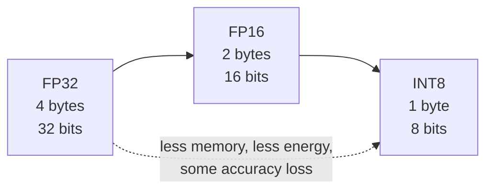

### Prefixes you will meet

| Prefix | Symbol | Power of ten | Example |
|---|---|---|---|
| kilo | k | 10³ | 1 kB = 1,000 bytes |
| mega | M | 10⁶ | 8 MB of cache |
| giga | G | 10⁹ | 500 GB/s bandwidth |
| tera | T | 10¹² | 92 TOPS |
| peta | P | 10¹⁵ | data-centre clusters quote PFLOPS |
| milli / micro / nano / pico | m / µ / n / p | 10⁻³ / 10⁻⁶ / 10⁻⁹ / 10⁻¹² | 1 ms, 1 µs, 1 ns, 1 pJ |

**Table 1.4.** SI prefixes used in this module.

Memory sizes are sometimes quoted in powers of two: 1 MiB = 2²⁰ = 1,048,576 bytes. The difference is small and does not change any conclusion in this module.

---

## 1.4 Why not just use a faster CPU?

For decades, the answer to "make computers faster" was simply "wait for the next CPU". That stopped working for two reasons.

**Reason 1: the workload is highly repetitive and independent.** Millions of MACs can be done at the same time because they do not depend on each other: the result of neuron 17 does not change the calculation for neuron 18. A chip built for doing one complicated thing quickly wastes its effort on this. A chip built for doing a huge number of simple things at once does not.

**Reason 2: energy and memory limits.** Chips can no longer simply be clocked faster without overheating. Historically, as transistors shrank, they also used less power, so each generation could run faster without getting hotter (this is often associated with Dennard scaling). That trend ended in the mid-2000s, and clock speeds flattened at a few gigahertz. Hennessy and Patterson, in their well-known textbook and Turing Award lecture, argue that because general-purpose processors have stopped improving as quickly as before, big gains in cost, energy, and performance must now come from domain-specific hardware (Hennessy & Patterson, 2019).

Gains now come from two directions, which this module keeps returning to:

1. doing more things at once (**parallelism**), and
2. moving less data (**memory efficiency**).

**Figure 1.4.** CPU clock speed over time, in schematic form. Clock speeds rose steeply until the mid-2000s, then flattened as power and heat limits were reached. *Source: author's own sketch, based on the trends described in Hennessy & Patterson (2019).*

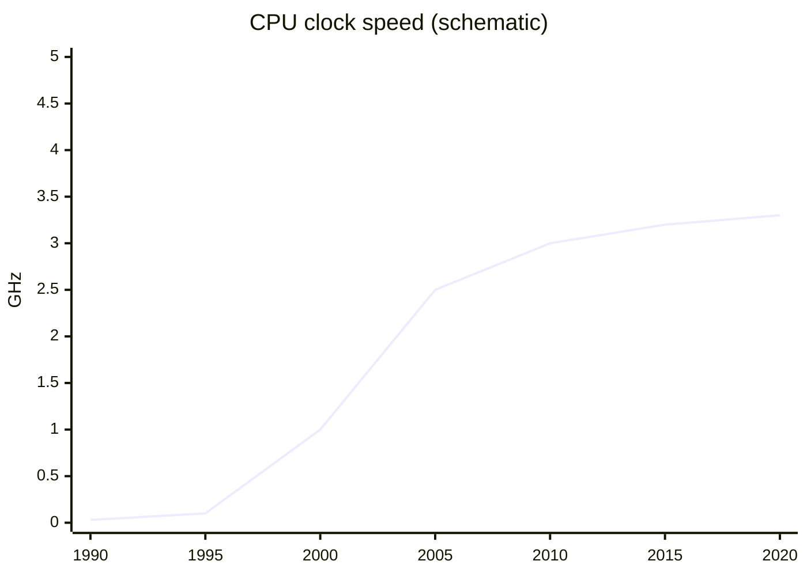

---

## 1.5 Training versus inference

The same neural network is used in two very different ways, and the hardware requirements differ.

| | Training | Inference |
|---|---|---|
| **Goal** | Learn weights from data | Use learned weights to answer a request |
| **Frequency** | Rare, long jobs (days to months) | Constant: millions of small requests |
| **Main limit** | Raw compute and chip-to-chip communication | Latency, energy and cost per request |
| **Typical place** | Large data-centre clusters | Data centres and edge devices (phones, cars) |
| **Precision** | Usually higher (FP32, BF16, FP16) | Often lower (INT8, FP8, even 4-bit) |
| **Data movement** | Forward pass and backward pass; many intermediate values stored | Forward pass only |
| **Batch size** | Large (hundreds or more) | Often 1 (one user at a time) |

**Table 1.5.** Training versus inference.

**Figure 1.5.** Where training and inference sit on the hardware landscape. Training happens in the data centre on large batches; inference happens both in the data centre and on edge devices, often at batch size 1. *Source: author's own diagram.*

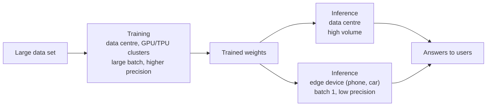

This distinction explains much of the hardware landscape. The first Google TPU was built for inference only (Jouppi et al., 2017); later generations added training, and Google's newest announced generation, Ironwood (announced 2025), is again aimed at inference at scale (Google, 2025).

> [!NOTE]
> **Why does the batch size matter?** Section 4 shows that a single-user request (batch size 1) tends to be limited by memory, whereas a large training batch tends to be limited by compute. That one fact shapes whole product lines.

---

## 1.6 Choosing hardware: metrics to compare

Section 1.3 defined the vocabulary. This table shows how those ideas are used to *choose* between chips.

| Metric | Question it answers | Why it matters |
|---|---|---|
| Throughput (TOPS, FLOP/s) | How much work per second? | Training speed |
| Latency | How long for one request? | User experience; real-time control |
| Performance per watt | How much work per joule? | Battery life; data-centre power bill |
| Utilisation | What share of peak is actually achieved? | Money paid for idle silicon |
| Performance per dollar | How much work per unit of cost? | Budget decisions |
| Memory capacity | How big a model fits? | Which models can run at all |

**Table 1.6.** Six metrics for comparing AI hardware.

**Figure 1.6.** Peak versus achieved utilisation. The gap between the two bars is the idle silicon you paid for. *Source: author's own diagram, based on the concept of utilisation introduced here and formalised in Section 3.*

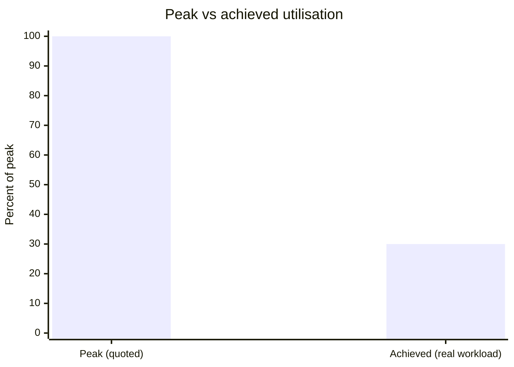

> [!WARNING]
> **Caution: peak is not typical.** A chip's quoted "peak" number is what it could do if every arithmetic unit were busy every cycle. Real programs are usually far below that. Sections 3 and 4 explain why.

---

## 1.7 Activities for Section 1

- [ ] **Activity 1.A.** A neuron has weights w = [2, -1, 0.5] and inputs x = [1, 4, 6]. Compute the output by hand, stating each MAC step.
- [ ] **Activity 1.B.** A layer has 512 inputs and 2,048 outputs. How many MACs does one input vector require? How many FLOPs is that?
- [ ] **Activity 1.C.** A chip is quoted as 100 TOPS but achieves only 30% utilisation on your workload. What throughput do you actually observe?
- [ ] **Activity 1.D.** For each case, say whether it is training or inference, and give one reason: (a) a phone unlocking with Face ID, (b) a team fine-tuning a language model on 100 GPUs for three weeks, (c) a chatbot answering 10,000 user requests per second.
- [ ] **Activity 1.E.** A model has 7 billion parameters stored in FP16. How much memory do the weights need? How much in INT8?

---

## 1.8 Summary

- AI hardware is any processor, memory system or interconnect designed or well suited to run machine-learning workloads efficiently; it covers five categories (general-purpose CPUs, GPUs, domain-specific accelerators, memory systems, interconnects).
- Neural networks are dominated by MACs (multiply-accumulate): one output is the sum of weight × input products, and a layer with 1,024 inputs and 4,096 outputs contains 4,194,304 MACs.
- A 3-weight, 3-input neuron computes its output in 3 MACs; the worked example gives 1.0.
- Matrices and vectors are compact ways of writing millions of MACs at once; a tensor is the higher-dimensional generalisation, which gives the TPU its name.
- Faster CPUs alone do not solve AI workloads because the work is repetitive and independent, and because clock-speed growth stopped in the mid-2000s; gains now come from parallelism and memory efficiency.
- Training and inference differ in goal, frequency, main limit, typical place, precision, data movement and batch size.
- Six metrics (throughput, latency, performance per watt, utilisation, performance per dollar and memory capacity) let you choose between chips; quoted peak numbers are rarely achieved in practice.

---

# Section 2: CPU vs GPU vs TPU

> [!IMPORTANT]
> **Big idea.** Three families of chips sit at different points on a trade-off between flexibility and efficiency. The more a chip is specialised for a task, the more efficient it is at that task and the less useful it is for anything else.

## Learning objectives

By the end of this section you should be able to:

1. Describe in one sentence each what a CPU, a GPU, a TPU and an NPU is designed to do.
2. Compare the four chip families on design goal, core count, control logic, flexibility, energy efficiency for AI, typical AI role, weakness for AI and programming route.
3. Explain what a systolic array is and work through a 2 × 2 weight-stationary example by hand and in code.
4. Summarise what the first TPU paper (Jouppi et al., 2017) measured, and state two caveats when reading it.
5. Explain why software tooling determines how useful a chip is in practice.
6. Choose an appropriate chip for a given scenario and justify the choice.

---

## 2.1 The three chips in one sentence each

- **CPU (Central Processing Unit):** a few very capable cores that handle any kind of program quickly, one step at a time per core.
- **GPU (Graphics Processing Unit):** thousands of simpler cores that do the same operation on many data items at once. Originally built to draw graphics, it turned out to be ideal for neural networks, because drawing millions of pixels and multiplying large matrices are both "same operation, lots of data" problems.
- **TPU (Tensor Processing Unit):** a chip designed by Google specifically for tensor (multi-dimensional array) arithmetic, built around a grid of multiply-accumulate units.

A related term you will meet in Section 5 is **NPU** (Neural Processing Unit): a general name for a small, low-power AI accelerator inside a phone or laptop chip.

**Figure 2.1.** The three chip families on the flexibility–efficiency trade-off. Moving right trades generality for efficiency on tensor arithmetic. *Source: author's own diagram, based on Hennessy & Patterson (2019).*

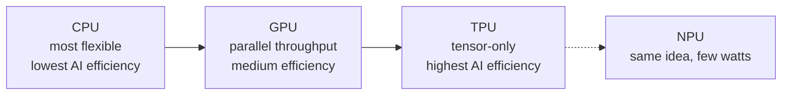

> [!NOTE]
> **An everyday analogy.**
> A **CPU** is like a small team of expert chefs who can cook any dish in the book, but each works on one dish at a time.
> A **GPU** is like a huge kitchen of junior cooks who all follow the same instruction ("chop these 1,000 onions") together.
> A **TPU** is like a factory assembly line built to make exactly one product, extremely efficiently, but useless if you want something else.

---

## 2.2 Comparison table

| Feature | CPU | GPU | TPU |
|---|---|---|---|
| **Design goal** | Fast, flexible, low latency for one task | High throughput on parallel data | Maximum matrix throughput per watt for neural networks |
| **Core count** (order of magnitude) | Few to ~100 complex cores | Thousands of simple cores | A large grid of MAC units (tens of thousands in one array) |
| **Control logic** | Complex: caches, out-of-order execution, branch prediction | Simpler; many threads hide delays | Minimal; deterministic execution |
| **Flexibility** | Highest: runs any program | High: programmable for many parallel tasks | Lowest: tuned to tensor operations |
| **Energy efficiency for AI** | Lowest | Medium to high | Highest (for supported workloads) |
| **Typical AI role** | Pre-processing, data loading, small models, orchestration | Training and inference of large models | Large-scale training and inference in Google's cloud |
| **Weakness for AI** | Too few parallel units | Higher power than a custom ASIC; memory bandwidth can limit | Less flexible; tied to a software stack |
| **Programming** | Any language | CUDA, OpenCL, or frameworks such as PyTorch | Through frameworks such as TensorFlow/JAX and the XLA compiler |

**Table 2.1.** Comparison of CPU, GPU and TPU across design goal, core count, control logic, flexibility, energy efficiency, typical AI role, weakness for AI and programming route.

*Sources for the design descriptions: Jouppi et al. (2017); Sze et al. (2017); Hennessy & Patterson (2019); NVIDIA (n.d.).*

### Terms used in the table

- **Core:** a unit inside a chip that can execute instructions on its own.
- **Cache:** a small, fast memory that keeps copies of recently used data close to the processor.
- **Out-of-order execution:** a CPU trick of running instructions in a different order from the program when it is safe, to avoid waiting.
- **Branch prediction:** guessing which way an `if` statement will go so the CPU can keep working instead of waiting.
- **Deterministic execution:** every run takes the same, predictable number of cycles. This matters for services that must answer within a time limit.
- **Compiler:** software that translates a program into instructions for a specific chip. XLA is the compiler used for TPUs.
- **MAC (multiply-accumulate):** an operation that computes `a × b + c`; the basic building block of neural-network arithmetic.

---

## 2.3 Visual: where the chip area goes

**Figure 2.2.** A simplified, not-to-scale sketch of where each design spends its silicon. A CPU devotes much of its area to caches and control logic that make a single thread fast; a GPU devotes most area to arithmetic units; a TPU devotes nearly all of it to the grid of MACs and the memory that feeds it. The positions are a qualitative teaching sketch, not measurements. *Source: author's own sketch, based on the design descriptions in Jouppi et al. (2017) and Hennessy & Patterson (2019).*

```text
        CPU                       GPU                        TPU
+------------------------+ +------------------------+ +------------------------+
| [Core] [Core]  CACHE   | | c c c c c c c c c c c  | | Systolic array of      |
| [Core] [Core]  CACHE   | | c c c c c c c c c c c  | | MAC units              |
| big control logic      | | c c c c c c c c c c c  | | (data flows through)   |
| large caches           | | small control, cache   | | + on-chip buffer       |
+------------------------+ +------------------------+ +------------------------+
   Few smart cores          Many simple cores          Matrix-multiply engine
```

In a CPU much of the area is "overhead" (caches, prediction logic) that makes a single thread fast. In a GPU, most area goes to arithmetic units. In a TPU, nearly all of it goes to the grid of MACs and the memory that feeds it.

---

## 2.4 Systolic arrays and a worked 2 × 2 example

A **systolic array** is a grid of MAC cells. Each cell holds one weight, and data is passed from neighbour to neighbour instead of being fetched from memory again and again. This neighbour-to-neighbour passing is what makes the design memory-efficient: the same input is reused across many cells without repeated memory reads.

### Worked example 2.A: a 2 × 2 systolic array (weight-stationary)

Let the weights be **W = [[1, 2], [3, 4]]**, loaded once, one per cell. The input is **x = [5, 6]**. We want **y = W·x**.

**Figure 2.3.** A 2 × 2 weight-stationary systolic array. Each cell holds one weight; inputs enter from the top and partial sums move to the right. *Source: author's own diagram.*

```text
                 x1=5        x2=6
                  │           │
               ┌──▼──┐     ┌──▼──┐
 row 1 (y1) →  │  1  │ ──► │  2  │ ──► y1
               └──┬──┘     └──┬──┘
               ┌──▼──┐     ┌──▼──┐
 row 2 (y2) →  │  3  │ ──► │  4  │ ──► y2
               └─────┘     └─────┘
        (each cell holds one weight; partial sums move right)
```

| Cycle | What happens | Result |
|---|---|---|
| **1** | x1 = 5 enters column 1. The two cells compute 1 × 5 and 3 × 5 and pass the partial sums to the right. | 5 and 15 |
| **2** | x2 = 6 reaches column 2 (a real array staggers inputs by one cycle). The cells compute 2 × 6 + 5 and 4 × 6 + 15. | 17 and 39 |

**Table 2.2.** Cycle-by-cycle behaviour of the 2 × 2 systolic array in Figure 2.3.

**Result:** `y = [17, 39]`, using 4 MACs. Check: 1×5 + 2×6 = 17 and 3×5 + 4×6 = 39.

**Memory reads.** Each of the 4 weights was read from memory **once**, and each of the 2 inputs was read **once**, then handed from cell to cell. Without neighbour-to-neighbour passing, each input would be read twice (once per output). That saving in memory traffic is the point of the systolic design, and it grows with array size.

The following Python program counts the reads in both styles. Its complete expected output is shown below the code.

```python
W = [[1, 2],
     [3, 4]]
x = [5, 6]

# Without reuse: every MAC fetches its own weight and its own input
reads_no_reuse = 0
y = [0, 0]
for i in range(2):
    for j in range(2):
        y[i] += W[i][j] * x[j]
        reads_no_reuse += 2          # one weight read + one input read

# Systolic style: each weight read once, each input read once
reads_systolic = 4 + 2

print(y)                             # [17, 39]
print(reads_no_reuse, reads_systolic)  # 8 6
```

Expected output:

```text
[17, 39]
8 6
```

---

## 2.5 What the first TPU paper measured

The 2017 paper by Jouppi et al. is the best-documented comparison available, because it measured a real chip in real data centres:

- The heart of the first TPU is a **65,536-element 8-bit MAC matrix unit** with a peak of **92 TOPS** and a **28 MiB** software-managed on-chip memory.
- Compared with a contemporary Intel Haswell server CPU and an Nvidia K80 GPU in the same data centres, the TPU was on average about **15–30× faster** and delivered about **30–80× more TOPS per watt**.
- The authors attribute part of this to deterministic execution: caches, out-of-order execution, multithreading and prefetching improve average throughput, but not the 99th-percentile response time that user-facing services need.
- Four of the six benchmark applications were **memory-bandwidth limited** on the TPU. Using the GPU's faster GDDR5 memory in a revised design would have tripled achieved TOPS.

**Figure 2.4.** What the first TPU paper measured. The TPU beat contemporary CPUs and GPUs on speed and energy efficiency, but on four of six benchmarks it was limited by memory bandwidth rather than by arithmetic. *Source: author's own diagram, based on data in Jouppi et al. (2017).*

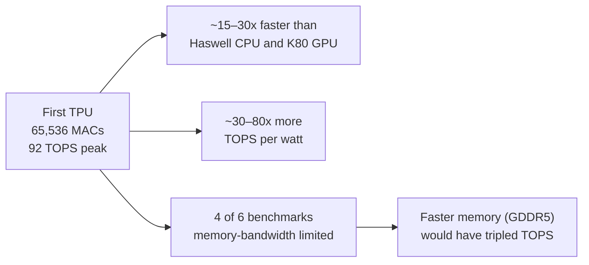

> [!WARNING]
> **Read this with care.** The comparison is from 2015–2017 hardware. It is a good illustration of the design philosophy, not a ranking of today's chips. Current GPUs have added dedicated matrix units of their own (NVIDIA calls them Tensor Cores), and the gap between "GPU" and "TPU" designs has narrowed.

> [!NOTE]
> **Why does the memory finding matter?** Even a chip with 65,536 MACs spent most of its time waiting for data on four out of six workloads. More arithmetic units do not help if they cannot be fed.

---

## 2.6 The NPU: AI on small devices

A phone cannot carry a 300-watt accelerator. An NPU applies the same ideas as a TPU (a grid of MAC units, low-precision numbers, on-chip memory) but scaled down to run in a few watts inside a **system-on-a-chip (SoC)**, which puts the CPU, GPU, NPU, memory controllers and other blocks on a single piece of silicon.

| Company | Name of its NPU |
|---|---|
| Apple | Neural Engine |
| Google Pixel | Tensor SoC |
| Qualcomm | Hexagon NPU |
| Many laptops | "AI Engine" / NPU |

**Table 2.3.** Vendor names for NPUs in consumer devices. Names differ, but the principle is the same.

**Figure 2.5.** An NPU inside a system-on-a-chip. The CPU, GPU and NPU share the same silicon and memory, which is what makes a few-watt AI accelerator practical on a phone. *Source: author's own diagram, based on Apple Inc. (2024) and Qualcomm (2024).*

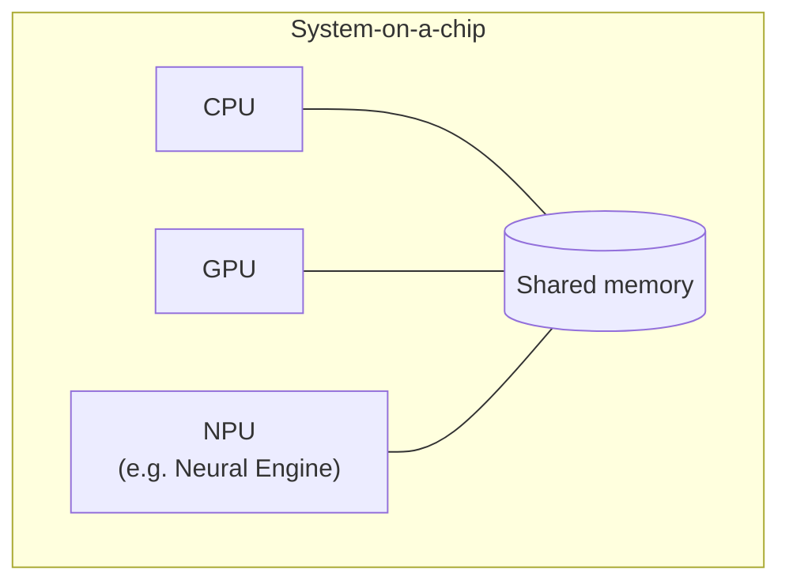

Section 5 studies the Apple version.

---

## 2.7 Software: why a chip is only as useful as its tools

Hardware is useless if programmers cannot easily use it. This is a major reason GPUs became dominant for AI:

| Chip | Typical way programmers reach it |
|---|---|
| CPU | Any language; compiler targets it directly |
| GPU | CUDA (NVIDIA), OpenCL, or high-level frameworks (PyTorch, TensorFlow) that call vendor-optimised libraries |
| TPU | Frameworks (TensorFlow, JAX, PyTorch/XLA) compile to the TPU through XLA |
| Apple Neural Engine | Core ML, which decides whether a model runs on CPU, GPU or the Neural Engine |

**Table 2.4.** How programmers typically reach each chip family.

A programmer usually does not write instructions for the MAC units directly. They write a model in a framework, and a compiler/runtime maps it onto the hardware. This is why "unsupported operations falling back to the CPU" can silently make a model slow (see the case-study questions in Section 5).

**Figure 2.6.** The software stack between a model and the hardware. Each layer hides detail from the one above, but also adds a place where unsupported operations can fall back to the CPU. *Source: author's own diagram, based on NVIDIA (n.d.) and Apple Inc. (2024).*

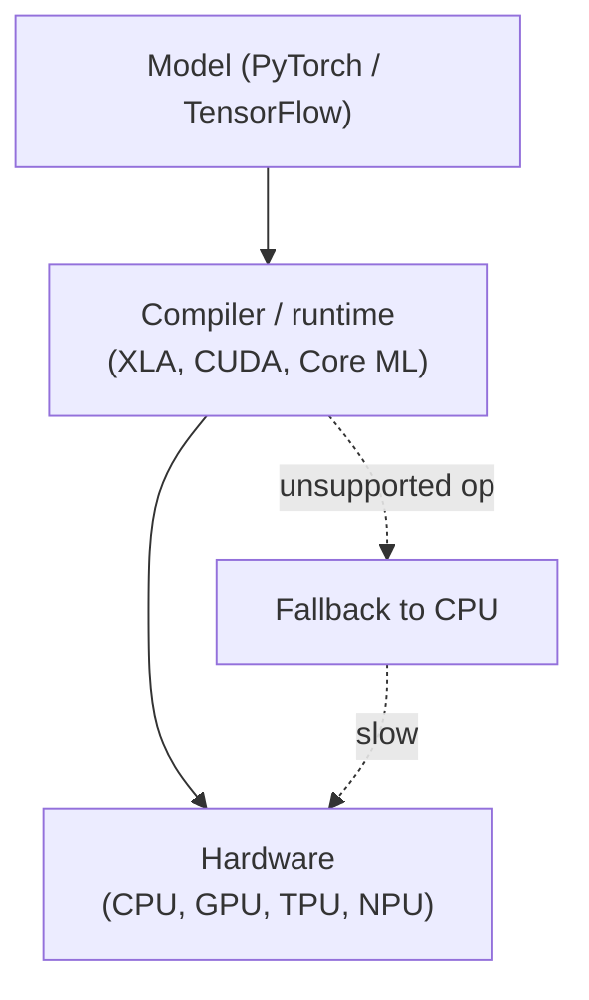

> [!TIP]
> **Going further.** The combination of hardware and its software ecosystem is sometimes called a **platform**. Switching from one platform to another can be costly even if the new chip is faster on paper, which partly explains why one vendor can dominate a market.

---

## 2.8 Activities for Section 2

- [ ] **Activity 2.A.** Which of the three chips would you choose for each case? Justify briefly. (a) a web server running mixed tasks, (b) training a large image model, (c) a fixed, high-volume inference service in a data centre.
- [ ] **Activity 2.B.** In the 2 × 2 systolic example (Worked example 2.A), how many times was each weight read from memory, and how many times was each input read?
- [ ] **Activity 2.C.** A start-up wants to add a voice assistant to a smart speaker that runs on a small battery. Arrange CPU, GPU and NPU in order from most to least suitable and give one reason for your ordering.
- [ ] **Activity 2.D.** The first TPU was faster and more energy-efficient than its contemporaries on Google's workloads, but a start-up with a different workload might still pick a GPU. Give two reasons.

---

## 2.9 Summary

- CPUs prioritise flexibility and low latency; GPUs prioritise parallel throughput; TPUs prioritise matrix throughput per watt at the cost of flexibility; NPUs scale the TPU idea down to a few watts inside a phone or laptop SoC.
- Systolic arrays reduce memory traffic by holding weights in place and passing inputs and partial sums from neighbour to neighbour; in the 2 × 2 example this cut memory reads from 8 to 6.
- The first TPU (Jouppi et al., 2017) was about 15–30× faster and 30–80× more TOPS per watt than contemporary CPUs and GPUs, but four of six benchmarks were memory-bandwidth limited, and the comparison is historical.
- A chip is only as useful as its software ecosystem; unsupported operations that fall back to the CPU can silently erase the hardware advantage.
- Choosing a chip means matching its design goal to the workload: mixed latency-sensitive tasks favour a CPU, large-model training favours a GPU, fixed high-volume inference favours a TPU or NPU.

---

# Section 3: Parallel Processing and AI Acceleration

> [!IMPORTANT]
> **Big idea.** Neural networks consist of huge numbers of independent MACs, so the way to go fast is to do many of them at the same time. But parallel hardware has limits, and the limits are as important as the speed-ups.

## Learning objectives

By the end of this section you should be able to:

1. Name and distinguish the four levels of parallelism (instruction-level, data-level, matrix-level, and across chips).
2. Count the MACs and FLOPs in a dense layer, and estimate the time for one pass on an idealised CPU core and an idealised parallel accelerator.
3. State Amdahl's law, apply it to a worked example, and explain its ceiling.
4. Explain why parallel hardware has limits: Amdahl's law, idle units, feeding the units, and communication.
5. Describe three acceleration techniques (quantisation, specialised units, batching) and calculate the memory footprint of a model in different precisions.

---

## 3.1 Kinds of parallelism

"Parallel" simply means "at the same time". Hardware does this at several different levels:

| Level | Idea | Example |
|---|---|---|
| **Instruction-level** | A single core overlaps several instructions (like an assembly line) | Modern CPU pipelines |
| **Data-level (SIMD / SIMT)** | One instruction acts on many values at once | GPU warps; CPU vector units |
| **Matrix-level (systolic)** | A grid of MAC units passes data neighbour to neighbour | TPU matrix unit |
| **Across chips** (data, pipeline and model splitting) | Split the model, or the batch of data, over many chips | Training clusters (Module 02) |

**Table 3.1.** Four levels of parallelism in AI hardware.

**Figure 3.1.** The four levels of parallelism, from a single instruction inside one core to a whole model split across many chips. Each level adds more units but also more coordination overhead. *Source: author's own diagram, based on Hennessy & Patterson (2019).*

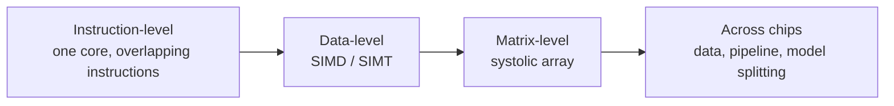

### Terms

- **SIMD (Single Instruction, Multiple Data):** the same instruction is applied to a block of values in lock-step. On GPUs the equivalent idea is often called **SIMT** (Single Instruction, Multiple Threads): groups of threads (a *warp* on NVIDIA GPUs) execute together.
- **Thread:** one stream of instructions. GPUs run tens of thousands at once.
- **Data parallelism:** the same operation on different data at the same time (for example, 1,000 pixels each multiplied by the same filter weights).
- **Pipeline parallelism:** one big model is split into stages across several chips (for example, one chip handles layers 1–10 while another handles layers 11–20), and data flows from stage to stage.

GPUs are built for data parallelism. A very useful trick they use is **latency hiding**: when one group of threads has to wait for memory, the GPU switches instantly to another group that is ready. With thousands of threads available, the arithmetic units rarely sit idle. CPUs take the opposite approach: they spend silicon on big caches and prediction logic so that one thread rarely waits at all.

> [!NOTE]
> **Bridge to Networks.** The last row of the table is where hardware meets networking. Once a model is split across chips, the links between them (NVLink, InfiniBand; Module 02) decide how much of the extra compute you can actually use.

---

## 3.2 Worked example 3.A: how many MACs, and how long?

**Problem.** A dense (fully connected) layer takes an input vector of 1,024 numbers and produces 4,096 outputs. The weight matrix is 1,024 × 4,096. Estimate the time for one pass on (a) a single idealised CPU core and (b) an idealised parallel accelerator.

**Step 1: Count the MACs.** Each of the 4,096 outputs needs 1,024 multiplications and additions.

```text
MACs = 1,024 × 4,096 = 4,194,304   (about 4.2 million)
```

**Step 2: Convert to FLOPs.** One MAC = 2 FLOPs (one multiply, one add).

```text
FLOPs = 2 × 4,194,304 = 8,388,608   (about 8.4 million)
```

**Step 3: Estimate time on two idealised chips** (illustrative assumptions).

| Chip (idealised) | Assumption | Calculation | Time for one pass |
|---|---|---|---|
| Single CPU core, one MAC per cycle, 3 GHz | 3 × 10⁹ MACs/s | 4,194,304 ÷ 3 × 10⁹ | ≈ **1.4 ms** |
| Accelerator with 4,096 MAC units working in parallel, 1 GHz | 4,096 × 10⁹ = 4.096 × 10¹² MACs/s | 4,194,304 ÷ 4.096 × 10¹² | ≈ **1.0 µs** |

**Table 3.2.** Estimated time for one pass of the layer on two idealised chips.

**Step 4: Interpret.** The idealised parallel accelerator is about 1,365× faster (roughly 1,400×) on this layer, even though its clock is slower, because it does 4,096 MACs per cycle instead of 1.

**Figure 3.2.** The same 4,194,304 MACs on a single CPU core (one MAC per cycle) versus a 4,096-unit accelerator. The accelerator's slower clock is more than compensated by doing many MACs per cycle. *Source: author's own diagram, based on the illustrative assumptions in Table 3.2.*

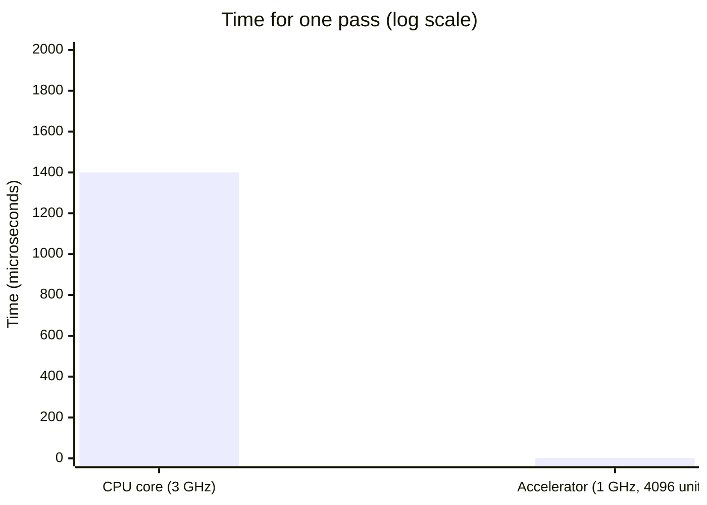

The following Python program reproduces the numbers. Its complete expected output is shown below the code.

```python
macs = 1024 * 4096
cpu_time = macs / 3e9            # 1 MAC per cycle at 3 GHz
acc_time = macs / (4096 * 1e9)   # 4,096 MACs per cycle at 1 GHz

print(macs)                      # 4194304
print(round(cpu_time * 1e3, 2), "ms")   # ~1.40 ms
print(round(acc_time * 1e6, 2), "us")   # ~1.02 us
print(round(cpu_time / acc_time))       # ~1365
```

Expected output:

```text
4194304
1.4 ms
1.02 us
1365
```

> [!WARNING]
> **Important caveat.** These are ideal numbers. They assume the data is always ready the instant it is needed. Section 3.3 and Section 4 explain why real chips often cannot reach them.

---

## 3.3 Why parallel hardware has limits

Adding more units does not give unlimited speed-up. Four things get in the way.

**Figure 3.3.** The four limits on parallel speed-up. Each can dominate on a real workload, and Amdahl's law sets a hard ceiling regardless of how many units you add. *Source: author's own diagram, based on Amdahl (1967) and the design discussion in Sections 3–4.*

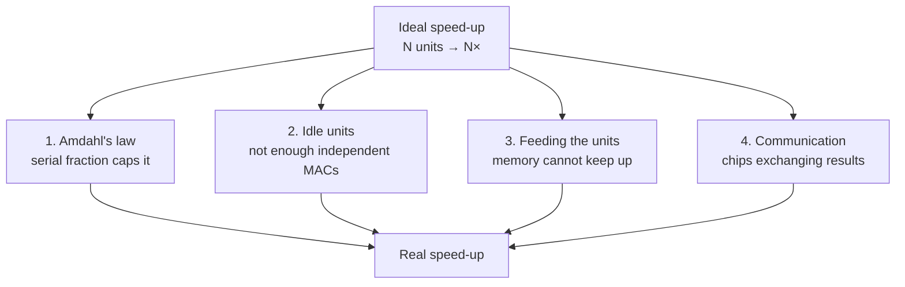

### 1. Amdahl's law

If a fraction *p* of a job can be parallelised, the best possible speed-up on *N* units is

```text
speed-up = 1 ÷ ( (1 − p) + p ÷ N )
```

*Worked example.* With p = 0.9 and N = 100: speed-up = 1 ÷ (0.1 + 0.009) ≈ **9.2×**. Even with unlimited units it can never exceed 1 ÷ 0.1 = **10×**, because the 10% serial part remains. In an AI pipeline the serial part might be loading data, pre-processing, or a step that cannot be spread out.

**Figure 3.4.** Amdahl's law for p = 0.9. The speed-up rises with the number of units but flattens towards the ceiling of 10×, set by the 10% serial fraction. *Source: author's own diagram, based on Amdahl (1967).*

```mermaid
xychart-beta
    title "Amdahl's law (p = 0.9)"
    x-axis ["1", "2", "4", "8", "16", "32", "64", "128"]
    y-axis "Speed-up" 0 --> 10
    line [1, 1.8, 3.1, 4.7, 6.4, 7.8, 8.8, 9.4]
```

The following Python program computes the worked example and the ceiling. Its complete expected output is shown below the code.

```python
def amdahl(p, n):
    return 1 / ((1 - p) + p / n)

print(round(amdahl(0.9, 100), 1))     # 9.2
print(round(amdahl(0.9, 10**9), 1))   # 10.0  (the ceiling)
```

Expected output:

```text
9.2
10.0
```

### 2. Idle units

A 4,096-unit accelerator can only be fully used if there are at least 4,096 independent MACs to do at once. A small layer leaves units idle, so **utilisation** (Section 1.6) falls.

### 3. Feeding the units

Units cannot compute without data. If memory cannot deliver numbers fast enough, the MACs wait. This is the subject of Section 4.

### 4. Communication

Across many chips, the time spent exchanging results can outweigh the gain from adding chips (Module 02).

---

## 3.4 Other acceleration techniques

Parallel MAC units are only one trick. Designers combine several. The three most important for this module are:

| Technique | What it does | Why it helps |
|---|---|---|
| **Lower precision (quantisation)** | Use INT8 or FP16 instead of FP32 | Smaller numbers: more fit in the same memory and more can be processed per cycle |
| **Specialised units** | NVIDIA Tensor Cores and Apple's Neural Engine are circuits that do small matrix multiplications as a single hardware step | Fewer instructions and less control overhead per MAC |
| **Batching** | Process several inputs together so the same weights are reused | Fetch weights once, use them many times (Section 4) |

**Table 3.3.** Three acceleration techniques and why they help.

**Figure 3.5.** Three ways to speed up AI beyond adding more MAC units: quantisation (smaller numbers), specialised units (matrix operations in one hardware step) and batching (reuse weights across inputs). *Source: author's own diagram, based on Jouppi et al. (2017) and NVIDIA (n.d.).*

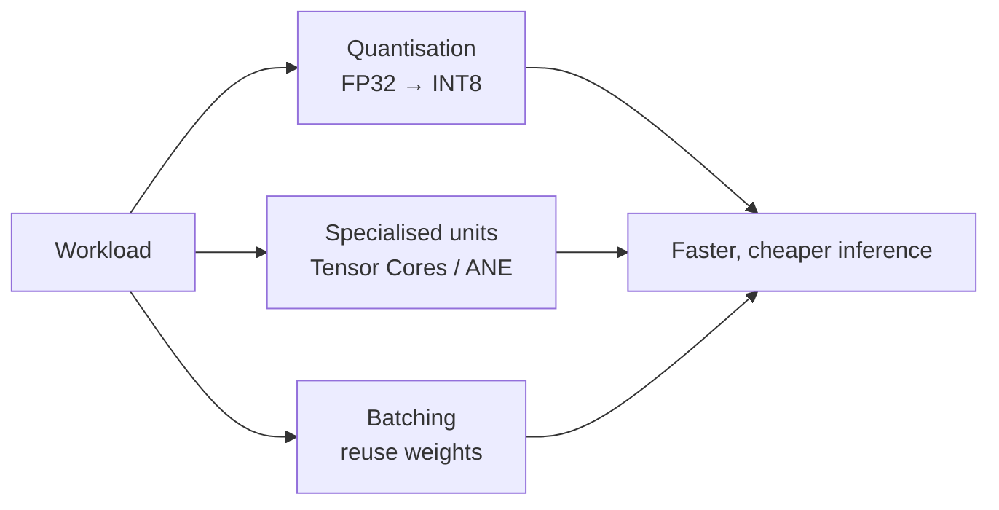

> [!TIP]
> **Going further.** Three more techniques you may meet:
> - **Sparsity:** skip multiplications by zero, so there is no work for values that cannot change the answer.
> - **Operator fusion:** combine several steps (for example, multiply, add bias and apply ReLU) into one pass to avoid writing and re-reading intermediate results.
> - **Weight-stationary data reuse:** keep weights in place while data moves past them, as in systolic arrays.

### Reduced precision (quantisation) in more detail

Quantisation converts a model's numbers from a high-precision format (such as FP32) to a lower-precision one (such as INT8). Using fewer bits per number lets a chip fit more MAC units in the same area and move fewer bytes. The first TPU used 8-bit integers for inference (Jouppi et al., 2017); later accelerators support formats such as bfloat16 (a 16-bit float with the same range as FP32) and 8-bit floating point.

| Format | Bits | Bytes | Typical use |
|---|---:|---:|---|
| FP32 | 32 | 4 | Classic training; "full" precision |
| BF16 / FP16 | 16 | 2 | Training and inference on modern accelerators |
| FP8 | 8 | 1 | Newer training/inference hardware |
| INT8 | 8 | 1 | Inference on phones, edge devices, TPUs |
| INT4 and below | 4 | 0.5 | Aggressively compressed models |

**Table 3.4.** Common number formats in AI hardware.

**Figure 3.6.** Quantising four sample weights to INT8 and back. The reconstructed values are close to the originals, with a maximum error of 0.0039. *Source: author's own diagram, based on the numbers in the code below.*

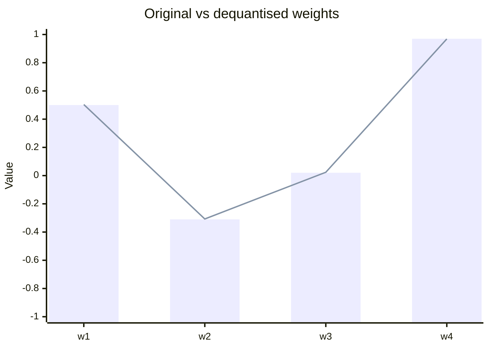

The following Python program quantises four weights to INT8 and back, and reports the maximum error. Its complete expected output is shown below the code.

```python
import numpy as np

w = np.array([0.5, -0.31, 0.02, 0.97], dtype=np.float32)
scale = 1.0 / 127
q = np.round(w / scale).astype(np.int8)    # quantise
w_back = q.astype(np.float32) * scale      # dequantise

print(q)                      # [ 64 -39   3 123]
print(np.round(w_back, 4))    # [ 0.5039 -0.3071  0.0236  0.9685]
print("max error:", np.abs(w - w_back).max().round(4))
```

Expected output:

```text
[ 64 -39   3 123]
[ 0.5039 -0.3071  0.0236  0.9685]
max error: 0.0039
```

---

## 3.5 Activities for Section 3

- [ ] **Activity 3.A.** The layer in Worked example 3.A is changed so that the output has 8,192 values instead of 4,096. What happens to the MAC count?
- [ ] **Activity 3.B.** With the same 4,096-unit accelerator, roughly how long would the 8,192-output layer take?
- [ ] **Activity 3.C.** A job is 80% parallelisable. What is the maximum speed-up on 8 units, and what is the limit with unlimited units?
- [ ] **Activity 3.D.** A 7-billion-parameter model is stored in FP16. How much memory do its weights need? How much if converted to INT8? To 4-bit?

---

## 3.6 Summary

- Hardware exploits parallelism at four levels: instruction-level, data-level (SIMD/SIMT), matrix-level (systolic), and across chips (data, pipeline and model splitting).
- A dense layer from 1,024 inputs to 4,096 outputs contains 4,194,304 MACs (about 8.4 million FLOPs); on idealised hardware this takes about 1.4 ms on one CPU core and about 1.0 µs on a 4,096-unit accelerator, a speed-up of about 1,365×.
- Amdahl's law caps the speed-up: with 90% parallelisable work the ceiling is 10×, and on 100 units you get about 9.2×.
- Parallel hardware also loses to idle units, memory that cannot feed the units fast enough, and communication between chips.
- Quantisation, specialised units and batching are the three main acceleration techniques covered here; quantising four sample weights to INT8 gives a maximum error of 0.0039.

---

# Section 4: Memory Hierarchy and Computational Efficiency

> [!IMPORTANT]
> **Big idea.** Arithmetic is cheap; moving data is expensive. Good AI hardware and good AI software are both organised to keep data in small, fast memory for as long as possible.

## Learning objectives

By the end of this section you should be able to:

1. Describe the levels of the memory hierarchy from registers to storage, and the trade-off between speed, size and cost that organises them.
2. State approximate energy costs for a 32-bit multiply, an on-chip SRAM read and a DRAM read, and explain why data movement dominates energy.
3. Define arithmetic intensity and the roofline model, including the ridge point, memory-bound and compute-bound regimes.
4. Apply the roofline model to a worked layer, and determine the batch size at which a workload becomes compute-bound.
5. List the main techniques for improving a memory-bound workload and explain how batching trades throughput against latency.

---

## 4.1 The memory hierarchy

Computers have several kinds of memory. Fast memory is small and expensive; large memory is slow and cheap. The arrangement from fastest to slowest is called the **memory hierarchy**.
 

#### Terms
 
- **Cache:** a small, fast memory that keeps copies of recently used data close to the processor. Managed automatically by hardware.
- **Scratchpad / software-managed buffer:** on-chip memory that the program or compiler controls explicitly, as in the TPU's 28 MiB unified buffer. It avoids the unpredictability of automatic caches.
- **SRAM:** fast memory built into the chip (usually several transistors per bit; expensive in area).
- **DRAM:** larger, slower memory outside the chip (one transistor plus a capacitor per bit; cheap per byte).
- **HBM (High Bandwidth Memory):** DRAM stacked in layers and placed right next to a GPU/accelerator to deliver very high bandwidth. Newer TPUs pair each chip with tens of gigabytes of HBM; for example, Google reported 192 GB per chip for Ironwood, six times the previous generation (as reported in press coverage of Google's 2025 announcement; verify against Google's own documentation before citing).
- **Bandwidth:** how many bytes per second can be moved (for example, 500 GB/s).
- **Latency (memory):** how long one access takes, as opposed to how many bytes per second can flow once it starts.
- **Unified memory:** a design (used by Apple silicon) in which CPU, GPU, and NPU share one pool of memory so data need not be copied between them.

> [!NOTE]
> **Analogy.** Think of cooking. Registers are the ingredients in your hands. Cache/SRAM is the chopping board in front of you. DRAM is the fridge across the kitchen. Storage is the supermarket. A cook who walks to the supermarket for every ingredient will never finish; a good cook plans the recipe so that everything needed is on the chopping board when required. Good AI hardware and software do the same.

**Figure 4.2.** The same hierarchy drawn as a cooking analogy: the closer the ingredient, the cheaper it is to reach. *Source: author's own diagram.*


---

## 4.2 The surprising fact: data movement dominates energy

Horowitz (2014) published approximate energy costs for a 45 nm chip process:

| Operation | Approximate energy |
|---|---:|
| 32-bit floating-point multiply | ~3.7 pJ |
| Read 32 bits from small on-chip SRAM (8 KB) | ~5 pJ |
| Read 32 bits from off-chip DRAM | ~640 pJ |

**Table 4.1.** Approximate energy costs per operation, from Horowitz (2014). pJ = picojoule, 10⁻¹² joule. Reading a register costs far less than any row in this table.

**Figure 4.3.** Fetching a number from DRAM costs about **170 times** the energy of multiplying it (640 ÷ 3.7 ≈ 173) and about **128 times** the energy of reading it from small on-chip SRAM. *Source: Horowitz (2014).*

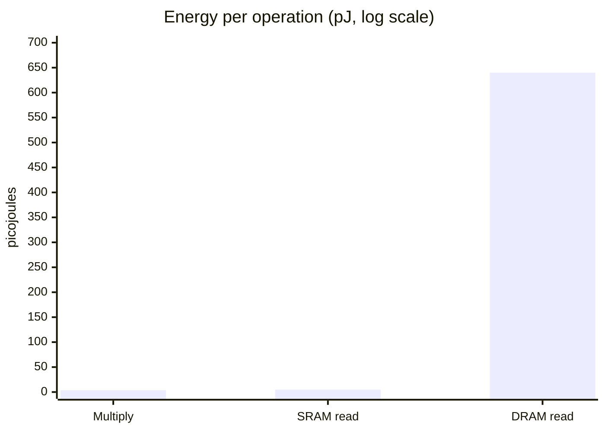

The following Python program computes the two ratios. Its complete expected output is shown below the code.

```python
mult, sram, dram = 3.7, 5, 640   # picojoules
print(round(dram / mult))        # 173
print(round(dram / sram))        # 128
```

Expected output:

```text
173
128
```

Fetching a number from DRAM costs roughly two orders of magnitude (about 100× or more) more energy than multiplying it. Modern processes differ in the exact numbers, but the pattern remains. This is why AI chip designers focus on reusing data already on the chip.

---

## 4.3 Arithmetic intensity and the roofline model

To judge whether a workload is limited by computing or by memory, we use **arithmetic intensity**:

```text
arithmetic intensity (FLOPs per byte) = total FLOPs ÷ total bytes moved from memory
```

A chip has two limits:

- **Peak compute** (FLOP/s): the most arithmetic it can do.
- **Memory bandwidth** (bytes/s): the most data it can fetch.

The **roofline model** (Williams, Waterman & Patterson, 2009) says:

```text
attainable performance = min( peak compute , arithmetic intensity × memory bandwidth )
```

The **ridge point** is where the two limits meet: peak compute ÷ bandwidth.

- Intensity **below** the ridge point → **memory-bound** (the chip waits for data).
- Intensity **above** the ridge point → **compute-bound** (the chip is busy computing).

> [!NOTE]
> **Why is it called a "roofline"?** Plot performance against intensity and the picture looks like a roof: a sloping line on the left (memory limit) that meets a flat line on the right (compute limit). Your workload's performance can never poke through the roof.

**Figure 4.4.** The roofline for the hypothetical accelerator used in this section (10 TFLOP/s peak, 500 GB/s bandwidth). The sloping left side is the memory limit; the flat right side is the compute limit. The ridge point sits at 20 FLOP/byte. *Source: author's own diagram, based on Williams, Waterman & Patterson (2009).*

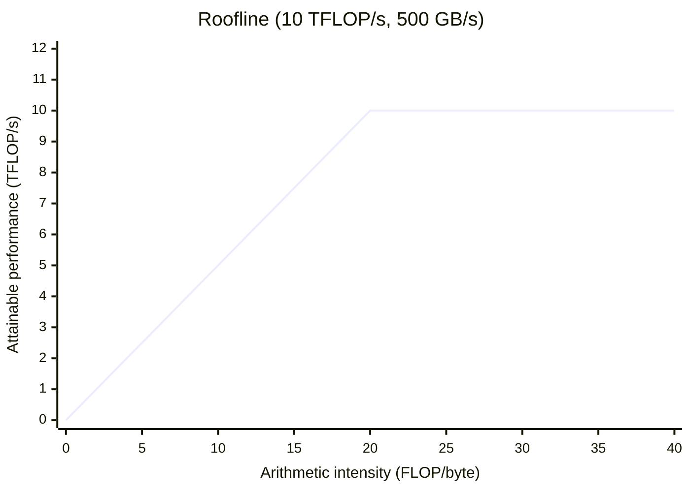

---

## 4.4 Worked example 4.A: roofline for one layer

**The hypothetical accelerator** used here and in the activity below:

| Property | Value |
|---|---|
| Peak compute | 10 TFLOP/s |
| Memory bandwidth | 500 GB/s |
| Ridge point | 10 TFLOP/s ÷ 500 GB/s = **20 FLOP/byte** |

**Table 4.2.** Properties of the hypothetical accelerator used in Worked example 4.A and Activity 4.5.

**Layer:** 1,024 inputs × 4,096 outputs, stored in FP16 (2 bytes per value).

### Batch 1

- FLOPs = 2 × 4,194,304 = 8,388,608.
- Bytes moved: weights 4,194,304 × 2 = 8,388,608; inputs 1,024 × 2 = 2,048; outputs 4,096 × 2 = 8,192. Total = **8,398,848**.
- Intensity = 8,388,608 ÷ 8,398,848 ≈ **1.0 FLOP/byte**, far below the ridge point of 20, so the layer is **memory-bound**.
- Attainable = min(10, 1.0 × 0.5) = **0.5 TFLOP/s, only 5% of peak**.
- Check in time: moving 8.4 MB at 500 GB/s takes about 16.8 µs, while the arithmetic at 10 TFLOP/s would take only about 0.84 µs. The chip spends about 95% of its time waiting.

### Batch 32

- FLOPs = 32 × 8,388,608 = 268,435,456.
- Bytes: weights 8,388,608 (fetched once) + inputs 32 × 2,048 = 65,536 + outputs 32 × 8,192 = 262,144. Total = **8,716,288**.
- Intensity ≈ **30.8 FLOP/byte**, above the ridge point, so the layer is **compute-bound** and reaches the full 10 TFLOP/s.

The weights were fetched once and reused 32 times. That is the whole story of batching.

**Figure 4.5.** Where batch 1 and batch 32 sit on the roofline. Batch 1 falls on the memory-limited slope; batch 32 clears the ridge point and reaches the compute ceiling. *Source: author's own diagram, based on the numbers in Worked example 4.A.*

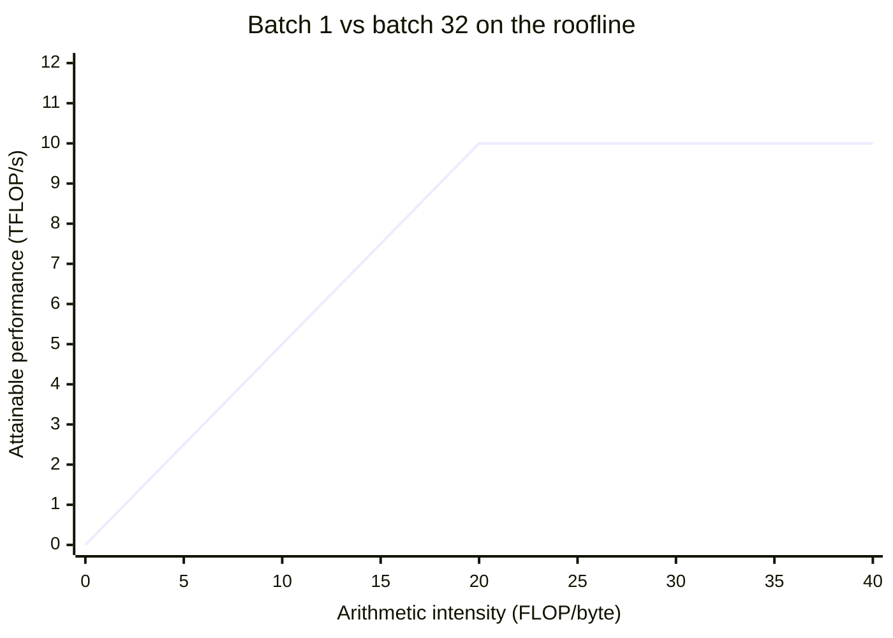

The following Python program checks all the numbers above. Its complete expected output is shown below the code.

```python
PEAK = 10e12        # FLOP/s
BW = 500e9          # bytes/s
BYTES = 2           # FP16

def roofline(n_in, n_out, batch):
    flops = 2 * n_in * n_out * batch
    weight_bytes = n_in * n_out * BYTES
    io_bytes = batch * (n_in + n_out) * BYTES
    intensity = flops / (weight_bytes + io_bytes)
    attainable = min(PEAK, intensity * BW)
    return intensity, attainable

for b in (1, 32):
    i, a = roofline(1024, 4096, b)
    print(b, round(i, 1), round(a / 1e12, 2), "TFLOP/s", f"{a / PEAK:.0%}")
```

Expected output:

```text
1 1.0 0.5 TFLOP/s 5%
32 30.8 10.0 TFLOP/s 100%
```

---

## 4.5 Learner activity: roofline for a different layer

**Setting.** Same hypothetical accelerator as in 4.4 (10 TFLOP/s, 500 GB/s, ridge point 20 FLOP/byte). A layer has **512 inputs and 2,048 outputs**, stored in FP16 (2 bytes per value).

**Tasks.**

1. Compute the number of weights and the weight size in bytes.
2. Compute FLOPs for one input vector (batch 1).
3. For batch sizes 1, 8 and 32, compute the bytes moved (weights + inputs + outputs) and the arithmetic intensity. State whether each case is memory-bound or compute-bound.
4. For each batch size, compute the attainable performance in TFLOP/s and as a percentage of peak.
5. What is the smallest batch size that makes the layer compute-bound?
6. **Reflect (2–3 sentences):** A voice assistant must answer one user at a time within milliseconds. What does the result of Task 3 imply for the hardware you would choose, and why?

**Hints.** Weights are fetched once per batch; inputs and outputs are fetched/written once per sample. Intensity = FLOPs ÷ bytes. Attainable = min(10 TFLOP/s, intensity × 0.5 TFLOP/s per unit intensity).

---

## 4.6 Further efficiency ideas

A designer who understands the roofline has a checklist of ways to improve a memory-bound workload:

| Idea | How it helps | Where you will see it |
|---|---|---|
| Bigger on-chip memory | Weights and activations stay close to the MACs | TPU's 28 MiB buffer; large caches in GPUs; NPUs |
| Higher bandwidth memory | Raises the slope of the roofline | HBM stacked beside the chip |
| Weight reuse (batching, weight-stationary arrays) | More operations per byte fetched | Systolic arrays, batched serving |
| Lower precision | Fewer bytes per weight | INT8/FP8/4-bit inference |
| Compression and pruning | Smaller or sparser models | Mobile model deployment |
| Operator fusion | Intermediate values never leave the chip | Compilers such as XLA and Core ML |
| Unified memory | No copy between CPU, GPU and NPU | Apple silicon |

**Table 4.3.** Techniques for improving a memory-bound workload.

**Figure 4.6.** The same techniques shown as levers on the roofline. Bigger on-chip memory and higher bandwidth raise the slope; batching, lower precision and weight reuse push a workload to the right. *Source: author's own diagram.*

```mermaid
flowchart LR
    MB["Memory-bound workload"] --> UP["Raise the slope<br/>higher bandwidth, larger on-chip memory"]
    MB --> RIGHT["Move right on the x-axis<br/>batching, weight reuse, lower precision"]
    UP --> CB["Compute-bound"]
    RIGHT --> CB
```

> [!WARNING]
> **A caution about batching.** Batching raises intensity but increases latency per request if requests must wait to form a batch. Servers therefore balance throughput (large batches) against latency (answer quickly). This trade-off is why the same model may be run differently in a data centre than on a phone.

---

## 4.7 Bridges to the rest of the course

**Networks.** The memory hierarchy does not stop at the edge of the chip. Moving data between chips, over links such as NVLink or InfiniBand, is another, slower level of the same hierarchy. When a model is split across many chips, this network becomes the bottleneck, which is the subject of Module 02.

**Behaviourist AI.** Behaviour-driven agents, such as robots and game-playing agents, run a loop of *sense, decide, act*, often one observation at a time. That is batch size 1, the memory-bound case from this section. Low latency and low energy per decision therefore matter more than peak throughput, which is why such agents often run on edge hardware such as NPUs.

**Figure 4.7.** The sense–decide–act loop of a behaviour-driven agent runs at batch size 1, so it sits on the memory-bound side of the roofline. *Source: author's own diagram, based on the behaviourist agent model described in Section 1.*

```mermaid
flowchart LR
    S["Sense<br/>one observation"] --> D["Decide<br/>batch = 1, memory-bound"]
    D --> A["Act"]
    A --> S
```

---

## 4.8 Activities for Section 4

- [ ] **Activity 4.A.** A designer doubles the number of MAC units on a memory-bound chip but leaves memory bandwidth unchanged. What happens to performance on a memory-bound workload?
- [ ] **Activity 4.B.** *(Revision of Section 2.5.)* The first TPU had four of six benchmarks memory-bandwidth limited. Which single hardware change did the authors say would have tripled achieved TOPS in a revised design?
- [ ] **Activity 4.C.** Using the energy table in 4.2 and the hierarchy in Figure 4.1, rank from lowest to highest energy per access: DRAM read, register access, small SRAM read.
- [ ] **Activity 4.5.** The learner activity in Section 4.5 (roofline for a 512 × 2,048 layer).

---

## 4.9 Summary

- The memory hierarchy runs from registers (fastest, smallest) through on-chip SRAM/cache and DRAM/HBM to storage (slowest, largest); each level down is larger, cheaper per byte and slower.
- Data movement dominates energy: a DRAM read costs about 170× a 32-bit multiply and about 128× a small SRAM read (Horowitz, 2014).
- Arithmetic intensity (FLOPs per byte) and the roofline model determine attainable performance: min(peak compute, intensity × bandwidth). The ridge point separates memory-bound from compute-bound workloads.
- For the worked layer (1,024 × 4,096, FP16) on a 10 TFLOP/s, 500 GB/s accelerator, batch 1 is memory-bound at about 0.5 TFLOP/s (5% of peak), while batch 32 is compute-bound at the full 10 TFLOP/s.
- Batching, bigger on-chip memory, higher bandwidth, lower precision, compression, operator fusion and unified memory all raise effective intensity; batching trades latency for throughput.

---

# Section 5: Case Study — Apple Neural Engine (On-Device AI)


> [!IMPORTANT]
> **Big idea.** The Apple Neural Engine is the module's ideas in one real device: parallel MACs, low-precision numbers, and on-chip, shared memory, all working inside a few watts.

## Learning objectives

By the end of this section, you should be able to:

1. Describe what the Apple Neural Engine (ANE) is, where it sits in an Apple SoC, and what kinds of tasks it accelerates.
2. Explain how the CPU, GPU, Neural Engine, and unified memory work together, and how Core ML decides where each part of a model runs.
3. Distinguish training from inference, and explain why training happens in the data centre while inference happens on the device.
4. Analyse Face ID as a sense–decide–act loop, and judge using the roofline model whether it is memory-bound or compute-bound.
5. Evaluate the advantages and limitations of on-device AI, including memory footprint, hardware compatibility, privacy and cloud dependency.

---

## 5.1 Introduction

**Figure 5.1.** The Neural Engine sits inside an Apple system-on-a-chip alongside the CPU, GPU and shared memory. *Source: Apple Inc. (2024), Apple Platform Security guide; diagram adapted by the author.*

```mermaid
flowchart TB
    subgraph SoC["Apple system-on-a-chip"]
        CPU["CPU"]
        GPU["GPU"]
        ANE["Neural Engine"]
        MEM[("Unified memory")]
        SEC["Secure Enclave"]
    end
    CPU --- MEM
    GPU --- MEM
    ANE --- MEM
    ANE --- SEC
```

The Apple Neural Engine (ANE) is a specialised processor built into Apple's chips to improve the speed and efficiency of artificial intelligence (AI) tasks. It is the NPU described in Section 2.6.

It was first introduced in 2017 with the A11 Bionic chip in the iPhone X. Apple described that first version as capable of 600 billion operations per second (Apple Inc., 2017); later generations are quoted in TOPS on Apple's specification pages for each chip.

Unlike traditional processors, the Neural Engine is specifically designed to handle AI calculations, allowing iPhones to perform tasks such as:

- Facial recognition (Face ID)
- Image and object recognition
- AI-powered camera features
- Language and speech processing

One major advantage is **on-device AI**, meaning AI tasks can be processed directly on an iPhone without always needing an internet connection or cloud server.

---

## 5.2 How the Apple Neural Engine works

The iPhone uses several hardware components that work together to process AI tasks. They sit on one system-on-a-chip (Section 2.6).

| Component | Function |
|---|---|
| **CPU** | Manages general tasks and coordinates AI operations. |
| **GPU** | Processes multiple calculations simultaneously, especially for graphics and AI. |
| **Neural Engine** | Accelerates neural network calculations for supported AI tasks. |
| **Memory** | Stores AI models, input data, and processing results. |

**Table 5.1.** Hardware components of an Apple SoC and their roles in AI processing.

The Neural Engine uses parallel processing (Section 3), allowing many calculations to happen at the same time instead of one by one. This makes AI applications faster and more energy-efficient.

**Figure 5.2.** How an app reaches the Neural Engine through Core ML. Core ML inspects the model and routes each operation to the CPU, GPU or Neural Engine; all three share unified memory. *Source: author's own diagram, based on Apple Inc. (2024), Core ML documentation.*

```mermaid
flowchart LR
    App["App / model"] --> CML["Core ML<br/>(decides where to run)"]
    CML --> CPU["CPU"]
    CML --> GPU["GPU"]
    CML --> ANE["Neural Engine"]
    CPU --- MEM[("Unified memory")]
    GPU --- MEM
    ANE --- MEM
```

### Technical details: linking back to Sections 2, 3 and 4

- **Software (Section 2.7).** Developers use **Core ML**, which decides whether each part of a model runs on the CPU, GPU or Neural Engine. If a model uses an operation the Neural Engine does not support, that part falls back to the CPU, which can make the whole model slower.
- **Memory (Section 4.1).** Apple silicon uses **unified memory**, so the CPU, GPU and Neural Engine share one pool and no copying is needed between them.
- **Precision (Section 3.4).** Models are usually quantised to INT8 or FP16 so that more fits in memory and less energy is spent moving it.
- **Batch size (Section 4.3).** Features such as Face ID process one input at a time (batch 1), the memory-bound case. This is why on-chip memory and low-precision weights matter so much on a phone.

---

## 5.3 Connection between training and inference


Training and inference are two important stages of AI processing (Section 1.5).

**Figure 5.3.** Training happens in the data centre on GPUs or accelerators; the trained weights are then shipped to the iPhone, where inference runs on the Neural Engine. *Source: author's own diagram.*

```mermaid
flowchart LR
    D["Large data set"] --> T["Training<br/>data centre, GPUs / accelerators"]
    T --> M["Trained model<br/>(weights)"]
    M --> I["Inference<br/>on the iPhone, Neural Engine"]
    I --> R["Fast, private answer"]
```

- **Training:** AI models are trained using large amounts of data, usually on powerful computers equipped with GPUs or other AI accelerators.
- **Inference:** once trained, the model can be used on an iPhone. The Neural Engine helps process new information quickly without needing to retrain the entire model.

This shows how specialised AI hardware supports the practical use of trained AI models.

---

## 5.4 Real-life application: Face ID


**Figure 5.4.** An iPhone using the TrueDepth camera for Face ID. *Source: Apple Inc. (2024), Face ID and privacy documentation; photograph reproduced by the author for teaching purposes only.*

Face ID is a real-world example of how Apple's AI hardware performs facial recognition.

### How Face ID works

1. **Face scanning:** the TrueDepth camera captures facial information using infrared light and depth sensors.
2. **Data processing:** the system converts facial information into a mathematical representation.
3. **AI inference:** neural networks analyse the facial information using specialised processing hardware.
4. **Face comparison:** the system securely compares the information with the registered face.
5. **Device unlocking:** if the face matches, the iPhone unlocks.

This process happens quickly because the iPhone uses specialised hardware to accelerate AI calculations.

**Figure 5.5.** The five steps of Face ID, from scanning to unlocking. *Source: author's own diagram, based on Apple Inc. (2024), Face ID documentation.*

```mermaid
flowchart LR
    S["1. Scan<br/>TrueDepth camera"] --> P["2. Process<br/>mathematical representation"]
    P --> A["3. AI inference<br/>Neural Engine"]
    A --> C["4. Compare<br/>with registered face"]
    C --> U["5. Unlock<br/>if match"]
```

Face ID also protects privacy because facial authentication data is processed and protected on the device rather than stored in the cloud. Apple's public security documentation describes this data as being kept in the **Secure Enclave** (Apple Inc., 2024).

> [!NOTE]
> **Bridge to Behaviourist AI.** Face ID is a small sense–decide–act loop: sense the face, decide match or no match, act by unlocking. It must answer in a fraction of a second, one request at a time, on a battery. The same constraints apply to robots and other agents that act in real time.

> [!NOTE]
> **Bridge to Networks.** Because the work stays on the device, Face ID needs no network round trip. That removes network delay and keeps sensitive data local, which is the trade-off between on-device and cloud processing.

---

## 5.5 Advantages of the Apple Neural Engine

| Advantage | Explanation |
|---|---|
| **Faster processing** | AI tasks can be completed quickly using specialised hardware. |
| **Energy efficiency** | AI calculations can use less power, helping preserve battery life. |
| **Better privacy** | Sensitive information can remain on the device. |
| **Real-time performance** | Applications such as Face ID respond almost immediately. |
| **Offline capability** | Many supported AI functions work without an internet connection. |

**Table 5.2.** Advantages of the Apple Neural Engine.

**Figure 5.6.** The five advantages of on-device AI with the Neural Engine. *Source: author's own diagram, based on Apple Inc. (2024).*

```mermaid
flowchart LR
    ANE["Apple Neural Engine"] --> F["Faster processing"]
    ANE --> E["Energy efficiency"]
    ANE --> P["Better privacy"]
    ANE --> R["Real-time performance"]
    ANE --> O["Offline capability"]
```

---

## 5.6 Limitations

Despite its advantages, the Apple Neural Engine has some limitations.

- **Limited computing resources:** smartphones cannot handle every large AI model as efficiently as powerful servers.
- **Hardware compatibility:** not all AI models or operations can run on the Neural Engine.
- **Memory limitations:** complex AI models may require more memory than a mobile device can provide.
- **Cloud dependency:** some advanced AI applications still need cloud-based processing.

---

## 5.7 Case-study questions

1. A model has one unsupported operation in the middle. Explain why it may run slower than a model with fewer supported operations overall. *(Hint: Section 2.7, fallback to the CPU, and the cost of moving data between processors.)*
2. Face ID processes one face at a time. Using Section 4, is this likely to be memory-bound or compute-bound, and why?
3. A 3-billion-parameter language model is quantised to 4-bit. How much memory do its weights need? Does it fit comfortably on a phone with 8 GB of memory shared with other apps?
4. Give one benefit and one drawback of keeping AI processing on the device rather than in the cloud.
5. Explain, using the Section 4 energy table, why unified memory saves energy as well as time.

The following Python program checks the arithmetic for question 3. Its complete expected output is shown below the code.

```python
params = 3e9
bytes_per_weight = 0.5          # 4-bit = half a byte
print(params * bytes_per_weight / 1e9, "GB")   # 1.5 GB
```

Expected output:

```text
1.5 GB
```

---

## 5.8 Conclusion

The Apple Neural Engine demonstrates how specialised hardware improves the performance of AI applications. By combining the CPU, GPU, Neural Engine, and memory, iPhones can process AI tasks quickly and efficiently.

The case study also shows the relationship between training and inference: AI models are generally trained using powerful computers, while the Neural Engine helps run those trained models directly on the iPhone. This makes everyday features such as Face ID, image recognition, and AI-powered photography possible.

---

## 5.9 Summary

- The Apple Neural Engine is the NPU inside Apple's SoC, introduced in 2017 (A11 Bionic) and shared with the CPU and GPU through unified memory.
- Core ML decides whether each operation runs on the CPU, GPU or Neural Engine; unsupported operations fall back to the CPU and can silently slow a model.
- Training happens in the data centre on GPUs or accelerators; inference happens on the device, where batch size 1 makes the workload memory-bound.
- Face ID is a sense–decide–act loop that must answer in a fraction of a second, on battery, with no network round trip; it is the memory-bound, latency-critical case from Section 4.
- On-device AI buys privacy, latency and offline capability, but is limited by memory, compute and hardware compatibility; a 3-billion-parameter model quantised to 4-bit needs 1.5 GB for its weights alone.

---

# Glossary (all sections)

| Term | Meaning |
|---|---|
| **Accelerator** | A chip that works alongside the CPU to speed up specific kinds of work. |
| **Amdahl's law** | A formula giving the maximum speed-up from parallelising a fraction *p* of a job on *N* units: 1 ÷ ((1 − p) + p ÷ N). |
| **Arithmetic intensity** | FLOPs performed per byte moved from memory. |
| **ASIC** | Application-specific integrated circuit; a chip built for one domain or fixed task. |
| **Bandwidth** | The number of bytes per second that can be moved between two parts of a system. |
| **Batch size / batching** | The number of inputs processed together; batching processes several inputs at once so the same weights are reused. |
| **BF16 (bfloat16)** | A 16-bit floating-point format with the same range as FP32. |
| **Branch prediction** | A CPU technique that guesses which way a conditional branch will go so it can keep working instead of waiting. |
| **Cache** | A small, fast memory that keeps copies of recently used data close to the processor, managed by hardware. |
| **Compiler** | Software that translates a program into instructions for a specific chip. |
| **Compute-bound** | A workload whose intensity is above the ridge point, so the chip's arithmetic is the limit. |
| **Core** | A unit inside a chip that can execute instructions on its own. |
| **Core ML** | Apple's framework that routes each part of a model to the CPU, GPU or Neural Engine. |
| **CUDA** | NVIDIA's programming interface for running general-purpose code on its GPUs. |
| **Data parallelism** | Doing the same operation on different data at the same time. |
| **Dennard scaling** | The historical trend that shrinking transistors also reduced their power use, allowing faster clocks; it ended in the mid-2000s. |
| **Deterministic execution** | Every run takes the same, predictable number of cycles. |
| **DRAM** | Larger, slower memory outside the chip, cheap per byte. |
| **FLOP / FLOPs / FLOPS** | One floating-point operation / the plural / FLOPs per second. One MAC = 2 FLOPs. |
| **FP32 / FP16 / FP8** | Floating-point formats using 32, 16 or 8 bits per number. |
| **HBM (High Bandwidth Memory)** | DRAM stacked in layers and placed next to a GPU or accelerator to deliver very high bandwidth. |
| **Inference** | Using a trained model to produce an answer. |
| **INT8 / INT4** | Integer formats using 8 or 4 bits per number. |
| **Interconnect** | The links between chips and between machines. |
| **Latency** | Time for one task from start to finish. |
| **Latency (memory)** | The time one memory access takes, as opposed to sustained bandwidth. |
| **Latency hiding** | Switching to another ready group of threads while one group waits, so arithmetic units stay busy. |
| **MAC** | Multiply-accumulate: the operation `a × b + c`, the basic building block of neural-network arithmetic; 1 MAC = 2 FLOPs. |
| **Matrix** | A table of numbers; the standard way to write many MACs compactly. |
| **Memory-bound** | A workload whose intensity is below the ridge point, so memory bandwidth is the limit. |
| **Memory hierarchy** | The arrangement of memory from fastest and smallest (registers) to slowest and largest (storage). |
| **NPU** | Neural processing unit; a small, low-power AI accelerator inside a phone or laptop chip. |
| **Operator fusion** | Combining several operations into one pass so intermediate values never leave the chip. |
| **Out-of-order execution** | A CPU technique of running instructions in a different order from the program when it is safe, to avoid waiting. |
| **Peak compute** | The maximum arithmetic throughput of a chip, in FLOP/s. |
| **Pipeline parallelism** | Splitting a model into stages across several chips, with data flowing from stage to stage. |
| **Precision** | How many bits are used to store each number (FP32, FP16, INT8, and so on). |
| **Quantisation** | Converting numbers from a high-precision to a lower-precision format. |
| **Ridge point** | Peak compute ÷ memory bandwidth; the intensity at which a workload switches from memory-bound to compute-bound. |
| **Roofline model** | A model stating attainable performance = min(peak compute, intensity × bandwidth). |
| **Scratchpad / software-managed buffer** | On-chip memory that the program or compiler controls explicitly. |
| **Secure Enclave** | Apple's isolated security processor that protects sensitive data such as Face ID templates. |
| **SIMD / SIMT** | Single Instruction, Multiple Data / Threads: one instruction applied to many values or threads at once. |
| **SoC** | System-on-a-chip: a single piece of silicon containing CPU, GPU, NPU, memory controllers and other blocks. |
| **Sparsity** | Skipping multiplications by zero. |
| **SRAM** | Fast on-chip memory, expensive in area. |
| **Systolic array** | A grid of MAC cells in which each cell holds a weight and data is passed from neighbour to neighbour. |
| **Tensor** | A multi-dimensional array; the higher-dimensional generalisation of a matrix. |
| **Thread** | One stream of instructions. |
| **Throughput** | Amount of work finished per second. |
| **TOPS** | Tera operations per second (10¹² operations per second): a measure of arithmetic throughput. |
| **Training** | Adjusting a model's weights using data. |
| **Unified memory** | One pool of memory shared by CPU, GPU and NPU so data need not be copied between them. |
| **Utilisation** | The fraction of a chip's peak capacity that is actually doing useful work. |
| **Vector** | A one-dimensional list of numbers. |
| **Warp** | A group of GPU threads that execute together. |
| **Weight** | A number learned during training and used during inference. |
| **XLA** | A compiler used to map models onto TPUs. |

---

# Answer Key (all sections)

## Section 1

**Activity 1.A.**
Step 1: total = 0.
Step 2: total = 0 + (2 × 1) = 2.
Step 3: total = 2 + (-1 × 4) = 2 − 4 = −2.
Step 4: total = −2 + (0.5 × 6) = −2 + 3 = **1.0**.
Computed with 3 MACs.

**Activity 1.B.**
MACs = 512 × 2,048 = **1,048,576**. FLOPs = 2 × 1,048,576 = **2,097,152** (about 2.1 million), because one MAC = 2 FLOPs.

**Activity 1.C.**
Observed throughput = 100 TOPS × 0.30 = **30 TOPS**. The other 70% of peak is idle silicon.

**Activity 1.D.**
(a) **Inference** — a trained model answers a single request on the device.
(b) **Training** — the weights are being adjusted using data over a long job on many chips.
(c) **Inference** — a trained model is answering many user requests, even though the total volume is large. (Serving at scale is still inference; the compute cost comes from volume, not from learning.)

**Activity 1.E.**
FP16: 7 × 10⁹ × 2 bytes = **14 GB**.
INT8: 7 × 10⁹ × 1 byte = **7 GB**.

---

## Section 2

**Activity 2.A.**
(a) **CPU** — the workload is mixed and latency-sensitive, so flexibility matters most.
(b) **GPU** (or a TPU if training on Google Cloud) — training needs high parallel throughput on large matrices.
(c) **TPU or another fixed-function accelerator** — the workload is fixed and high-volume, so maximum efficiency per watt pays off.

**Activity 2.B.**
Each weight is read **once** (4 reads in total), and each input is read **once** (2 reads in total), for 6 reads in total. Without neighbour-to-neighbour passing, each input would be read once per output, giving 8 reads. The saving grows with array size.

**Activity 2.C.**
Order: **NPU, then CPU, then GPU.**
Reason: the NPU gives the most operations per watt and is designed for exactly this kind of always-on, low-power inference; the CPU is flexible but less efficient; the GPU draws too much power for a small battery.

**Activity 2.D.**
Any two of: the workload may use operations the TPU does not support well (falling back to the CPU and losing the advantage); the team may already depend on a GPU software stack, and switching platforms is costly; GPU cloud availability and cost may be better; the workload may be memory-bandwidth limited, where the TPU's arithmetic advantage does not help.

---

## Section 3

**Activity 3.A.**
The MAC count doubles, to 1,024 × 8,192 = **8,388,608 MACs** (about 16.8 million FLOPs), because there are twice as many outputs and each still needs 1,024 MACs.

**Activity 3.B.**
About **2 µs**, ideally: twice the MACs at the same throughput. In practice the accelerator may do slightly better than a simple doubling if the larger layer keeps more units busy, or slightly worse if memory becomes the bottleneck.

**Activity 3.C.**
On 8 units: 1 ÷ (0.2 + 0.8 ÷ 8) = 1 ÷ 0.3 ≈ **3.3×**.
With unlimited units: 1 ÷ 0.2 = **5×**, because the 20% serial part remains.

**Activity 3.D.**
FP16: 7 × 10⁹ × 2 bytes = **14 GB**.
INT8: 7 × 10⁹ × 1 byte = **7 GB**.
4-bit: 7 × 10⁹ × 0.5 bytes = **3.5 GB**.

---

## Section 4

**Activity 4.A.**
Almost nothing changes. On a memory-bound workload the limit is the rate at which data can be supplied, not the number of arithmetic units. Doubling the MACs leaves them idle for the same fraction of time, so attainable performance stays about the same until memory bandwidth or on-chip reuse improves.

**Activity 4.B.**
Using the GPU's faster **GDDR5 memory** in a revised design; the authors estimated this would have tripled achieved TOPS.

**Activity 4.C.**
Lowest to highest energy per access: **register access, then small SRAM read (~5 pJ), then DRAM read (~640 pJ)**.

**Activity 4.5 (learner activity).**

- Weights: 512 × 2,048 = **1,048,576 weights**, i.e. 1,048,576 × 2 = **2,097,152 bytes**.
- FLOPs at batch 1 = 2 × 1,048,576 = **2,097,152**.

| Batch | Intensity (FLOP/byte) | Bound | Attainable | % of peak |
|---:|---:|---|---:|---:|
| 1 | ≈ 1.0 | memory | ≈ 0.5 TFLOP/s | ≈ 5% |
| 8 | ≈ 7.9 | memory | ≈ 3.9 TFLOP/s | ≈ 39% |
| 32 | ≈ 29.7 | compute | 10 TFLOP/s | 100% |

**Table 4.4.** Answer key for Activity 4.5, tasks 3 and 4.

- Smallest compute-bound batch: **22** (intensity reaches the ridge point of 20 at batch 22).
- Reflection: batch 1 is memory-bound, so extra arithmetic units help little. Prefer hardware with high memory bandwidth, large on-chip memory and low-precision weights (for example, an NPU), because latency and energy per decision matter more than peak throughput.

---

## Section 5

**Question 1.**
The model is split into pieces. Each switch to the CPU and back means moving data between processors and losing the accelerator's efficiency, so a few unsupported operations can dominate the total time. The cost is not the unsupported operation itself but the data movement around it.

**Question 2.**
**Memory-bound.** Batch 1 has low arithmetic intensity (Section 4.3): each weight is fetched for a single input, so the chip spends most of its time waiting for data. This is why on-chip memory and low-precision weights matter so much on a phone.

**Question 3.**
The weights need 3 × 10⁹ × 0.5 bytes = **1.5 GB**. That is a modest share of 8 GB, but the model also needs working memory (activations, KV cache during generation) and shares RAM with other apps, so it is workable rather than comfortable.

**Question 4.**
Benefits: privacy (data stays on the device), no network delay, works offline.
Drawbacks: limited memory and compute, so the largest models may still need the cloud; hardware compatibility limits which operations can run on the Neural Engine.

**Question 5.**
Without copying between CPU, GPU and NPU, fewer off-chip memory accesses are needed. Each DRAM access costs far more energy than arithmetic (about 170× a multiply, Section 4.2), so avoiding copies saves energy as well as time.

---

# References (all sections)

- Amdahl, G. M. (1967). Validity of the single processor approach to achieving large scale computing capabilities. *AFIPS Conference Proceedings*.
- Apple Inc. (2017). *Apple introduces iPhone X* [press release].
- Apple Inc. (2024). *Apple Platform Security guide* (Face ID and Secure Enclave sections).
- Apple Inc. (2024). *Core ML documentation*.
- Google. (2025). *Ironwood TPU announcement*.
- Hennessy, J. L., & Patterson, D. A. (2019). A new golden age for computer architecture. *Communications of the ACM*, 62(2), 48–60.
- Horowitz, M. (2014). Computing's energy problem (and what we can do about it). *IEEE ISSCC*.
- Jouppi, N. P., et al. (2017). In-datacenter performance analysis of a Tensor Processing Unit. *Proceedings of ISCA 2017*.
- NVIDIA. (n.d.). *GPU and Tensor Core documentation*.
- Qualcomm. (2024). *Hexagon NPU documentation*.
- Sze, V., et al. (2017). Efficient processing of deep neural networks: A tutorial and survey. *Proceedings of the IEEE*.
- Williams, S., Waterman, A., & Patterson, D. (2009). Roofline: an insightful visual performance model for multicore architectures. *Communications of the ACM*, 52(4), 65–76.

# Module 02: Computer Networks & AI Infrastructure

| | |
|---|---|
| **Course** | Hardware, Networks & Behaviourist AI |
| **Version** | V1.0 (substantive draft) |
| **Audience** | Beginners with basic programming knowledge and no networking background |
| **Prerequisites** | Module 01 (MACs, bandwidth, memory hierarchy, batch size). Basic arithmetic and the idea of a variable and a loop. |
| **Position in course** | Second of five modules; builds on the vocabulary of Module 01 and is reused by Modules 03-05 |

## Table of contents

- [Module overview](#module-overview)
- [Learning objectives](#learning-objectives)
- [A running example](#a-running-example)
- [Section 1: Network Architecture and Communication Protocols](#section-1-network-architecture-and-communication-protocols)
- [Section 2: TCP/IP and Data Transmission](#section-2-tcpip-and-data-transmission)
- [Section 3: Cloud Computing vs Edge Computing](#section-3-cloud-computing-vs-edge-computing)
- [Section 4: Network Latency, Bandwidth, and Scalability](#section-4-network-latency-bandwidth-and-scalability)
- [Section 5: Case Study — Cloud-Based AI Service (5G and AI-Powered Network Optimization)](#section-5-case-study--cloud-based-ai-service-5g-and-ai-powered-network-optimization)
- [Glossary (all sections)](#glossary-all-sections)
- [Answer Key (all sections)](#answer-key-all-sections)
- [References (all sections)](#references-all-sections)

---

## Module overview

Module 01 showed that an AI model is, in the end, a huge number of arithmetic operations on physical chips, and that moving data often costs more than computing on it. That story did not stop at the edge of the chip. A trained model has to be delivered to users, a request has to travel to wherever the model runs, and, when a model is too big for one chip, the chips have to talk to each other. All of that happens over networks.

The choice of network and of *where* the computation runs decides:

- how long a user waits for an answer (milliseconds or seconds),
- how much a service can grow before it breaks (one user or a billion),
- what data leaves the user's device (privacy), and
- how much of the extra hardware you pay for actually gets used (Module 01's utilisation, now across many machines).

This module explains how networks are organised, how data is moved reliably across them, where AI computation can be placed (cloud, edge, device), how to reason about latency, bandwidth and scalability with simple calculations, and how a modern mobile network (5G) and AI work together in both directions: the network carries AI services, and AI helps run the network.

> [!NOTE]
> **Where this module is going.** Section 1 introduces network architectures, layered models and the protocols AI services use. Section 2 follows data through TCP/IP and shows why a fast link can still deliver slow transfers. Section 3 compares cloud, edge and on-device computing. Section 4 gives the tools to reason about latency, bandwidth and scalability, including the communication cost of training across many chips. Section 5 applies everything to a cloud-based AI service delivered over 5G, and to AI-powered network optimization.

## Learning objectives

By the end of this module, you will be able to:

1. Describe common network architectures and explain how layered models and encapsulation let very different systems communicate.
2. Explain how TCP/IP moves data reliably (addressing, handshake, acknowledgements, flow and congestion control) and where UDP and QUIC differ.
3. Compare cloud, edge and on-device computing for an AI workload and justify a choice using latency, bandwidth, privacy and model size.
4. Calculate propagation, transmission and queueing delays and the bandwidth-delay product, and use them to explain why a transfer is slow.
5. Explain scalability, tail latency, and why communication limits the speed-up of training across many chips (linking to Amdahl's law from Module 01).
6. Analyse how 5G and AI-powered network optimization support a cloud-based AI service, and judge the trade-offs.

## A running example

Module 01 used Face ID, a task that stays entirely on the device. This module uses a contrasting task that cannot always stay there:

> **Running example: translating a street sign.** You point your phone's camera at a sign in a language you cannot read and ask for a translation. The photo has to be turned into text, translated, and shown to you within about a second. A small model might run on the phone's Neural Engine. A bigger, more accurate model runs in a data centre. Deciding which one answers (and how the photo gets there) is the networking problem of this module.

Every networking idea here (protocol layers, round trips, bandwidth, edge servers) exists because of pressures like these.

---

# Section 1: Network Architecture and Communication Protocols

> [!IMPORTANT]
> **Big idea.** A network is a set of machines connected by links that follow shared rules (protocols). Layering those rules lets each part do one job, so a phone, a router and a GPU server can cooperate even though they are built by different companies.

## Learning objectives

By the end of this section you should be able to:

1. Define a computer network and name its basic elements (nodes, links, packets, protocols).
2. Describe the scales of network that matter for AI, from inside a chip package to a mobile network.
3. Compare client-server, peer-to-peer and data-centre (leaf-spine) architectures.
4. Explain layering and encapsulation, and calculate the header overhead of a packet.
5. Match common application protocols (HTTP, gRPC, MQTT, WebRTC) to the AI scenarios they suit.

---

## 1.1 What is a computer network?

A **computer network** is a collection of devices (**nodes**) connected by **links** so they can exchange data. Data is cut into small pieces called **packets**; each packet carries a header with the information needed to deliver it. A **protocol** is an agreed set of rules for how packets are formatted, sent, received and acknowledged.

Networks matter to AI at three moments:

- **Delivering data to the model**: a photo, a voice clip or a sensor reading travels to where the model runs.
- **Delivering the model to the user**: weights are downloaded to a phone or a server.
- **Connecting the chips that run the model**: large models are split across many accelerators, which exchange results constantly (Module 01, Section 3, "Across chips").

> [!TIP]
> **Going further.** Module 01 listed *interconnects* as one of the five categories of AI hardware. This module is the full story of that category: what the links are, which rules they follow, and how far the data has to travel.

---

## 1.2 Network scales in AI systems

The same idea (send data over a link) appears at very different scales. Speed and delay change by many orders of magnitude between them. This is the memory hierarchy of Module 01 extended outwards.

| Scale | Typical link | Rough bandwidth | Rough delay |
|---|---|---|---|
| Inside an accelerator package | HBM stack to chip | ~TB/s (Module 01) | hundreds of ns |
| Between GPUs in one server | NVLink; PCIe | up to several hundred GB/s (NVLink); ~64 GB/s per direction (PCIe 5.0 x16) | ~µs |
| Between servers in a data centre | InfiniBand or Ethernet, 100-400 Gbit/s per port (12.5-50 GB/s) | 12.5-50 GB/s | ~µs to tens of µs |
| Between data centres and users | Fibre backbone and access network | 0.1-10 Gbit/s typical per user | ~ms to ~100 ms |
| Last hop to a phone | Wi-Fi, 4G, 5G | tens to hundreds of Mbit/s (more with 5G) | ~ms to tens of ms |

**Table 1.1.** Orders of magnitude for links at different scales. These are indicative figures from vendor specifications and typical deployments; exact values depend on the generation of hardware and on the network, so check current specification sheets before relying on them (NVIDIA, n.d.; Kurose & Ross, 2020).

> [!NOTE]
> **Bits and bytes again.** Network speeds are quoted in **bits** per second (Gbit/s), memory speeds in **bytes** per second (GB/s). Divide by 8 to convert: 100 Gbit/s = 12.5 GB/s. This is the same bits-and-bytes caution as in Module 01.

---

## 1.3 Network architectures

An **architecture** is the pattern in which machines are arranged and who talks to whom.

| Architecture | Idea | AI example |
|---|---|---|
| **Client-server** | Many clients send requests to a few servers that do the work | A phone app sending a photo to a cloud translation service |
| **Peer-to-peer (P2P)** | Machines talk to each other directly, with no central server | Devices sharing model updates in federated learning (Section 3.6) |
| **Data-centre fabric (leaf-spine)** | Every "leaf" switch connects to every "spine" switch, giving many equal paths | A training cluster where thousands of GPUs exchange gradients |
| **Hybrid** | A mix, such as device, edge server and cloud | Section 3 and the case study in Section 5 |

**Table 1.2.** Four network architectures and an AI example of each.

**Figure 1.1.** A small leaf-spine data-centre fabric. Servers attach to leaf switches; every leaf connects to every spine, so traffic between any two servers has several equal-length paths and no single link is the bottleneck. *Source: author's own diagram, based on Al-Fares, Loukissas & Vahdat (2008).*

```mermaid
flowchart TB
    subgraph Spines["Spine switches"]
        S1["Spine 1"]
        S2["Spine 2"]
    end
    subgraph Leaves["Leaf switches"]
        L1["Leaf 1"]
        L2["Leaf 2"]
        L3["Leaf 3"]
    end
    S1 --- L1
    S1 --- L2
    S1 --- L3
    S2 --- L1
    S2 --- L2
    S2 --- L3
    L1 --- A["GPU servers"]
    L2 --- B["GPU servers"]
    L3 --- C["Storage servers"]
```

Why this shape? A single giant switch would be a bottleneck and a single point of failure. In a leaf-spine fabric you grow the network by adding switches, and if one spine fails the others carry the load.

---

## 1.4 Layered models and encapsulation

Sending a photo across the world involves radio signals, cables, addresses, routes, retransmissions and an application that understands the photo. Nobody designs all of that as one block. Instead, the work is split into **layers**, each using the one below it and offering a simple service to the one above.

| Layer (TCP/IP model) | Job | Example protocols |
|---|---|---|
| **Application** | What the programs say to each other | HTTP, gRPC, MQTT, DNS |
| **Transport** | Delivery between programs on two machines; reliability | TCP, UDP, QUIC |
| **Network (Internet)** | Addressing and routing across networks | IP (IPv4, IPv6) |
| **Link and physical** | Moving bits over one hop: cable, fibre, radio | Ethernet, Wi-Fi, 5G radio |

**Table 1.3.** The four-layer TCP/IP model. (The seven-layer OSI model splits the application layer into three and the link layer into two; you will see both in textbooks.)

As data moves down the stack, each layer wraps it in its own header. This is called **encapsulation**. At the destination, each layer removes its header and hands the rest upward.

**Figure 1.2.** Encapsulation. The application data is wrapped first by a TCP header, then an IP header, then an Ethernet header and trailer. Each wrapper is overhead that the link must carry in addition to the useful data. *Source: author's own diagram, based on Kurose & Ross (2020).*

```mermaid
flowchart LR
    D["Application data<br/>payload"] --> T["TCP header (20 B)<br/>+ payload"]
    T --> I["IP header (20 B)<br/>+ TCP segment"]
    I --> E["Ethernet header (14 B)<br/>+ IP packet + FCS (4 B)"]
```

### Worked example 1.A: how much of a packet is useful?

*Illustrative numbers.* Assume a minimal TCP header (20 bytes), a minimal IPv4 header (20 bytes), and Ethernet framing (14-byte header plus 4-byte check sequence). That is 58 bytes of overhead per packet.

1. **Step 1.** Overhead = 20 + 20 + 14 + 4 = **58 bytes**.
2. **Step 2.** For a 1,000-byte payload, the frame is 1,000 + 58 = **1,058 bytes**.
3. **Step 3.** Efficiency = useful bytes ÷ total bytes = 1,000 ÷ 1,058 ≈ **94.5%**.
4. **Step 4.** For a tiny 100-byte payload (such as a small sensor reading), efficiency = 100 ÷ 158 ≈ **63.3%**.

**Result.** Large payloads waste little on headers; very small messages waste more than a third of the link. This is one reason many small messages are batched together, an idea that returns in Section 4.

The following Python program checks the result. Its complete expected output is shown below the code.

```python
HEADERS = 20 + 20 + 14 + 4   # TCP + IP + Ethernet header + Ethernet FCS (bytes)

def efficiency(payload):
    return payload / (payload + HEADERS)

print(1000 + HEADERS)                 # frame size for a 1,000-byte payload
print(f"{efficiency(1000):.1%}")
print(f"{efficiency(100):.1%}")
```

Expected output:

```text
1058
94.5%
63.3%
```

> [!WARNING]
> **Caution: real packets vary.** IPv6 headers are 40 bytes, TCP can carry options, and wireless links add their own framing. Treat 58 bytes as a teaching figure, not a rule.

---

## 1.5 Application protocols for AI services

At the top of the stack, programs agree on *what* to say. Different AI scenarios favour different protocols.

| Protocol | Style | Typical use in AI systems |
|---|---|---|
| **HTTP / REST (usually with JSON)** | Request and response, human-readable | Public AI APIs: send a prompt or an image, receive a result |
| **gRPC** | Compact binary messages, typed interfaces, streaming | Service-to-service calls inside a data centre, for example between a web server and a model server |
| **WebSocket / server-sent events** | Long-lived connection the server can push on | Streaming a chatbot's answer word by word |
| **MQTT** | Lightweight publish/subscribe messaging | Thousands of low-power sensors reporting to a hub |
| **RTP / WebRTC** | Real-time audio and video, usually over UDP | Live voice assistants and video calls |

**Table 1.4.** Common application protocols and the AI scenarios they suit.

**Figure 1.3.** A cloud AI request passes through several services, each speaking a protocol suited to its job. *Source: author's own diagram.*

```mermaid
flowchart LR
    U["Phone app"] -->|"HTTPS / JSON"| G["API gateway"]
    G -->|"gRPC"| M["Model server<br/>GPU / TPU"]
    M -->|"gRPC"| G
    G -->|"HTTPS / JSON"| U
    SENS["Sensors"] -->|"MQTT"| HUB["IoT hub"]
    HUB -->|"gRPC"| M
```

---

## 1.6 Key terms

A complete glossary is at the end of this module (see [Glossary](#glossary-all-sections)). Some terms (round-trip time, bandwidth-delay product) are explained in full in later sections, so treat this as a first look.

| Term | Definition |
|---|---|
| **Node** | Any device on a network: phone, server, router, switch. |
| **Link** | A connection that carries bits between two nodes. |
| **Packet** | A small chunk of data plus a header with delivery information. |
| **Protocol** | An agreed set of rules for communication. |
| **Header** | Control information a layer adds in front of the data it carries. |
| **Router / switch** | Devices that forward packets. Routers forward between networks using IP addresses; switches forward within a network. |
| **Bandwidth** | How many bits per second a link can carry (Module 01 defined it in bytes per second for memory). |
| **Latency** | How long it takes for data to get from one point to another, or for a request to be answered. |
| **RTT (round-trip time)** | Time for a message to go to the destination and a reply to come back. |
| **Throughput** | The rate at which useful data is actually delivered; always at most the bandwidth. |
| **Client / server** | The machine that asks / the machine that answers. |

**Table 1.5.** Key terms for Section 1.

---

## 1.7 Activities for Section 1

- [ ] **Activity 1.A.** Using the 58-byte overhead from Worked example 1.A, compute the efficiency for a 1,200-byte payload and for a 40-byte payload.
- [ ] **Activity 1.B.** For each task, name the TCP/IP layer responsible: (a) choosing which route a packet takes across the internet, (b) re-sending a lost segment, (c) turning bits into a radio signal, (d) an HTTP request for a translation.
- [ ] **Activity 1.C.** Explain in two or three sentences why a data centre uses a leaf-spine fabric instead of one very large switch.
- [ ] **Activity 1.D.** Match each scenario to the most suitable protocol (HTTP/REST, gRPC, MQTT, WebRTC): (a) thousands of battery-powered sensors reporting to a hub, (b) a web server calling a model server in the same data centre, (c) a live voice assistant, (d) a public API that accepts images from any developer.

---

## 1.8 Summary

- A network is nodes connected by links that follow protocols; data travels as packets with headers.
- Links span many scales, from TB/s inside a package to tens of Mbit/s on a mobile network; delay grows with distance, just as in the memory hierarchy of Module 01.
- Common architectures are client-server, peer-to-peer, data-centre leaf-spine fabrics and hybrids.
- Layering (application, transport, network, link) splits the work; encapsulation wraps data in a header at each layer. With 58 bytes of headers, a 1,000-byte payload is 94.5% efficient and a 100-byte payload 63.3%.
- Different protocols suit different AI jobs: HTTP/REST for public APIs, gRPC inside data centres, MQTT for sensors, WebRTC for real-time media.

---

# Section 2: TCP/IP and Data Transmission

> [!IMPORTANT]
> **Big idea.** IP gets packets across the world on a best-effort basis; TCP turns that unreliable delivery into a dependable stream. The price is round trips and careful pacing, and these can make a fast link feel slow.

## Learning objectives

By the end of this section you should be able to:

1. Explain what IP addresses and routing do, and why IP delivery is "best effort".
2. Describe how TCP establishes a connection, achieves reliability, and controls flow and congestion.
3. Distinguish TCP, UDP and QUIC and say when each is used.
4. Calculate time to first byte for different protocol setups.
5. Compute the bandwidth-delay product and the window-limited throughput of a TCP connection.
6. Explain how packet loss reduces TCP throughput, using the Mathis formula.

---

## 2.1 IP: addressing and best-effort delivery

Every device on the internet has an **IP address**. IPv4 addresses are 32 bits (about 4.3 billion possible); IPv6 addresses are 128 bits (Postel, 1981; Deering & Hinden, 2017). A **router** reads the destination address in each packet's header and forwards it one hop closer to its destination. No router keeps track of the whole journey.

IP is **best effort**: a packet may be delayed, lost, duplicated or arrive out of order, and IP does not tell anyone. This simple design is why the internet scales so well, but most applications need more.

**Figure 2.1.** A packet crosses several routers. Each router decides only the next hop. If a router is overloaded, it drops the packet and IP does not notice. *Source: author's own diagram, based on Kurose & Ross (2020).*

```mermaid
flowchart LR
    P["Phone"] --> R1["Router 1"]
    R1 --> R2["Router 2"]
    R2 --> R3["Router 3"]
    R3 --> S["Cloud server"]
    R2 -.->|"overloaded: packet dropped"| X["lost"]
```

---

## 2.2 TCP: a reliable stream on top of unreliable packets

The **Transmission Control Protocol (TCP)** adds four things on top of IP (Cerf & Kahn, 1974; Eddy, 2022):

1. **Connection setup.** The two ends agree to talk, using a **three-way handshake**: SYN, SYN-ACK, ACK.
2. **Reliability.** Every byte has a sequence number. The receiver sends acknowledgements (ACKs); if the sender does not see an ACK in time, it sends the data again.
3. **Flow control.** The receiver advertises how much data it can accept (the **receive window**), so a fast sender does not overwhelm a slow receiver.
4. **Congestion control.** The sender adjusts how fast it sends in response to signs of network congestion. A classic scheme begins with **slow start** (the sending window grows quickly) and then increases it gradually until loss occurs, cutting it back sharply when loss is detected (Jacobson, 1988).

**Figure 2.2.** The TCP three-way handshake. One full round trip passes before the first byte of application data can be sent. *Source: author's own diagram, based on Eddy (2022).*

```mermaid
sequenceDiagram
    participant C as Client (phone)
    participant S as Server (cloud)
    C->>S: SYN
    S->>C: SYN-ACK
    C->>S: ACK + first data
    S->>C: data / ACK
```

> [!NOTE]
> **An everyday analogy.** TCP is like a registered courier service. Before sending anything, you phone ahead to check the recipient is there (handshake). Every parcel is numbered and signed for (ACKs). If a signature does not come back, the parcel is sent again (retransmission). If the recipient's hallway is full, they tell you to slow down (flow control), and if the roads are jammed, you send fewer vans (congestion control).

---

## 2.3 UDP and QUIC

TCP's guarantees cost time. For some applications, an old packet is worse than no packet: a voice assistant that waits to retransmit a lost 20 ms audio chunk will only deliver it too late.

| Protocol | Reliable? | Connection setup | Typical use |
|---|---|---|---|
| **TCP** | Yes, ordered stream | 1 round trip (plus security handshake) | Web, file and model downloads, most APIs |
| **UDP** | No: just send packets (Postel, 1980) | None | Real-time voice and video, games, DNS |
| **QUIC** | Yes, built on UDP | Transport and security combined, about 1 round trip (Iyengar & Thomson, 2021) | HTTP/3, modern web and mobile apps |

**Table 2.1.** Three transport protocols compared.

QUIC runs in user space on top of UDP, combines connection setup with encryption, and avoids a TCP problem where one lost packet blocks everything behind it. It is increasingly used by large web services.

> [!TIP]
> **Going further: security.** Most AI APIs use **TLS** (Transport Layer Security) so that data (your photo, your prompt) is encrypted in transit. TLS 1.3 needs one extra round trip on top of TCP's handshake (Rescorla, 2018).

---

## 2.4 Worked example 2.A: time to first byte

**Problem.** A phone is 40 ms (round trip) from a cloud server. How long before the first byte of an answer can arrive, using TCP with TLS 1.3, and using QUIC? Assume a fresh connection and ignore server processing time.

**Step 1: Count round trips for TCP + TLS 1.3.**

- TCP handshake: **1** round trip.
- TLS 1.3 handshake: **1** round trip.
- HTTP request and first byte of response: **1** round trip.
- Total: **3** round trips.

**Step 2: Count round trips for QUIC.**

- Combined transport and security handshake: **1** round trip.
- Request and first byte of response: **1** round trip.
- Total: **2** round trips.

**Step 3: Multiply by the RTT.**

| Setup | Round trips | Time to first byte at RTT = 40 ms |
|---|---:|---:|
| TCP + TLS 1.3 | 3 | **120 ms** |
| QUIC | 2 | **80 ms** |

**Table 2.2.** Time to first byte for a fresh connection. Connection reuse and session resumption can remove some of these round trips in practice.

The following Python program checks the numbers. Its complete expected output is shown below the code.

```python
def time_to_first_byte(rtt_ms, round_trips):
    return rtt_ms * round_trips

rtt = 40
print("TCP + TLS 1.3:", time_to_first_byte(rtt, 3), "ms")
print("QUIC:", time_to_first_byte(rtt, 2), "ms")
```

Expected output:

```text
TCP + TLS 1.3: 120 ms
QUIC: 80 ms
```

> [!IMPORTANT]
> **Key idea.** Handshakes cost *round trips*, and a round trip cannot be made shorter by buying a faster link. Only moving the server closer, or doing fewer round trips, helps. This is the networking version of "moving data is more expensive than computing on it".

---

## 2.5 Worked example 2.B: why a fast link can give a slow transfer

TCP can only have as much data "in flight" (sent but not yet acknowledged) as its window allows. To keep a link full, the window must be at least the **bandwidth-delay product (BDP)**:

```text
BDP = bandwidth × round-trip time
```

**Problem.** A 1 Gbit/s link has a 40 ms RTT. A TCP connection uses a classic 65,535-byte window. What is the BDP, and what throughput does the window allow?

1. **Step 1.** BDP = 1 × 10⁹ bit/s × 0.040 s = 40 × 10⁶ bits = **5.0 MB** (divide by 8 to get bytes).
2. **Step 2.** Window-limited throughput = window ÷ RTT = 65,535 × 8 bits ÷ 0.040 s ≈ **13.1 Mbit/s**.
3. **Step 3.** Share of the link used = 13.1 Mbit/s ÷ 1,000 Mbit/s ≈ **1.31%**.

**Result.** The link could carry 1 Gbit/s, but this connection uses about 1.3% of it. The sender spends most of the time waiting for ACKs. Modern TCP uses *window scaling* to allow much bigger windows; the point of the example is that the window must be roughly the BDP to fill the link.

**Figure 2.3.** The sender can only keep one window of data in flight per round trip. If the window is smaller than the pipe, the pipe is mostly empty. *Source: author's own diagram, based on Kurose & Ross (2020).*

```mermaid
flowchart LR
    SND["Sender"] -->|"window = 64 KB in flight"| PIPE["Pipe holds 5 MB<br/>(1 Gbit/s × 40 ms)"]
    PIPE -->|"ACKs return after one RTT"| SND
```

The following Python program checks the numbers. Its complete expected output is shown below the code.

```python
link = 1e9          # bit/s
rtt = 0.040         # seconds
window = 65535      # bytes

bdp = link * rtt / 8                 # bytes
limit = window * 8 / rtt             # bit/s

print(bdp / 1e6, "MB")
print(round(limit / 1e6, 1), "Mbit/s")
print(f"{limit / link:.2%}")
```

Expected output:

```text
5.0 MB
13.1 Mbit/s
1.31%
```

---

## 2.6 Worked example 2.C: how packet loss limits throughput

Even with a large window, TCP's congestion control slows down when it sees loss. A well-known approximation (the Mathis formula) says that the throughput of one TCP connection is about

```text
throughput ≈ 1.22 × MSS ÷ ( RTT × √p )
```

where **MSS** is the maximum segment size (about 1,460 bytes of payload on Ethernet) and **p** is the packet-loss probability (Mathis et al., 1997).

**Problem.** For MSS = 1,460 bytes and RTT = 40 ms, find the throughput at loss rates p = 10⁻⁶, 10⁻⁴ and 10⁻².

The following Python program computes the three values. Its complete expected output is shown below the code.

```python
import math

MSS = 1460       # bytes
RTT = 0.040      # seconds

for p in (1e-6, 1e-4, 1e-2):
    rate = 1.22 * MSS * 8 / (RTT * math.sqrt(p))
    print(p, round(rate / 1e6, 1), "Mbit/s")
```

Expected output:

```text
1e-06 356.2 Mbit/s
0.0001 35.6 Mbit/s
0.01 3.6 Mbit/s
```

**Interpretation.** Because of the square root, a 100× increase in loss produces a 10× fall in throughput. A wireless last hop with noticeable loss, or a congested path, can therefore dominate the whole transfer, however fast the backbone is.

> [!WARNING]
> **Caution: an approximation.** The formula assumes a long-lived, loss-limited TCP flow in steady state and a particular congestion-control algorithm. It is a good way to see the *shape* of the effect (RTT and loss both matter), not a precise prediction for a particular connection.

---

## 2.7 Why this matters for AI

- **Model downloads and API calls** are transfers like those above: RTT and loss, not just bandwidth, set the speed.
- **Streaming answers** (token by token) use long-lived connections so the handshake is paid once, not for every word.
- **Real-time voice and video** favour UDP-style transport, where late packets are dropped rather than retransmitted.
- **Training clusters** often bypass the ordinary operating-system network stack with hardware features such as RDMA (remote direct memory access), used with InfiniBand or RoCE Ethernet, so data moves from one machine's memory to another's with minimal overhead. The reason is exactly the one in Module 01: for the same bytes, less overhead means more of the expensive accelerators' time spent computing.

---

## 2.8 Activities for Section 2

- [ ] **Activity 2.A.** The phone-to-server RTT is 100 ms. Compute the time to first byte for TCP + TLS 1.3 and for QUIC on a fresh connection.
- [ ] **Activity 2.B.** A 100 Mbit/s link has an RTT of 80 ms and uses a 65,535-byte window. What is the BDP? What throughput does the window allow, and what percentage of the link is that?
- [ ] **Activity 2.C.** Using Worked example 2.C, what happens to the throughput when the loss rate rises from 10⁻⁶ to 10⁻⁴, and why?
- [ ] **Activity 2.D.** Put these in order: ACK, SYN, SYN-ACK. Then explain in one sentence why a live voice assistant may prefer UDP-based transport over TCP.

---

## 2.9 Summary

- IP addresses and routes packets across networks on a best-effort basis; packets can be lost, delayed or reordered.
- TCP adds a handshake, sequence numbers and acknowledgements, flow control and congestion control to deliver a reliable stream; UDP skips these; QUIC builds a reliable, encrypted transport on UDP and saves a round trip.
- On a fresh connection with a 40 ms RTT, TCP + TLS 1.3 needs 3 round trips (120 ms) before the first byte, QUIC 2 (80 ms).
- The bandwidth-delay product tells how much data must be in flight to fill a link: a 1 Gbit/s, 40 ms path needs 5 MB, and a 65,535-byte window reaches only about 1.3% of the link.
- Loss and RTT both limit TCP throughput; because of the square root in the Mathis formula, 100× more loss means 10× less throughput.

---

# Section 3: Cloud Computing vs Edge Computing

> [!IMPORTANT]
> **Big idea.** Where a model runs is a design choice with trade-offs. The cloud offers almost unlimited compute and large models; the edge and the device offer shorter paths, less data leaving the user, and independence from the network. Most real systems combine all three.

## Learning objectives

By the end of this section you should be able to:

1. Define cloud computing using the NIST characteristics and distinguish IaaS, PaaS and SaaS.
2. Define edge computing and describe the device, near-edge and cloud tiers.
3. Compare cloud, edge and on-device computing for an AI workload.
4. Build an end-to-end latency budget for cloud, edge and on-device inference.
5. Calculate the data saved by processing at the edge, and check whether a model fits on a device.
6. Describe hybrid patterns such as cascades, split inference and federated learning.

---

## 3.1 Cloud computing

The US National Institute of Standards and Technology (NIST) defines **cloud computing** as a model for on-demand network access to a shared pool of configurable computing resources, and lists five essential characteristics: on-demand self-service, broad network access, resource pooling, rapid elasticity, and measured service (Mell & Grance, 2011).

For AI this means you can rent a rack of GPUs for a weekend, scale a model service up when traffic spikes and down when it drops, and pay for what you used.

| Service model | What the provider runs | AI example |
|---|---|---|
| **IaaS** (infrastructure) | Servers, storage, networking; you install everything else | Renting GPU or TPU machines to train a model |
| **PaaS** (platform) | Plus the runtime and tools | A managed service to train and deploy models |
| **SaaS** (software) | The whole application | An AI assistant or translation service you simply use |

**Table 3.1.** Cloud service models with AI examples.

---

## 3.2 Edge computing

**Edge computing** moves computation closer to where data is produced or used, rather than sending everything to a distant data centre (Shi et al., 2016; Satyanarayanan, 2017). "Edge" is a spectrum of places:

- **On-device:** the phone, car or camera itself (for example, the Neural Engine from Module 01).
- **Near edge / multi-access edge computing (MEC):** small servers at a mobile operator's base station or local exchange, a few milliseconds from the user (ETSI, 2014).
- **Regional cloud:** a large data centre in the same region.
- **Distant cloud:** a data centre far away, with the most resources.

**Figure 3.1.** Computing tiers between a user and the cloud. Moving left means shorter paths and less data leaving the device; moving right means more compute and larger models. *Source: author's own diagram, based on Shi et al. (2016) and ETSI (2014).*

```mermaid
flowchart LR
    DEV["On-device<br/>NPU, ~0 ms network"] --> EDGE["Near edge / MEC<br/>a few ms away"]
    EDGE --> REG["Regional cloud<br/>tens of ms"]
    REG --> FAR["Distant cloud<br/>up to ~100+ ms"]
```

---

## 3.3 Comparison

| Property | On-device | Edge server (MEC) | Cloud |
|---|---|---|---|
| **Network delay** | None | A few ms | Tens to 100+ ms |
| **Compute and memory** | Smallest (watts, GB) | Medium | Largest, elastic |
| **Model size possible** | Small to mid (quantised) | Mid to large | Largest |
| **Privacy** | Best: data stays local | Good: data stays in the region | Data leaves the user's control |
| **Works offline** | Yes | No | No |
| **Cost model** | Cost sits in the device | Operator or enterprise infrastructure | Pay-per-use, scales with traffic |
| **Weakness** | Limited by battery and memory | Fewer locations, less elasticity | Network dependence, delay, data transfer |

**Table 3.2.** On-device, edge and cloud compared.

---

## 3.4 Worked example 3.A: an end-to-end latency budget

**Problem.** The running example sends a 200 KB photo to be translated. Compare three options. All numbers are illustrative assumptions.

- Uplink speed: 20 Mbit/s.
- Cloud region: RTT 60 ms; edge server: RTT 10 ms.
- Inference on a server accelerator: 10 ms.
- On-device model on the Neural Engine: 15 ms.
- Connection is already open (no handshake), and the reply is tiny.

**Step 1: Time to upload the photo.** 200,000 bytes × 8 ÷ 20 × 10⁶ bit/s = 0.080 s = **80 ms**.

**Step 2: Add the other terms.**

| Option | Upload | Network round trip | Inference | Total |
|---|---:|---:|---:|---:|
| Cloud | 80 ms | 60 ms | 10 ms | **150 ms** |
| Edge server | 80 ms | 10 ms | 10 ms | **100 ms** |
| On-device | none | none | 15 ms | **15 ms** |

**Table 3.3.** Latency budget for the three options.

**Step 3: Interpret.** Notice that the *upload*, not the server's fast inference, is the largest term for the remote options. Sending a smaller (compressed) image or sending extracted features would help; so would a faster link, which is where 5G enters in Section 5. The on-device option wins on latency, but only if the model on the phone is good enough.

**Figure 3.2.** Latency budget for each option. The remote options are dominated by upload and network delay, not by the model's compute time. *Source: author's own diagram, based on the illustrative assumptions in Table 3.3.*

```mermaid
xychart-beta
    title "End-to-end latency (ms)"
    x-axis ["Cloud", "Edge", "On-device"]
    y-axis "ms" 0 --> 160
    bar [150, 100, 15]
```

The following Python program checks the numbers. Its complete expected output is shown below the code.

```python
def tx_ms(size_bytes, rate_bps):
    return size_bytes * 8 / rate_bps * 1000

upload = tx_ms(200_000, 20e6)
cloud = upload + 60 + 10
edge = upload + 10 + 10

print("Upload:", round(upload), "ms")
print("Cloud:", round(cloud), "ms")
print("Edge:", round(edge), "ms")
print("On-device:", 15, "ms")
```

Expected output:

```text
Upload: 80 ms
Cloud: 150 ms
Edge: 100 ms
On-device: 15 ms
```

---

## 3.5 Worked example 3.B: how much data does the edge save?

**Problem.** A shop has 100 cameras, each streaming compressed video at 5 Mbit/s to a cloud service that detects events. Instead, an edge box in the shop analyses the video and sends only small event messages: 200 bytes each, about 10 per second per camera. How much network traffic is saved?

1. **Step 1: Streaming everything.** 100 × 5 Mbit/s = **500 Mbit/s**.
2. **Step 2: Sending only events.** 100 cameras × 200 bytes × 8 bits × 10 events/s = 1,600,000 bit/s = **1.6 Mbit/s**.
3. **Step 3: Ratio.** 500 ÷ 1.6 = **312.5**, so about 300 times less traffic.

The following Python program checks the numbers. Its complete expected output is shown below the code.

```python
cameras = 100
video = cameras * 5                          # Mbit/s
events = cameras * 200 * 8 * 10 / 1e6        # Mbit/s (200-byte events, 10 per second)

print(video, "Mbit/s")
print(events, "Mbit/s")
print(round(video / events, 1))
```

Expected output:

```text
500 Mbit/s
1.6 Mbit/s
312.5
```

**Interpretation.** The edge converts a *bandwidth* problem into a *compute* problem: the shop must now run a model locally (Module 01), but the wide-area network carries three hundred times less data, and raw video never leaves the premises.

---

## 3.6 Hybrid patterns

Real systems rarely pick one location. Common combinations:

| Pattern | Idea | Example |
|---|---|---|
| **Cascade** | A small, cheap model runs first; hard cases go to a bigger model | Phone recognises common signs locally, and sends unusual ones to the cloud |
| **Split inference** | The first layers run on the device, the rest on a server; only the intermediate values are sent | Reduces upload size and keeps raw data local |
| **Edge pre-processing** | The edge filters or compresses data before it goes to the cloud | Worked example 3.B |
| **Federated learning** | Devices train on their own data and send only model updates to a server (McMahan et al., 2017) | Keyboard prediction learned from many phones without uploading their text |

**Table 3.4.** Hybrid patterns combining device, edge and cloud.

### Does the model fit? (Module 01 revisited)

Module 01 showed that a model's weight memory is parameters × bytes per weight. That decides whether on-device is even possible.

| Model | Precision | Weight memory | Fits in an 8 GB phone shared with other apps? |
|---|---|---:|---|
| 3 billion parameters | 4-bit | 1.5 GB | Yes, comfortably |
| 13 billion parameters | 4-bit | 6.5 GB | Not realistically: almost all the memory |
| 70 billion parameters | FP16 | 140 GB | No: a multi-accelerator server |

**Table 3.5.** Weight memory for three models (weights only; real use needs extra working memory).

---

## 3.7 Choosing where to run: a checklist

| Question | If the answer is yes... |
|---|---|
| Must the answer arrive in a few tens of milliseconds, every time? | Favour on-device or edge |
| Must raw data stay with the user or on-premises? | Favour on-device or edge |
| Must it work with no connection? | On-device |
| Is the model too big for the device's memory? | Edge or cloud |
| Is demand very bursty or unpredictable? | Cloud (elasticity) |
| Is the job a large, one-off batch such as training? | Cloud |

**Table 3.6.** A first-pass checklist. Real decisions weigh several of these at once.

---

## 3.8 Activities for Section 3

- [ ] **Activity 3.A.** A 500 KB image is sent over a 40 Mbit/s uplink. Cloud RTT is 25 ms, edge RTT is 5 ms, and server inference takes 20 ms. Compute the total latency for cloud and edge. Which option could meet a 33 ms budget (30 frames per second) if an on-device model takes 30 ms?
- [ ] **Activity 3.B.** 50 cameras each stream 4 Mbit/s. An edge box instead sends 20 kbit/s of events per camera. How much traffic is saved, in Mbit/s and as a ratio?
- [ ] **Activity 3.C.** How much memory do the weights of a 13-billion-parameter model need in 4-bit and in FP16? Which, if either, could run on an 8 GB phone?
- [ ] **Activity 3.D.** Choose cloud, edge or on-device, and justify: (a) a hospital scanner that must respond instantly and keep images on site, (b) a nightly job that trains a large model, (c) noise suppression in a hearing aid.

---

## 3.9 Summary

- Cloud computing provides on-demand, elastic, pooled resources (NIST); service models are IaaS, PaaS and SaaS.
- Edge computing puts computation closer to the data: on-device, at a near-edge server (MEC), or in a regional cloud.
- Trade-offs: the cloud has the most compute and the longest path; on-device has no network but the least memory; the edge sits in between.
- In the street-sign example, cloud takes about 150 ms, edge 100 ms and on-device 15 ms; upload time, not compute, dominates the remote options.
- Processing at the edge can cut wide-area traffic by hundreds of times (312.5× in the camera example).
- Hybrid designs (cascade, split inference, edge pre-processing, federated learning) combine the tiers; model size and quantisation (Module 01) decide what fits on the device.

---

# Section 4: Network Latency, Bandwidth, and Scalability

> [!IMPORTANT]
> **Big idea.** Latency and bandwidth are different things and are limited by different laws. Latency has a floor set by the speed of light and a ceiling set by queues; bandwidth can be bought. Scalability is about keeping both under control as demand grows.

## Learning objectives

By the end of this section you should be able to:

1. Break latency into processing, queueing, transmission and propagation delay.
2. Distinguish latency, bandwidth and throughput, and calculate transmission and propagation delays.
3. Explain tail latency and compute the chance that at least one of many parallel requests is slow.
4. Explain how queueing makes delay grow sharply as utilisation approaches 100%.
5. Explain vertical vs horizontal scaling and apply the idea of communication overhead to data-parallel training.
6. Connect these ideas to Amdahl's law and utilisation from Module 01.

---

## 4.1 Four kinds of delay

The time for a packet to get from A to B is the sum of four delays (Kurose & Ross, 2020):

| Delay | What causes it | How to reduce it |
|---|---|---|
| **Processing** | Routers and servers examining headers and handling the request | Faster hardware, simpler pipelines |
| **Queueing** | Waiting in line behind other packets or requests | Spare capacity, load balancing |
| **Transmission** | Pushing all the bits onto the link: size ÷ bandwidth | More bandwidth, smaller messages |
| **Propagation** | The signal travelling through the medium: distance ÷ speed | Shorter distance (edge servers) |

**Table 4.1.** The four components of delay.

**Figure 4.1.** One hop of a packet's journey. Processing, queueing and transmission happen at each node; propagation happens on each link. *Source: author's own diagram, based on Kurose & Ross (2020).*

```mermaid
flowchart LR
    A["Node A"] --> P["Processing"] --> Q["Queueing"] --> T["Transmission"] --> L["Propagation<br/>along the link"] --> B["Node B"]
```

> [!NOTE]
> **An everyday analogy.** Think of a pipe. *Bandwidth* is how wide the pipe is: how much water per second can flow. *Latency* is how long the pipe is: how long a drop takes to get through. A wider pipe lets you move more water per second, but it does not make any single drop arrive sooner.

---

## 4.2 Worked example 4.A: the speed-of-light floor, and big downloads

Light in optical fibre travels at about two-thirds of its speed in vacuum, roughly 2 × 10⁸ m/s, which is 5 µs per kilometre one way.

**Problem (part 1).** What is the minimum delay over 1,000 km, 3,000 km and 10,000 km of fibre?

**Problem (part 2).** How long does it take to download a 1.5 GB model (the 3-billion-parameter 4-bit model from Module 01) at 100 Mbit/s and at 1 Gbit/s?

The following Python program computes both. Its complete expected output is shown below the code.

```python
V = 2e8   # m/s, light in fibre is roughly two-thirds of c

for km in (1000, 3000, 10000):
    one_way = km * 1000 / V * 1000          # milliseconds
    print(km, "km:", round(one_way, 1), "ms one way,", round(2 * one_way, 1), "ms round trip")

model_bits = 1.5e9 * 8
print(round(model_bits / 100e6, 1), "s at 100 Mbit/s")
print(round(model_bits / 1e9, 1), "s at 1 Gbit/s")
```

Expected output:

```text
1000 km: 5.0 ms one way, 10.0 ms round trip
3000 km: 15.0 ms one way, 30.0 ms round trip
10000 km: 50.0 ms one way, 100.0 ms round trip
120.0 s at 100 Mbit/s
12.0 s at 1 Gbit/s
```

**Interpretation.**

- Over 10,000 km no network can answer in under about 100 ms round trip, however much bandwidth is bought. Real routes are longer than straight lines, so real delays are higher. The only fix is a closer server, which is the case for edge computing.
- For the *model download*, transmission time dominates, and a 10× faster link makes it 10× quicker. Different problems need different fixes: latency-bound tasks need proximity; bandwidth-bound tasks need capacity.

---

## 4.3 Tail latency and the problem of many parallel requests

Average latency is a poor guide to what users feel. A large AI service often fans a request out to many servers (retrieval shards, model replicas, tool calls) and waits for all of them. Then the *slowest* response decides the total (Dean & Barroso, 2013).

### Worked example 4.B

Suppose each server is slow (say, delayed by a garbage-collection pause or a busy neighbour) on 1% of requests, independently. If a request must wait for *n* servers, the probability that at least one is slow is

```text
P(at least one slow) = 1 − (1 − p)ⁿ
```

The following Python program evaluates this for n = 1, 10 and 100 with p = 0.01. Its complete expected output is shown below the code.

```python
def p_slow(n, p):
    return 1 - (1 - p) ** n

for n in (1, 10, 100):
    print(n, f"{p_slow(n, 0.01):.1%}")
```

Expected output:

```text
1 1.0%
10 9.6%
100 63.4%
```

**Result.** A rare 1% problem becomes a problem for nearly two out of three requests when the request touches 100 servers. This is why large services track the 99th-percentile latency and design to tolerate slow components (for example, by sending a backup request).

**Figure 4.2.** Probability of hitting at least one slow server as the number of parallel servers grows, for a 1% per-server slow rate. *Source: author's own diagram, based on the numbers in Worked example 4.B and Dean & Barroso (2013).*

```mermaid
xychart-beta
    title "P(at least one slow server), p = 1%"
    x-axis ["1", "10", "100"]
    y-axis "Percent" 0 --> 70
    bar [1.0, 9.6, 63.4]
```

---

## 4.4 Queueing: why high utilisation is dangerous

A server that is busy 100% of the time has no spare capacity, so any burst forms a queue. For a simple single-server queue (the M/M/1 model, where arrivals are random and service times vary), the average time in the system is

```text
time ≈ service time ÷ (1 − utilisation)
```

This is a textbook result (Kurose & Ross, 2020) and a simplification of real systems, but its shape is what matters.

### Worked example 4.C

A model server takes 10 ms per request. What is the average response time at utilisation 0.5, 0.9 and 0.99?

```python
service = 10  # ms

for rho in (0.5, 0.9, 0.99):
    print(rho, round(service / (1 - rho)), "ms")
```

Expected output:

```text
0.5 20 ms
0.9 100 ms
0.99 1000 ms
```

**Figure 4.3.** Response time against utilisation for a 10 ms service time. Delay rises slowly until about 80% utilisation and then shoots upwards. *Source: author's own diagram, based on the formula above.*

```mermaid
xychart-beta
    title "Response time vs utilisation (service time 10 ms)"
    x-axis ["0.5", "0.8", "0.9", "0.95", "0.99"]
    y-axis "ms" 0 --> 1000
    line [20, 50, 100, 200, 1000]
```

> [!WARNING]
> **Caution: utilisation is not a goal in itself.** In Module 01, low utilisation meant wasted silicon. Here, utilisation near 100% means unpredictable delay. Real services aim for a deliberate middle: high enough to be cost-effective, low enough to absorb bursts.

---

## 4.5 Scalability

A system is **scalable** if it can handle more load by adding resources without redesign.

| Approach | Idea | Limit |
|---|---|---|
| **Vertical scaling (scale up)** | Use a bigger machine (more memory, more accelerators in one box) | There is a biggest machine; failure takes everything down |
| **Horizontal scaling (scale out)** | Add more machines behind a **load balancer** | The work must be divisible, and machines must coordinate |
| **Autoscaling** | Add or remove machines automatically as demand changes | Takes time to start new machines; GPUs can be scarce |

**Table 4.2.** Ways to scale a service.

Scaling out works best when requests are independent and **stateless**, meaning any server can handle any request. Serving a model is mostly like this: add replicas of the model server and spread the requests. Training one large model is not: the machines must continually agree on the same set of weights.

---

## 4.6 Worked example 4.D: the communication cost of training

In *data-parallel training*, each GPU processes a different slice of the data, and then all GPUs must combine (average) their gradients before the next step. A standard method is **ring all-reduce**, in which each of *N* GPUs sends and receives about

```text
data per GPU = 2 × (N − 1) ÷ N × gradient size
```

(Patarasuk & Yuan, 2009). The result is that, for large *N*, each GPU moves close to twice the gradient size, almost independently of *N*.

**Problem.** Eight GPUs each hold 2 GB of gradients (a 1-billion-parameter model in FP16). A step needs 300 ms of computation. Compare a fast intra-server link of 50 GB/s with a 100 Gbit/s (12.5 GB/s) Ethernet link. Assume, for simplicity, that communication does not overlap with computation.

1. **Step 1: Data per GPU.** 2 × 7 ÷ 8 × 2 GB = **3.5 GB**.
2. **Step 2: Time to exchange.** At 50 GB/s: 70 ms. At 12.5 GB/s: 280 ms.
3. **Step 3: Efficiency** = compute ÷ (compute + communication): 300 ÷ 370 = **81.1%** and 300 ÷ 580 = **51.7%**.

The following Python program checks the numbers. Its complete expected output is shown below the code.

```python
def allreduce_gb(n_gpus, size_gb):
    return 2 * (n_gpus - 1) / n_gpus * size_gb

vol = allreduce_gb(8, 2)
compute = 0.300   # seconds per step

print(vol, "GB per GPU")
for name, bw in (("50 GB/s link", 50), ("100 Gbit/s Ethernet", 12.5)):
    comm = vol / bw
    print(f"{name}: {comm * 1000:.0f} ms, efficiency {compute / (compute + comm):.1%}")
```

Expected output:

```text
3.5 GB per GPU
50 GB/s link: 70 ms, efficiency 81.1%
100 Gbit/s Ethernet: 280 ms, efficiency 51.7%
```

**Interpretation.** With the slower network, nearly half of the expensive GPUs' time is spent waiting for data. This is the "communication" limit that Module 01 (Section 3.3) named, now with numbers. It is also why training clusters use the fastest links available, and why practitioners overlap communication with computation so that the two happen at the same time.

**Figure 4.4.** The same step with two network speeds. A slower link leaves the GPUs idle for longer in every step. *Source: author's own diagram, based on the numbers in Worked example 4.D.*

```mermaid
xychart-beta
    title "Training efficiency by network"
    x-axis ["50 GB/s link", "100 Gbit/s Ethernet"]
    y-axis "Percent of time computing" 0 --> 100
    bar [81.1, 51.7]
```

> [!TIP]
> **Going further.** Amdahl's law (Module 01, Section 3.3) says the serial part of a job caps the speed-up. In distributed training, communication that cannot be hidden behind computation behaves like a serial part, so adding more GPUs gives diminishing returns, just as the formula predicts.

---

## 4.7 Activities for Section 4

- [ ] **Activity 4.A.** What is the minimum round-trip time over 3,000 km of fibre? Why will a real connection be slower?
- [ ] **Activity 4.B.** A request waits for 50 servers, each slow 2% of the time. What is the probability that at least one is slow?
- [ ] **Activity 4.C.** A server has a 5 ms service time. Compute the average response time at utilisation 0.8 and 0.95.
- [ ] **Activity 4.D.** Four GPUs each hold 4 GB of gradients, and the link is 25 GB/s. How much data does each GPU move in a ring all-reduce, and how long does it take?

---

## 4.8 Summary

- Delay has four parts (processing, queueing, transmission, propagation); latency, bandwidth and throughput are different quantities.
- Propagation sets a floor: about 5 µs per km one way in fibre, so 10,000 km means at least about 100 ms round trip. Bandwidth cannot remove it; a closer server can.
- Transmission delay shrinks with bandwidth: a 1.5 GB model takes 120 s at 100 Mbit/s and 12 s at 1 Gbit/s.
- Tail latency: a 1% slow rate per server becomes a 63.4% chance of a slow request if 100 servers are involved.
- Queueing delay explodes near full utilisation: a 10 ms service takes 20 ms at 50% load and 1,000 ms at 99%.
- Scaling out works for independent requests; training needs communication, and with 8 GPUs exchanging 2 GB each, a 12.5 GB/s link cuts efficiency to 51.7% versus 81.1% at 50 GB/s.

---

# Section 5: Case Study — Cloud-Based AI Service (5G and AI-Powered Network Optimization)

> [!IMPORTANT]
> **Big idea.** A cloud-based AI service is only as good as the network between the user and the model. 5G improves that network and brings computing closer through edge servers; at the same time, AI is used to run the 5G network itself. Each helps the other.

## Learning objectives

By the end of this section, you should be able to:

1. Describe the path of a request from a phone through a 5G network to a cloud or edge AI service.
2. Explain the three 5G usage scenarios and the role of network slicing and multi-access edge computing (MEC).
3. Compare the latency of a cloud AI service over 4G, 5G, and 5G with an edge server, and identify which term dominates.
4. Explain, with an example, how AI is used to optimise a network (traffic prediction, energy saving, closed-loop control).
5. Evaluate the advantages and limitations of delivering AI services over 5G.

---

## 5.1 Introduction

**Cloud-based AI service.** A *cloud-based AI service* is a model hosted in a data centre and offered over the network: a translation API, a speech recognition service, an image classifier or a chatbot. Developers and apps send requests and receive results, as in the running example. The provider handles the hardware (Module 01) and scaling (Section 4); the user needs only a connection.

**5G.** The fifth generation of mobile networks, defined by the ITU as IMT-2020 and standardised by 3GPP. The ITU set three usage scenarios for it (ITU-R, 2015):

| Scenario | Goal | Example |
|---|---|---|
| **eMBB** (enhanced mobile broadband) | Much higher data rates | Fast uploads of photos and video to an AI service |
| **URLLC** (ultra-reliable low-latency communication) | Very low and dependable delay | Remote control, industrial automation, vehicles |
| **mMTC** (massive machine-type communication) | A very large number of devices | Dense fields of sensors |

**Table 5.1.** The three 5G usage scenarios.

The ITU's minimum technical requirements (ITU-R, 2017) include a peak data rate of 20 Gbit/s downlink and 10 Gbit/s uplink, a target of 1 ms user-plane latency for URLLC (4 ms for eMBB), and support for up to one million devices per square kilometre. These are *targets for the radio network under ideal conditions*, not what an app sees end to end.

> [!WARNING]
> **Caution: "1 ms" is not the delay of your AI service.** The 1 ms figure covers the radio part of the path. An AI request also has to be uploaded, cross the operator's network, reach a server, wait in a queue, be processed by the model and return. Section 5.3 builds the full budget.

---

## 5.2 The path of a request

**Figure 5.1.** The path of an AI request over a 5G network. The base station (gNB) is the radio access point; the user plane function (UPF) in the 5G core routes traffic either to a nearby edge server (MEC) or onward to the internet and the cloud. *Source: author's own diagram, based on 3GPP TS 23.501 and ETSI (2014).*

```mermaid
flowchart LR
    PH["Phone"] -->|"5G radio"| GNB["Base station<br/>gNB"]
    GNB -->|"transport network"| UPF["5G core<br/>UPF"]
    UPF -->|"local breakout"| MEC["Edge server<br/>MEC, GPU"]
    UPF -->|"internet"| CLD["Cloud data centre<br/>GPU / TPU"]
```

Three features of 5G matter to AI services:

- **Higher radio speeds** shorten the *upload* term in the latency budget (Section 3.4).
- **Multi-access edge computing (MEC):** the operator places servers near the base station, and the core can route traffic to them directly (local breakout), cutting the *round-trip* term (Section 4.1).
- **Network slicing:** a single physical network is divided into virtual slices with different guarantees. An AI service with strict latency needs can be given its own slice, kept apart from, say, bulk video downloads (3GPP, n.d.).

---

## 5.3 Worked example 5.A: latency budget of the street-sign translation

We reuse the 200 KB photo from Worked example 3.A. The numbers are illustrative assumptions, chosen to show the pattern; real values vary widely by operator, location and load.

| Path | Uplink speed | Round trip to server | Inference |
|---|---:|---:|---:|
| 4G + cloud | 20 Mbit/s | 50 ms | 10 ms |
| 5G + cloud | 100 Mbit/s | 30 ms | 10 ms |
| 5G + MEC edge | 100 Mbit/s | 10 ms | 10 ms |
| On-device NPU | n/a | n/a | 15 ms |

**Table 5.2.** Assumptions for each path.

**Step 1: Upload time.** At 20 Mbit/s: 200,000 × 8 ÷ 20 × 10⁶ = 80 ms. At 100 Mbit/s: **16 ms**.

**Step 2: Add the terms.**

- 4G + cloud: 80 + 50 + 10 = **140 ms**
- 5G + cloud: 16 + 30 + 10 = **56 ms**
- 5G + MEC: 16 + 10 + 10 = **36 ms**
- On-device: **15 ms**

**Figure 5.2.** End-to-end latency for each path. 5G reduces both the upload term and, with MEC, the round-trip term; on-device still has the lowest latency but the smallest model. *Source: author's own diagram, based on the illustrative assumptions in Table 5.2.*

```mermaid
xychart-beta
    title "End-to-end latency (ms)"
    x-axis ["4G + cloud", "5G + cloud", "5G + MEC", "On-device"]
    y-axis "ms" 0 --> 160
    bar [140, 56, 36, 15]
```

The following Python program checks the numbers. Its complete expected output is shown below the code.

```python
def tx_ms(size_bytes, rate_bps):
    return size_bytes * 8 / rate_bps * 1000

IMAGE = 200_000   # bytes
INFER = 10        # ms on a server accelerator

paths = {
    "4G + cloud": (20e6, 50),
    "5G + cloud": (100e6, 30),
    "5G + MEC edge": (100e6, 10),
}
for name, (rate, rtt) in paths.items():
    print(f"{name}: {tx_ms(IMAGE, rate) + rtt + INFER:.0f} ms")
print("On-device NPU: 15 ms")
```

Expected output:

```text
4G + cloud: 140 ms
5G + cloud: 56 ms
5G + MEC edge: 36 ms
On-device NPU: 15 ms
```

**Interpretation.** Moving from 4G to 5G cut the total by 84 ms (140 → 56), mostly from the faster upload (80 → 16 ms). Once the upload is fast, the largest remaining term in "5G + cloud" is the 30 ms round trip, so the MEC edge server (10 ms) gives the next big gain. The on-device model is fastest, but it is a smaller model; the network lets a phone reach a much larger one at the cost of some tens of milliseconds. That is the design trade-off of Section 3 in numbers.

---

## 5.4 AI for the network: optimization in a 5G system

So far AI has been a *customer* of the network. It is also a *tool* for running it. A 5G network has thousands of base stations, each making constant decisions about radio resources, and operators use machine learning to improve:

| Task | What AI does | Benefit |
|---|---|---|
| **Traffic prediction** | Forecasts load per cell from past patterns | Prepare capacity before the demand arrives |
| **Energy saving** | Predicts quiet periods and switches off spare radio capacity | Lower power bills and emissions |
| **Beam and resource management** | Adapts radio settings to user movement and interference | Better speed and reliability |
| **Anomaly and fault detection** | Spots unusual behaviour before it becomes an outage | Fewer service disruptions |

**Table 5.3.** Examples of AI-powered network optimization.

In the O-RAN architecture, an RAN Intelligent Controller (RIC) hosts such applications in two control loops: a *non-real-time* RIC for decisions on timescales longer than one second (such as training models and setting policies), and a *near-real-time* RIC for decisions between about 10 ms and 1 s (such as adjusting radio resources) (O-RAN Alliance, n.d.).

**Figure 5.3.** The network as a sense-decide-act loop. Measurements from the network feed a model; the model's decision changes the network; new measurements follow. *Source: author's own diagram, based on O-RAN Alliance (n.d.).*

```mermaid
flowchart LR
    NET["Network<br/>base stations, traffic"] -->|"sense: measurements"| ML["AI model<br/>forecast / classify"]
    ML -->|"decide"| POL["Policy / action"]
    POL -->|"act: change settings"| NET
```

> [!NOTE]
> **Bridge to Behaviourist AI.** This is the same sense-decide-act loop as Face ID in Module 01, and as the agents studied in the later Behaviourist AI modules. Here the "agent" controls a network, and the "environment" is the traffic. Reinforcement learning, the subject of Module 03, is an active research approach for such control problems.

### Worked example 5.B: a tiny traffic forecast for energy saving

*A toy model, for teaching.* A base station's load (as a percentage of capacity) is measured every 15 minutes: 40, 35, 30, 22, 15, 10, 8, 9. We forecast the next load with **exponential smoothing**, a simple method that blends the newest measurement with the previous forecast:

```text
forecast = 0.5 × newest measurement + 0.5 × previous forecast
```

The rule: if the forecast falls below 20%, the operator may switch off spare capacity at this cell to save energy (real systems also check that neighbouring cells can take over).

```python
load = [40, 35, 30, 22, 15, 10, 8, 9]   # % of capacity every 15 min
forecast = load[0]
forecasts = []
for x in load:
    forecast = 0.5 * x + 0.5 * forecast
    forecasts.append(round(forecast, 1))

print(forecasts)
sleep_at = next(i + 1 for i, v in enumerate(forecasts) if v < 20)
print("sleep at step", sleep_at)
```

Expected output:

```text
[40.0, 37.5, 33.8, 27.9, 21.4, 15.7, 11.9, 10.4]
sleep at step 6
```

**Interpretation.** The smoothed forecast crosses 20% at step 6 (15.7%), even though the raw load first dipped below 20% at step 5 (15%): smoothing makes the decision less jumpy. Production systems use much richer models (for example, neural networks that use time of day, events and neighbouring cells), but the loop (measure, forecast, decide, act) is the same.

---

## 5.5 Advantages of 5G-delivered AI services

| Advantage | Explanation |
|---|---|
| **Faster upload** | Higher radio rates shorten the time to send photos, audio and video |
| **Shorter round trips** | MEC places the model a few milliseconds away |
| **Access to large models** | A phone can use models far bigger than fit in its memory (Table 3.5) |
| **Guaranteed service levels** | Network slicing can reserve capacity and latency for critical AI services |
| **Smarter, greener networks** | AI-based forecasting and control can cut energy use and prevent faults |

**Table 5.4.** Advantages of delivering cloud AI over 5G.

**Figure 5.4.** The advantages as two reinforcing loops: 5G improves the AI service, and AI improves the 5G network. *Source: author's own diagram.*

```mermaid
flowchart LR
    G["5G network"] -->|"faster, closer, sliced"| S["Cloud / edge AI service"]
    S -->|"traffic and demand data"| A["AI-powered optimization"]
    A -->|"better capacity, lower energy"| G
```

---

## 5.6 Limitations

- **Coverage and variability.** 5G speeds depend heavily on frequency band, distance and load. High-capacity bands cover short distances; real-world rates fall well below the peak.
- **Latency is not just the radio.** As Section 5.3 shows, upload, round trip, queueing and inference all count; "1 ms" is only the radio target.
- **Edge capacity is limited.** MEC sites have fewer servers than a cloud region, so they cannot always host the largest models or absorb large bursts (Section 4.4).
- **Privacy and security.** Data still leaves the device for the operator's and provider's systems and must be encrypted and governed.
- **Cost and complexity.** Slicing, MEC and AI-based control need investment, skills and integration across the operator and the service provider.
- **Dependence.** A cloud AI service stops working without a connection; an on-device fallback (Section 3.6) is often wise.
- **Risk of automated control.** An AI controller that switches off capacity wrongly can degrade service, so decisions need safeguards and human oversight.

---

## 5.7 Case-study questions

1. In "5G + cloud" (Worked example 5.A), which term is largest, and what change would help most?
2. Why does the 1 ms user-plane latency target for 5G not mean a cloud AI service answers in 1 ms?
3. In Worked example 5.B, why is a forecast-based sleep decision better than switching off the moment load falls below 20%? Name one risk of switching off too eagerly.
4. For each decision, say whether it fits better in the non-real-time RIC or the near-real-time RIC: (a) re-tuning radio resources for a moving user, (b) re-training a traffic forecasting model overnight.
5. Give one benefit and one risk of using a network slice for a latency-critical AI service.

---

## 5.8 Conclusion

A cloud-based AI service turns the network into part of the AI system. The model's quality matters, but so do the upload speed, the round trip and the queue, which is why operators place edge servers near users and why 5G focuses on rate and latency. At the same time, AI helps run the network: forecasting traffic, saving energy and controlling resources in a continuing sense-decide-act loop.

The case study also connects the whole module. Protocol layers and TCP/IP (Sections 1-2) set how data moves; the cloud-edge-device trade-off (Section 3) sets where it goes; delay, bandwidth and scalability (Section 4) set how well the service performs; and 5G with AI-based optimization shows these ideas working together in a real system.

---

## 5.9 Summary

- A cloud-based AI service is a model hosted in a data centre and reached over a network; 5G provides the access network, with an optional edge server (MEC) near the user.
- 5G's three scenarios are eMBB, URLLC and mMTC; headline targets include 20 Gbit/s peak downlink and 1 ms radio latency, but these are radio-network targets, not end-to-end service delays.
- For the street-sign example, the total latency falls from 140 ms (4G + cloud) to 56 ms (5G + cloud) and 36 ms (5G + MEC); on-device takes 15 ms with a smaller model.
- AI is also used inside the network: traffic prediction, energy saving, beam management and anomaly detection, organised in non-real-time (over 1 s) and near-real-time (about 10 ms to 1 s) control loops.
- A simple exponential-smoothing forecast triggers an energy-saving decision at step 6, showing the measure-forecast-decide-act loop.
- Limitations include coverage variability, limited edge capacity, privacy and cost; designs should keep a fallback for when the network is not available.

---

# Glossary (all sections)

| Term | Meaning |
|---|---|
| **5G** | The fifth generation of mobile networks (ITU: IMT-2020). |
| **Autoscaling** | Automatically adding or removing machines as demand changes. |
| **Bandwidth** | How many bits per second a link can carry. |
| **Bandwidth-delay product (BDP)** | Bandwidth × round-trip time: the amount of data in flight needed to fill a link. |
| **Best effort** | A delivery service that makes no guarantee of arrival, order or timing (IP). |
| **Cloud computing** | On-demand access to a shared pool of computing resources over a network (NIST). |
| **Congestion control** | TCP's adjustment of its sending rate in response to network congestion. |
| **Edge computing** | Computation placed close to where data is produced or used. |
| **eMBB** | Enhanced mobile broadband: a 5G scenario focused on high data rates. |
| **Encapsulation** | Wrapping data in a header at each layer as it moves down the stack. |
| **Federated learning** | Training in which devices learn locally and share only model updates. |
| **Flow control** | The receiver limiting how much a sender may send, using the receive window. |
| **gNB** | The 5G base station (radio access point). |
| **gRPC** | A binary, typed remote-procedure-call protocol common between services in a data centre. |
| **Header** | Control information added in front of data by a protocol layer. |
| **Horizontal scaling** | Adding more machines to share the load. |
| **IaaS / PaaS / SaaS** | Infrastructure / Platform / Software as a service. |
| **IP address** | The numerical address of a device on an IP network (IPv4: 32 bits; IPv6: 128 bits). |
| **Latency** | The time for data to travel from one point to another, or for a request to be answered. |
| **Leaf-spine** | A data-centre network in which every leaf switch connects to every spine switch. |
| **Load balancer** | A device or service that spreads requests across several servers. |
| **MEC (multi-access edge computing)** | Servers placed in or near the access network to serve nearby users with low delay. |
| **mMTC** | Massive machine-type communication: a 5G scenario for very many devices. |
| **MQTT** | A lightweight publish/subscribe messaging protocol for devices and sensors. |
| **MSS** | Maximum segment size: the largest payload in one TCP segment. |
| **Network slicing** | Dividing one physical network into virtual networks with different guarantees. |
| **Node** | Any device on a network. |
| **O-RAN / RIC** | Open radio access network architecture / RAN Intelligent Controller, which hosts network-optimization applications. |
| **Packet** | A small chunk of data with a header, the unit of delivery on a network. |
| **Peer-to-peer** | An architecture in which machines communicate directly, without a central server. |
| **Propagation delay** | Time for a signal to travel through the medium: distance ÷ speed. |
| **Protocol** | An agreed set of rules for communication. |
| **QUIC** | A reliable, encrypted transport protocol built on UDP. |
| **Queueing delay** | Time spent waiting in line before being processed or transmitted. |
| **RDMA** | Remote direct memory access: moving data between machines' memories with little CPU involvement. |
| **Ring all-reduce** | A method in which GPUs pass pieces of data around a ring to sum gradients efficiently. |
| **Router** | A device that forwards packets between networks using IP addresses. |
| **RTT (round-trip time)** | Time for a message to reach the destination and the reply to return. |
| **Scalability** | The ability to handle more load by adding resources. |
| **Slow start** | The initial phase of TCP congestion control in which the sending window grows quickly. |
| **Stateless** | A service design in which any server can handle any request. |
| **Tail latency** | The latency of the slowest requests, for example the 99th percentile. |
| **TCP** | Transmission Control Protocol: a reliable, ordered byte stream. |
| **Three-way handshake** | The SYN, SYN-ACK, ACK exchange that opens a TCP connection. |
| **TLS** | Transport Layer Security: encryption for data in transit. |
| **Throughput** | The rate of useful data actually delivered. |
| **Transmission delay** | Time to push all the bits of a message onto a link: size ÷ bandwidth. |
| **UDP** | User Datagram Protocol: unreliable, connectionless delivery of packets. |
| **UPF** | User plane function: the 5G core component that routes user data. |
| **URLLC** | Ultra-reliable low-latency communication: a 5G scenario for dependable low delay. |
| **Utilisation** | The fraction of capacity in use. |
| **Vertical scaling** | Using a bigger machine to handle more load. |

---

# Answer Key (all sections)

## Section 1

**Activity 1.A.**
Overhead = 58 bytes. For 1,200 bytes: 1,200 ÷ 1,258 ≈ **95.4%**. For 40 bytes: 40 ÷ 98 ≈ **40.8%**. Small messages waste most of the packet on headers.

**Activity 1.B.**
(a) **Network (IP)** layer. (b) **Transport (TCP)** layer. (c) **Link/physical** layer. (d) **Application** layer.

**Activity 1.C.**
A single huge switch is a bottleneck and a single point of failure, and there is a limit to how big one switch can be. In a leaf-spine fabric, capacity grows by adding switches; every pair of servers has several equal-length paths, so traffic is spread out; and if one spine switch fails, the others keep the network running.

**Activity 1.D.**
(a) **MQTT**: lightweight publish/subscribe for many small devices. (b) **gRPC**: compact binary messages between services in a data centre. (c) **WebRTC** (RTP over UDP): real-time audio with low delay. (d) **HTTP/REST**: universal, easy for any developer to call.

---

## Section 2

**Activity 2.A.**
TCP + TLS 1.3: 3 × 100 = **300 ms**. QUIC: 2 × 100 = **200 ms**.

**Activity 2.B.**
BDP = 100 × 10⁶ × 0.080 ÷ 8 = **1 MB**. Window-limited throughput = 65,535 × 8 ÷ 0.080 ≈ **6.55 Mbit/s**, which is about **6.6%** of the link. A window of about 1 MB would be needed to fill it.

**Activity 2.C.**
The loss rate rises 100×, so throughput falls by √100 = **10×**: from about 356 Mbit/s to about 36 Mbit/s (Worked example 2.C). TCP interprets loss as congestion and reduces its sending rate, and the reduction scales with the square root of the loss rate.

**Activity 2.D.**
Order: **SYN, SYN-ACK, ACK**. A live voice assistant may prefer UDP-based transport because a retransmitted audio chunk arrives too late to be useful; it is better to skip a lost packet than to delay everything behind it.

---

## Section 3

**Activity 3.A.**
Upload = 500,000 × 8 ÷ 40 × 10⁶ = 0.100 s = 100 ms. Cloud: 100 + 25 + 20 = **145 ms**. Edge: 100 + 5 + 20 = **125 ms**. Neither remote option meets a 33 ms budget; only the **on-device** model (30 ms) does, provided it is accurate enough and fits in memory.

**Activity 3.B.**
Streaming everything: 50 × 4 = **200 Mbit/s**. Events: 50 × 20 kbit/s = 1,000 kbit/s = **1 Mbit/s**. Ratio: **200×** less traffic.

**Activity 3.C.**
4-bit: 13 × 10⁹ × 0.5 bytes = **6.5 GB**. FP16: 13 × 10⁹ × 2 bytes = **26 GB**. Neither realistically runs on an 8 GB phone shared with other apps: the 4-bit version would take most of the memory, and FP16 does not fit at all.

**Activity 3.D.**
(a) **Edge** (on-premises server): instant response and data kept on site, with more compute than a device. (b) **Cloud**: large, one-off batch job that benefits from elastic GPUs. (c) **On-device**: tiny battery, very low latency and no dependence on a connection.

---

## Section 4

**Activity 4.A.**
One way: 3,000 km × 5 µs/km = 15 ms; round trip = **30 ms** at minimum. Real routes are longer than straight lines and add processing and queueing at every hop, so the real value is higher.

**Activity 4.B.**
1 − 0.98⁵⁰ ≈ 1 − 0.364 = **63.6%**.

**Activity 4.C.**
At 0.8: 5 ÷ 0.2 = **25 ms**. At 0.95: 5 ÷ 0.05 = **100 ms**. Going from 80% to 95% utilisation quadruples the response time.

**Activity 4.D.**
Data per GPU = 2 × 3 ÷ 4 × 4 GB = **6 GB**. Time = 6 ÷ 25 = **0.24 s** (240 ms).

---

## Section 5

**Question 1.**
The **30 ms round trip** is largest (30 of 56 ms, about 54%), ahead of the 16 ms upload and 10 ms inference. Moving the server closer (MEC) helps most: it cuts the round trip to 10 ms, giving 36 ms in total.

**Question 2.**
The 1 ms figure is a *radio* target for the user plane. A cloud AI service also needs the upload of the data (16 ms for 200 KB at 100 Mbit/s), transport and core-network delay, the distance to the server, any queueing, the model's inference time and the reply. These add up to tens of milliseconds even on a good 5G network.

**Question 3.**
The smoothed forecast reduces false alarms from momentary dips: it crossed 20% at step 6, not at step 5 when the raw load first dipped to 15%. A forecast also lets the operator prepare for the *expected* trend. Risk of switching off too eagerly: if demand rises again, users may see slower service or dropped connections while capacity is restored.

**Question 4.**
(a) **Near-real-time RIC** (decisions between about 10 ms and 1 s). (b) **Non-real-time RIC** (timescales longer than 1 s, such as model training and policy setting).

**Question 5.**
Benefit: the slice's capacity and latency are reserved and isolated from other traffic, so the AI service keeps predictable performance under load. Risk: it adds cost and complexity, depends on the operator offering and correctly configuring slices, and may not be available everywhere.

---

# References (all sections)

- 3GPP. (n.d.). *TS 23.501: System architecture for the 5G System (5GS).*
- Al-Fares, M., Loukissas, A., & Vahdat, A. (2008). A scalable, commodity data center network architecture. *Proceedings of ACM SIGCOMM 2008*.
- Cerf, V. G., & Kahn, R. E. (1974). A protocol for packet network intercommunication. *IEEE Transactions on Communications*, 22(5), 637-648.
- Dean, J., & Barroso, L. A. (2013). The tail at scale. *Communications of the ACM*, 56(2), 74-80.
- Deering, S., & Hinden, R. (2017). *Internet Protocol, Version 6 (IPv6) Specification* (RFC 8200). IETF.
- Eddy, W. (2022). *Transmission Control Protocol (TCP)* (RFC 9293). IETF.
- ETSI. (2014). *Mobile-Edge Computing: Introductory Technical White Paper.*
- ITU-R. (2015). *Recommendation M.2083-0: IMT Vision, Framework and overall objectives of the future development of IMT for 2020 and beyond.*
- ITU-R. (2017). *Report M.2410-0: Minimum requirements related to technical performance for IMT-2020 radio interface(s).*
- Iyengar, J., & Thomson, M. (2021). *QUIC: A UDP-Based Multiplexed and Secure Transport* (RFC 9000). IETF.
- Jacobson, V. (1988). Congestion avoidance and control. *Proceedings of ACM SIGCOMM 1988*.
- Kurose, J. F., & Ross, K. W. (2020). *Computer Networking: A Top-Down Approach* (8th ed.). Pearson.
- Mathis, M., Semke, J., Mahdavi, J., & Ott, T. (1997). The macroscopic behavior of the TCP congestion avoidance algorithm. *ACM SIGCOMM Computer Communication Review*, 27(3), 67-82.
- McMahan, H. B., Moore, E., Ramage, D., Hampson, S., & Arcas, B. A. y. (2017). Communication-efficient learning of deep networks from decentralized data. *Proceedings of AISTATS 2017*.
- Mell, P., & Grance, T. (2011). *The NIST Definition of Cloud Computing* (NIST Special Publication 800-145).
- NVIDIA. (n.d.). *NVLink and NVSwitch documentation.*
- O-RAN Alliance. (n.d.). *O-RAN architecture description and RAN Intelligent Controller specifications.*
- Patarasuk, P., & Yuan, X. (2009). Bandwidth optimal all-reduce algorithms for clusters of workstations. *Journal of Parallel and Distributed Computing*, 69(2), 117-124.
- Postel, J. (1980). *User Datagram Protocol* (RFC 768). IETF.
- Postel, J. (1981). *Internet Protocol* (RFC 791). IETF.
- Rescorla, E. (2018). *The Transport Layer Security (TLS) Protocol Version 1.3* (RFC 8446). IETF.
- Satyanarayanan, M. (2017). The emergence of edge computing. *Computer*, 50(1), 30-39.
- Shi, W., Cao, J., Zhang, Q., Li, Y., & Xu, L. (2016). Edge computing: Vision and challenges. *IEEE Internet of Things Journal*, 3(5), 637-646.

