# Module 01: AI Hardware Architecture

| | |
|---|---|
| **Course** | Hardware, Networks & Behaviourist AI |
| **Version** | V1.0 (substantive draft, Stage 1) |
| **Audience** | Beginners with basic programming knowledge and no hardware background |
| **Prerequisites** | Basic arithmetic, the idea of a variable and a loop. No electronics knowledge needed. |
| **Position in course** | First of five modules; Modules 02-05 reuse the vocabulary introduced here |

## Table of contents

- [Module overview](#module-overview)
- [Learning objectives](#learning-objectives)
- [A running example](#a-running-example)
- [Section 1: Definition and Fundamental Concepts](#section-1-definition-and-fundamental-concepts)
- [Section 2: CPU vs GPU vs TPU](#section-2-cpu-vs-gpu-vs-tpu)
- [Section 3: Parallel Processing and AI Acceleration](#section-3-parallel-processing-and-ai-acceleration)
- [Section 4: Memory Hierarchy and Computational Efficiency](#section-4-memory-hierarchy-and-computational-efficiency)
- [Section 5: Case Study — Apple Neural Engine (On-Device AI)](#section-5-case-study--apple-neural-engine-on-device-ai)
- [Glossary (all sections)](#glossary-all-sections)
- [Answer Key (all sections)](#answer-key-all-sections)
- [References (all sections)](#references-all-sections)

---

## Module overview

When people talk about artificial intelligence, they usually talk about software: models, data, and algorithms. But every AI model is, in the end, an enormous number of arithmetic operations running on physical chips. The choice of chip decides:

- how fast a model can be trained (days or months),
- how much electricity it uses (and therefore what it costs and what it emits),
- how quickly it can answer one request (milliseconds or seconds),
- and whether it can run on a phone at all, or only in a data centre.

This module explains why AI needs specialised hardware and how it's designed. It ends with a case study of the hardware inside a phone you may be holding right now: the Apple Neural Engine.

> [!NOTE]
> **Where this module is going.** Section 1 defines AI hardware and the arithmetic it exists to speed up. Section 2 compares CPUs, GPUs, TPUs and NPUs. Section 3 shows how parallelism speeds up MACs, and where it stops helping. Section 4 explains why memory, not arithmetic, is often the real limit. Section 5 applies everything to a real device, the Apple Neural Engine.

## Learning objectives

By the end of this module, you will be able to:

1. Define AI hardware and explain why general-purpose processors are not always enough.
2. Compare CPUs, GPUs, and TPUs in terms of architecture and the kind of work each does best.
3. Explain how parallel processing, systolic arrays, and reduced-precision arithmetic speed up the core operation of neural networks (matrix multiplication).
4. Describe the memory hierarchy and explain why moving data often costs more than computing on it.
5. Use a simple roofline calculation to decide whether a workload is limited by compute or by memory.
6. Analyse how the Apple Neural Engine brings AI onto a phone, and judge its trade-offs.

## A running example

Throughout the module we return to one small, concrete task so that every idea has something to attach to:

> **Running example: unlocking a phone with your face.** A camera takes a picture, a neural network turns it into a list of numbers, and the phone compares those numbers with the ones saved when you set up Face ID. The whole thing has to take a fraction of a second, use almost no battery, and never send your face to anyone else's computer.

Every hardware idea in this module (parallel units, low precision, on-chip memory) exists because of pressures like these.

---

# Section 1: Definition and Fundamental Concepts

## 1.1 What is AI hardware?

AI hardware is any physical computing device (a processor, a memory system or the wiring between them) that is designed, or is well suited, to run machine-learning workloads efficiently.

The word *efficiently* matters. A laptop CPU can run a neural network, and so can a calculator if you are patient enough. The real questions are:

- **How fast?** (time)
- **How much energy?** (battery life, electricity bill, heat)
- **At what cost?** (price of the chip, size of the data centre)

AI hardware therefore includes:

| Category | What it is | Examples |
|---|---|---|
| General-purpose processors used for AI | Chips designed for any program but able to run AI | CPUs (Intel, AMD, Arm) |
| Massively parallel processors | Thousands of simple cores doing the same thing to different data | GPUs (NVIDIA, AMD) |
| Domain-specific accelerators | Chips designed around the arithmetic of neural networks | TPUs (Google), NPUs such as Apple's Neural Engine |
| Memory systems | Fast memory placed near the compute units | On-chip SRAM, High Bandwidth Memory (HBM) |
| Interconnects | Links between chips and between machines | NVLink, TPU inter-chip links, Ethernet/InfiniBand (Module 02) |

**Table 1.1.** Five categories of AI hardware.

**Figure 1.1.** The five categories of AI hardware, shown as a layered system: processors compute, memory systems feed them, and interconnects link chips and machines. *Source: author's own diagram, based on Hennessy & Patterson (2019).*

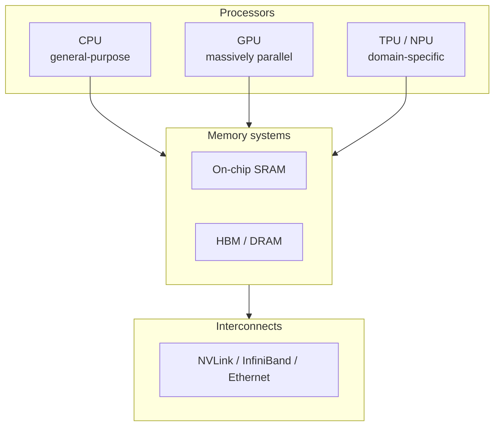

> [!TIP]
> **Going further.** A chip designed for one domain is often called an **ASIC** (application-specific integrated circuit). A TPU is an ASIC for neural-network arithmetic. The opposite extreme is the CPU, a general-purpose processor.

---

## 1.2 What do AI models actually compute?

Before comparing chips, we need to know what the chips are asked to do.

A neural network is built from layers. Most layers do one dominant operation: multiply a block of numbers (the **weights**, which the model learned during training) by another block of numbers (the **inputs**), then add the results together.

For one output value, the calculation looks like this:

```text
Output = (w1 × x1) + (w2 × x2) + (w3 × x3) + ... + (wn × xn)
```

Each "multiply, then add to a running total" step is called a **MAC** (multiply-accumulate).

**Figure 1.2.** A single neuron: each input is multiplied by its weight, and the products are summed into one output. *Source: author's own diagram.*

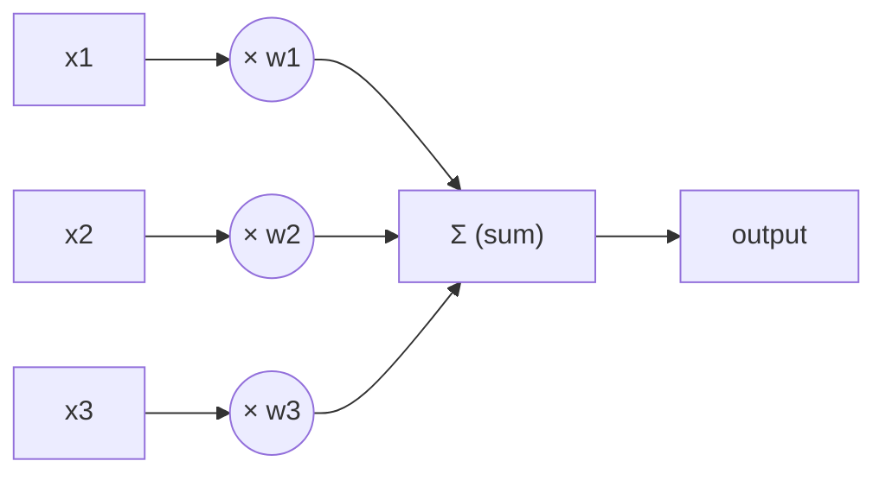

### Worked example 1.A: a single neuron by hand

*Illustrative numbers.* A tiny neuron has three weights and receives three inputs:

| | w1 / x1 | w2 / x2 | w3 / x3 |
|---|---:|---:|---:|
| Weights **w** | 0.5 | -1.0 | 2.0 |
| Inputs **x** | 4 | 3 | 1 |

**Table 1.2.** Weights and inputs for Worked example 1.A.

1. **Step 1.** Start the running total at 0.
2. **Step 2.** MAC #1: `total = 0 + (0.5 × 4) = 0 + 2.0 = 2.0`
3. **Step 3.** MAC #2: `total = 2.0 + (-1.0 × 3) = 2.0 - 3.0 = -1.0`
4. **Step 4.** MAC #3: `total = -1.0 + (2.0 × 1) = -1.0 + 2.0 = 1.0`

**Result.** The output is **1.0**, computed with 3 MACs. (Real networks then pass this number through a simple function such as ReLU, which keeps positive numbers and turns negative ones into 0; that step is cheap compared with the MACs.)

The following Python program checks the result. Its complete expected output is shown below the code.

```python
weights = [0.5, -1.0, 2.0]
inputs = [4, 3, 1]

total = 0
for w, x in zip(weights, inputs):
    total += w * x          # one MAC per loop

print(total)                # 1.0
print(max(0, total))        # ReLU -> 1.0
```

Expected output:

```text
1.0
1.0
```

Now scale it up. One layer might have 4,096 neurons, each with 1,024 inputs. That is 1,024 × 4,096 = **4,194,304 MACs**, about 4.2 million, for one layer and one input. A modern large language model needs billions to trillions of MACs to produce a single answer.

> [!IMPORTANT]
> **Key idea.** If a chip can do MACs very fast and very efficiently, it speeds up almost the whole model. This is why the MAC is the central operation in AI hardware design.

### Matrices: the same thing, written compactly

Writing out every MAC is tedious, so we group the weights into a table called a **matrix**, and the inputs into a list called a **vector**. "Multiply the weight matrix by the input vector" means "do all the neuron calculations at once". When we process several inputs at the same time, they form a second matrix, and we speak of matrix multiplication. Almost all of AI hardware is, at heart, hardware for multiplying matrices. A generalisation to higher dimensions is called a **tensor**, which is where the "T" in TPU comes from.

```text
Weight matrix W          Input vector x     Output vector y
(rows = neurons)

[ w11 w12 w13 ]          [ x1 ]             [ w11·x1 + w12·x2 + w13·x3 ]
[ w21 w22 w23 ]    ×     [ x2 ]      =      [ w21·x1 + w22·x2 + w23·x3 ]
[ w31 w32 w33 ]          [ x3 ]             [ w31·x1 + w32·x2 + w33·x3 ]
```

Each output value = 3 MACs. Whole layer = 3 × 3 = **9 MACs**.

The same idea in NumPy. Its complete expected output is shown below the code.

```python
import numpy as np

W = np.array([[0.5, -1.0, 2.0],
              [1.0,  0.0, 1.0],
              [0.0,  2.0, -1.0]])
x = np.array([4, 3, 1])

y = W @ x                   # all 9 MACs in one matrix-vector product
print(y)                    # [ 1.  5.  5.]
```

Expected output:

```text
[1. 5. 5.]
```

**Check by hand:** row 1 gives 0.5×4 + (−1.0)×3 + 2.0×1 = 1.0; row 2 gives 1.0×4 + 0.0×3 + 1.0×1 = 5.0; row 3 gives 0.0×4 + 2.0×3 + (−1.0)×1 = 5.0.

---

## 1.3 Key terms

These terms are used throughout the module. A complete glossary is at the end of this module (see [Glossary](#glossary-all-sections)). Some terms (bandwidth, utilisation) are only fully explained later, in Sections 3 and 4, so treat this table as a first look.

| Term | Definition |
|---|---|
| **Training** | Adjusting a model's weights using lots of data. Very compute-heavy; usually done in data centres. |
| **Inference** | Using a trained model to produce an answer (for example, unlocking your phone). Happens every time a user uses the AI. |
| **MAC** | Multiply-accumulate: multiply two numbers and add the result to a running total. |
| **FLOP / FLOPs** | A floating-point operation (one add or multiply on decimal-style numbers). "FLOPs" is the plural; FLOPS (capital S) means FLOPs per second. One MAC counts as 2 FLOPs. |
| **TOPS** | Tera operations per second (10¹² operations per second). Often used for integer operations on AI chips. |
| **Throughput** | How much work is finished per second. |
| **Latency** | How long one task takes from start to finish. |
| **Precision** | How many bits are used to store each number: FP32 = 32-bit floating-point, FP16 = 16-bit float, INT8 = 8-bit integer. Lower precision means less memory, less energy and usually faster hardware, at some cost in accuracy. |
| **Accelerator** | A chip that works alongside the CPU to speed up specific kinds of work. |
| **Bandwidth** | How many bytes per second can be moved between two parts of a system. |

**Table 1.3.** Key terms for Section 1.

> [!WARNING]
> **Caution: bits and bytes.** 1 byte = 8 bits. An FP32 number takes 4 bytes, an FP16 number 2 bytes, and an INT8 number 1 byte. Many mistakes in hardware calculations come from forgetting this conversion.

**Figure 1.3.** The same model stored at three precisions. Lower precision uses less memory but keeps less information about each weight. *Source: author's own diagram.*

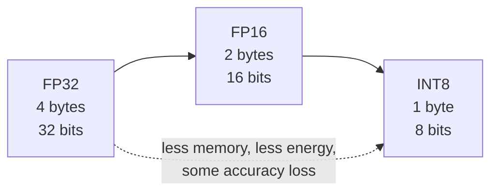

### Prefixes you will meet

| Prefix | Symbol | Power of ten | Example |
|---|---|---|---|
| kilo | k | 10³ | 1 kB = 1,000 bytes |
| mega | M | 10⁶ | 8 MB of cache |
| giga | G | 10⁹ | 500 GB/s bandwidth |
| tera | T | 10¹² | 92 TOPS |
| peta | P | 10¹⁵ | data-centre clusters quote PFLOPS |
| milli / micro / nano / pico | m / µ / n / p | 10⁻³ / 10⁻⁶ / 10⁻⁹ / 10⁻¹² | 1 ms, 1 µs, 1 ns, 1 pJ |

**Table 1.4.** SI prefixes used in this module.

Memory sizes are sometimes quoted in powers of two: 1 MiB = 2²⁰ = 1,048,576 bytes. The difference is small and does not change any conclusion in this module.

---

## 1.4 Why not just use a faster CPU?

For decades, the answer to "make computers faster" was simply "wait for the next CPU". That stopped working for two reasons.

**Reason 1: the workload is highly repetitive and independent.** Millions of MACs can be done at the same time because they do not depend on each other: the result of neuron 17 does not change the calculation for neuron 18. A chip built for doing one complicated thing quickly wastes its effort on this. A chip built for doing a huge number of simple things at once does not.

**Reason 2: energy and memory limits.** Chips can no longer simply be clocked faster without overheating. Historically, as transistors shrank, they also used less power, so each generation could run faster without getting hotter (this is often associated with Dennard scaling). That trend ended in the mid-2000s, and clock speeds flattened at a few gigahertz. Hennessy and Patterson, in their well-known textbook and Turing Award lecture, argue that because general-purpose processors have stopped improving as quickly as before, big gains in cost, energy, and performance must now come from domain-specific hardware (Hennessy & Patterson, 2019).

Gains now come from two directions, which this module keeps returning to:

1. doing more things at once (**parallelism**), and
2. moving less data (**memory efficiency**).

**Figure 1.4.** CPU clock speed over time, in schematic form. Clock speeds rose steeply until the mid-2000s, then flattened as power and heat limits were reached. *Source: author's own sketch, based on the trends described in Hennessy & Patterson (2019).*

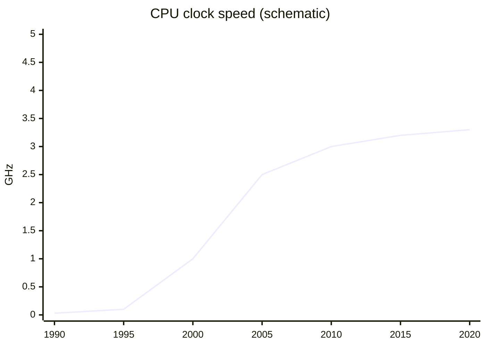

---

## 1.5 Training versus inference

The same neural network is used in two very different ways, and the hardware requirements differ.

| | Training | Inference |
|---|---|---|
| **Goal** | Learn weights from data | Use learned weights to answer a request |
| **Frequency** | Rare, long jobs (days to months) | Constant: millions of small requests |
| **Main limit** | Raw compute and chip-to-chip communication | Latency, energy and cost per request |
| **Typical place** | Large data-centre clusters | Data centres and edge devices (phones, cars) |
| **Precision** | Usually higher (FP32, BF16, FP16) | Often lower (INT8, FP8, even 4-bit) |
| **Data movement** | Forward pass and backward pass; many intermediate values stored | Forward pass only |
| **Batch size** | Large (hundreds or more) | Often 1 (one user at a time) |

**Table 1.5.** Training versus inference.

**Figure 1.5.** Where training and inference sit on the hardware landscape. Training happens in the data centre on large batches; inference happens both in the data centre and on edge devices, often at batch size 1. *Source: author's own diagram.*

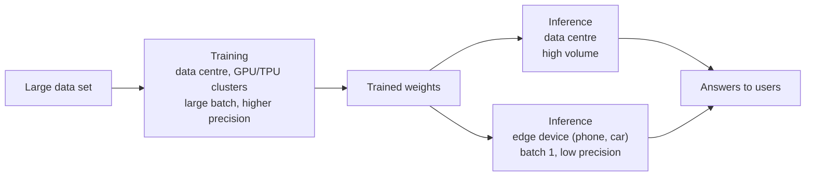

This distinction explains much of the hardware landscape. The first Google TPU was built for inference only (Jouppi et al., 2017); later generations added training, and Google's newest announced generation, Ironwood (announced 2025), is again aimed at inference at scale (Google, 2025).

> [!NOTE]
> **Why does the batch size matter?** Section 4 shows that a single-user request (batch size 1) tends to be limited by memory, whereas a large training batch tends to be limited by compute. That one fact shapes whole product lines.

---

## 1.6 Choosing hardware: metrics to compare

Section 1.3 defined the vocabulary. This table shows how those ideas are used to *choose* between chips.

| Metric | Question it answers | Why it matters |
|---|---|---|
| Throughput (TOPS, FLOP/s) | How much work per second? | Training speed |
| Latency | How long for one request? | User experience; real-time control |
| Performance per watt | How much work per joule? | Battery life; data-centre power bill |
| Utilisation | What share of peak is actually achieved? | Money paid for idle silicon |
| Performance per dollar | How much work per unit of cost? | Budget decisions |
| Memory capacity | How big a model fits? | Which models can run at all |

**Table 1.6.** Six metrics for comparing AI hardware.

**Figure 1.6.** Peak versus achieved utilisation. The gap between the two bars is the idle silicon you paid for. *Source: author's own diagram, based on the concept of utilisation introduced here and formalised in Section 3.*

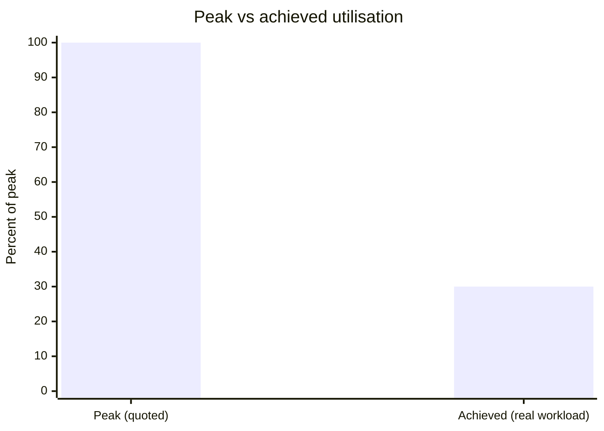

> [!WARNING]
> **Caution: peak is not typical.** A chip's quoted "peak" number is what it could do if every arithmetic unit were busy every cycle. Real programs are usually far below that. Sections 3 and 4 explain why.

---

## 1.7 Activities for Section 1

- [ ] **Activity 1.A.** A neuron has weights w = [2, -1, 0.5] and inputs x = [1, 4, 6]. Compute the output by hand, stating each MAC step.
- [ ] **Activity 1.B.** A layer has 512 inputs and 2,048 outputs. How many MACs does one input vector require? How many FLOPs is that?
- [ ] **Activity 1.C.** A chip is quoted as 100 TOPS but achieves only 30% utilisation on your workload. What throughput do you actually observe?
- [ ] **Activity 1.D.** For each case, say whether it is training or inference, and give one reason: (a) a phone unlocking with Face ID, (b) a team fine-tuning a language model on 100 GPUs for three weeks, (c) a chatbot answering 10,000 user requests per second.
- [ ] **Activity 1.E.** A model has 7 billion parameters stored in FP16. How much memory do the weights need? How much in INT8?

---

## 1.8 Summary

- AI hardware is any processor, memory system or interconnect designed or well suited to run machine-learning workloads efficiently; it covers five categories (general-purpose CPUs, GPUs, domain-specific accelerators, memory systems, interconnects).
- Neural networks are dominated by MACs (multiply-accumulate): one output is the sum of weight × input products, and a layer with 1,024 inputs and 4,096 outputs contains 4,194,304 MACs.
- A 3-weight, 3-input neuron computes its output in 3 MACs; the worked example gives 1.0.
- Matrices and vectors are compact ways of writing millions of MACs at once; a tensor is the higher-dimensional generalisation, which gives the TPU its name.
- Faster CPUs alone do not solve AI workloads because the work is repetitive and independent, and because clock-speed growth stopped in the mid-2000s; gains now come from parallelism and memory efficiency.
- Training and inference differ in goal, frequency, main limit, typical place, precision, data movement and batch size.
- Six metrics (throughput, latency, performance per watt, utilisation, performance per dollar and memory capacity) let you choose between chips; quoted peak numbers are rarely achieved in practice.

---

# Section 2: CPU vs GPU vs TPU

> [!IMPORTANT]
> **Big idea.** Three families of chips sit at different points on a trade-off between flexibility and efficiency. The more a chip is specialised for a task, the more efficient it is at that task and the less useful it is for anything else.

## Learning objectives

By the end of this section you should be able to:

1. Describe in one sentence each what a CPU, a GPU, a TPU and an NPU is designed to do.
2. Compare the four chip families on design goal, core count, control logic, flexibility, energy efficiency for AI, typical AI role, weakness for AI and programming route.
3. Explain what a systolic array is and work through a 2 × 2 weight-stationary example by hand and in code.
4. Summarise what the first TPU paper (Jouppi et al., 2017) measured, and state two caveats when reading it.
5. Explain why software tooling determines how useful a chip is in practice.
6. Choose an appropriate chip for a given scenario and justify the choice.

---

## 2.1 The three chips in one sentence each

- **CPU (Central Processing Unit):** a few very capable cores that handle any kind of program quickly, one step at a time per core.
- **GPU (Graphics Processing Unit):** thousands of simpler cores that do the same operation on many data items at once. Originally built to draw graphics, it turned out to be ideal for neural networks, because drawing millions of pixels and multiplying large matrices are both "same operation, lots of data" problems.
- **TPU (Tensor Processing Unit):** a chip designed by Google specifically for tensor (multi-dimensional array) arithmetic, built around a grid of multiply-accumulate units.

A related term you will meet in Section 5 is **NPU** (Neural Processing Unit): a general name for a small, low-power AI accelerator inside a phone or laptop chip.

**Figure 2.1.** The three chip families on the flexibility–efficiency trade-off. Moving right trades generality for efficiency on tensor arithmetic. *Source: author's own diagram, based on Hennessy & Patterson (2019).*

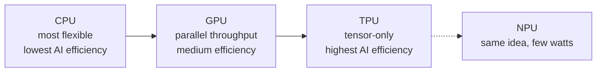

> [!NOTE]
> **An everyday analogy.**
> A **CPU** is like a small team of expert chefs who can cook any dish in the book, but each works on one dish at a time.
> A **GPU** is like a huge kitchen of junior cooks who all follow the same instruction ("chop these 1,000 onions") together.
> A **TPU** is like a factory assembly line built to make exactly one product, extremely efficiently, but useless if you want something else.

---

## 2.2 Comparison table

| Feature | CPU | GPU | TPU |
|---|---|---|---|
| **Design goal** | Fast, flexible, low latency for one task | High throughput on parallel data | Maximum matrix throughput per watt for neural networks |
| **Core count** (order of magnitude) | Few to ~100 complex cores | Thousands of simple cores | A large grid of MAC units (tens of thousands in one array) |
| **Control logic** | Complex: caches, out-of-order execution, branch prediction | Simpler; many threads hide delays | Minimal; deterministic execution |
| **Flexibility** | Highest: runs any program | High: programmable for many parallel tasks | Lowest: tuned to tensor operations |
| **Energy efficiency for AI** | Lowest | Medium to high | Highest (for supported workloads) |
| **Typical AI role** | Pre-processing, data loading, small models, orchestration | Training and inference of large models | Large-scale training and inference in Google's cloud |
| **Weakness for AI** | Too few parallel units | Higher power than a custom ASIC; memory bandwidth can limit | Less flexible; tied to a software stack |
| **Programming** | Any language | CUDA, OpenCL, or frameworks such as PyTorch | Through frameworks such as TensorFlow/JAX and the XLA compiler |

**Table 2.1.** Comparison of CPU, GPU and TPU across design goal, core count, control logic, flexibility, energy efficiency, typical AI role, weakness for AI and programming route.

*Sources for the design descriptions: Jouppi et al. (2017); Sze et al. (2017); Hennessy & Patterson (2019); NVIDIA (n.d.).*

### Terms used in the table

- **Core:** a unit inside a chip that can execute instructions on its own.
- **Cache:** a small, fast memory that keeps copies of recently used data close to the processor.
- **Out-of-order execution:** a CPU trick of running instructions in a different order from the program when it is safe, to avoid waiting.
- **Branch prediction:** guessing which way an `if` statement will go so the CPU can keep working instead of waiting.
- **Deterministic execution:** every run takes the same, predictable number of cycles. This matters for services that must answer within a time limit.
- **Compiler:** software that translates a program into instructions for a specific chip. XLA is the compiler used for TPUs.
- **MAC (multiply-accumulate):** an operation that computes `a × b + c`; the basic building block of neural-network arithmetic.

---

## 2.3 Visual: where the chip area goes

**Figure 2.2.** A simplified, not-to-scale sketch of where each design spends its silicon. A CPU devotes much of its area to caches and control logic that make a single thread fast; a GPU devotes most area to arithmetic units; a TPU devotes nearly all of it to the grid of MACs and the memory that feeds it. The positions are a qualitative teaching sketch, not measurements. *Source: author's own sketch, based on the design descriptions in Jouppi et al. (2017) and Hennessy & Patterson (2019).*

```text
        CPU                       GPU                        TPU
+------------------------+ +------------------------+ +------------------------+
| [Core] [Core]  CACHE   | | c c c c c c c c c c c  | | Systolic array of      |
| [Core] [Core]  CACHE   | | c c c c c c c c c c c  | | MAC units              |
| big control logic      | | c c c c c c c c c c c  | | (data flows through)   |
| large caches           | | small control, cache   | | + on-chip buffer       |
+------------------------+ +------------------------+ +------------------------+
   Few smart cores          Many simple cores          Matrix-multiply engine
```

In a CPU much of the area is "overhead" (caches, prediction logic) that makes a single thread fast. In a GPU, most area goes to arithmetic units. In a TPU, nearly all of it goes to the grid of MACs and the memory that feeds it.

---

## 2.4 Systolic arrays and a worked 2 × 2 example

A **systolic array** is a grid of MAC cells. Each cell holds one weight, and data is passed from neighbour to neighbour instead of being fetched from memory again and again. This neighbour-to-neighbour passing is what makes the design memory-efficient: the same input is reused across many cells without repeated memory reads.

### Worked example 2.A: a 2 × 2 systolic array (weight-stationary)

Let the weights be **W = [[1, 2], [3, 4]]**, loaded once, one per cell. The input is **x = [5, 6]**. We want **y = W·x**.

**Figure 2.3.** A 2 × 2 weight-stationary systolic array. Each cell holds one weight; inputs enter from the top and partial sums move to the right. *Source: author's own diagram.*

```text
                 x1=5        x2=6
                  │           │
               ┌──▼──┐     ┌──▼──┐
 row 1 (y1) →  │  1  │ ──► │  2  │ ──► y1
               └──┬──┘     └──┬──┘
               ┌──▼──┐     ┌──▼──┐
 row 2 (y2) →  │  3  │ ──► │  4  │ ──► y2
               └─────┘     └─────┘
        (each cell holds one weight; partial sums move right)
```

| Cycle | What happens | Result |
|---|---|---|
| **1** | x1 = 5 enters column 1. The two cells compute 1 × 5 and 3 × 5 and pass the partial sums to the right. | 5 and 15 |
| **2** | x2 = 6 reaches column 2 (a real array staggers inputs by one cycle). The cells compute 2 × 6 + 5 and 4 × 6 + 15. | 17 and 39 |

**Table 2.2.** Cycle-by-cycle behaviour of the 2 × 2 systolic array in Figure 2.3.

**Result:** `y = [17, 39]`, using 4 MACs. Check: 1×5 + 2×6 = 17 and 3×5 + 4×6 = 39.

**Memory reads.** Each of the 4 weights was read from memory **once**, and each of the 2 inputs was read **once**, then handed from cell to cell. Without neighbour-to-neighbour passing, each input would be read twice (once per output). That saving in memory traffic is the point of the systolic design, and it grows with array size.

The following Python program counts the reads in both styles. Its complete expected output is shown below the code.

```python
W = [[1, 2],
     [3, 4]]
x = [5, 6]

# Without reuse: every MAC fetches its own weight and its own input
reads_no_reuse = 0
y = [0, 0]
for i in range(2):
    for j in range(2):
        y[i] += W[i][j] * x[j]
        reads_no_reuse += 2          # one weight read + one input read

# Systolic style: each weight read once, each input read once
reads_systolic = 4 + 2

print(y)                             # [17, 39]
print(reads_no_reuse, reads_systolic)  # 8 6
```

Expected output:

```text
[17, 39]
8 6
```

---

## 2.5 What the first TPU paper measured

The 2017 paper by Jouppi et al. is the best-documented comparison available, because it measured a real chip in real data centres:

- The heart of the first TPU is a **65,536-element 8-bit MAC matrix unit** with a peak of **92 TOPS** and a **28 MiB** software-managed on-chip memory.
- Compared with a contemporary Intel Haswell server CPU and an Nvidia K80 GPU in the same data centres, the TPU was on average about **15–30× faster** and delivered about **30–80× more TOPS per watt**.
- The authors attribute part of this to deterministic execution: caches, out-of-order execution, multithreading and prefetching improve average throughput, but not the 99th-percentile response time that user-facing services need.
- Four of the six benchmark applications were **memory-bandwidth limited** on the TPU. Using the GPU's faster GDDR5 memory in a revised design would have tripled achieved TOPS.

**Figure 2.4.** What the first TPU paper measured. The TPU beat contemporary CPUs and GPUs on speed and energy efficiency, but on four of six benchmarks it was limited by memory bandwidth rather than by arithmetic. *Source: author's own diagram, based on data in Jouppi et al. (2017).*

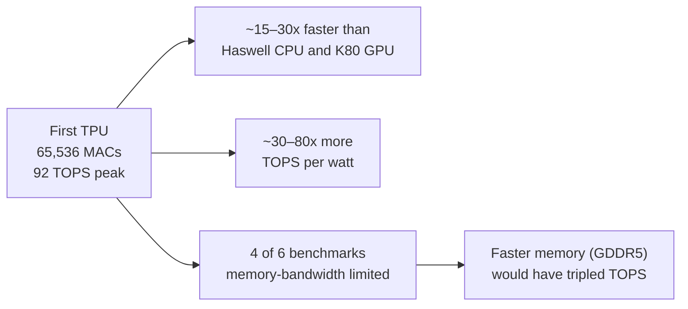

> [!WARNING]
> **Read this with care.** The comparison is from 2015–2017 hardware. It is a good illustration of the design philosophy, not a ranking of today's chips. Current GPUs have added dedicated matrix units of their own (NVIDIA calls them Tensor Cores), and the gap between "GPU" and "TPU" designs has narrowed.

> [!NOTE]
> **Why does the memory finding matter?** Even a chip with 65,536 MACs spent most of its time waiting for data on four out of six workloads. More arithmetic units do not help if they cannot be fed.

---

## 2.6 The NPU: AI on small devices

A phone cannot carry a 300-watt accelerator. An NPU applies the same ideas as a TPU (a grid of MAC units, low-precision numbers, on-chip memory) but scaled down to run in a few watts inside a **system-on-a-chip (SoC)**, which puts the CPU, GPU, NPU, memory controllers and other blocks on a single piece of silicon.

| Company | Name of its NPU |
|---|---|
| Apple | Neural Engine |
| Google Pixel | Tensor SoC |
| Qualcomm | Hexagon NPU |
| Many laptops | "AI Engine" / NPU |

**Table 2.3.** Vendor names for NPUs in consumer devices. Names differ, but the principle is the same.

**Figure 2.5.** An NPU inside a system-on-a-chip. The CPU, GPU and NPU share the same silicon and memory, which is what makes a few-watt AI accelerator practical on a phone. *Source: author's own diagram, based on Apple Inc. (2024) and Qualcomm (2024).*

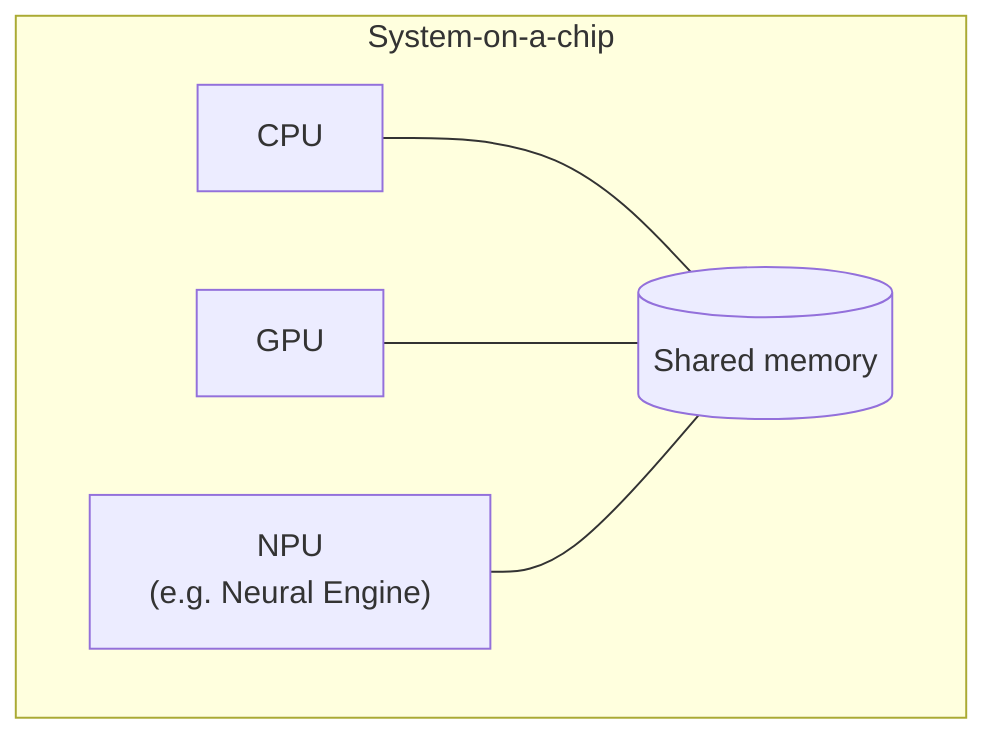

Section 5 studies the Apple version.

---

## 2.7 Software: why a chip is only as useful as its tools

Hardware is useless if programmers cannot easily use it. This is a major reason GPUs became dominant for AI:

| Chip | Typical way programmers reach it |
|---|---|
| CPU | Any language; compiler targets it directly |
| GPU | CUDA (NVIDIA), OpenCL, or high-level frameworks (PyTorch, TensorFlow) that call vendor-optimised libraries |
| TPU | Frameworks (TensorFlow, JAX, PyTorch/XLA) compile to the TPU through XLA |
| Apple Neural Engine | Core ML, which decides whether a model runs on CPU, GPU or the Neural Engine |

**Table 2.4.** How programmers typically reach each chip family.

A programmer usually does not write instructions for the MAC units directly. They write a model in a framework, and a compiler/runtime maps it onto the hardware. This is why "unsupported operations falling back to the CPU" can silently make a model slow (see the case-study questions in Section 5).

**Figure 2.6.** The software stack between a model and the hardware. Each layer hides detail from the one above, but also adds a place where unsupported operations can fall back to the CPU. *Source: author's own diagram, based on NVIDIA (n.d.) and Apple Inc. (2024).*

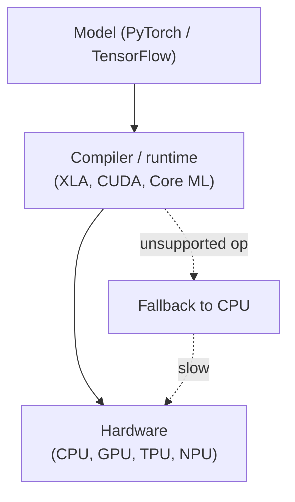

> [!TIP]
> **Going further.** The combination of hardware and its software ecosystem is sometimes called a **platform**. Switching from one platform to another can be costly even if the new chip is faster on paper, which partly explains why one vendor can dominate a market.

---

## 2.8 Activities for Section 2

- [ ] **Activity 2.A.** Which of the three chips would you choose for each case? Justify briefly. (a) a web server running mixed tasks, (b) training a large image model, (c) a fixed, high-volume inference service in a data centre.
- [ ] **Activity 2.B.** In the 2 × 2 systolic example (Worked example 2.A), how many times was each weight read from memory, and how many times was each input read?
- [ ] **Activity 2.C.** A start-up wants to add a voice assistant to a smart speaker that runs on a small battery. Arrange CPU, GPU and NPU in order from most to least suitable and give one reason for your ordering.
- [ ] **Activity 2.D.** The first TPU was faster and more energy-efficient than its contemporaries on Google's workloads, but a start-up with a different workload might still pick a GPU. Give two reasons.

---

## 2.9 Summary

- CPUs prioritise flexibility and low latency; GPUs prioritise parallel throughput; TPUs prioritise matrix throughput per watt at the cost of flexibility; NPUs scale the TPU idea down to a few watts inside a phone or laptop SoC.
- Systolic arrays reduce memory traffic by holding weights in place and passing inputs and partial sums from neighbour to neighbour; in the 2 × 2 example this cut memory reads from 8 to 6.
- The first TPU (Jouppi et al., 2017) was about 15–30× faster and 30–80× more TOPS per watt than contemporary CPUs and GPUs, but four of six benchmarks were memory-bandwidth limited, and the comparison is historical.
- A chip is only as useful as its software ecosystem; unsupported operations that fall back to the CPU can silently erase the hardware advantage.
- Choosing a chip means matching its design goal to the workload: mixed latency-sensitive tasks favour a CPU, large-model training favours a GPU, fixed high-volume inference favours a TPU or NPU.

---

# Section 3: Parallel Processing and AI Acceleration

> [!IMPORTANT]
> **Big idea.** Neural networks consist of huge numbers of independent MACs, so the way to go fast is to do many of them at the same time. But parallel hardware has limits, and the limits are as important as the speed-ups.

## Learning objectives

By the end of this section you should be able to:

1. Name and distinguish the four levels of parallelism (instruction-level, data-level, matrix-level, and across chips).
2. Count the MACs and FLOPs in a dense layer, and estimate the time for one pass on an idealised CPU core and an idealised parallel accelerator.
3. State Amdahl's law, apply it to a worked example, and explain its ceiling.
4. Explain why parallel hardware has limits: Amdahl's law, idle units, feeding the units, and communication.
5. Describe three acceleration techniques (quantisation, specialised units, batching) and calculate the memory footprint of a model in different precisions.

---

## 3.1 Kinds of parallelism

"Parallel" simply means "at the same time". Hardware does this at several different levels:

| Level | Idea | Example |
|---|---|---|
| **Instruction-level** | A single core overlaps several instructions (like an assembly line) | Modern CPU pipelines |
| **Data-level (SIMD / SIMT)** | One instruction acts on many values at once | GPU warps; CPU vector units |
| **Matrix-level (systolic)** | A grid of MAC units passes data neighbour to neighbour | TPU matrix unit |
| **Across chips** (data, pipeline and model splitting) | Split the model, or the batch of data, over many chips | Training clusters (Module 02) |

**Table 3.1.** Four levels of parallelism in AI hardware.

**Figure 3.1.** The four levels of parallelism, from a single instruction inside one core to a whole model split across many chips. Each level adds more units but also more coordination overhead. *Source: author's own diagram, based on Hennessy & Patterson (2019).*

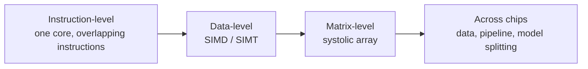

### Terms

- **SIMD (Single Instruction, Multiple Data):** the same instruction is applied to a block of values in lock-step. On GPUs the equivalent idea is often called **SIMT** (Single Instruction, Multiple Threads): groups of threads (a *warp* on NVIDIA GPUs) execute together.
- **Thread:** one stream of instructions. GPUs run tens of thousands at once.
- **Data parallelism:** the same operation on different data at the same time (for example, 1,000 pixels each multiplied by the same filter weights).
- **Pipeline parallelism:** one big model is split into stages across several chips (for example, one chip handles layers 1–10 while another handles layers 11–20), and data flows from stage to stage.

GPUs are built for data parallelism. A very useful trick they use is **latency hiding**: when one group of threads has to wait for memory, the GPU switches instantly to another group that is ready. With thousands of threads available, the arithmetic units rarely sit idle. CPUs take the opposite approach: they spend silicon on big caches and prediction logic so that one thread rarely waits at all.

> [!NOTE]
> **Bridge to Networks.** The last row of the table is where hardware meets networking. Once a model is split across chips, the links between them (NVLink, InfiniBand; Module 02) decide how much of the extra compute you can actually use.

---

## 3.2 Worked example 3.A: how many MACs, and how long?

**Problem.** A dense (fully connected) layer takes an input vector of 1,024 numbers and produces 4,096 outputs. The weight matrix is 1,024 × 4,096. Estimate the time for one pass on (a) a single idealised CPU core and (b) an idealised parallel accelerator.

**Step 1: Count the MACs.** Each of the 4,096 outputs needs 1,024 multiplications and additions.

```text
MACs = 1,024 × 4,096 = 4,194,304   (about 4.2 million)
```

**Step 2: Convert to FLOPs.** One MAC = 2 FLOPs (one multiply, one add).

```text
FLOPs = 2 × 4,194,304 = 8,388,608   (about 8.4 million)
```

**Step 3: Estimate time on two idealised chips** (illustrative assumptions).

| Chip (idealised) | Assumption | Calculation | Time for one pass |
|---|---|---|---|
| Single CPU core, one MAC per cycle, 3 GHz | 3 × 10⁹ MACs/s | 4,194,304 ÷ 3 × 10⁹ | ≈ **1.4 ms** |
| Accelerator with 4,096 MAC units working in parallel, 1 GHz | 4,096 × 10⁹ = 4.096 × 10¹² MACs/s | 4,194,304 ÷ 4.096 × 10¹² | ≈ **1.0 µs** |

**Table 3.2.** Estimated time for one pass of the layer on two idealised chips.

**Step 4: Interpret.** The idealised parallel accelerator is about 1,365× faster (roughly 1,400×) on this layer, even though its clock is slower, because it does 4,096 MACs per cycle instead of 1.

**Figure 3.2.** The same 4,194,304 MACs on a single CPU core (one MAC per cycle) versus a 4,096-unit accelerator. The accelerator's slower clock is more than compensated by doing many MACs per cycle. *Source: author's own diagram, based on the illustrative assumptions in Table 3.2.*

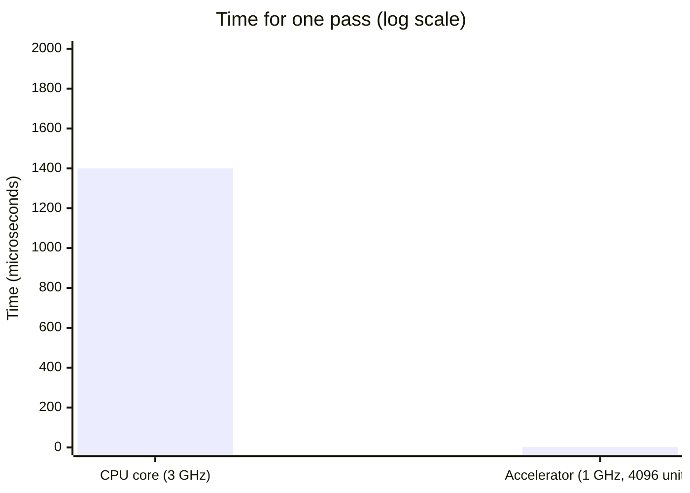

The following Python program reproduces the numbers. Its complete expected output is shown below the code.

```python
macs = 1024 * 4096
cpu_time = macs / 3e9            # 1 MAC per cycle at 3 GHz
acc_time = macs / (4096 * 1e9)   # 4,096 MACs per cycle at 1 GHz

print(macs)                      # 4194304
print(round(cpu_time * 1e3, 2), "ms")   # ~1.40 ms
print(round(acc_time * 1e6, 2), "us")   # ~1.02 us
print(round(cpu_time / acc_time))       # ~1365
```

Expected output:

```text
4194304
1.4 ms
1.02 us
1365
```

> [!WARNING]
> **Important caveat.** These are ideal numbers. They assume the data is always ready the instant it is needed. Section 3.3 and Section 4 explain why real chips often cannot reach them.

---

## 3.3 Why parallel hardware has limits

Adding more units does not give unlimited speed-up. Four things get in the way.

**Figure 3.3.** The four limits on parallel speed-up. Each can dominate on a real workload, and Amdahl's law sets a hard ceiling regardless of how many units you add. *Source: author's own diagram, based on Amdahl (1967) and the design discussion in Sections 3–4.*

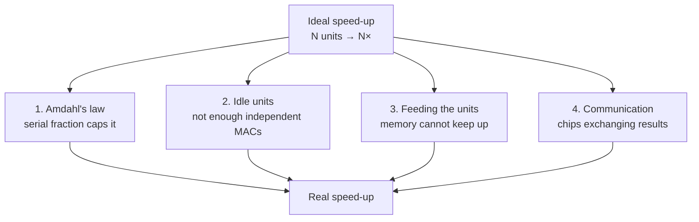

### 1. Amdahl's law

If a fraction *p* of a job can be parallelised, the best possible speed-up on *N* units is

```text
speed-up = 1 ÷ ( (1 − p) + p ÷ N )
```

*Worked example.* With p = 0.9 and N = 100: speed-up = 1 ÷ (0.1 + 0.009) ≈ **9.2×**. Even with unlimited units it can never exceed 1 ÷ 0.1 = **10×**, because the 10% serial part remains. In an AI pipeline the serial part might be loading data, pre-processing, or a step that cannot be spread out.

**Figure 3.4.** Amdahl's law for p = 0.9. The speed-up rises with the number of units but flattens towards the ceiling of 10×, set by the 10% serial fraction. *Source: author's own diagram, based on Amdahl (1967).*

```mermaid
xychart-beta
    title "Amdahl's law (p = 0.9)"
    x-axis ["1", "2", "4", "8", "16", "32", "64", "128"]
    y-axis "Speed-up" 0 --> 10
    line [1, 1.8, 3.1, 4.7, 6.4, 7.8, 8.8, 9.4]
```

The following Python program computes the worked example and the ceiling. Its complete expected output is shown below the code.

```python
def amdahl(p, n):
    return 1 / ((1 - p) + p / n)

print(round(amdahl(0.9, 100), 1))     # 9.2
print(round(amdahl(0.9, 10**9), 1))   # 10.0  (the ceiling)
```

Expected output:

```text
9.2
10.0
```

### 2. Idle units

A 4,096-unit accelerator can only be fully used if there are at least 4,096 independent MACs to do at once. A small layer leaves units idle, so **utilisation** (Section 1.6) falls.

### 3. Feeding the units

Units cannot compute without data. If memory cannot deliver numbers fast enough, the MACs wait. This is the subject of Section 4.

### 4. Communication

Across many chips, the time spent exchanging results can outweigh the gain from adding chips (Module 02).

---

## 3.4 Other acceleration techniques

Parallel MAC units are only one trick. Designers combine several. The three most important for this module are:

| Technique | What it does | Why it helps |
|---|---|---|
| **Lower precision (quantisation)** | Use INT8 or FP16 instead of FP32 | Smaller numbers: more fit in the same memory and more can be processed per cycle |
| **Specialised units** | NVIDIA Tensor Cores and Apple's Neural Engine are circuits that do small matrix multiplications as a single hardware step | Fewer instructions and less control overhead per MAC |
| **Batching** | Process several inputs together so the same weights are reused | Fetch weights once, use them many times (Section 4) |

**Table 3.3.** Three acceleration techniques and why they help.

**Figure 3.5.** Three ways to speed up AI beyond adding more MAC units: quantisation (smaller numbers), specialised units (matrix operations in one hardware step) and batching (reuse weights across inputs). *Source: author's own diagram, based on Jouppi et al. (2017) and NVIDIA (n.d.).*

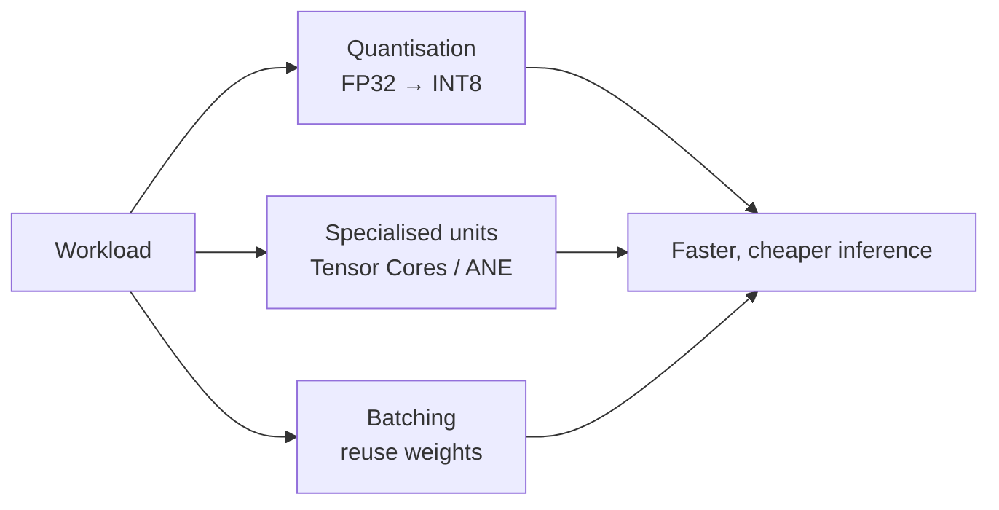

> [!TIP]
> **Going further.** Three more techniques you may meet:
> - **Sparsity:** skip multiplications by zero, so there is no work for values that cannot change the answer.
> - **Operator fusion:** combine several steps (for example, multiply, add bias and apply ReLU) into one pass to avoid writing and re-reading intermediate results.
> - **Weight-stationary data reuse:** keep weights in place while data moves past them, as in systolic arrays.

### Reduced precision (quantisation) in more detail

Quantisation converts a model's numbers from a high-precision format (such as FP32) to a lower-precision one (such as INT8). Using fewer bits per number lets a chip fit more MAC units in the same area and move fewer bytes. The first TPU used 8-bit integers for inference (Jouppi et al., 2017); later accelerators support formats such as bfloat16 (a 16-bit float with the same range as FP32) and 8-bit floating point.

| Format | Bits | Bytes | Typical use |
|---|---:|---:|---|
| FP32 | 32 | 4 | Classic training; "full" precision |
| BF16 / FP16 | 16 | 2 | Training and inference on modern accelerators |
| FP8 | 8 | 1 | Newer training/inference hardware |
| INT8 | 8 | 1 | Inference on phones, edge devices, TPUs |
| INT4 and below | 4 | 0.5 | Aggressively compressed models |

**Table 3.4.** Common number formats in AI hardware.

**Figure 3.6.** Quantising four sample weights to INT8 and back. The reconstructed values are close to the originals, with a maximum error of 0.0039. *Source: author's own diagram, based on the numbers in the code below.*

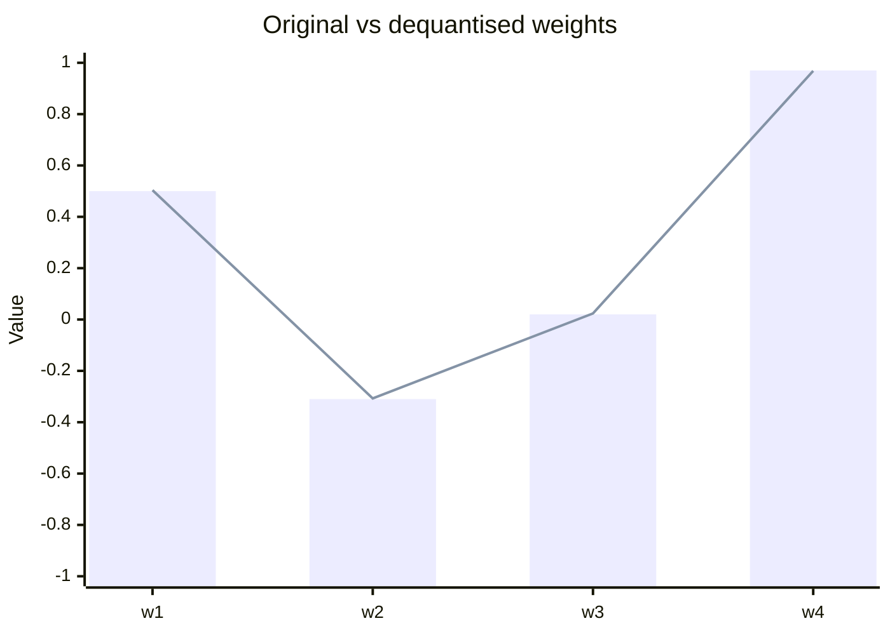

The following Python program quantises four weights to INT8 and back, and reports the maximum error. Its complete expected output is shown below the code.

```python
import numpy as np

w = np.array([0.5, -0.31, 0.02, 0.97], dtype=np.float32)
scale = 1.0 / 127
q = np.round(w / scale).astype(np.int8)    # quantise
w_back = q.astype(np.float32) * scale      # dequantise

print(q)                      # [ 64 -39   3 123]
print(np.round(w_back, 4))    # [ 0.5039 -0.3071  0.0236  0.9685]
print("max error:", np.abs(w - w_back).max().round(4))
```

Expected output:

```text
[ 64 -39   3 123]
[ 0.5039 -0.3071  0.0236  0.9685]
max error: 0.0039
```

---

## 3.5 Activities for Section 3

- [ ] **Activity 3.A.** The layer in Worked example 3.A is changed so that the output has 8,192 values instead of 4,096. What happens to the MAC count?
- [ ] **Activity 3.B.** With the same 4,096-unit accelerator, roughly how long would the 8,192-output layer take?
- [ ] **Activity 3.C.** A job is 80% parallelisable. What is the maximum speed-up on 8 units, and what is the limit with unlimited units?
- [ ] **Activity 3.D.** A 7-billion-parameter model is stored in FP16. How much memory do its weights need? How much if converted to INT8? To 4-bit?

---

## 3.6 Summary

- Hardware exploits parallelism at four levels: instruction-level, data-level (SIMD/SIMT), matrix-level (systolic), and across chips (data, pipeline and model splitting).
- A dense layer from 1,024 inputs to 4,096 outputs contains 4,194,304 MACs (about 8.4 million FLOPs); on idealised hardware this takes about 1.4 ms on one CPU core and about 1.0 µs on a 4,096-unit accelerator, a speed-up of about 1,365×.
- Amdahl's law caps the speed-up: with 90% parallelisable work the ceiling is 10×, and on 100 units you get about 9.2×.
- Parallel hardware also loses to idle units, memory that cannot feed the units fast enough, and communication between chips.
- Quantisation, specialised units and batching are the three main acceleration techniques covered here; quantising four sample weights to INT8 gives a maximum error of 0.0039.

---

# Section 4: Memory Hierarchy and Computational Efficiency

> [!IMPORTANT]
> **Big idea.** Arithmetic is cheap; moving data is expensive. Good AI hardware and good AI software are both organised to keep data in small, fast memory for as long as possible.

## Learning objectives

By the end of this section you should be able to:

1. Describe the levels of the memory hierarchy from registers to storage, and the trade-off between speed, size and cost that organises them.
2. State approximate energy costs for a 32-bit multiply, an on-chip SRAM read and a DRAM read, and explain why data movement dominates energy.
3. Define arithmetic intensity and the roofline model, including the ridge point, memory-bound and compute-bound regimes.
4. Apply the roofline model to a worked layer, and determine the batch size at which a workload becomes compute-bound.
5. List the main techniques for improving a memory-bound workload and explain how batching trades throughput against latency.

---

## 4.1 The memory hierarchy

Computers have several kinds of memory. Fast memory is small and expensive; large memory is slow and cheap. The arrangement from fastest to slowest is called the **memory hierarchy**.
 

#### Terms
 
- **Cache:** a small, fast memory that keeps copies of recently used data close to the processor. Managed automatically by hardware.
- **Scratchpad / software-managed buffer:** on-chip memory that the program or compiler controls explicitly, as in the TPU's 28 MiB unified buffer. It avoids the unpredictability of automatic caches.
- **SRAM:** fast memory built into the chip (usually several transistors per bit; expensive in area).
- **DRAM:** larger, slower memory outside the chip (one transistor plus a capacitor per bit; cheap per byte).
- **HBM (High Bandwidth Memory):** DRAM stacked in layers and placed right next to a GPU/accelerator to deliver very high bandwidth. Newer TPUs pair each chip with tens of gigabytes of HBM; for example, Google reported 192 GB per chip for Ironwood, six times the previous generation (as reported in press coverage of Google's 2025 announcement; verify against Google's own documentation before citing).
- **Bandwidth:** how many bytes per second can be moved (for example, 500 GB/s).
- **Latency (memory):** how long one access takes, as opposed to how many bytes per second can flow once it starts.
- **Unified memory:** a design (used by Apple silicon) in which CPU, GPU, and NPU share one pool of memory so data need not be copied between them.

> [!NOTE]
> **Analogy.** Think of cooking. Registers are the ingredients in your hands. Cache/SRAM is the chopping board in front of you. DRAM is the fridge across the kitchen. Storage is the supermarket. A cook who walks to the supermarket for every ingredient will never finish; a good cook plans the recipe so that everything needed is on the chopping board when required. Good AI hardware and software do the same.

**Figure 4.2.** The same hierarchy drawn as a cooking analogy: the closer the ingredient, the cheaper it is to reach. *Source: author's own diagram.*


---

## 4.2 The surprising fact: data movement dominates energy

Horowitz (2014) published approximate energy costs for a 45 nm chip process:

| Operation | Approximate energy |
|---|---:|
| 32-bit floating-point multiply | ~3.7 pJ |
| Read 32 bits from small on-chip SRAM (8 KB) | ~5 pJ |
| Read 32 bits from off-chip DRAM | ~640 pJ |

**Table 4.1.** Approximate energy costs per operation, from Horowitz (2014). pJ = picojoule, 10⁻¹² joule. Reading a register costs far less than any row in this table.

**Figure 4.3.** Fetching a number from DRAM costs about **170 times** the energy of multiplying it (640 ÷ 3.7 ≈ 173) and about **128 times** the energy of reading it from small on-chip SRAM. *Source: Horowitz (2014).*

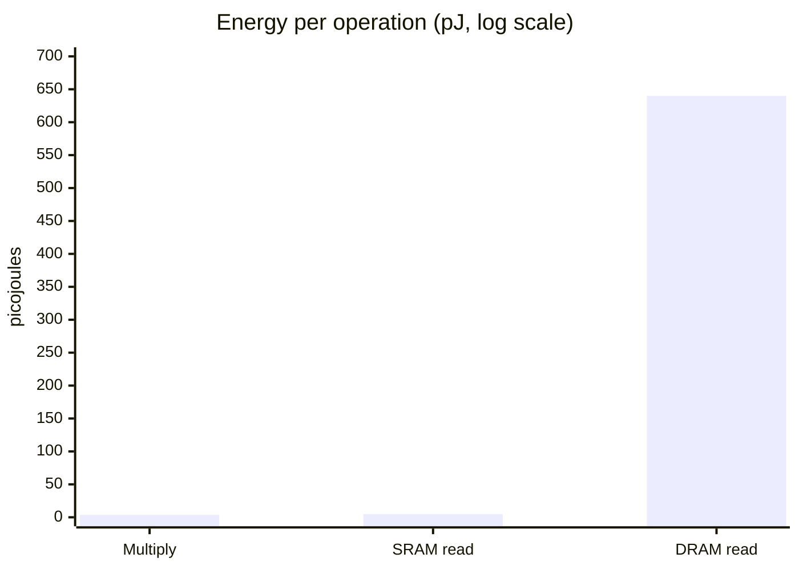

The following Python program computes the two ratios. Its complete expected output is shown below the code.

```python
mult, sram, dram = 3.7, 5, 640   # picojoules
print(round(dram / mult))        # 173
print(round(dram / sram))        # 128
```

Expected output:

```text
173
128
```

Fetching a number from DRAM costs roughly two orders of magnitude (about 100× or more) more energy than multiplying it. Modern processes differ in the exact numbers, but the pattern remains. This is why AI chip designers focus on reusing data already on the chip.

---

## 4.3 Arithmetic intensity and the roofline model

To judge whether a workload is limited by computing or by memory, we use **arithmetic intensity**:

```text
arithmetic intensity (FLOPs per byte) = total FLOPs ÷ total bytes moved from memory
```

A chip has two limits:

- **Peak compute** (FLOP/s): the most arithmetic it can do.
- **Memory bandwidth** (bytes/s): the most data it can fetch.

The **roofline model** (Williams, Waterman & Patterson, 2009) says:

```text
attainable performance = min( peak compute , arithmetic intensity × memory bandwidth )
```

The **ridge point** is where the two limits meet: peak compute ÷ bandwidth.

- Intensity **below** the ridge point → **memory-bound** (the chip waits for data).
- Intensity **above** the ridge point → **compute-bound** (the chip is busy computing).

> [!NOTE]
> **Why is it called a "roofline"?** Plot performance against intensity and the picture looks like a roof: a sloping line on the left (memory limit) that meets a flat line on the right (compute limit). Your workload's performance can never poke through the roof.

**Figure 4.4.** The roofline for the hypothetical accelerator used in this section (10 TFLOP/s peak, 500 GB/s bandwidth). The sloping left side is the memory limit; the flat right side is the compute limit. The ridge point sits at 20 FLOP/byte. *Source: author's own diagram, based on Williams, Waterman & Patterson (2009).*

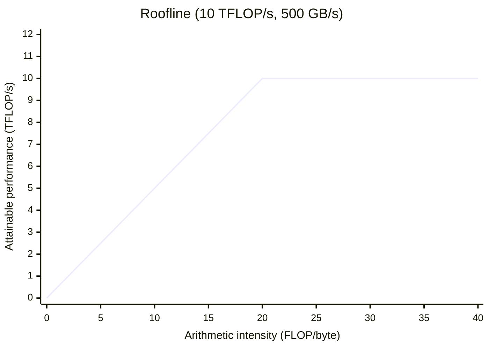

---

## 4.4 Worked example 4.A: roofline for one layer

**The hypothetical accelerator** used here and in the activity below:

| Property | Value |
|---|---|
| Peak compute | 10 TFLOP/s |
| Memory bandwidth | 500 GB/s |
| Ridge point | 10 TFLOP/s ÷ 500 GB/s = **20 FLOP/byte** |

**Table 4.2.** Properties of the hypothetical accelerator used in Worked example 4.A and Activity 4.5.

**Layer:** 1,024 inputs × 4,096 outputs, stored in FP16 (2 bytes per value).

### Batch 1

- FLOPs = 2 × 4,194,304 = 8,388,608.
- Bytes moved: weights 4,194,304 × 2 = 8,388,608; inputs 1,024 × 2 = 2,048; outputs 4,096 × 2 = 8,192. Total = **8,398,848**.
- Intensity = 8,388,608 ÷ 8,398,848 ≈ **1.0 FLOP/byte**, far below the ridge point of 20, so the layer is **memory-bound**.
- Attainable = min(10, 1.0 × 0.5) = **0.5 TFLOP/s, only 5% of peak**.
- Check in time: moving 8.4 MB at 500 GB/s takes about 16.8 µs, while the arithmetic at 10 TFLOP/s would take only about 0.84 µs. The chip spends about 95% of its time waiting.

### Batch 32

- FLOPs = 32 × 8,388,608 = 268,435,456.
- Bytes: weights 8,388,608 (fetched once) + inputs 32 × 2,048 = 65,536 + outputs 32 × 8,192 = 262,144. Total = **8,716,288**.
- Intensity ≈ **30.8 FLOP/byte**, above the ridge point, so the layer is **compute-bound** and reaches the full 10 TFLOP/s.

The weights were fetched once and reused 32 times. That is the whole story of batching.

**Figure 4.5.** Where batch 1 and batch 32 sit on the roofline. Batch 1 falls on the memory-limited slope; batch 32 clears the ridge point and reaches the compute ceiling. *Source: author's own diagram, based on the numbers in Worked example 4.A.*

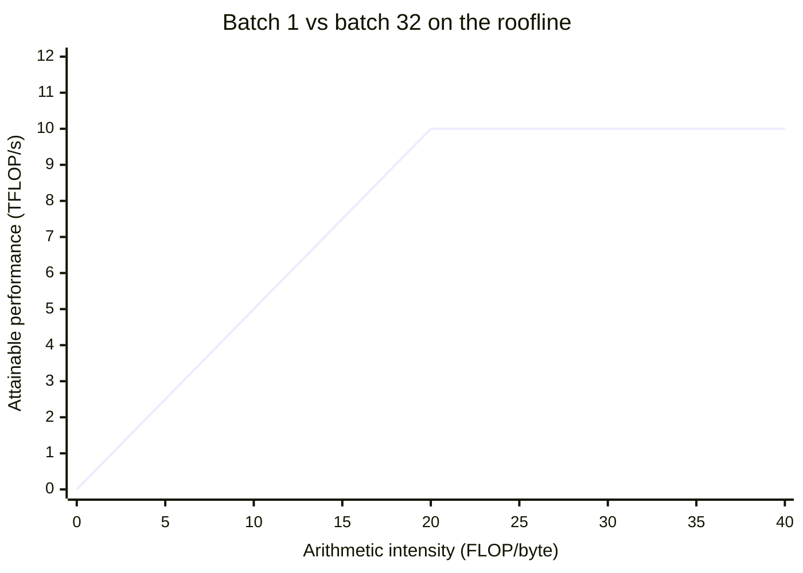

The following Python program checks all the numbers above. Its complete expected output is shown below the code.

```python
PEAK = 10e12        # FLOP/s
BW = 500e9          # bytes/s
BYTES = 2           # FP16

def roofline(n_in, n_out, batch):
    flops = 2 * n_in * n_out * batch
    weight_bytes = n_in * n_out * BYTES
    io_bytes = batch * (n_in + n_out) * BYTES
    intensity = flops / (weight_bytes + io_bytes)
    attainable = min(PEAK, intensity * BW)
    return intensity, attainable

for b in (1, 32):
    i, a = roofline(1024, 4096, b)
    print(b, round(i, 1), round(a / 1e12, 2), "TFLOP/s", f"{a / PEAK:.0%}")
```

Expected output:

```text
1 1.0 0.5 TFLOP/s 5%
32 30.8 10.0 TFLOP/s 100%
```

---

## 4.5 Learner activity: roofline for a different layer

**Setting.** Same hypothetical accelerator as in 4.4 (10 TFLOP/s, 500 GB/s, ridge point 20 FLOP/byte). A layer has **512 inputs and 2,048 outputs**, stored in FP16 (2 bytes per value).

**Tasks.**

1. Compute the number of weights and the weight size in bytes.
2. Compute FLOPs for one input vector (batch 1).
3. For batch sizes 1, 8 and 32, compute the bytes moved (weights + inputs + outputs) and the arithmetic intensity. State whether each case is memory-bound or compute-bound.
4. For each batch size, compute the attainable performance in TFLOP/s and as a percentage of peak.
5. What is the smallest batch size that makes the layer compute-bound?
6. **Reflect (2–3 sentences):** A voice assistant must answer one user at a time within milliseconds. What does the result of Task 3 imply for the hardware you would choose, and why?

**Hints.** Weights are fetched once per batch; inputs and outputs are fetched/written once per sample. Intensity = FLOPs ÷ bytes. Attainable = min(10 TFLOP/s, intensity × 0.5 TFLOP/s per unit intensity).

---

## 4.6 Further efficiency ideas

A designer who understands the roofline has a checklist of ways to improve a memory-bound workload:

| Idea | How it helps | Where you will see it |
|---|---|---|
| Bigger on-chip memory | Weights and activations stay close to the MACs | TPU's 28 MiB buffer; large caches in GPUs; NPUs |
| Higher bandwidth memory | Raises the slope of the roofline | HBM stacked beside the chip |
| Weight reuse (batching, weight-stationary arrays) | More operations per byte fetched | Systolic arrays, batched serving |
| Lower precision | Fewer bytes per weight | INT8/FP8/4-bit inference |
| Compression and pruning | Smaller or sparser models | Mobile model deployment |
| Operator fusion | Intermediate values never leave the chip | Compilers such as XLA and Core ML |
| Unified memory | No copy between CPU, GPU and NPU | Apple silicon |

**Table 4.3.** Techniques for improving a memory-bound workload.

**Figure 4.6.** The same techniques shown as levers on the roofline. Bigger on-chip memory and higher bandwidth raise the slope; batching, lower precision and weight reuse push a workload to the right. *Source: author's own diagram.*

```mermaid
flowchart LR
    MB["Memory-bound workload"] --> UP["Raise the slope<br/>higher bandwidth, larger on-chip memory"]
    MB --> RIGHT["Move right on the x-axis<br/>batching, weight reuse, lower precision"]
    UP --> CB["Compute-bound"]
    RIGHT --> CB
```

> [!WARNING]
> **A caution about batching.** Batching raises intensity but increases latency per request if requests must wait to form a batch. Servers therefore balance throughput (large batches) against latency (answer quickly). This trade-off is why the same model may be run differently in a data centre than on a phone.

---

## 4.7 Bridges to the rest of the course

**Networks.** The memory hierarchy does not stop at the edge of the chip. Moving data between chips, over links such as NVLink or InfiniBand, is another, slower level of the same hierarchy. When a model is split across many chips, this network becomes the bottleneck, which is the subject of Module 02.

**Behaviourist AI.** Behaviour-driven agents, such as robots and game-playing agents, run a loop of *sense, decide, act*, often one observation at a time. That is batch size 1, the memory-bound case from this section. Low latency and low energy per decision therefore matter more than peak throughput, which is why such agents often run on edge hardware such as NPUs.

**Figure 4.7.** The sense–decide–act loop of a behaviour-driven agent runs at batch size 1, so it sits on the memory-bound side of the roofline. *Source: author's own diagram, based on the behaviourist agent model described in Section 1.*

```mermaid
flowchart LR
    S["Sense<br/>one observation"] --> D["Decide<br/>batch = 1, memory-bound"]
    D --> A["Act"]
    A --> S
```

---

## 4.8 Activities for Section 4

- [ ] **Activity 4.A.** A designer doubles the number of MAC units on a memory-bound chip but leaves memory bandwidth unchanged. What happens to performance on a memory-bound workload?
- [ ] **Activity 4.B.** *(Revision of Section 2.5.)* The first TPU had four of six benchmarks memory-bandwidth limited. Which single hardware change did the authors say would have tripled achieved TOPS in a revised design?
- [ ] **Activity 4.C.** Using the energy table in 4.2 and the hierarchy in Figure 4.1, rank from lowest to highest energy per access: DRAM read, register access, small SRAM read.
- [ ] **Activity 4.5.** The learner activity in Section 4.5 (roofline for a 512 × 2,048 layer).

---

## 4.9 Summary

- The memory hierarchy runs from registers (fastest, smallest) through on-chip SRAM/cache and DRAM/HBM to storage (slowest, largest); each level down is larger, cheaper per byte and slower.
- Data movement dominates energy: a DRAM read costs about 170× a 32-bit multiply and about 128× a small SRAM read (Horowitz, 2014).
- Arithmetic intensity (FLOPs per byte) and the roofline model determine attainable performance: min(peak compute, intensity × bandwidth). The ridge point separates memory-bound from compute-bound workloads.
- For the worked layer (1,024 × 4,096, FP16) on a 10 TFLOP/s, 500 GB/s accelerator, batch 1 is memory-bound at about 0.5 TFLOP/s (5% of peak), while batch 32 is compute-bound at the full 10 TFLOP/s.
- Batching, bigger on-chip memory, higher bandwidth, lower precision, compression, operator fusion and unified memory all raise effective intensity; batching trades latency for throughput.

---

# Section 5: Case Study — Apple Neural Engine (On-Device AI)


> [!IMPORTANT]
> **Big idea.** The Apple Neural Engine is the module's ideas in one real device: parallel MACs, low-precision numbers, and on-chip, shared memory, all working inside a few watts.

## Learning objectives

By the end of this section, you should be able to:

1. Describe what the Apple Neural Engine (ANE) is, where it sits in an Apple SoC, and what kinds of tasks it accelerates.
2. Explain how the CPU, GPU, Neural Engine, and unified memory work together, and how Core ML decides where each part of a model runs.
3. Distinguish training from inference, and explain why training happens in the data centre while inference happens on the device.
4. Analyse Face ID as a sense–decide–act loop, and judge using the roofline model whether it is memory-bound or compute-bound.
5. Evaluate the advantages and limitations of on-device AI, including memory footprint, hardware compatibility, privacy and cloud dependency.

---

## 5.1 Introduction

**Figure 5.1.** The Neural Engine sits inside an Apple system-on-a-chip alongside the CPU, GPU and shared memory. *Source: Apple Inc. (2024), Apple Platform Security guide; diagram adapted by the author.*

```mermaid
flowchart TB
    subgraph SoC["Apple system-on-a-chip"]
        CPU["CPU"]
        GPU["GPU"]
        ANE["Neural Engine"]
        MEM[("Unified memory")]
        SEC["Secure Enclave"]
    end
    CPU --- MEM
    GPU --- MEM
    ANE --- MEM
    ANE --- SEC
```

The Apple Neural Engine (ANE) is a specialised processor built into Apple's chips to improve the speed and efficiency of artificial intelligence (AI) tasks. It is the NPU described in Section 2.6.

It was first introduced in 2017 with the A11 Bionic chip in the iPhone X. Apple described that first version as capable of 600 billion operations per second (Apple Inc., 2017); later generations are quoted in TOPS on Apple's specification pages for each chip.

Unlike traditional processors, the Neural Engine is specifically designed to handle AI calculations, allowing iPhones to perform tasks such as:

- Facial recognition (Face ID)
- Image and object recognition
- AI-powered camera features
- Language and speech processing

One major advantage is **on-device AI**, meaning AI tasks can be processed directly on an iPhone without always needing an internet connection or cloud server.

---

## 5.2 How the Apple Neural Engine works

The iPhone uses several hardware components that work together to process AI tasks. They sit on one system-on-a-chip (Section 2.6).

| Component | Function |
|---|---|
| **CPU** | Manages general tasks and coordinates AI operations. |
| **GPU** | Processes multiple calculations simultaneously, especially for graphics and AI. |
| **Neural Engine** | Accelerates neural network calculations for supported AI tasks. |
| **Memory** | Stores AI models, input data, and processing results. |

**Table 5.1.** Hardware components of an Apple SoC and their roles in AI processing.

The Neural Engine uses parallel processing (Section 3), allowing many calculations to happen at the same time instead of one by one. This makes AI applications faster and more energy-efficient.

**Figure 5.2.** How an app reaches the Neural Engine through Core ML. Core ML inspects the model and routes each operation to the CPU, GPU or Neural Engine; all three share unified memory. *Source: author's own diagram, based on Apple Inc. (2024), Core ML documentation.*

```mermaid
flowchart LR
    App["App / model"] --> CML["Core ML<br/>(decides where to run)"]
    CML --> CPU["CPU"]
    CML --> GPU["GPU"]
    CML --> ANE["Neural Engine"]
    CPU --- MEM[("Unified memory")]
    GPU --- MEM
    ANE --- MEM
```

### Technical details: linking back to Sections 2, 3 and 4

- **Software (Section 2.7).** Developers use **Core ML**, which decides whether each part of a model runs on the CPU, GPU or Neural Engine. If a model uses an operation the Neural Engine does not support, that part falls back to the CPU, which can make the whole model slower.
- **Memory (Section 4.1).** Apple silicon uses **unified memory**, so the CPU, GPU and Neural Engine share one pool and no copying is needed between them.
- **Precision (Section 3.4).** Models are usually quantised to INT8 or FP16 so that more fits in memory and less energy is spent moving it.
- **Batch size (Section 4.3).** Features such as Face ID process one input at a time (batch 1), the memory-bound case. This is why on-chip memory and low-precision weights matter so much on a phone.

---

## 5.3 Connection between training and inference


Training and inference are two important stages of AI processing (Section 1.5).

**Figure 5.3.** Training happens in the data centre on GPUs or accelerators; the trained weights are then shipped to the iPhone, where inference runs on the Neural Engine. *Source: author's own diagram.*

```mermaid
flowchart LR
    D["Large data set"] --> T["Training<br/>data centre, GPUs / accelerators"]
    T --> M["Trained model<br/>(weights)"]
    M --> I["Inference<br/>on the iPhone, Neural Engine"]
    I --> R["Fast, private answer"]
```

- **Training:** AI models are trained using large amounts of data, usually on powerful computers equipped with GPUs or other AI accelerators.
- **Inference:** once trained, the model can be used on an iPhone. The Neural Engine helps process new information quickly without needing to retrain the entire model.

This shows how specialised AI hardware supports the practical use of trained AI models.

---

## 5.4 Real-life application: Face ID


**Figure 5.4.** An iPhone using the TrueDepth camera for Face ID. *Source: Apple Inc. (2024), Face ID and privacy documentation; photograph reproduced by the author for teaching purposes only.*

Face ID is a real-world example of how Apple's AI hardware performs facial recognition.

### How Face ID works

1. **Face scanning:** the TrueDepth camera captures facial information using infrared light and depth sensors.
2. **Data processing:** the system converts facial information into a mathematical representation.
3. **AI inference:** neural networks analyse the facial information using specialised processing hardware.
4. **Face comparison:** the system securely compares the information with the registered face.
5. **Device unlocking:** if the face matches, the iPhone unlocks.

This process happens quickly because the iPhone uses specialised hardware to accelerate AI calculations.

**Figure 5.5.** The five steps of Face ID, from scanning to unlocking. *Source: author's own diagram, based on Apple Inc. (2024), Face ID documentation.*

```mermaid
flowchart LR
    S["1. Scan<br/>TrueDepth camera"] --> P["2. Process<br/>mathematical representation"]
    P --> A["3. AI inference<br/>Neural Engine"]
    A --> C["4. Compare<br/>with registered face"]
    C --> U["5. Unlock<br/>if match"]
```

Face ID also protects privacy because facial authentication data is processed and protected on the device rather than stored in the cloud. Apple's public security documentation describes this data as being kept in the **Secure Enclave** (Apple Inc., 2024).

> [!NOTE]
> **Bridge to Behaviourist AI.** Face ID is a small sense–decide–act loop: sense the face, decide match or no match, act by unlocking. It must answer in a fraction of a second, one request at a time, on a battery. The same constraints apply to robots and other agents that act in real time.

> [!NOTE]
> **Bridge to Networks.** Because the work stays on the device, Face ID needs no network round trip. That removes network delay and keeps sensitive data local, which is the trade-off between on-device and cloud processing.

---

## 5.5 Advantages of the Apple Neural Engine

| Advantage | Explanation |
|---|---|
| **Faster processing** | AI tasks can be completed quickly using specialised hardware. |
| **Energy efficiency** | AI calculations can use less power, helping preserve battery life. |
| **Better privacy** | Sensitive information can remain on the device. |
| **Real-time performance** | Applications such as Face ID respond almost immediately. |
| **Offline capability** | Many supported AI functions work without an internet connection. |

**Table 5.2.** Advantages of the Apple Neural Engine.

**Figure 5.6.** The five advantages of on-device AI with the Neural Engine. *Source: author's own diagram, based on Apple Inc. (2024).*

```mermaid
flowchart LR
    ANE["Apple Neural Engine"] --> F["Faster processing"]
    ANE --> E["Energy efficiency"]
    ANE --> P["Better privacy"]
    ANE --> R["Real-time performance"]
    ANE --> O["Offline capability"]
```

---

## 5.6 Limitations

Despite its advantages, the Apple Neural Engine has some limitations.

- **Limited computing resources:** smartphones cannot handle every large AI model as efficiently as powerful servers.
- **Hardware compatibility:** not all AI models or operations can run on the Neural Engine.
- **Memory limitations:** complex AI models may require more memory than a mobile device can provide.
- **Cloud dependency:** some advanced AI applications still need cloud-based processing.

---

## 5.7 Case-study questions

1. A model has one unsupported operation in the middle. Explain why it may run slower than a model with fewer supported operations overall. *(Hint: Section 2.7, fallback to the CPU, and the cost of moving data between processors.)*
2. Face ID processes one face at a time. Using Section 4, is this likely to be memory-bound or compute-bound, and why?
3. A 3-billion-parameter language model is quantised to 4-bit. How much memory do its weights need? Does it fit comfortably on a phone with 8 GB of memory shared with other apps?
4. Give one benefit and one drawback of keeping AI processing on the device rather than in the cloud.
5. Explain, using the Section 4 energy table, why unified memory saves energy as well as time.

The following Python program checks the arithmetic for question 3. Its complete expected output is shown below the code.

```python
params = 3e9
bytes_per_weight = 0.5          # 4-bit = half a byte
print(params * bytes_per_weight / 1e9, "GB")   # 1.5 GB
```

Expected output:

```text
1.5 GB
```

---

## 5.8 Conclusion

The Apple Neural Engine demonstrates how specialised hardware improves the performance of AI applications. By combining the CPU, GPU, Neural Engine, and memory, iPhones can process AI tasks quickly and efficiently.

The case study also shows the relationship between training and inference: AI models are generally trained using powerful computers, while the Neural Engine helps run those trained models directly on the iPhone. This makes everyday features such as Face ID, image recognition, and AI-powered photography possible.

---

## 5.9 Summary

- The Apple Neural Engine is the NPU inside Apple's SoC, introduced in 2017 (A11 Bionic) and shared with the CPU and GPU through unified memory.
- Core ML decides whether each operation runs on the CPU, GPU or Neural Engine; unsupported operations fall back to the CPU and can silently slow a model.
- Training happens in the data centre on GPUs or accelerators; inference happens on the device, where batch size 1 makes the workload memory-bound.
- Face ID is a sense–decide–act loop that must answer in a fraction of a second, on battery, with no network round trip; it is the memory-bound, latency-critical case from Section 4.
- On-device AI buys privacy, latency and offline capability, but is limited by memory, compute and hardware compatibility; a 3-billion-parameter model quantised to 4-bit needs 1.5 GB for its weights alone.

---

# Glossary (all sections)

| Term | Meaning |
|---|---|
| **Accelerator** | A chip that works alongside the CPU to speed up specific kinds of work. |
| **Amdahl's law** | A formula giving the maximum speed-up from parallelising a fraction *p* of a job on *N* units: 1 ÷ ((1 − p) + p ÷ N). |
| **Arithmetic intensity** | FLOPs performed per byte moved from memory. |
| **ASIC** | Application-specific integrated circuit; a chip built for one domain or fixed task. |
| **Bandwidth** | The number of bytes per second that can be moved between two parts of a system. |
| **Batch size / batching** | The number of inputs processed together; batching processes several inputs at once so the same weights are reused. |
| **BF16 (bfloat16)** | A 16-bit floating-point format with the same range as FP32. |
| **Branch prediction** | A CPU technique that guesses which way a conditional branch will go so it can keep working instead of waiting. |
| **Cache** | A small, fast memory that keeps copies of recently used data close to the processor, managed by hardware. |
| **Compiler** | Software that translates a program into instructions for a specific chip. |
| **Compute-bound** | A workload whose intensity is above the ridge point, so the chip's arithmetic is the limit. |
| **Core** | A unit inside a chip that can execute instructions on its own. |
| **Core ML** | Apple's framework that routes each part of a model to the CPU, GPU or Neural Engine. |
| **CUDA** | NVIDIA's programming interface for running general-purpose code on its GPUs. |
| **Data parallelism** | Doing the same operation on different data at the same time. |
| **Dennard scaling** | The historical trend that shrinking transistors also reduced their power use, allowing faster clocks; it ended in the mid-2000s. |
| **Deterministic execution** | Every run takes the same, predictable number of cycles. |
| **DRAM** | Larger, slower memory outside the chip, cheap per byte. |
| **FLOP / FLOPs / FLOPS** | One floating-point operation / the plural / FLOPs per second. One MAC = 2 FLOPs. |
| **FP32 / FP16 / FP8** | Floating-point formats using 32, 16 or 8 bits per number. |
| **HBM (High Bandwidth Memory)** | DRAM stacked in layers and placed next to a GPU or accelerator to deliver very high bandwidth. |
| **Inference** | Using a trained model to produce an answer. |
| **INT8 / INT4** | Integer formats using 8 or 4 bits per number. |
| **Interconnect** | The links between chips and between machines. |
| **Latency** | Time for one task from start to finish. |
| **Latency (memory)** | The time one memory access takes, as opposed to sustained bandwidth. |
| **Latency hiding** | Switching to another ready group of threads while one group waits, so arithmetic units stay busy. |
| **MAC** | Multiply-accumulate: the operation `a × b + c`, the basic building block of neural-network arithmetic; 1 MAC = 2 FLOPs. |
| **Matrix** | A table of numbers; the standard way to write many MACs compactly. |
| **Memory-bound** | A workload whose intensity is below the ridge point, so memory bandwidth is the limit. |
| **Memory hierarchy** | The arrangement of memory from fastest and smallest (registers) to slowest and largest (storage). |
| **NPU** | Neural processing unit; a small, low-power AI accelerator inside a phone or laptop chip. |
| **Operator fusion** | Combining several operations into one pass so intermediate values never leave the chip. |
| **Out-of-order execution** | A CPU technique of running instructions in a different order from the program when it is safe, to avoid waiting. |
| **Peak compute** | The maximum arithmetic throughput of a chip, in FLOP/s. |
| **Pipeline parallelism** | Splitting a model into stages across several chips, with data flowing from stage to stage. |
| **Precision** | How many bits are used to store each number (FP32, FP16, INT8, and so on). |
| **Quantisation** | Converting numbers from a high-precision to a lower-precision format. |
| **Ridge point** | Peak compute ÷ memory bandwidth; the intensity at which a workload switches from memory-bound to compute-bound. |
| **Roofline model** | A model stating attainable performance = min(peak compute, intensity × bandwidth). |
| **Scratchpad / software-managed buffer** | On-chip memory that the program or compiler controls explicitly. |
| **Secure Enclave** | Apple's isolated security processor that protects sensitive data such as Face ID templates. |
| **SIMD / SIMT** | Single Instruction, Multiple Data / Threads: one instruction applied to many values or threads at once. |
| **SoC** | System-on-a-chip: a single piece of silicon containing CPU, GPU, NPU, memory controllers and other blocks. |
| **Sparsity** | Skipping multiplications by zero. |
| **SRAM** | Fast on-chip memory, expensive in area. |
| **Systolic array** | A grid of MAC cells in which each cell holds a weight and data is passed from neighbour to neighbour. |
| **Tensor** | A multi-dimensional array; the higher-dimensional generalisation of a matrix. |
| **Thread** | One stream of instructions. |
| **Throughput** | Amount of work finished per second. |
| **TOPS** | Tera operations per second (10¹² operations per second): a measure of arithmetic throughput. |
| **Training** | Adjusting a model's weights using data. |
| **Unified memory** | One pool of memory shared by CPU, GPU and NPU so data need not be copied between them. |
| **Utilisation** | The fraction of a chip's peak capacity that is actually doing useful work. |
| **Vector** | A one-dimensional list of numbers. |
| **Warp** | A group of GPU threads that execute together. |
| **Weight** | A number learned during training and used during inference. |
| **XLA** | A compiler used to map models onto TPUs. |

---

# Answer Key (all sections)

## Section 1

**Activity 1.A.**
Step 1: total = 0.
Step 2: total = 0 + (2 × 1) = 2.
Step 3: total = 2 + (-1 × 4) = 2 − 4 = −2.
Step 4: total = −2 + (0.5 × 6) = −2 + 3 = **1.0**.
Computed with 3 MACs.

**Activity 1.B.**
MACs = 512 × 2,048 = **1,048,576**. FLOPs = 2 × 1,048,576 = **2,097,152** (about 2.1 million), because one MAC = 2 FLOPs.

**Activity 1.C.**
Observed throughput = 100 TOPS × 0.30 = **30 TOPS**. The other 70% of peak is idle silicon.

**Activity 1.D.**
(a) **Inference** — a trained model answers a single request on the device.
(b) **Training** — the weights are being adjusted using data over a long job on many chips.
(c) **Inference** — a trained model is answering many user requests, even though the total volume is large. (Serving at scale is still inference; the compute cost comes from volume, not from learning.)

**Activity 1.E.**
FP16: 7 × 10⁹ × 2 bytes = **14 GB**.
INT8: 7 × 10⁹ × 1 byte = **7 GB**.

---

## Section 2

**Activity 2.A.**
(a) **CPU** — the workload is mixed and latency-sensitive, so flexibility matters most.
(b) **GPU** (or a TPU if training on Google Cloud) — training needs high parallel throughput on large matrices.
(c) **TPU or another fixed-function accelerator** — the workload is fixed and high-volume, so maximum efficiency per watt pays off.

**Activity 2.B.**
Each weight is read **once** (4 reads in total), and each input is read **once** (2 reads in total), for 6 reads in total. Without neighbour-to-neighbour passing, each input would be read once per output, giving 8 reads. The saving grows with array size.

**Activity 2.C.**
Order: **NPU, then CPU, then GPU.**
Reason: the NPU gives the most operations per watt and is designed for exactly this kind of always-on, low-power inference; the CPU is flexible but less efficient; the GPU draws too much power for a small battery.

**Activity 2.D.**
Any two of: the workload may use operations the TPU does not support well (falling back to the CPU and losing the advantage); the team may already depend on a GPU software stack, and switching platforms is costly; GPU cloud availability and cost may be better; the workload may be memory-bandwidth limited, where the TPU's arithmetic advantage does not help.

---

## Section 3

**Activity 3.A.**
The MAC count doubles, to 1,024 × 8,192 = **8,388,608 MACs** (about 16.8 million FLOPs), because there are twice as many outputs and each still needs 1,024 MACs.

**Activity 3.B.**
About **2 µs**, ideally: twice the MACs at the same throughput. In practice the accelerator may do slightly better than a simple doubling if the larger layer keeps more units busy, or slightly worse if memory becomes the bottleneck.

**Activity 3.C.**
On 8 units: 1 ÷ (0.2 + 0.8 ÷ 8) = 1 ÷ 0.3 ≈ **3.3×**.
With unlimited units: 1 ÷ 0.2 = **5×**, because the 20% serial part remains.

**Activity 3.D.**
FP16: 7 × 10⁹ × 2 bytes = **14 GB**.
INT8: 7 × 10⁹ × 1 byte = **7 GB**.
4-bit: 7 × 10⁹ × 0.5 bytes = **3.5 GB**.

---

## Section 4

**Activity 4.A.**
Almost nothing changes. On a memory-bound workload the limit is the rate at which data can be supplied, not the number of arithmetic units. Doubling the MACs leaves them idle for the same fraction of time, so attainable performance stays about the same until memory bandwidth or on-chip reuse improves.

**Activity 4.B.**
Using the GPU's faster **GDDR5 memory** in a revised design; the authors estimated this would have tripled achieved TOPS.

**Activity 4.C.**
Lowest to highest energy per access: **register access, then small SRAM read (~5 pJ), then DRAM read (~640 pJ)**.

**Activity 4.5 (learner activity).**

- Weights: 512 × 2,048 = **1,048,576 weights**, i.e. 1,048,576 × 2 = **2,097,152 bytes**.
- FLOPs at batch 1 = 2 × 1,048,576 = **2,097,152**.

| Batch | Intensity (FLOP/byte) | Bound | Attainable | % of peak |
|---:|---:|---|---:|---:|
| 1 | ≈ 1.0 | memory | ≈ 0.5 TFLOP/s | ≈ 5% |
| 8 | ≈ 7.9 | memory | ≈ 3.9 TFLOP/s | ≈ 39% |
| 32 | ≈ 29.7 | compute | 10 TFLOP/s | 100% |

**Table 4.4.** Answer key for Activity 4.5, tasks 3 and 4.

- Smallest compute-bound batch: **22** (intensity reaches the ridge point of 20 at batch 22).
- Reflection: batch 1 is memory-bound, so extra arithmetic units help little. Prefer hardware with high memory bandwidth, large on-chip memory and low-precision weights (for example, an NPU), because latency and energy per decision matter more than peak throughput.

---

## Section 5

**Question 1.**
The model is split into pieces. Each switch to the CPU and back means moving data between processors and losing the accelerator's efficiency, so a few unsupported operations can dominate the total time. The cost is not the unsupported operation itself but the data movement around it.

**Question 2.**
**Memory-bound.** Batch 1 has low arithmetic intensity (Section 4.3): each weight is fetched for a single input, so the chip spends most of its time waiting for data. This is why on-chip memory and low-precision weights matter so much on a phone.

**Question 3.**
The weights need 3 × 10⁹ × 0.5 bytes = **1.5 GB**. That is a modest share of 8 GB, but the model also needs working memory (activations, KV cache during generation) and shares RAM with other apps, so it is workable rather than comfortable.

**Question 4.**
Benefits: privacy (data stays on the device), no network delay, works offline.
Drawbacks: limited memory and compute, so the largest models may still need the cloud; hardware compatibility limits which operations can run on the Neural Engine.

**Question 5.**
Without copying between CPU, GPU and NPU, fewer off-chip memory accesses are needed. Each DRAM access costs far more energy than arithmetic (about 170× a multiply, Section 4.2), so avoiding copies saves energy as well as time.

---

# References (all sections)

- Amdahl, G. M. (1967). Validity of the single processor approach to achieving large scale computing capabilities. *AFIPS Conference Proceedings*.
- Apple Inc. (2017). *Apple introduces iPhone X* [press release].
- Apple Inc. (2024). *Apple Platform Security guide* (Face ID and Secure Enclave sections).
- Apple Inc. (2024). *Core ML documentation*.
- Google. (2025). *Ironwood TPU announcement*.
- Hennessy, J. L., & Patterson, D. A. (2019). A new golden age for computer architecture. *Communications of the ACM*, 62(2), 48–60.
- Horowitz, M. (2014). Computing's energy problem (and what we can do about it). *IEEE ISSCC*.
- Jouppi, N. P., et al. (2017). In-datacenter performance analysis of a Tensor Processing Unit. *Proceedings of ISCA 2017*.
- NVIDIA. (n.d.). *GPU and Tensor Core documentation*.
- Qualcomm. (2024). *Hexagon NPU documentation*.
- Sze, V., et al. (2017). Efficient processing of deep neural networks: A tutorial and survey. *Proceedings of the IEEE*.
- Williams, S., Waterman, A., & Patterson, D. (2009). Roofline: an insightful visual performance model for multicore architectures. *Communications of the ACM*, 52(4), 65–76.

# Module 02: Computer Networks & AI Infrastructure

| | |
|---|---|
| **Course** | Hardware, Networks & Behaviourist AI |
| **Version** | V1.0 (substantive draft) |
| **Audience** | Beginners with basic programming knowledge and no networking background |
| **Prerequisites** | Module 01 (MACs, bandwidth, memory hierarchy, batch size). Basic arithmetic and the idea of a variable and a loop. |
| **Position in course** | Second of five modules; builds on the vocabulary of Module 01 and is reused by Modules 03-05 |

## Table of contents

- [Module overview](#module-overview)
- [Learning objectives](#learning-objectives)
- [A running example](#a-running-example)
- [Section 1: Network Architecture and Communication Protocols](#section-1-network-architecture-and-communication-protocols)
- [Section 2: TCP/IP and Data Transmission](#section-2-tcpip-and-data-transmission)
- [Section 3: Cloud Computing vs Edge Computing](#section-3-cloud-computing-vs-edge-computing)
- [Section 4: Network Latency, Bandwidth, and Scalability](#section-4-network-latency-bandwidth-and-scalability)
- [Section 5: Case Study — Cloud-Based AI Service (5G and AI-Powered Network Optimization)](#section-5-case-study--cloud-based-ai-service-5g-and-ai-powered-network-optimization)
- [Glossary (all sections)](#glossary-all-sections)
- [Answer Key (all sections)](#answer-key-all-sections)
- [References (all sections)](#references-all-sections)

---

## Module overview

Module 01 showed that an AI model is, in the end, a huge number of arithmetic operations on physical chips, and that moving data often costs more than computing on it. That story did not stop at the edge of the chip. A trained model has to be delivered to users, a request has to travel to wherever the model runs, and, when a model is too big for one chip, the chips have to talk to each other. All of that happens over networks.

The choice of network and of *where* the computation runs decides:

- how long a user waits for an answer (milliseconds or seconds),
- how much a service can grow before it breaks (one user or a billion),
- what data leaves the user's device (privacy), and
- how much of the extra hardware you pay for actually gets used (Module 01's utilisation, now across many machines).

This module explains how networks are organised, how data is moved reliably across them, where AI computation can be placed (cloud, edge, device), how to reason about latency, bandwidth and scalability with simple calculations, and how a modern mobile network (5G) and AI work together in both directions: the network carries AI services, and AI helps run the network.

> [!NOTE]
> **Where this module is going.** Section 1 introduces network architectures, layered models and the protocols AI services use. Section 2 follows data through TCP/IP and shows why a fast link can still deliver slow transfers. Section 3 compares cloud, edge and on-device computing. Section 4 gives the tools to reason about latency, bandwidth and scalability, including the communication cost of training across many chips. Section 5 applies everything to a cloud-based AI service delivered over 5G, and to AI-powered network optimization.

## Learning objectives

By the end of this module, you will be able to:

1. Describe common network architectures and explain how layered models and encapsulation let very different systems communicate.
2. Explain how TCP/IP moves data reliably (addressing, handshake, acknowledgements, flow and congestion control) and where UDP and QUIC differ.
3. Compare cloud, edge and on-device computing for an AI workload and justify a choice using latency, bandwidth, privacy and model size.
4. Calculate propagation, transmission and queueing delays and the bandwidth-delay product, and use them to explain why a transfer is slow.
5. Explain scalability, tail latency, and why communication limits the speed-up of training across many chips (linking to Amdahl's law from Module 01).
6. Analyse how 5G and AI-powered network optimization support a cloud-based AI service, and judge the trade-offs.

## A running example

Module 01 used Face ID, a task that stays entirely on the device. This module uses a contrasting task that cannot always stay there:

> **Running example: translating a street sign.** You point your phone's camera at a sign in a language you cannot read and ask for a translation. The photo has to be turned into text, translated, and shown to you within about a second. A small model might run on the phone's Neural Engine. A bigger, more accurate model runs in a data centre. Deciding which one answers (and how the photo gets there) is the networking problem of this module.

Every networking idea here (protocol layers, round trips, bandwidth, edge servers) exists because of pressures like these.

---

# Section 1: Network Architecture and Communication Protocols

> [!IMPORTANT]
> **Big idea.** A network is a set of machines connected by links that follow shared rules (protocols). Layering those rules lets each part do one job, so a phone, a router and a GPU server can cooperate even though they are built by different companies.

## Learning objectives

By the end of this section you should be able to:

1. Define a computer network and name its basic elements (nodes, links, packets, protocols).
2. Describe the scales of network that matter for AI, from inside a chip package to a mobile network.
3. Compare client-server, peer-to-peer and data-centre (leaf-spine) architectures.
4. Explain layering and encapsulation, and calculate the header overhead of a packet.
5. Match common application protocols (HTTP, gRPC, MQTT, WebRTC) to the AI scenarios they suit.

---

## 1.1 What is a computer network?

A **computer network** is a collection of devices (**nodes**) connected by **links** so they can exchange data. Data is cut into small pieces called **packets**; each packet carries a header with the information needed to deliver it. A **protocol** is an agreed set of rules for how packets are formatted, sent, received and acknowledged.

Networks matter to AI at three moments:

- **Delivering data to the model**: a photo, a voice clip or a sensor reading travels to where the model runs.
- **Delivering the model to the user**: weights are downloaded to a phone or a server.
- **Connecting the chips that run the model**: large models are split across many accelerators, which exchange results constantly (Module 01, Section 3, "Across chips").

> [!TIP]
> **Going further.** Module 01 listed *interconnects* as one of the five categories of AI hardware. This module is the full story of that category: what the links are, which rules they follow, and how far the data has to travel.

---

## 1.2 Network scales in AI systems

The same idea (send data over a link) appears at very different scales. Speed and delay change by many orders of magnitude between them. This is the memory hierarchy of Module 01 extended outwards.

| Scale | Typical link | Rough bandwidth | Rough delay |
|---|---|---|---|
| Inside an accelerator package | HBM stack to chip | ~TB/s (Module 01) | hundreds of ns |
| Between GPUs in one server | NVLink; PCIe | up to several hundred GB/s (NVLink); ~64 GB/s per direction (PCIe 5.0 x16) | ~µs |
| Between servers in a data centre | InfiniBand or Ethernet, 100-400 Gbit/s per port (12.5-50 GB/s) | 12.5-50 GB/s | ~µs to tens of µs |
| Between data centres and users | Fibre backbone and access network | 0.1-10 Gbit/s typical per user | ~ms to ~100 ms |
| Last hop to a phone | Wi-Fi, 4G, 5G | tens to hundreds of Mbit/s (more with 5G) | ~ms to tens of ms |

**Table 1.1.** Orders of magnitude for links at different scales. These are indicative figures from vendor specifications and typical deployments; exact values depend on the generation of hardware and on the network, so check current specification sheets before relying on them (NVIDIA, n.d.; Kurose & Ross, 2020).

> [!NOTE]
> **Bits and bytes again.** Network speeds are quoted in **bits** per second (Gbit/s), memory speeds in **bytes** per second (GB/s). Divide by 8 to convert: 100 Gbit/s = 12.5 GB/s. This is the same bits-and-bytes caution as in Module 01.

---

## 1.3 Network architectures

An **architecture** is the pattern in which machines are arranged and who talks to whom.

| Architecture | Idea | AI example |
|---|---|---|
| **Client-server** | Many clients send requests to a few servers that do the work | A phone app sending a photo to a cloud translation service |
| **Peer-to-peer (P2P)** | Machines talk to each other directly, with no central server | Devices sharing model updates in federated learning (Section 3.6) |
| **Data-centre fabric (leaf-spine)** | Every "leaf" switch connects to every "spine" switch, giving many equal paths | A training cluster where thousands of GPUs exchange gradients |
| **Hybrid** | A mix, such as device, edge server and cloud | Section 3 and the case study in Section 5 |

**Table 1.2.** Four network architectures and an AI example of each.

**Figure 1.1.** A small leaf-spine data-centre fabric. Servers attach to leaf switches; every leaf connects to every spine, so traffic between any two servers has several equal-length paths and no single link is the bottleneck. *Source: author's own diagram, based on Al-Fares, Loukissas & Vahdat (2008).*

```mermaid
flowchart TB
    subgraph Spines["Spine switches"]
        S1["Spine 1"]
        S2["Spine 2"]
    end
    subgraph Leaves["Leaf switches"]
        L1["Leaf 1"]
        L2["Leaf 2"]
        L3["Leaf 3"]
    end
    S1 --- L1
    S1 --- L2
    S1 --- L3
    S2 --- L1
    S2 --- L2
    S2 --- L3
    L1 --- A["GPU servers"]
    L2 --- B["GPU servers"]
    L3 --- C["Storage servers"]
```

Why this shape? A single giant switch would be a bottleneck and a single point of failure. In a leaf-spine fabric you grow the network by adding switches, and if one spine fails the others carry the load.

---

## 1.4 Layered models and encapsulation

Sending a photo across the world involves radio signals, cables, addresses, routes, retransmissions and an application that understands the photo. Nobody designs all of that as one block. Instead, the work is split into **layers**, each using the one below it and offering a simple service to the one above.

| Layer (TCP/IP model) | Job | Example protocols |
|---|---|---|
| **Application** | What the programs say to each other | HTTP, gRPC, MQTT, DNS |
| **Transport** | Delivery between programs on two machines; reliability | TCP, UDP, QUIC |
| **Network (Internet)** | Addressing and routing across networks | IP (IPv4, IPv6) |
| **Link and physical** | Moving bits over one hop: cable, fibre, radio | Ethernet, Wi-Fi, 5G radio |

**Table 1.3.** The four-layer TCP/IP model. (The seven-layer OSI model splits the application layer into three and the link layer into two; you will see both in textbooks.)

As data moves down the stack, each layer wraps it in its own header. This is called **encapsulation**. At the destination, each layer removes its header and hands the rest upward.

**Figure 1.2.** Encapsulation. The application data is wrapped first by a TCP header, then an IP header, then an Ethernet header and trailer. Each wrapper is overhead that the link must carry in addition to the useful data. *Source: author's own diagram, based on Kurose & Ross (2020).*

```mermaid
flowchart LR
    D["Application data<br/>payload"] --> T["TCP header (20 B)<br/>+ payload"]
    T --> I["IP header (20 B)<br/>+ TCP segment"]
    I --> E["Ethernet header (14 B)<br/>+ IP packet + FCS (4 B)"]
```

### Worked example 1.A: how much of a packet is useful?

*Illustrative numbers.* Assume a minimal TCP header (20 bytes), a minimal IPv4 header (20 bytes), and Ethernet framing (14-byte header plus 4-byte check sequence). That is 58 bytes of overhead per packet.

1. **Step 1.** Overhead = 20 + 20 + 14 + 4 = **58 bytes**.
2. **Step 2.** For a 1,000-byte payload, the frame is 1,000 + 58 = **1,058 bytes**.
3. **Step 3.** Efficiency = useful bytes ÷ total bytes = 1,000 ÷ 1,058 ≈ **94.5%**.
4. **Step 4.** For a tiny 100-byte payload (such as a small sensor reading), efficiency = 100 ÷ 158 ≈ **63.3%**.

**Result.** Large payloads waste little on headers; very small messages waste more than a third of the link. This is one reason many small messages are batched together, an idea that returns in Section 4.

The following Python program checks the result. Its complete expected output is shown below the code.

```python
HEADERS = 20 + 20 + 14 + 4   # TCP + IP + Ethernet header + Ethernet FCS (bytes)

def efficiency(payload):
    return payload / (payload + HEADERS)

print(1000 + HEADERS)                 # frame size for a 1,000-byte payload
print(f"{efficiency(1000):.1%}")
print(f"{efficiency(100):.1%}")
```

Expected output:

```text
1058
94.5%
63.3%
```

> [!WARNING]
> **Caution: real packets vary.** IPv6 headers are 40 bytes, TCP can carry options, and wireless links add their own framing. Treat 58 bytes as a teaching figure, not a rule.

---

## 1.5 Application protocols for AI services

At the top of the stack, programs agree on *what* to say. Different AI scenarios favour different protocols.

| Protocol | Style | Typical use in AI systems |
|---|---|---|
| **HTTP / REST (usually with JSON)** | Request and response, human-readable | Public AI APIs: send a prompt or an image, receive a result |
| **gRPC** | Compact binary messages, typed interfaces, streaming | Service-to-service calls inside a data centre, for example between a web server and a model server |
| **WebSocket / server-sent events** | Long-lived connection the server can push on | Streaming a chatbot's answer word by word |
| **MQTT** | Lightweight publish/subscribe messaging | Thousands of low-power sensors reporting to a hub |
| **RTP / WebRTC** | Real-time audio and video, usually over UDP | Live voice assistants and video calls |

**Table 1.4.** Common application protocols and the AI scenarios they suit.

**Figure 1.3.** A cloud AI request passes through several services, each speaking a protocol suited to its job. *Source: author's own diagram.*

```mermaid
flowchart LR
    U["Phone app"] -->|"HTTPS / JSON"| G["API gateway"]
    G -->|"gRPC"| M["Model server<br/>GPU / TPU"]
    M -->|"gRPC"| G
    G -->|"HTTPS / JSON"| U
    SENS["Sensors"] -->|"MQTT"| HUB["IoT hub"]
    HUB -->|"gRPC"| M
```

---

## 1.6 Key terms

A complete glossary is at the end of this module (see [Glossary](#glossary-all-sections)). Some terms (round-trip time, bandwidth-delay product) are explained in full in later sections, so treat this as a first look.

| Term | Definition |
|---|---|
| **Node** | Any device on a network: phone, server, router, switch. |
| **Link** | A connection that carries bits between two nodes. |
| **Packet** | A small chunk of data plus a header with delivery information. |
| **Protocol** | An agreed set of rules for communication. |
| **Header** | Control information a layer adds in front of the data it carries. |
| **Router / switch** | Devices that forward packets. Routers forward between networks using IP addresses; switches forward within a network. |
| **Bandwidth** | How many bits per second a link can carry (Module 01 defined it in bytes per second for memory). |
| **Latency** | How long it takes for data to get from one point to another, or for a request to be answered. |
| **RTT (round-trip time)** | Time for a message to go to the destination and a reply to come back. |
| **Throughput** | The rate at which useful data is actually delivered; always at most the bandwidth. |
| **Client / server** | The machine that asks / the machine that answers. |

**Table 1.5.** Key terms for Section 1.

---

## 1.7 Activities for Section 1

- [ ] **Activity 1.A.** Using the 58-byte overhead from Worked example 1.A, compute the efficiency for a 1,200-byte payload and for a 40-byte payload.
- [ ] **Activity 1.B.** For each task, name the TCP/IP layer responsible: (a) choosing which route a packet takes across the internet, (b) re-sending a lost segment, (c) turning bits into a radio signal, (d) an HTTP request for a translation.
- [ ] **Activity 1.C.** Explain in two or three sentences why a data centre uses a leaf-spine fabric instead of one very large switch.
- [ ] **Activity 1.D.** Match each scenario to the most suitable protocol (HTTP/REST, gRPC, MQTT, WebRTC): (a) thousands of battery-powered sensors reporting to a hub, (b) a web server calling a model server in the same data centre, (c) a live voice assistant, (d) a public API that accepts images from any developer.

---

## 1.8 Summary

- A network is nodes connected by links that follow protocols; data travels as packets with headers.
- Links span many scales, from TB/s inside a package to tens of Mbit/s on a mobile network; delay grows with distance, just as in the memory hierarchy of Module 01.
- Common architectures are client-server, peer-to-peer, data-centre leaf-spine fabrics and hybrids.
- Layering (application, transport, network, link) splits the work; encapsulation wraps data in a header at each layer. With 58 bytes of headers, a 1,000-byte payload is 94.5% efficient and a 100-byte payload 63.3%.
- Different protocols suit different AI jobs: HTTP/REST for public APIs, gRPC inside data centres, MQTT for sensors, WebRTC for real-time media.

---

# Section 2: TCP/IP and Data Transmission

> [!IMPORTANT]
> **Big idea.** IP gets packets across the world on a best-effort basis; TCP turns that unreliable delivery into a dependable stream. The price is round trips and careful pacing, and these can make a fast link feel slow.

## Learning objectives

By the end of this section you should be able to:

1. Explain what IP addresses and routing do, and why IP delivery is "best effort".
2. Describe how TCP establishes a connection, achieves reliability, and controls flow and congestion.
3. Distinguish TCP, UDP and QUIC and say when each is used.
4. Calculate time to first byte for different protocol setups.
5. Compute the bandwidth-delay product and the window-limited throughput of a TCP connection.
6. Explain how packet loss reduces TCP throughput, using the Mathis formula.

---

## 2.1 IP: addressing and best-effort delivery

Every device on the internet has an **IP address**. IPv4 addresses are 32 bits (about 4.3 billion possible); IPv6 addresses are 128 bits (Postel, 1981; Deering & Hinden, 2017). A **router** reads the destination address in each packet's header and forwards it one hop closer to its destination. No router keeps track of the whole journey.

IP is **best effort**: a packet may be delayed, lost, duplicated or arrive out of order, and IP does not tell anyone. This simple design is why the internet scales so well, but most applications need more.

**Figure 2.1.** A packet crosses several routers. Each router decides only the next hop. If a router is overloaded, it drops the packet and IP does not notice. *Source: author's own diagram, based on Kurose & Ross (2020).*

```mermaid
flowchart LR
    P["Phone"] --> R1["Router 1"]
    R1 --> R2["Router 2"]
    R2 --> R3["Router 3"]
    R3 --> S["Cloud server"]
    R2 -.->|"overloaded: packet dropped"| X["lost"]
```

---

## 2.2 TCP: a reliable stream on top of unreliable packets

The **Transmission Control Protocol (TCP)** adds four things on top of IP (Cerf & Kahn, 1974; Eddy, 2022):

1. **Connection setup.** The two ends agree to talk, using a **three-way handshake**: SYN, SYN-ACK, ACK.
2. **Reliability.** Every byte has a sequence number. The receiver sends acknowledgements (ACKs); if the sender does not see an ACK in time, it sends the data again.
3. **Flow control.** The receiver advertises how much data it can accept (the **receive window**), so a fast sender does not overwhelm a slow receiver.
4. **Congestion control.** The sender adjusts how fast it sends in response to signs of network congestion. A classic scheme begins with **slow start** (the sending window grows quickly) and then increases it gradually until loss occurs, cutting it back sharply when loss is detected (Jacobson, 1988).

**Figure 2.2.** The TCP three-way handshake. One full round trip passes before the first byte of application data can be sent. *Source: author's own diagram, based on Eddy (2022).*

```mermaid
sequenceDiagram
    participant C as Client (phone)
    participant S as Server (cloud)
    C->>S: SYN
    S->>C: SYN-ACK
    C->>S: ACK + first data
    S->>C: data / ACK
```

> [!NOTE]
> **An everyday analogy.** TCP is like a registered courier service. Before sending anything, you phone ahead to check the recipient is there (handshake). Every parcel is numbered and signed for (ACKs). If a signature does not come back, the parcel is sent again (retransmission). If the recipient's hallway is full, they tell you to slow down (flow control), and if the roads are jammed, you send fewer vans (congestion control).

---

## 2.3 UDP and QUIC

TCP's guarantees cost time. For some applications, an old packet is worse than no packet: a voice assistant that waits to retransmit a lost 20 ms audio chunk will only deliver it too late.

| Protocol | Reliable? | Connection setup | Typical use |
|---|---|---|---|
| **TCP** | Yes, ordered stream | 1 round trip (plus security handshake) | Web, file and model downloads, most APIs |
| **UDP** | No: just send packets (Postel, 1980) | None | Real-time voice and video, games, DNS |
| **QUIC** | Yes, built on UDP | Transport and security combined, about 1 round trip (Iyengar & Thomson, 2021) | HTTP/3, modern web and mobile apps |

**Table 2.1.** Three transport protocols compared.

QUIC runs in user space on top of UDP, combines connection setup with encryption, and avoids a TCP problem where one lost packet blocks everything behind it. It is increasingly used by large web services.

> [!TIP]
> **Going further: security.** Most AI APIs use **TLS** (Transport Layer Security) so that data (your photo, your prompt) is encrypted in transit. TLS 1.3 needs one extra round trip on top of TCP's handshake (Rescorla, 2018).

---

## 2.4 Worked example 2.A: time to first byte

**Problem.** A phone is 40 ms (round trip) from a cloud server. How long before the first byte of an answer can arrive, using TCP with TLS 1.3, and using QUIC? Assume a fresh connection and ignore server processing time.

**Step 1: Count round trips for TCP + TLS 1.3.**

- TCP handshake: **1** round trip.
- TLS 1.3 handshake: **1** round trip.
- HTTP request and first byte of response: **1** round trip.
- Total: **3** round trips.

**Step 2: Count round trips for QUIC.**

- Combined transport and security handshake: **1** round trip.
- Request and first byte of response: **1** round trip.
- Total: **2** round trips.

**Step 3: Multiply by the RTT.**

| Setup | Round trips | Time to first byte at RTT = 40 ms |
|---|---:|---:|
| TCP + TLS 1.3 | 3 | **120 ms** |
| QUIC | 2 | **80 ms** |

**Table 2.2.** Time to first byte for a fresh connection. Connection reuse and session resumption can remove some of these round trips in practice.

The following Python program checks the numbers. Its complete expected output is shown below the code.

```python
def time_to_first_byte(rtt_ms, round_trips):
    return rtt_ms * round_trips

rtt = 40
print("TCP + TLS 1.3:", time_to_first_byte(rtt, 3), "ms")
print("QUIC:", time_to_first_byte(rtt, 2), "ms")
```

Expected output:

```text
TCP + TLS 1.3: 120 ms
QUIC: 80 ms
```

> [!IMPORTANT]
> **Key idea.** Handshakes cost *round trips*, and a round trip cannot be made shorter by buying a faster link. Only moving the server closer, or doing fewer round trips, helps. This is the networking version of "moving data is more expensive than computing on it".

---

## 2.5 Worked example 2.B: why a fast link can give a slow transfer

TCP can only have as much data "in flight" (sent but not yet acknowledged) as its window allows. To keep a link full, the window must be at least the **bandwidth-delay product (BDP)**:

```text
BDP = bandwidth × round-trip time
```

**Problem.** A 1 Gbit/s link has a 40 ms RTT. A TCP connection uses a classic 65,535-byte window. What is the BDP, and what throughput does the window allow?

1. **Step 1.** BDP = 1 × 10⁹ bit/s × 0.040 s = 40 × 10⁶ bits = **5.0 MB** (divide by 8 to get bytes).
2. **Step 2.** Window-limited throughput = window ÷ RTT = 65,535 × 8 bits ÷ 0.040 s ≈ **13.1 Mbit/s**.
3. **Step 3.** Share of the link used = 13.1 Mbit/s ÷ 1,000 Mbit/s ≈ **1.31%**.

**Result.** The link could carry 1 Gbit/s, but this connection uses about 1.3% of it. The sender spends most of the time waiting for ACKs. Modern TCP uses *window scaling* to allow much bigger windows; the point of the example is that the window must be roughly the BDP to fill the link.

**Figure 2.3.** The sender can only keep one window of data in flight per round trip. If the window is smaller than the pipe, the pipe is mostly empty. *Source: author's own diagram, based on Kurose & Ross (2020).*

```mermaid
flowchart LR
    SND["Sender"] -->|"window = 64 KB in flight"| PIPE["Pipe holds 5 MB<br/>(1 Gbit/s × 40 ms)"]
    PIPE -->|"ACKs return after one RTT"| SND
```

The following Python program checks the numbers. Its complete expected output is shown below the code.

```python
link = 1e9          # bit/s
rtt = 0.040         # seconds
window = 65535      # bytes

bdp = link * rtt / 8                 # bytes
limit = window * 8 / rtt             # bit/s

print(bdp / 1e6, "MB")
print(round(limit / 1e6, 1), "Mbit/s")
print(f"{limit / link:.2%}")
```

Expected output:

```text
5.0 MB
13.1 Mbit/s
1.31%
```

---

## 2.6 Worked example 2.C: how packet loss limits throughput

Even with a large window, TCP's congestion control slows down when it sees loss. A well-known approximation (the Mathis formula) says that the throughput of one TCP connection is about

```text
throughput ≈ 1.22 × MSS ÷ ( RTT × √p )
```

where **MSS** is the maximum segment size (about 1,460 bytes of payload on Ethernet) and **p** is the packet-loss probability (Mathis et al., 1997).

**Problem.** For MSS = 1,460 bytes and RTT = 40 ms, find the throughput at loss rates p = 10⁻⁶, 10⁻⁴ and 10⁻².

The following Python program computes the three values. Its complete expected output is shown below the code.

```python
import math

MSS = 1460       # bytes
RTT = 0.040      # seconds

for p in (1e-6, 1e-4, 1e-2):
    rate = 1.22 * MSS * 8 / (RTT * math.sqrt(p))
    print(p, round(rate / 1e6, 1), "Mbit/s")
```

Expected output:

```text
1e-06 356.2 Mbit/s
0.0001 35.6 Mbit/s
0.01 3.6 Mbit/s
```

**Interpretation.** Because of the square root, a 100× increase in loss produces a 10× fall in throughput. A wireless last hop with noticeable loss, or a congested path, can therefore dominate the whole transfer, however fast the backbone is.

> [!WARNING]
> **Caution: an approximation.** The formula assumes a long-lived, loss-limited TCP flow in steady state and a particular congestion-control algorithm. It is a good way to see the *shape* of the effect (RTT and loss both matter), not a precise prediction for a particular connection.

---

## 2.7 Why this matters for AI

- **Model downloads and API calls** are transfers like those above: RTT and loss, not just bandwidth, set the speed.
- **Streaming answers** (token by token) use long-lived connections so the handshake is paid once, not for every word.
- **Real-time voice and video** favour UDP-style transport, where late packets are dropped rather than retransmitted.
- **Training clusters** often bypass the ordinary operating-system network stack with hardware features such as RDMA (remote direct memory access), used with InfiniBand or RoCE Ethernet, so data moves from one machine's memory to another's with minimal overhead. The reason is exactly the one in Module 01: for the same bytes, less overhead means more of the expensive accelerators' time spent computing.

---

## 2.8 Activities for Section 2

- [ ] **Activity 2.A.** The phone-to-server RTT is 100 ms. Compute the time to first byte for TCP + TLS 1.3 and for QUIC on a fresh connection.
- [ ] **Activity 2.B.** A 100 Mbit/s link has an RTT of 80 ms and uses a 65,535-byte window. What is the BDP? What throughput does the window allow, and what percentage of the link is that?
- [ ] **Activity 2.C.** Using Worked example 2.C, what happens to the throughput when the loss rate rises from 10⁻⁶ to 10⁻⁴, and why?
- [ ] **Activity 2.D.** Put these in order: ACK, SYN, SYN-ACK. Then explain in one sentence why a live voice assistant may prefer UDP-based transport over TCP.

---

## 2.9 Summary

- IP addresses and routes packets across networks on a best-effort basis; packets can be lost, delayed or reordered.
- TCP adds a handshake, sequence numbers and acknowledgements, flow control and congestion control to deliver a reliable stream; UDP skips these; QUIC builds a reliable, encrypted transport on UDP and saves a round trip.
- On a fresh connection with a 40 ms RTT, TCP + TLS 1.3 needs 3 round trips (120 ms) before the first byte, QUIC 2 (80 ms).
- The bandwidth-delay product tells how much data must be in flight to fill a link: a 1 Gbit/s, 40 ms path needs 5 MB, and a 65,535-byte window reaches only about 1.3% of the link.
- Loss and RTT both limit TCP throughput; because of the square root in the Mathis formula, 100× more loss means 10× less throughput.

---

# Section 3: Cloud Computing vs Edge Computing

> [!IMPORTANT]
> **Big idea.** Where a model runs is a design choice with trade-offs. The cloud offers almost unlimited compute and large models; the edge and the device offer shorter paths, less data leaving the user, and independence from the network. Most real systems combine all three.

## Learning objectives

By the end of this section you should be able to:

1. Define cloud computing using the NIST characteristics and distinguish IaaS, PaaS and SaaS.
2. Define edge computing and describe the device, near-edge and cloud tiers.
3. Compare cloud, edge and on-device computing for an AI workload.
4. Build an end-to-end latency budget for cloud, edge and on-device inference.
5. Calculate the data saved by processing at the edge, and check whether a model fits on a device.
6. Describe hybrid patterns such as cascades, split inference and federated learning.

---

## 3.1 Cloud computing

The US National Institute of Standards and Technology (NIST) defines **cloud computing** as a model for on-demand network access to a shared pool of configurable computing resources, and lists five essential characteristics: on-demand self-service, broad network access, resource pooling, rapid elasticity, and measured service (Mell & Grance, 2011).

For AI this means you can rent a rack of GPUs for a weekend, scale a model service up when traffic spikes and down when it drops, and pay for what you used.

| Service model | What the provider runs | AI example |
|---|---|---|
| **IaaS** (infrastructure) | Servers, storage, networking; you install everything else | Renting GPU or TPU machines to train a model |
| **PaaS** (platform) | Plus the runtime and tools | A managed service to train and deploy models |
| **SaaS** (software) | The whole application | An AI assistant or translation service you simply use |

**Table 3.1.** Cloud service models with AI examples.

---

## 3.2 Edge computing

**Edge computing** moves computation closer to where data is produced or used, rather than sending everything to a distant data centre (Shi et al., 2016; Satyanarayanan, 2017). "Edge" is a spectrum of places:

- **On-device:** the phone, car or camera itself (for example, the Neural Engine from Module 01).
- **Near edge / multi-access edge computing (MEC):** small servers at a mobile operator's base station or local exchange, a few milliseconds from the user (ETSI, 2014).
- **Regional cloud:** a large data centre in the same region.
- **Distant cloud:** a data centre far away, with the most resources.

**Figure 3.1.** Computing tiers between a user and the cloud. Moving left means shorter paths and less data leaving the device; moving right means more compute and larger models. *Source: author's own diagram, based on Shi et al. (2016) and ETSI (2014).*

```mermaid
flowchart LR
    DEV["On-device<br/>NPU, ~0 ms network"] --> EDGE["Near edge / MEC<br/>a few ms away"]
    EDGE --> REG["Regional cloud<br/>tens of ms"]
    REG --> FAR["Distant cloud<br/>up to ~100+ ms"]
```

---

## 3.3 Comparison

| Property | On-device | Edge server (MEC) | Cloud |
|---|---|---|---|
| **Network delay** | None | A few ms | Tens to 100+ ms |
| **Compute and memory** | Smallest (watts, GB) | Medium | Largest, elastic |
| **Model size possible** | Small to mid (quantised) | Mid to large | Largest |
| **Privacy** | Best: data stays local | Good: data stays in the region | Data leaves the user's control |
| **Works offline** | Yes | No | No |
| **Cost model** | Cost sits in the device | Operator or enterprise infrastructure | Pay-per-use, scales with traffic |
| **Weakness** | Limited by battery and memory | Fewer locations, less elasticity | Network dependence, delay, data transfer |

**Table 3.2.** On-device, edge and cloud compared.

---

## 3.4 Worked example 3.A: an end-to-end latency budget

**Problem.** The running example sends a 200 KB photo to be translated. Compare three options. All numbers are illustrative assumptions.

- Uplink speed: 20 Mbit/s.
- Cloud region: RTT 60 ms; edge server: RTT 10 ms.
- Inference on a server accelerator: 10 ms.
- On-device model on the Neural Engine: 15 ms.
- Connection is already open (no handshake), and the reply is tiny.

**Step 1: Time to upload the photo.** 200,000 bytes × 8 ÷ 20 × 10⁶ bit/s = 0.080 s = **80 ms**.

**Step 2: Add the other terms.**

| Option | Upload | Network round trip | Inference | Total |
|---|---:|---:|---:|---:|
| Cloud | 80 ms | 60 ms | 10 ms | **150 ms** |
| Edge server | 80 ms | 10 ms | 10 ms | **100 ms** |
| On-device | none | none | 15 ms | **15 ms** |

**Table 3.3.** Latency budget for the three options.

**Step 3: Interpret.** Notice that the *upload*, not the server's fast inference, is the largest term for the remote options. Sending a smaller (compressed) image or sending extracted features would help; so would a faster link, which is where 5G enters in Section 5. The on-device option wins on latency, but only if the model on the phone is good enough.

**Figure 3.2.** Latency budget for each option. The remote options are dominated by upload and network delay, not by the model's compute time. *Source: author's own diagram, based on the illustrative assumptions in Table 3.3.*

```mermaid
xychart-beta
    title "End-to-end latency (ms)"
    x-axis ["Cloud", "Edge", "On-device"]
    y-axis "ms" 0 --> 160
    bar [150, 100, 15]
```

The following Python program checks the numbers. Its complete expected output is shown below the code.

```python
def tx_ms(size_bytes, rate_bps):
    return size_bytes * 8 / rate_bps * 1000

upload = tx_ms(200_000, 20e6)
cloud = upload + 60 + 10
edge = upload + 10 + 10

print("Upload:", round(upload), "ms")
print("Cloud:", round(cloud), "ms")
print("Edge:", round(edge), "ms")
print("On-device:", 15, "ms")
```

Expected output:

```text
Upload: 80 ms
Cloud: 150 ms
Edge: 100 ms
On-device: 15 ms
```

---

## 3.5 Worked example 3.B: how much data does the edge save?

**Problem.** A shop has 100 cameras, each streaming compressed video at 5 Mbit/s to a cloud service that detects events. Instead, an edge box in the shop analyses the video and sends only small event messages: 200 bytes each, about 10 per second per camera. How much network traffic is saved?

1. **Step 1: Streaming everything.** 100 × 5 Mbit/s = **500 Mbit/s**.
2. **Step 2: Sending only events.** 100 cameras × 200 bytes × 8 bits × 10 events/s = 1,600,000 bit/s = **1.6 Mbit/s**.
3. **Step 3: Ratio.** 500 ÷ 1.6 = **312.5**, so about 300 times less traffic.

The following Python program checks the numbers. Its complete expected output is shown below the code.

```python
cameras = 100
video = cameras * 5                          # Mbit/s
events = cameras * 200 * 8 * 10 / 1e6        # Mbit/s (200-byte events, 10 per second)

print(video, "Mbit/s")
print(events, "Mbit/s")
print(round(video / events, 1))
```

Expected output:

```text
500 Mbit/s
1.6 Mbit/s
312.5
```

**Interpretation.** The edge converts a *bandwidth* problem into a *compute* problem: the shop must now run a model locally (Module 01), but the wide-area network carries three hundred times less data, and raw video never leaves the premises.

---

## 3.6 Hybrid patterns

Real systems rarely pick one location. Common combinations:

| Pattern | Idea | Example |
|---|---|---|
| **Cascade** | A small, cheap model runs first; hard cases go to a bigger model | Phone recognises common signs locally, and sends unusual ones to the cloud |
| **Split inference** | The first layers run on the device, the rest on a server; only the intermediate values are sent | Reduces upload size and keeps raw data local |
| **Edge pre-processing** | The edge filters or compresses data before it goes to the cloud | Worked example 3.B |
| **Federated learning** | Devices train on their own data and send only model updates to a server (McMahan et al., 2017) | Keyboard prediction learned from many phones without uploading their text |

**Table 3.4.** Hybrid patterns combining device, edge and cloud.

### Does the model fit? (Module 01 revisited)

Module 01 showed that a model's weight memory is parameters × bytes per weight. That decides whether on-device is even possible.

| Model | Precision | Weight memory | Fits in an 8 GB phone shared with other apps? |
|---|---|---:|---|
| 3 billion parameters | 4-bit | 1.5 GB | Yes, comfortably |
| 13 billion parameters | 4-bit | 6.5 GB | Not realistically: almost all the memory |
| 70 billion parameters | FP16 | 140 GB | No: a multi-accelerator server |

**Table 3.5.** Weight memory for three models (weights only; real use needs extra working memory).

---

## 3.7 Choosing where to run: a checklist

| Question | If the answer is yes... |
|---|---|
| Must the answer arrive in a few tens of milliseconds, every time? | Favour on-device or edge |
| Must raw data stay with the user or on-premises? | Favour on-device or edge |
| Must it work with no connection? | On-device |
| Is the model too big for the device's memory? | Edge or cloud |
| Is demand very bursty or unpredictable? | Cloud (elasticity) |
| Is the job a large, one-off batch such as training? | Cloud |

**Table 3.6.** A first-pass checklist. Real decisions weigh several of these at once.

---

## 3.8 Activities for Section 3

- [ ] **Activity 3.A.** A 500 KB image is sent over a 40 Mbit/s uplink. Cloud RTT is 25 ms, edge RTT is 5 ms, and server inference takes 20 ms. Compute the total latency for cloud and edge. Which option could meet a 33 ms budget (30 frames per second) if an on-device model takes 30 ms?
- [ ] **Activity 3.B.** 50 cameras each stream 4 Mbit/s. An edge box instead sends 20 kbit/s of events per camera. How much traffic is saved, in Mbit/s and as a ratio?
- [ ] **Activity 3.C.** How much memory do the weights of a 13-billion-parameter model need in 4-bit and in FP16? Which, if either, could run on an 8 GB phone?
- [ ] **Activity 3.D.** Choose cloud, edge or on-device, and justify: (a) a hospital scanner that must respond instantly and keep images on site, (b) a nightly job that trains a large model, (c) noise suppression in a hearing aid.

---

## 3.9 Summary

- Cloud computing provides on-demand, elastic, pooled resources (NIST); service models are IaaS, PaaS and SaaS.
- Edge computing puts computation closer to the data: on-device, at a near-edge server (MEC), or in a regional cloud.
- Trade-offs: the cloud has the most compute and the longest path; on-device has no network but the least memory; the edge sits in between.
- In the street-sign example, cloud takes about 150 ms, edge 100 ms and on-device 15 ms; upload time, not compute, dominates the remote options.
- Processing at the edge can cut wide-area traffic by hundreds of times (312.5× in the camera example).
- Hybrid designs (cascade, split inference, edge pre-processing, federated learning) combine the tiers; model size and quantisation (Module 01) decide what fits on the device.

---

# Section 4: Network Latency, Bandwidth, and Scalability

> [!IMPORTANT]
> **Big idea.** Latency and bandwidth are different things and are limited by different laws. Latency has a floor set by the speed of light and a ceiling set by queues; bandwidth can be bought. Scalability is about keeping both under control as demand grows.

## Learning objectives

By the end of this section you should be able to:

1. Break latency into processing, queueing, transmission and propagation delay.
2. Distinguish latency, bandwidth and throughput, and calculate transmission and propagation delays.
3. Explain tail latency and compute the chance that at least one of many parallel requests is slow.
4. Explain how queueing makes delay grow sharply as utilisation approaches 100%.
5. Explain vertical vs horizontal scaling and apply the idea of communication overhead to data-parallel training.
6. Connect these ideas to Amdahl's law and utilisation from Module 01.

---

## 4.1 Four kinds of delay

The time for a packet to get from A to B is the sum of four delays (Kurose & Ross, 2020):

| Delay | What causes it | How to reduce it |
|---|---|---|
| **Processing** | Routers and servers examining headers and handling the request | Faster hardware, simpler pipelines |
| **Queueing** | Waiting in line behind other packets or requests | Spare capacity, load balancing |
| **Transmission** | Pushing all the bits onto the link: size ÷ bandwidth | More bandwidth, smaller messages |
| **Propagation** | The signal travelling through the medium: distance ÷ speed | Shorter distance (edge servers) |

**Table 4.1.** The four components of delay.

**Figure 4.1.** One hop of a packet's journey. Processing, queueing and transmission happen at each node; propagation happens on each link. *Source: author's own diagram, based on Kurose & Ross (2020).*

```mermaid
flowchart LR
    A["Node A"] --> P["Processing"] --> Q["Queueing"] --> T["Transmission"] --> L["Propagation<br/>along the link"] --> B["Node B"]
```

> [!NOTE]
> **An everyday analogy.** Think of a pipe. *Bandwidth* is how wide the pipe is: how much water per second can flow. *Latency* is how long the pipe is: how long a drop takes to get through. A wider pipe lets you move more water per second, but it does not make any single drop arrive sooner.

---

## 4.2 Worked example 4.A: the speed-of-light floor, and big downloads

Light in optical fibre travels at about two-thirds of its speed in vacuum, roughly 2 × 10⁸ m/s, which is 5 µs per kilometre one way.

**Problem (part 1).** What is the minimum delay over 1,000 km, 3,000 km and 10,000 km of fibre?

**Problem (part 2).** How long does it take to download a 1.5 GB model (the 3-billion-parameter 4-bit model from Module 01) at 100 Mbit/s and at 1 Gbit/s?

The following Python program computes both. Its complete expected output is shown below the code.

```python
V = 2e8   # m/s, light in fibre is roughly two-thirds of c

for km in (1000, 3000, 10000):
    one_way = km * 1000 / V * 1000          # milliseconds
    print(km, "km:", round(one_way, 1), "ms one way,", round(2 * one_way, 1), "ms round trip")

model_bits = 1.5e9 * 8
print(round(model_bits / 100e6, 1), "s at 100 Mbit/s")
print(round(model_bits / 1e9, 1), "s at 1 Gbit/s")
```

Expected output:

```text
1000 km: 5.0 ms one way, 10.0 ms round trip
3000 km: 15.0 ms one way, 30.0 ms round trip
10000 km: 50.0 ms one way, 100.0 ms round trip
120.0 s at 100 Mbit/s
12.0 s at 1 Gbit/s
```

**Interpretation.**

- Over 10,000 km no network can answer in under about 100 ms round trip, however much bandwidth is bought. Real routes are longer than straight lines, so real delays are higher. The only fix is a closer server, which is the case for edge computing.
- For the *model download*, transmission time dominates, and a 10× faster link makes it 10× quicker. Different problems need different fixes: latency-bound tasks need proximity; bandwidth-bound tasks need capacity.

---

## 4.3 Tail latency and the problem of many parallel requests

Average latency is a poor guide to what users feel. A large AI service often fans a request out to many servers (retrieval shards, model replicas, tool calls) and waits for all of them. Then the *slowest* response decides the total (Dean & Barroso, 2013).

### Worked example 4.B

Suppose each server is slow (say, delayed by a garbage-collection pause or a busy neighbour) on 1% of requests, independently. If a request must wait for *n* servers, the probability that at least one is slow is

```text
P(at least one slow) = 1 − (1 − p)ⁿ
```

The following Python program evaluates this for n = 1, 10 and 100 with p = 0.01. Its complete expected output is shown below the code.

```python
def p_slow(n, p):
    return 1 - (1 - p) ** n

for n in (1, 10, 100):
    print(n, f"{p_slow(n, 0.01):.1%}")
```

Expected output:

```text
1 1.0%
10 9.6%
100 63.4%
```

**Result.** A rare 1% problem becomes a problem for nearly two out of three requests when the request touches 100 servers. This is why large services track the 99th-percentile latency and design to tolerate slow components (for example, by sending a backup request).

**Figure 4.2.** Probability of hitting at least one slow server as the number of parallel servers grows, for a 1% per-server slow rate. *Source: author's own diagram, based on the numbers in Worked example 4.B and Dean & Barroso (2013).*

```mermaid
xychart-beta
    title "P(at least one slow server), p = 1%"
    x-axis ["1", "10", "100"]
    y-axis "Percent" 0 --> 70
    bar [1.0, 9.6, 63.4]
```

---

## 4.4 Queueing: why high utilisation is dangerous

A server that is busy 100% of the time has no spare capacity, so any burst forms a queue. For a simple single-server queue (the M/M/1 model, where arrivals are random and service times vary), the average time in the system is

```text
time ≈ service time ÷ (1 − utilisation)
```

This is a textbook result (Kurose & Ross, 2020) and a simplification of real systems, but its shape is what matters.

### Worked example 4.C

A model server takes 10 ms per request. What is the average response time at utilisation 0.5, 0.9 and 0.99?

```python
service = 10  # ms

for rho in (0.5, 0.9, 0.99):
    print(rho, round(service / (1 - rho)), "ms")
```

Expected output:

```text
0.5 20 ms
0.9 100 ms
0.99 1000 ms
```

**Figure 4.3.** Response time against utilisation for a 10 ms service time. Delay rises slowly until about 80% utilisation and then shoots upwards. *Source: author's own diagram, based on the formula above.*

```mermaid
xychart-beta
    title "Response time vs utilisation (service time 10 ms)"
    x-axis ["0.5", "0.8", "0.9", "0.95", "0.99"]
    y-axis "ms" 0 --> 1000
    line [20, 50, 100, 200, 1000]
```

> [!WARNING]
> **Caution: utilisation is not a goal in itself.** In Module 01, low utilisation meant wasted silicon. Here, utilisation near 100% means unpredictable delay. Real services aim for a deliberate middle: high enough to be cost-effective, low enough to absorb bursts.

---

## 4.5 Scalability

A system is **scalable** if it can handle more load by adding resources without redesign.

| Approach | Idea | Limit |
|---|---|---|
| **Vertical scaling (scale up)** | Use a bigger machine (more memory, more accelerators in one box) | There is a biggest machine; failure takes everything down |
| **Horizontal scaling (scale out)** | Add more machines behind a **load balancer** | The work must be divisible, and machines must coordinate |
| **Autoscaling** | Add or remove machines automatically as demand changes | Takes time to start new machines; GPUs can be scarce |

**Table 4.2.** Ways to scale a service.

Scaling out works best when requests are independent and **stateless**, meaning any server can handle any request. Serving a model is mostly like this: add replicas of the model server and spread the requests. Training one large model is not: the machines must continually agree on the same set of weights.

---

## 4.6 Worked example 4.D: the communication cost of training

In *data-parallel training*, each GPU processes a different slice of the data, and then all GPUs must combine (average) their gradients before the next step. A standard method is **ring all-reduce**, in which each of *N* GPUs sends and receives about

```text
data per GPU = 2 × (N − 1) ÷ N × gradient size
```

(Patarasuk & Yuan, 2009). The result is that, for large *N*, each GPU moves close to twice the gradient size, almost independently of *N*.

**Problem.** Eight GPUs each hold 2 GB of gradients (a 1-billion-parameter model in FP16). A step needs 300 ms of computation. Compare a fast intra-server link of 50 GB/s with a 100 Gbit/s (12.5 GB/s) Ethernet link. Assume, for simplicity, that communication does not overlap with computation.

1. **Step 1: Data per GPU.** 2 × 7 ÷ 8 × 2 GB = **3.5 GB**.
2. **Step 2: Time to exchange.** At 50 GB/s: 70 ms. At 12.5 GB/s: 280 ms.
3. **Step 3: Efficiency** = compute ÷ (compute + communication): 300 ÷ 370 = **81.1%** and 300 ÷ 580 = **51.7%**.

The following Python program checks the numbers. Its complete expected output is shown below the code.

```python
def allreduce_gb(n_gpus, size_gb):
    return 2 * (n_gpus - 1) / n_gpus * size_gb

vol = allreduce_gb(8, 2)
compute = 0.300   # seconds per step

print(vol, "GB per GPU")
for name, bw in (("50 GB/s link", 50), ("100 Gbit/s Ethernet", 12.5)):
    comm = vol / bw
    print(f"{name}: {comm * 1000:.0f} ms, efficiency {compute / (compute + comm):.1%}")
```

Expected output:

```text
3.5 GB per GPU
50 GB/s link: 70 ms, efficiency 81.1%
100 Gbit/s Ethernet: 280 ms, efficiency 51.7%
```

**Interpretation.** With the slower network, nearly half of the expensive GPUs' time is spent waiting for data. This is the "communication" limit that Module 01 (Section 3.3) named, now with numbers. It is also why training clusters use the fastest links available, and why practitioners overlap communication with computation so that the two happen at the same time.

**Figure 4.4.** The same step with two network speeds. A slower link leaves the GPUs idle for longer in every step. *Source: author's own diagram, based on the numbers in Worked example 4.D.*

```mermaid
xychart-beta
    title "Training efficiency by network"
    x-axis ["50 GB/s link", "100 Gbit/s Ethernet"]
    y-axis "Percent of time computing" 0 --> 100
    bar [81.1, 51.7]
```

> [!TIP]
> **Going further.** Amdahl's law (Module 01, Section 3.3) says the serial part of a job caps the speed-up. In distributed training, communication that cannot be hidden behind computation behaves like a serial part, so adding more GPUs gives diminishing returns, just as the formula predicts.

---

## 4.7 Activities for Section 4

- [ ] **Activity 4.A.** What is the minimum round-trip time over 3,000 km of fibre? Why will a real connection be slower?
- [ ] **Activity 4.B.** A request waits for 50 servers, each slow 2% of the time. What is the probability that at least one is slow?
- [ ] **Activity 4.C.** A server has a 5 ms service time. Compute the average response time at utilisation 0.8 and 0.95.
- [ ] **Activity 4.D.** Four GPUs each hold 4 GB of gradients, and the link is 25 GB/s. How much data does each GPU move in a ring all-reduce, and how long does it take?

---

## 4.8 Summary

- Delay has four parts (processing, queueing, transmission, propagation); latency, bandwidth and throughput are different quantities.
- Propagation sets a floor: about 5 µs per km one way in fibre, so 10,000 km means at least about 100 ms round trip. Bandwidth cannot remove it; a closer server can.
- Transmission delay shrinks with bandwidth: a 1.5 GB model takes 120 s at 100 Mbit/s and 12 s at 1 Gbit/s.
- Tail latency: a 1% slow rate per server becomes a 63.4% chance of a slow request if 100 servers are involved.
- Queueing delay explodes near full utilisation: a 10 ms service takes 20 ms at 50% load and 1,000 ms at 99%.
- Scaling out works for independent requests; training needs communication, and with 8 GPUs exchanging 2 GB each, a 12.5 GB/s link cuts efficiency to 51.7% versus 81.1% at 50 GB/s.

---

# Section 5: Case Study — Cloud-Based AI Service (5G and AI-Powered Network Optimization)

> [!IMPORTANT]
> **Big idea.** A cloud-based AI service is only as good as the network between the user and the model. 5G improves that network and brings computing closer through edge servers; at the same time, AI is used to run the 5G network itself. Each helps the other.

## Learning objectives

By the end of this section, you should be able to:

1. Describe the path of a request from a phone through a 5G network to a cloud or edge AI service.
2. Explain the three 5G usage scenarios and the role of network slicing and multi-access edge computing (MEC).
3. Compare the latency of a cloud AI service over 4G, 5G, and 5G with an edge server, and identify which term dominates.
4. Explain, with an example, how AI is used to optimise a network (traffic prediction, energy saving, closed-loop control).
5. Evaluate the advantages and limitations of delivering AI services over 5G.

---

## 5.1 Introduction

**Cloud-based AI service.** A *cloud-based AI service* is a model hosted in a data centre and offered over the network: a translation API, a speech recognition service, an image classifier or a chatbot. Developers and apps send requests and receive results, as in the running example. The provider handles the hardware (Module 01) and scaling (Section 4); the user needs only a connection.

**5G.** The fifth generation of mobile networks, defined by the ITU as IMT-2020 and standardised by 3GPP. The ITU set three usage scenarios for it (ITU-R, 2015):

| Scenario | Goal | Example |
|---|---|---|
| **eMBB** (enhanced mobile broadband) | Much higher data rates | Fast uploads of photos and video to an AI service |
| **URLLC** (ultra-reliable low-latency communication) | Very low and dependable delay | Remote control, industrial automation, vehicles |
| **mMTC** (massive machine-type communication) | A very large number of devices | Dense fields of sensors |

**Table 5.1.** The three 5G usage scenarios.

The ITU's minimum technical requirements (ITU-R, 2017) include a peak data rate of 20 Gbit/s downlink and 10 Gbit/s uplink, a target of 1 ms user-plane latency for URLLC (4 ms for eMBB), and support for up to one million devices per square kilometre. These are *targets for the radio network under ideal conditions*, not what an app sees end to end.

> [!WARNING]
> **Caution: "1 ms" is not the delay of your AI service.** The 1 ms figure covers the radio part of the path. An AI request also has to be uploaded, cross the operator's network, reach a server, wait in a queue, be processed by the model and return. Section 5.3 builds the full budget.

---

## 5.2 The path of a request

**Figure 5.1.** The path of an AI request over a 5G network. The base station (gNB) is the radio access point; the user plane function (UPF) in the 5G core routes traffic either to a nearby edge server (MEC) or onward to the internet and the cloud. *Source: author's own diagram, based on 3GPP TS 23.501 and ETSI (2014).*

```mermaid
flowchart LR
    PH["Phone"] -->|"5G radio"| GNB["Base station<br/>gNB"]
    GNB -->|"transport network"| UPF["5G core<br/>UPF"]
    UPF -->|"local breakout"| MEC["Edge server<br/>MEC, GPU"]
    UPF -->|"internet"| CLD["Cloud data centre<br/>GPU / TPU"]
```

Three features of 5G matter to AI services:

- **Higher radio speeds** shorten the *upload* term in the latency budget (Section 3.4).
- **Multi-access edge computing (MEC):** the operator places servers near the base station, and the core can route traffic to them directly (local breakout), cutting the *round-trip* term (Section 4.1).
- **Network slicing:** a single physical network is divided into virtual slices with different guarantees. An AI service with strict latency needs can be given its own slice, kept apart from, say, bulk video downloads (3GPP, n.d.).

---

## 5.3 Worked example 5.A: latency budget of the street-sign translation

We reuse the 200 KB photo from Worked example 3.A. The numbers are illustrative assumptions, chosen to show the pattern; real values vary widely by operator, location and load.

| Path | Uplink speed | Round trip to server | Inference |
|---|---:|---:|---:|
| 4G + cloud | 20 Mbit/s | 50 ms | 10 ms |
| 5G + cloud | 100 Mbit/s | 30 ms | 10 ms |
| 5G + MEC edge | 100 Mbit/s | 10 ms | 10 ms |
| On-device NPU | n/a | n/a | 15 ms |

**Table 5.2.** Assumptions for each path.

**Step 1: Upload time.** At 20 Mbit/s: 200,000 × 8 ÷ 20 × 10⁶ = 80 ms. At 100 Mbit/s: **16 ms**.

**Step 2: Add the terms.**

- 4G + cloud: 80 + 50 + 10 = **140 ms**
- 5G + cloud: 16 + 30 + 10 = **56 ms**
- 5G + MEC: 16 + 10 + 10 = **36 ms**
- On-device: **15 ms**

**Figure 5.2.** End-to-end latency for each path. 5G reduces both the upload term and, with MEC, the round-trip term; on-device still has the lowest latency but the smallest model. *Source: author's own diagram, based on the illustrative assumptions in Table 5.2.*

```mermaid
xychart-beta
    title "End-to-end latency (ms)"
    x-axis ["4G + cloud", "5G + cloud", "5G + MEC", "On-device"]
    y-axis "ms" 0 --> 160
    bar [140, 56, 36, 15]
```

The following Python program checks the numbers. Its complete expected output is shown below the code.

```python
def tx_ms(size_bytes, rate_bps):
    return size_bytes * 8 / rate_bps * 1000

IMAGE = 200_000   # bytes
INFER = 10        # ms on a server accelerator

paths = {
    "4G + cloud": (20e6, 50),
    "5G + cloud": (100e6, 30),
    "5G + MEC edge": (100e6, 10),
}
for name, (rate, rtt) in paths.items():
    print(f"{name}: {tx_ms(IMAGE, rate) + rtt + INFER:.0f} ms")
print("On-device NPU: 15 ms")
```

Expected output:

```text
4G + cloud: 140 ms
5G + cloud: 56 ms
5G + MEC edge: 36 ms
On-device NPU: 15 ms
```

**Interpretation.** Moving from 4G to 5G cut the total by 84 ms (140 → 56), mostly from the faster upload (80 → 16 ms). Once the upload is fast, the largest remaining term in "5G + cloud" is the 30 ms round trip, so the MEC edge server (10 ms) gives the next big gain. The on-device model is fastest, but it is a smaller model; the network lets a phone reach a much larger one at the cost of some tens of milliseconds. That is the design trade-off of Section 3 in numbers.

---

## 5.4 AI for the network: optimization in a 5G system

So far AI has been a *customer* of the network. It is also a *tool* for running it. A 5G network has thousands of base stations, each making constant decisions about radio resources, and operators use machine learning to improve:

| Task | What AI does | Benefit |
|---|---|---|
| **Traffic prediction** | Forecasts load per cell from past patterns | Prepare capacity before the demand arrives |
| **Energy saving** | Predicts quiet periods and switches off spare radio capacity | Lower power bills and emissions |
| **Beam and resource management** | Adapts radio settings to user movement and interference | Better speed and reliability |
| **Anomaly and fault detection** | Spots unusual behaviour before it becomes an outage | Fewer service disruptions |

**Table 5.3.** Examples of AI-powered network optimization.

In the O-RAN architecture, an RAN Intelligent Controller (RIC) hosts such applications in two control loops: a *non-real-time* RIC for decisions on timescales longer than one second (such as training models and setting policies), and a *near-real-time* RIC for decisions between about 10 ms and 1 s (such as adjusting radio resources) (O-RAN Alliance, n.d.).

**Figure 5.3.** The network as a sense-decide-act loop. Measurements from the network feed a model; the model's decision changes the network; new measurements follow. *Source: author's own diagram, based on O-RAN Alliance (n.d.).*

```mermaid
flowchart LR
    NET["Network<br/>base stations, traffic"] -->|"sense: measurements"| ML["AI model<br/>forecast / classify"]
    ML -->|"decide"| POL["Policy / action"]
    POL -->|"act: change settings"| NET
```

> [!NOTE]
> **Bridge to Behaviourist AI.** This is the same sense-decide-act loop as Face ID in Module 01, and as the agents studied in the later Behaviourist AI modules. Here the "agent" controls a network, and the "environment" is the traffic. Reinforcement learning, the subject of Module 03, is an active research approach for such control problems.

### Worked example 5.B: a tiny traffic forecast for energy saving

*A toy model, for teaching.* A base station's load (as a percentage of capacity) is measured every 15 minutes: 40, 35, 30, 22, 15, 10, 8, 9. We forecast the next load with **exponential smoothing**, a simple method that blends the newest measurement with the previous forecast:

```text
forecast = 0.5 × newest measurement + 0.5 × previous forecast
```

The rule: if the forecast falls below 20%, the operator may switch off spare capacity at this cell to save energy (real systems also check that neighbouring cells can take over).

```python
load = [40, 35, 30, 22, 15, 10, 8, 9]   # % of capacity every 15 min
forecast = load[0]
forecasts = []
for x in load:
    forecast = 0.5 * x + 0.5 * forecast
    forecasts.append(round(forecast, 1))

print(forecasts)
sleep_at = next(i + 1 for i, v in enumerate(forecasts) if v < 20)
print("sleep at step", sleep_at)
```

Expected output:

```text
[40.0, 37.5, 33.8, 27.9, 21.4, 15.7, 11.9, 10.4]
sleep at step 6
```

**Interpretation.** The smoothed forecast crosses 20% at step 6 (15.7%), even though the raw load first dipped below 20% at step 5 (15%): smoothing makes the decision less jumpy. Production systems use much richer models (for example, neural networks that use time of day, events and neighbouring cells), but the loop (measure, forecast, decide, act) is the same.

---

## 5.5 Advantages of 5G-delivered AI services

| Advantage | Explanation |
|---|---|
| **Faster upload** | Higher radio rates shorten the time to send photos, audio and video |
| **Shorter round trips** | MEC places the model a few milliseconds away |
| **Access to large models** | A phone can use models far bigger than fit in its memory (Table 3.5) |
| **Guaranteed service levels** | Network slicing can reserve capacity and latency for critical AI services |
| **Smarter, greener networks** | AI-based forecasting and control can cut energy use and prevent faults |

**Table 5.4.** Advantages of delivering cloud AI over 5G.

**Figure 5.4.** The advantages as two reinforcing loops: 5G improves the AI service, and AI improves the 5G network. *Source: author's own diagram.*

```mermaid
flowchart LR
    G["5G network"] -->|"faster, closer, sliced"| S["Cloud / edge AI service"]
    S -->|"traffic and demand data"| A["AI-powered optimization"]
    A -->|"better capacity, lower energy"| G
```

---

## 5.6 Limitations

- **Coverage and variability.** 5G speeds depend heavily on frequency band, distance and load. High-capacity bands cover short distances; real-world rates fall well below the peak.
- **Latency is not just the radio.** As Section 5.3 shows, upload, round trip, queueing and inference all count; "1 ms" is only the radio target.
- **Edge capacity is limited.** MEC sites have fewer servers than a cloud region, so they cannot always host the largest models or absorb large bursts (Section 4.4).
- **Privacy and security.** Data still leaves the device for the operator's and provider's systems and must be encrypted and governed.
- **Cost and complexity.** Slicing, MEC and AI-based control need investment, skills and integration across the operator and the service provider.
- **Dependence.** A cloud AI service stops working without a connection; an on-device fallback (Section 3.6) is often wise.
- **Risk of automated control.** An AI controller that switches off capacity wrongly can degrade service, so decisions need safeguards and human oversight.

---

## 5.7 Case-study questions

1. In "5G + cloud" (Worked example 5.A), which term is largest, and what change would help most?
2. Why does the 1 ms user-plane latency target for 5G not mean a cloud AI service answers in 1 ms?
3. In Worked example 5.B, why is a forecast-based sleep decision better than switching off the moment load falls below 20%? Name one risk of switching off too eagerly.
4. For each decision, say whether it fits better in the non-real-time RIC or the near-real-time RIC: (a) re-tuning radio resources for a moving user, (b) re-training a traffic forecasting model overnight.
5. Give one benefit and one risk of using a network slice for a latency-critical AI service.

---

## 5.8 Conclusion

A cloud-based AI service turns the network into part of the AI system. The model's quality matters, but so do the upload speed, the round trip and the queue, which is why operators place edge servers near users and why 5G focuses on rate and latency. At the same time, AI helps run the network: forecasting traffic, saving energy and controlling resources in a continuing sense-decide-act loop.

The case study also connects the whole module. Protocol layers and TCP/IP (Sections 1-2) set how data moves; the cloud-edge-device trade-off (Section 3) sets where it goes; delay, bandwidth and scalability (Section 4) set how well the service performs; and 5G with AI-based optimization shows these ideas working together in a real system.

---

## 5.9 Summary

- A cloud-based AI service is a model hosted in a data centre and reached over a network; 5G provides the access network, with an optional edge server (MEC) near the user.
- 5G's three scenarios are eMBB, URLLC and mMTC; headline targets include 20 Gbit/s peak downlink and 1 ms radio latency, but these are radio-network targets, not end-to-end service delays.
- For the street-sign example, the total latency falls from 140 ms (4G + cloud) to 56 ms (5G + cloud) and 36 ms (5G + MEC); on-device takes 15 ms with a smaller model.
- AI is also used inside the network: traffic prediction, energy saving, beam management and anomaly detection, organised in non-real-time (over 1 s) and near-real-time (about 10 ms to 1 s) control loops.
- A simple exponential-smoothing forecast triggers an energy-saving decision at step 6, showing the measure-forecast-decide-act loop.
- Limitations include coverage variability, limited edge capacity, privacy and cost; designs should keep a fallback for when the network is not available.

---

# Glossary (all sections)

| Term | Meaning |
|---|---|
| **5G** | The fifth generation of mobile networks (ITU: IMT-2020). |
| **Autoscaling** | Automatically adding or removing machines as demand changes. |
| **Bandwidth** | How many bits per second a link can carry. |
| **Bandwidth-delay product (BDP)** | Bandwidth × round-trip time: the amount of data in flight needed to fill a link. |
| **Best effort** | A delivery service that makes no guarantee of arrival, order or timing (IP). |
| **Cloud computing** | On-demand access to a shared pool of computing resources over a network (NIST). |
| **Congestion control** | TCP's adjustment of its sending rate in response to network congestion. |
| **Edge computing** | Computation placed close to where data is produced or used. |
| **eMBB** | Enhanced mobile broadband: a 5G scenario focused on high data rates. |
| **Encapsulation** | Wrapping data in a header at each layer as it moves down the stack. |
| **Federated learning** | Training in which devices learn locally and share only model updates. |
| **Flow control** | The receiver limiting how much a sender may send, using the receive window. |
| **gNB** | The 5G base station (radio access point). |
| **gRPC** | A binary, typed remote-procedure-call protocol common between services in a data centre. |
| **Header** | Control information added in front of data by a protocol layer. |
| **Horizontal scaling** | Adding more machines to share the load. |
| **IaaS / PaaS / SaaS** | Infrastructure / Platform / Software as a service. |
| **IP address** | The numerical address of a device on an IP network (IPv4: 32 bits; IPv6: 128 bits). |
| **Latency** | The time for data to travel from one point to another, or for a request to be answered. |
| **Leaf-spine** | A data-centre network in which every leaf switch connects to every spine switch. |
| **Load balancer** | A device or service that spreads requests across several servers. |
| **MEC (multi-access edge computing)** | Servers placed in or near the access network to serve nearby users with low delay. |
| **mMTC** | Massive machine-type communication: a 5G scenario for very many devices. |
| **MQTT** | A lightweight publish/subscribe messaging protocol for devices and sensors. |
| **MSS** | Maximum segment size: the largest payload in one TCP segment. |
| **Network slicing** | Dividing one physical network into virtual networks with different guarantees. |
| **Node** | Any device on a network. |
| **O-RAN / RIC** | Open radio access network architecture / RAN Intelligent Controller, which hosts network-optimization applications. |
| **Packet** | A small chunk of data with a header, the unit of delivery on a network. |
| **Peer-to-peer** | An architecture in which machines communicate directly, without a central server. |
| **Propagation delay** | Time for a signal to travel through the medium: distance ÷ speed. |
| **Protocol** | An agreed set of rules for communication. |
| **QUIC** | A reliable, encrypted transport protocol built on UDP. |
| **Queueing delay** | Time spent waiting in line before being processed or transmitted. |
| **RDMA** | Remote direct memory access: moving data between machines' memories with little CPU involvement. |
| **Ring all-reduce** | A method in which GPUs pass pieces of data around a ring to sum gradients efficiently. |
| **Router** | A device that forwards packets between networks using IP addresses. |
| **RTT (round-trip time)** | Time for a message to reach the destination and the reply to return. |
| **Scalability** | The ability to handle more load by adding resources. |
| **Slow start** | The initial phase of TCP congestion control in which the sending window grows quickly. |
| **Stateless** | A service design in which any server can handle any request. |
| **Tail latency** | The latency of the slowest requests, for example the 99th percentile. |
| **TCP** | Transmission Control Protocol: a reliable, ordered byte stream. |
| **Three-way handshake** | The SYN, SYN-ACK, ACK exchange that opens a TCP connection. |
| **TLS** | Transport Layer Security: encryption for data in transit. |
| **Throughput** | The rate of useful data actually delivered. |
| **Transmission delay** | Time to push all the bits of a message onto a link: size ÷ bandwidth. |
| **UDP** | User Datagram Protocol: unreliable, connectionless delivery of packets. |
| **UPF** | User plane function: the 5G core component that routes user data. |
| **URLLC** | Ultra-reliable low-latency communication: a 5G scenario for dependable low delay. |
| **Utilisation** | The fraction of capacity in use. |
| **Vertical scaling** | Using a bigger machine to handle more load. |

---

# Answer Key (all sections)

## Section 1

**Activity 1.A.**
Overhead = 58 bytes. For 1,200 bytes: 1,200 ÷ 1,258 ≈ **95.4%**. For 40 bytes: 40 ÷ 98 ≈ **40.8%**. Small messages waste most of the packet on headers.

**Activity 1.B.**
(a) **Network (IP)** layer. (b) **Transport (TCP)** layer. (c) **Link/physical** layer. (d) **Application** layer.

**Activity 1.C.**
A single huge switch is a bottleneck and a single point of failure, and there is a limit to how big one switch can be. In a leaf-spine fabric, capacity grows by adding switches; every pair of servers has several equal-length paths, so traffic is spread out; and if one spine switch fails, the others keep the network running.

**Activity 1.D.**
(a) **MQTT**: lightweight publish/subscribe for many small devices. (b) **gRPC**: compact binary messages between services in a data centre. (c) **WebRTC** (RTP over UDP): real-time audio with low delay. (d) **HTTP/REST**: universal, easy for any developer to call.

---

## Section 2

**Activity 2.A.**
TCP + TLS 1.3: 3 × 100 = **300 ms**. QUIC: 2 × 100 = **200 ms**.

**Activity 2.B.**
BDP = 100 × 10⁶ × 0.080 ÷ 8 = **1 MB**. Window-limited throughput = 65,535 × 8 ÷ 0.080 ≈ **6.55 Mbit/s**, which is about **6.6%** of the link. A window of about 1 MB would be needed to fill it.

**Activity 2.C.**
The loss rate rises 100×, so throughput falls by √100 = **10×**: from about 356 Mbit/s to about 36 Mbit/s (Worked example 2.C). TCP interprets loss as congestion and reduces its sending rate, and the reduction scales with the square root of the loss rate.

**Activity 2.D.**
Order: **SYN, SYN-ACK, ACK**. A live voice assistant may prefer UDP-based transport because a retransmitted audio chunk arrives too late to be useful; it is better to skip a lost packet than to delay everything behind it.

---

## Section 3

**Activity 3.A.**
Upload = 500,000 × 8 ÷ 40 × 10⁶ = 0.100 s = 100 ms. Cloud: 100 + 25 + 20 = **145 ms**. Edge: 100 + 5 + 20 = **125 ms**. Neither remote option meets a 33 ms budget; only the **on-device** model (30 ms) does, provided it is accurate enough and fits in memory.

**Activity 3.B.**
Streaming everything: 50 × 4 = **200 Mbit/s**. Events: 50 × 20 kbit/s = 1,000 kbit/s = **1 Mbit/s**. Ratio: **200×** less traffic.

**Activity 3.C.**
4-bit: 13 × 10⁹ × 0.5 bytes = **6.5 GB**. FP16: 13 × 10⁹ × 2 bytes = **26 GB**. Neither realistically runs on an 8 GB phone shared with other apps: the 4-bit version would take most of the memory, and FP16 does not fit at all.

**Activity 3.D.**
(a) **Edge** (on-premises server): instant response and data kept on site, with more compute than a device. (b) **Cloud**: large, one-off batch job that benefits from elastic GPUs. (c) **On-device**: tiny battery, very low latency and no dependence on a connection.

---

## Section 4

**Activity 4.A.**
One way: 3,000 km × 5 µs/km = 15 ms; round trip = **30 ms** at minimum. Real routes are longer than straight lines and add processing and queueing at every hop, so the real value is higher.

**Activity 4.B.**
1 − 0.98⁵⁰ ≈ 1 − 0.364 = **63.6%**.

**Activity 4.C.**
At 0.8: 5 ÷ 0.2 = **25 ms**. At 0.95: 5 ÷ 0.05 = **100 ms**. Going from 80% to 95% utilisation quadruples the response time.

**Activity 4.D.**
Data per GPU = 2 × 3 ÷ 4 × 4 GB = **6 GB**. Time = 6 ÷ 25 = **0.24 s** (240 ms).

---

## Section 5

**Question 1.**
The **30 ms round trip** is largest (30 of 56 ms, about 54%), ahead of the 16 ms upload and 10 ms inference. Moving the server closer (MEC) helps most: it cuts the round trip to 10 ms, giving 36 ms in total.

**Question 2.**
The 1 ms figure is a *radio* target for the user plane. A cloud AI service also needs the upload of the data (16 ms for 200 KB at 100 Mbit/s), transport and core-network delay, the distance to the server, any queueing, the model's inference time and the reply. These add up to tens of milliseconds even on a good 5G network.

**Question 3.**
The smoothed forecast reduces false alarms from momentary dips: it crossed 20% at step 6, not at step 5 when the raw load first dipped to 15%. A forecast also lets the operator prepare for the *expected* trend. Risk of switching off too eagerly: if demand rises again, users may see slower service or dropped connections while capacity is restored.

**Question 4.**
(a) **Near-real-time RIC** (decisions between about 10 ms and 1 s). (b) **Non-real-time RIC** (timescales longer than 1 s, such as model training and policy setting).

**Question 5.**
Benefit: the slice's capacity and latency are reserved and isolated from other traffic, so the AI service keeps predictable performance under load. Risk: it adds cost and complexity, depends on the operator offering and correctly configuring slices, and may not be available everywhere.

---

# References (all sections)

- 3GPP. (n.d.). *TS 23.501: System architecture for the 5G System (5GS).*
- Al-Fares, M., Loukissas, A., & Vahdat, A. (2008). A scalable, commodity data center network architecture. *Proceedings of ACM SIGCOMM 2008*.
- Cerf, V. G., & Kahn, R. E. (1974). A protocol for packet network intercommunication. *IEEE Transactions on Communications*, 22(5), 637-648.
- Dean, J., & Barroso, L. A. (2013). The tail at scale. *Communications of the ACM*, 56(2), 74-80.
- Deering, S., & Hinden, R. (2017). *Internet Protocol, Version 6 (IPv6) Specification* (RFC 8200). IETF.
- Eddy, W. (2022). *Transmission Control Protocol (TCP)* (RFC 9293). IETF.
- ETSI. (2014). *Mobile-Edge Computing: Introductory Technical White Paper.*
- ITU-R. (2015). *Recommendation M.2083-0: IMT Vision, Framework and overall objectives of the future development of IMT for 2020 and beyond.*
- ITU-R. (2017). *Report M.2410-0: Minimum requirements related to technical performance for IMT-2020 radio interface(s).*
- Iyengar, J., & Thomson, M. (2021). *QUIC: A UDP-Based Multiplexed and Secure Transport* (RFC 9000). IETF.
- Jacobson, V. (1988). Congestion avoidance and control. *Proceedings of ACM SIGCOMM 1988*.
- Kurose, J. F., & Ross, K. W. (2020). *Computer Networking: A Top-Down Approach* (8th ed.). Pearson.
- Mathis, M., Semke, J., Mahdavi, J., & Ott, T. (1997). The macroscopic behavior of the TCP congestion avoidance algorithm. *ACM SIGCOMM Computer Communication Review*, 27(3), 67-82.
- McMahan, H. B., Moore, E., Ramage, D., Hampson, S., & Arcas, B. A. y. (2017). Communication-efficient learning of deep networks from decentralized data. *Proceedings of AISTATS 2017*.
- Mell, P., & Grance, T. (2011). *The NIST Definition of Cloud Computing* (NIST Special Publication 800-145).
- NVIDIA. (n.d.). *NVLink and NVSwitch documentation.*
- O-RAN Alliance. (n.d.). *O-RAN architecture description and RAN Intelligent Controller specifications.*
- Patarasuk, P., & Yuan, X. (2009). Bandwidth optimal all-reduce algorithms for clusters of workstations. *Journal of Parallel and Distributed Computing*, 69(2), 117-124.
- Postel, J. (1980). *User Datagram Protocol* (RFC 768). IETF.
- Postel, J. (1981). *Internet Protocol* (RFC 791). IETF.
- Rescorla, E. (2018). *The Transport Layer Security (TLS) Protocol Version 1.3* (RFC 8446). IETF.
- Satyanarayanan, M. (2017). The emergence of edge computing. *Computer*, 50(1), 30-39.
- Shi, W., Cao, J., Zhang, Q., Li, Y., & Xu, L. (2016). Edge computing: Vision and challenges. *IEEE Internet of Things Journal*, 3(5), 637-646.

# Module 03: Behaviourist AI & Reinforcement Learning

| | |
|---|---|
| **Course** | Hardware, Networks & Behaviourist AI |
| **Version** | V1.0 (substantive draft) |
| **Audience** | Beginners with basic programming knowledge and no machine-learning background |
| **Prerequisites** | Basic arithmetic, variables, loops and lists. Modules 01 and 02 help (MACs, batch size, latency) but each bridge to them is explained again where it appears. |
| **Position in course** | Third of five modules; uses the hardware (Module 01) and network (Module 02) vocabulary and prepares Modules 04-05 |

## Table of contents

- [Module overview](#module-overview)
- [Learning objectives](#learning-objectives)
- [A running example](#a-running-example)
- [Section 1: Definition and Principles of Behaviourist AI](#section-1-definition-and-principles-of-behaviourist-ai)
- [Section 2: Agent-Environment Interaction](#section-2-agent-environment-interaction)
- [Section 3: Reward Systems and Feedback Mechanisms](#section-3-reward-systems-and-feedback-mechanisms)
- [Section 4: Exploration vs Exploitation](#section-4-exploration-vs-exploitation)
- [Section 5: Case Study — Robot Dogs: How a Quadruped Learns to Walk](#section-5-case-study--robot-dogs-how-a-quadruped-learns-to-walk)
- [Glossary (all sections)](#glossary-all-sections)
- [Answer Key (all sections)](#answer-key-all-sections)
- [References (all sections)](#references-all-sections)

---

## Module overview

Modules 01 and 02 were about *where* AI computation happens: on which chip, over which network. This module is about a different question: *how does a machine learn what to do?*

Most of the AI you meet first learns from examples that come with the right answer: here is a photo, and it is a cat. But many problems do not come with an answer key. Nobody can write down the correct motor command for every instant of a robot dog's walk, or the correct move for every position in a game. What we *can* do is say, afterwards, whether things went well. **Behaviourist AI** builds systems that learn what to do from the consequences of their own actions, in the same spirit as an animal learning from rewards and punishments.

This module explains the idea and its psychological roots, the formal model of an agent interacting with an environment, how rewards shape behaviour (and how badly designed rewards backfire), the central trade-off between trying new things and repeating what works, and a case study of robot dogs that learn to walk.

> [!NOTE]
> **Where this module is going.** Section 1 defines behaviourist AI and contrasts it with other kinds of learning. Section 2 introduces agents, environments, states, actions, policies and returns. Section 3 studies rewards, feedback and the Q-learning update. Section 4 studies exploration versus exploitation. Section 5 applies everything to robot dogs, where Module 01's hardware and Module 02's latency numbers come back.

> [!NOTE]
> **A note on the term.** "Behaviourist AI" is how this course names the family of methods in which an agent learns behaviour from interaction and reward. The standard technical name for the mathematical framework is **reinforcement learning (RL)** (Sutton & Barto, 2018). The two terms are used together throughout.

## Learning objectives

By the end of this module, you will be able to:

1. Define behaviourist AI, explain its roots in behavioural psychology, and distinguish it from rule-based and supervised approaches.
2. Describe the agent-environment loop and use the terms state, action, reward, policy, return and value correctly.
3. Calculate a discounted return and the value of states in a small environment by hand and in code.
4. Explain how reward design shapes behaviour, including sparse versus dense rewards, reward shaping and reward hacking, and perform a Q-learning update.
5. Explain the exploration-exploitation trade-off and compare greedy, epsilon-greedy and upper-confidence-bound strategies.
6. Analyse how a robot dog can learn to walk using simulation and reinforcement learning, and judge the trade-offs, linking the policy to hardware and network limits.

## A running example

Module 01 used Face ID and Module 02 used translating a street sign. This module uses a task where nobody can hand the machine the answers:

> **Running example: teaching a robot dog to walk.** A four-legged robot has twelve motors (three per leg) and sensors that tell it how its joints are bent and how its body is tilting. Nobody tells it which joint angles to use. It tries something, maybe falls over, and receives a number saying how well that went: positive for moving forward steadily, negative for falling or wasting energy. Over many thousands of attempts, it learns a way of walking.

Every idea in this module (agents, rewards, exploration, simulation) is needed to make that example work.

---

# Section 1: Definition and Principles of Behaviourist AI

> [!IMPORTANT]
> **Big idea.** Behaviourist AI learns *behaviour* from *consequences*. Instead of being told what to do, the system acts, observes how well it went, and gradually does more of what was rewarded and less of what was not.

## Learning objectives

By the end of this section you should be able to:

1. Define behaviourist AI and describe the psychological ideas it borrows (law of effect, operant conditioning).
2. Explain the four basic consequences: positive reinforcement, punishment, extinction, and the idea of shaping.
3. Compare rule-based AI, supervised learning and behaviourist AI/reinforcement learning.
4. Carry out a small law-of-effect update by hand and in code.
5. State two strengths and two limitations of learning purely from reward.

---

## 1.1 What is behaviourist AI?

**Behaviourist AI** is an approach in which a system learns a way of behaving by interacting with an environment and receiving feedback in the form of rewards. The system is not told the correct action; it discovers which actions lead to good outcomes through trial and error.

The name comes from **behaviourism**, a school of psychology that studies observable behaviour and how it is shaped by its consequences rather than by inner mental states. Four ideas are central:

- **Law of effect.** Responses that are followed by satisfying consequences become more likely to be repeated; responses followed by unpleasant consequences become less likely (Thorndike, 1911). Thorndike studied cats learning to escape from puzzle boxes by trial and error.
- **Classical conditioning.** A neutral signal paired repeatedly with a meaningful one comes to trigger a response by itself: Pavlov's dogs salivating at a bell (Pavlov, 1927).
- **Operant conditioning.** Behaviour is shaped by reinforcement and punishment that follow it (Skinner, 1938).
- **Behaviour as the object of study.** Watson (1913) argued that psychology should focus on what can be observed.

The technical descendant of these ideas in AI is reinforcement learning, which grew in the 1980s and 1990s into a mathematical theory (Sutton, 1988; Watkins & Dayan, 1992; Sutton & Barto, 2018).

**Figure 1.1.** From animal learning to machine learning: a short chain of ideas. *Source: author's own diagram, based on the works cited in Section 1.1.*

```mermaid
flowchart LR
    T["Thorndike 1911<br/>law of effect"] --> S["Skinner 1938<br/>operant conditioning"]
    S --> RL["Sutton, Watkins 1980s-90s<br/>temporal-difference and Q-learning"]
    RL --> DRL["2010s onwards<br/>deep reinforcement learning<br/>(for example Mnih et al., 2015)"]
```

---

## 1.2 The four consequences of behaviour

Behavioural psychology names four basic ways in which consequences change behaviour. The same vocabulary describes how machines are trained.

| Term | What happens | Effect on behaviour | Dog-training example | Robot example |
|---|---|---|---|---|
| **Positive reinforcement** | Something good is added after an action | The action becomes more likely | A treat after "sit" | + reward for moving forward |
| **Punishment** | Something unpleasant follows an action | The action becomes less likely | A sharp "no" after jumping on the sofa | − reward for falling over |
| **Extinction** | A previously rewarded action stops being rewarded | The action fades | Barking no longer gets attention | A trick that no longer scores gradually disappears |
| **Shaping** | Reward successive approximations of the target behaviour | Complex behaviour is built step by step | Reward a step towards the mat, then touching it, then lying on it | Reward partial progress before the full walk |

**Table 1.1.** The four consequences of behaviour, with a dog-training example and a robot example of each.

> [!NOTE]
> **An everyday analogy.** Training a puppy is a good picture of behaviourist AI. You do not explain sitting in words or show it a labelled photo. You wait for it to do something close, reward it immediately, and repeat. Over time, the behaviour you rewarded becomes the one it chooses.

---

## 1.3 Behaviourist AI compared with other approaches

| | Rule-based (symbolic) AI | Supervised learning | Behaviourist AI / reinforcement learning |
|---|---|---|---|
| **Where the knowledge comes from** | Rules written by a person | Labelled examples (input and correct output) | Experience of acting and receiving rewards |
| **What the system is told** | Exactly what to do | The right answer for each example | Only how good the outcome was, often late |
| **Typical task** | Tax calculation, expert systems | Classifying photos, spam filtering | Robot control, games, resource management |
| **Data needed** | Expert time | A large labelled data set | An environment (real or simulated) to act in |
| **Main weakness** | Cannot handle what the rules miss | Cannot learn what no one has labelled | Needs many trials; reward must be designed well |

**Table 1.2.** Three ways to give a machine its knowledge.

An early robotics echo of the behavioural view is Brooks's argument for intelligence built from layers of simple, direct sense-to-action behaviours rather than detailed internal models of the world (Brooks, 1986; Brooks, 1991). Modern reinforcement learning is different in method (the behaviour is learned, not hand-wired), but shares the emphasis on action in a real environment.

> [!WARNING]
> **Caution: behaviourism has limits, and so does the AI version.** Psychologists criticised pure behaviourism for ignoring internal mental processes (a famous example is Chomsky, 1959). The AI analogue: a system that only learns from reward may need enormous amounts of experience, may find shortcuts you did not intend (Section 3.5), and does not necessarily "understand" what it is doing. Some modern methods add an internal model of the world to address this; they are mentioned in Section 5.7.

---

## 1.4 Worked example 1.A: the law of effect by hand

*Illustrative numbers.* A robot dog can try three actions when it hears the command: **sit**, **bark** or **roll**. It keeps a number for each action, a *preference value*, starting at 0. After each trial, it moves the chosen action's value towards the reward received:

```text
value ← value + α × (reward − value)
```

Here α (alpha, the **learning rate**) says how far to move; we use α = 0.5. Rewards: +1 for a treat, −1 for a scolding, 0 for nothing.

1. **Step 1.** Trial 1: the dog sits and gets a treat (+1). `value(sit) = 0 + 0.5 × (1 − 0) = 0.5`.
2. **Step 2.** Trial 2: the dog barks and is scolded (−1). `value(bark) = 0 + 0.5 × (−1 − 0) = −0.5`.
3. **Step 3.** Trial 3: the dog sits again and gets a treat (+1). `value(sit) = 0.5 + 0.5 × (1 − 0.5) = 0.75`.

**Result.** After three trials, sit has value 0.75, bark −0.5, roll 0. If the dog now picks the action with the highest value, it sits. Nobody told it to; the consequences did. This is the law of effect as arithmetic.

The following Python program checks the result. Its complete expected output is shown below the code.

```python
ALPHA = 0.5
value = {"sit": 0.0, "bark": 0.0, "roll": 0.0}
trials = [("sit", 1), ("bark", -1), ("sit", 1)]

for action, reward in trials:
    value[action] += ALPHA * (reward - value[action])
    print(action, reward, value)
```

Expected output:

```text
sit 1 {'sit': 0.5, 'bark': 0.0, 'roll': 0.0}
bark -1 {'sit': 0.5, 'bark': -0.5, 'roll': 0.0}
sit 1 {'sit': 0.75, 'bark': -0.5, 'roll': 0.0}
```

> [!IMPORTANT]
> **Key idea.** The update `value ← value + α × (reward − value)` is a running average that leans towards recent experience. A larger α learns faster but is noisier; a smaller α is steadier but slower. Every learning rule in this module is a variation of this one.

---

## 1.5 Key terms

A complete glossary is at the end of this module (see [Glossary](#glossary-all-sections)). Some terms (policy, return) are fully explained in Section 2, so treat this as a first look.

| Term | Definition |
|---|---|
| **Agent** | The learner and decision-maker (the robot dog's controller). |
| **Environment** | Everything the agent interacts with (the floor, gravity, the robot's body). |
| **Action** | A choice the agent makes (a target angle for each joint). |
| **Reward** | A number the environment gives after an action, saying how good it was. |
| **Policy** | The agent's way of choosing actions: a mapping from situations to actions. |
| **Trial and error** | Learning by trying actions and observing consequences. |
| **Learning rate (α)** | How strongly one new experience changes what the agent believes. |
| **Reinforcement learning (RL)** | The mathematical framework for learning a policy from rewards. |

**Table 1.3.** Key terms for Section 1.

---

## 1.6 Activities for Section 1

- [ ] **Activity 1.A.** Use the update rule from Worked example 1.A (α = 0.5, all values start at 0) for this sequence of trials: sit (+1), roll (0), sit (+1), sit (+1). What are the final values?
- [ ] **Activity 1.B.** Classify each as rule-based, supervised or behaviourist/reinforcement learning, with one reason: (a) a chess program whose moves come from hand-written rules, (b) an image classifier trained on 100,000 labelled photos, (c) a robot that learns to walk by trial and error, (d) a spam filter trained on emails marked "spam" or "not spam".
- [ ] **Activity 1.C.** Name the consequence from Table 1.1 in each case: (a) a robot gets +1 for every second it stays upright, (b) a game agent gets −10 for losing a life, (c) a dog that was fed for begging stops being fed, and eventually stops begging, (d) a trainer rewards a robot for lifting one leg, then two, then a full step.
- [ ] **Activity 1.D.** In two or three sentences, explain the difference between telling a robot *what to do* and telling it *how well it did*. Why is the second often easier to provide?

---

## 1.7 Summary

- Behaviourist AI learns behaviour from the consequences of its actions through trial and error; the technical framework is reinforcement learning.
- It draws on the law of effect (Thorndike), classical conditioning (Pavlov) and operant conditioning (Skinner).
- Four consequences shape behaviour: positive reinforcement, punishment, extinction and shaping.
- Compared with rule-based and supervised approaches, it needs no correct answers, only a measure of how good outcomes were, but it needs many trials and a well-designed reward.
- The core update, `value ← value + α × (reward − value)`, moves an estimate towards what was just experienced; in Worked example 1.A, "sit" reaches 0.75 and "bark" falls to −0.5 after three trials.

---

# Section 2: Agent-Environment Interaction

> [!IMPORTANT]
> **Big idea.** Reinforcement learning describes every problem as the same loop: the agent observes the situation, acts, and the environment responds with a new situation and a reward. The agent's goal is to choose actions that maximise the total reward over time, not just the next reward.

## Learning objectives

By the end of this section you should be able to:

1. Describe the agent-environment loop and name its parts: state, action, reward, policy.
2. Explain an episode, a trajectory and the Markov property.
3. Calculate a discounted return and explain the role of the discount factor γ.
4. Define the value of a state and compute it for a small corridor environment.
5. Estimate the computation a small control policy needs, and check whether it can meet a control-loop time budget, linking to Modules 01 and 02.

---

## 2.1 The loop

At each time step *t*, the same cycle repeats:

1. The agent receives the current **state** *s* (what it can observe).
2. It chooses an **action** *a* according to its **policy** π.
3. The environment responds with a **reward** *r* and a new state *s′*.

**Figure 2.1.** The agent-environment loop. The agent never sees the environment's inner workings, only states and rewards. *Source: author's own diagram, based on Sutton & Barto (2018).*

```mermaid
flowchart LR
    AG["Agent<br/>policy π"] -->|"action a"| EN["Environment"]
    EN -->|"new state s'"| AG
    EN -->|"reward r"| AG
```

> [!NOTE]
> **Bridge to Modules 01 and 02.** This is the *sense, decide, act* loop of Module 01 (Face ID, robots, game agents), now with a reward added. Because the agent usually handles one observation at a time, it runs at batch size 1, the memory-bound case of Module 01 Section 4. And because the loop repeats many times per second, the time each pass takes (Module 02, Section 4) is a hard limit; Section 2.6 below puts numbers on that.

### Terms

- **State (s):** the information the agent uses to decide: the robot's joint angles, body tilt and so on. (When the agent sees only part of the world, this is called an *observation*.)
- **Action (a):** what the agent can do.
- **Reward (r):** a single number per step.
- **Policy (π):** how the agent chooses actions. It can be a table, a rule, or a neural network.
- **Episode:** one run from a start state until it ends (the robot falls, reaches the goal, or time runs out).
- **Trajectory:** the sequence state, action, reward, state, action, reward, … recorded during an episode.
- **Markov property:** the next state and reward depend only on the current state and action, not on the longer history. This is what lets the loop be described compactly. A problem written this way is called a **Markov decision process (MDP)**.

---

## 2.2 Return and the discount factor

The agent does not care about one reward in isolation; it cares about the total reward over the episode. But rewards that come sooner are usually worth more than rewards that come later: they are more certain, and often a delay has costs. We capture this with a **discount factor** γ (gamma), a number between 0 and 1. The **return** is the discounted sum of future rewards:

```text
G = r₁ + γ·r₂ + γ²·r₃ + γ³·r₄ + ...
```

- γ close to 1: the agent is *far-sighted*; distant rewards count almost fully.
- γ close to 0: the agent is *short-sighted*; only the next reward matters.

### Worked example 2.A: a discounted return

*Illustrative numbers.* An agent walks down a corridor and gets rewards `[0, 0, 0, 10]`: nothing for three steps, then 10 on arrival.

1. **Step 1: γ = 0.9.** G = 0 + 0.9 × 0 + 0.81 × 0 + 0.729 × 10 = **7.29**.
2. **Step 2: γ = 0.5.** G = 0.125 × 10 = **1.25**.
3. **Step 3: shorter path.** If the reward `10` arrives after only three steps (`[0, 0, 10]`) with γ = 0.9: G = 0.81 × 10 = **8.1**.

**Result.** A smaller γ makes the agent care less about distant rewards, and a shorter route to the same reward is worth more.

The following Python program checks the numbers. Its complete expected output is shown below the code.

```python
def discounted_return(rewards, gamma):
    return sum(gamma ** k * r for k, r in enumerate(rewards))

print(round(discounted_return([0, 0, 0, 10], 0.9), 3))
print(round(discounted_return([0, 0, 0, 10], 0.5), 3))
print(round(discounted_return([0, 0, 10], 0.9), 3))
```

Expected output:

```text
7.29
1.25
8.1
```

---

## 2.3 Policies and value

A **policy** tells the agent what to do. A **value** tells it how good a situation is:

- **State value V(s):** the expected return if the agent starts in state *s* and follows its policy.
- **Action value Q(s, a):** the expected return if the agent takes action *a* in state *s*, then follows its policy.

Values connect the present to the future in a simple way. The value of a state is the reward you get next, plus the discounted value of where you end up (the **Bellman equation**, Sutton & Barto, 2018):

```text
V(s) = r + γ · V(s′)
```

(for a deterministic move; with randomness, the right-hand side is averaged over the possible outcomes).

### Worked example 2.B: the value of each square in a corridor

**Environment.** A corridor with five squares numbered 0 to 4. Square 4 is the goal. Moving into the goal gives reward +1; every other step gives 0. The policy is "always move right". γ = 0.9.

**By hand, working backwards from the goal.**

- Square 3 is one step from the goal: V(3) = 1 + 0.9 × 0 = **1.0**.
- Square 2: V(2) = 0 + 0.9 × V(3) = **0.9**.
- Square 1: V(1) = 0.9 × 0.9 = **0.81**.
- Square 0: V(0) = 0.9 × 0.81 = **0.729**.

Notice the pattern: each step further from the goal multiplies the value by γ.

**Figure 2.2.** The corridor and the value of each square under the "always move right" policy. *Source: author's own diagram, based on the calculation in Worked example 2.B.*

```mermaid
flowchart LR
    S0["Square 0<br/>V = 0.729"] --> S1["Square 1<br/>V = 0.81"]
    S1 --> S2["Square 2<br/>V = 0.9"]
    S2 --> S3["Square 3<br/>V = 1.0"]
    S3 -->|"reward +1"| G["Goal<br/>square 4"]
```

The following Python program repeats the calculation until the values settle. Its complete expected output is shown below the code.

```python
GAMMA = 0.9
N = 5                          # squares 0..4; square 4 is the goal (terminal)
V = [0.0] * N

for _ in range(50):
    for s in range(N - 1):     # policy: always move right
        s2 = s + 1
        r = 1.0 if s2 == N - 1 else 0.0
        V[s] = r + GAMMA * V[s2]     # V of the goal stays 0

print([round(v, 3) for v in V])
```

Expected output:

```text
[0.729, 0.81, 0.9, 1.0, 0.0]
```

> [!IMPORTANT]
> **Key idea.** Value turns a *delayed* reward into a *per-step* guide: square 0 has no reward of its own, yet it has value 0.729 because it leads to one. That is how an agent learns that early actions matter even when the payoff comes much later (Section 3.3).

---

## 2.4 The goal: find a good policy

The agent's aim is a policy that maximises the expected return. Two broad ways to get there:

| Approach | Idea | Example |
|---|---|---|
| **Value-based** | Learn Q(s, a) for every action, then pick the action with the largest Q | Q-learning (Section 3.4) |
| **Policy-based** | Adjust the policy directly to increase the return | Policy-gradient methods, used for robot locomotion (Section 5) |

**Table 2.1.** Two families of reinforcement-learning methods.

Modern systems use a neural network as the policy or value function, which is called *deep* reinforcement learning (Mnih et al., 2015).

---

## 2.5 Model-free and model-based

- **Model-free:** the agent learns what to do purely from experience, without trying to predict how the world works. This is closest to the behaviourist picture.
- **Model-based:** the agent also learns, or is given, a model of how the environment responds, and plans using it.

Model-free methods are simpler but need more experience; model-based methods can learn from less experience but suffer if the model is wrong. Many practical systems, including the ones in Section 5, are model-free in how the policy is learned, but use a simulator (a hand-built model of physics) to *generate* the experience.

---

## 2.6 Worked example 2.C: what the policy costs to run (a bridge to Modules 01 and 02)

A robot dog's policy is usually a small neural network that runs on the robot itself, many times per second. Let's check what that demands.

**Setting (illustrative).** The policy has an input of 45 numbers (joint angles, joint speeds, body tilt, and so on), two hidden layers of 128 numbers, and 12 outputs (one per joint). It runs at 50 times per second (50 Hz).

1. **Step 1: MACs per decision.** 45 × 128 + 128 × 128 + 128 × 12 = 5,760 + 16,384 + 1,536 = **23,680 MACs** (Module 01, Section 1.2).
2. **Step 2: FLOPs.** 2 × 23,680 = **47,360 FLOPs** per decision. At 50 Hz that is about **2.4 million FLOP/s**, a tiny fraction of what any modern chip can do.
3. **Step 3: Memory.** Counting weights only, each weight is used once per decision, so there are 23,680 weights. In FP16 (2 bytes each) that is **47,360 bytes ≈ 46 KiB**. This fits easily in on-chip memory (Module 01, Section 4).
4. **Step 4: Intensity.** 47,360 FLOPs ÷ 47,360 bytes = **1 FLOP per byte**: the batch-1 memory-bound case from Module 01. It does not matter here, because all the weights sit in fast on-chip memory and the amount of computation is tiny.
5. **Step 5: Time budget.** At 50 Hz, each control step lasts 1,000 ÷ 50 = **20 ms**.

The following Python program checks the numbers. Its complete expected output is shown below the code.

```python
def macs(layers):
    return sum(a * b for a, b in zip(layers, layers[1:]))

m = macs([45, 128, 128, 12])
print(m, 2 * m)
print(2 * m * 50 / 1e6, "MFLOP/s at 50 Hz")
print(2 * m, "bytes in FP16,", round(2 * m / 1024, 2), "KiB")
print(1000 / 50, "ms per control step")
```

Expected output:

```text
23680 47360
2.368 MFLOP/s at 50 Hz
47360 bytes in FP16, 46.25 KiB
20.0 ms per control step
```

**Interpretation, using Module 02.** The decision must be made within 20 ms. In Module 02 (Worked example 5.A), even the best case of a 5G edge server (MEC) took about 36 ms end to end, and a cloud path 56 to 140 ms. So the policy **cannot** live in the cloud: it must run on the robot itself, which is easy because it is so small. Training, by contrast, is heavy and happens in a data centre, exactly as in Module 01's Face ID and Apple Neural Engine case study.

> [!TIP]
> **Going further.** Real locomotion policies are often a few hundred units wide and are sometimes combined with extra inputs such as a terrain scan; the numbers above are a teaching example of the scale, not the size of any specific published system.

---

## 2.7 Activities for Section 2

- [ ] **Activity 2.A.** Compute the discounted return for rewards `[1, 0, 2, 5]` with γ = 0.9.
- [ ] **Activity 2.B.** A corridor has six squares (0 to 5) with the goal at square 5, reward +1 for entering it, γ = 0.9, and the policy "always move right". What is V(0)? What would it be with γ = 0.5?
- [ ] **Activity 2.C.** A drone's controller must run at 100 Hz. What is the time budget per step? Can it use a policy served over a 5G edge server with a 36 ms end-to-end delay? Explain.
- [ ] **Activity 2.D.** A policy network has layers 20 → 64 → 64 → 6. How many MACs and FLOPs per decision? How many bytes do its weights take in FP16?

---

## 2.8 Summary

- Every reinforcement-learning problem is the loop: observe a state, choose an action by the policy, receive a reward and a new state.
- An episode is one run; a trajectory is the recorded sequence; the Markov property says the future depends only on the present state and action.
- The return is the discounted sum of future rewards; γ sets how far-sighted the agent is. With rewards `[0, 0, 0, 10]`, G = 7.29 at γ = 0.9 and 1.25 at γ = 0.5.
- Values (V and Q) measure how good states and actions are; the Bellman relation `V(s) = r + γ·V(s′)` gives V = 0.729, 0.81, 0.9, 1.0 along the example corridor.
- A small 45 → 128 → 128 → 12 policy needs 23,680 MACs and about 46 KiB per decision; at 50 Hz it has a 20 ms budget, which rules out a cloud-served policy and means it runs on the robot.

---

# Section 3: Reward Systems and Feedback Mechanisms

> [!IMPORTANT]
> **Big idea.** The reward is the only way you tell the agent what you want. Whatever the reward measures is what the agent will pursue, whether or not it is what you meant.

## Learning objectives

By the end of this section you should be able to:

1. State the reward hypothesis and explain why reward design is the main place where humans specify the goal.
2. Distinguish sparse from dense rewards, and explain delayed reward and credit assignment.
3. Explain reward shaping, including the potential-based form that does not change the best policy.
4. Recognise reward hacking (specification gaming) and suggest a fix.
5. Perform a Q-learning update by hand and in code, and read a learned Q-table.

---

## 3.1 The reward hypothesis

Reinforcement learning rests on the **reward hypothesis**: all of what we mean by a goal can be expressed as the maximisation of the expected cumulative reward (Sutton & Barto, 2018). To teach a robot to walk, we do not describe walking. We design a reward and let the agent discover the walking that earns it.

This puts a lot of weight on the reward. A good reward is:

- **Aligned:** high reward really means the behaviour you want.
- **Informative:** it gives the agent a way to tell better from worse.
- **Robust:** it cannot be earned in some unintended cheap way.

---

## 3.2 Sparse and dense rewards

| | Sparse reward | Dense reward |
|---|---|---|
| **What it is** | Reward only at the end or at rare moments (+1 for reaching the goal, 0 otherwise) | A reward at nearly every step (for example, based on progress) |
| **Advantage** | Simple and hard to misuse: it measures exactly the goal | Easier to learn from: the agent gets feedback all the time |
| **Disadvantage** | The agent may wander for a very long time before it ever sees a reward | Easy to design badly, and the agent may exploit the shortcuts it creates |
| **Example** | Winning a board game | Robot reward for forward speed, minus an energy cost |

**Table 3.1.** Sparse versus dense rewards.

---

## 3.3 Delayed reward and credit assignment

Often the consequence of an action shows up much later. A chess move can decide the game thirty moves on; a robot's bad foot placement may cause a fall two steps later. The question "which of my earlier actions deserves the credit (or blame)?" is the **credit assignment problem**.

Discounting and values (Section 2) address it: a state's value carries the future reward back to the states that lead to it, as Worked example 2.B showed. Learning methods that update an estimate using the *next* estimate rather than waiting for the final outcome are called **temporal-difference (TD) learning** (Sutton, 1988).

---

## 3.4 Learning from feedback: Q-learning

**Q-learning** learns the action values Q(s, a) from experience, one step at a time (Watkins & Dayan, 1992). After taking action *a* in state *s* and seeing reward *r* and new state *s′*, update:

```text
Q(s, a) ← Q(s, a) + α × [ r + γ × max over a′ of Q(s′, a′) − Q(s, a) ]
```

Read it in three parts:

- **Target:** `r + γ × max Q(s′, a′)`: what the reward plus the best future now suggests.
- **TD error:** target minus the current Q: how wrong the old estimate was.
- **Step:** move Q by a fraction α of that error. This is the same form as the update in Worked example 1.A.

### Worked example 3.A: one Q-learning update by hand

*Illustrative numbers.* Currently Q(s, a) = 0.2. The agent takes the action, receives r = 1, and arrives in s′ where the best action's value is 0.5. Use α = 0.1 and γ = 0.9.

1. **Step 1: Target** = 1 + 0.9 × 0.5 = **1.45**.
2. **Step 2: TD error** = 1.45 − 0.2 = **1.25**.
3. **Step 3: New Q** = 0.2 + 0.1 × 1.25 = **0.325**.

The estimate moved from 0.2 towards the target of 1.45 by a tenth of the gap.

### Worked example 3.B: Q-learning on the corridor

We return to the corridor from Worked example 2.B: five squares, the goal at square 4, reward +1 for entering it, γ = 0.9, α = 0.5. This time the agent has two actions, **left** and **right** (moving left from square 0 leaves it in square 0), and learns Q for both. To keep the output predictable, the program updates every state-action pair in turn, 30 times, instead of choosing actions at random (Section 4 covers choosing actions).

```python
GAMMA, ALPHA = 0.9, 0.5
N = 5                              # squares 0..4; square 4 is the goal (terminal)
ACTIONS = (-1, +1)                 # left, right
Q = [[0.0, 0.0] for _ in range(N)]

def step(s, a):
    s2 = min(max(s + a, 0), N - 1)
    return s2, (1.0 if s2 == N - 1 else 0.0)

for sweep in range(30):
    for s in range(N - 1):
        for i, a in enumerate(ACTIONS):
            s2, r = step(s, a)
            future = 0.0 if s2 == N - 1 else max(Q[s2])
            Q[s][i] += ALPHA * (r + GAMMA * future - Q[s][i])

for s in range(N - 1):
    best = "right" if Q[s][1] > Q[s][0] else "left"
    print(s, [round(q, 3) for q in Q[s]], "->", best)
```

Expected output:

```text
0 [0.656, 0.729] -> right
1 [0.656, 0.81] -> right
2 [0.729, 0.9] -> right
3 [0.81, 1.0] -> right
```

**Reading the table.** Each row is `[Q(left), Q(right)]`. The "right" values are exactly the V values from Worked example 2.B (0.729, 0.81, 0.9, 1.0). The "left" values are slightly lower because moving left costs one extra step: for example, from square 1, going left to square 0 then right gives 0.9 × 0.729 = 0.656. Choosing the larger Q in each row gives the best policy: always move right. The agent has learned the route from rewards alone.

---

## 3.5 Reward shaping and reward hacking

### Reward shaping

When the reward is sparse, we can add *extra* rewards that guide the agent. **Reward shaping** does this. The danger: a badly chosen extra reward changes what is optimal. A safe form, **potential-based shaping**, adds

```text
F(s, s′) = γ × Φ(s′) − Φ(s)
```

where Φ is any function of the state (a "potential", such as the negative of the distance to the goal). This particular form is proven not to change which policy is best (Ng, Harada & Russell, 1999), so it guides learning without altering the goal.

*Example.* With Φ(s) = −(distance to the goal), a step from distance 4 to distance 3 gives F = 0.9 × (−3) − (−4) = **+1.3**: a bonus for making progress.

### Reward hacking

**Reward hacking** (also called specification gaming) is when the agent finds a way to earn a high reward without doing what the designer intended. It is the AI version of a student studying the test instead of the subject. A well-known example: a boat-racing game agent, rewarded for hitting targets along the track, learned to circle in a lagoon hitting respawning targets instead of finishing the race (Clark & Amodei, 2016). More general discussion: Amodei et al. (2016).

| Intended goal | Reward written | Possible hack | Better design |
|---|---|---|---|
| Clean the room | +1 per piece of dirt collected | Dump the dirt, collect it again, repeat | Reward the *amount of clean floor*, not the act of collecting |
| Walk forward | +1 for body speed | Throw itself forward, or vibrate | Reward speed *and* penalise falling, tilt and violent motion |
| Finish the race | +1 per target hit | Circle through targets forever | Reward progress along the track and finishing |

**Table 3.2.** Intended goals, naive rewards, hacks and fixes.

> [!WARNING]
> **Caution: you get what you reward.** The agent has no idea what you meant, only what you scored. Always ask: "if the agent were clever and lazy, how could it earn this reward without doing the job?" Check by watching the behaviour, not just the number.

---

## 3.6 Feedback in practice

| Feedback source | How it arrives | Example |
|---|---|---|
| **Environment reward** | Built into the task | Score in a game |
| **Hand-designed reward function** | A formula by the engineer | Robot speed minus energy cost (Section 5) |
| **Human feedback** | A person rates or compares behaviours | A trainer approving or rejecting a robot's gait |
| **Imitation** | Reward for matching a demonstration | A robot copying motion-capture data from an animal |

**Table 3.3.** Where feedback can come from.

---

## 3.7 Activities for Section 3

- [ ] **Activity 3.A.** Perform one Q-learning update: Q(s, a) = 0.5, r = 0, max Q(s′, ·) = 0.8, α = 0.2, γ = 0.9. Show the target, the TD error and the new Q.
- [ ] **Activity 3.B.** Using potential-based shaping with Φ(s) = −(distance to goal) and γ = 0.9, compute F for a step from distance 4 to distance 3, and for a step *backwards* from distance 3 to distance 4.
- [ ] **Activity 3.C.** A cleaning robot is rewarded +1 for every item of rubbish it puts in the bin. Describe how it might hack this reward, and propose a better reward.
- [ ] **Activity 3.D.** For each reward, say whether it is sparse or dense: (a) +1 only when a robot reaches a charging station, (b) a score every step based on how fast the robot is moving, (c) +100 for winning a game, 0 otherwise.

---

## 3.8 Summary

- The reward hypothesis says goals can be expressed as maximising cumulative reward, so reward design is where humans specify what they want.
- Sparse rewards are simple but slow to learn from; dense rewards guide learning but risk being exploited.
- Delayed rewards raise the credit assignment problem; discounting, values and TD learning pass credit back to earlier states.
- Q-learning updates `Q ← Q + α × (target − Q)`, where the target is `r + γ × max Q(s′, ·)`. On the corridor it recovers the policy "always move right" from reward alone.
- Potential-based shaping, `F = γΦ(s′) − Φ(s)`, guides learning without changing the best policy; careless shaping and naive rewards invite reward hacking.

---

# Section 4: Exploration vs Exploitation

> [!IMPORTANT]
> **Big idea.** To get a high reward, the agent must *use* what it knows (exploit), but to find out what is best it must sometimes *try* things it is unsure about (explore). Too little exploration and it gets stuck on a mediocre habit; too much and it wastes time.

## Learning objectives

By the end of this section you should be able to:

1. Explain the exploration-exploitation trade-off with an everyday example.
2. Describe the multi-armed bandit problem as the simplest setting for it.
3. Compare greedy, epsilon-greedy (with decay) and upper-confidence-bound (UCB) strategies.
4. Compute an expected reward for epsilon-greedy and a UCB score by hand.
5. Interpret a bandit simulation and explain why pure greedy fails.
6. Explain why exploration is costly on real hardware and how simulation reduces that cost.

---

## 4.1 The dilemma

> [!NOTE]
> **An everyday analogy.** You are in a city with ten restaurants. You have tried three, and one was good. Do you go to the good one again (exploit), guaranteeing a decent dinner? Or try a new one (explore), risking a bad meal but possibly finding a great one? If you only ever exploit, you may never learn there was a better place. If you only ever explore, you never enjoy the best one you found.

For a learning agent the same tension appears at every step. The cost of exploring is the reward you could have earned by exploiting. The benefit is information that raises future rewards.

---

## 4.2 The multi-armed bandit

The simplest version of the dilemma is the **multi-armed bandit**: a row of slot machines ("arms"), each paying out with a different, unknown probability. At each step you choose one arm. There is no changing state, only the question *which arm?* The goal is to collect as much reward as possible over many pulls.

The agent keeps an estimate Q for each arm: the average reward seen so far. It updates the estimate with the running-average rule from Section 1:

```text
Q(arm) ← Q(arm) + (reward − Q(arm)) ÷ n
```

where *n* is how many times that arm has been pulled (the learning rate is 1/n, which gives the exact average).

**Figure 4.1.** The bandit loop: choose an arm, get a reward, update that arm's estimate. The *choice* is where exploration versus exploitation is decided. *Source: author's own diagram, based on Sutton & Barto (2018).*

```mermaid
flowchart LR
    C["Choose an arm<br/>explore or exploit?"] --> P["Pull it"]
    P --> R["Receive reward"]
    R --> U["Update the estimate<br/>Q for that arm"]
    U --> C
```

---

## 4.3 Strategies

| Strategy | Rule | Strength | Weakness |
|---|---|---|---|
| **Greedy** | Always pick the arm with the highest current Q | Pure exploitation, no wasted pulls | Can lock onto the first arm that looks fine and never discover better ones |
| **Epsilon-greedy (ε-greedy)** | With probability ε pick a random arm; otherwise pick the greedy arm | Simple; never stops exploring | Keeps exploring at the same rate even when it already knows the answer |
| **Decaying ε** | Start with a large ε and shrink it over time, for example ε = max(0.05, 0.99ᵗ) | Explore early, exploit later | The schedule must be tuned |
| **Optimistic initial values** | Start every Q high so every arm looks promising until tried | Encourages early exploration with no randomness | Works mainly at the start |
| **Upper confidence bound (UCB)** | Pick the arm with the largest `Q + √(2 ln t ÷ n)` | Explores the arms it is *least sure about* | Needs counts; designed for the bandit setting |

**Table 4.1.** Five exploration strategies. UCB is analysed in Auer, Cesa-Bianchi & Fischer (2002).

### Worked example 4.A: how much does ε-greedy give up?

**Problem.** Three arms pay out with probabilities 0.2, 0.5 and 0.8. Suppose the agent has already identified the best arm (0.8). With ε = 0.1, what is its average reward per pull?

1. **Step 1.** With probability 0.9 it exploits the best arm: 0.9 × 0.8 = **0.72**.
2. **Step 2.** With probability 0.1 it picks an arm at random; the average of the three arms is (0.2 + 0.5 + 0.8) ÷ 3 = 0.5, so this part contributes 0.1 × 0.5 = **0.05**.
3. **Step 3.** Total = 0.72 + 0.05 = **0.77**, compared with 0.8 for always picking the best arm.

**Result.** Exploration costs about 0.03 reward per pull forever, even after the agent knows the answer. That is why ε is often decayed (Table 4.1).

### Worked example 4.B: a bandit simulation

The following program plays the three-arm bandit for 1,000 pulls, for four values of ε, and averages the result over 20 runs with different random seeds. A random-number generator with a fixed seed is used so that the output is the same every time. "Best arm chosen" is the share of pulls that used the 0.8 arm. Its complete expected output is shown below the code.

```python
import random

def run(epsilon, steps=1000, seed=0):
    rng = random.Random(seed)
    means = [0.2, 0.5, 0.8]
    q = [0.0, 0.0, 0.0]
    n = [0, 0, 0]
    total = 0.0
    for _ in range(steps):
        if rng.random() < epsilon:
            a = rng.randrange(3)          # explore
        else:
            a = q.index(max(q))           # exploit (ties: first arm)
        r = 1.0 if rng.random() < means[a] else 0.0
        n[a] += 1
        q[a] += (r - q[a]) / n[a]
        total += r
    return total / steps, n[2] / steps

for eps in (0.0, 0.01, 0.1, 0.3):
    results = [run(eps, seed=s) for s in range(20)]
    avg = sum(r[0] for r in results) / 20
    best = sum(r[1] for r in results) / 20
    print(f"epsilon={eps}: average reward {avg:.3f}, best arm chosen {best:.1%}")
```

Expected output:

```text
epsilon=0.0: average reward 0.197, best arm chosen 0.0%
epsilon=0.01: average reward 0.618, best arm chosen 55.8%
epsilon=0.1: average reward 0.757, best arm chosen 88.6%
epsilon=0.3: average reward 0.705, best arm chosen 78.5%
```

**Reading the results.**

- **ε = 0 (pure greedy)** never leaves the first arm it tries (arm 0, payout 0.2): its average reward is about 0.2, the value of that arm. It never even tries the best arm.
- **ε = 0.01** explores too rarely to find the best arm quickly, so it spends much of the 1,000 pulls on worse arms.
- **ε = 0.1** is the best of the four here: 0.757, close to the 0.77 limit from Worked example 4.A (the gap is the cost of the early learning).
- **ε = 0.3** finds the best arm but wastes too many pulls exploring forever: 0.705.

**Figure 4.2.** Average reward for four exploration rates (from the simulation above). Too little exploration and too much both lose; a moderate ε wins. *Source: author's own diagram, based on the output of Worked example 4.B.*

```mermaid
xychart-beta
    title "Average reward by epsilon (1,000 pulls)"
    x-axis ["0.0", "0.01", "0.1", "0.3"]
    y-axis "Average reward" 0 --> 1
    bar [0.197, 0.618, 0.757, 0.705]
```

> [!IMPORTANT]
> **Key idea.** There is no free lunch: exploring costs reward now to gain information for later. The right amount depends on how long you will keep playing; with only a few pulls left, explore little, with thousands left, explore more.

### Worked example 4.C: the UCB rule favours the uncertain

UCB adds a bonus to each arm's estimate that is large when the arm has been tried only a few times:

```text
score = Q + √( 2 × ln(t) ÷ n )
```

where *t* is the total number of pulls so far and *n* is the number of pulls of that arm.

**Problem.** After t = 100 pulls, arm A has Q = 0.6 from n = 60 pulls and arm B has Q = 0.5 from n = 10 pulls. Which does UCB choose?

```python
import math

t = 100
arms = {"A": (0.6, 60), "B": (0.5, 10)}
for name, (mean, n) in arms.items():
    print(name, round(mean + math.sqrt(2 * math.log(t) / n), 3))
```

Expected output:

```text
A 0.992
B 1.46
```

**Result.** UCB picks **B**, even though its average (0.5) is lower than A's (0.6), because B has been tried so little that it could still turn out to be much better. As B is tried more, its bonus shrinks and the estimates take over. This is "optimism in the face of uncertainty".

---

## 4.4 Exploration beyond bandits

In full problems (with states, like the corridor or a robot), the same trade-off appears and the same tools carry over. Common practice:

- **ε-greedy on Q-values**, with ε decayed during training.
- **Adding noise to the actions**, so a robot tries slightly different joint commands every time.
- **Bonuses for novelty**, rewarding visits to states the agent has not seen often ("curiosity").
- **Entropy bonuses** in policy-based methods, which reward the policy for staying random until it has good reason not to be.

---

## 4.5 Exploration is costly on real hardware

On a game, a bad exploratory move costs nothing. On a real robot, it can mean a fall, a broken part or an injured person. Exploring a robot dog on a real floor 100 million times is neither safe nor practical. Two common responses:

- **Explore in simulation first.** Let the agent try (and fall) as often as needed in a physics simulator, then transfer the learned policy to the real robot (Section 5).
- **Constrain exploration.** Limit joint torques, add safety stops, and restrict actions to safe ranges.

This is where Module 01 returns: simulators can run thousands of virtual robots in parallel on one GPU, which turns the *time* cost of exploration into a *hardware* cost. Section 5.4 puts numbers on this.

---

## 4.6 Activities for Section 4

- [ ] **Activity 4.A.** Three arms pay 0.1, 0.4 and 0.7. An agent that already knows the best arm uses ε = 0.2 (random choices pick any arm with equal probability). What is its average reward per pull, and how much less than the best arm is that?
- [ ] **Activity 4.B.** After t = 200 pulls, arm A has Q = 0.7 from n = 150 pulls and arm B has Q = 0.6 from n = 50. Compute the UCB score of each. Which is chosen?
- [ ] **Activity 4.C.** Explain in two or three sentences why a pure greedy agent can get stuck, using the simulation of Worked example 4.B.
- [ ] **Activity 4.D.** An exploration schedule is ε = max(0.05, 0.99ᵗ). What is ε at t = 100 (to three decimals) and at t = 300?

---

## 4.7 Summary

- Exploration (trying uncertain options) and exploitation (using the best known option) pull against each other; the cost of exploring is the reward given up now.
- The multi-armed bandit isolates the dilemma; the estimate of each arm is a running average.
- Pure greedy can lock onto a poor option (average reward ≈ 0.2 in the simulation); ε-greedy keeps trying others; a moderate ε = 0.1 was best of four (0.757), while ε = 0.01 (0.618) explored too little and ε = 0.3 (0.705) too much.
- Even after learning the best arm, ε = 0.1 costs about 0.03 reward per pull (0.77 instead of 0.8), so ε is often decayed.
- UCB explores the arms it is least sure about: in the example it prefers B (score 1.46) over A (0.992) despite B's lower average.
- Exploration is dangerous and slow on real hardware, so it is done mostly in simulation, which is where parallel hardware helps.

---

# Section 5: Case Study — Robot Dogs: How a Quadruped Learns to Walk

> [!IMPORTANT]
> **Big idea.** A robot dog is a reward-driven agent whose body is the environment. Rather than writing equations for every leg movement, engineers write a reward, let thousands of simulated robots try and fall in parallel on GPUs, and then run the small, learned policy on the real robot.

## Learning objectives

By the end of this section, you should be able to:

1. Describe a quadruped robot as a reinforcement-learning agent: its states, actions and reward.
2. Calculate a locomotion reward from its terms and explain what each term is for.
3. Explain the sim-to-real approach, including domain randomisation, and why it is used.
4. Estimate how much massively parallel simulation shortens training, linking to Module 01.
5. Evaluate the advantages and limitations of learned locomotion, including safety and the behaviourist critique.

---

## 5.1 Introduction

Four-legged ("quadruped") robots, often called **robot dogs**, are used for inspection, research and exploration. Walking is hard to program by hand: the robot is unstable, the ground varies, contact with the floor is brief and violent, and small errors can cause a fall. Traditionally, engineers designed controllers from models of the robot's physics. Over the last decade, researchers have shown that policies *learned* by reinforcement learning can walk, run, recover from falls and cross rough ground on real quadrupeds (Hwangbo et al., 2019; Lee et al., 2020).

**Figure 5.1.** The learning pipeline for a robot dog. Training happens in simulation on GPUs in a data centre; the learned policy is then copied onto the robot, where it runs in real time. *Source: author's own diagram, based on Hwangbo et al. (2019) and Rudin et al. (2022).*

```mermaid
flowchart LR
    SIM["Simulator<br/>thousands of virtual robots<br/>on GPUs"] --> TR["Train policy<br/>reinforcement learning"]
    TR --> POL["Trained policy<br/>small neural network"]
    POL --> ROB["Real robot<br/>runs policy 50 times per second"]
    ROB -.->|"optional: fine-tune,<br/>adapt to real conditions"| TR
```

---

## 5.2 The robot dog as an RL problem

| Element | In the robot dog | Example (illustrative) |
|---|---|---|
| **Agent** | The controller (a neural network) | 45 → 128 → 128 → 12 network (Section 2.6) |
| **Environment** | The robot body, the ground, gravity | Simulated or real |
| **State / observation** | What the sensors report | 12 joint angles, 12 joint speeds, 3 body-tilt numbers, 3 body-rotation speeds, the previous 12 actions, 3 velocity commands = 45 numbers |
| **Action** | What the controller outputs | A target angle for each of the 12 joints (a low-level controller then drives the motors) |
| **Reward** | A formula scoring each step | See Section 5.3 |
| **Episode** | One attempt | Ends if the robot falls or after a time limit |
| **Time step** | One decision | 20 ms (50 Hz) |

**Table 5.1.** The robot dog in reinforcement-learning terms.

The **velocity command** is an input: a person (or a higher-level planner) says "go forward at 1 m/s", and the learned policy works out how to do it. That is how one policy can walk at many speeds and turn on command.

> [!NOTE]
> **Bridge to Module 04.** The observation comes from sensors: joint encoders, an inertial measurement unit (IMU) and sometimes cameras. Module 04 (AI Sensors and Intelligent Systems) covers how these measurements are produced and processed; here we take them as given numbers.

---

## 5.3 Designing the reward

A typical walking reward is a **sum of weighted terms**, each pushing the robot towards one aspect of good walking (Hwangbo et al., 2019; Rudin et al., 2022). Here is a simplified example (illustrative):

| Term | Purpose | Form |
|---|---|---|
| **Velocity tracking** | Move as commanded | `exp( −(v_cmd − v)² ÷ 0.25 )`, which is 1 when speed matches the command and falls as the error grows |
| **Energy penalty** | Avoid wasting power and straining motors | `−0.0001 × Σ torque²` |
| **Action-rate penalty** | Avoid jerky, vibrating motion | `−0.01 × Σ (change in action)²` |
| **Termination** | Falling ends the episode, which also ends reward collection | (episode stops) |

**Table 5.2.** A simplified locomotion reward. The weights are illustrative; real systems use more terms (body orientation, foot clearance and others) and tune the weights.

### Worked example 5.A: scoring three moments

*Illustrative numbers.* The command is v_cmd = 1.0 m/s. Compare three moments:

1. **Walking well:** speed 0.8 m/s, Σ torque² = 400, Σ (Δaction)² = 2.0.
   Tracking = exp(−0.04 ÷ 0.25) = exp(−0.16) ≈ 0.8521. Penalties: 0.0001 × 400 = 0.04 and 0.01 × 2.0 = 0.02. Reward ≈ 0.8521 − 0.04 − 0.02 = **0.7921**.
2. **Walking slowly:** speed 0.5 m/s, same effort. Tracking = exp(−0.25 ÷ 0.25) = exp(−1) ≈ 0.3679. Reward ≈ 0.3679 − 0.06 = **0.3079**.
3. **Standing still, using no effort:** speed 0, no torque, no action change. Tracking = exp(−1 ÷ 0.25) = exp(−4) ≈ 0.0183. Reward ≈ **0.0183**.

```python
import math

def reward(v_cmd, v, torque_sq, action_rate_sq):
    track = math.exp(-(v_cmd - v) ** 2 / 0.25)
    return track - 0.0001 * torque_sq - 0.01 * action_rate_sq

print(round(reward(1.0, 0.8, 400, 2.0), 4))
print(round(reward(1.0, 0.5, 400, 2.0), 4))
print(round(reward(1.0, 0.0, 0, 0), 4))
```

Expected output:

```text
0.7921
0.3079
0.0183
```

**Interpretation.** The reward ranks the behaviours in the order we want: walking well beats walking slowly, which beats standing still. The penalties stop the robot from reaching speed with violent, wasteful motion (a mild defence against the hacks in Table 3.2). The smooth, continuous shape of the tracking term is also a *dense* reward (Section 3.2): the robot gets a useful signal at every step, even when it is far from the target speed.

> [!WARNING]
> **Caution: the weights matter.** If the energy penalty were far too large, the robot would learn that standing still is best. If it were too small, the gait could become jerky and damage the motors. Engineers tune these weights over many training runs and always *watch the robot* to catch behaviours the score does not reveal.

---

## 5.4 Training in simulation: massively parallel learning

Learning to walk needs a huge number of steps. Suppose a policy needs about 100 million steps of experience (an illustrative figure; real numbers vary with the method and the terrain).

**Worked example 5.B: one real robot versus thousands of simulated ones.**

1. **Step 1: One real robot at 50 steps per second**, running without breaks: 100,000,000 ÷ 50 = 2,000,000 s ≈ **23.1 days**. In practice it would also fall, need resetting and wear out.
2. **Step 2: 4,096 simulated robots, each at 50 steps per second in simulated real time**, all running in parallel on one GPU: 4,096 × 50 = 204,800 steps per second, so 100,000,000 ÷ 204,800 ≈ 488 s ≈ **8.1 minutes**.

```python
real = 100e6 / 50 / 86400                 # days on one real robot
sim = 100e6 / (4096 * 50) / 60            # minutes with 4,096 simulated robots
print(round(real, 1), "days")
print(round(sim, 1), "minutes")
```

Expected output:

```text
23.1 days
8.1 minutes
```

**Interpretation.** This is exactly the parallelism of Module 01 (Section 3): the same simple computation (physics and a small network) is applied to thousands of independent robots, and a GPU does it at once. Research systems built on this idea report training walking policies in minutes on a single GPU (Rudin et al., 2022), using GPU-based simulators (Makoviychuk et al., 2021). Real systems fall short of the ideal division, because of Amdahl's law (Module 01, Section 3.3): part of every step (collecting results, updating the network) is not perfectly parallel, and communication between chips (Module 02, Section 4.6) adds overhead when training is spread across several GPUs.

**Figure 5.2.** Time to collect the same experience: one real robot versus 4,096 simulated robots in parallel. Note the change of unit (days versus minutes). *Source: author's own diagram, based on the numbers in Worked example 5.B.*

```mermaid
flowchart LR
    A["1 real robot<br/>23.1 days"] -->|"4,096 simulated robots<br/>in parallel on a GPU"| B["8.1 minutes"]
```

---

## 5.5 From simulation to the real robot

A policy trained only in simulation often fails on the real robot, because the simulator is never exactly right: the floor is slipperier, the motors are weaker or slower, the robot is heavier. This difference is the **sim-to-real gap**. Three standard remedies:

| Technique | Idea | Reference |
|---|---|---|
| **Domain randomisation** | In simulation, randomly vary friction, body mass, motor strength, delays and sensor noise on every run, so the policy must work across all of them and the real robot looks like just another variation | Tobin et al. (2017); Tan et al. (2018) |
| **Better actuator models** | Learn a model of the real motors from data and include it in the simulator | Hwangbo et al. (2019) |
| **Adaptation** | The policy estimates the current conditions (a slippery floor, a heavy load) from recent experience and adjusts | Kumar et al. (2021) |

**Table 5.3.** Ways to narrow the sim-to-real gap.

Other work has trained robots directly on real hardware, using careful safety measures and efficient algorithms (Haarnoja et al., 2019; Smith et al., 2022). These methods spend the real robot's time on a smaller number of attempts, which links back to the cost of real exploration in Section 4.5.

**Figure 5.3.** Domain randomisation. Each training run draws different physical settings, so the policy learns behaviour that works across many "worlds", including, hopefully, the real one. *Source: author's own diagram, based on Tobin et al. (2017).*

```mermaid
flowchart LR
    R["Randomise<br/>friction, mass, motor strength,<br/>delay, sensor noise"] --> E["Run an episode<br/>in simulation"]
    E --> L["Update the policy"]
    L --> R
    L -.->|"after training"| REAL["Real robot<br/>one more variation"]
```

---

## 5.6 Advantages of learned locomotion

| Advantage | Explanation |
|---|---|
| **Handles complexity** | One learned policy can walk, run, turn and recover from pushes, without hand-written equations for each |
| **Robust behaviour** | Training across randomised conditions can produce gaits that cope with unexpected terrain |
| **Fast iteration** | Changing the goal (for example, adding a stairs-climbing term) means changing the reward and retraining, not rewriting a controller |
| **Small to run** | The finished policy is tiny (Section 2.6) and runs on-board with no network |
| **Learns from experience** | Skills improve with more training, including recovering from falls (Hwangbo et al., 2019) |

**Table 5.4.** Advantages of learned locomotion.

---

## 5.7 Limitations

- **Reward design effort.** Getting the reward terms and weights right takes expertise and many runs (Section 3.5). A subtly wrong reward can produce odd gaits that score well but look or behave badly.
- **Sim-to-real gap.** Policies can fail in conditions the randomisation did not cover.
- **Safety and wear.** Learning or fine-tuning on a real robot risks falls and damage; limits and safety stops are needed.
- **Data and compute.** Training needs a lot of experience and GPU time, even if the finished policy is tiny.
- **Limited understanding.** The policy is a pattern of reflexes learned from reward; it does not "know" why it works, and may behave unpredictably outside its training range. This is the behaviourist critique of Section 1.3 in a concrete form.
- **Explainability.** It is hard to say exactly why a neural-network policy chose an action, which matters for safety certification.
- **Alternative approaches.** Model-based control, which plans with an explicit physics model, is more predictable and is still widely used; modern systems often combine learning with such methods.

---

## 5.8 Case-study questions

1. A policy network has layers 45 → 128 → 128 → 12. How many MACs and how many FLOPs does one decision need? How many bytes do its weights take in FP16?
2. Why can the policy not run on a cloud server over a 5G network at 50 Hz? Use the numbers from Module 02, Worked example 5.A.
3. Compute the reward for a moment where the command is 1.0 m/s, the robot moves at 0.5 m/s, Σ torque² = 400 and Σ (Δaction)² = 2.0, using the reward in Table 5.2.
4. With 4,096 parallel simulated robots, the ideal speed-up over a single robot is 4,096×. Give two reasons the real speed-up is lower.
5. Give one benefit and one risk of domain randomisation.

---

## 5.9 Conclusion

The robot dog shows behaviourist AI working end to end. The goal is expressed as a reward (Section 3); the agent explores by trial and error, mostly in simulation where mistakes are cheap (Section 4); the loop of state, action and reward is the framework that makes it a learning problem (Section 2); and the result is a small policy that earns its reward by behaving, not by following hand-written rules (Section 1).

The case also connects the whole course. Module 01's parallel hardware makes training in minutes possible; Module 02's latency analysis explains why the finished policy runs on the robot rather than in the cloud; and Module 04's sensors will supply the observations the policy depends on.

---

## 5.10 Summary

- A robot dog can be treated as a reward-driven agent: states are sensor readings (45 numbers in the example), actions are 12 joint targets, and the policy runs at 50 Hz (20 ms per decision).
- The reward is a weighted sum: a velocity-tracking term plus penalties for energy and jerky motion; in the example, walking well scores 0.7921, walking slowly 0.3079 and standing still 0.0183.
- Training in simulation with thousands of parallel robots can reduce the time to collect 100 million steps from about 23.1 days to about 8.1 minutes in the ideal case, thanks to GPU parallelism (Module 01).
- Domain randomisation, better actuator models and adaptation narrow the sim-to-real gap.
- The learned policy is small (23,680 MACs, about 46 KiB in FP16) and must run on the robot, because a 20 ms control step cannot tolerate cloud delays (Module 02).
- Limitations include reward design effort, the sim-to-real gap, safety and wear, compute for training, and limited explainability.

---

# Glossary (all sections)

| Term | Meaning |
|---|---|
| **Action (a)** | A choice the agent makes at a time step. |
| **Agent** | The learner and decision-maker. |
| **Behaviourism** | A school of psychology that studies observable behaviour and how consequences shape it. |
| **Behaviourist AI** | Learning behaviour from interaction and the consequences (rewards) of actions. |
| **Bellman equation** | The relation between the value of a state and the reward plus the discounted value of the next state: V(s) = r + γV(s′). |
| **Classical conditioning** | Learning that a neutral signal predicts a meaningful event (Pavlov). |
| **Credit assignment** | Working out which earlier actions deserve credit or blame for a later outcome. |
| **Deep reinforcement learning** | Reinforcement learning that uses neural networks for the policy or value function. |
| **Discount factor (γ)** | A number between 0 and 1 that reduces the weight of later rewards. |
| **Domain randomisation** | Varying simulation settings during training so the policy works across many conditions. |
| **Environment** | Everything the agent interacts with. |
| **Epsilon-greedy** | A strategy that explores at random with probability ε and otherwise exploits the best-known action. |
| **Episode** | One run of the agent from a start state to an end. |
| **Exploitation** | Choosing the action currently believed to be best. |
| **Exploration** | Trying actions whose value is uncertain in order to learn more. |
| **Extinction** | The fading of a behaviour once it is no longer rewarded. |
| **Greedy** | Always choosing the action with the highest current estimate. |
| **Law of effect** | Behaviour followed by satisfying consequences becomes more likely (Thorndike). |
| **Learning rate (α)** | How far one new experience moves an estimate. |
| **Markov decision process (MDP)** | A formal model of states, actions, rewards and transitions in which the future depends only on the present state and action. |
| **Markov property** | The next state and reward depend only on the current state and action. |
| **Model-based / model-free** | Using / not using a learned or given model of how the environment responds. |
| **Multi-armed bandit** | The problem of repeatedly choosing among options with unknown payouts. |
| **Operant conditioning** | Shaping behaviour through reinforcement and punishment (Skinner). |
| **Policy (π)** | The rule the agent uses to choose actions. |
| **Positive reinforcement** | Adding something good after an action, making the action more likely. |
| **Potential-based shaping** | Extra reward of the form γΦ(s′) − Φ(s) that guides learning without changing the best policy. |
| **Punishment** | An unpleasant consequence after an action, making it less likely. |
| **Q-learning** | A method that learns action values Q(s, a) from experience using a TD update. |
| **Q-value Q(s, a)** | Expected return from taking action a in state s and following the policy afterwards. |
| **Reinforcement learning (RL)** | Learning a policy from rewards through interaction. |
| **Return (G)** | The discounted sum of future rewards. |
| **Reward** | A number given by the environment after an action. |
| **Reward hacking** | Earning high reward without achieving the intended goal; also called specification gaming. |
| **Reward hypothesis** | Goals can be expressed as maximising expected cumulative reward. |
| **Reward shaping** | Adding extra reward to guide learning. |
| **Shaping (behavioural)** | Rewarding successive approximations of a target behaviour. |
| **Sim-to-real gap** | The difference between a simulator and the real world that can make a simulated policy fail on a real robot. |
| **Sparse / dense reward** | Reward given rarely / at nearly every step. |
| **State (s)** | The information the agent uses to decide. |
| **Temporal-difference (TD) learning** | Updating an estimate using the next estimate instead of waiting for the final outcome. |
| **Trajectory** | The recorded sequence of states, actions and rewards. |
| **UCB (upper confidence bound)** | A strategy that adds an uncertainty bonus to each estimate: Q + √(2 ln t ÷ n). |
| **Value V(s)** | Expected return starting from state s and following the policy. |

---

# Answer Key (all sections)

## Section 1

**Activity 1.A.**
Start: sit 0, roll 0, bark 0. Trial 1 (sit, +1): sit = 0.5. Trial 2 (roll, 0): roll = 0 + 0.5 × (0 − 0) = 0. Trial 3 (sit, +1): sit = 0.5 + 0.5 × (1 − 0.5) = 0.75. Trial 4 (sit, +1): sit = 0.75 + 0.5 × (1 − 0.75) = **0.875**. Final: **sit 0.875, roll 0, bark 0**.

**Activity 1.B.**
(a) **Rule-based**: the knowledge was written as rules by a person. (b) **Supervised**: each training example comes with the correct label. (c) **Behaviourist/reinforcement learning**: no correct answers, only consequences of trials. (d) **Supervised**: emails are labelled "spam" or "not spam".

**Activity 1.C.**
(a) **Positive reinforcement**: something good is added while the robot stays upright. (b) **Punishment**: something unpleasant follows losing a life. (c) **Extinction**: the reward for begging stops, so the behaviour fades. (d) **Shaping**: successive approximations of the target behaviour are rewarded.

**Activity 1.D.**
Telling a robot what to do needs an expert to specify every action for every situation, which is impractical for walking. Telling it how well it did needs only a score, which is usually easier to provide because we can recognise a good result, such as moving forward steadily, without knowing exactly which motor commands cause it. The robot then works out the *how* by trial and error.

---

## Section 2

**Activity 2.A.**
G = 1 + 0.9 × 0 + 0.81 × 2 + 0.729 × 5 = 1 + 0 + 1.62 + 3.645 = **6.265**.

**Activity 2.B.**
Square 0 is five steps from the goal, so the reward of +1 arrives on the fifth step, discounted by γ⁴. With γ = 0.9: 0.9⁴ = **0.6561**. With γ = 0.5: 0.5⁴ = **0.0625**.

**Activity 2.C.**
The time budget is 1,000 ÷ 100 = **10 ms** per step. A 36 ms end-to-end delay is more than three times that, so the policy **cannot** be served over the 5G edge server; it must run on board the drone.

**Activity 2.D.**
MACs = 20 × 64 + 64 × 64 + 64 × 6 = 1,280 + 4,096 + 384 = **5,760**. FLOPs = 2 × 5,760 = **11,520**. Weights = 5,760 × 2 bytes = **11,520 bytes** (about 11.3 KiB) in FP16.

---

## Section 3

**Activity 3.A.**
Target = 0 + 0.9 × 0.8 = **0.72**. TD error = 0.72 − 0.5 = **0.22**. New Q = 0.5 + 0.2 × 0.22 = **0.544**. The target (0.72) is above the old estimate (0.5), so Q moves up by 0.044 even though this step's reward was 0: the promise of a good next state is enough.

**Activity 3.B.**
Forwards (distance 4 → 3): F = 0.9 × (−3) − (−4) = −2.7 + 4 = **+1.3**. Backwards (distance 3 → 4): F = 0.9 × (−4) − (−3) = −3.6 + 3 = **−0.6**. Progress gets a bonus and going backwards gets a penalty.

**Activity 3.C.**
The robot could pick up an item of rubbish, drop it out of the bin, and pick it up again, earning +1 each time without cleaning anything. A better reward: reward the *reduction in the amount of rubbish on the floor* (or the total amount that is in the bin at the end of the episode), rather than counting the act of putting items in.

**Activity 3.D.**
(a) **Sparse**: reward only when the charging station is reached. (b) **Dense**: a score at every step. (c) **Sparse**: reward only at the end of the game.

---

## Section 4

**Activity 4.A.**
Exploit: 0.8 × 0.7 = 0.56. Explore: 0.2 × (0.1 + 0.4 + 0.7) ÷ 3 = 0.2 × 0.4 = 0.08. Total = **0.64**. That is **0.06** less than the best arm's 0.7.

**Activity 4.B.**
ln 200 ≈ 5.298, so 2 ln 200 ≈ 10.597. A: 0.7 + √(10.597 ÷ 150) = 0.7 + √0.0706 = 0.7 + 0.266 = **0.966**. B: 0.6 + √(10.597 ÷ 50) = 0.6 + √0.2119 = 0.6 + 0.460 = **1.060**. UCB chooses **B**.

**Activity 4.C.**
With ε = 0 the agent always picks the arm with the highest estimate, and at the start all estimates are equal, so it picks the first arm. That arm's estimate then stays at or above the others' untried estimates, so the agent keeps picking it and never learns that another arm pays more. In the simulation this gave an average reward of about 0.2, the payout of the first arm, and the best arm was chosen 0.0% of the time.

**Activity 4.D.**
At t = 100: 0.99¹⁰⁰ ≈ 0.366, which is above 0.05, so **ε ≈ 0.366**. At t = 300: 0.99³⁰⁰ ≈ 0.049, which is below 0.05, so the floor applies and **ε = 0.05**.

---

## Section 5

**Question 1.**
MACs = 45 × 128 + 128 × 128 + 128 × 12 = 5,760 + 16,384 + 1,536 = **23,680**. FLOPs = **47,360**. Weights in FP16 = 23,680 × 2 = **47,360 bytes** (about 46.25 KiB), counting weights only.

**Question 2.**
At 50 Hz the control step lasts 20 ms. In Module 02, the best remote path (5G with an edge server) took about 36 ms end to end, and the cloud paths 56 to 140 ms. All of these exceed 20 ms, so a cloud-served policy would arrive too late. The policy is small (about 46 KiB), so running it on the robot is easy.

**Question 3.**
Tracking = exp(−(1.0 − 0.5)² ÷ 0.25) = exp(−1) ≈ 0.3679. Penalties = 0.0001 × 400 + 0.01 × 2.0 = 0.04 + 0.02 = 0.06. Reward ≈ 0.3679 − 0.06 = **0.3079**.

**Question 4.**
Any two of: part of each training step is not parallel (collecting results, updating the network), so Amdahl's law caps the speed-up; the simulator and the network update may be limited by memory bandwidth rather than arithmetic (Module 01, Section 4); if training is spread across several GPUs, communication between them adds overhead (Module 02, Section 4.6); the simulated robots do not all run at exactly the same speed or finish at the same time.

**Question 5.**
Benefit: the policy becomes robust to differences between the simulator and reality, so it is more likely to work on the real robot. Risk: too much randomisation can make the task unnecessarily hard or lead to an overly cautious, lower-performing policy, and randomising the *wrong* factors (or too narrow a range) still leaves a sim-to-real gap.

---

# References (all sections)

- Amodei, D., Olah, C., Steinhardt, J., Christiano, P., Schulman, J., & Mané, D. (2016). Concrete problems in AI safety. *arXiv preprint*.
- Auer, P., Cesa-Bianchi, N., & Fischer, P. (2002). Finite-time analysis of the multiarmed bandit problem. *Machine Learning*, 47(2-3), 235-256.
- Brooks, R. A. (1986). A robust layered control system for a mobile robot. *IEEE Journal of Robotics and Automation*, 2(1), 14-23.
- Brooks, R. A. (1991). Intelligence without representation. *Artificial Intelligence*, 47(1-3), 139-159.
- Chomsky, N. (1959). A review of B. F. Skinner's *Verbal Behavior*. *Language*, 35(1), 26-58.
- Clark, J., & Amodei, D. (2016). *Faulty reward functions in the wild* [blog post]. OpenAI.
- Haarnoja, T., Ha, S., Zhou, A., Tan, J., Tucker, G., & Levine, S. (2019). Learning to walk via deep reinforcement learning. *Robotics: Science and Systems (RSS)*.
- Hwangbo, J., Lee, J., Dosovitskiy, A., Bellicoso, D., Tsounis, V., Koltun, V., & Hutter, M. (2019). Learning agile and dynamic motor skills for legged robots. *Science Robotics*, 4(26).
- Kumar, A., Fu, Z., Pathak, D., & Malik, J. (2021). RMA: Rapid motor adaptation for legged robots. *Robotics: Science and Systems (RSS)*.
- Lee, J., Hwangbo, J., Wellhausen, L., Koltun, V., & Hutter, M. (2020). Learning quadrupedal locomotion over challenging terrain. *Science Robotics*, 5(47).
- Makoviychuk, V., et al. (2021). Isaac Gym: High performance GPU-based physics simulation for robot learning. *NeurIPS Datasets and Benchmarks Track*.
- Mnih, V., et al. (2015). Human-level control through deep reinforcement learning. *Nature*, 518, 529-533.
- Ng, A. Y., Harada, D., & Russell, S. (1999). Policy invariance under reward transformations: Theory and application to reward shaping. *Proceedings of ICML 1999*.
- Pavlov, I. P. (1927). *Conditioned Reflexes*. Oxford University Press.
- Rudin, N., Hoeller, D., Reist, P., & Hutter, M. (2022). Learning to walk in minutes using massively parallel deep reinforcement learning. *Proceedings of Machine Learning Research*, 164 (CoRL 2021), 91-100.
- Skinner, B. F. (1938). *The Behavior of Organisms*. Appleton-Century.
- Smith, L., Kostrikov, I., & Levine, S. (2022). A walk in the park: Learning to walk in 20 minutes with model-free reinforcement learning. *arXiv preprint*.
- Sutton, R. S. (1988). Learning to predict by the methods of temporal differences. *Machine Learning*, 3(1), 9-44.
- Sutton, R. S., & Barto, A. G. (2018). *Reinforcement Learning: An Introduction* (2nd ed.). MIT Press.
- Tan, J., et al. (2018). Sim-to-real: Learning agile locomotion for quadruped robots. *Robotics: Science and Systems (RSS)*.
- Thorndike, E. L. (1911). *Animal Intelligence: Experimental Studies*. Macmillan.
- Tobin, J., Fong, R., Ray, A., Schneider, J., Zaremba, W., & Abbeel, P. (2017). Domain randomization for transferring deep neural networks from simulation to the real world. *Proceedings of IROS 2017*.
- Watkins, C. J. C. H., & Dayan, P. (1992). Q-learning. *Machine Learning*, 8(3-4), 279-292.
- Watson, J. B. (1913). Psychology as the behaviorist views it. *Psychological Review*, 20(2), 158-177.

# Module 04: AI Sensors & Intelligent Systems

|                        |                                                                                                                   |
|------------------------|-------------------------------------------------------------------------------------------------------------------|
| **Course**             | Hardware, Networks & Behaviourist AI                                                                              |
| **Version**            | V1.0 (substantive draft, Stage 1)                                                                                 |
| **Audience**           | Beginners with basic programming knowledge and no hardware background                                             |
| **Prerequisites**      | Basic arithmetic and Module 01 vocabulary: MAC, TOPS, bandwidth, latency, throughput, batch size, utilisation     |
| **Position in course** | Fourth of five modules; builds on Module 01 (AI hardware) and bridges to Module 02 (networks) and behaviourist AI |

## Table of contents

1. [Module overview](#module-overview)
2. [Learning objectives](#learning-objectives)
3. [A running example](#a-running-example)
4. [Section 1: Types of Sensors (Cameras, LiDAR, Ultrasonic)](#section-1-types-of-sensors-cameras-lidar-ultrasonic)
5. [Section 2: Data Acquisition and Real-Time Processing](#section-2-data-acquisition-and-real-time-processing)
6. [Section 3: Sensor Fusion and Environmental Perception](#section-3-sensor-fusion-and-environmental-perception)
7. [Section 4: Integration of Hardware and AI Decision-Making](#section-4-integration-of-hardware-and-ai-decision-making)
8. [Section 5: Case Study — Tesla's Autonomous Driving Technology](#section-5-case-study--teslas-autonomous-driving-technology)
9. [Glossary (all sections)](#glossary-all-sections)
10. [Answer Key (all sections)](#answer-key-all-sections)
11. [References (all sections)](#references-all-sections)
12. [Scope notes and known gaps](#scope-notes-and-known-gaps)

## Module overview

Module 01 explained the chips that run AI. But a chip can only process what it is given. An intelligent system that acts in the physical world (a car, a robot, a drone, a phone) must first **sense** that world, turn the signals into numbers, combine them into a trustworthy picture, and then **decide** what to do, all within a few tenths of a second.

This module follows that chain from the physical sensor to the decision:

- how cameras, LiDAR and ultrasonic sensors measure the world, and what each is bad at,
- how raw signals are acquired, timestamped and processed under real-time deadlines,
- how sensor fusion combines imperfect measurements into one better estimate,
- how perception, prediction, planning and control are mapped onto hardware, and
- how all of this appears in a real, controversial system: Tesla's camera-only driving stack, compared with sensor-rich designs such as Waymo's.

> [!NOTE]
> **Note** Where this module is going. Section 1 introduces the sensors and a comparison table. Section 2 follows the data from sensor to processor and shows why latency and data rate matter. Section 3 shows how fusion works, with a hand-calculated Kalman filter. Section 4 connects perception to decision-making and safety. Section 5 applies everything to Tesla, and discusses what can and cannot be concluded from public evidence.

```mermaid
flowchart TB
  subgraph S1["S1 Sense"]
    direction TB
    cam[Camera]
    lidar[LiDAR]
    ultra[Ultrasonic]
    radar[Radar]
  end

  subgraph S2["S2 Acquire"]
    direction TB
    adc[ADC]
    isp[ISP]
    ts[Timestamps]
    rt[Real-time deadlines]
  end

  subgraph S3["S3 Fuse & perceive"]
    direction TB
    det[Detect]
    trk[Track]
    fuse[Fuse sensors]
    unc[Estimate uncertainty]
  end

  subgraph S4["S4 Decide & act"]
    direction TB
    pred[Predict]
    plan[Plan]
    ctrl[Control]
    safe[Safety monitors]
  end

  S5["S5 Case study:<br/>Tesla vs sensor-rich designs"]

  S1 --> S2 --> S3 --> S4
  S3 --> S5

  classDef item fill:#ffffff,stroke:#6d5bd0,color:#1f1f1f,stroke-width:1px
  classDef optional fill:#ffffff,stroke:#6d5bd0,color:#1f1f1f,stroke-dasharray:4 3
  classDef study fill:#f1efe8,stroke:#5f5e5a,color:#2c2c2a,stroke-width:1.5px

  class cam,lidar,ultra,adc,isp,ts,rt,det,trk,fuse,unc,pred,plan,ctrl,safe item
  class radar optional
  class S5 study

  style S1 fill:#e1f5ee,stroke:#0f6e56,color:#04342c
  style S2 fill:#e1f5ee,stroke:#0f6e56,color:#04342c
  style S3 fill:#eeedfe,stroke:#534ab7,color:#26215c
  style S4 fill:#eeedfe,stroke:#534ab7,color:#26215c
```

## Learning objectives

By the end of this module, you will be able to:

1. Explain how cameras, LiDAR and ultrasonic sensors measure the world, and compare them on range, resolution, weather sensitivity, direct depth, data rate and cost.
2. Calculate simple sensor quantities by hand: pixels on a target, time-of-flight distance, ultrasonic echo distance, and LiDAR data rate.
3. Describe the data-acquisition chain and compute a latency budget, a stopping distance and a compute requirement for a multi-camera system.
4. Explain why sensor fusion is needed, distinguish early, mid-level and late fusion, and carry out an inverse-variance fusion and one Kalman-filter cycle by hand.
5. Describe how perception, prediction, planning and control are integrated with hardware, and explain how safety and uncertainty shape decisions.
6. Analyse Tesla's sensor strategy using public evidence, compare it with a sensor-rich alternative, and judge the trade-offs without relying on company claims alone.

## A running example

Throughout the module we return to one concrete scene:

> **Running example: a ball rolls into the road at dusk.** A car is driving at 50 km/h. It is getting dark and it has just stopped raining. A ball rolls out between two parked cars, and a child may follow it. The system must notice the ball, work out how far away it is, decide whether to brake, and brake in time. It has a fraction of a second.

Every idea here exists because of pressures like these: dim light, wet surfaces, partial occlusion, a hard deadline and a high cost for a mistake.

# Section 1: Types of Sensors (Cameras, LiDAR, Ultrasonic)

> [!IMPORTANT]
> **Big idea** No sensor sees everything. Each one measures a different physical quantity (light, laser echoes, sound echoes), and each fails in different conditions. Choosing sensors is choosing which failures you can live with.

**Learning objectives.** By the end of this section you should be able to:

- Define a sensor and place it in the sense–decide–act loop.
- Distinguish passive from active and exteroceptive from proprioceptive sensors.
- Explain how a camera, a LiDAR and an ultrasonic sensor each work, and calculate a basic quantity for each.
- Use a comparison table to choose sensors for a scenario and justify the choice.

## 1.1 What is a sensor?

A **sensor** is a device that converts a physical quantity (light, sound, distance, acceleration) into an electrical signal that a computer can read. In Module 01 we described Face ID as a small *sense–decide–act* loop. The same loop, at larger scale, is the structure of every intelligent system:

```mermaid
flowchart LR
  WORLD(["<b>World</b><br/>light, echoes"])
  SENS["<b>Sensors</b><br/>camera<br/>LiDAR<br/>ultrasonic"]
  ACQ["<b>Acquisition</b><br/>digitise<br/>timestamp"]
  PERC["<b>Perception</b><br/>detect<br/>track, fuse"]
  PLAN["<b>Planning</b><br/>predict<br/>decide"]
  CTRL["<b>Control</b><br/>steering<br/>braking"]
  ACT["<b>Actuators</b><br/>motors<br/>brakes"]

  WORLD --> SENS --> ACQ --> PERC --> PLAN --> CTRL --> ACT
  ACT -. "the loop closes" .-> WORLD

  classDef world fill:#f1efe8,stroke:#5f5e5a,color:#2c2c2a,stroke-width:1.5px
  classDef hw fill:#e1f5ee,stroke:#0f6e56,color:#04342c,stroke-width:1px
  classDef sw fill:#eeedfe,stroke:#534ab7,color:#26215c,stroke-width:1px

  class WORLD world
  class SENS,ACQ,ACT hw
  class PERC,PLAN,CTRL sw

  linkStyle 6 stroke:#5f5e5a,stroke-width:1.5px,stroke-dasharray:5 4
```

Two useful ways to classify sensors:

| Classification     | Meaning                                  | Examples                                                                     |
|--------------------|------------------------------------------|------------------------------------------------------------------------------|
| **Passive**        | Only receives energy that already exists | Camera (uses ambient light), microphone                                      |
| **Active**         | Emits energy and measures the echo       | LiDAR (laser), radar (radio waves), ultrasonic (sound)                       |
| **Exteroceptive**  | Measures the outside world               | Camera, LiDAR, radar, ultrasonic                                             |
| **Proprioceptive** | Measures the machine itself              | Wheel-speed sensor, IMU (accelerometer and gyroscope), steering-angle sensor |

Table 1.1. Two ways to classify sensors.

This module concentrates on three exteroceptive sensors (camera, LiDAR, ultrasonic) and also mentions radar, because it appears in almost every real comparison.

## 1.2 Cameras

A **camera** is a passive sensor. A lens focuses light onto an image sensor, a grid of light-sensitive cells (pixels). Each pixel measures how much light reached it, and a colour filter pattern gives red, green and blue values.

**What a camera is good at.** It gives very high resolution and colour, so it can read traffic signs, lane markings, traffic-light colour and brake lights. It is cheap, small and has no moving parts. Because a camera produces a 2-D image, a neural network must *infer* distance from visual cues (object size, perspective, motion, or two cameras at once).

**What it is bad at.** It does not measure distance directly. It depends on ambient light, so low light, glare from a low sun or oncoming headlights, and fast changes in brightness hurt it. Rain, fog and dirt on the lens degrade the image.

**Key camera quantities.**

- **Resolution:** number of pixels, such as 1920 × 1080 (about 2 megapixels).
- **Field of view (FOV):** the angle the camera sees. A wide FOV sees more, but each object covers fewer pixels.
- **Frame rate:** images per second (fps).
- **Dynamic range:** the ratio between the brightest and darkest things it can capture in one frame; important for tunnels and sunsets.

### Worked example 1.A: how many pixels does a child cover?

Illustrative numbers. A camera has 1,920 pixels across and a horizontal field of view of 60°. The target is 0.5 m wide (a small child seen from the front). Under the pinhole model, the focal length expressed in pixels is

```
f = (W / 2) / tan(FOV / 2) = 960 / tan(30°) = 960 / 0.5774 ≈ 1,663 pixels
```

The width of the target in the image is (f × real width) ÷ distance:

- At 50 m: 1,663 × 0.5 ÷ 50 ≈ **16.6 pixels**
- At 150 m: 1,663 × 0.5 ÷ 150 ≈ **5.5 pixels**

At 150 m the child is only about five pixels wide, which is hard for a network to classify reliably. This is why range and resolution are linked.


```mermaid
flowchart TD
    A([Start]) --> B["Import math"]
    B --> C["Initialize variables:<br/>W = 1920<br/>hfov = 60<br/>size = 0.5"]
    C --> D["Calculate focal length:<br/>f = (W / 2) / tan(radians(hfov / 2))"]
    D --> E["Set distances: (50, 150)"]
    E --> F{"More distances<br/>to process?"}
    F -- Yes --> G["Get next distance d"]
    G --> H["Calculate pixel width:<br/>round(f * size / d, 1)"]
    H --> I[/"Print distance and pixel width"/]
    I --> F
    F -- No --> J([End])
```

Expected output:

```
50 m: 16.6 pixels
150 m: 5.5 pixels
```

## 1.3 LiDAR

**LiDAR** (Light Detection and Ranging) is an active sensor. It fires very short laser pulses and measures how long each pulse takes to bounce back. Because light travels at a known speed (c ≈ 3 × 10⁸ m/s), the delay gives the distance directly. This is called **time of flight (ToF)**:

```
distance = (c × t) / 2        (divide by 2 because the pulse goes out and back)
```

By sweeping the laser in many directions (a spinning head, a mirror, or a solid-state design), the sensor builds a **point cloud**: a set of 3-D points (x, y, z) plus an intensity value for the strength of each return.

**What LiDAR is good at.** It measures distance directly and accurately (typically to a few centimetres), works in darkness because it brings its own light, and gives a 3-D shape of the surroundings. It is excellent for detecting obstacles that a camera might not recognise (an unusual object lying in the road).

**What it is bad at.** It does not see colour or read text, so it cannot read a sign or a traffic light. Heavy rain, fog, snow and dust scatter the laser pulses. Very dark or very shiny surfaces may return little energy. The sensor is more expensive than a camera, although costs have fallen as manufacturers moved to solid-state and mass-production designs. A point cloud is sparse: far objects may be hit by only a few points.

### Worked example 1.B: time of flight

A pulse returns after **400 ns** (4 × 10⁻⁷ s).

```
distance = (3 × 10⁸ × 4 × 10⁻⁷) / 2 = 120 / 2 = 60 m
```

### Worked example 1.C: how much data does a LiDAR produce?

Illustrative sensor: 128 beams (vertical channels), a horizontal step of 0.2° over 360° (so 360 ÷ 0.2 = 1,800 steps), spinning at 10 Hz. Each point is stored as four 32-bit numbers (x, y, z, intensity) = 16 bytes.

```python
beams, az, hz = 128, 1800, 10
pts = beams * az
print(pts)
print(pts * hz)
print(pts * 16 / 1e6, 'MB per frame')
print(pts * 16 * hz / 1e6, 'MB/s')
```

Expected output:

```
230400
2304000
3.6864 MB per frame
36.864 MB/s
```

So this LiDAR produces about 2.3 million points per second and about 37 MB/s. Remember this number: in Section 2 we compare it with a camera.

## 1.4 Ultrasonic sensors

An **ultrasonic sensor** is an active sensor that emits a short burst of sound above human hearing (typically about 40 kHz) and listens for the echo. It uses the same round-trip idea as LiDAR, but with sound, which is about a million times slower than light:

```
distance = (v × t) / 2,   where v ≈ 343 m/s in air at 20 °C
```

The speed of sound depends on temperature: v ≈ 331.3 + 0.606 × T (T in °C).

**What it is good at.** It is very cheap, works in the dark and measures short distances to nearly any solid object, including low obstacles below a camera's view. This is why it is used for parking assistance.

**What it is bad at.** Its range is short (typically a few metres), its beam is wide and its angular resolution is poor, so it cannot tell *what* the object is. Because sound is slow, it cannot track fast-moving objects. Wind, other ultrasonic sources and soft, sound-absorbing surfaces (such as clothing) affect it.

### Worked example 1.D: echo to distance, and the temperature error

\(a\) An echo returns after 5.8 ms. With v = 343 m/s: distance = 343 × 0.0058 ÷ 2 ≈ **0.99 m**.

\(b\) An object is truly 1.00 m away on a freezing day (0 °C, where v = 331.3 m/s). The echo takes 2 ÷ 331.3 = 6.04 ms. If the sensor wrongly assumes 343 m/s, it reports 343 × 0.00604 ÷ 2 ≈ 1.035 m, an error of about 3.5%. Good sensors measure temperature and correct for it.

```python
v20, v0 = 343.0, 331.3
t = 2 * 1.00 / v0
print(round(t * 1e3, 2), 'ms')
print(round(v20 * t / 2, 3), 'm')
```

Expected output:

```
6.04 ms
1.035 m
```

## 1.5 A fourth sensor: radar

Radar emits radio waves (automotive radar commonly uses the 76–81 GHz band) and measures the echo. Its special strength is velocity: by the **Doppler effect**, a moving object shifts the frequency of the echo, so radar measures speed directly, and it keeps working in rain, fog and darkness. Its weakness is coarse angular resolution, so it struggles to separate nearby objects or identify shapes.

```
v = (Δf × c) / (2 × f0)
```

Example: at f0 = 77 GHz, a shift of Δf = 10.27 kHz gives v = (10,270 × 3 × 10⁸) ÷ (2 × 77 × 10⁹) ≈ **20 m/s** (72 km/h).

## 1.6 Comparison table

| Feature                      | Camera                                          | LiDAR                                  | Ultrasonic                       | Radar (for reference)                      |
|------------------------------|-------------------------------------------------|----------------------------------------|----------------------------------|--------------------------------------------|
| **Physical principle**       | Light (passive)                                 | Laser time of flight (active)          | Sound echo (active)              | Radio-wave echo and Doppler (active)       |
| **Measures**                 | Colour and texture image                        | 3-D point cloud                        | Short-range distance             | Range and radial velocity                  |
| **Typical useful range**     | Long (tens to 250 m or more, depending on lens) | Roughly 100–250 m for automotive units | About 0.2–5 m                    | Roughly 5–250 m                            |
| **Resolution**               | Very high                                       | High in range, sparse far away         | Very low                         | Low to medium                              |
| **Direct depth?**            | No (must be inferred)                           | Yes, accurate                          | Yes, short range                 | Yes                                        |
| **Direct velocity?**         | No (from frame-to-frame change)                 | No (from successive frames)            | No                               | Yes (Doppler)                              |
| **Works in darkness?**       | Poorly without light                            | Yes                                    | Yes                              | Yes                                        |
| **Rain, fog, snow**          | Degraded                                        | Degraded (scattering)                  | Mostly unaffected at short range | Least affected                             |
| **Reads signs and colours?** | Yes                                             | No                                     | No                               | No                                         |
| **Approximate data rate**    | High (about 100 MB/s per camera, raw)           | Moderate (tens of MB/s)                | Tiny                             | Low to moderate                            |
| **Approximate cost**         | Low                                             | Medium to high, falling                | Very low                         | Low to medium                              |
| **Typical use**              | Lane, sign and object recognition               | 3-D mapping, obstacle detection        | Parking, close-range alerts      | Adaptive cruise control, collision warning |

Table 1.2. Comparison of automotive sensors. Ranges and costs are typical orders of magnitude and vary by product and year; the data rates are derived in Sections 1.3 and 2.2. Sources for the principles: Winner et al. (2016); Thrun, Burgard & Fox (2005); Rosique et al. (2019).

> [!WARNING]
> **Caution** Numbers in a comparison table are *typical*, not guaranteed. A specific sensor can be far better or worse. Always check the datasheet of the product you actually use.

## 1.7 Activities for Section 1

- **Activity 1.A.** A 3,840-pixel-wide camera has a 90° horizontal field of view. How many pixels wide is a 1.8 m car at 100 m?
- **Activity 1.B.** A LiDAR pulse returns after 1.0 µs. How far away is the object?
- **Activity 1.C.** An ultrasonic echo returns after 11.7 ms (v = 343 m/s). How far away is the object?
- **Activity 1.D.** A radar at 77 GHz measures a Doppler shift of 15.4 kHz. What is the object's radial speed?
- **Activity 1.E.** A LiDAR has 64 beams and a horizontal step of 0.4° over 360°, spinning at 10 Hz. How many points per frame, and how many MB per frame at 16 bytes per point?
- **Activity 1.F.** For each situation, say which sensor of the four you would rely on most, and why: (a) reversing into a garage with 30 cm clearance, (b) reading a speed-limit sign, (c) detecting a stalled car in dense fog on a motorway, (d) judging the exact 3-D shape of an unusual object on the road at night.

## 1.8 Summary

- A sensor turns a physical quantity into a signal; sensors can be passive or active, and exteroceptive or proprioceptive.
- Cameras are cheap and rich in detail but measure no distance directly and depend on light; at 150 m a 0.5 m child covers only about 5.5 pixels in our example.
- LiDAR measures distance directly with time of flight (distance = c × t ÷ 2) and produces a point cloud, about 37 MB/s in our example, but cannot read signs and is degraded by precipitation.
- Ultrasonic sensors are cheap and short-range; their accuracy depends on the temperature-dependent speed of sound.
- Radar adds direct velocity and weather robustness but has coarse resolution.
- No sensor dominates on every row of the comparison table, which is the motivation for fusion in Section 3.

# Section 2: Data Acquisition and Real-Time Processing

> [!IMPORTANT]
> **Big idea** A sensor reading is only useful if it reaches the processor with the right timestamp, in time to act on. In a moving machine, every millisecond of delay is distance travelled blind.

**Learning objectives.** By the end of this section you should be able to:

- Describe the data-acquisition chain from sensing element to processor.
- Calculate the raw data rate of a camera array and compare it with a LiDAR.
- Build a latency budget and compute how far a vehicle travels while the system is still thinking.
- Explain why timestamp synchronisation and motion compensation matter.
- Estimate whether a compute platform can keep up with a sensor array, linking back to Module 01 (TOPS, utilisation).

## 2.1 The acquisition chain

```mermaid
flowchart LR
  A["<b>Sensing element</b><br/>photons in"]
  B["<b>ADC</b><br/>analog to digital"]
  C["<b>Pre-processing</b><br/>camera: ISP<br/>LiDAR: filter"]
  D["<b>Timestamp</b><br/>and sync"]
  E["<b>Transfer</b><br/>bus, link"]
  F["<b>Memory</b><br/>DRAM / SRAM"]
  G["<b>Neural network</b><br/>on CPU / GPU / NPU"]

  A --> B --> C --> D --> E --> F --> G

  classDef hw fill:#e1f5ee,stroke:#0f6e56,color:#04342c,stroke-width:1px
  classDef sw fill:#eeedfe,stroke:#534ab7,color:#26215c,stroke-width:1px

  class A,B,E,F hw
  class C,D,G sw
```

- **Sensing element:** photodiodes in a camera, a laser receiver in a LiDAR, a microphone-like transducer in an ultrasonic sensor.
- **ADC (analogue-to-digital converter):** converts the voltage to a number. A 12-bit ADC gives 4,096 levels.
- **ISP (image signal processor):** hardware that turns raw sensor data into a usable image: removing noise, correcting the lens, adjusting exposure and colour.
- **Timestamp and synchronisation:** each measurement is labelled with the time it was taken.
- **Transfer:** the data crosses a cable or bus. Bandwidth here is limited just like memory bandwidth in Module 01.
- **Memory and compute:** the data lands in memory and a neural network runs on a CPU, GPU or NPU.

## 2.2 How much data?

### Worked example 2.A: data rate of a camera array

Illustrative array: 8 cameras, each 1,920 × 1,080 pixels, 12-bit raw output, 36 frames per second.

```mermaid
flowchart LR
  subgraph IN["Inputs"]
    direction TB
    W["<b>w × h</b><br/>1,920 × 1,080 pixels"]
    BITS["<b>bits</b><br/>12-bit raw"]
    FPS["<b>fps</b><br/>36 frames per second"]
    N["<b>n</b><br/>8 cameras"]
  end

  FRAME["<b>Frame size</b><br/>w × h × bits ÷ 8<br/>= 3,110,400 bytes"]
  CAM["<b>Per camera</b><br/>frame × fps ÷ 1e6<br/>≈ 112.0 MB/s"]
  TOTAL["<b>Total</b><br/>frame × fps × n ÷ 1e9<br/>≈ 0.9 GB/s"]

  W --> FRAME
  BITS --> FRAME
  FRAME --> CAM
  FPS --> CAM
  CAM --> TOTAL
  N --> TOTAL

  classDef input fill:#ffffff,stroke:#6d5bd0,color:#1f1f1f,stroke-width:1px
  classDef calc fill:#eeedfe,stroke:#534ab7,color:#26215c,stroke-width:1px
  classDef result fill:#e1f5ee,stroke:#0f6e56,color:#04342c,stroke-width:1.5px

  class W,BITS,FPS,N input
  class FRAME,CAM calc
  class TOTAL result

  style IN fill:#f1efe8,stroke:#5f5e5a,color:#2c2c2a
```

```mermaid
flowchart LR
  subgraph OUT["Expected output"]
    direction LR
    A["<b>3110400.0</b><br/>bytes per frame"]
    B["<b>112.0 MB/s</b><br/>per camera"]
    C["<b>0.9 GB/s</b><br/>total, 8 cameras"]
  end

  A --> B --> C

  classDef frame fill:#ffffff,stroke:#6d5bd0,color:#1f1f1f,stroke-width:1px
  classDef cam fill:#eeedfe,stroke:#534ab7,color:#26215c,stroke-width:1px
  classDef total fill:#e1f5ee,stroke:#0f6e56,color:#04342c,stroke-width:1.5px

  class A frame
  class B cam
  class C total

  style OUT fill:#f1efe8,stroke:#5f5e5a,color:#2c2c2a
```

One camera alone (112 MB/s) produces about three times the data of the 128-beam LiDAR in Worked example 1.C (37 MB/s). Cameras, not LiDARs, usually dominate the data volume. This data must pass through memory, and Module 01 taught us that moving data costs more energy than computing on it, so keeping raw images on the chip, or compressing them early, matters.

## 2.3 Real-time deadlines

A **real-time** system must produce a result before a deadline. In a *hard* real-time system, missing the deadline is a failure (a braking command that arrives too late). In a *soft* real-time system, a late result is merely less useful (a delayed video frame). Driving needs hard guarantees for safety functions.

Two different quantities matter, as defined in Module 01:

- **Throughput:** how many frames per second the system can process.
- **Latency:** how long one frame takes from photon to action.

A system can have high throughput and still be dangerously slow to react if the latency of each frame is long.

### Worked example 2.B: distance travelled while thinking

A car drives at 100 km/h (27.78 m/s) and can brake with a deceleration of 6 m/s². Braking distance = v² ÷ (2a) = 771.6 ÷ 12 ≈ 64.3 m.

```mermaid
flowchart LR
  V["<b>Speed v</b><br/>100 ÷ 3.6<br/>= 27.78 m/s"]
  A["<b>Deceleration a</b><br/>6.0 m/s²"]
  BRAKE["<b>Braking distance</b><br/>v² ÷ (2a)<br/>≈ 64.3 m"]

  subgraph L1["Latency 0.1 s"]
    direction TB
    B1["<b>Blind distance</b><br/>v × 0.1<br/>≈ 2.78 m"]
    T1["<b>Total</b><br/>≈ 67.1 m"]
    B1 --> T1
  end

  subgraph L2["Latency 0.3 s"]
    direction TB
    B2["<b>Blind distance</b><br/>v × 0.3<br/>≈ 8.33 m"]
    T2["<b>Total</b><br/>≈ 72.6 m"]
    B2 --> T2
  end

  V --> BRAKE
  A --> BRAKE
  V --> B1
  V --> B2
  BRAKE --> T1
  BRAKE --> T2

  classDef input fill:#ffffff,stroke:#6d5bd0,color:#1f1f1f,stroke-width:1px
  classDef calc fill:#eeedfe,stroke:#534ab7,color:#26215c,stroke-width:1px
  classDef result fill:#e1f5ee,stroke:#0f6e56,color:#04342c,stroke-width:1.5px

  class V,A input
  class BRAKE,B1,B2 calc
  class T1,T2 result

  style L1 fill:#f1efe8,stroke:#5f5e5a,color:#2c2c2a
  style L2 fill:#f1efe8,stroke:#5f5e5a,color:#2c2c2a
```

```mermaid
flowchart TB
  subgraph R1["Latency 0.1 s"]
    direction LR
    A1["<b>0.1</b><br/>latency (s)"]
    B1["<b>2.78</b><br/>blind distance (m)"]
    C1["<b>64.3</b><br/>braking distance (m)"]
    D1["<b>67.1</b><br/>total (m)"]
    A1 --> B1 --> C1 --> D1
  end

  subgraph R2["Latency 0.3 s"]
    direction LR
    A2["<b>0.3</b><br/>latency (s)"]
    B2["<b>8.33</b><br/>blind distance (m)"]
    C2["<b>64.3</b><br/>braking distance (m)"]
    D2["<b>72.6</b><br/>total (m)"]
    A2 --> B2 --> C2 --> D2
  end

  R1 ~~~ R2

  classDef lat fill:#ffffff,stroke:#6d5bd0,color:#1f1f1f,stroke-width:1px
  classDef calc fill:#eeedfe,stroke:#534ab7,color:#26215c,stroke-width:1px
  classDef total fill:#e1f5ee,stroke:#0f6e56,color:#04342c,stroke-width:1.5px

  class A1,A2 lat
  class B1,C1,B2,C2 calc
  class D1,D2 total

  style R1 fill:#f1efe8,stroke:#5f5e5a,color:#2c2c2a
  style R2 fill:#f1efe8,stroke:#5f5e5a,color:#2c2c2a
```

An extra 200 ms of latency adds 5.6 m to the total stopping distance, which can be the difference between a near miss and a collision.

### A latency budget

A **latency budget** splits the allowed end-to-end time among the stages. The numbers below are illustrative.

| Stage                      | Time (ms) |
|----------------------------|-----------|
| Exposure and readout       | 10        |
| ISP                        | 5         |
| Transfer to memory         | 2         |
| Neural-network inference   | 30        |
| Fusion and tracking        | 10        |
| Planning                   | 15        |
| Actuation (brake build-up) | 30        |
| **Total**                  | **102**   |

Table 2.1. An illustrative latency budget. If the target is 100 ms, the system is already 2 ms over. The biggest slice, inference, is where the hardware ideas of Module 01 (parallelism, low precision, on-chip memory) pay off.

## 2.4 Timestamps and motion compensation

Sensors do not sample at the same instant, and some take time to scan.

- A spinning LiDAR needs 100 ms (at 10 Hz) to complete one sweep. At 20 m/s the car moves 2 m during that sweep, so the first and last points of one frame are measured from places 2 m apart. Without **ego-motion compensation** (correcting each point using the car's own motion, from wheel and IMU data) the point cloud is smeared.
- If the camera and LiDAR timestamps differ by 10 ms at 20 m/s, an object in one sensor's view is displaced by 0.2 m from the same object in the other, which can cause a fused detection to split in two.
- Hardware solutions include a shared clock (for example, precision time protocol over Ethernet) and **hardware triggering**, which makes cameras expose at the instant the LiDAR beam passes their field of view.

## 2.5 Can the computer keep up?

This is where Module 01 and Module 04 meet.

### Worked example 2.C: compute needed for a camera array

Suppose one frame needs a 100 GFLOP network (illustrative). With 8 cameras at 36 fps:

```mermaid
flowchart LR
  subgraph IN["Inputs"]
    direction TB
    F["<b>flops_per_frame</b><br/>100 GFLOP"]
    C["<b>cams</b><br/>8 cameras"]
    P["<b>fps</b><br/>36 frames per second"]
  end

  NEED["<b>Compute needed</b><br/>flops_per_frame × cams × fps<br/>= 28.8 TFLOP/s"]
  PEAK["<b>Peak at 40% utilisation</b><br/>need ÷ 0.4<br/>= 72.0 TFLOP/s"]

  F --> NEED
  C --> NEED
  P --> NEED
  NEED --> PEAK

  classDef input fill:#ffffff,stroke:#6d5bd0,color:#1f1f1f,stroke-width:1px
  classDef calc fill:#eeedfe,stroke:#534ab7,color:#26215c,stroke-width:1px
  classDef result fill:#e1f5ee,stroke:#0f6e56,color:#04342c,stroke-width:1.5px

  class F,C,P input
  class NEED calc
  class PEAK result

  style IN fill:#f1efe8,stroke:#5f5e5a,color:#2c2c2a
```

```mermaid
flowchart LR
  subgraph OUT["Expected output"]
    direction LR
    A["<b>28.8 TFLOP/s</b><br/>compute needed"]
    B["<b>72.0 TFLOP/s</b><br/>peak at 40% utilisation"]
    A --> B
  end

  classDef need fill:#eeedfe,stroke:#534ab7,color:#26215c,stroke-width:1px
  classDef peak fill:#e1f5ee,stroke:#0f6e56,color:#04342c,stroke-width:1.5px

  class A need
  class B peak

  style OUT fill:#f1efe8,stroke:#5f5e5a,color:#2c2c2a
```

The hypothetical accelerator in Module 01 (10 TFLOP/s peak) is far too small. And because the cameras are processed continuously, the realistic requirement is the *peak* figure that gives the needed performance after losses: here about 72 TFLOP/s. This is why self-driving computers carry hundreds of TOPS, and why Module 01's lessons (utilisation, memory-bound versus compute-bound, batch size) decide whether a system works. Note the contrast with a phone unlocking by Face ID: that was one image, one inference, batch 1. A car makes hundreds of inferences per second, continuously, and cannot skip one.

> [!NOTE]
> **Note** Bridge to Networks. Inside a vehicle, sensors and computers are connected by automotive Ethernet and other buses. Module 02 explains how network bandwidth and latency limit how much sensor data can be delivered.

## 2.6 Activities for Section 2

- **Activity 2.A.** Six cameras, each 1,280 × 960 pixels, 10-bit raw, 30 fps. What is the data rate per camera and in total?
- **Activity 2.B.** A vehicle travels at 72 km/h, brakes at 5 m/s², and has a total system latency of 150 ms. What is its total stopping distance?
- **Activity 2.C.** In Table 2.1, inference grows from 30 ms to 60 ms. What is the new total, and by how much does it miss a 100 ms target? Name two hardware or software changes that could recover the time.
- **Activity 2.D.** Twelve cameras at 30 fps with a 60 GFLOP network. What sustained TFLOP/s is needed, and what peak is required at 30% utilisation?
- **Activity 2.E.** The camera and LiDAR clocks are 15 ms apart and the car moves at 30 m/s. How far apart are the two views of the same object?

## 2.7 Summary

- The acquisition chain runs from sensing element through ADC, ISP, timestamping and transfer into memory, where a neural network processes it.
- A raw camera produces about 112 MB/s in our example, three times a 128-beam LiDAR; an 8-camera array produces about 0.9 GB/s.
- Real-time systems must meet deadlines; latency, not just throughput, decides safety. At 100 km/h, 100 ms of latency means 2.8 m travelled blind; 300 ms means 8.3 m.
- A latency budget splits the allowed time among stages; inference is usually the largest slice.
- Synchronisation and ego-motion compensation prevent smeared point clouds and mismatched detections.
- A multi-camera array needs tens of TFLOP/s sustained (28.8 in our example), so the utilisation and memory ideas of Module 01 determine feasibility.

# Section 3: Sensor Fusion and Environmental Perception

> [!IMPORTANT]
> **Big idea** Every sensor is wrong in its own way. Sensor fusion combines them so that one sensor's strength covers another's weakness, and so that the system knows *how uncertain* its picture is.

**Learning objectives.** By the end of this section you should be able to:

- Explain why fusion is needed, using complementary failure modes.
- Distinguish early, mid-level (feature) and late (object-level) fusion, and draw the fusion flow.
- Fuse two measurements by inverse-variance weighting and carry out one Kalman-filter cycle by hand.
- Explain data association and tracking, and why camera depth error grows with distance.
- Describe the main perception tasks and metrics (IoU, precision, recall), and name the common causes of fusion failure.

## 3.1 Why fuse?

Section 1 ended with a comparison table in which no sensor won every row. Fusion exploits the fact that the *failures are different*.

| Condition                    | Camera        | LiDAR               | Radar           | Ultrasonic           |
|------------------------------|---------------|---------------------|-----------------|----------------------|
| Night                        | Weak          | Strong              | Strong          | Strong (short range) |
| Heavy rain, fog, snow        | Weak          | Weak to medium      | Strong          | Medium               |
| Low sun glare                | Weak          | Strong              | Strong          | Strong               |
| Dark, non-reflective object  | Weak at night | Weaker returns      | Strong if metal | Strong               |
| Reading signs and lights     | Strong        | Cannot              | Cannot          | Cannot               |
| Measuring speed directly     | Indirect      | Indirect            | Strong          | Weak                 |
| Close range below the bumper | Blind spot    | Possible blind spot | Weak            | Strong               |

Table 3.1. Complementary strengths and weaknesses (qualitative). Based on Rosique et al. (2019) and Feng et al. (2021).

In the running example (a ball at dusk after rain), the camera sees the ball's colour but struggles with low light and wet-road reflections, while a LiDAR or radar return gives the distance regardless of light. Together they are more reliable than either alone.

## 3.2 Where does fusion happen? Three levels

| Level                   | What is fused                                                                                      | Advantage                                          | Disadvantage                                                                    |
|-------------------------|----------------------------------------------------------------------------------------------------|----------------------------------------------------|---------------------------------------------------------------------------------|
| **Early (raw-data)**    | Raw pixels and raw points, for example by projecting LiDAR points onto the image                   | Keeps all information                              | Needs precise calibration and synchronisation; heavy computation and data rates |
| **Mid-level (feature)** | Features from each sensor's neural network, merged in a shared space such as bird's-eye view (BEV) | Learns how to combine sensors; strong accuracy     | Needs joint training; harder to debug                                           |
| **Late (object-level)** | Lists of detected objects from each sensor, merged with a tracker                                  | Simple; modular; one failed sensor is easy to drop | Information already thrown away before fusion                                   |

Table 3.2. Three levels of sensor fusion. After Hall & Llinas (1997) and Liu et al. (2023).

```mermaid
flowchart LR
  START["<b>Start</b><br/>x = 50.0<br/>P = 4.0"]
  PRED["<b>Predict</b><br/>Q = 1.0<br/>P = P + Q = 5.0"]
  U1["<b>Update 1</b><br/>z = 52.0, R = 1.0<br/>K = 0.83<br/>x = 51.67, P = 0.83"]
  U2["<b>Update 2</b><br/>z = 50.5, R = 4.0<br/>K = 0.17<br/>x = 51.47, P = 0.69"]
  O1(["<b>Prints</b><br/>51.67 0.83"])
  O2(["<b>Prints</b><br/>51.47 0.69"])

  START --> PRED
  PRED --> U1
  U1 --> U2
  U1 --> O1
  U2 --> O2

  classDef input fill:#ffffff,stroke:#6d5bd0,color:#1f1f1f
  classDef calc fill:#eeedfe,stroke:#534ab7,color:#26215c
  classDef result fill:#e1f5ee,stroke:#0f6e56,color:#04342c

  class START input
  class PRED,U1,U2 calc
  class O1,O2 result
```

```mermaid
flowchart LR
  R1["<b>After update 1</b><br/>x = 51.67<br/>P = 0.83"]
  R2["<b>After update 2</b><br/>x = 51.47<br/>P = 0.69"]

  R1 --> R2

  classDef first fill:#eeedfe,stroke:#534ab7,color:#26215c
  classDef second fill:#e1f5ee,stroke:#0f6e56,color:#04342c

  class R1 first
  class R2 second
```
A **bird's-eye view (BEV)** is a top-down map around the vehicle. Putting every sensor's features into the same BEV grid makes it natural to combine them (Philion & Fidler, 2020; Li et al., 2022; Liu et al., 2023).

## 3.3 The simplest fusion: weigh by confidence

Suppose two sensors measure the same distance. A more precise sensor deserves more weight. If a sensor's error has standard deviation σ, its **variance** is σ², and the optimal weight is 1 ÷ σ² (**inverse-variance weighting**).

### Worked example 3.A: radar plus camera

A radar measures the range to the car ahead as 50.0 m with σ = 0.5 m. A camera network estimates 52.0 m with σ = 2.0 m.

- Weights: radar 1 ÷ 0.25 = 4; camera 1 ÷ 4 = 0.25.
- Fused estimate = (4 × 50.0 + 0.25 × 52.0) ÷ (4 + 0.25) = 213 ÷ 4.25 ≈ **50.12 m**.
- Fused variance = 1 ÷ 4.25 ≈ 0.235, so σ ≈ **0.49 m**, slightly better than the best sensor alone.

```mermaid
flowchart LR
  subgraph S1["Sensor 1"]
    direction TB
    Z1["<b>z₁ = 50.0</b><br/>measurement"]
    S1V["<b>s₁ = 0.5</b><br/>uncertainty"]
    W1["<b>w₁ = 1 ÷ s₁²</b><br/>= 4.00"]
    S1V --> W1
  end

  subgraph S2["Sensor 2"]
    direction TB
    Z2["<b>z₂ = 52.0</b><br/>measurement"]
    S2V["<b>s₂ = 2.0</b><br/>uncertainty"]
    W2["<b>w₂ = 1 ÷ s₂²</b><br/>= 0.25"]
    S2V --> W2
  end

  FUSED["<b>Fused estimate</b><br/>Σ(wᵢ × zᵢ) ÷ Σ(wᵢ)<br/>= 213 ÷ 4.25<br/>≈ 50.1"]
  SIGMA["<b>Fused uncertainty</b><br/>(1 ÷ Σ(wᵢ))^0.5<br/>= (1 ÷ 4.25)^0.5<br/>≈ 0.49"]

  Z1 --> FUSED
  Z2 --> FUSED
  W1 --> FUSED
  W2 --> FUSED
  W1 --> SIGMA
  W2 --> SIGMA

  classDef input fill:#ffffff,stroke:#6d5bd0,color:#1f1f1f,stroke-width:1px
  classDef calc fill:#eeedfe,stroke:#534ab7,color:#26215c,stroke-width:1px
  classDef result fill:#e1f5ee,stroke:#0f6e56,color:#04342c,stroke-width:1.5px

  class Z1,Z2,S1V,S2V input
  class W1,W2 calc
  class FUSED,SIGMA result

  style S1 fill:#f1efe8,stroke:#5f5e5a,color:#2c2c2a
  style S2 fill:#f1efe8,stroke:#5f5e5a,color:#2c2c2a
```
```mermaid
flowchart LR
  subgraph OUT["Expected output"]
    direction LR
    A["<b>50.1</b><br/>fused estimate"]
    B["<b>0.49</b><br/>fused uncertainty"]
    A --> B
  end

  classDef est fill:#e1f5ee,stroke:#0f6e56,color:#04342c,stroke-width:1.5px
  classDef unc fill:#eeedfe,stroke:#534ab7,color:#26215c,stroke-width:1px

  class A est
  class B unc

  style OUT fill:#f1efe8,stroke:#5f5e5a,color:#2c2c2a
```

> [!WARNING]
> **Caution** This assumes the errors are independent, unbiased and roughly bell-shaped. If both sensors share a flaw (for example, both are degraded by fog), the fused result is *less* trustworthy than the formula claims.

## 3.4 Fusion over time: the Kalman filter

Measurements arrive repeatedly, and objects move. The **Kalman filter** (Kalman, 1960) keeps a running estimate *and* its uncertainty, and alternates two steps:

1. **Predict:** use a motion model to move the estimate forward in time. Uncertainty grows, because the model is imperfect (process noise Q).
2. **Update:** when a measurement z arrives (with noise variance R), correct the estimate. The **Kalman gain** K = P ÷ (P + R) decides how much to trust the measurement versus the prediction. Then x ← x + K(z − x), and P ← (1 − K)P.

### Worked example 3.B: one predict step and two updates

Distance to the lead car: prior estimate x = 50.0 m with variance P = 4.0. Process noise Q = 1.0.

- **Predict:** P = 4.0 + 1.0 = 5.0.
- **Update 1 (radar):** z = 52.0, R = 1.0. K = 5 ÷ 6 = 0.833. x = 50 + 0.833 × 2 = 51.67. P = (1 − 0.833) × 5 = 0.83.
- **Update 2 (camera):** z = 50.5, R = 4.0. K = 0.833 ÷ 4.833 = 0.172. x = 51.67 + 0.172 × (50.5 − 51.67) = 51.47. P = (1 − 0.172) × 0.833 = 0.69.

```mermaid
flowchart LR
  START["<b>Start</b><br/>x = 50.0<br/>P = 4.0"]
  PRED["<b>Predict</b><br/>P = P + Q<br/>Q = 1.0<br/>P = 5.0"]
  U1["<b>Update 1</b><br/>z = 52.0, R = 1.0<br/>K = 5.0 ÷ 6.0 = 0.83<br/>x = 51.67<br/>P = 0.83"]
  U2["<b>Update 2</b><br/>z = 50.5, R = 4.0<br/>K = 0.83 ÷ 4.83 = 0.17<br/>x = 51.47<br/>P = 0.69"]
  O1(["<b>Prints</b><br/>51.67 0.83"])
  O2(["<b>Prints</b><br/>51.47 0.69"])

  START --> PRED --> U1 --> U2
  U1 --> O1
  U2 --> O2

  classDef input fill:#ffffff,stroke:#6d5bd0,color:#1f1f1f,stroke-width:1px
  classDef calc fill:#eeedfe,stroke:#534ab7,color:#26215c,stroke-width:1px
  classDef result fill:#e1f5ee,stroke:#0f6e56,color:#04342c,stroke-width:1.5px

  class START input
  class PRED,U1,U2 calc
  class O1,O2 result
```

```mermaid
flowchart TB
  subgraph R1["After update 1 (z = 52.0)"]
    direction LR
    A1["<b>51.67</b><br/>estimate x"]
    B1["<b>0.83</b><br/>uncertainty P"]
    A1 --> B1
  end

  subgraph R2["After update 2 (z = 50.5)"]
    direction LR
    A2["<b>51.47</b><br/>estimate x"]
    B2["<b>0.69</b><br/>uncertainty P"]
    A2 --> B2
  end

  R1 --> R2

  classDef est fill:#e1f5ee,stroke:#0f6e56,color:#04342c,stroke-width:1.5px
  classDef unc fill:#eeedfe,stroke:#534ab7,color:#26215c,stroke-width:1px

  class A1,A2 est
  class B1,B2 unc

  style R1 fill:#f1efe8,stroke:#5f5e5a,color:#2c2c2a
  style R2 fill:#f1efe8,stroke:#5f5e5a,color:#2c2c2a
```

Notice three things. The precise radar pulled the estimate strongly; the noisier camera pulled it only a little; and the uncertainty P *fell* with each update. Real trackers use a state with position and velocity (a constant-velocity model), so they also estimate speed, but the idea is identical. Thrun, Burgard & Fox (2005) give a full treatment.

## 3.5 Association and tracking

Before fusing, the system must decide which detection belongs to which object. This is **data association**.

- **Gating:** only detections within a window around the predicted position are considered. If a track is predicted at 30.0 m with a gate of ±3 m, a detection at 29.2 m is accepted and one at 33.5 m is rejected.
- **Assignment:** when several tracks and detections compete, an algorithm such as the Hungarian algorithm finds the best one-to-one matching.
- **Track life cycle:** a new detection starts a *tentative* track; it becomes *confirmed* after being seen on several frames; it is *deleted* if unmatched for too long. This suppresses single-frame false alarms.

## 3.6 Depth from cameras and why it gets worse with range

A single camera does not measure depth. With **two cameras** a known distance B apart (the baseline), a point appears shifted between the two images by a **disparity** d (in pixels), and depth is

```mermaid
flowchart LR
  subgraph IN["Inputs"]
    direction TB
    F["<b>f</b><br/>focal length (pixels)"]
    B["<b>B</b><br/>baseline (m)"]
    D["<b>d</b><br/>disparity (pixels)"]
  end

  NUM["<b>Multiply</b><br/>f × B"]
  Z(["<b>Z = (f × B) ÷ d</b><br/>depth (m)"])

  F --> NUM
  B --> NUM
  NUM --> Z
  D -- "divide by" --> Z

  classDef input fill:#ffffff,stroke:#6d5bd0,color:#1f1f1f,stroke-width:1px
  classDef calc fill:#eeedfe,stroke:#534ab7,color:#26215c,stroke-width:1px
  classDef result fill:#e1f5ee,stroke:#0f6e56,color:#04342c,stroke-width:1.5px

  class F,B,D input
  class NUM calc
  class Z result

  style IN fill:#f1efe8,stroke:#5f5e5a,color:#2c2c2a
```

### Worked example 3.C: stereo depth and its sensitivity

Let f = 1,000 pixels and B = 0.30 m.

```mermaid
flowchart LR
  subgraph IN["Inputs"]
    direction TB
    F["<b>f</b><br/>1000"]
    B["<b>B</b><br/>0.3"]
  end

  NUM["<b>f × B</b><br/>1000 × 0.3<br/>= 300"]

  subgraph LOOP["Loop over d"]
    direction TB
    D5["<b>d = 5</b><br/>300 ÷ 5"]
    D6["<b>d = 6</b><br/>300 ÷ 6"]
    D7["<b>d = 7</b><br/>300 ÷ 7"]
  end

  subgraph OUT["Expected output"]
    direction TB
    O5["<b>5 60.0</b>"]
    O6["<b>6 50.0</b>"]
    O7["<b>7 42.9</b>"]
  end

  F --> NUM
  B --> NUM
  NUM --> D5 --> O5
  NUM --> D6 --> O6
  NUM --> D7 --> O7

  classDef input fill:#ffffff,stroke:#6d5bd0,color:#1f1f1f,stroke-width:1px
  classDef calc fill:#eeedfe,stroke:#534ab7,color:#26215c,stroke-width:1px
  classDef result fill:#e1f5ee,stroke:#0f6e56,color:#04342c,stroke-width:1.5px

  class F,B input
  class NUM,D5,D6,D7 calc
  class O5,O6,O7 result

  style IN fill:#f1efe8,stroke:#5f5e5a,color:#2c2c2a
  style LOOP fill:#f1efe8,stroke:#5f5e5a,color:#2c2c2a
  style OUT fill:#f1efe8,stroke:#5f5e5a,color:#2c2c2a
```

A one-pixel error in disparity moves the answer from 50 m to 42.9 m or 60 m. The depth error per pixel of disparity error is approximately Z² ÷ (f × B): at 50 m, 2,500 ÷ 300 ≈ 8.3 m. Because of the *square*, camera depth error rises quickly with range, whereas a LiDAR's error stays at a few centimetres. Modern systems also learn depth from a single image or video using neural networks, and some convert it into a pseudo-LiDAR point cloud (Wang et al., 2019); this works well on average but is still an estimate, not a measurement.

## 3.7 What perception outputs, and how it is scored

| Task                       | Output                                                         |
|----------------------------|----------------------------------------------------------------|
| **Object detection**       | 3-D boxes with class (car, pedestrian, cyclist)                |
| **Semantic segmentation**  | A class label for every pixel or point                         |
| **Tracking**               | Identity, velocity and history of each object                  |
| **Occupancy / free space** | Which parts of 3-D space are occupied, even by unknown objects |
| **Lane and map elements**  | Lane lines, curbs, crosswalks, traffic lights, signs           |

Table 3.3. The main perception tasks.

Public datasets such as KITTI (Geiger, Lenz & Urtasun, 2012), nuScenes (Caesar et al., 2020) and the Waymo Open Dataset (Sun et al., 2020) provide labelled camera, LiDAR and radar data, so methods can be compared fairly.

**Scoring a detection.** **Intersection over Union (IoU)** measures how well a predicted box overlaps the true box: IoU = overlap area ÷ union area. **Precision** = true detections ÷ all detections made. **Recall** = true detections ÷ all real objects.

### Worked example 3.D: IoU, precision and recall

A predicted box is 4 m × 2 m (8 m²) and the true box is the same size but shifted 1 m along its length. Overlap = 3 × 2 = 6 m². Union = 8 + 8 − 6 = 10 m². IoU = 6 ÷ 10 = **0.6**.

A detector makes 100 detections, of which 90 are correct and 10 are false alarms, and it misses 30 real objects. Precision = 90 ÷ 100 = **0.90**. Recall = 90 ÷ 120 = **0.75**. In driving, false alarms cause phantom braking and misses cause collisions; Section 4 shows how to weigh them.

## 3.8 How fusion fails

- **Miscalibration.** Fusion needs the exact position and angle of every sensor (the *extrinsic* calibration). A 1° yaw error between a camera and a LiDAR shifts an object at 50 m sideways by 50 × tan(1°) ≈ 0.87 m, enough to put a pedestrian in the wrong lane.
- **Poor synchronisation.** See Section 2.4.
- **Sensor disagreement.** When the camera says there is a car and the radar says there is not, which is right? Voting, confidence weights and learned fusion all try to answer this, and none is perfect.
- **Common-cause failures.** Fog or a dirty windscreen can degrade several sensors at once, breaking the independence assumption (Section 4.5).
- **Adversarial and rare cases.** Stickers on signs, reflective surfaces and unusual objects can fool networks, which is a reason to keep a sensor that measures geometry directly.

## 3.9 Activities for Section 3

- **Activity 3.A.** A LiDAR measures 30.0 m with σ = 0.1 m; a camera estimates 31.0 m with σ = 1.0 m. Compute the inverse-variance fused estimate and its σ.
- **Activity 3.B.** Starting from x = 20.0, P = 2.0, Q = 0.5, apply one predict step and then one update with z = 21.0 and R = 1.5. Give x and P.
- **Activity 3.C.** Stereo cameras with f = 1,200 pixels and B = 0.5 m see a disparity of 12 pixels. What is the depth, and what is the depth if the disparity is 11 pixels?
- **Activity 3.D.** A predicted box is 5 m × 2 m and the true box overlaps it by 4 m × 2 m (same size boxes). Compute the IoU.
- **Activity 3.E.** A detector makes 80 detections, 72 of them correct, and misses 8 objects. Compute precision and recall.
- **Activity 3.F.** A camera–LiDAR yaw calibration error is 0.5°. How large is the sideways offset at 80 m?
- **Activity 3.G.** Explain, in two or three sentences, why fusing a camera and a LiDAR in thick fog is less beneficial than fusing a camera and a radar.

## 3.10 Summary

- Sensors fail in different ways, so combining them improves reliability and measurably reduces uncertainty.
- Fusion can happen on raw data (early), on features (mid-level, often in bird's-eye view) or on object lists (late).
- Inverse-variance weighting gave a fused range of 50.1 m with σ ≈ 0.49 m in our example; a Kalman filter does the same over time and tracks uncertainty (51.67 m then 51.47 m, with P falling from 5.0 to 0.69).
- Association (gating, assignment, track life cycle) decides which measurement belongs to which object.
- Stereo depth error grows with the square of distance (about 8.3 m per pixel at 50 m in our example), which is why direct range sensors remain valuable.
- Perception is scored with IoU, precision and recall; fusion fails through miscalibration, poor timing, disagreement and common-cause conditions.

# Section 4: Integration of Hardware and AI Decision-Making

> [!IMPORTANT]
> **Big idea** Perception is only useful if it changes what the machine does. Turning an uncertain picture into a safe action is a chain of software modules mapped onto hardware, each with its own deadline, and with safety checks wrapped around it.

**Learning objectives.** By the end of this section you should be able to:

- Draw the autonomy stack (perception, prediction, planning, control) and map each stage to hardware.
- Compare modular and end-to-end architectures.
- Calculate whether a vehicle can stop in time given detection range and latency.
- Use a cost-based rule to choose a decision threshold under uncertainty.
- Describe SAE automation levels, functional safety and redundancy, and why redundancy needs independence.

## 4.1 The autonomy stack

```mermaid
flowchart LR
  SENS(["<b>Sensors</b>"])
  ACQ["<b>Acquire</b>"]
  PERC["<b>Perception</b><br/>detect, track, fuse"]
  LOC["<b>Localisation</b><br/>where am I?"]
  PRED["<b>Prediction</b><br/>where will others go?"]
  PLAN["<b>Planning</b><br/>route, behaviour,<br/>trajectory"]
  CTRL["<b>Control</b><br/>steering, throttle<br/>commands"]
  ACT(["<b>Actuators</b><br/>steer, brake,<br/>accelerate"])
  SAFE["<b>Safety monitor</b><br/>runs beside the stack<br/>checks plausibility, deadlines,<br/>sensor health"]

  SENS --> ACQ
  ACQ --> PERC
  PERC --> LOC
  LOC --> PRED
  PRED --> PLAN
  PLAN --> CTRL
  CTRL --> ACT

  ACT -. "feedback: the vehicle's own motion" .-> LOC
  SAFE -. "watches" .- PERC
  SAFE -. "can trigger a safe stop" .-> ACT

  classDef hw fill:#e1f5ee,stroke:#0f6e56,color:#04342c
  classDef sw fill:#eeedfe,stroke:#534ab7,color:#26215c
  classDef safety fill:#faece7,stroke:#993c1d,color:#4a1b0c

  class SENS,ACQ,ACT hw
  class PERC,LOC,PRED,PLAN,CTRL sw
  class SAFE safety
```

- **Perception** (Section 3) outputs tracked objects with uncertainty.
- **Localisation** estimates the vehicle's own position, using GNSS, an IMU, wheel odometry, and maps or camera and LiDAR features.
- **Prediction** forecasts where other road users will be in the next few seconds, often as several possible trajectories with probabilities.
- **Planning** chooses a route, a behaviour (follow, overtake, stop) and a smooth, collision-free trajectory.
- **Control** converts the trajectory into steering, throttle and brake commands, usually at 50–100 Hz or faster.

### Modular versus end-to-end

The stack above is *modular*: each stage is a separate component with a defined interface. The alternative is *end-to-end*: one neural network takes sensor data and outputs a trajectory or controls. An early demonstration trained a convolutional network to steer directly from camera images (Bojarski et al., 2016), and more recent work trains one network with several linked tasks (Hu et al., 2023).

|                      | Modular                                         | End-to-end                                   |
|----------------------|-------------------------------------------------|----------------------------------------------|
| **Interfaces**       | Explicit (object lists, trajectories)           | Learned, implicit                            |
| **Debugging**        | Easier: find the failing module                 | Harder: behaviour is hidden in the weights   |
| **Safety argument**  | Easier to test and certify per module           | Harder to certify; needs very strong testing |
| **Information loss** | Detail is lost at each interface                | Less loss; the network can keep what matters |
| **Data needs**       | Each module can be trained and tuned separately | Needs very large amounts of driving data     |
| **Compute**          | Many specialised pieces                         | One or a few very large networks             |

Table 4.1. Modular versus end-to-end architectures. Real systems are often hybrids.

## 4.2 Mapping the stack onto hardware

Module 01 showed that different chips suit different work. A vehicle computer is a **heterogeneous** system that combines several:

| Stage                          | Typical workload                   | Typical hardware             | Typical rate   |
|--------------------------------|------------------------------------|------------------------------|----------------|
| Sensor capture and ISP         | Fixed image processing             | Dedicated ISP blocks         | 30–60 fps      |
| Neural-network perception      | Huge matrix arithmetic             | NPU or GPU (Module 01)       | 10–60 Hz       |
| Fusion, tracking, localisation | Many small, irregular computations | CPU, DSP                     | 10–100 Hz      |
| Prediction and planning        | Mixed neural and search code       | CPU plus accelerator         | About 10 Hz    |
| Control and safety monitor     | Simple but strictly timed code     | Safety-rated microcontroller | 100 Hz or more |

Table 4.2. A typical mapping of autonomy functions to hardware. The rates are illustrative.

Two lessons from earlier modules apply directly. First, **utilisation and memory** (Module 01): a perception network at batch size 1 on a continuous stream tends to be memory-bound, so on-chip memory and low precision matter. Second, **unsupported operations falling back to the CPU** (Module 01, Section 2.7) can silently blow the latency budget of Section 2.3.

## 4.3 Can the car stop in time?

The earlier running example becomes a calculation. The car drives at 50 km/h (13.89 m/s). System latency is 0.15 s and it can brake at 7 m/s². A ball (and perhaps a child) is detected at distance d. Will the car stop?

### Worked example 4.A: detection range decides the outcome

- Distance travelled during latency: 13.89 × 0.15 ≈ 2.08 m.
- Braking distance: 13.89² ÷ (2 × 7) ≈ 13.78 m. Total needed ≈ **15.9 m**.
- If detection happens at 25 m, the car stops with about 9 m to spare.
- If detection happens at only 15 m, the car cannot stop. After the 2.08 m latency it has 12.92 m left; its speed when it reaches the obstacle is √(13.89² − 2 × 7 × 12.92) ≈ 3.5 m/s (about 12.5 km/h).

```mermaid
flowchart LR
  IN["<b>Inputs</b><br/>v = 50 / 3.6 = 13.89 m/s<br/>a = 7.0 m/s²<br/>lat = 0.15 s"]
  BLIND["<b>Blind distance</b><br/>v × lat<br/>= 2.08 m"]

  D25["<b>d = 25 m</b><br/>rem = 25 - 2.08 = 22.92 m<br/>v² = 192.90 - 2 × 7.0 × 22.92<br/>= -127.93 (below 0)"]
  D15["<b>d = 15 m</b><br/>rem = 15 - 2.08 = 12.92 m<br/>v² = 192.90 - 2 × 7.0 × 12.92<br/>= 12.07"]

  O25(["<b>25 0.0</b><br/>stops in time"])
  O15(["<b>15 3.5</b><br/>impact at 3.5 m/s"])

  IN --> BLIND
  BLIND --> D25
  BLIND --> D15
  D25 --> O25
  D15 --> O15

  classDef input fill:#ffffff,stroke:#6d5bd0,color:#1f1f1f
  classDef calc fill:#eeedfe,stroke:#534ab7,color:#26215c
  classDef safe fill:#e1f5ee,stroke:#0f6e56,color:#04342c
  classDef hit fill:#faece7,stroke:#993c1d,color:#4a1b0c

  class IN input
  class BLIND,D25,D15 calc
  class O25 safe
  class O15 hit
```

This ties the whole module together: detection range (Section 1: pixels on target, LiDAR range), latency (Section 2), and the quality of the fused estimate (Section 3) decide whether the decision can be carried out at all. Even a 3.5 m/s impact is a serious injury risk for a child, so early, reliable detection beats any amount of late braking.

## 4.4 Deciding under uncertainty

The perception system rarely outputs a certain answer. It outputs *probabilities* and *uncertainties*. The planner must act anyway. A principled way to choose is to compare **expected costs**.

### Worked example 4.B: when should the car brake?

Let the cost of an unnecessary hard brake (a false alarm) be 1 unit, and the cost of failing to brake for a real pedestrian be 1,000 units. Let p be the probability that the object is a real pedestrian.

- Expected cost of braking = (1 − p) × 1 (cost arises only if it was a false alarm).
- Expected cost of not braking = p × 1,000.
- Brake when (1 − p) \< 1,000p, that is when p \> 1 ÷ 1,001 ≈ **0.1%**.

```mermaid
flowchart LR
  FP["<b>cost_fp</b><br/>false-positive cost<br/>= 1"]
  FN["<b>cost_fn</b><br/>false-negative cost<br/>= 1000"]
  SUM["<b>Add the costs</b><br/>cost_fp + cost_fn<br/>= 1001"]
  DIV["<b>Divide</b><br/>cost_fp ÷ 1001<br/>= 0.000999000..."]
  OUT(["<b>Prints</b><br/>0.000999<br/>rounded to 6 places"])

  FP --> SUM
  FN --> SUM
  FP --> DIV
  SUM --> DIV
  DIV --> OUT

  classDef input fill:#ffffff,stroke:#6d5bd0,color:#1f1f1f
  classDef calc fill:#eeedfe,stroke:#534ab7,color:#26215c
  classDef result fill:#e1f5ee,stroke:#0f6e56,color:#04342c

  class FP,FN input
  class SUM,DIV calc
  class OUT result
```

The threshold is tiny because the two errors are so unequal. But if the car brakes at 0.1% confidence, it will brake often for harmless things (shadows, plastic bags): the *phantom braking* problem, which is irritating and can itself cause rear-end collisions. The real cost ratio is not 1,000:1 at every speed and in every traffic situation, so the thresholds are tuned with data, simulation and road testing. The lesson is that **precision and recall (Section 3.7) are not abstract scores; they set a safety-versus-comfort trade-off.**

The fused uncertainty also feeds the planner. In Worked example 3.B, the fused distance was 51.47 m with variance 0.69 (σ ≈ 0.83 m). A cautious planner may plan with a conservative distance of 51.47 − 2 × 0.83 ≈ 49.8 m (two standard deviations closer), so that a bad measurement does not cause a collision.

## 4.5 Safety, levels of automation and redundancy

**Levels of automation.** SAE J3016 defines six levels of driving automation (SAE International, 2021):

| Level | Name                                      | Who monitors the road?                          |
|-------|-------------------------------------------|-------------------------------------------------|
| 0     | No automation                             | Human                                           |
| 1     | Driver assistance (steering *or* speed)   | Human                                           |
| 2     | Partial automation (steering *and* speed) | Human must supervise at all times               |
| 3     | Conditional automation                    | System, but the human must take over on request |
| 4     | High automation                           | System, within a defined operating domain       |
| 5     | Full automation                           | System, everywhere                              |

Table 4.3. SAE levels of driving automation. Consumer driver-assist features that require constant human supervision are Level 2, whatever their marketing names.

**Functional safety.** ISO 26262 is the standard for the safety of electronic systems in cars; it classifies the risk of each function into integrity levels (ASIL A to D, with D the strictest) and sets design and testing requirements. **SOTIF** (ISO 21448, Safety Of The Intended Functionality) covers a different problem: hazards that occur even when nothing is broken, because a sensor or a neural network reaches its performance limits (for example, a camera blinded by glare).

**Redundancy.** Safety-critical systems duplicate important parts: two computers, two power supplies, and *diverse* sensors that measure the world in different ways. If a function fails, a **fail-operational** system keeps working in a reduced mode, while a **fail-safe** system stops safely. The vehicle executes a **minimal-risk manoeuvre**, such as pulling over, when it can no longer drive safely.

### Why redundancy needs independence

Suppose each sensing channel misses a hazard 5% of the time. If two channels fail *independently*, both miss it only 0.05 × 0.05 = **0.25%** of the time, which is 20 times better. If the failures are perfectly *correlated* (a single cause, such as fog or a dirty windscreen, blinds both), both miss it **5%** of the time, no better than one channel. Real systems fall in between. This is the engineering argument for using *different physical principles* (camera, radar, LiDAR) rather than several copies of the same sensor. The counter-argument (Section 5) is that a single, very capable sensing channel plus a very good network can be simpler, cheaper and avoid the problem of conflicting sensors.

## 4.6 Activities for Section 4

- **Activity 4.A.** A vehicle drives at 36 km/h, with 0.2 s latency and a braking deceleration of 6 m/s². What is the minimum detection distance needed to stop before an obstacle?
- **Activity 4.B.** Using the numbers of Worked example 4.A, at what detection distance is the impact speed exactly zero? (Hint: the answer is the total needed distance.)
- **Activity 4.C.** If a false alarm costs 2 units and a missed pedestrian costs 600 units, what is the probability threshold above which the car should brake?
- **Activity 4.D.** Two independent channels each miss a hazard with probability 0.02. What is the probability that both miss it? What if they are perfectly correlated?
- **Activity 4.E.** Name two advantages and two disadvantages of an end-to-end architecture compared with a modular one.
- **Activity 4.F.** Explain the difference between ISO 26262 and SOTIF using one example of each kind of hazard.

## 4.7 Summary

- The autonomy stack runs perception, localisation, prediction, planning and control in a loop, with a safety monitor beside it; modular designs are easier to debug and certify, end-to-end designs lose less information but are harder to verify.
- The stack maps onto heterogeneous hardware: ISPs, NPUs/GPUs, CPUs and safety-rated microcontrollers, each with its own rate and deadline.
- In our example a car at 50 km/h with 0.15 s latency needs about 15.9 m to stop; detection at 15 m still leaves a 3.5 m/s impact.
- Decisions under uncertainty compare expected costs; with a 1:1,000 cost ratio the braking threshold falls to about 0.1%, which shows why false alarms and misses must be balanced with data.
- SAE levels describe who is responsible; ISO 26262 and SOTIF address faults and performance limits; redundancy only helps if failures are independent (0.25% versus 5% in our example).

# Section 5: Case Study — Tesla's Autonomous Driving Technology

> [!IMPORTANT]
> **Big idea** Tesla made the most debated sensor decision in the industry: drive with cameras and a neural network alone. The case shows every idea in this module at once, and it is also a lesson in separating what a company *claims* from what independent evidence *shows*.

**Learning objectives.** By the end of this section you should be able to:

- Describe Tesla's sensor history and its current camera-only (Tesla Vision) design.
- Explain how Tesla's software replaces radar and ultrasonic sensors with learned perception (bird's-eye view, occupancy networks, end-to-end networks).
- Link the in-car computer to Module 01 (MACs, TOPS, memory bandwidth, quantisation) with a calculation.
- Compare Tesla's approach with a sensor-rich alternative (Waymo) using a table.
- Evaluate public claims critically and say what evidence would settle the camera-versus-LiDAR argument.

> [!NOTE]
> **Currency note.** This case study was checked against public sources in early November 2026. Tesla's software, hardware plans and regulatory status change quickly, and several figures below come from news reports of company statements, not from independent measurement. Each such figure is marked *reported* or *company claim*.

## 5.1 A short history of Tesla's sensors

| Period                 | Sensor suite and software milestone                                                                                                                                                                                         |
|------------------------|-----------------------------------------------------------------------------------------------------------------------------------------------------------------------------------------------------------------------------|
| 2016                   | Early Autopilot hardware: eight cameras, a forward-facing radar and twelve ultrasonic sensors, with a plan to reach full self-driving by software updates                                                                   |
| 2019                   | Tesla's own FSD computer ('HW3') with two custom chips, described by Tesla as about 144 TOPS in total                                                                                                                       |
| 2021                   | Radar removed from new Model 3 and Model Y cars, and from Model S and Model X in 2022 (Tesla Support: Tesla Vision)                                                                                                         |
| October 2022           | Ultrasonic sensors dropped from new Model 3 and Model Y; a vision-based **occupancy network** replaces their inputs (Tesla Support; reports in TechCrunch and Electrek)                                                     |
| 2023 onward            | 'HW4' computer and new cameras in new vehicles                                                                                                                                                                              |
| Early 2024 (FSD v12)   | End-to-end neural network replaces much of the hand-written control code (reported: about 300,000 lines of C++)                                                                                                             |
| October 2025 (FSD v14) | Larger model; available on HW4 vehicles first (reported)                                                                                                                                                                    |
| 2025–2026              | Robotaxi service launched in Austin in June 2025 and expanded to further cities during 2026 (reported); Tesla stated that older HW3 vehicles would not be capable of unsupervised driving (Q1 2026 earnings call, reported) |
| 2026–2027              | Next-generation 'AI5' chip: small volumes reported for late 2026, high volume later, after delays                                                                                                                           |

Table 5.1. Timeline of Tesla's sensor and computing changes. Sources: Tesla Support (2021, 2022); Talpes et al. (2020); TechCrunch (2022); Electrek (2022); press coverage of Tesla earnings calls (2026). Dates and volumes marked *reported* were not independently verified.

## 5.2 The sensor suite today

Current Tesla cars use **eight external cameras** giving 360° coverage, with no radar, no LiDAR and no ultrasonic sensors (in markets where Tesla Vision is fully deployed). In Tesla's earlier public descriptions of the layout, three cameras look forward with different lenses (wide, main, narrow; the narrow one for long range, with a maximum range quoted as about 250 m), two look forward and sideways from the B-pillars, two look backward and sideways from the front fenders, and one looks to the rear. Camera resolution is reported to have risen from about 1.2 megapixels (HW3) to about 5 megapixels (HW4).

```
Figure 5.1  Camera coverage (top view, schematic, not to scale)

                  narrow  main  wide
                      \    |    /
          fwd-side L  .---------.  fwd-side R
                  \  /           \  /
                   ||    CAR      ||
                  /  \           /  \
          rear-side L  '---------'  rear-side R
                          |
                         rear
```

There is no directly measured depth anywhere in this system. Every distance comes from a neural network's inference from images. That makes the system a direct test of the depth limits discussed in Section 3.6.

## 5.3 From pixels to a driving decision

```
Figure 5.2  Tesla's perception-to-control pipeline (simplified from public talks)

 8 cameras -> ISP / calibration -> shared image backbone per camera
                                          |
                                          v
                     multi-camera fusion into a 3-D / bird's-eye-view space
                          (attention-based network; uses several past frames)
                                          |
              +---------------------------+---------------------------+
              v                           v                           v
     objects, lanes, signs      3-D OCCUPANCY (what is solid,      motion / velocity
                                even for unknown objects)           per object
              \___________________________|___________________________/
                                          v
                    end-to-end driving network (v12 and later)
                                          v
                       steering and acceleration commands
```

Three ideas from the public talks stand out:

1. **Multi-camera fusion in bird's-eye view.** Instead of detecting objects in each image and merging lists (late fusion), the network fuses *image features* from all eight cameras into one top-down 3-D representation (Tesla AI Day, 2021; Karpathy, 2021). This is mid-level fusion, as described in Section 3.2.
2. **Occupancy networks.** The network predicts which small 3-D cells around the car are occupied, even by objects it cannot name (a fallen ladder, an unusual trailer). This gives geometry like a LiDAR would, but inferred from video (Tesla AI Day, 2022), and it is what Tesla used to replace the ultrasonic sensors.
3. **Video, not single images.** The network uses a memory of recent frames, so it can estimate speed and see through brief occlusions. Using several frames at slightly different positions is like having a moving stereo baseline (Section 3.6).

The **data engine** is the second half of the system. It is a loop that turns driving mistakes into training data.

```
Figure 5.3  The data-engine loop (training in the data centre, inference in the car)

   fleet drives -> rare or difficult case detected -> clip uploaded -> labelled
        ^                                                               |
        |                                                               v
   over-the-air update <- validated in simulation and tests <- network retrained
   (inference runs in the car on the NPU)                  (data centre, GPUs)
```

This is the training-versus-inference split from Module 01, Section 1.5, applied at a scale of millions of vehicles.

## 5.4 The in-car computer: Module 01 in one chip

Tesla's FSD computer uses custom chips, each with two neural-network accelerators. Tesla described each accelerator as a **96 × 96 array of multiply-accumulate (MAC) units** doing 8-bit integer multiplications at about 2 GHz (Talpes et al., 2020). This is the same design idea as the systolic arrays and INT8 quantisation of Module 01, Sections 2 and 3.

### Worked example 5.A: how many TOPS?

One MAC counts as 2 operations (Module 01, Section 1.3).

```python
macs = 96 * 96
clock = 2e9
tops_npu = macs * 2 * clock / 1e12
print(round(tops_npu, 1))
print(round(tops_npu * 4, 1))
print(round(tops_npu * 4 * 0.4, 1))
```

Expected output:

```
36.9
147.5
59.0
```

Four accelerators (two chips of two each) give about 147 TOPS peak, close to Tesla's quoted 144 TOPS. At 40% utilisation (Module 01, Section 1.6), about 59 TOPS are usable, which exceeds the 28.8 TFLOP/s needed by the illustrative camera network of Worked example 2.C. So the arithmetic is plausible.

But Module 01, Section 4, warned that **memory, not arithmetic, is often the limit**. At batch size 1 on a continuous stream, a perception network is typically memory-bound. This matches a report from Tesla's Q1 2026 earnings call, in which the company said HW3 has about one-eighth of the memory bandwidth of HW4, and that bandwidth is a key requirement for unsupervised driving (reported). In roofline terms (Module 01, Section 4.3), the same TOPS figure cannot be reached if the memory cannot feed it; bigger models on the older computer are bandwidth-starved.

## 5.5 Why camera-only? The arguments

| Argument for camera-only                                                                                                      | Argument against                                                                                                                                       |
|-------------------------------------------------------------------------------------------------------------------------------|--------------------------------------------------------------------------------------------------------------------------------------------------------|
| Humans drive with vision, and roads are designed for eyes (Tesla's public reasoning)                                          | Humans also have a large brain and common sense that networks do not reliably match, so copying the sensor does not copy the capability                |
| Cameras are cheap, so the system can be fitted to every car and scale to millions of vehicles that supply training data       | Cost savings do not remove the cost of the compute, the data engine and any accidents                                                                  |
| Many sensors can disagree; one sensor and one network avoid sensor-conflict problems (Tesla's explanation for dropping radar) | Disagreement is information; a LiDAR or radar that measures geometry directly gives an independent check on the network (Section 4.5)                  |
| High-resolution cameras plus large networks have improved fast                                                                | Camera depth error grows with the square of distance (Worked example 3.C), and cameras are weak in glare, darkness and heavy precipitation (Table 3.1) |
| The data engine finds rare cases at fleet scale                                                                               | All sensing shares one failure mode (common cause); redundancy of the same modality is less powerful than diverse sensing                              |

Table 5.2. Arguments for and against camera-only perception.

> [!WARNING]
> **Caution** A strong argument is not evidence. This table lists arguments. Only measurements, ideally independent ones, can show which side is right.

## 5.6 A contrast: Waymo

| Feature                  | Tesla (consumer cars)                                                                                                                                        | Waymo (robotaxi, sixth-generation Driver)                               |
|--------------------------|--------------------------------------------------------------------------------------------------------------------------------------------------------------|-------------------------------------------------------------------------|
| Cameras                  | 8 external                                                                                                                                                   | 13                                                                      |
| LiDAR                    | None                                                                                                                                                         | 4                                                                       |
| Radar                    | None                                                                                                                                                         | 6 (plus external audio receivers)                                       |
| Direct depth measurement | None; inferred                                                                                                                                               | LiDAR and radar                                                         |
| Role of the human        | FSD (Supervised) is a driver-assistance feature; the driver must supervise (SAE Level 2). Driverless Robotaxi service operates in selected cities (reported) | Driverless service in defined areas (Level 4 style)                     |
| Hardware cost            | Low per car                                                                                                                                                  | Higher; sixth-generation hardware reported at under US\$20,000 per unit |
| Maps                     | Relies mainly on live perception and standard navigation maps                                                                                                | Uses detailed prior maps, matched to live sensor data                   |
| Operating domain         | Broad (anywhere the car can go), with supervision                                                                                                            | Geofenced service areas                                                 |

Table 5.3. Two philosophies. Sources: Tesla Support (2021, 2022); Waymo (2024); Electrek (2026). Waymo's sixth-generation system reduced its sensor count from 29 cameras and 5 LiDARs in the previous generation while adding a 17-megapixel imager (reported).

Notice that Waymo is also *reducing* sensors as its cameras and software improve, while keeping LiDAR and radar. The industry therefore did not settle on 'more sensors is always better'. It is converging on 'enough *diverse* sensors, with better software'.

## 5.7 Evaluating the evidence

Tesla has publicly claimed (company claim, April 2026, from a company executive's post) that supervised FSD has several times fewer collisions per mile than average human drivers. How should a student judge this?

- **Who measured it?** A company's own data is not independent.
- **What is the exposure?** FSD may be used mostly on easier roads (motorways) in good weather; human averages include all roads and conditions.
- **Who is really driving?** With a supervising human, the combined system is measured, not the software alone.
- **What counts as a collision or an intervention?** Definitions differ between companies and regulators.
- **What do regulators find?** The US National Highway Traffic Safety Administration (NHTSA) has opened several investigations into FSD behaviour, including bad-weather crashes and traffic-law violations; these investigations are slow, and their outcomes should be checked at nhtsa.gov (reported).

What would settle the camera-only question? Independent, comparable data: crashes and disengagements per million miles, split by road type, weather and light; third-party tests of low-visibility scenarios; and open reporting of incidents. Until then, the honest conclusion is that camera-only driving is technically *possible to demonstrate* and *not yet proven equal to* a sensor-rich design in all conditions.

## 5.8 Case-study questions

1. Using Worked example 3.C, explain why a camera-only system finds long-range distance harder than a LiDAR system. What techniques does Tesla use to compensate?
2. A report says HW3 has one-eighth of HW4's memory bandwidth. Using the roofline model of Module 01, explain why this could limit performance even if the TOPS figure were similar.
3. Check Worked example 5.A: recompute the TOPS if the array were 128 × 128 at 1.5 GHz.
4. A company says its driver-assistance system is seven times safer than an average driver. List four questions you would ask before accepting this.
5. Removing ultrasonic sensors saves cost and cabling. Give one benefit and one risk, using the idea of common-cause failure.
6. Classify FSD (Supervised) on the SAE scale. What does this imply for driver monitoring?
7. Choose three real-world conditions where you would most want an additional radar or LiDAR on a camera-only car, and explain each with a number or a fact from this module.

## 5.9 Conclusion

Tesla's design shows what is possible when sensing is reduced to cameras and *everything else* is moved into software, data and computing power. The approach connects every section of this module: it needs cameras (Section 1), a high-throughput, low-latency data path (Section 2), a learned fusion and depth-estimation system (Section 3), an end-to-end decision network on a purpose-built NPU (Section 4), and a data engine that depends on training in the data centre. Its weakness is the other side of the same coin: a single sensing modality has correlated failures and an inferred depth. The wiser lesson is not 'cameras versus LiDAR', but *what evidence is needed before a system is trusted without a human*.

## 5.10 Summary

- Tesla removed radar (from 2021) and ultrasonic sensors (from late 2022) and now relies on eight cameras and neural networks; Waymo's sixth-generation Driver uses 13 cameras, 4 LiDARs and 6 radars.
- Tesla's software fuses all cameras in a bird's-eye-view space, predicts 3-D occupancy, uses video over time and, since FSD v12, uses end-to-end networks, trained on fleet data in the data centre and run in the car on an NPU.
- Tesla's FSD computer uses 96 × 96 MAC arrays at 8-bit precision, about 36.9 TOPS each and about 147 TOPS for four, and memory bandwidth is reported to be the key limit on older hardware.
- The camera-only debate is about cost, scale and capability on one side and direct depth, independence and robustness on the other.
- Company safety claims are not independent evidence; the missing evidence is comparable, independently audited data.

# Glossary (all sections)

| Term                              | Meaning                                                                                                                |
|-----------------------------------|------------------------------------------------------------------------------------------------------------------------|
| **Active sensor**                 | A sensor that emits energy (light, sound, radio) and measures the echo, such as LiDAR, radar and ultrasonic.           |
| **ADC**                           | Analogue-to-digital converter; turns a voltage into a number.                                                          |
| **ASIL**                          | Automotive Safety Integrity Level; ISO 26262 risk classes from A (lowest) to D (highest).                              |
| **Bandwidth**                     | Bytes per second that can be moved between two parts of a system (Module 01).                                          |
| **Batch size**                    | The number of inputs processed together; a driving system usually works at batch size 1 per camera stream (Module 01). |
| **Bird's-eye view (BEV)**         | A top-down map around the vehicle used as a common space for fusing sensors.                                           |
| **Calibration**                   | Measuring a sensor's internal properties (intrinsic) and its position and angle on the vehicle (extrinsic).            |
| **Camera**                        | A passive sensor that records an image of light; gives rich detail but no direct depth.                                |
| **Data association**              | Deciding which detection belongs to which tracked object.                                                              |
| **Data engine**                   | A loop that finds difficult cases in fleet driving and turns them into training data.                                  |
| **Disparity**                     | The pixel shift of a point between two camera images; depth Z = f × B ÷ d.                                             |
| **Doppler effect**                | The shift in frequency of an echo caused by relative motion; radar uses it to measure speed.                           |
| **Dynamic range**                 | The range between the brightest and darkest light a camera can capture in one frame.                                   |
| **Ego-motion compensation**       | Correcting measurements for the sensor platform's own motion during a scan.                                            |
| **End-to-end driving**            | A single neural network that maps sensor data to trajectory or controls.                                               |
| **Exteroceptive sensor**          | A sensor that measures the outside world.                                                                              |
| **Fail-operational / fail-safe**  | A system that keeps working in a reduced mode after a fault / a system that moves to a safe state, such as stopping.   |
| **Field of view (FOV)**           | The angle that a sensor can see.                                                                                       |
| **Frame rate**                    | Images per second (fps).                                                                                               |
| **Functional safety**             | The discipline (ISO 26262) of preventing hazards caused by faults in electronic systems.                               |
| **Gating**                        | Restricting data association to detections near a track's predicted position.                                          |
| **Hard real-time**                | A system in which missing a deadline counts as a failure.                                                              |
| **Hardware triggering**           | Making sensors capture at a shared, controlled instant.                                                                |
| **IMU**                           | Inertial measurement unit; accelerometers and gyroscopes that measure the vehicle's motion.                            |
| **Inference**                     | Running a trained network to get an answer (Module 01).                                                                |
| **Intersection over Union (IoU)** | Overlap area divided by union area of a predicted and a true box.                                                      |
| **ISP**                           | Image signal processor; hardware that converts raw sensor data into a usable image.                                    |
| **Kalman filter**                 | A predict-and-update algorithm that tracks a state and its uncertainty over time.                                      |
| **Kalman gain**                   | K = P ÷ (P + R); the weight given to a new measurement.                                                                |
| **Latency**                       | Time from the start to the end of one task (Module 01); for driving, from photons to action.                           |
| **Latency budget**                | The allocation of the allowed end-to-end time among the processing stages.                                             |
| **LiDAR**                         | Light Detection and Ranging; measures distance by laser time of flight and produces a point cloud.                     |
| **MAC**                           | Multiply-accumulate; one MAC counts as 2 operations (Module 01).                                                       |
| **Minimal-risk manoeuvre**        | A safe fallback action, such as pulling over, when the system can no longer drive safely.                              |
| **Modular stack**                 | An autonomy design made of separate modules (perception, prediction, planning, control) with explicit interfaces.      |
| **NPU**                           | Neural processing unit; a low-power AI accelerator (Module 01).                                                        |
| **Occupancy network**             | A network that predicts which 3-D cells around the vehicle are occupied.                                               |
| **Passive sensor**                | A sensor that only receives existing energy, such as a camera.                                                         |
| **Phantom braking**               | Braking caused by a false detection.                                                                                   |
| **Point cloud**                   | A set of 3-D points measured by a LiDAR.                                                                               |
| **Precision / Recall**            | The share of detections that are correct / the share of real objects found.                                            |
| **Proprioceptive sensor**         | A sensor that measures the machine itself, such as wheel speed or an IMU.                                              |
| **Radar**                         | A sensor using radio-wave echoes to measure range and, through Doppler, speed.                                         |
| **Real-time system**              | A system required to respond within a deadline.                                                                        |
| **Redundancy**                    | Duplicating functions or sensors so that one failure does not cause a hazard.                                          |
| **Roofline model**                | Attainable performance = min(peak compute, intensity × bandwidth) (Module 01).                                         |
| **SAE levels**                    | SAE J3016 classification of driving automation from Level 0 to Level 5.                                                |
| **Sensor**                        | A device that converts a physical quantity into an electrical signal.                                                  |
| **Sensor fusion**                 | Combining measurements from several sensors into one estimate.                                                         |
| **SOTIF**                         | Safety Of The Intended Functionality (ISO 21448); hazards from performance limits when nothing is broken.              |
| **Stereo vision**                 | Estimating depth from two cameras a known distance apart.                                                              |
| **Throughput**                    | Amount of work finished per second (Module 01).                                                                        |
| **Time of flight (ToF)**          | Measuring distance from the round-trip time of an emitted pulse: d = v × t ÷ 2.                                        |
| **TOPS**                          | Tera operations per second (10¹²) (Module 01).                                                                         |
| **Tracking**                      | Following an object's identity, position and velocity across time.                                                     |
| **Ultrasonic sensor**             | A sensor using ultrasound echoes for short-range distance.                                                             |
| **Utilisation**                   | The fraction of a chip's peak that is doing useful work (Module 01).                                                   |
| **Variance**                      | The square of the standard deviation σ; a measure of uncertainty.                                                      |

# Answer Key (all sections)

## Section 1

**Activity 1.A.** f = 1,920 ÷ tan(45°) = 1,920 pixels. Width in image = 1,920 × 1.8 ÷ 100 = 34.56, so about **34.6 pixels**.

**Activity 1.B.** Distance = (3 × 10⁸ × 1.0 × 10⁻⁶) ÷ 2 = **150 m**.

**Activity 1.C.** Distance = 343 × 0.0117 ÷ 2 ≈ **2.0 m**.

**Activity 1.D.** v = (15,400 × 3 × 10⁸) ÷ (2 × 77 × 10⁹) = **30 m/s** (108 km/h).

**Activity 1.E.** Steps per rotation = 360 ÷ 0.4 = 900. Points per frame = 64 × 900 = **57,600**. Data per frame = 57,600 × 16 = 921,600 bytes ≈ **0.92 MB** (about 9.2 MB/s at 10 Hz).

**Activity 1.F.** (a) Ultrasonic: short range, cheap, sees low obstacles below camera view. (b) Camera: only it reads text and colour. (c) Radar: unaffected by fog and measures speed; LiDAR and camera degrade in fog. (A caution: radar can struggle to separate a stationary vehicle from roadside clutter, which is another reason for fusion.) (d) LiDAR: measures 3-D shape directly and works in darkness.

## Section 2

**Activity 2.A.** Frame = 1,280 × 960 × 10 ÷ 8 = 1,536,000 bytes. Per camera = 1,536,000 × 30 = **46.08 MB/s**. Six cameras = **276.48 MB/s** (about 0.28 GB/s).

**Activity 2.B.** v = 20 m/s. Blind distance = 20 × 0.15 = 3.0 m. Braking distance = 20² ÷ (2 × 5) = 40 m. Total = **43.0 m**.

**Activity 2.C.** New total = 102 − 30 + 60 = **132 ms**, which misses the 100 ms target by **32 ms**. Possible fixes (any two): quantise the network to INT8, use a smaller or pruned network, reduce input resolution, fuse operators, ensure all operations are supported on the NPU so none fall back to the CPU, or run stages as an overlapping pipeline.

**Activity 2.D.** 60 × 10⁹ × 12 × 30 = 21.6 × 10¹² = **21.6 TFLOP/s** sustained. At 30% utilisation the peak needed is 21.6 ÷ 0.3 = **72 TFLOP/s**.

**Activity 2.E.** 0.015 s × 30 m/s = **0.45 m**.

## Section 3

**Activity 3.A.** Weights: LiDAR 1 ÷ 0.01 = 100; camera 1 ÷ 1 = 1. Fused = (100 × 30.0 + 1 × 31.0) ÷ 101 = 3,031 ÷ 101 ≈ **30.01 m**. σ = √(1 ÷ 101) ≈ **0.10 m**. The precise LiDAR dominates.

**Activity 3.B.** Predict: P = 2.0 + 0.5 = 2.5. K = 2.5 ÷ (2.5 + 1.5) = 0.625. x = 20.0 + 0.625 × (21.0 − 20.0) = **20.63**. P = (1 − 0.625) × 2.5 = **0.94**.

**Activity 3.C.** Z = 1,200 × 0.5 ÷ 12 = **50.0 m**. With 11 pixels: 600 ÷ 11 ≈ **54.5 m**. A one-pixel error moves the estimate by 4.5 m.

**Activity 3.D.** Each box is 5 × 2 = 10 m². Overlap = 4 × 2 = 8 m². Union = 10 + 10 − 8 = 12 m². IoU = 8 ÷ 12 ≈ **0.67**.

**Activity 3.E.** Precision = 72 ÷ 80 = **0.90**. Real objects = 72 + 8 = 80, so recall = 72 ÷ 80 = **0.90**.

**Activity 3.F.** 80 × tan(0.5°) ≈ **0.70 m**.

**Activity 3.G.** Fog scatters both visible light and laser light, so a camera and a LiDAR are degraded by the same cause and their errors are correlated; fusing them adds little independent information. Radio waves pass through fog far better, so a radar's error is largely independent of the camera's, and fusion helps much more.

## Section 4

**Activity 4.A.** v = 10 m/s. Blind distance = 10 × 0.2 = 2.0 m. Braking distance = 100 ÷ 12 ≈ 8.33 m. Total ≈ **10.3 m**.

**Activity 4.B.** Total needed = 2.08 + 13.78 ≈ **15.9 m**. At that detection distance the car stops exactly at the obstacle; farther than that it stops with a margin.

**Activity 4.C.** Brake when (1 − p) × 2 \< p × 600, i.e. p \> 2 ÷ 602 ≈ **0.33%**.

**Activity 4.D.** Independent: 0.02 × 0.02 = 0.0004 = **0.04%**. Perfectly correlated: **2%**, the same as one channel.

**Activity 4.E.** Advantages (any two): less information lost between modules; the whole system is optimised for one goal; fewer hand-written rules. Disadvantages (any two): hard to debug because behaviour is hidden in the weights; hard to certify; needs very large amounts of data; limited interpretability.

**Activity 4.F.** ISO 26262 covers hazards caused by faults, for example a failing brake controller or a corrupted memory value. SOTIF covers hazards where nothing is broken but the intended function reaches its limits, for example a camera blinded by low-sun glare, or a network misclassifying an unusual object.

## Section 5

**Question 1.** Depth from a camera is inferred. For stereo, depth error ≈ Z² ÷ (f × B), so it grows with the square of range, about 8.3 m per pixel of disparity error at 50 m in Worked example 3.C. A LiDAR measures range directly with centimetre-level error. Tesla compensates with learned depth, fusion of all eight cameras in a bird's-eye-view space, use of several frames over time (a moving baseline), and training on very large fleet data. These give good estimates but not measurements.

**Question 2.** At batch size 1 on a continuous stream, a network has low arithmetic intensity, which places it on the sloping, memory-limited part of the roofline. There, attainable performance = intensity × bandwidth, so one-eighth of the bandwidth means about one-eighth of the performance, however many TOPS the chip has. Larger models therefore cannot be fed fast enough on the older computer.

**Question 3.** 128 × 128 = 16,384 MACs. 16,384 × 2 × 1.5 × 10⁹ = 4.9152 × 10¹³ ≈ **49.2 TOPS** per accelerator.

**Question 4.** Any four of: Who measured it, and is it independent? What road types, weather and times of day are included, compared with the human baseline? How many miles of exposure, and what is the statistical uncertainty? Was a human supervising and intervening? How are collision and intervention defined? Is the comparison between the same kinds of vehicle and driver? Is the raw data available for audit?

**Question 5.** Benefit: lower cost, less wiring, fewer parts to fail, and a simpler supply chain. Risk: the short-range geometry that ultrasonic sensors measured directly must now be inferred from cameras, so one blocked, dirty, dark or glare-affected camera view removes information that no other sensor can supply. All the remaining sensing shares a single modality, a common-cause failure (Section 4.5).

**Question 6.** Level 2 (partial automation). The human must supervise at all times, so driver monitoring and clear hand-over rules are essential. A separate driverless robotaxi service is classified differently, and its classification should be taken from regulators and independent assessment, not from the product name.

**Question 7.** Three examples (others are acceptable): (1) Heavy fog or rain: radar penetrates it and measures speed, while cameras degrade (Table 3.1). (2) Night driving with a dark, unlit obstacle: LiDAR supplies direct range in darkness, whereas at 150 m a 0.5 m object is only about 5.5 pixels wide (Worked example 1.A). (3) Low-sun glare or a tunnel exit: dynamic range limits blind a camera for a moment, and the 100 ms latency is 2.8 m at 100 km/h (Worked example 2.B).

# References (all sections)

All web sources were accessed in early November 2026.

**Books, standards and academic papers**

- Bojarski, M., et al. (2016). *End to end learning for self-driving cars*. arXiv:1604.07316.
- Caesar, H., et al. (2020). nuScenes: A multimodal dataset for autonomous driving. *Proceedings of CVPR 2020*.
- Feng, D., et al. (2021). Deep multi-modal object detection and semantic segmentation for autonomous driving: Datasets, methods, and challenges. *IEEE Transactions on Intelligent Transportation Systems, 22*(3), 1341–1360.
- Geiger, A., Lenz, P., & Urtasun, R. (2012). Are we ready for autonomous driving? The KITTI vision benchmark suite. *Proceedings of CVPR 2012*.
- Hall, D. L., & Llinas, J. (1997). An introduction to multisensor data fusion. *Proceedings of the IEEE, 85*(1), 6–23.
- Hu, Y., et al. (2023). Planning-oriented autonomous driving. *Proceedings of CVPR 2023*.
- ISO. (2018). *ISO 26262: Road vehicles — Functional safety*. International Organization for Standardization.
- ISO. (2022). *ISO 21448: Road vehicles — Safety of the intended functionality*. International Organization for Standardization.
- Kalman, R. E. (1960). A new approach to linear filtering and prediction problems. *Journal of Basic Engineering, 82*(1), 35–45.
- Li, Z., et al. (2022). BEVFormer: Learning bird's-eye-view representation from multi-camera images via spatiotemporal transformers. *Proceedings of ECCV 2022*.
- Liu, Z., et al. (2023). BEVFusion: Multi-task multi-sensor fusion with unified bird's-eye view representation. *Proceedings of ICRA 2023*.
- Philion, J., & Fidler, S. (2020). Lift, Splat, Shoot: Encoding images from arbitrary camera rigs by implicitly unprojecting to 3D. *Proceedings of ECCV 2020*.
- Rosique, F., Navarro, P. J., Fernández, C., & Padilla, A. (2019). A systematic review of perception system and simulators for autonomous vehicles research. *Sensors, 19*(3), 648.
- SAE International. (2021). *J3016: Taxonomy and definitions for terms related to driving automation systems for on-road motor vehicles*.
- Sun, P., et al. (2020). Scalability in perception for autonomous driving: Waymo Open Dataset. *Proceedings of CVPR 2020*.
- Talpes, E., et al. (2020). Compute solution for Tesla's Full Self-Driving computer. *IEEE Micro, 40*(2), 25–35.
- Thrun, S., Burgard, W., & Fox, D. (2005). *Probabilistic Robotics*. MIT Press.
- Wang, Y., et al. (2019). Pseudo-LiDAR from visual depth estimation: Bridging the gap in 3D object detection for autonomous driving. *Proceedings of CVPR 2019*.
- Winner, H., Hakuli, S., Lotz, F., & Singer, C. (Eds.). (2016). *Handbook of Driver Assistance Systems*. Springer.
- Hennessy, J. L., & Patterson, D. A. (2019). A new golden age for computer architecture. *Communications of the ACM, 62*(2), 48–60.
- Horowitz, M. (2014). Computing's energy problem (and what we can do about it). *IEEE ISSCC*.
- Williams, S., Waterman, A., & Patterson, D. (2009). Roofline: an insightful visual performance model for multicore architectures. *Communications of the ACM, 52*(4), 65–76.
- Tesla. (2019). *Autonomy Day* \[investor presentation\].
- Tesla. (2021, 2022). *Tesla AI Day* \[presentations\]. Karpathy, A. (2021). Keynote, *CVPR Workshop on Autonomous Driving*.
- Tesla Support. (2021). *Transitioning to Tesla Vision*. tesla.com/support.
- Tesla Support. (2022). *Tesla Vision Update: Replacing Ultrasonic Sensors with Tesla Vision*. tesla.com/support.
- TechCrunch. (2022, October). *Tesla is now building Model 3 and Model Y vehicles without ultrasonic sensors*. techcrunch.com.
- Electrek. (2022, October). *Tesla announces it's moving away from ultrasonic sensors in favor of 'Tesla Vision'*. electrek.co.
- Waymo. (2024, August 19). *Meet the 6th-generation Waymo Driver*. https://waymo.com/blog/2024/08/meet-the-6th-generation-waymo-driver/
- Electrek. (2026, February 12). *Waymo begins fully autonomous ops with 6th-gen Driver, targets 1M weekly rides*. https://electrek.co/2026/02/12/waymo-begins-fully-autonomous-ops-with-6th-gen-driver-targets-1m-weekly-rides/
- Teslarati. (2026). Coverage of Tesla's Q1 2026 earnings call on HW3 memory bandwidth. teslarati.com.
- Not a Tesla App. (2026). Coverage of Tesla AI5 chip timing. notateslaapp.com.
- Elluswamy, A. (2026, April 27). Post on X on camera-only FSD, as reported by Basenor. *Company claim; not independently verified.*
- National Highway Traffic Safety Administration. (n.d.). *Investigations and recalls*. nhtsa.gov.
